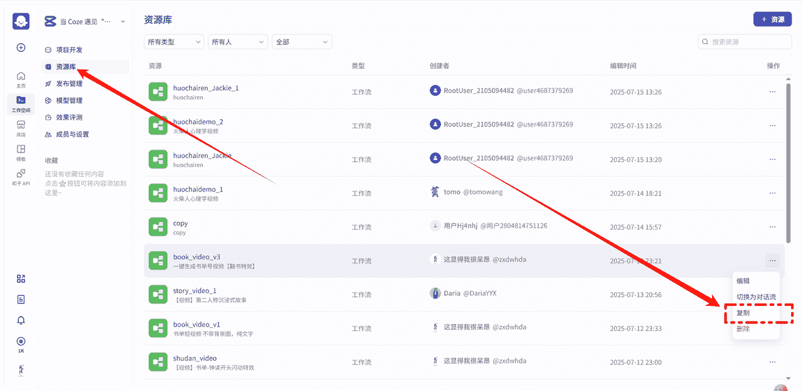
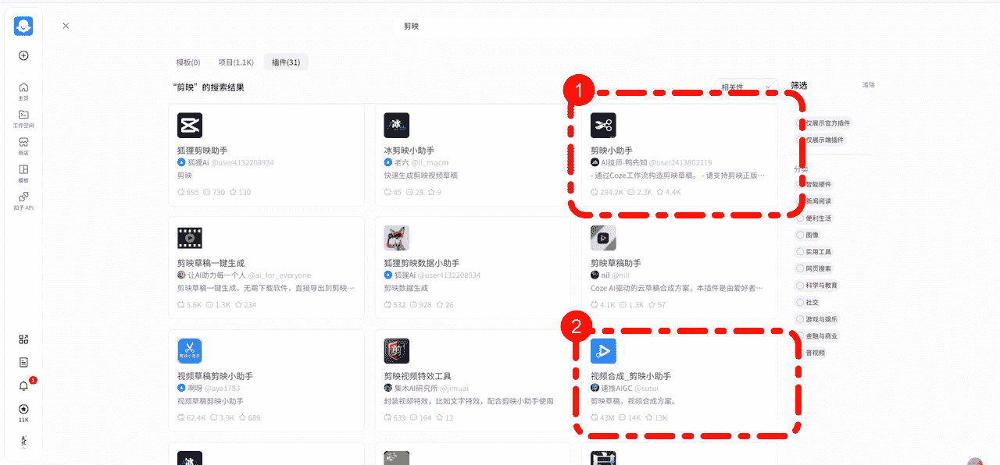
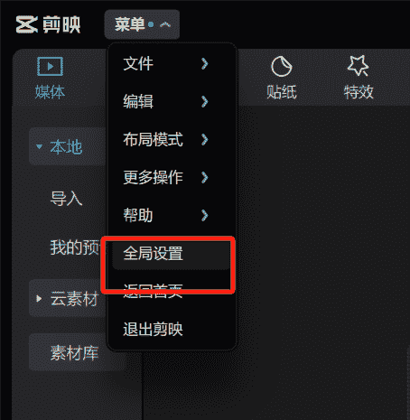
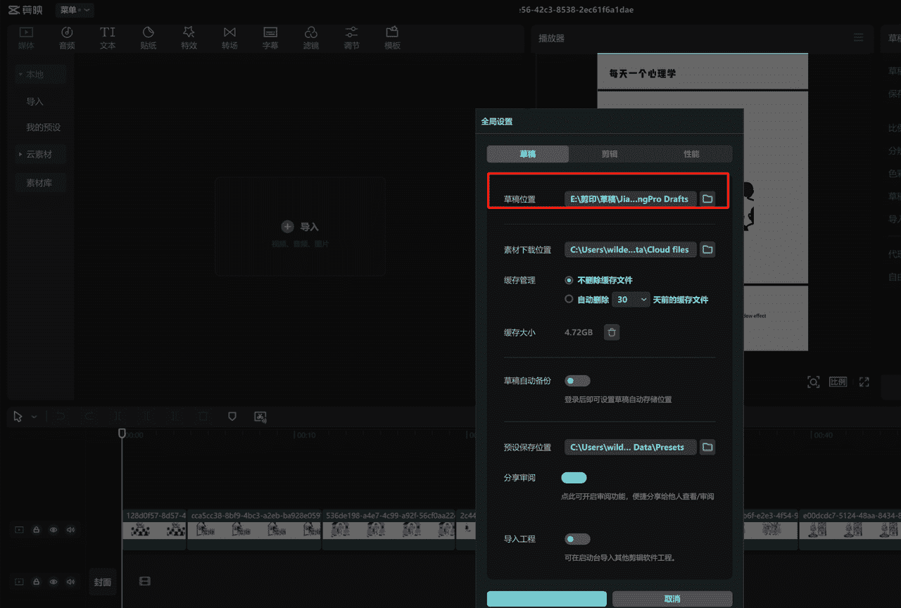
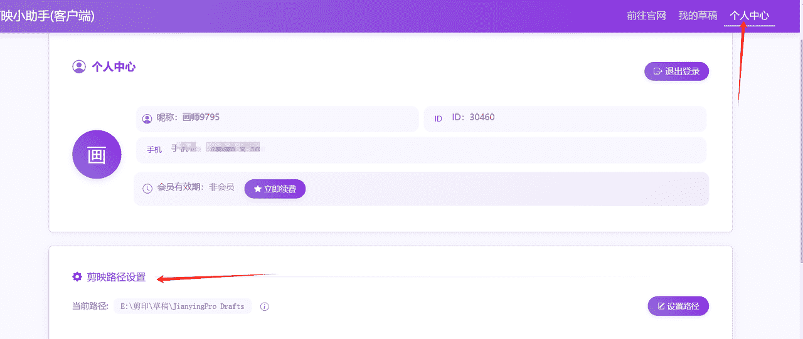

# 第 1 章 开发环境配置

> 来源：[https://v11enp9ok1h.feishu.cn/docx/MkKwd6eFPo1Nbnx2UlfcpiIZnhP](https://v11enp9ok1h.feishu.cn/docx/MkKwd6eFPo1Nbnx2UlfcpiIZnhP)

欢迎大家来到我们《当 Coze 学会了“剪映”》课程，在本章中我将带着大家学会如何复制别人编辑好的工作流、还有一些付费内容。

# 加入

## 课程空间

> 在复制 Coze 工作流前，先麻烦各位同学进一下学习空间，方便我们后续使用

目前 Coze 改版，建议大家使用官方上传功能

[当 Coze 遇见“剪映”工作流(1).zip](https://internal-api-drive-stream.feishu.cn/space/api/box/stream/download/all/Kozjb0Lg3or11bxXxDicPMCJn1e)

# 技巧

## 如何复制Coze工作流

在学习下面课程前面，请大家先把空间的工作流复制一份

【coze小技巧：如何快速高效的复制别人的工作流】 https://www.bilibili.com/video/BV1vXEiztEVK/?share_source=copy_web&vd_source=b8565baf79a7ad9d86a39a95254bcf06

## 付费插件

最近coze上线了很多联动剪映的功能后，很多琐碎的剪辑工作量就完全可以自动化处理掉了！可以省下大量时间来做项目

本次教程使用的是“速推 AIGC”的插件

本次课程充值最少的金额就可以完成学习，充值 20 元！！！不建议充多

第 3 章才需要使用付费插件，不建议提前充值

# 需要安装的软件

## 剪映

+   剪映：https://www.capcut.cn/

+   地址填到下面的剪映小助手上

## 剪映小助手

+   剪映小助手：https://ts.fyshark.com/#/cozeToJianyin

在安装好剪映小助手后，设置下下载的草稿路径和剪映的草稿路径一致后，才能自动生成。

Ps：

课程刚刚写，问题可能比较多，风格就口语化了，不使用 AI 润色～

请大家见谅，欢迎抓虫！