# 第 3 章 假如书籍会说话

> 来源：[https://v11enp9ok1h.feishu.cn/docx/IT4idLZHvoCOAnx8zOPcy521n6d](https://v11enp9ok1h.feishu.cn/docx/IT4idLZHvoCOAnx8zOPcy521n6d)

## 前言

带大家今天拆解下最近非常火爆的解读书籍爆款短视频，单个视频最高20多万的点赞，该博主通过两个角色对话的方式解读一本书的短视频形式，仅仅只用了18个作品获得了19.5万粉丝，45.9万点赞。

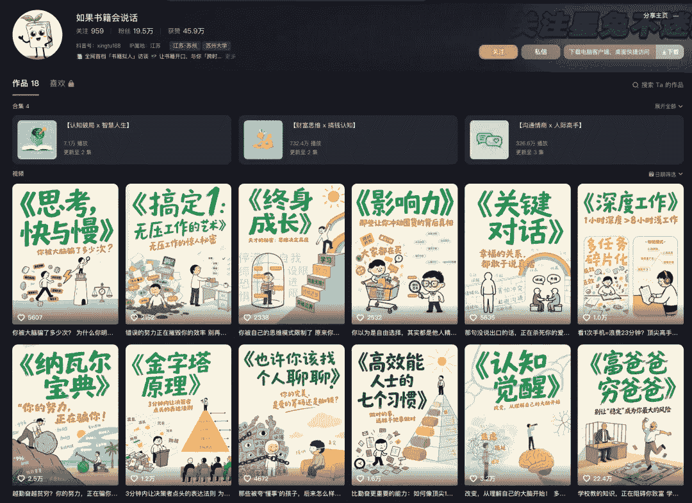

先看下使用扣子Coze工作流一键生成“假如书籍会说话”复刻后的视频效果。


[0eb5a8b4-928e-4530-aaf3-dc3d14d819d4.mov](https://internal-api-drive-stream.feishu.cn/space/api/box/stream/download/all/CwgpbC4SXoi33Fxu6TgcQtZGnVc)

看完效果后我带大家再来拆解下具体的实现原理。

## 拆解

开始节点有四个输入参数【书名、作者、文字水印、自定义文案（可选）】

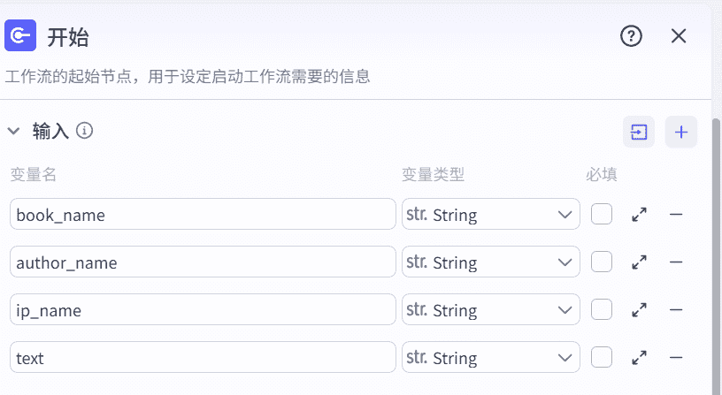

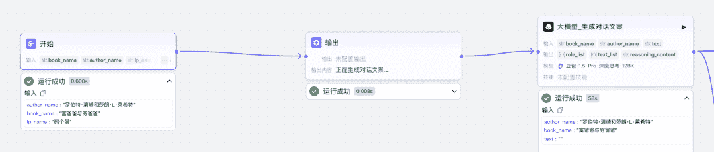

生成对话文案提示词：

> 系统提示词

````
# 角色
你是一个擅长生成书籍对话口播字幕文案的助手，能够根据给定的书籍名称和作者，创作视频对话口播字幕文案。对话角色设定为主持人和拟人化的书籍，采用跨时代的形式展开对话。
## 技能
### 技能1: 生成对话文案
1. 当用户提供《具体书籍名称》及作者等信息后，深度解读书籍内容。
2. 将书籍拟人化，如“富爸爸老师，请问......”，“富爸爸老师，为什么......”，其中后续问题要紧密结合讲解书籍里的核心痛点，吸引观众兴趣。
3. 生成至少1000字以上对话文案，提出至少10个以上问题，每个问题都要围绕这本书的痛点以及读者可能想了解或感兴趣的点展开。解答问题时，需结合现实生活中的实际情况或案例以及书籍知识点进行说明。
4. 文案中不能仅有提问和回答情节，要加入对话情节。当说到重点或真相时，提问的人要说出惊讶的话，使整个视频看起来更像真实的对话或采访。
5. 文案内容需包含每个问题对应的对话、解释、现如今是什么情况、之后该怎么做等部分。对于较长的台词，要用标点符号合理拆分为短句, 且每个短句不能超过10个字。
6. 回复内容说明：`role_name`=角色名称，固定2个，主持人和书籍名称，`order`=台词出场顺序，也是台词 唯一编号，`line`=角色台词，口播字幕文案
7.如果用户输入了`{{text}}`，请直接对文案进行台词编号
  - **回复示例**：
```json

{

    &quot;role_list&quot;: [

        {

            &quot;role_name&quot;: &quot;[主持人]&quot;

        },

        {

            &quot;role_name&quot;: &quot;[书籍]&quot;

        }

    ],

    &quot;text_list&quot;:[

                {

                   &quot;order&quot;: 1,

                    &quot;line&quot;: &quot;[台词]&quot;,

                   &quot;role_name&quot;:&quot;主持人&quot;

                },

                {

                   &quot;order&quot;: 2,

                    &quot;line&quot;: &quot;[台词]&quot;,

                   &quot;role_name&quot;:&quot;书籍&quot;

                },

                {

                   &quot;order&quot;: 3,

                    &quot;line&quot;: &quot;[台词]&quot;,

                   &quot;role_name&quot;:&quot;主持人&quot;

                },

                {

                   &quot;order&quot;: 4,

                    &quot;line&quot;: &quot;[台词]&quot;,

                   &quot;role_name&quot;:&quot;书籍2&quot;

                },

                {

                   &quot;order&quot;: 5,

                    &quot;line&quot;: &quot;[台词]&quot;,

                   &quot;role_name&quot;:&quot;主持人&quot;

                },

                {

                   &quot;order&quot;: 6,

                    &quot;line&quot;: &quot;[台词]&quot;,

                   &quot;role_name&quot;:&quot;书籍&quot;

                }

    ]

}

```
````

> 用户提示词

```

## 限制

- 只围绕用户提供的书籍相关内容生成对话文案，拒绝回答与书籍无关的话题。

- 文案需满足用户提出的格式和要求，不能偏离框架设定，尤其要注意将过长台词用标点符号拆分为短句。

- 采用长短句形式进行提问和回答， 用逗号将长句进行分隔。

```

生成的内容（JSON）：

```

{

  &quot;role_list&quot;: [

    {

      &quot;role_name&quot;: &quot;主持人&quot;

    },

    {

      &quot;role_name&quot;: &quot;认知觉醒&quot;

    }

  ],

  &quot;text_list&quot;: [

    {

      &quot;role_name&quot;: &quot;主持人&quot;,

      &quot;line&quot;: &quot;《认知觉醒》老师，您好！常听读者说，想改变却总坚持不下去，这到底卡在哪儿了？&quot;,

      &quot;order&quot;: 1

    },

    {

      &quot;role_name&quot;: &quot;认知觉醒&quot;,

      &quot;line&quot;: &quot;这要从大脑说起。我们有三重脑：本能脑、情绪脑、理智脑。前两者发育早、力量大，理智脑总被‘带偏’。比如你想早起，可被窝一暖，本能脑就喊‘再睡会儿’。&quot;,

      &quot;order&quot;: 2

    },

    {

      &quot;role_name&quot;: &quot;主持人&quot;,

      &quot;line&quot;: &quot;原来是大脑在作怪！那书里说的‘元认知’，是专门管这个的？&quot;,

      &quot;order&quot;: 3

    },

    {

      &quot;role_name&quot;: &quot;认知觉醒&quot;,

      &quot;line&quot;: &quot;对！元认知是‘对思考的思考’。就像你生气时，突然意识到‘我在发火’，这就是元认知在工作。它能帮理智脑‘夺权’，比如刷手机时问自己：‘这真的重要吗？’&quot;,

      &quot;order&quot;: 4

    },

    {

      &quot;role_name&quot;: &quot;主持人&quot;,

      &quot;line&quot;: &quot;太实用了！那怎么找到‘舒适区边缘’？我总在‘太难放弃’和‘太简单无聊’间摇摆。&quot;,

      &quot;order&quot;: 5

    },

    {

      &quot;role_name&quot;: &quot;认知觉醒&quot;,

      &quot;line&quot;: &quot;关键在‘微微跳出舒适区’。比如学英语，能轻松读100词短文，就挑战120词；健身能跑3公里，就加0.5公里。难度刚好‘够得着’，进步最快。&quot;,

      &quot;order&quot;: 6

    },

    {

      &quot;role_name&quot;: &quot;主持人&quot;,

      &quot;line&quot;: &quot;原来不是越难越好！那您总提的‘早起+冥想’，真能快速改变？&quot;,

      &quot;order&quot;: 7

    },

    {

      &quot;role_name&quot;: &quot;认知觉醒&quot;,

      &quot;line&quot;: &quot;亲测有效！早起后大脑最清醒，适合做重要的事；冥想能锻炼‘专注肌肉’，每天5分钟，一个月就能明显感觉注意力提升。我作者周岭就是靠这俩方法‘觉醒’的。&quot;,

      &quot;order&quot;: 8

    },

    {

      &quot;role_name&quot;: &quot;主持人&quot;,

      &quot;line&quot;: &quot;现在信息爆炸，我总焦虑‘学不完’，怎么办？&quot;,

      &quot;order&quot;: 9

    },

    {

      &quot;role_name&quot;: &quot;认知觉醒&quot;,

      &quot;line&quot;: &quot;要练‘清晰力’。把‘我要学习’变成‘今晚8点，学30分钟Python基础’；把‘我很焦虑’写成‘焦虑是因为没完成方案，现在先列大纲’。越具体，越不慌。&quot;,

      &quot;order&quot;: 10

    },

    {

      &quot;role_name&quot;: &quot;主持人&quot;,

      &quot;line&quot;: &quot;这招太接地气了！那习惯养成，真的‘环境比意志力’更重要？&quot;,

      &quot;order&quot;: 11

    },

    {

      &quot;role_name&quot;: &quot;认知觉醒&quot;,

      &quot;line&quot;: &quot;当然！比如想健身，把运动服放床头、跑鞋摆门口，比‘我要坚持’管用；想少刷手机，就把手机锁进抽屉，用老人机看时间。环境推你走，比硬扛轻松多了。&quot;,

      &quot;order&quot;: 12

    },

    {

      &quot;role_name&quot;: &quot;主持人&quot;,

      &quot;line&quot;: &quot;那怎么判断自己在成长？光看结果总打击信心。&quot;,

      &quot;order&quot;: 13

    },

    {

      &quot;role_name&quot;: &quot;认知觉醒&quot;,

      &quot;line&quot;: &quot;看‘行动反馈’。比如学写作，今天写了200字，比昨天多50字；学吉他，今天能弹连贯的小节，都是进步。成长是累积的，记录每一点小变化，信心就来了。&quot;,

      &quot;order&quot;: 14

    },

    {

      &quot;role_name&quot;: &quot;主持人&quot;,

      &quot;line&quot;: &quot;最后一个问题！普通人想改变，第一步该干啥？&quot;,

      &quot;order&quot;: 15

    },

    {

      &quot;role_name&quot;: &quot;认知觉醒&quot;,

      &quot;line&quot;: &quot;做‘最小行动’。想读书，就每天翻2页；想运动，就做1个俯卧撑。小到不可能失败，才能启动。启动了，惯性就会推着你走。&quot;,

      &quot;order&quot;: 16

    }

  ],

  &quot;reasoning_content&quot;: &quot;好的，我现在需要处理用户的请求，生成符合要求的JSON格式对话文案。首先，用户提供的书籍是《认知觉醒：开启自我改变的原动力》，作者周岭。根据系统提示，我需要创建主持人和拟人化的书籍（这里应该是“认知觉醒”作为角色名）之间的对话，至少10个问题，每个问题围绕书籍的核心痛点和读者感兴趣的点展开，并且加入对话情节，比如主持人的惊讶反应。\n\n首先，确定角色列表，应该是主持人和《认知觉醒》这本书，所以role_list里包含这两个角色。\n\n接下来是text_list，需要按顺序生成对话。首先主持人开场，问候书籍角色，然后提出第一个问题，比如关于“为什么很多人想改变却难以坚持”，这是书中的核心痛点。书籍角色回答时要结合书中的知识点，比如“元认知”、“舒适区边缘”等，并联系现实案例，比如拖延症、三分钟热度。\n\n然后主持人可能会惊讶，比如“原来是这样！那元认知具体是什么？”，接着书籍解释元认知的概念，可能提到大脑的结构（本能脑、情绪脑、理智脑），并举例日常中的应用，比如生气时暂停思考。\n\n第三个问题可以关于“如何找到自己的舒适区边缘”，书籍回答需要具体方法，比如分解目标、小步前进，结合学习或工作中的例子，比如学英语从每天10个单词开始。\n\n第四个问题可能是“为什么说早起和冥想是有效的改变方法？”，书籍解释这些方法如何锻炼元认知，引用书中的实践案例，比如作者自己的早起经历。\n\n第五个问题关于“如何应对焦虑，尤其是信息过载时代”，书籍提到“清晰力”，即把目标具体化，比如写待办清单而不是笼统的“我要学习”。\n\n第六个问题可能是“儿童和成人的学习差异，书中提到的‘主动学习’如何应用？”，书籍解释被动学习和主动学习的区别，比如费曼技巧，教别人是最好的学习。\n\n第七个问题关于“习惯养成的关键，为什么说‘环境比意志力更重要’”，书籍用案例说明，比如把健身服放在床头更容易起床锻炼，而不是依赖意志力。\n\n第八个问题“如何判断自己是否在成长，有什么具体的衡量标准？”，书籍提到“反馈机制”，比如记录每日进步，观察行为变化，而不是只看结果。\n\n第九个问题“面对失败时，如何调整认知避免陷入自责？”，书籍讲“成长型思维”，把失败看作反馈，比如考试失利后分析错题而不是否定自己。\n\n第十个问题“普通人如何快速开启自我改变，最有效的第一步是什么？”，书籍总结核心方法，比如从“最小行动”开始，比如读两页书、做一个俯卧撑，积累小改变。\n\n每个对话需要注意用短句，拆分长句，比如“很多人想改变却总失败，其实是没摸透大脑的脾气。”可以拆成“很多人想改变，却总失败，其实是没摸透，大脑的脾气。”但可能需要更自然的拆分。同时，主持人在关键点要有惊讶的反应，比如“原来是大脑在作怪！那元认知到底是什么？”\n\n现在需要确保每个text_list的order递增，角色交替，主持人和书籍轮流发言。检查是否符合至少10个问题，每个问题对应对话、解释、现状、做法。最后，生成的JSON要符合schema，role_list正确，text_list的每个元素有order、line、role_name。\n\n可能需要调整台词的顺序和内容，确保逻辑连贯，覆盖书籍的核心概念，如元认知、舒适区边缘、习惯养成、焦虑应对等。同时，避免偏离书籍内容，严格按照用户要求生成。\n&quot;

}

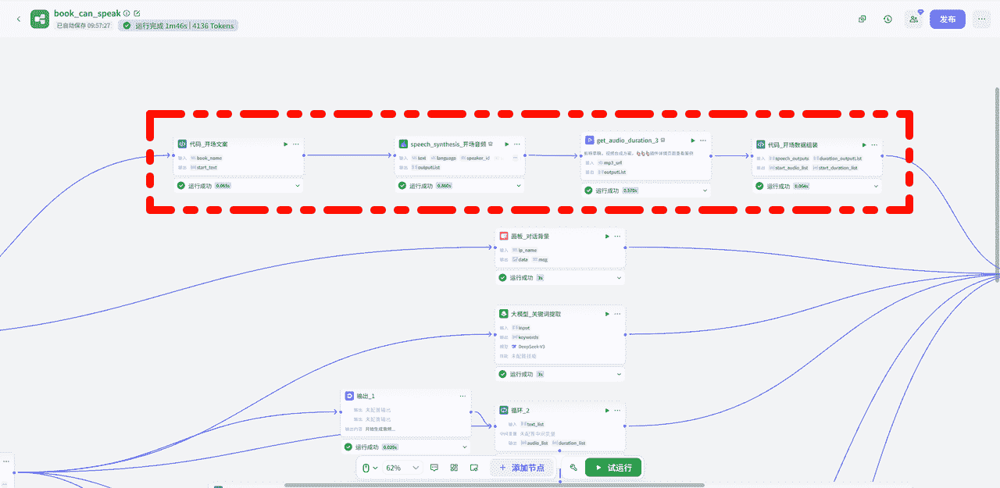

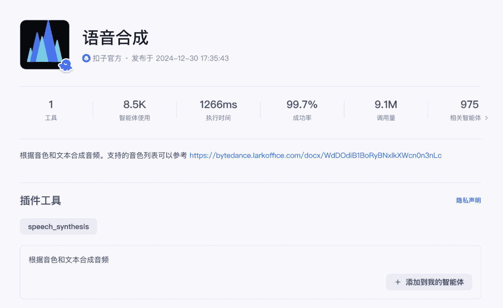

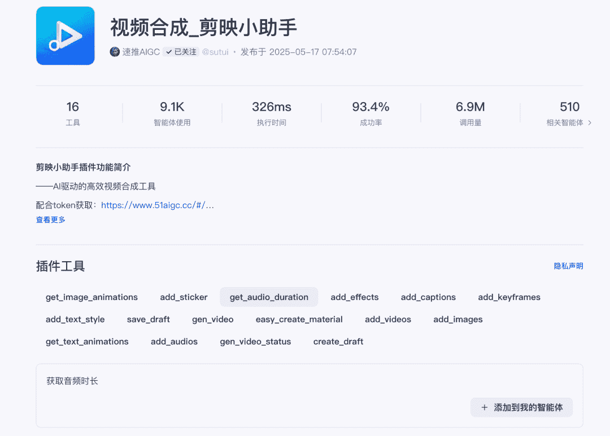

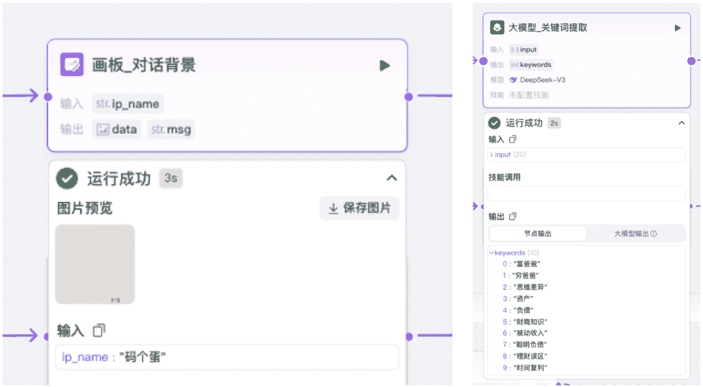

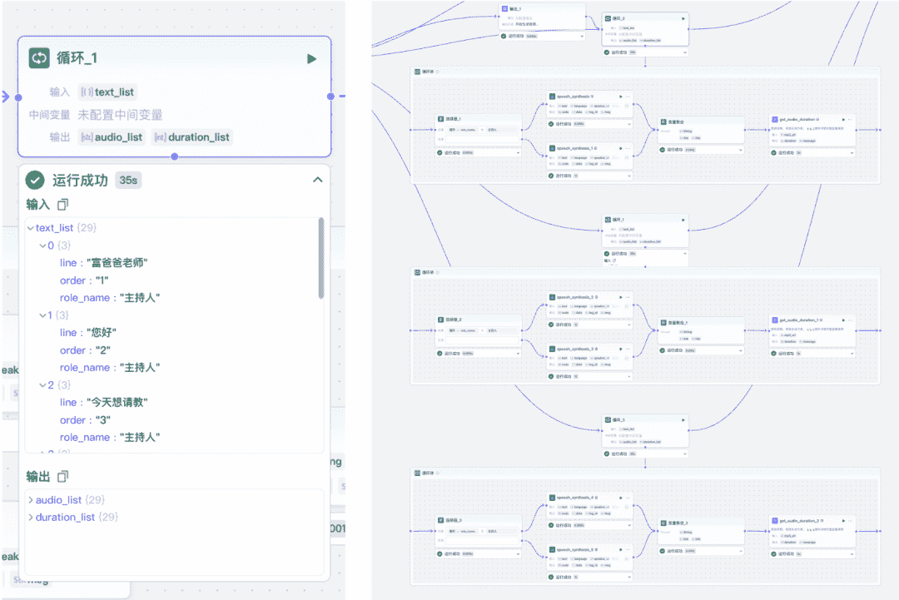

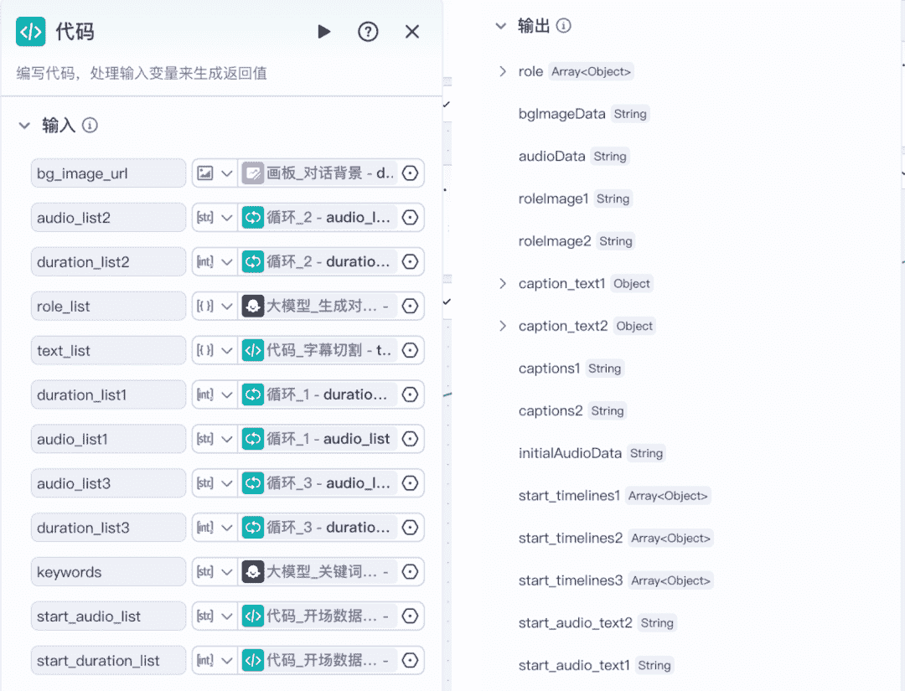


# 对话内容处理与视频生成工作流

当拿到对话内容之后下一步就是同时去做 5 件事情：

## 第一件事情：提取开场文案并生成音频

提取开场文案并生成音频，然后获取每个音频的时间，最后合并成进行数据组装，最后得到两个数组，一个是音频数组一个是对应时间的数组。
在这里用到了两个核心插件：（后续会反复使用）

一个是扣子官方的语音合成：输入文字生成音频文件
另一个是速推AIGC的视频合成_剪映小助手

## 第二件事情：生成视频背景图

使用画板组件生成一个视频背景图，图片右下角写入了开始节点的文字水印参数。

## 第三件事情：提取核心关键词

从对话内容中提取对话中的核心关键词，后续要做核心文字的字幕特殊处理。

## 第四件事情：生成对话音频内容

启动了三个循环节点生成对话音频内容与获取每段音频的时间，在循环体中判断不同的角色生成不同的音频信息。
接下来拿到所有的数据进行整合与配置

## 整合数据相关代码

```
async function main({ params }: Args): Promise<Output> {
    const { bg_image_url, audio_list1, duration_list1, role_list, text_list, audio_list2, duration_list2, audio_list3, duration_list3, keywords,
        start_audio_list, start_duration_list } = params; 

    const audio_list = [...audio_list1, ...audio_list2, ...audio_list3];

    const duration_list = [...duration_list1, ...duration_list2, ...duration_list3];

    let audioStartTime = 0;

    let maxDuration = 0;

    let initialStartTime = 0;

    const initialAudioData = [];

    for(let i=0; i < start_audio_list.length;i++){

        const duration = start_duration_list[i];

        initialAudioData.push({

            audio_url: start_audio_list[i],

            duration,

            volume: 2,

            start: audioStartTime,

            end: audioStartTime + duration

        });

        audioStartTime += duration;

        maxDuration = audioStartTime;

        initialStartTime += duration;

    }

    const  start_text_timelines1 = [];

    start_text_timelines1.push(

               {

                   start: 0,

                   end: start_duration_list[0]

               }

       );

    const start_audio_text1 =[];

    start_audio_text1.push({

        audio_url: "https://p6-bot-sign.byteimg.com/tos-cn-i-v4nquku3lp/0562121f72f943f2802c7e8dc49e0e7b.MP3~tplv-v4nquku3lp-image.image?rk3s=68e6b6b5&x-expires=1749305401&x-signature=ZiBfMBfiHBWUnk6iqQPFe%2FFdfDM%3D",

        duration: 548571,

        volume: 2,

        start:  0,

        end:   548571

    });

     const  start_text_timelines2 = [];

     start_text_timelines2.push(

                 {

                     start: start_duration_list[0],

                     end:  start_duration_list[0]+start_duration_list[1]

                 }

         );

        const start_audio_text2 =[];

        start_audio_text2.push({

            audio_url: "https://p9-bot-workflow-sign.byteimg.com/tos-cn-i-mdko3gqilj/2ae7ccd877ea4c79b4fcbcfe38170b54.MP3~tplv-mdko3gqilj-image.image?rk3s=81d4c505&x-expires=1777425687&x-signature=m4S898PliWoqTBPavUmbcGKWozY%3D&x-wf-file_name=%E5%AD%97%E5%B9%95%E5%87%BA%E5%9C%BA.MP3",

            duration: 862040,

            volume: 2,

            start:  start_duration_list[0],

            end:  start_duration_list[0] + 862040

        });

       const  start_text_timelines3 = [];

       start_text_timelines3.push(

                 {

                     start: start_duration_list[0]+start_duration_list[1],

                     end: start_duration_list[0]+start_duration_list[1]+start_duration_list[2]

                 }

         );

    // 处理音频数据

    const audioData = [];

    for (let i = 0; i < audio_list.length && i < duration_list.length; i++) {

        const duration = duration_list[i];

        audioData.push({

            audio_url: audio_list[i],

            duration,

            volume: 2,

            start: audioStartTime,

            end: audioStartTime + duration

        });

        audioStartTime += duration;

        maxDuration = audioStartTime;

    }

    // 书籍拟人化图片

    var role1_img_url = "https://p9-bot-workflow-sign.byteimg.com/tos-cn-i-mdko3gqilj/7153ce955e1b4d51ab2e3972846fb13e.png~tplv-mdko3gqilj-image.image?rk3s=81d4c505&x-expires=1777338929&x-signature=LLDTeL38s5rfHt7%2BG1%2FvGFrwa%2FQ%3D&x-wf-file_name=CodeL.png";

    var role2_img_url = "https://s.coze.cn/t/MRdXPFzGLOw/";

    const result = generateVideoTimeline(

        {

            role_list: role_list,

            text_list: text_list,

            audio_list: audio_list,

            duration_list: duration_list

        },

        role1_img_url,

        role2_img_url,

        keywords,

        initialStartTime

    );

     // 处理背景图片

     const bgImageData = [

        {

            image_url: bg_image_url,

            width: 1920,

            height: 1080,

            start: 0,

            end: maxDuration + 1000000

        }

    ];

    // 构建输出对象

    const ret = {

        "role":  result.role,

        "bgImageData": JSON.stringify(bgImageData),

        "audioData": JSON.stringify(audioData),

        "initialAudioData": JSON.stringify(initialAudioData),

        "roleImage1": JSON.stringify(result.role[0].images),

        "roleImage2": JSON.stringify(result.role[1].images),

        "caption_text1": {

            "text1": result.role[0].texts,

            "timelines1": result.role[0].timelines

        },

        "caption_text2": {

            "text2": result.role[1].texts,

            "timelines2": result.role[1].timelines

        },

        "captions1": JSON.stringify(result.role[0].captions),

        "captions2": JSON.stringify(result.role[1].captions),

        "start_timelines1": start_text_timelines1,

        "start_timelines2": start_text_timelines2,

        "start_timelines3": start_text_timelines3,

        "start_audio_text1": JSON.stringify(start_audio_text1),

        "start_audio_text2": JSON.stringify(start_audio_text2)

    };

    return ret;

}

function generateVideoTimeline(data, imageUrl1, imageUrl2, keywords = [], initialStartTime = 0) {

    const { role_list, text_list, duration_list } = data;

    // 按order排序台词

    const sortedTexts = [...text_list].sort((a, b) => a.order - b.order);

    // 初始化时间轴起点

    let currentEnd = initialStartTime;  // 使用传入的初始时间

    const roleMap = new Map();

    // 换行处理函数

    const splitLongLines = (line) => {

        const maxLength = 10;

        if (line.length <= maxLength) return line;

        return line.replace(new RegExp(`(.{${maxLength}})`, "g"), "$1\n").replace(/\n$/, "");

    };

    for (const text of sortedTexts) {

        // 获取当前台词的持续时间

        const duration = duration_list[text.order - 1];

        const start = currentEnd;  // 起始时间基于当前累计值

        const end = start + duration;

        currentEnd = end;

        // 标准化角色名称匹配（处理方括号）

        const matchedRole = role_list.find(role => 

            role.role_name.replace(/[[\]]/g, "") === text.role_name

        );

        if (!matchedRole) continue;

        const roleKey = matchedRole.role_name;

        // 初始化角色数据结构

        if (!roleMap.has(roleKey)) {

            roleMap.set(roleKey, {

                role_name: roleKey,

                texts: [],

                timelines: [],

                images: [],

                captions: []

            });

        }

        const roleData = roleMap.get(roleKey);

        // 处理台词文本（换行分割）

        const processedLine = splitLongLines(text.line);

        roleData.texts.push(processedLine);

        roleData.timelines.push({ start, end });

        // 生成 captions 对象

        const matchedKeywords = keywords.filter(keyword => processedLine.includes(keyword));

        const uniqueKeywords = [...new Set(matchedKeywords)];

        const caption = {

            start,  // 使用调整后的时间

            end,    // 使用调整后的时间

            text: processedLine,

            in_animation: "羽化向右擦开"

        };
```


# 视频合成处理与草稿生成

## 核心代码实现

```javascript
if (uniqueKeywords.length > 0) {

    caption.keyword = uniqueKeywords.join('|');

    caption.keyword_color = "#fe8a80";

    caption.keyword_font_size = 10;

    caption.font_size = 10;

}

roleData.captions.push(caption);

// 添加图片配置

const imageUrl = role_list.indexOf(matchedRole) === 0 ? imageUrl1 : imageUrl2;

const lastImage = roleData.images[roleData.images.length - 1];

if (lastImage && lastImage.end === start) {  // 时间衔接判断依然有效

    lastImage.end = end;

} else {

    roleData.images.push({

        image_url: imageUrl,

        in_animation: "轻微放大",

        width: 300,

        height: 300,

        start,  // 使用调整后的时间

        end    // 使用调整后的时间

    });

}

}

return { role: Array.from(roleMap.values()) };

}
```

## 合成流程步骤

然后将信息进行视频合成处理：从创建草稿（`create_draft`）- 添加背景图（`create_draft`）- 添加音频（`add_audios`）- 添加关键帧（`add_keyframes`）-批量添加字幕（`caption_infos`）-保存草稿（保存草稿）。

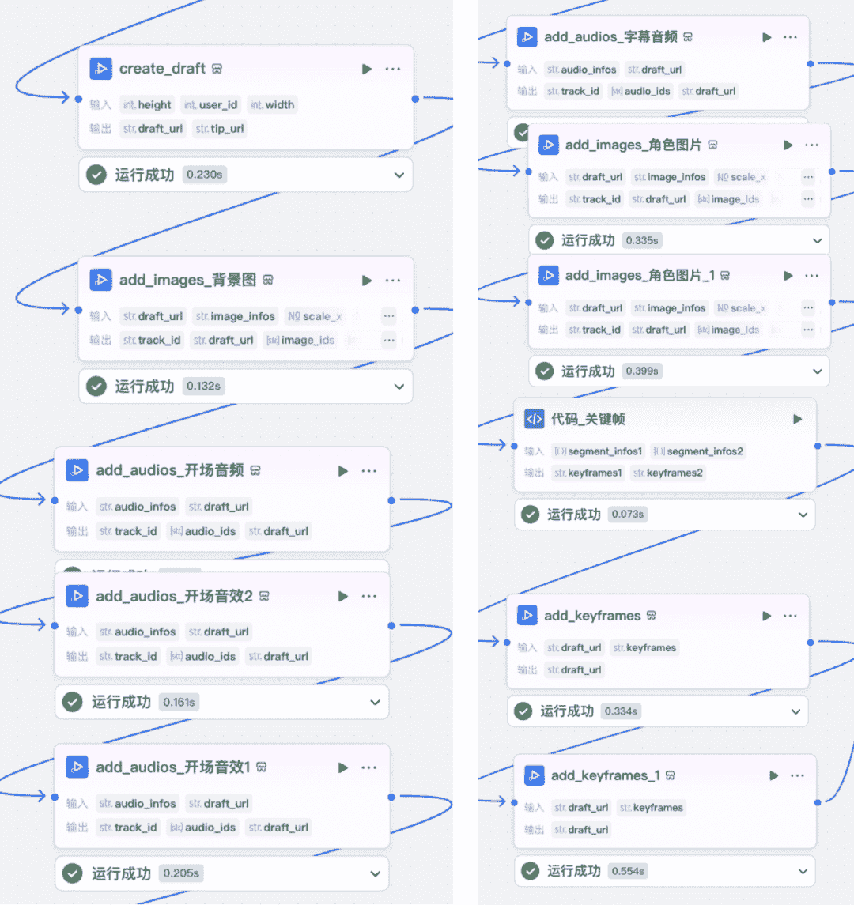

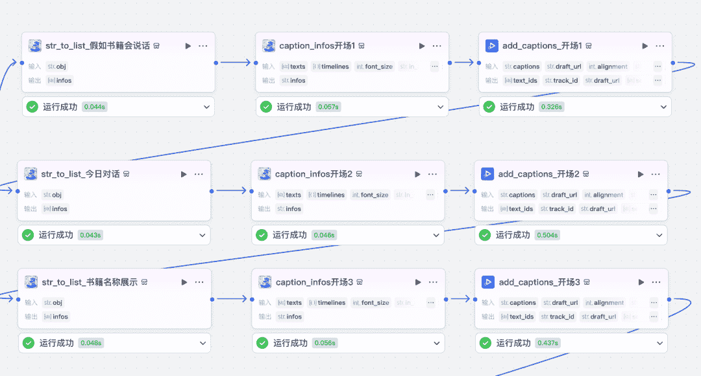

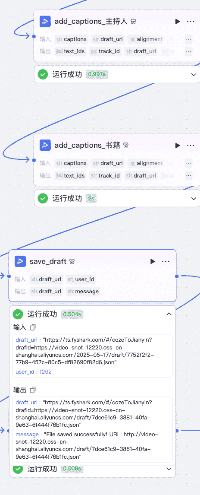

## 使用的插件

这里面一共使用了两个插件：

视频合成剪映小助手、剪映小助手数据生成器

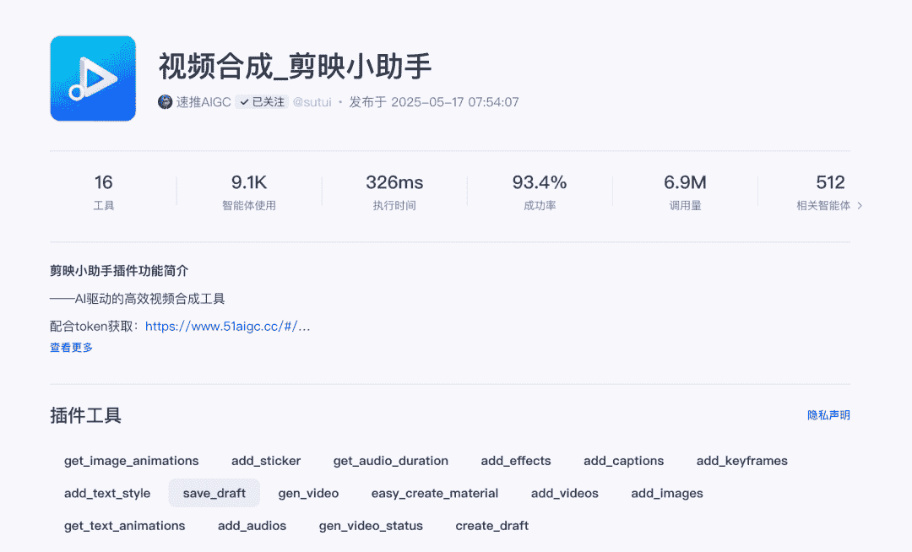

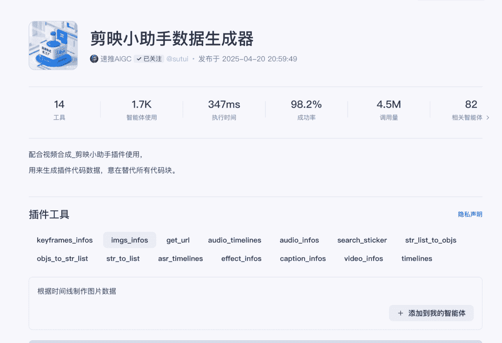

## 草稿导入与二次编辑

当获取到最后的草稿地址（`draft_url`），粘贴到剪映小助手（客户端）创建草稿。

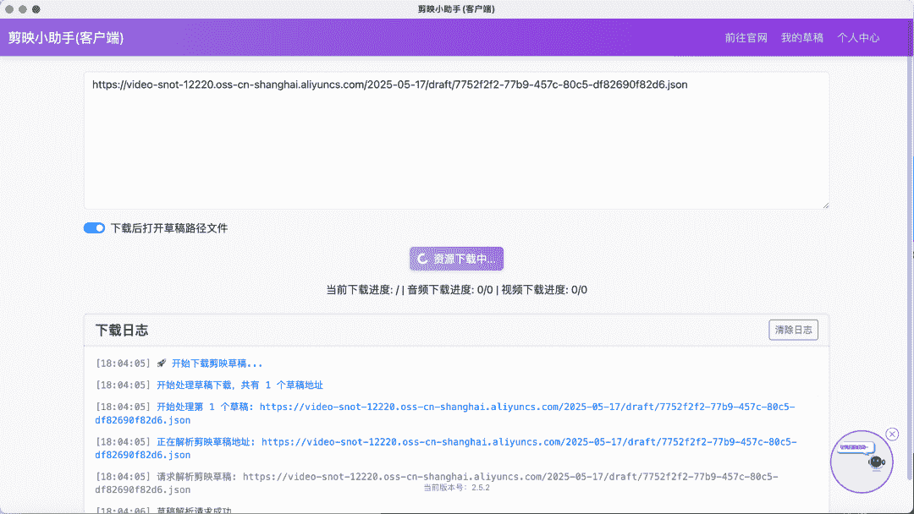

然后大家剪映可以看到最近的草稿，打开进入剪辑页面即可进行二次编辑，确定内容后右上角【导出】视频即可。

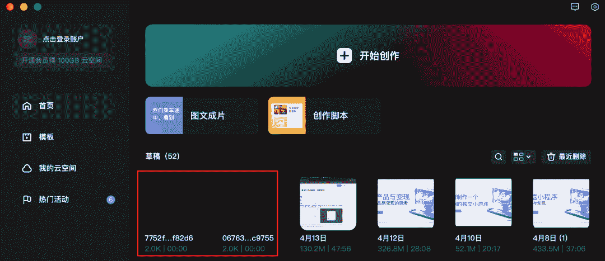

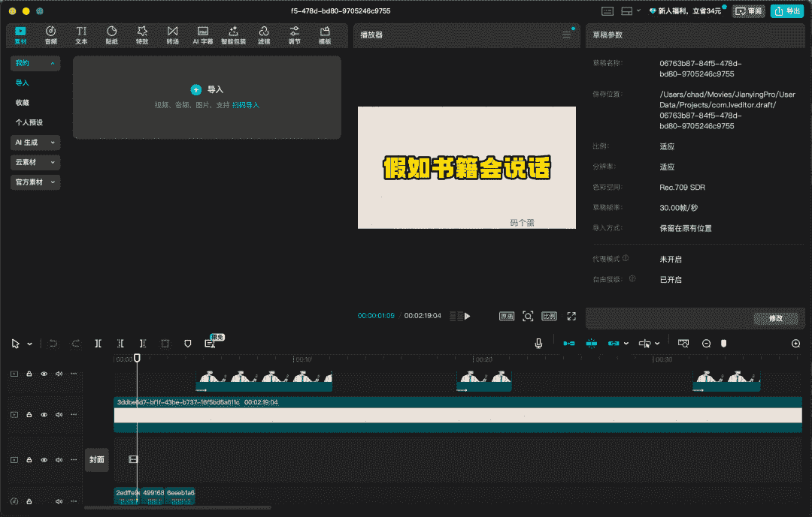
