# 第 4 章 coze智能体：AI自动化视频

> 来源：[https://v11enp9ok1h.feishu.cn/docx/TQW6dCkieopX4cx14eIcf9ovnde](https://v11enp9ok1h.feishu.cn/docx/TQW6dCkieopX4cx14eIcf9ovnde)

## 工作流思路

只需要输入书名，就可以通过扣子一键生成书单视频，大家可以先看一下效果：


[AI自动化.mp4](https://internal-api-drive-stream.feishu.cn/space/api/box/stream/download/all/LU🐧bgTMioEOyMx1re0cfbITn5g)

工作流整体实现思路是：

+ 通过书名获取作者、封面图等信息

+ 大模型输出视频文案

+ 大模型生成文生图的提示词

+ 生成视频背景图

+ 对文案配音

+ 整理数据格式

+ 生成剪映草稿文件

+ 使用第三方工具下载素材和剪映草稿文件

+ 云端下载/剪映导出

工作流全貌：

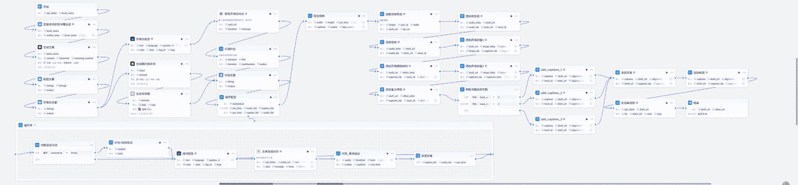

## 具体步骤

### （1）开始节点

有两个输入项：

`book_name`：书籍名称，会在豆瓣读书根据书籍名称自动搜索作者、书籍封面等信息；

`api_token`：剪映小助手的 `api_token`，可以在 `https://www.51aigc.cc/#/home?user_id=255128` 的「个人中心」查找到，类似于：`c7d6bb51-cxx4-4c91-xxx-060c8165xxxx`


`api_token` 获取：


### （2）查询豆瓣读书相关信息

添加节点，选择插件，搜索“豆瓣”，找到图片中的插件添加。


插件输入项：

+ `book_name`：书籍名称，选择开始节点的 `book_name` 即可，会返回书籍作者、书籍封面等信息。


### （3）大模型生成文案和关键词


大模型设置：

+ 大模型我们选择：豆包 1.5pro-深度思考

+ 输入项 `book_name`：还是选择开始节点的 `book_name` 即可


+ 系统提示词参考如下

```
# 角色：
你是一名经验丰富的书评人，擅长用简洁明了的语言传达读书笔记。

# 任务：
- 请使用第三人称视角，用口语化的语言，分享用户提供书籍的三个核心观点，每个观点都需要至少引用一句书籍中的金句，每个观点不少于 500 字，最后加一个总结，并引导用户购买。
- 提取本书中的关键词，每个关键词 2 至 4 个字，使用数组形式输出

# 限制
- 不要使用“第一个观点”、“第二个观点”、“书中有一句话”这样生硬的表达
- 开篇直切主题，不要做过多铺垫

# 输出格式
{
"content": "$书评内容$",
"keywords":["kw":"$关键词$"]
}
```

+ 用户提示词设置为：书籍名称：《{{`book_name`}}》

+ 注意配置输出项为 `json` 格式

+ `content` 类型选择 String，这就是大模型生成的视频文案内容，供后边配音使用

+ `keywords` 类型选择 Array，这是大模型生成的关键词列表，主要用于视频字幕飘红使用

+ 设置元素名为 `kw`，类型选择 String


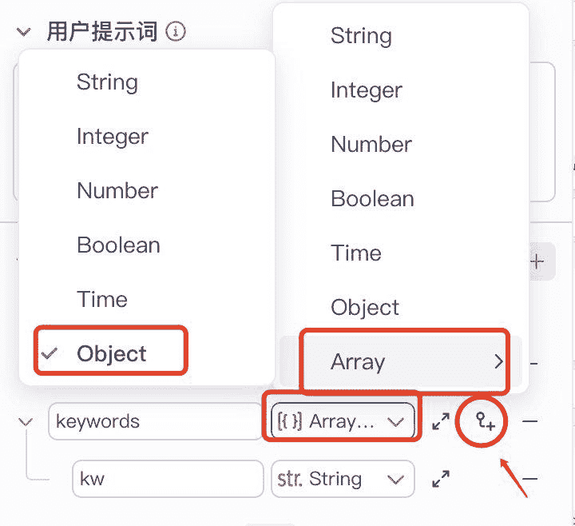

### （4）标题文案

+ 文本处理节点，选择「字符串拼接」

+ 输入项：

+ `String1` 选择开始节点的 `book_name`

+ `String2` 选择第二步豆瓣插件输出的 `authors`

+ 拼接为《{{`String1`}}》|{{`String2[0]`}}，这里注意 `String2` 是个列表，所以我们使用 `String2[0]`表示只提取第一个作者信息即可，最终输出示例：《活着》|余华


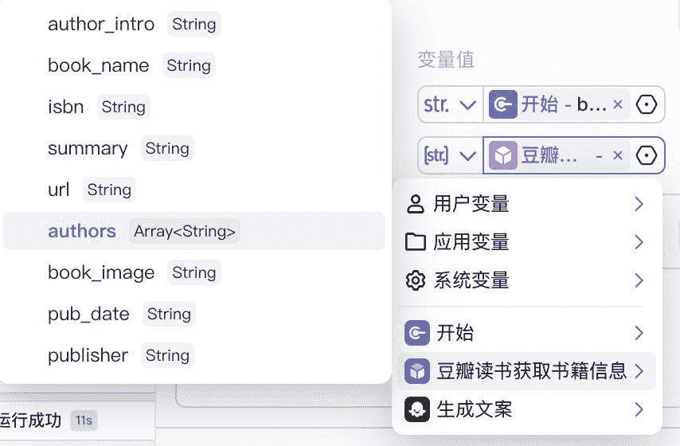

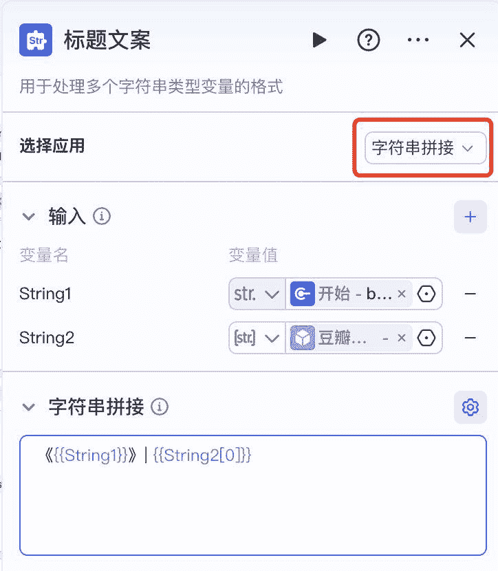

### （5）开场白文案

+ 同样的方式拼接开场白，也就是视频的第一句话

+ 输入项选择开始节点的 `book_name`


### （6）开场白配音

+ 选择插件：语音合成


+ 输入项：

+ `text`：需要配音的内容，选择第 5 步生成的开场白文案

+ `speed_ratio`：语速，选填

+ `voice_id`：选择擎苍


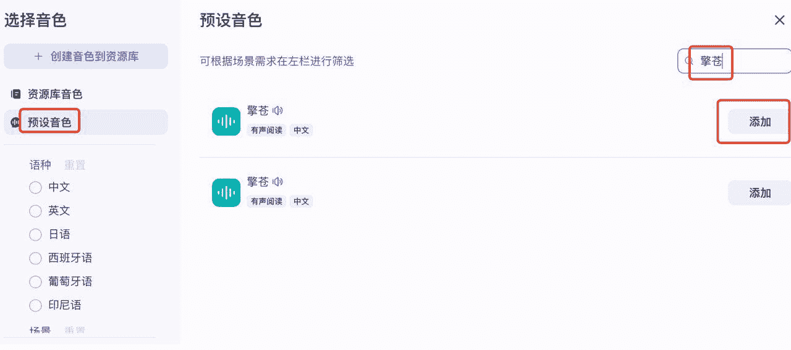

### （7）生成图片提示词

+ 选择大模型节点，生成用于生成图片的提示词

+ 模型选择豆包 1.5-pro，输入项选择开始节点的 `book_name`


+ 系统提示词和输出项设置如下，无需设置用户提示词

```
帮我生成一段关于书籍《{{input}}》的一幅插图画面描述，符合书籍内容风格，具有艺术风格。
画面中避免出现亮色、红色。

输出画面描述提示词，符合 Midjourney 风格。
```

+ 这里注意「开场白文案」之后，为了节约工作流时间，设置了两个并行分支「开场白配音」、「生成图片提示词」，结构如下，连线的时候注意。


### （8）生成背景图

+ 添加节点，选择「图像生成」


+ 配置项如下


+ 输入项选择第 7 步生成的生图提示词，正向提示词输入{{`prompt`}}

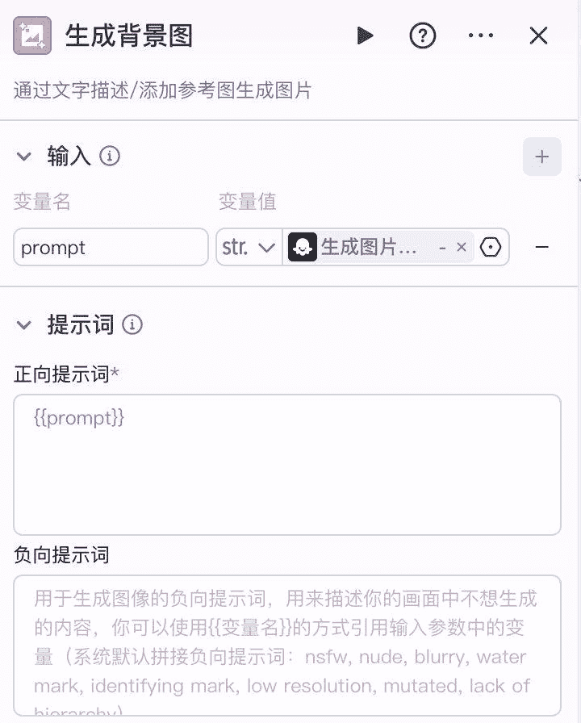

### （9）获取开场白时长

添加插件搜索「时长」


输入项：第 6 步生成的开场白配音


### （10）计算时长

使用代码节点组装开场白的数据，并计算下一段音频的时长。先添加代码节点：


> 工作流中会多处用到计算时长的功能，主要是为了生成带时间轴的字幕使用。

输入项：

+ `duration`：第 9 步输出项中的时长

+ `link`：第 6 步生成的音频 url

输出项：

+ `duration`：变量类型 Array：转换的开场白时长数据，输入项中 `duration` 单位是秒，为了方便剪映草稿使用，需要转换为微秒，需要乘以 1000000

+ `nextDuration`：变量类型 int，开场白后一条音频的开始时间

+ `audios`：变量类型 int，组装好的固定格式的开场白数据，供后续生成剪映草稿使用

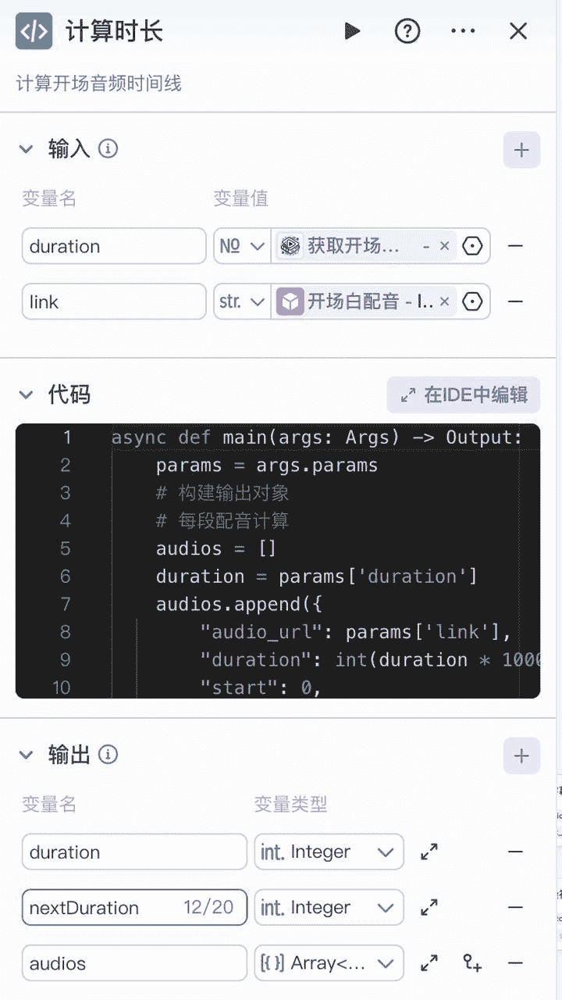

代码注意左上角选择「Python」然后复制如下代码：

```
async def main(args: Args) -> Output:
    params = args.params
    # 构建输出对象
    # 每段配音计算
    audios = []
    duration = params['duration']
    audios.append({
        "audio_url": params['link'],
        "duration": int(duration * 1000000),
        "start": 0,
        "end": int(duration * 1000000),
    })
    # 增加 1s 的间隔时间
    ret: Output = {
        "audios": audios,
        "duration": int(duration*1000000),
        "nextDuration": int(duration*1000000) + 1000000,
    }
    return ret
```

### （11）分割文案

对大模型生成的视频文案进行分割，方便后续循环生成字幕和配音。

+ 选择「文本处理」节点


+ 右上角选择「文本分割」，输入项选择第 3 步生成的文案 `content`，分隔符选择句号。


### （12）循环配音

+ 添加循环节点

+ 设置输入项：

+ 循环类型选择：使用数组循环

+ `contentList`：选择第 11 步分割的文案 `output`

+ 设置中间变量 `pre_time`：开始的时间，选择第 10 步的 `nextDuration`

+ `audio_list`：音频列表，选择第 10 步的 `audio`

+ `caption_list`：字幕列表，设置为`[]`，也就是空列表的意思


+ 编写循环体


+ 添加「选择器」节点


+ 设置条件分支：选择「循环」中的 `contentList` 的元素 `item`，选择「不为空」。这里主要是为了过滤空的字幕，否则程序报错。

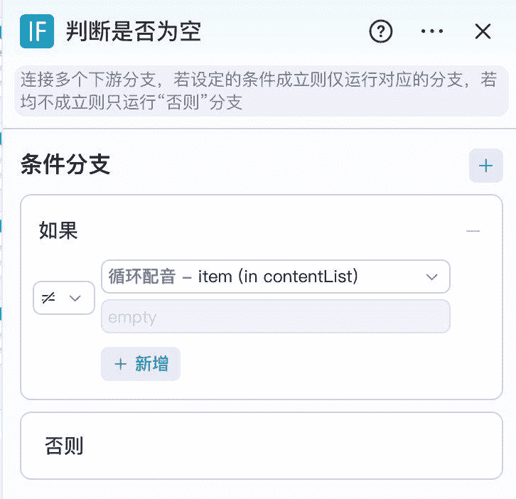

+ 添加代码节点：

+ 输入项 `content`：选择「循环」中的 `contentList` 的元素 `item`

+ 输出项 `texts`：类型 string，

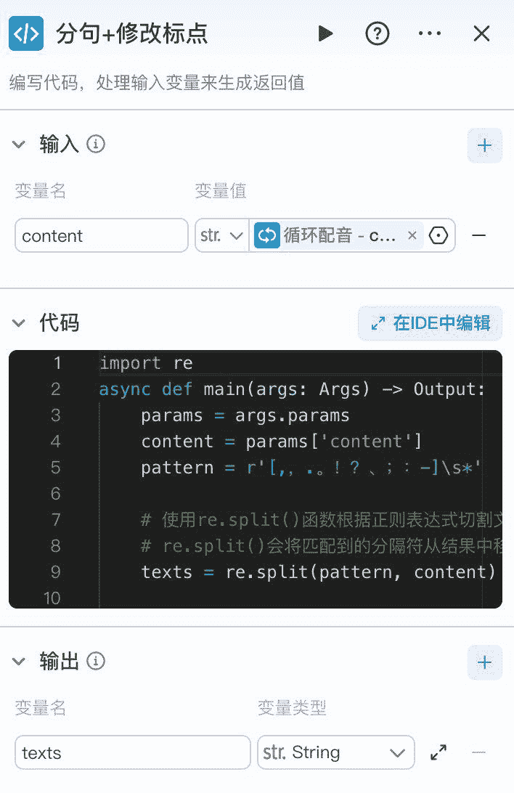

左上角选择「Python」，复制如下代码：

```
import re
async def main(args: Args) -> Output:
    params = args.params
    content = params['content']
    pattern = r'[,，     .. ! ? 、; ：-]\s*'

    # 使用 re.split() 函数根据正则表达式切割文本
    # re.split() 会将匹配到的分隔符从结果中移除
    texts = re.split(pattern, content)

    # 移除数组中可能存在的空字符串元素
    texts = [t for t in texts if t]
    
    # 处理文本片段：
    # 1。 去除所有英文/中文的单引号或者双引号
    # 2。 将——改为中文逗号
    processed_texts = []
    for text in texts:
        # 去除英文/中文的单引号或者双引号
        text = re.sub(r'[\'""\']', '', text)
        # 将——改为中文逗号
        text = text.replace('——', '，')
        processed_texts.append(text)
    
    # 构建输出对象
    ret: Output = {
        "texts": "\n".join(processed_texts)
    }
    return ret
```

+ 这步主要是去除视频文案中的标点符号+分句，使后续在视频中添加字幕更美观

+ 选择「语音合成」节点，对视频文案进行配音


+ 输入项 `text`：选择「循环」中的 `contentList` 的元素 `item`。

+ `speed_ratio`：语速，我们设置为 1.3

+ `voice_id`：还是选择「擎苍」

+ 搜索添加「字幕音频对齐」节点，主要用于音频和字幕对齐，也就是播放相应音频的时候，出现对应字幕


> 插件收取少量费用，可以试用 1 次。充值请访问 `https://www.51aigc.cc/#/home?user_id=255128`

> 最低充值额就可以，可以用很久。

+ 输入项 `api_token`：选择开始节点的 `api_token`

+ `audio_url`：选择循环体中上一步语音合成的 `link`

+ `text`：选择循环体中上上步代码节点输出的 `texts`


+ 添加「代码节点」组合素材，供下一步使用。主要是对生成的内容，处理为规定的格式。

+ 输入项 `audio`：选择循环体中的语音合成 `link`

+ `timelines`：选择循环体中上一步音频字幕对齐的 `timelins`

+ `texts`：选择循环体中上一步音频字幕对齐的 `texts`

+ `pre_time`：选择循环节点的 `pre_time`

+ `audio_list`：选择循环节点的 `audio_list`

+ `caption_list`：选择循环节点的 `caption_list`

+ `width`/`height`：设置为 1920X1080（横屏），这是设置视频的尺寸

+ `duration`：选择循环体中上一步音频字幕对齐的 `duration`

+ `keywords`：选择第 3 步大模型生成的 `keywords`

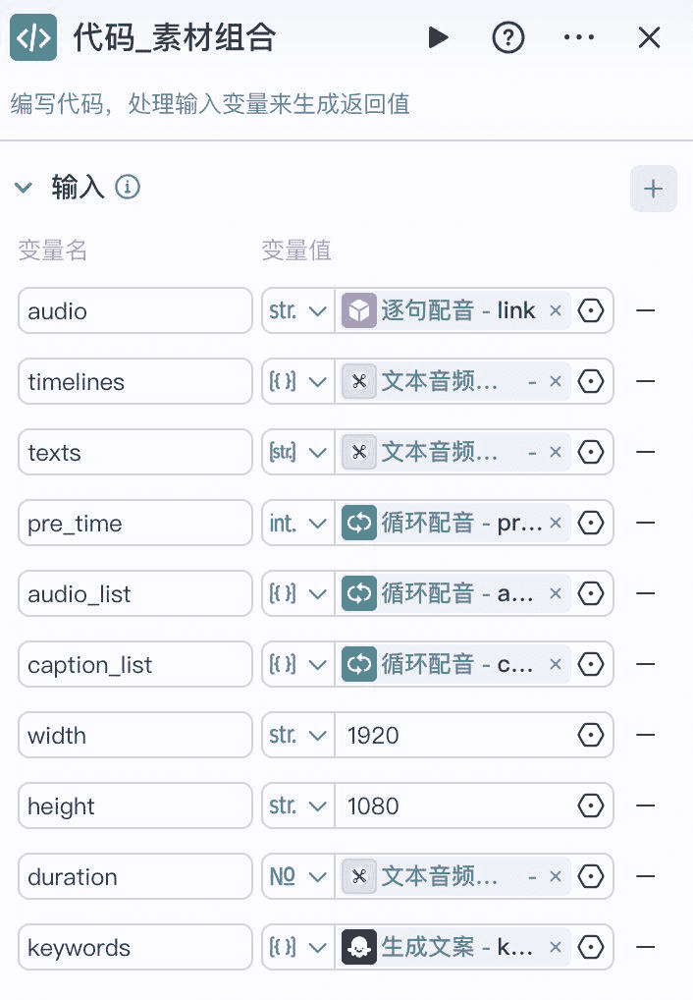

+ 左上角选择「Python」，复制如下代码：


# 代码实现与节点配置

```python
import json
async def main(args: Args) -> Output:
    params = args.params
    # 固定参数
    # bgm = params.get('bgm', "https://ve-template-0920.oss-cn-shanghAI.aliyuncs.com/uploads/1747213706549_bzwh21eozgv.mp3"),
    cover_image = params['pic']
    bg_image = params['bg_pic']
    audio_duration = params['audio_duration']
    toptitle = params['toptitle']
    width = params['width']
    height = params['height']

    pre_time = params['pre_time']

    imgs1 = []
    imgs2 = []
    title_captions = []
    bgm_audios = []

    title_captions.append({
        'text': params['title'],
        'start': audio_duration+1000000,
        'end': pre_time,
        "in_animation": "缩小",
        "in_animation_duration": 2000000
    })
    topcaptions = []
    topcaptions.append({
        'text': toptitle,
        'start': audio_duration+1000000,
        'end': pre_time,
        "in_animation": "渐显",
        "in_animation_duration": 1000000
    })

    # 获取已有字幕音频
    audios = params['audio_list']

    # =================
    # 翻书声音
    bgm_audios.append({
        "audio_url": "https://houht.oss-cn-shanghAI.aliyuncs.com/public/booklist/book.MP3",
        "duration": 2000000,
        "start": 0,
        "end": 2000000
    })
    # 背景音乐时间线
    bgm_audios.append({
        "audio_url": "https://ve-template-0920.oss-cn-shanghAI.aliyuncs.com/uploads/1747213706549_bzwh21eozgv.mp3",
        "duration": pre_time-2000000,
        "start": 2000000,
        "end": pre_time,
        "volume": 0.7
    })
    # =================

    # 开场封面 1 2 秒  添加特效 模糊，2 秒 audio_duration
    # 结束时间：在翻书转场特效之后 0.5 秒
    imgs1.append({
            "image_url": cover_image,
            "width": 768,
            "height": 1024,
            "start": 0,
            "end": audio_duration+1000000+500000,
            "transition": "中心切开",
            "transition_duration": 1000000
        })
    # 开场封面 2 翻书动画 2 秒  audio_duration
    imgs2.append({
            "image_url": cover_image,
            "width": 768,
            "height": 1024,
            "start": 0,
            "end": audio_duration+1000000,
            "in_animation": "翻书",
            "in_animation_duration": audio_duration,
            "transition": "中心切开",
            "transition_duration": 1000000
        })
    # 背景图，第二个分镜图
    # imgs1.append({
    #         "image_url": bg_image,
    #         "width": width,
    #         "height": height,
    #         "start": audio_duration+1000000,
    #         "end": pre_time
    #     })
    imgs2.append({
            "image_url": bg_image,
            "width": width,
            "height": height,
            "start": audio_duration+1000000,
            "end": pre_time
        })

    effects = []
    effects.append({
        "effect_title": "模糊",
        "end": audio_duration+1000000,
        "start": 0
    })

    effects2 = []
    effects2.append({
        "effect_title": "星火",
        "end": pre_time,
        "start": audio_duration+1000000
    })
    # 构建输出对象
    ret = {
        "captions": json.dumps(params['caption_list']),
        "audios": json.dumps(audios),
        "bgm_audios": json.dumps(bgm_audios),
        "imgs1": json.dumps(imgs1),
        "imgs2": json.dumps(imgs2),
        "effects": json.dumps(effects),
        "effects2": json.dumps(effects2),
        "titleCaptions": json.dumps(title_captions),
        "topcaptions": json.dumps(topcaptions)
    }

    return ret
```

+ 设置输出项：`audios`：音频，类型 `Array`

+ `captions`：字幕，类型 `Array`

+ `end_time`：视频结束时长，类型 `int`

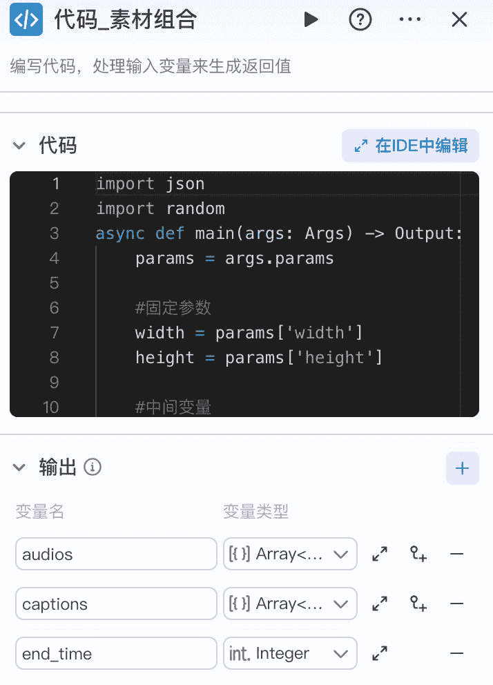

+ 添加「设置变量」节点，保存中间变量


+ 设置中间变量：

+ 循环节点 `caption_list`——>循环体中上一步代码节点的 `captions`

+ 循环节点 `audio_list`——>循环体中上一步代码节点的 `audios`

+ 循环节点 `pre_time`——>循环体中上一步代码节点的 `end_time`

+ 设置「循环」节点的输出项：

+ 点击「循环」节点

+ 设置输出项：`pre_time/caption_list/audio_list` 分别选择「循环」节点的对应项目

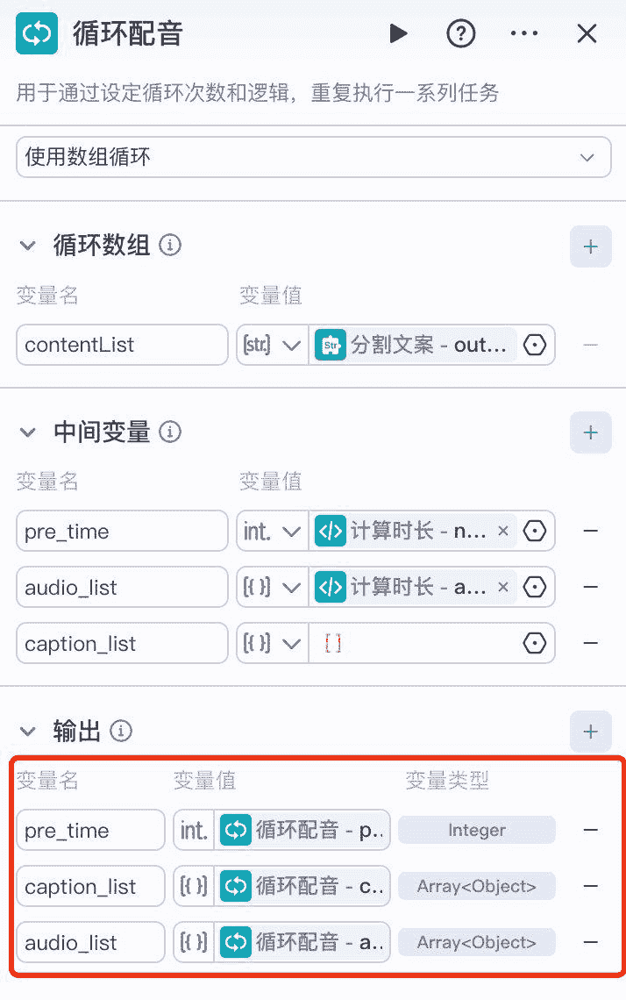

+ 这里注意循环体需要首尾的连线，一定要记得连上

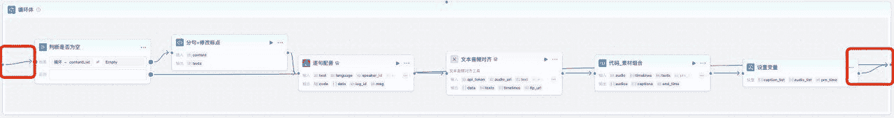

## （13）组合结构

+ 添加「代码」节点，主要是格式化之前所有数据，为后边创建剪映草稿箱做准备。有编程经验的童鞋可以看一下官方的文档，调整对应项目：剪映小助手使用说明

+ 输入项：

+ `width`、`height`：1920*1080（横屏）

+ `pre_time`：循环节点 `pre_time`

+ `caption_time`：循环节点 `caption_time`

+ `audio_time`：循环节点 `audio_time`

+ `pic`：第二步查询豆瓣信息的 `book_image`

+ `audio_url`：第 6 步开场白配音的 `link`

+ `audio_duration`：第 10 步计算时长的 `duration`

+ `bg_pic`：第 8 步生成背景图的 `data`

+ `title`：开始节点的 `book_name`

+ `toptitle`：第 4 步标题文案的 `output`

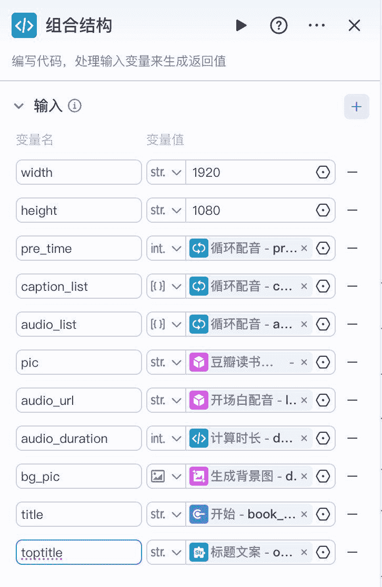

+ 左上角选择「Python」，复制如下代码


```python
import json
async def main(args: Args) -> Output:
    params = args.params
    # 固定参数
    # bgm = params.get('bgm', "https://ve-template-0920.oss-cn-shanghAI.aliyuncs.com/uploads/1747213706549_bzwh21eozgv.mp3"),
    cover_image = params['pic']
    bg_image = params['bg_pic']
    audio_duration = params['audio_duration']
    toptitle = params['toptitle']
    width = params['width']
    height = params['height']

    pre_time = params['pre_time']

    imgs1 = []
    imgs2 = []
    title_captions = []
    bgm_audios = []

    title_captions.append({
        'text': params['title'],
        'start': audio_duration+1000000,
        'end': pre_time,
        "in_animation": "缩小",
        "in_animation_duration": 2000000
    })
    topcaptions = []
    topcaptions.append({
        'text': toptitle,
        'start': audio_duration+1000000,
        'end': pre_time,
        "in_animation": "渐显",
        "in_animation_duration": 1000000
    })

    # 获取已有字幕音频
    audios = params['audio_list']

    # =================
    # 翻书声音
    bgm_audios.append({
        "audio_url": "https://houht.oss-cn-shanghAI.aliyuncs.com/public/booklist/book.MP3",
        "duration": 2000000,
        "start": 0,
        "end": 2000000
    })
    # 背景音乐时间线
    bgm_audios.append({
        "audio_url": "https://ve-template-0920.oss-cn-shanghAI.aliyuncs.com/uploads/1747213706549_bzwh21eozgv.mp3",
        "duration": pre_time-2000000,
        "start": 2000000,
        "end": pre_time,
        "volume": 0.7
    })
    # =================

    # 开场封面 1 2 秒  添加特效 模糊，2 秒 audio_duration
    # 结束时间：在翻书转场特效之后 0.5 秒
    imgs1.append({
            "image_url": cover_image,
            "width": 768,
            "height": 1024,
            "start": 0,
            "end": audio_duration+1000000+500000,
            "transition": "中心切开",
            "transition_duration": 1000000
        })
    # 开场封面 2 翻书动画 2 秒  audio_duration
    imgs2.append({
            "image_url": cover_image,
            "width": 768,
            "height": 1024,
            "start": 0,
            "end": audio_duration+1000000,
            "in_animation": "翻书",
            "in_animation_duration": audio_duration,
            "transition": "中心切开",
            "transition_duration": 1000000
        })
    # 背景图，第二个分镜图
    # imgs1.append({
    #         "image_url": bg_image,
    #         "width": width,
    #         "height": height,
    #         "start": audio_duration+1000000,
    #         "end": pre_time
    #     })
    imgs2.append({
            "image_url": bg_image,
            "width": width,
            "height": height,
            "start": audio_duration+1000000,
            "end": pre_time
        })

    effects = []
    effects.append({
        "effect_title": "模糊",
        "end": audio_duration+1000000,
        "start": 0
        })

    effects2 = []
    effects2.append({
        "effect_title": "星火",
        "end": pre_time,
        "start": audio_duration+1000000
        })
    # 构建输出对象
    ret = {
        "captions": json.dumps(params['caption_list']),
        "audios": json.dumps(audios),
        "bgm_audios": json.dumps(bgm_audios),
        "imgs1": json.dumps(imgs1),
        "imgs2": json.dumps(imgs2),
        "effects": json.dumps(effects),
        "effects2": json.dumps(effects2),
        "titleCaptions": json.dumps(title_captions),
        "topcaptions": json.dumps(topcaptions)
    }

    return ret
```

+   设置输出项：

+   `caption`（字幕）、`audios`（音频）、`bgm_audios`（背景音乐）、`imgs1`（开场封面 1）、`imgs2`（开场封面 2）、`effects`（开场模糊特效）、`effects2`（星火特效）、`titleCaptions`（书名）、`topcaptions`（视频标题）

+   类型全部是 `string`

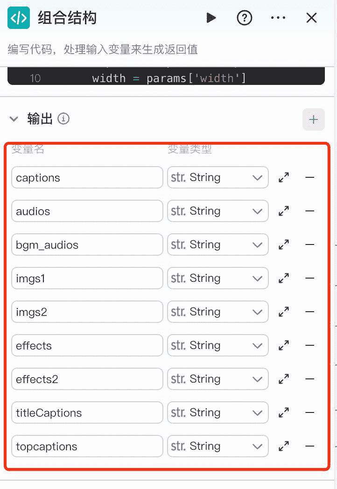

## （14）创建剪映草稿

+   搜索「视频合成」，添加「`creat_draft`」创建草稿节点


+   设置视频尺寸 1920*1080


## （15）添加音频

+   由于音频文件有两个：背景音乐、文案配音，所以我们要设置两个「`add_audio`」添加音频节点


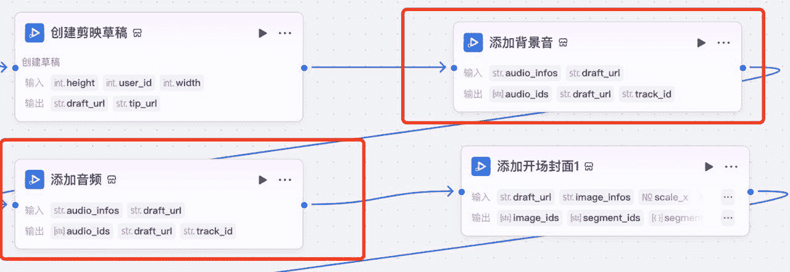

+   设置都类似，输入项 `draft_url` 选择上一步创建剪映草稿的 `draft_url`，`audio_infos` 分别选择第 13 步的 `bgm_audios` 和 `audios`


## （16）添加图片

+   同样为了做开头的书籍封面效果，有两张图片，需要添加两个「`add_imges`」节点


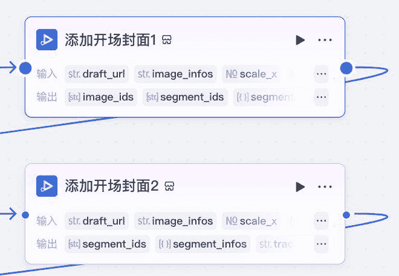

+   输入项 `draft_url` 选择第 14 步的 `draft_url`，`image_infos` 分别选择第 13 步的 `imgs1`、`imgs2`。

+   一个设置 `scale`，一个不设置

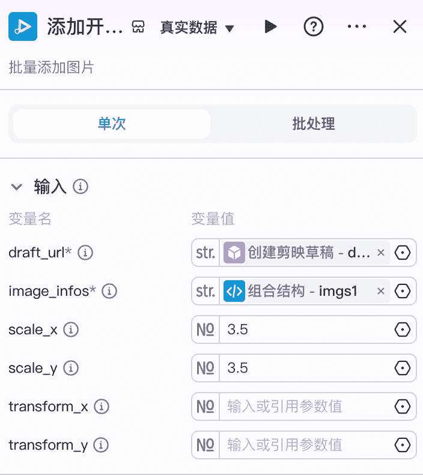

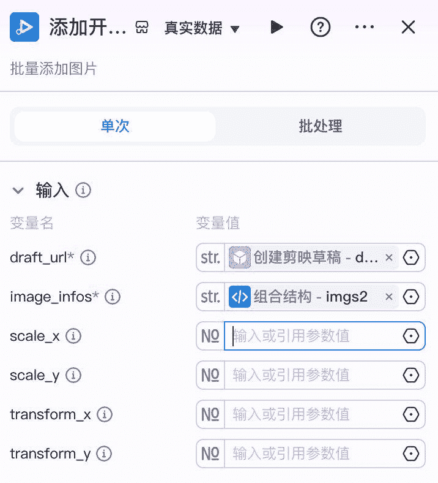

## （17）添加特效

+   我们需要为视频添加两个特效，所以也需要添加两个「`add_effects`」节点，一个用于开头封面模糊特效，一个用于视频整体的星火特效


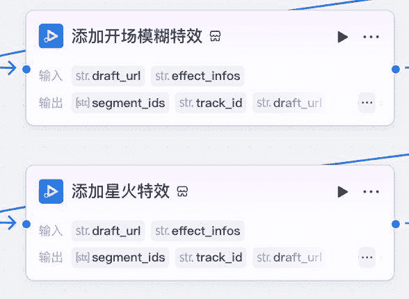

+   设置输入项 `draft_url`，设置为第 14 步的 `draft_url`，`effect_infos` 分别选择第 13 步的 `effects`、`effects2`

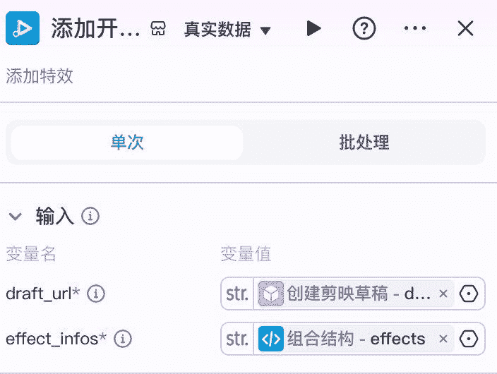

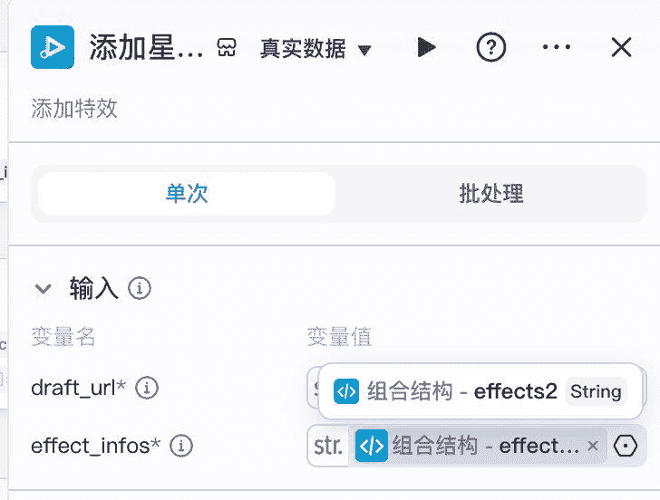

## （18）添加字幕

+   视频中的所有文字都需要用添加字幕的方式添加，所以需要添加 5 个「`add_captions`」


+   为了让背景中的书名更好看，我们先通过「选择器」节点判断一下书名的字数，来决定字体大小，让输出的内容更美观

+   输入项：开始节点的 `book_name`，分为三个分支：少于 3 个字，少于 6 个字，大于等于 6 个字

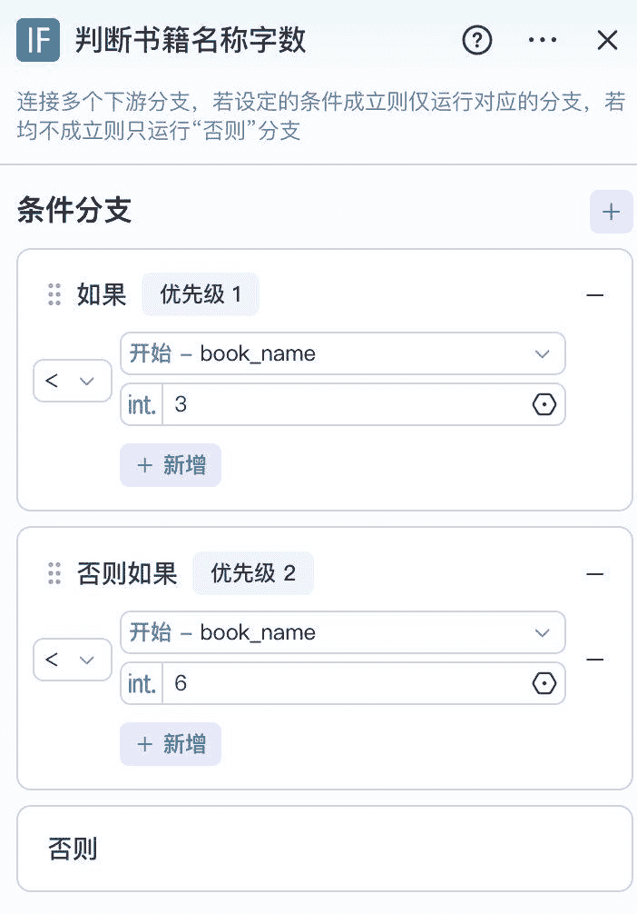

+   `add_caption` 输入项 `draft_url` 选择第 14 步的 `draft_url`，`captions` 选择第 13 步的 `titleCaptions`

+   `alignment`（文字对齐方式）设置为 1，居中对齐

+   `font`（字体）设置为优设标题黑

+   `font_size`（字体大小）分别设置为：50、35、30

+   `letter_spacing`（字间距）设置为为 2

+   `text_color`（字体颜色）设置为#aa1314

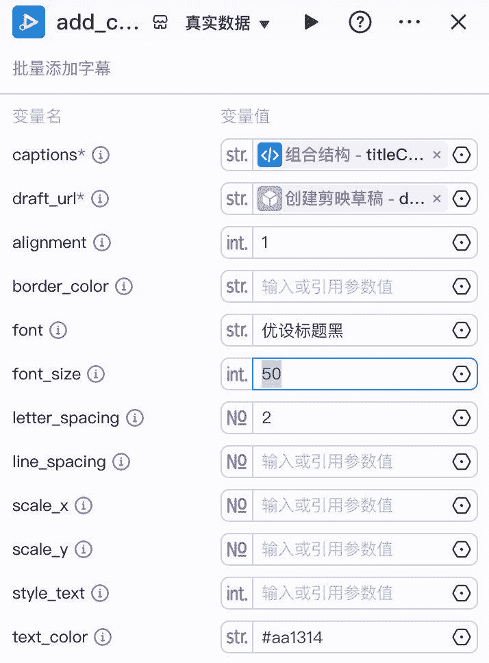

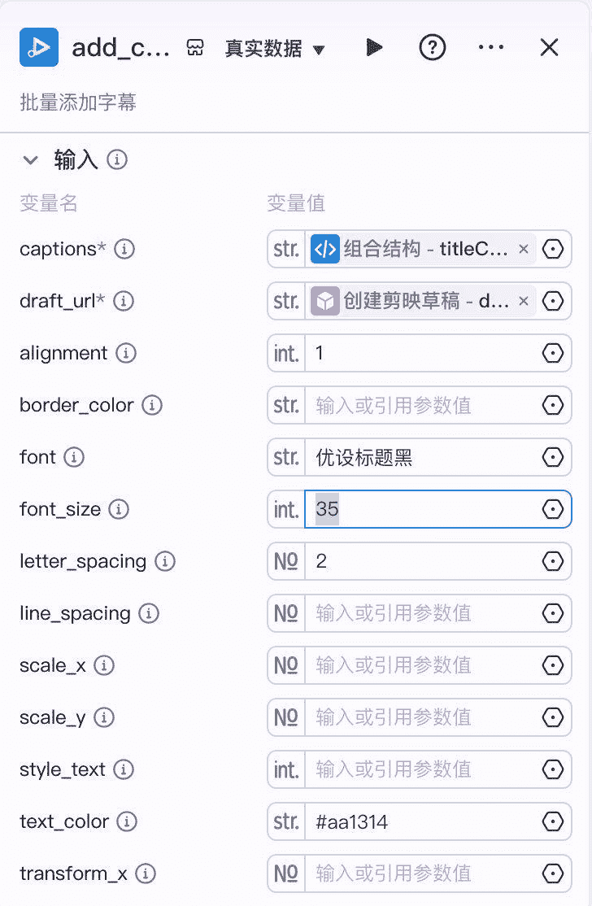

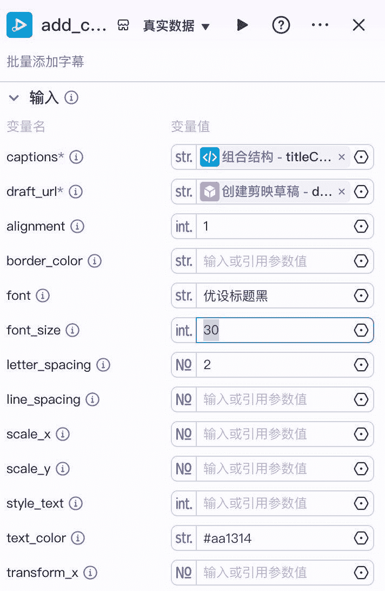

+   添加字幕输入项 `draft_url` 选择第 14 步的 `draft_url`，`captions` 选择第 13 步的 `captions`

+   其他设置如下图

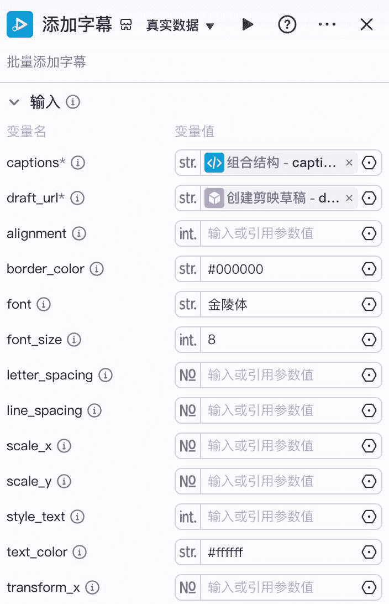

+   添加标题，也就是视频右上角有书名和作者信息的文字。

+   输入项 `draft_url` 设置为第 14 步的 `draft_url`，`captions` 设置为第 13 步的 `topcaptions`

+   其他设置见下图

## （19）云渲染视频（可选）

+   这个第三方工具提供云渲染功能，也就是不用导出到剪映，直接云端渲染，制作完成后，用网页访问下载视频即可。可以免费生成 5 次，人民币玩家无限生成，可以根据自己情况使用，访问 `https://www.51aigc.cc/#/home?user_id=255128` 查看

+   添加「`gen_video`」节点


+   输入项 `draft_url` 选择第 14 步的 `draft_url`，`api_token` 选择开始节点的 `api_token`


## （20）结束节点

+   两个输出项：

+   `draft_url`：剪映草稿，选择第 14 步生成的 `draft_url`，在本地电脑复制 `https://ts-api.fyshark.com/api/get_video/37634110-4b99-4f0c-b95f-27b61f57f7e9url` 到剪映小助手下载草稿文件，再打开剪映导出。

+   `video_url`：云端渲染成功的视频 url，选择第 19 步生成的 `video_url`，网页打开可以直接下载视频。


