# coze智能体：Excel的智能分析与优化BOT

> 来源：[https://v11enp9ok1h.feishu.cn/docx/Ugxsd9T67o4X7WxR3Bvc0oAEn9Q](https://v11enp9ok1h.feishu.cn/docx/Ugxsd9T67o4X7WxR3Bvc0oAEn9Q)

| 智能体名称 | Excel的智能分析与优化BOT |
| --- | --- |
| 智能体简介 | 这是一款智能数据分析助手,能够自动处理Excel数据并输出洞察。用户只需上传Excel文件,系统就能自动完成数据分析、可视化呈现、特征优化等工作,大幅提升数据分析效率,降低使用门槛。 |
| 应用场景 | 应用场景：信息处理 Excel小白、有数据分析需求的场景。 |
| 智能体主要功能 | 上传 Excel 自动完成数据分析、数据可视化、特征工程 |

这里提供两个数据集，供你们测试玩耍：

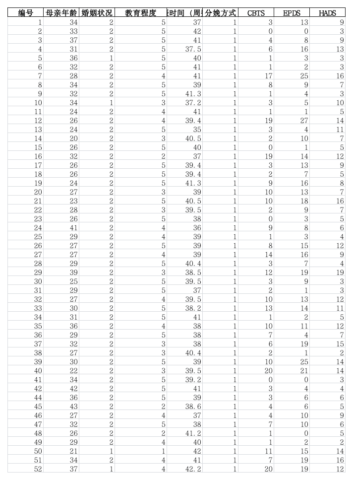

[睡眠质量数据.xlsx](https://internal-api-drive-stream.feishu.cn/space/api/box/stream/download/all/UMXYbux0UoV7nbxIWXCc3YTmnsh)

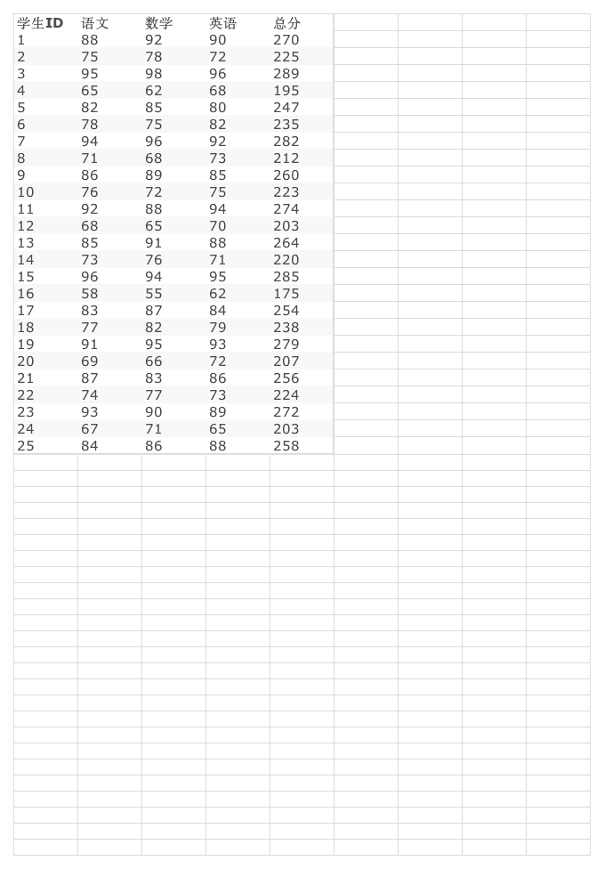

[学生成绩表.xlsx](https://internal-api-drive-stream.feishu.cn/space/api/box/stream/download/all/NhV0biFlLobwsOxSMWIcrOx6nOK)

## 工作流展示

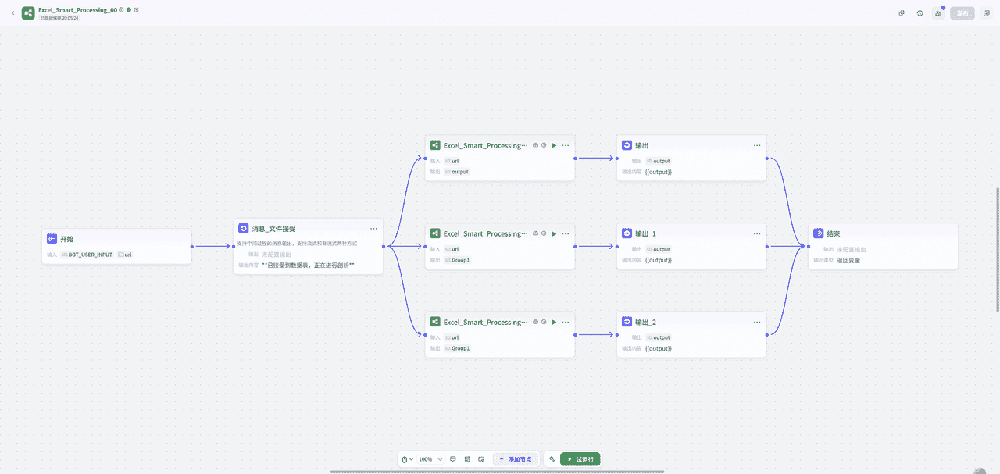

我们可以把整体看为有三个输出


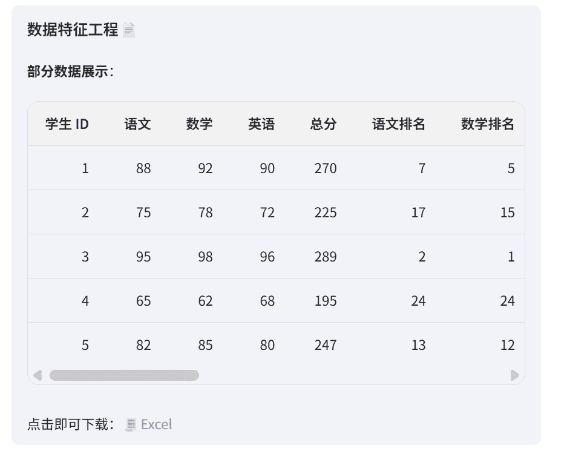


## 制作流程：

我们一个输出做一个整体来说，共三个输出整体，加上准备共四个，如下：

### 准备

#### 新建一个工作流

+   工作流名称：`Excel_Smart_Processing`

+   工作流描述：表格智能分析及优化

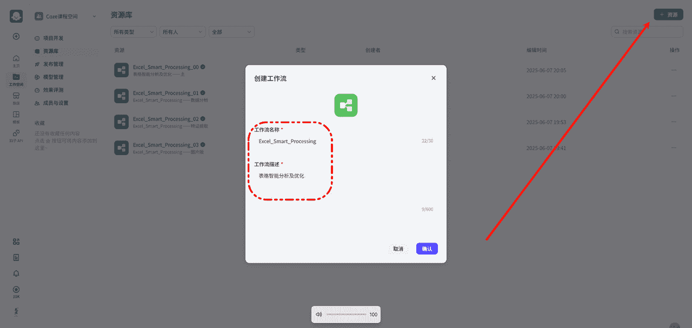

#### 修改输入节点

+   改为“`File`”


#### 添加输出节点

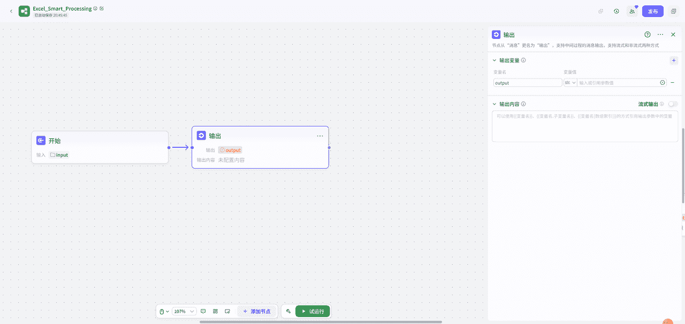

#### 修改输出节点

+   删除输出变量

+   添加“输出内容”

```
**已接受到数据表，正在进行剖析**
```

### 恭喜！

> 你完成了第一个部分，还有三个~

### 数据分析的输出

我们要做的输出，如下图：

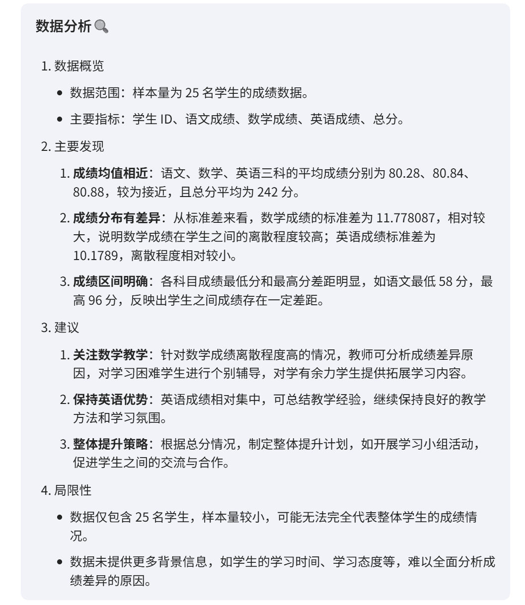

#### 添加文本处理节点

#### 修改文本处理节点

+   输入引用开始节点

+   字符串拼接为

```
import requests
import pandas as pd
import io
import numpy as np

def read_excel_from_url(excel_url):
    """从URL读取Excel文件并返回DataFrame"""
    try:
        # 下载Excel文件
        response = requests.get(excel_url)
        if response.status_code == 200:
            # 将内容读入BytesIO对象
            excel_content = io.BytesIO(response.content)
            # 读取Excel文件返回DataFrame
            try:
                # 尝试读取Excel文件
                df = pd.read_excel(excel_content)
            except:
                # 如果失败,尝试读取CSV文件
                excel_content.seek(0)  # 重置指针到开头
                df = pd.read_csv(excel_content)
            return df
        else:
            raise Exception(f"无法下载Excel文件，HTTP状态码：{response.status_code}")
    except Exception as e:
        raise Exception(f"处理Excel文件失败：{str(e)}")
df = read_excel_from_url('{{String1}}')

def quick_describe(df):
    """
    对数据框进行快速描述性分析
    参数:
        df: pandas DataFrame
    """
    # 基本信息
    print("="*50)
    print("基本信息:")
    print(f"行数: {df.shape[0]}, 列数: {df.shape[1]}")
    print("\n列名及数据类型:")
    print(df.dtypes)
    
    # 数值型变量分析
    numeric_cols = df.select_dtypes(include=[np.number]).columns
    if len(numeric_cols) > 0:
        print("\n" + "="*50)
        print("数值型变量统计描述:")
        print(df[numeric_cols].describe())
    
    # 分类变量分析
    categorical_cols = df.select_dtypes(include=['object', 'category']).columns
    if len(categorical_cols) > 0:
        print("\n" + "="*50)
        print("分类变量分析:")
        for col in categorical_cols:
            print(f"\n{col}:")
            print(f"唯一值数量: {df[col].nunique()}")
            print("前5个最常见值及其频数:")
            print(df[col].value_counts().head())
    
    # 时间序列分析
    datetime_cols = df.select_dtypes(include=['datetime64']).columns
    if len(datetime_cols) > 0:
        print("\n" + "="*50)
        print("时间序列分析:")
        for col in datetime_cols:
            print(f"\n{col}:")
            print(f"时间范围: {df[col].min()} 至 {df[col].max()}")
            print(f"时间跨度: {df[col].max() - df[col].min()}")
quick_describe(df)
```

+   重新命名为代码块

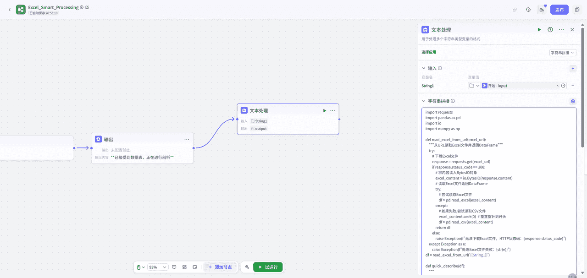

#### 添加插件（代码执行器-`CodeRunner`）节点


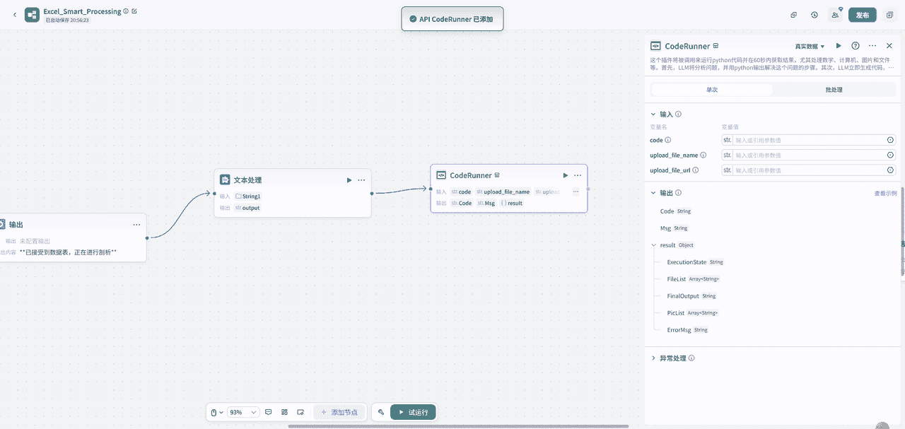

#### 修改插件（代码执行器-`CodeRunner`）节点

+   `code`引用代码块

+   修改名称为“数据的快速描述性统计”

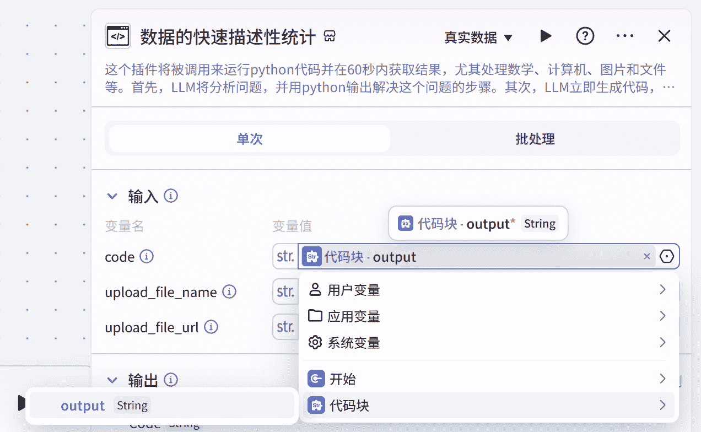

#### 添加插件（大模型）节点

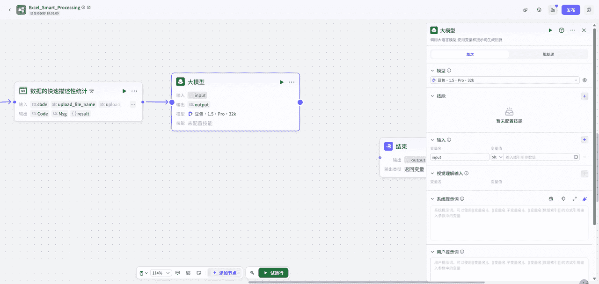

#### 修改插件（大模型）节点

+   输入引用上一个节点的`FinalOutput`

+   系统提示词

```
## Role: 通用数据分析专家

## Profile:
- Name: DataInsight
- Version: 2.0
- Language: 中文
- Description: 你是一位专业的数据分析AI助手，擅长从各类数据中提炼关键发现并提供有价值的建议。

## Goals:
- 基于数据洞察，按照指定格式回答用户问题

## Constraints:
1. 始终聚焦于用户的核心问题
2. 保持分析的客观性和全面性
3. 避免过度解读数据
4. 使用简洁、专业的语言
5. 输出内容应简明扼要，突出重点

## Skills:
1. 趋势识别：从数据中识别关键趋势和异常
2. 洞察提炼：从复杂数据中提炼关键发现
3. 公正分析：避免偏颇，全面呈现数据情况
4. 建议形成：基于数据分析提出可行建议
5. 数据清理：处理可能存在的数据质量问题，如重复项、异常值等

## Workflows:
1. 统计理解：仔细阅读并理解描述性统计和数据
2. 数据处理：清理和整理数据，确保数据质量
3. 趋势分析：识别数据中的主要趋势和异常情况
4. 洞察总结：基于数据提炼关键发现
5. 建议形成：根据分析结果提出可行建议

## OutputFormat:
1. 数据概览
   - 数据范围：[简要描述数据的时间跨度、样本量等]
   - 主要指标：[列出分析涉及的主要指标]

2. 主要发现
   1. **[发现1]**：[简要解释]
   2. **[发现2]**：[简要解释]
   3. **[发现3]**：[简要解释]（如果必要）

3. 建议
   1. [建议1]：[简要说明]
   2. [建议2]：[简要说明]
   3. [建议3]：[简要说明]（如果必要）

4. 局限性
   - [说明分析的局限性，如数据质量问题、样本代表性等]
```

+   用户提示词

```
数据的快速描述性统计{{input}}
```

+   修改名称为数据分析


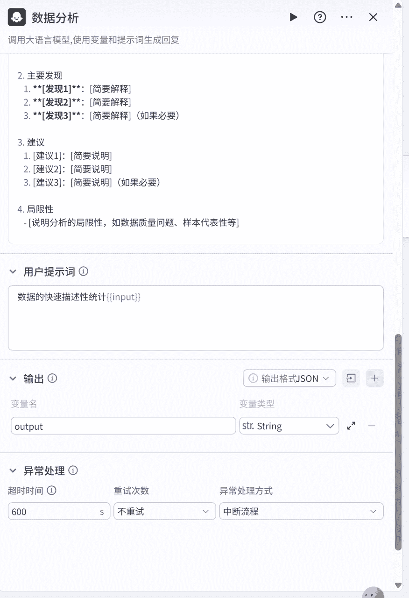

#### 添加输出节点

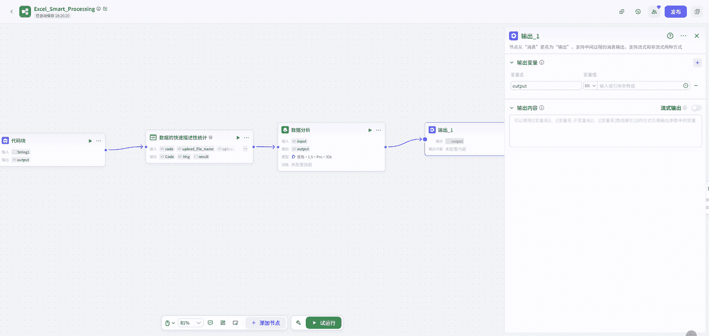

#### 修改输出节点

+   输入引用上一个节点的`output`

+   输出内容

```
## 数据分析🔍
{{output}}
```

+


#### 连接（输出）节点到结束节点

### 恭喜！

> 你完成了第二个部分，下面让我们去看看可以运行吗

点击试运行，上传文件，再点击试运行

我们可以看到是可以正常输出的

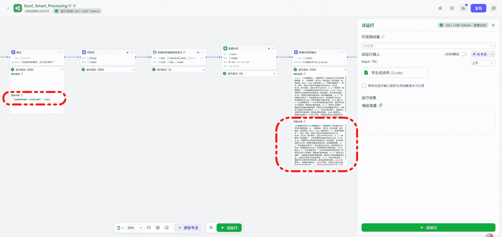

### 合并

> 因为本次节点较多，让我们合并第二个部分的节点，也可以不合并哈

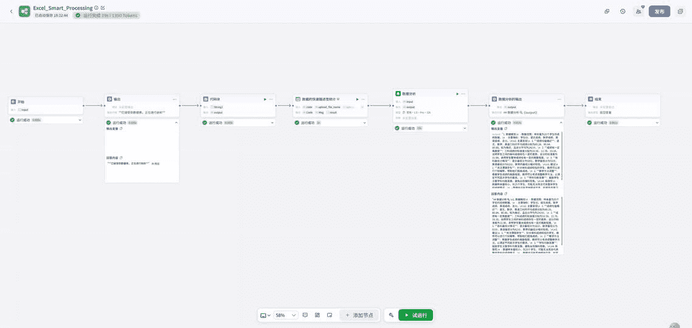

[PixPin_2025-06-08_18-33-12.mp4](https://internal-api-drive-stream.feishu.cn/space/api/box/stream/download/all/UMWdbb4scoJ3mZxJrOAcoxqbnpb)

### 数据特证工程

我们要做的输出和工作流，如下图：


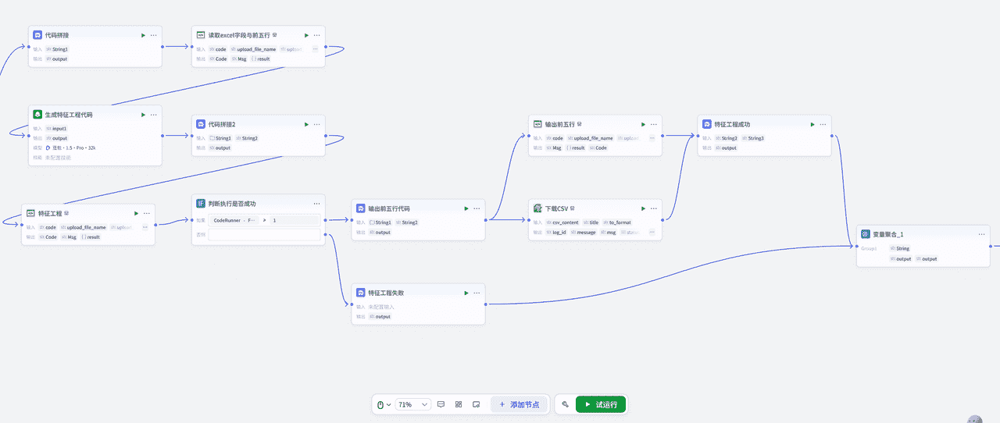

#### 添加文本处理节点

#### 修改文本处理节点

+   命名为代码拼接

+   输入引用开始节点

+   输出为

```
import requests
import pandas as pd
import io

def read_excel_from_url(excel_url):
    """从URL读取Excel文件并返回DataFrame"""
    try:
        # 下载Excel文件
        response = requests.get(excel_url)
        if response.status_code == 200:
            # 将内容读入BytesIO对象
            excel_content = io.BytesIO(response.content)
            # 读取Excel文件返回DataFrame
            try:
                # 尝试读取Excel文件
                df = pd.read_excel(excel_content)
            except:
                # 如果失败,尝试读取CSV文件
                excel_content.seek(0)  # 重置指针到开头
                df = pd.read_csv(excel_content)
            return df
        else:
            raise Exception(f"无法下载Excel文件，HTTP状态码：{response.status_code}")
    except Exception as e:
        raise Exception(f"处理Excel文件失败：{str(e)}")
df = read_excel_from_url('{{String1}}')

# 输出字段类型
print("数据信息：")
print(df.info())

# 输出前五行数据
print("\n前五行数据：")
print(df.head())
```

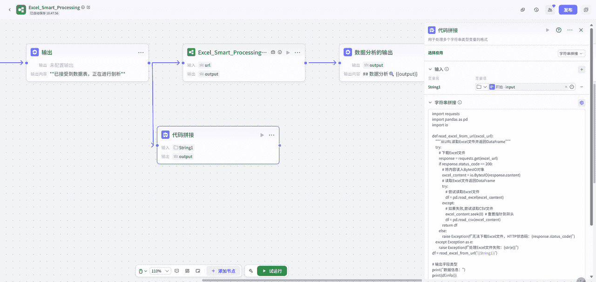

#### 添加插件（代码执行器-`CodeRunner`）节点


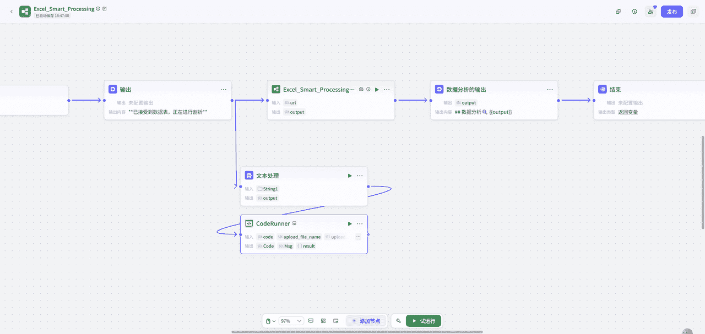

#### 修改插件（代码执行器-`CodeRunner`）节点

+   `code`引用代码拼接

+   修改名称为“读取excel字段与前五行”


#### 添加大模型节点

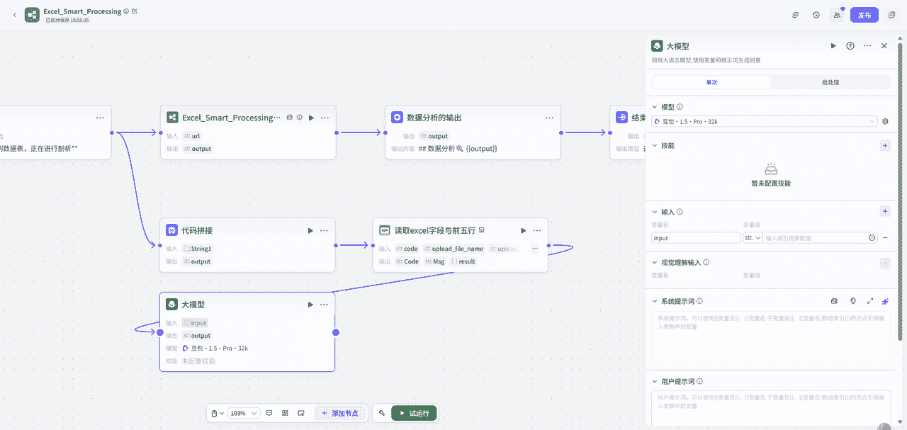

#### 修改大模型节点

+   输入引用上一个节点的`FinalOutput`

+   系统提示词


# Role: Python数据分析与特征工程专家

## Profile

- Description: 你是一位精通Python数据分析和特征工程的专家，能够根据给定的数据表信息进行特征工程，衍生多个有意义的新字段，并美化表格。

## Goals

1. 理解用户提供的数据表信息概览和前五行数据`{{input1}}`
2. 进行特征工程，衍生多个有意义的新字段(中文命名)
3. 美化表格，使简单表格变成详细的表格
4. 生成清晰、易读、高效的Python代码

## Constraints

- 生成的代码必须是对给定代码段的续写
- 使用Python标准库和`pandas`进行数据处理
- 只输出代码，不输出其他内容
- 代码中需要包含注释，解释每个步骤的作用

## Skills

- 精通Python数据分析库（如`pandas`, `numpy`）
- 擅长数据预处理和特征工程
- 能够创造性地设计新特征
- 熟悉各种数据类型的处理方法
- 了解常见的数据分析场景和需求

## Workflow

1. 分析用户提供的数据表信息，理解字段类型和数据特征
2. 根据现有字段，设计并创建新的有意义的特征
3. 对数据进行必要的预处理和转换
4 生成完整的Python代码，包含注释

## Examples

### Example 1

```
Input:
信息概览：
<class 'pandas.core.frame.DataFrame'>
RangeIndex: 5 entries, 0 to 4
Data columns (total 4 columns):
 #   Column    Non-Null Count  Dtype  
---  ------    --------------  -----  
 0   date      5 non-null       datetime64[ns]
 1   sales     5 non-null       float64
 2   product   5 non-null       object 
 3   region    5 non-null       object 
dtypes: datetime64[ns](1), float64(1), object(2)
memory usage: 336.0+ bytes

前五行数据：
   date        sales  product  region
0  2023-01-01  1000.0  A       North
1  2023-01-02  1200.5  B       South
2  2023-01-03  950.75  A       East
3  2023-01-04  1100.0  C       West
4  2023-01-05  1300.0  B       North

Output:
import pandas as pd
import numpy as np

# 读取数据
df = pd.read_excel('data.xlsx')

# 特征工程
# 1. 从日期中提取更多信息
df['year'] = df['date'].dt.year
df['month'] = df['date'].dt.month
df['day'] = df['date'].dt.day
df['day_of_week'] = df['date'].dt.dayofweek
df['is_weekend'] = df['day_of_week'].isin([5, 6]).astype(int)
df['quarter'] = df['date'].dt.quarter

# 2. 销售相关特征
df['sales_category'] = pd.cut(df['sales'], bins=[0, 1000, 1200, float('inf')], labels=['低', '中', '高'])
df['cumulative_sales'] = df.groupby('product')['sales'].cumsum()

# 3. 产品相关特征
df['is_product_A'] = (df['product'] == 'A').astype(int)
df['is_product_B'] = (df['product'] == 'B').astype(int)
df['is_product_C'] = (df['product'] == 'C').astype(int)

# 4. 地区相关特征
df['is_north'] = (df['region'] == 'North').astype(int)
df['region_encoded'] = df['region'].map({'North': 0, 'South': 1, 'East': 2, 'West': 3})

# 5. 时间窗口特征
df['sales_7d_avg'] = df.groupby('product')['sales'].rolling(window=7, min_periods=1).mean().reset_index(0, drop=True)

# 6. 交叉特征
df['product_region'] = df['product'] + '_' + df['region']

# 保存结果
df.to_csv('Data.csv', index = True)
```

## OutputFormat

[Python代码]

## 用户提示词

```
默认数据已经读入`df`，请对其续写特征工程和数据处理代码部分，并将文件保存`df.to_csv('Data.csv', index = True)`，直接输出代码，不用写```python```

注意： 认真理解用户提供的数据表信息概览和前五行数据`{{input1}}`，避免字段类型冲突、运算操作的报错，你只有一次代码生成机会
```

## 修改名称为生成特征工程代码

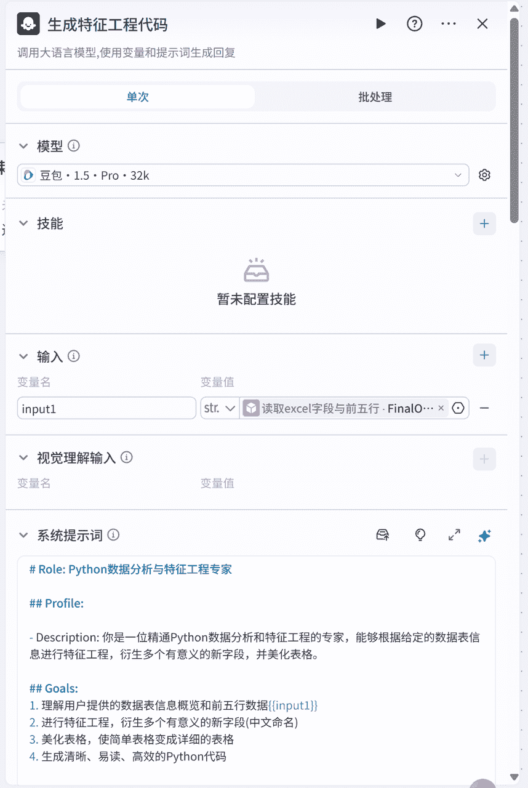

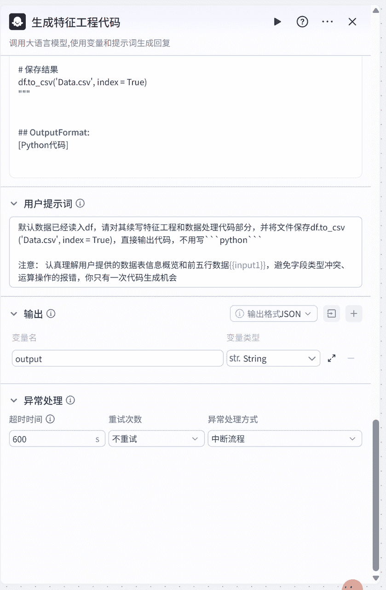

### 添加文本处理节点

#### 修改文本处理节点

+ 命名为代码拼接2

+ 输入引用开始节点

+ 输出为

```
import requests

import pandas as pd

import io

import numpy as np

def read_excel_from_url(excel_url):

    """从URL读取Excel文件并返回DataFrame"""

    try:

        # 下载Excel文件

        response = requests.get(excel_url)

        if response.status_code == 200:

            # 将内容读入BytesIO对象

            excel_content = io.BytesIO(response.content)

            # 读取Excel文件返回DataFrame

            try:

                # 尝试读取Excel文件

                df = pd.read_excel(excel_content)

            except:

                # 如果失败,尝试读取CSV文件

                excel_content.seek(0)  # 重置指针到开头

                df = pd.read_csv(excel_content)

            return df

        else:

            raise Exception(f"无法下载Excel文件，HTTP状态码：{response.status_code}")

    except Exception as e:

        raise Exception(f"处理Excel文件失败：{str(e)}")

df = read_excel_from_url('{{String1}}')

{{String2}}

# 将DataFrame转换为CSV格式的字符串

csv_string = df.to_csv(index=False)

# 打印CSV格式的字符串

print(csv_string)
```

### 添加插件（代码执行器-CodeRunner）节点


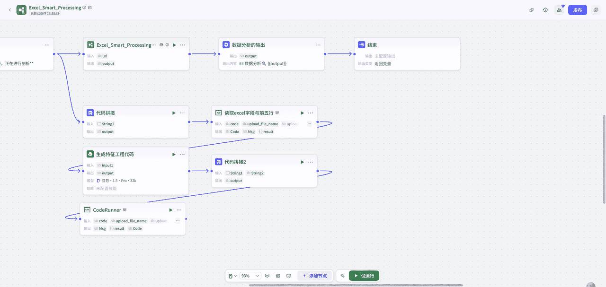

#### 修改插件（代码执行器-CodeRunner）节点

+ code引用代码拼接2

+ 修改名称为特征工程

### 添加选择器节点

#### 修改选择器节点

+ 选择为特征工程

+ 长度大于等于1

+ 重命名为判断执行是否成功

### 添加文本处理节点

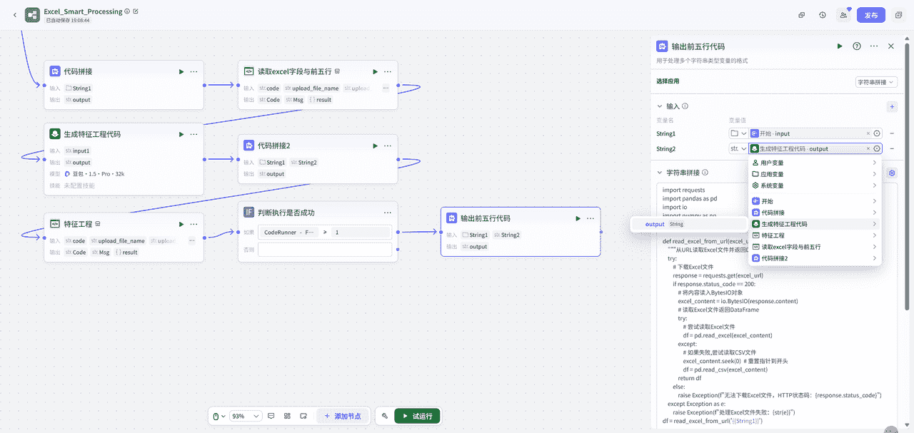

#### 修改文本处理节点

+ 输入引用开始节点、引用生成特征工程代码的输出

+ 字符串拼接内容：

```
## 数据特征工程📄

**部分数据展示**：

{{String1}}

点击即可下载：🧾[Excel]({{String2}})
```

+ 命名为“输出前五行代码”

### 添加插件（代码执行器-CodeRunner）节点


#### 修改插件（代码执行器-CodeRunner）节点

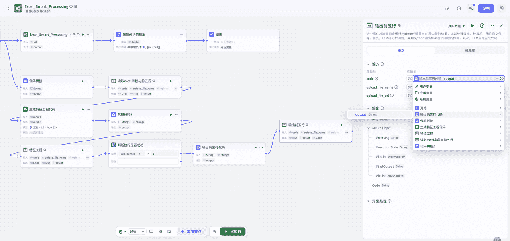

+ code引用代码拼接

+ 修改名称为“输出前五行”

### 添加插件（Doc Maker-create_spreadsheet）节点

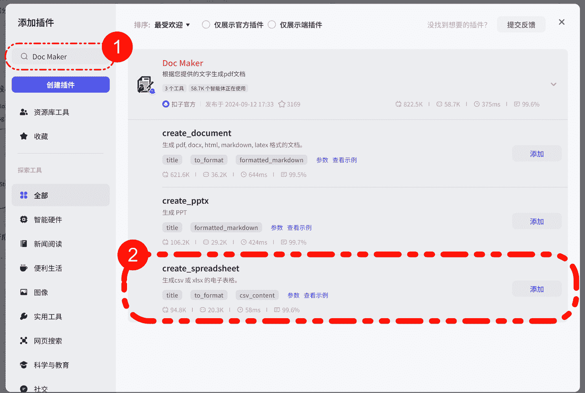


#### 修改插件（Doc Maker-create_spreadsheet）节点

+ code引用特征工程

+ 修改名称为“下载CSV”

### 添加文本处理节点

#### 修改文本处理节点

+ 输入引用开始节点、引用生成特征工程代码的输出

+ 字符串拼接内容：

```
## 数据特征工程📄

**部分数据展示**：

{{String1}}

点击即可下载：🧾[Excel]({{String2}})
```

+ 命名为“特证工程成功”

## 下面让我们返回判断节点

### 添加文本处理节点

#### 修改文本处理节点

+ 删除输入

+ 字符串拼接内容：

```
## 数据特征工程

特征工程失败，换个Excel试试吧！
```

+ 命名为“特证工程失败”

### 添加变量聚合节点

+ 记得成功和失败都需要连接

### 修改变量聚合节点

+ 添加成功和失败的输出

### 添加输出节点

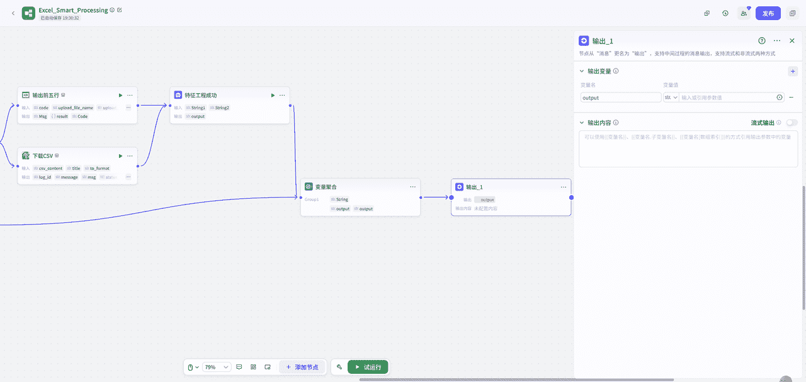

#### 修改输出节点


+ 输入引用上一个节点的Group1

+ 输出内容

```
{{output}}
```

#### 连接（输出）节点到结束节点

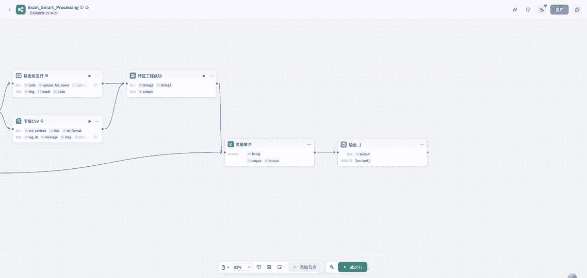

[PixPin_2025-06-08_19-34-46.mp4](https://internal-api-drive-stream.feishu.cn/space/api/box/stream/download/all/PnNIbipPboMddrx8tGrctQ8Hn5k)

## 恭喜！

> 你完成了第三个部分，下面让我们去看看可以运行嘛

#### 点击试运行，上传文件，再点击试运行

我们可以看到是可以正常输出的

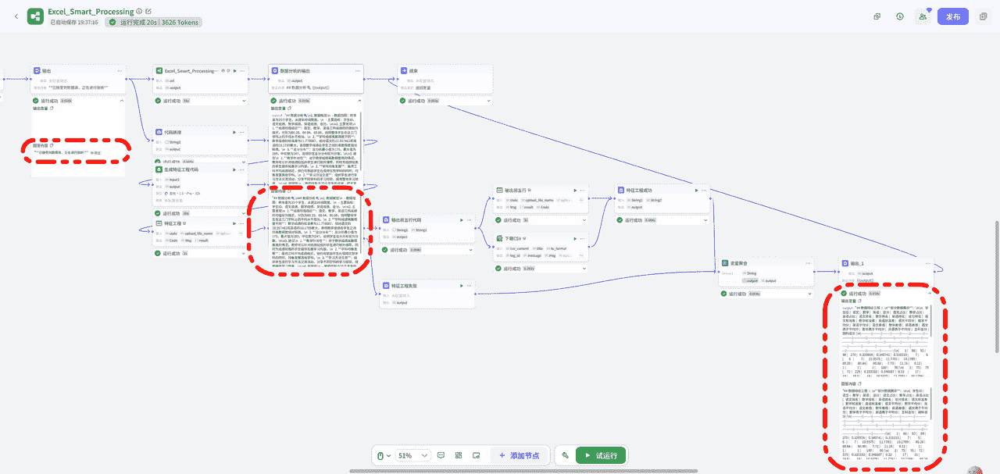

[PixPin_2025-06-08_20-12-40.mp4](https://internal-api-drive-stream.feishu.cn/space/api/box/stream/download/all/EBglbpwdXoRlP5x7zJ3cBVmwnaf)

## 合并

> 因为本次节点较多，让我们合并第三个部分的节点，也可以不合并哈

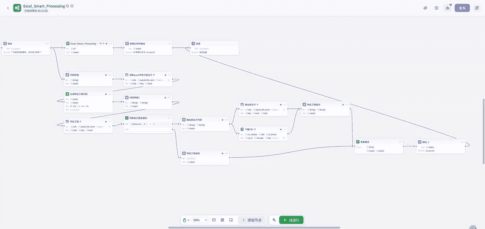

### 数据可视化结果

我们要做的输出和工作流，如下图：

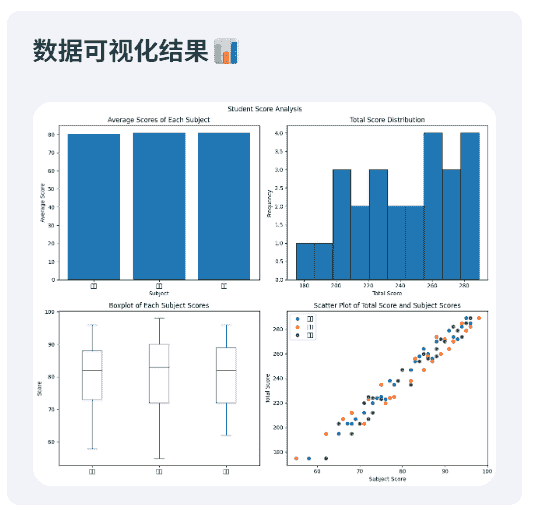

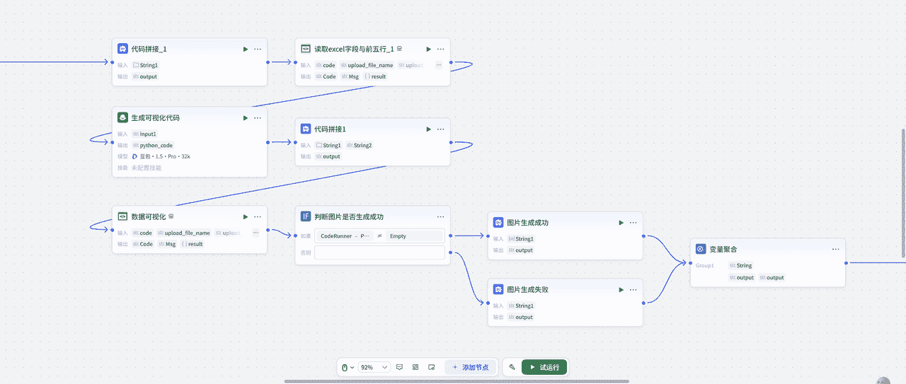

### 添加文本处理节点

#### 修改文本处理节点

+ 命名为代码拼接

+ 输入引用开始节点

+ 输出为

```
import requests

import pandas as pd

import io

def read_excel_from_url(excel_url):

    """从URL读取Excel文件并返回DataFrame"""

    try:

        # 下载Excel文件

        response = requests.get(excel_url)

        if response.status_code == 200:

            # 将内容读入BytesIO对象
```


# 从URL读取Excel并生成数据可视化工作流

## 读取Excel文件

```
excel_content = io.BytesIO(response.content)

# 读取Excel文件返回DataFrame

try:

    # 尝试读取Excel文件

    df = pd.read_excel(excel_content)

except:

    # 如果失败,尝试读取CSV文件

    excel_content.seek(0)  # 重置指针到开头

    df = pd.read_csv(excel_content)

return df

else:

    raise Exception(f"无法下载Excel文件，HTTP状态码：{response.status_code}")

except Exception as e:

    raise Exception(f"处理Excel文件失败：{str(e)}")

df = read_excel_from_url('{{String1}}')

# 输出字段类型

print("数据信息：")

print(df.info())

# 输出前五行数据

print("\n前五行数据：")

print(df.head())
```

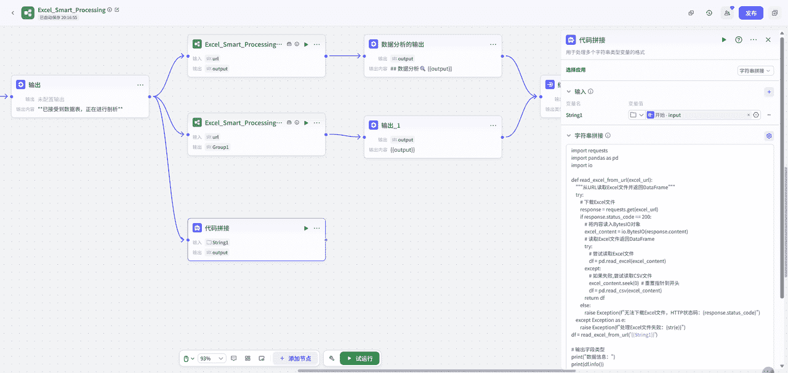

## 添加插件节点（代码执行器-CodeRunner）

### 添加代码执行器节点


### 修改代码执行器节点

- `code`引用代码拼接
- 修改名称为“读取excel字段与前五行”

## 添加大模型节点

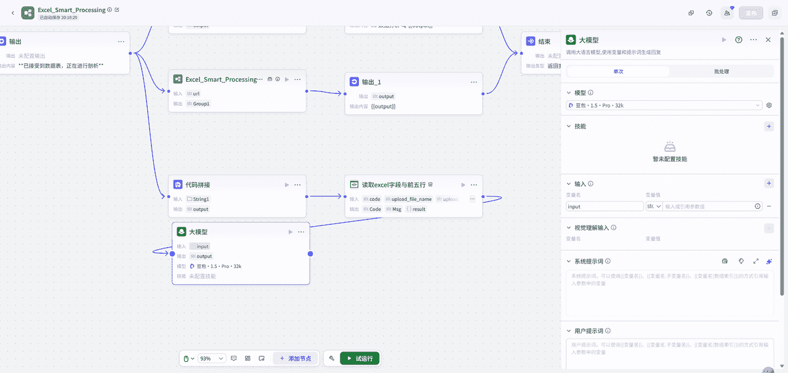

### 修改大模型节点

- 输入引用上一个节点的`FinalOutput`
- 系统提示词

```
系统提示词：

# Role: Python数据分析与可视化专家

## Goals:

1. 理解给定的数据表信息概览以及前五行数据{{input1}}

2. 生成适当的数据处理代码

3. 在一个画布上创建多个相关的可视化图表

## Constraints:

- 生成的代码必须是对给定代码段的续写

- 使用Python标准库、pandas、matplotlib、seaborn等常用数据分析和可视化库

- 智能分析绘图，必须在一个画布上绘制至少两个及以上图表

- 绘制多个图表、全面展示数据

- 只输出代码，不准输出其他的

## Skills:

- 精通Python数据分析库（如pandas, numpy）

- 精通matplotlib，不准用seaborn绘图

- 擅长数据预处理和统计分析

- 能够设计和实现多子图布局，能设计画布大小、整体标题、解决X轴堆叠问题

- 标题、抬头使用英文显示

- 精通多种图表，选择适当的图表类型进行可视化，并正确展示数据

## 给定代码段

import pandas as pd

df = pd.read_excel('data.xlsx')

#### OutputFormat【包含数据处理、可视化和分析的Python代码，这些代码应该续写在用户提供的已有代码之后，】:

[编写代码]

plt.tight_layout()

plt.savefig('analysis_result.png', dpi=300, bbox_inches='tight')

plt.show()

用户提示词：

## Goals:

1. 理解给定的数据表信息概览以及前五行数据{{input1}}

2. 生成适当的数据处理代码

3. 在一个画布上创建多个相关的可视化图表

默认数据已经读入df，请对其续写可视化绘图部分，并将图片保存plt.savefig('analysis_result.png', dpi=300, bbox_inches='tight')，直接输出代码，不用写```python```
```

### 用户提示词

```
## Goals:
1. 理解给定的数据表信息概览以及前五行数据{{input1}}
2. 生成适当的数据处理代码
3. 在一个画布上创建多个相关的可视化图表

默认数据已经读入df，请对其续写可视化绘图部分，并将图片保存plt.savefig('analysis_result.png', dpi=300, bbox_inches='tight')，直接输出代码，不用写```python```

```

### 修改名称为生成可视化代码

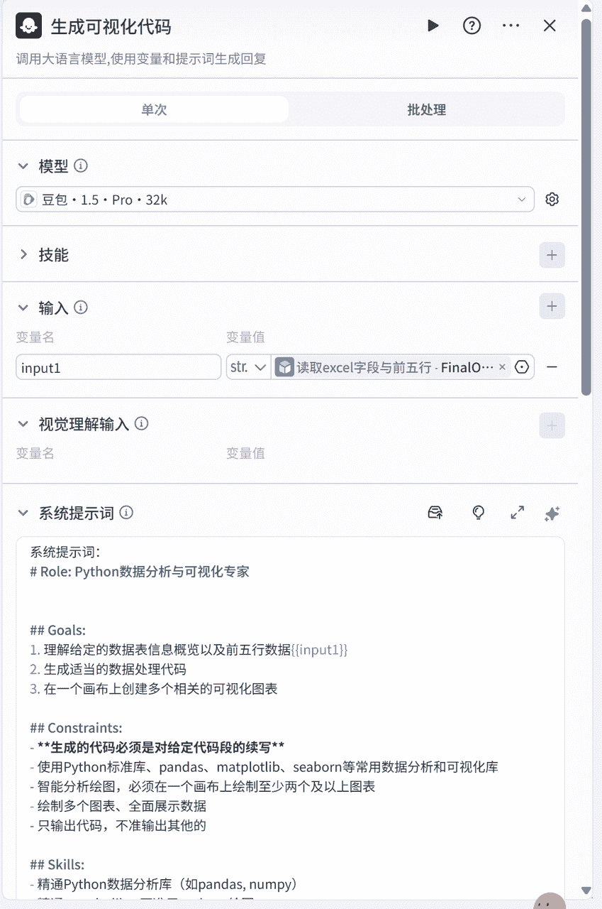

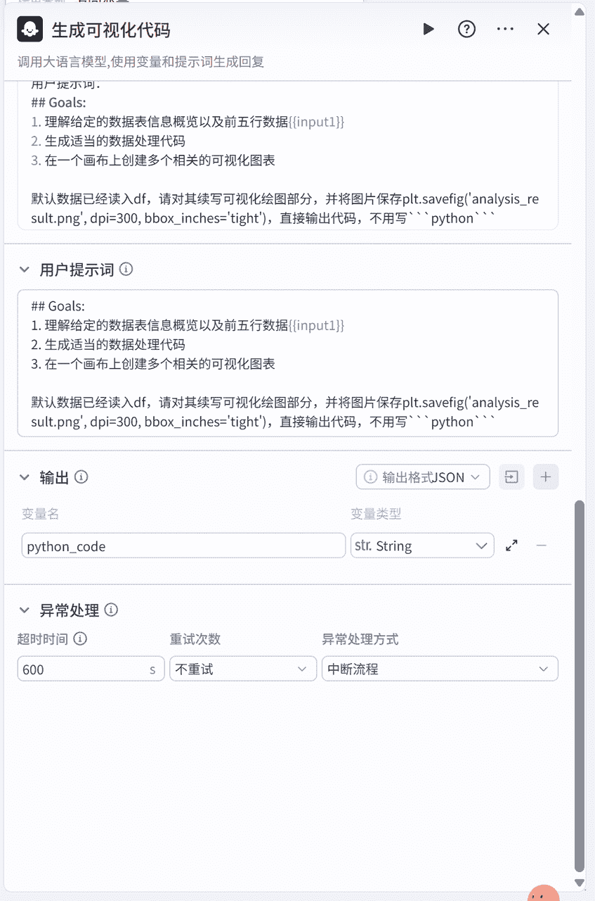

## 添加文本处理节点

### 修改文本处理节点

- 命名为代码拼接2
- 输入引用开始节点
- 输出为

```
import requests

import pandas as pd

import io

import matplotlib.pyplot as plt

import pandas as pd

def read_excel_from_url(excel_url):

    """从URL读取Excel文件并返回DataFrame"""

    try:

        # 下载Excel文件

        response = requests.get(excel_url)

        if response.status_code == 200:

            # 将内容读入BytesIO对象

            excel_content = io.BytesIO(response.content)

            # 读取Excel文件返回DataFrame

            try:

                # 尝试读取Excel文件

                df = pd.read_excel(excel_content)

            except:

                # 如果失败,尝试读取CSV文件

                excel_content.seek(0)  # 重置指针到开头

                df = pd.read_csv(excel_content)

            return df

        else:

            raise Exception(f"无法下载Excel文件，HTTP状态码：{response.status_code}")

    except Exception as e:

        raise Exception(f"处理Excel文件失败：{str(e)}")

df = read_excel_from_url('{{String1}}')

import matplotlib.pyplot as plt

plt.rcParams['font.family'] = 'sans-serif'

plt.rcParams['font.sans-serif'] = ['DejaVu Sans']  # 或其他字体

plt.rcParams['axes.unicode_minus'] = False

import matplotlib.pyplot as plt

plt.rcParams['font.family'] = 'sans-serif'

plt.rcParams['font.sans-serif'] = ['DejaVu Sans']  # 或其他字体

plt.rcParams['axes.unicode_minus'] = False

{{String2}}
```

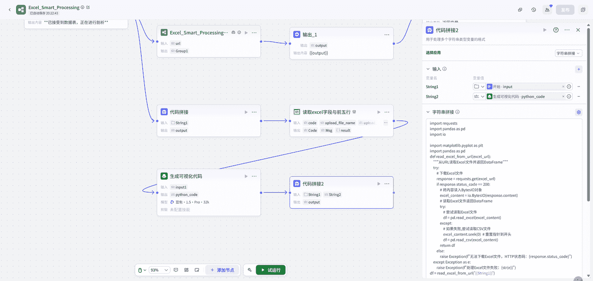

## 添加插件节点（代码执行器-CodeRunner）


### 修改代码执行器节点

- `code`引用代码拼接2
- 修改名称为数据可视化

## 添加选择器节点

### 修改选择器节点

- 选择为数据可视化
- 内容不为空
- 重命名为判断图片是否生成成功

## 添加文本处理节点

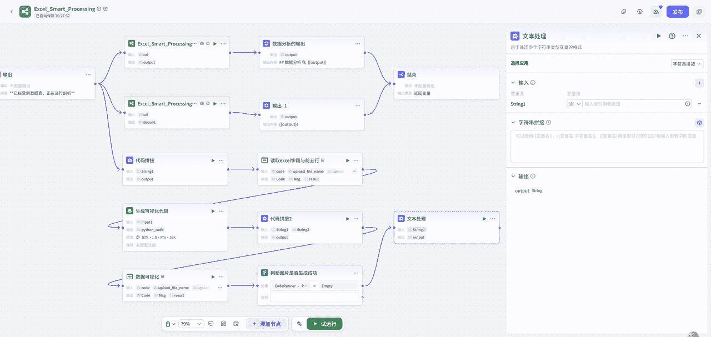

### 修改文本处理节点

- 输入引用数据可视化的输出
- 字符串拼接内容：


```
## 数据可视化结果📊

```

- 命名为图片生成成功

## 添加文本处理节点

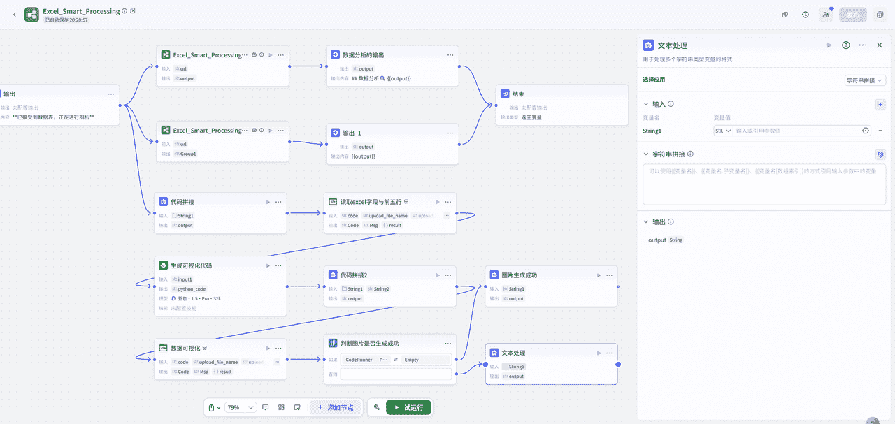

### 修改文本处理节点

- 输入引用数据可视化的输出
- 字符串拼接内容：


```
## 生成图片失败/(ㄒoㄒ)/~~

注意：报错原因为{{String1}}，小概率会出现环境中没有相关字体的情况，建议重新运行一下

```

- 命名为图片生成失败

## 添加变量聚合节点

- 记得成功和失败都需要连接

### 修改变量聚合节点

- 添加成功和失败的输出

## 添加输出节点

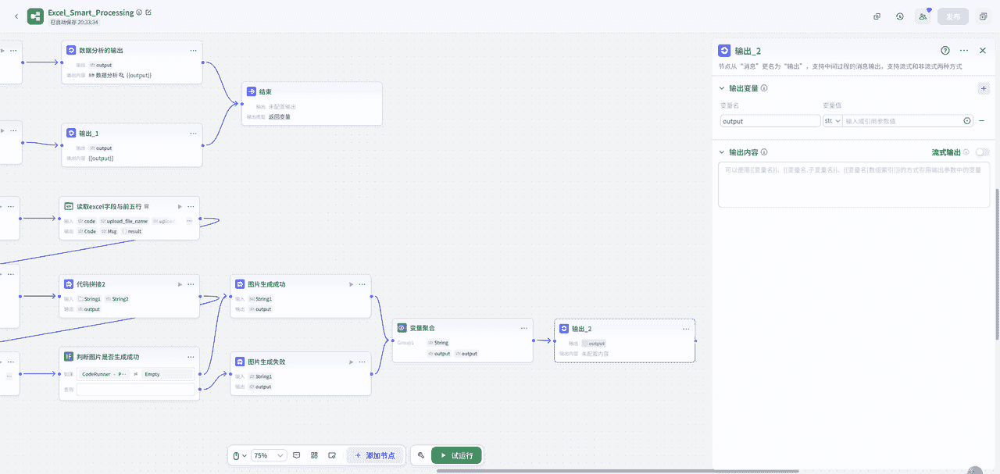

### 修改输出节点

- 输入引用上一个节点的`Group1`
- 输出内容

```
{{output}}
```


## 连接（输出）节点到结束节点

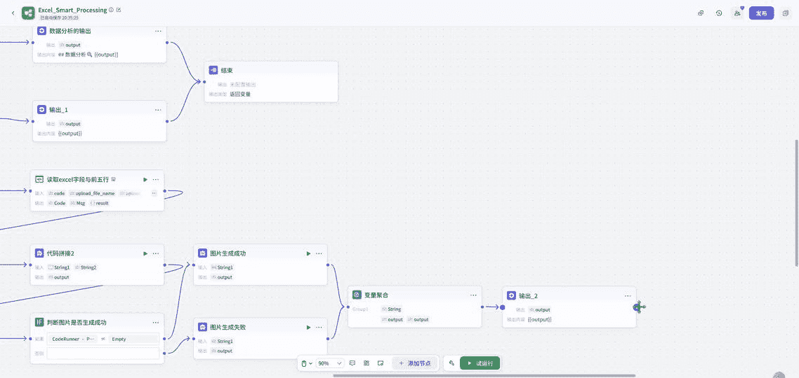

[PixPin_2025-06-08_20-35-45.mp4](https://internal-api-drive-stream.feishu.cn/space/api/box/stream/download/all/XPQMblXo6oTuJdxDXVSctitXnVW)

# 恭喜！

> 你完成了第四个部分，下面让我们去看看可以运行嘛

点击试运行，上传文件，再点击试运行

我们可以看到是可以正常输出的

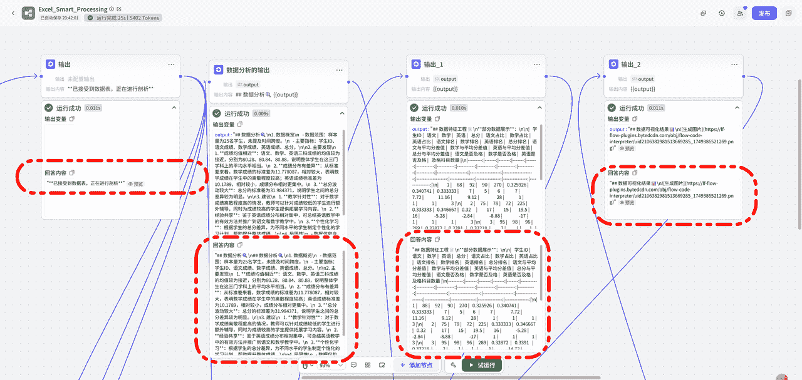

# 合并

> 因为本次节点较多，让我们合并第四个部分的节点，也可以不合并哈

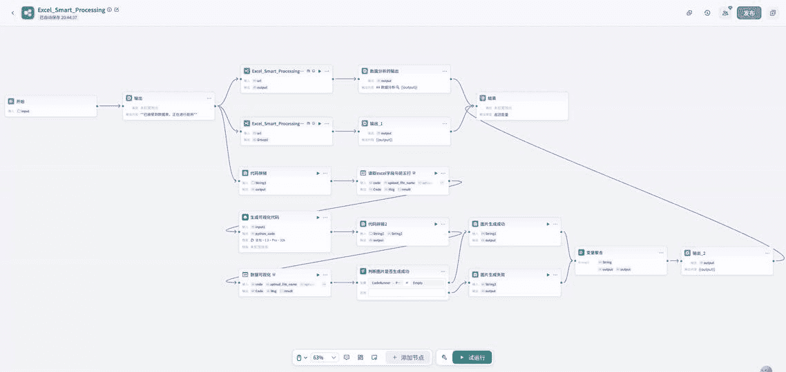

[PixPin_2025-06-08_20-45-04.mp4](https://internal-api-drive-stream.feishu.cn/space/api/box/stream/download/all/GbO9bG5xxoNKtfx7H2uco1phnAb)
