# 【Coze应用】扭蛋机（原创）

> 来源：[https://v11enp9ok1h.feishu.cn/docx/PxgbdPhfUodBogxS0MzckluknFp](https://v11enp9ok1h.feishu.cn/docx/PxgbdPhfUodBogxS0MzckluknFp)

一切的起源都是因为甲方爸爸

## 思路（我为什么会有这个想法）

其实很简单，我有一个需求，我想通过Coze的AI应用做一个可视化的UI出来，就开始询问AI

点击链接查看和 Kimi 的对话 https://www.kimi.com/share/d20d2enhvltu88ac9100

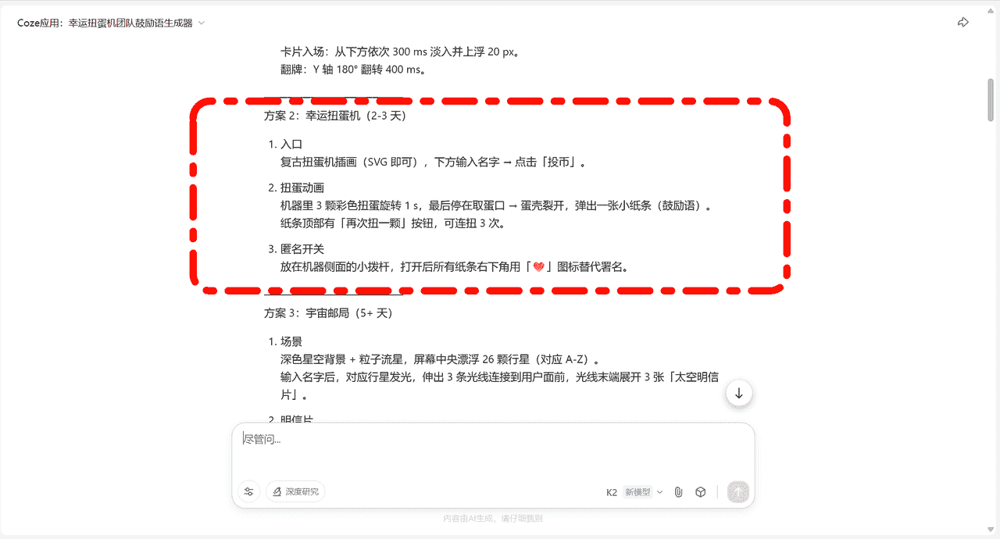

大家也可以看到，我认为扭蛋机不错，我就把相关的链接，发给他（因为搜索不到coze官网内容）

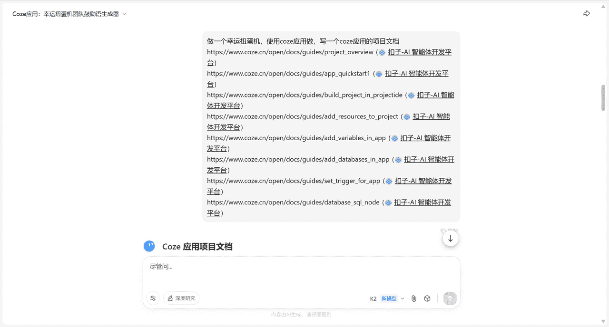

重点来了！生成的项目文档看什么？看数据表的设计、工作流不同节点的变化

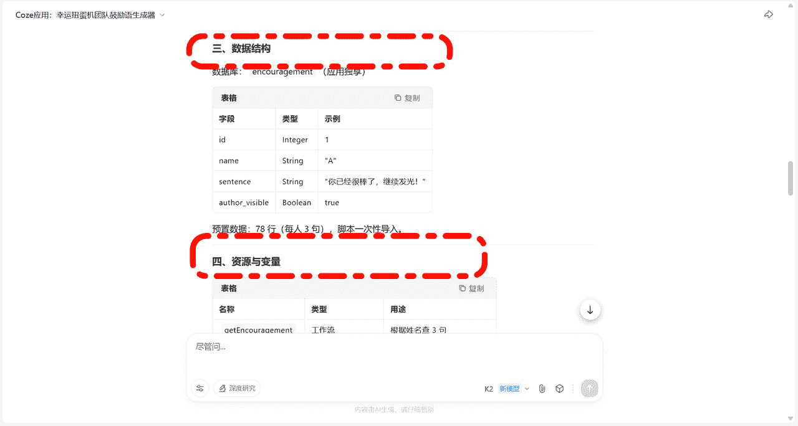

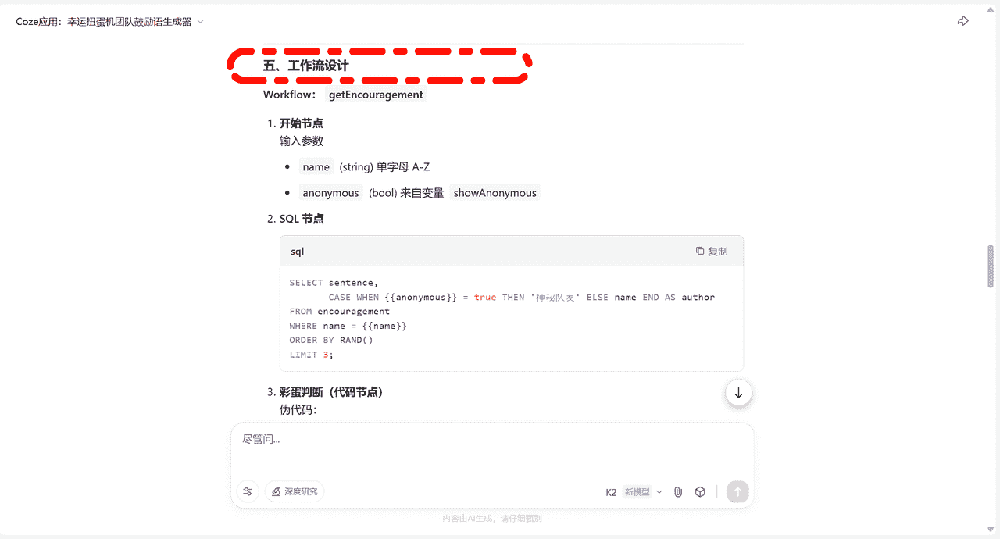

从上面AI生成的内容，我对我要做的内容有了一点思路，但是UI，还是不是很清楚

我就问AI：“详细聊聊用户界面，需要画几张图片，我让AI绘画去画”

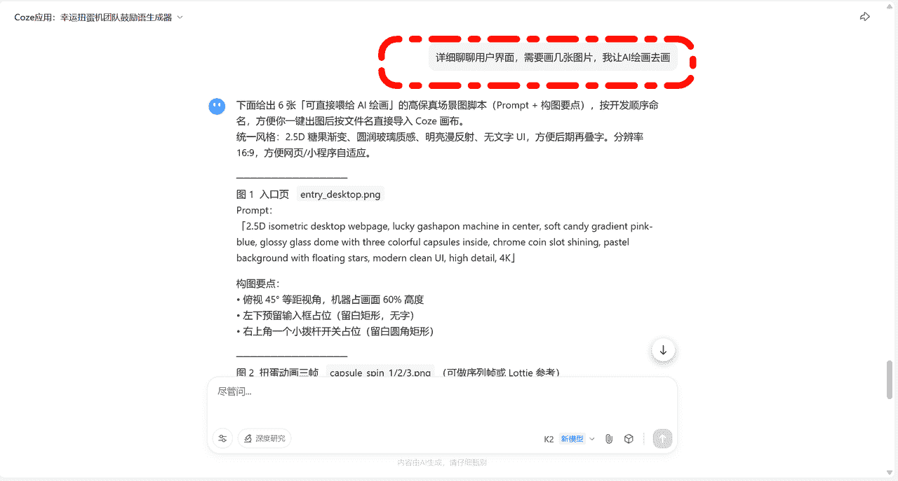

看完我还是云里雾里。

> 这里大家可以新开一个对话，继续聊

> 因为kimi对大多数链接都是可以读取的，使用一般使用kimi去阅读官网文档，生成项目文档

> UI的话，目前看下来kimi对思路的扩展不是很好，所以大家可以继续问，或者像我这样（需要对coze应用了解）

我就休息一下（真的，相信我，你的脑子还在思考）

---

几个小时后，下班了，我在路上开始思考这个工作流，有点忘记了，打开手机看一下，越来越明晰了，到自习室里，我就搭建了一个简单的工作流，大致如下

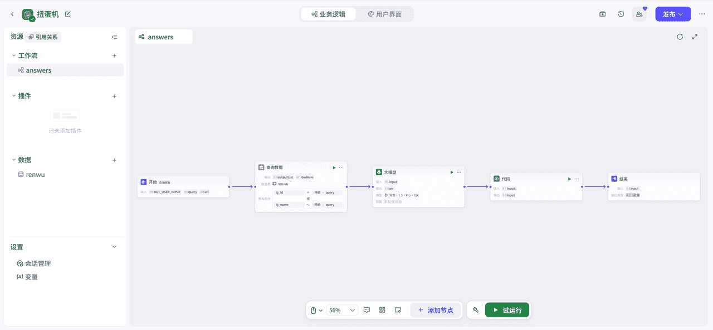

其实这个大家搭建完之后，就会对整体的输入、输出有一定的概念

好了，让我们回到UI怎么搞？

这个时候，我们可以看来两个内容

1.  组件

> 什么时候有的“自定义”？

我们把每一个组件过一遍。过什么呢？他的输入和UI的样子是什么

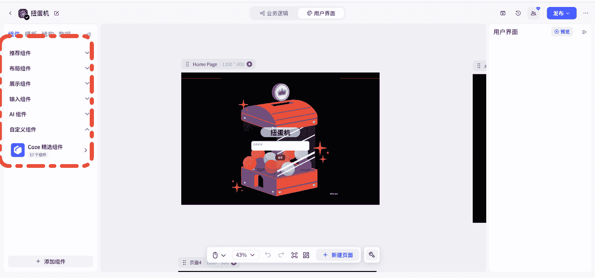

1.  模板

这里不推荐大家看商店，先看模板，因为你可以把人家的界面复制出来，直接改就行，如果还是没有思路，就去商店看看

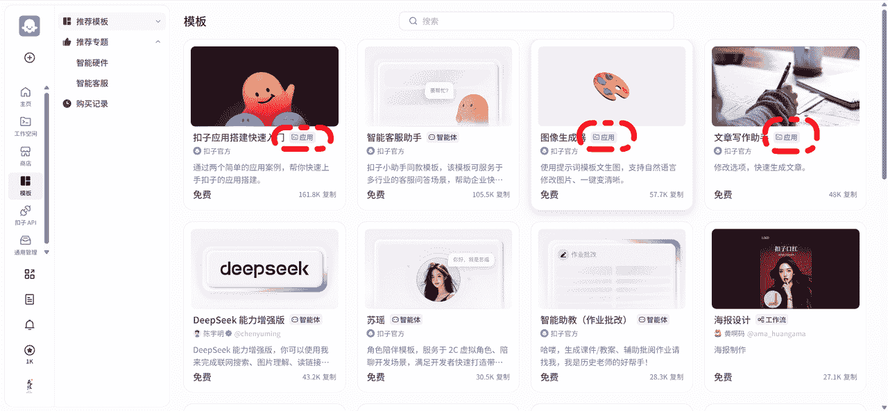

我在组件的时候发现了一个叫“Lottie动画”的组件，我当时就在想，这样就解决了UI动画的问题

在模板的时候，找到了一个很适合我们这个主题的模板《答案之书》

好了，一拍即合，开始吧！

希望这个思路对你有帮助！

## AI工作流设计

> 好了，废话不多说，直接开始把

新建一个工作流，名字随便

点击“开始节点”，变量名称设置为“query”

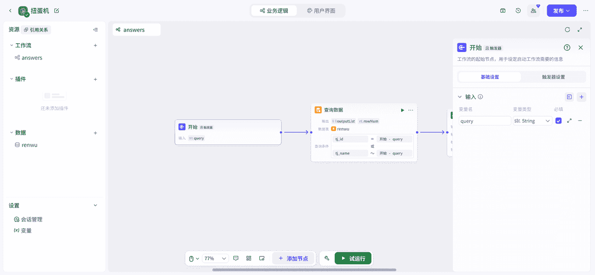

新建一个“查询数据”

点击数据表的“+”，添加一个数据表

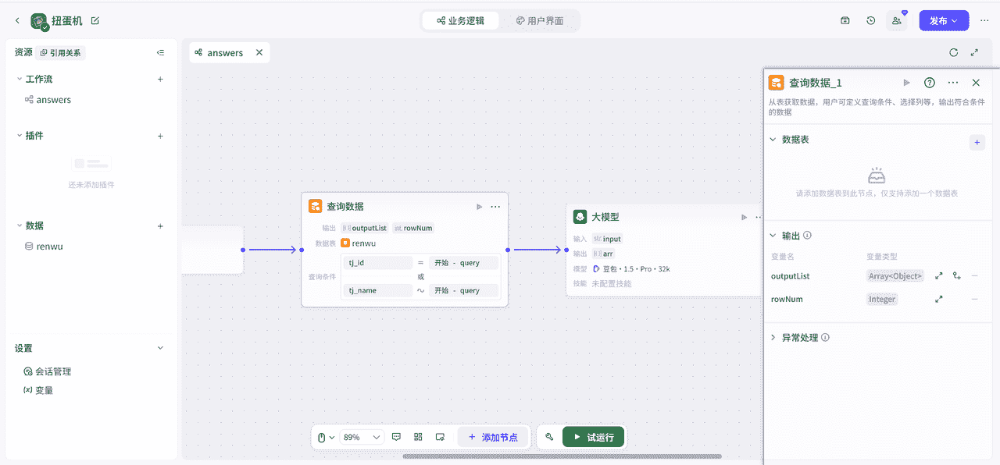

新建一数据表——自定义

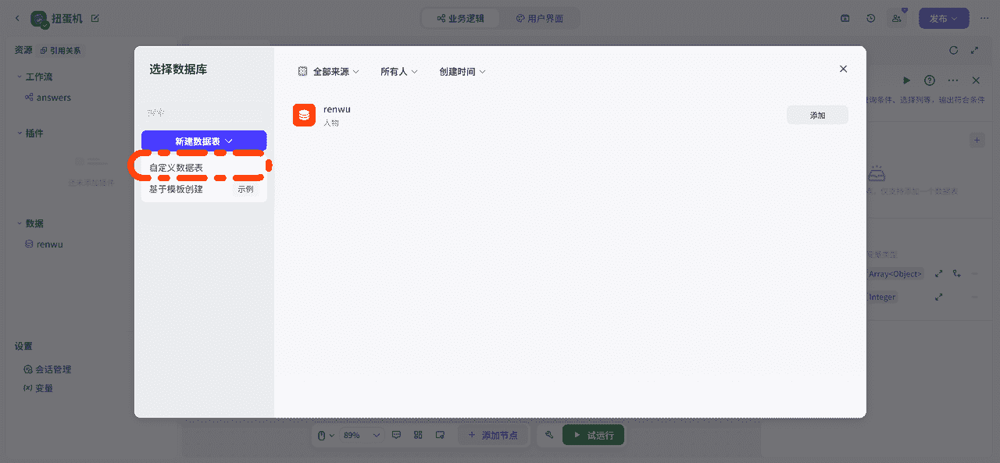

点击“使用AI新建”

复制下面内容到对话框，让AI生成

```
tj_name-提交人-String
yuju-语句-String
tj_id-提交人的ID-Integer
```

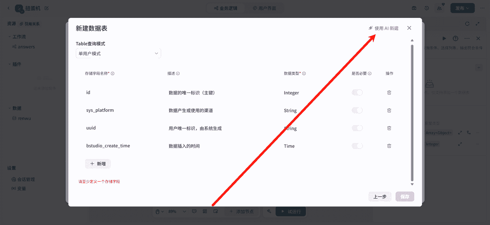

## PS：

> 这里大家在实验自己的内容的时候，就可以把AI给设计的表放进去，看看这些数据在整体上的流转

上传数据（根据真实内容改编）


[虚拟人物信息.xlsx](https://internal-api-drive-stream.feishu.cn/space/api/box/stream/download/all/CRX4bcsdhokQ1xxsGUhcePcmnEh)

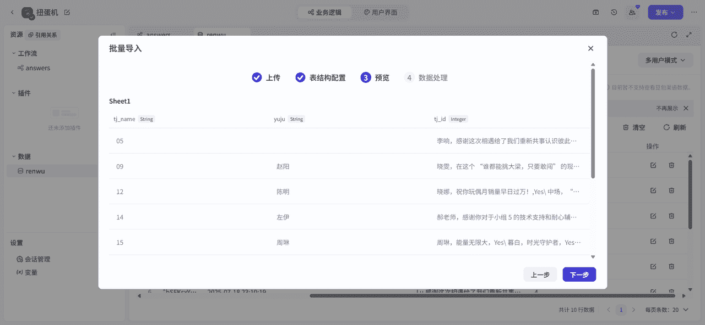

新建一个大模型节点

输入、输出如下

系统提示词

```
你将收到一段用“|”或者“\”分隔的多条记录文本，每条格式为：
name,title,Yes/No（大小写均可）

任务：
1. 按“|”或者“\”切分，得到若干条记录。
2. 对每条记录：
   - 去掉末尾的“,Yes”或“,No”（大小写不敏感，可带前后空格）。
   - 用第一个逗号把剩余内容分成 name 与 title（均 trim 前后空格）。
3. 输出纯 JSON，结构如下：
{&quot;arr&quot;:[{&quot;name&quot;:&quot;...&quot;,&quot;title&quot;:&quot;...&quot;}, ...]}
无需额外解释或文字。
```

用户提示词

```
{{input}}
```

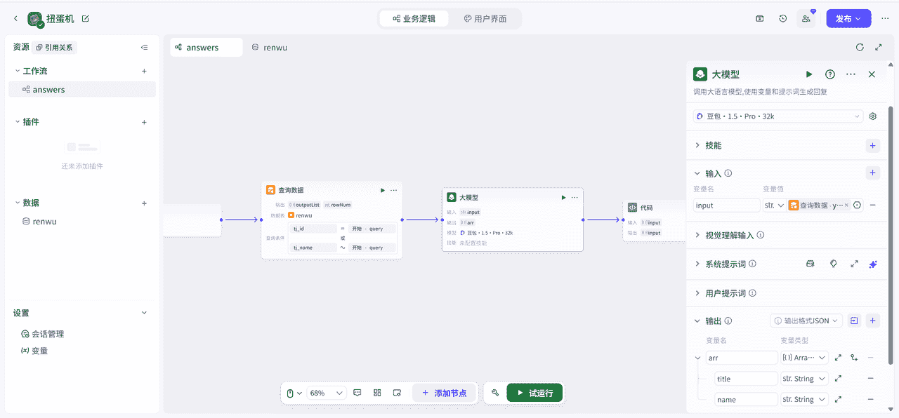

> 因为要给对应的内容加上，使用这里使用代码节点处理一下

添加代码节点，输入、输出如下图

        &quot;https://p9-bot-workflow-sign.byteimg.com/tos-cn-i-mdko3gqilj/90b1a6a779c34ca08a95f403d2e2a125.png~tplv-mdko3gqilj-image.image?rk3s=81d4c505&amp;x-expires=1783956442&amp;x-signature=j2mzagcgwSFolPTryRKrhbo3BBo%3D&amp;x-wf-file_name=%E8%93%9D%E8%89%B2.png&quot;,
        &quot;https://p26-bot-workflow-sign.byteimg.com/tos-cn-i-mdko3gqilj/7e3e1710e06d4e49a52b38dee6c15976.png~tplv-mdko3gqilj-image.image?rk3s=81d4c505&amp;x-expires=1783956443&amp;x-signature=IR9g00OmYQtCTiHgsoScWtSUe5E%3D&amp;x-wf-file_name=%E6%9C%AA%E6%A0%87%E9%A2%98-1.png&quot;,
        &quot;https://p26-bot-workflow-sign.byteimg.com/tos-cn-i-mdko3gqilj/2905ee52ea334d198254a73b6efdb94e.png~tplv-mdko3gqilj-image.image?rk3s=81d4c505&amp;x-expires=1783956443&amp;x-signature=kJLsaaNp1%2BCROGzTKC0euW8R7bI%3D&amp;x-wf-file_name=%E7%B4%AB%E8%89%B2.png&quot;

```
import random

async def main(args: Args) -&gt; Output:
    params = args.params
    arr = params[&#x27;input&#x27;]        # 这里本身就是列表，无需再 .get(&#x27;arr&#x27;)

    # 3 个候选 url（请替换成你的真实地址）
    url_pool = [
    ]

    # 为每个对象随机加一个 url
    for item in arr:
        item[&#x27;url&#x27;] = random.choice(url_pool)

    # 把处理后的数组再包一层对象返回（与入参结构保持一致）
    ret: Output = {&quot;input&quot;: arr}
    return ret
```

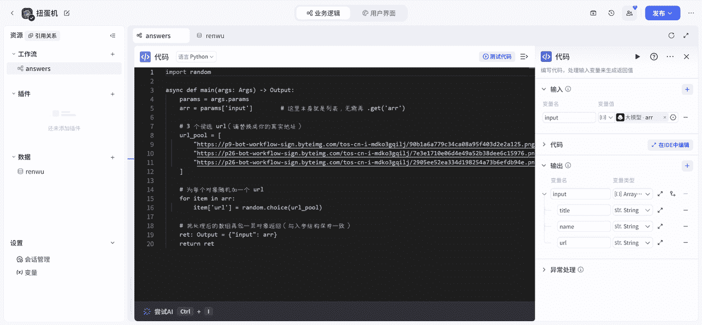

最后结束节点

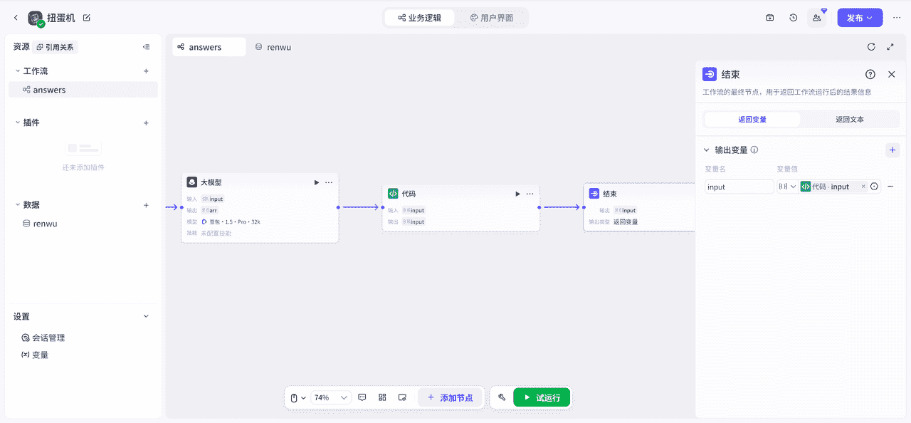

## 用户界面设计

设计相关的文件：


[【Coze应用】扭蛋机（原创）.zip](https://internal-api-drive-stream.feishu.cn/space/api/box/stream/download/all/PLFhbd7CeoKg1cxvrF1crQWjnXg)