# Coze应用+多维表格=数据分析

> 来源：[https://v11enp9ok1h.feishu.cn/docx/KnJadipgToOJHPxG1Hxcouf8n4b](https://v11enp9ok1h.feishu.cn/docx/KnJadipgToOJHPxG1Hxcouf8n4b)

## 一、效果演示

### 账号分析

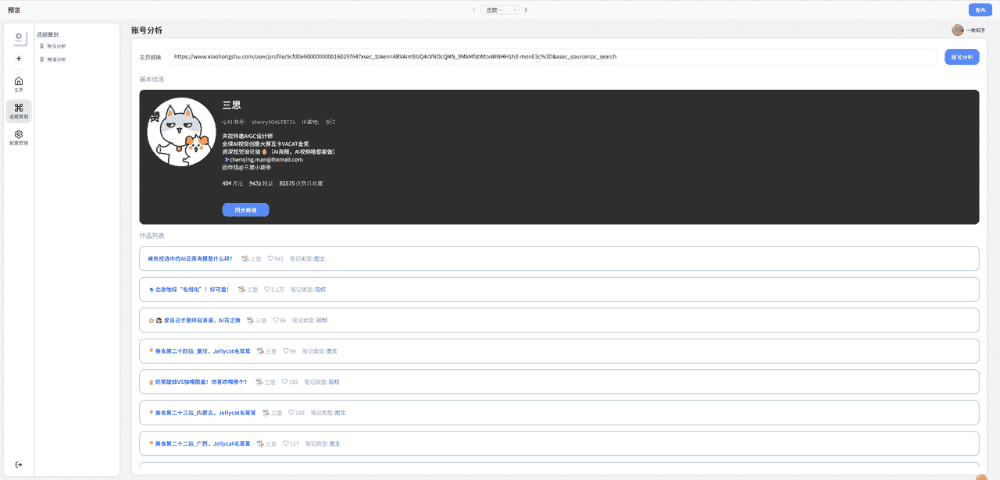

### 赛道分析

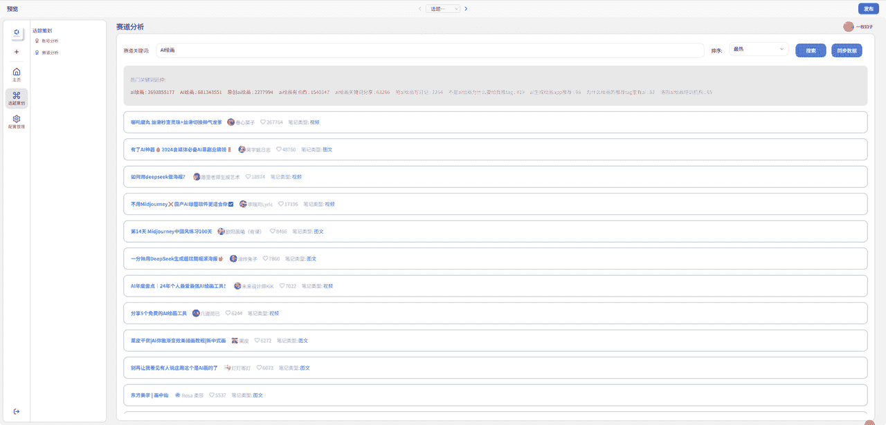

### 多维表格

#### 数据大屏

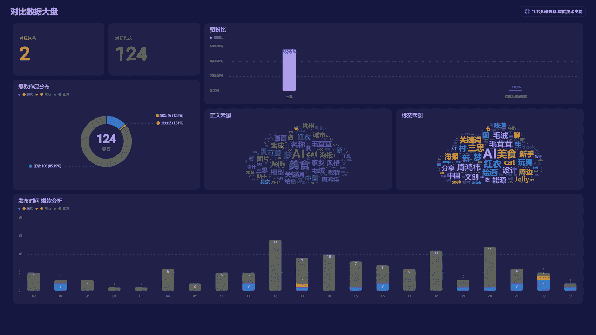

#### 账号分析结果

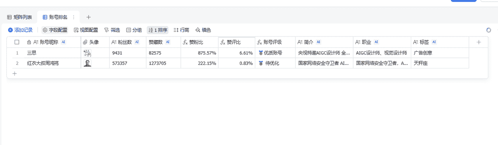

#### 笔记分析结果

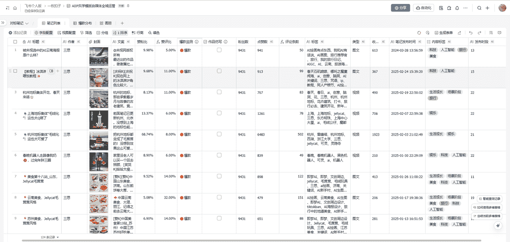

能帮助我们解决什么问题？

## 二、动手实践

### Coze 应用

#### **创建应用**

打开Coze，创建应用，选择PC模式。

设计应用界面：

##### 配置管理页面

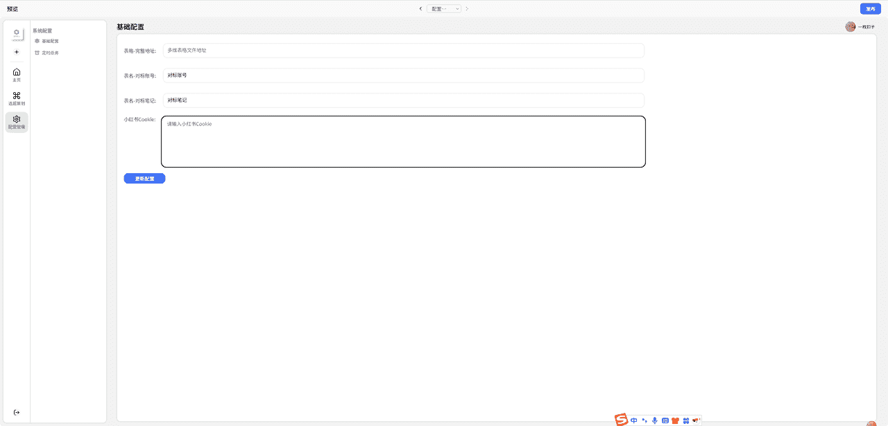

##### 账号分析页面

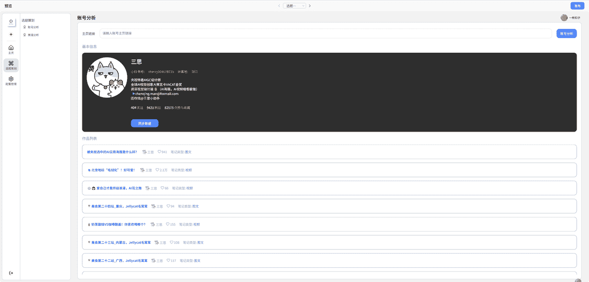

##### 赛道分析页面

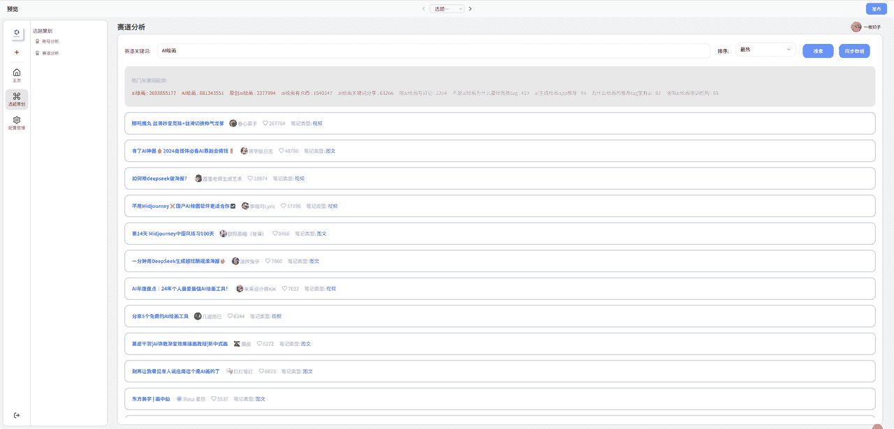

##### **简化版界面**

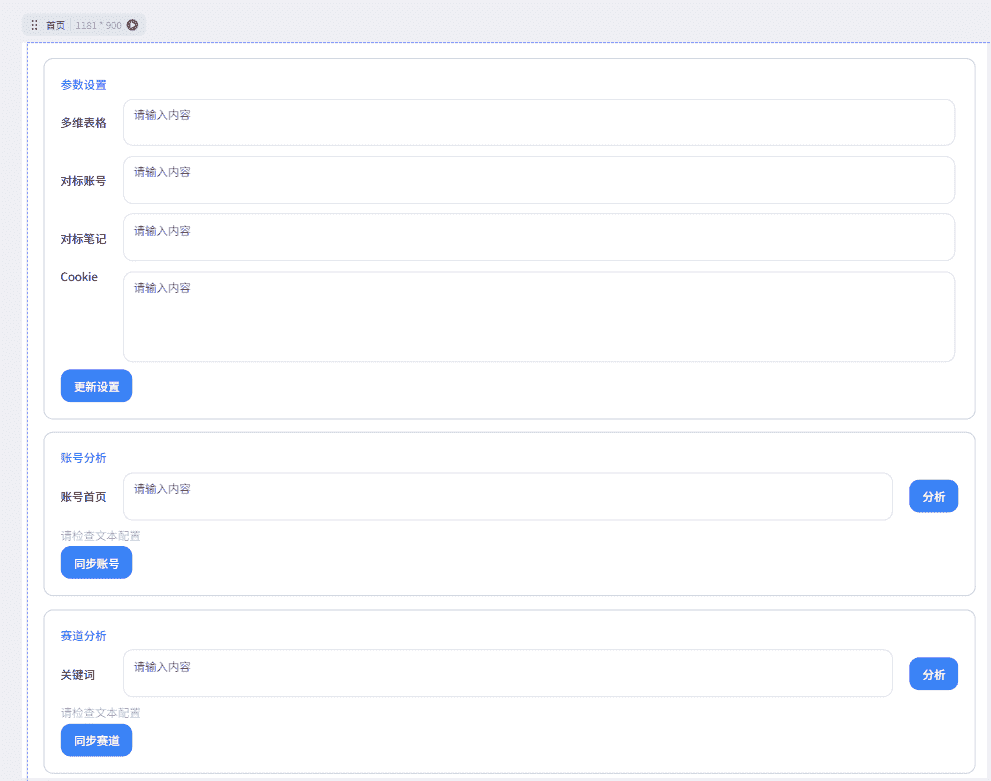

界面整体用来做三个任务，1. **设置参数****，包含你****的多维表格地址、**需要同步的表名、浏览器Cookie。2. 查询账号数据，并同步账号的基础信息和作品列表到多维表格。3.查询赛道或关键词，同步查询到的博主和相关作品，到到多维表格。

#### **配置工作流**

##### 工作流-配置管理

配置管理，通过用户变量，来保存设置，用于给其他工作流使用。

添加变量，设置启用

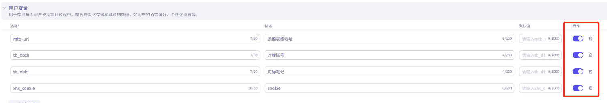

编排工作流，赋值给变量，在开始节点，添加4个变量，用于接收UI上输入的配置参数。

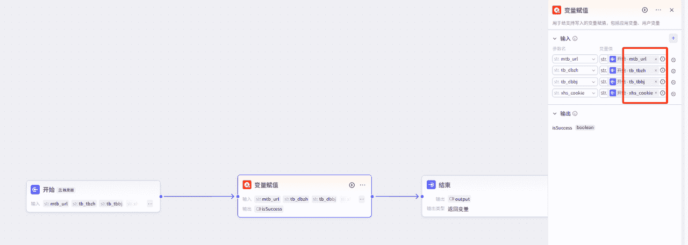

返**回到UI部分，将工作流关联**到“更新配置”按钮的事件上，并分别取4个输入框的值，传给工作流对应的4个参数。注意，要一一对应起来，不要弄错咯。

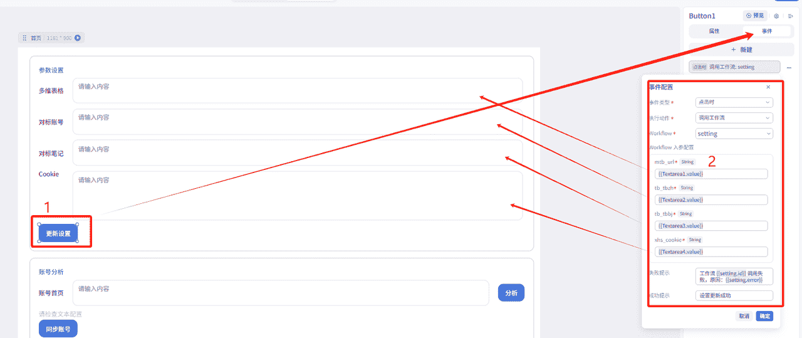

##### 工作流-账号分析

**基础工作流**

做一个基础的查询功能，用来确保正确读取信息，开始节点添加一个参数，user_link，用来接收界面上的输入地址，并传值给第二个节点。在第二个节点中（在插件商场找一个读取用户信息的小红书插件），然后选用户变量cookie赋值到第一个参数中，第二个参数用开始节点的参数，即可。

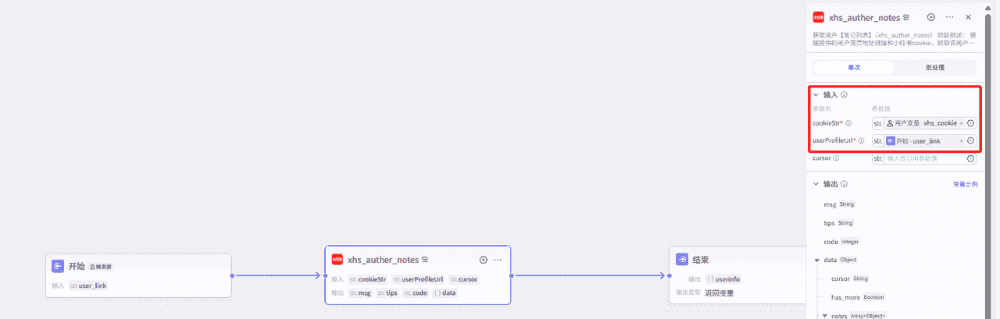

**数据同步工作流**

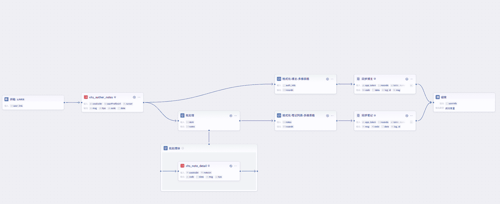

代码节点. 格式化-同步博主信息到多维表格

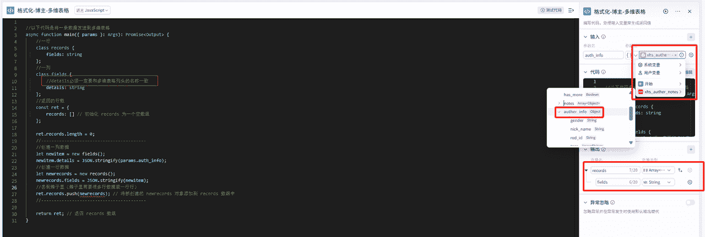

两个核心节点的代码：

```

//以下代码是将一条数据发送到多维表格
async function main({ params }: Args): Promise&lt;Output&gt; {
    //一行
    class records {
        fields: string
    };
    //一列
    class fields {
        //details必须一定要和多维表格列头的名称一致
        details: string
    };
    //返回的行数
    const ret = {
        records: [] // 初始化 records 为一个空数组
    };

    ret.records.length = 0;
    //-----------------------------------------
    //创建一列数据
    let newitem = new fields();
    newitem.details = JSON.stringify(params.auth_info);
    //创建一行数据
    let newrecord = new records();
    newrecord.fields = JSON.stringify(newitem);
    //丢到箱子里（箱子里需要很多行数据或一行）
    ret.records.push(newrecord); // 将新创建的 newrecord 对象添加到 records 数组中
    //-----------------------------------------

    return ret; // 返回 records 数组
}
```

**代码节点-笔记列表数据格式化**

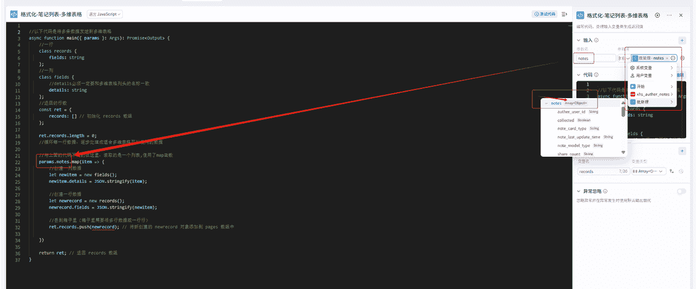

```

/**/以下代码是****将多****条数据发送到多维表**格
async function main({ params }: Args): Promise&lt;Output&gt; {
    //一行
    class records {
        fields: string
    };
    //一列
    class fields {
        //details必须一定要和多维表格列头的名称一致
        details: string
    };
    //返回的行数
    const ret = {
        records: [] // 初始化 records 数组
    };
    
    ret.records.length = 0;
    //循环每一行数据，逐步处理成适合多维表格可以使用的数据

    //与上面的代码不同的在这里，读取的是一个列表,使用了map函数
    params.notes.map(item =&gt; {
        //创建一列数据
        let newitem = new fields();
        newitem.details = JSON.stringify(item);

        //创建一行数据
        let newrecord = new records();
        newrecord.fields = JSON.stringify(newitem);

        //丢到箱子里（箱子里需要很多行数据或一行行）
        ret.records.push(newrecord); // 将新创建的 newrecord 对象添加到 records数组中

    })
 
    return ret; // 返回 records 数组
}
```

同步博主与同步笔记的两个节点都只需要分别取参数传入即可。

##### 工作流-关键词/赛道分析

**基础工作流**,**查询关键词**

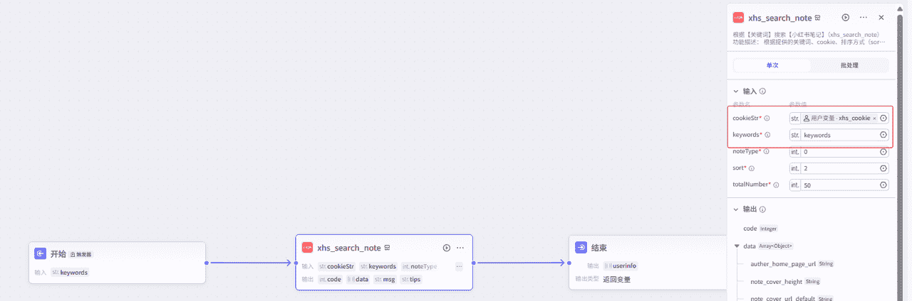

**同步数据工作流**

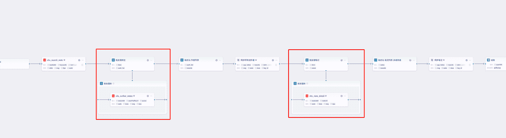

代码节点，这两个代码节点都使用上面的同步多条的代码节点即可。

最后参考，配置管理的界面，把按钮与工作流对应的调用关系设置好，即可。

**同步账号**

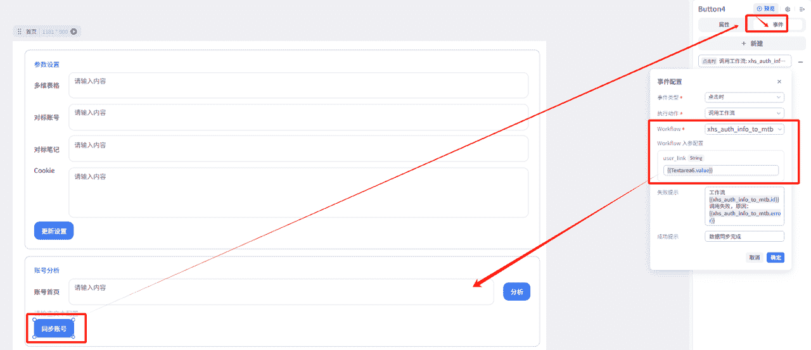

**同步赛道**

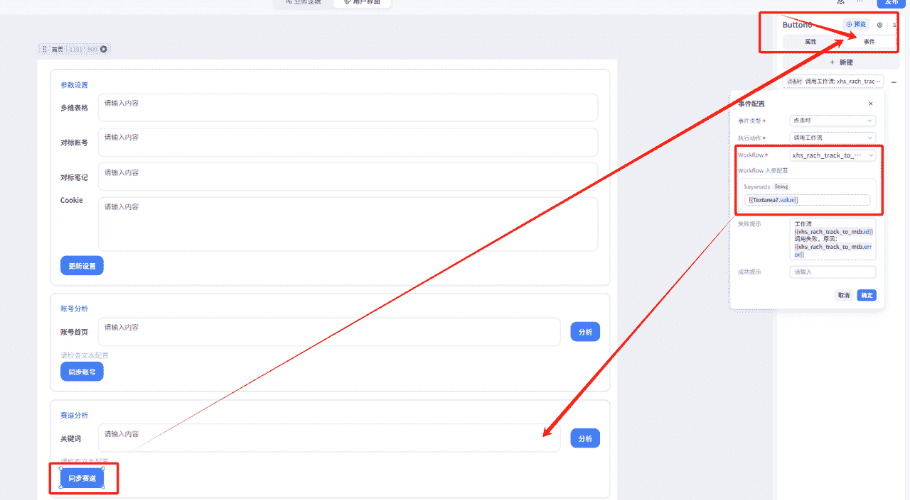

#### 多维表格

**复制多维表格模版，把对应的多维表格地址、表明**、Cookie设置进去。如果你改了表名或需要同步数据的列明，需要在代码你修改列名称，以及更新配置对应的表明。

一切就绪后，即可同步数据了。

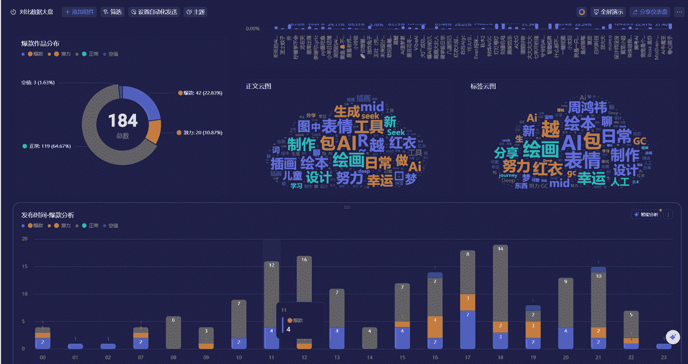

## 应用的背景说明

1.  解决的问题

1.  使用Coze、飞书多维表格、自定义AI字段捷径（这个名字不如改成叫Agent），来实现数据的高效抓取与批量AI化处理。

1.  技术场景

1.  Coze定义智能体，发布到飞书多维表格字段捷径。

1.  多维表格中使用和配置自定义的AI字段捷径。

1.  Coze应用，采用交互式界面将数据导入到飞书多维表格，并驱动多维表格自动运行。

1.  多维表格仪表盘对数据的可视化。

1.  期望达到的目的

1.  这个应用的目的，实际上是更多的是希望大家能看“如何最高效率使用AI”。抛砖引玉，让大家能将方案泛化到自己的实际工作中！同时，也选择了最适合的技术路线（不懂代码即可完成）！

## 动手实践

以上是几个环节的工作流程，接下来我们将一步一步实现以上流程。

所以，在你动手做应用之前，需要构思一下你想要做成什么样，以及想要解决什么问题，那么，在设计工作流的时候会比较清晰。

### Coze智能体（字段捷径）获取笔记+评论信息

#### 创建智能体

第一步，要创建一个智能体，使用单Agent对话流模式，

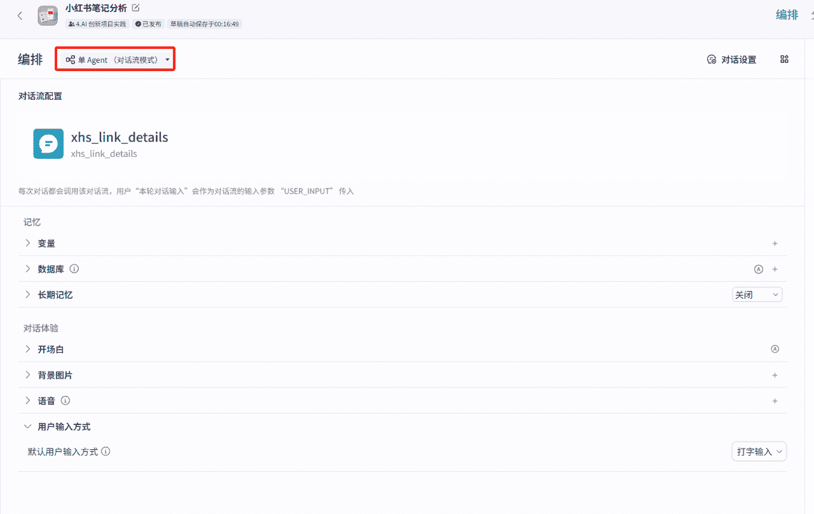

#### 编排对话流

点击创建一个新的对话流（记得要和智能体关联），编排如下：

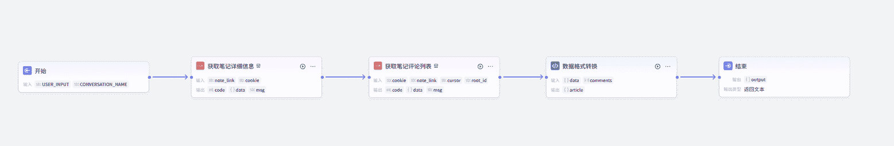

这个工作流没有什么特别需要注意的地方，两个小红书插件，大家可以在插件市场找到。按着配置，（cookie如何找？教程暴多），在获取笔记详情节点和笔记评论节点，分别配置cookie，note_link使用开始节点的USER_INPUT

然后，我们会使用代码节点，将两个插件获取的结果进行一次数据处理（代码节点通常都会在这个场景下出现）。

具体代码如下：

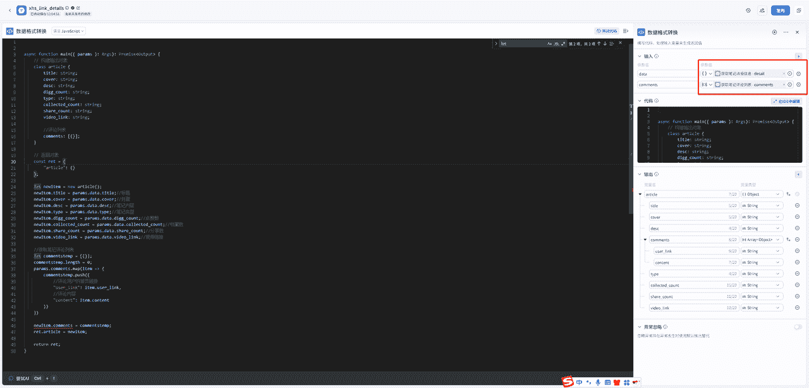

在这里要注意代码节点输出的配置格式。

```

async function main({ params }: Args): Promise&lt;Output&gt; {
    // 构建输出对象
    class article {
        title: string;
        cover: string;
        desc: string;
        digg_count: string;
        type: string;
        collected_count: string;
        share_count: string;
        video_link: string;

        //评论列表
        comments: [{}];
    }

    // 返回对象
    const ret = {
        &quot;article&quot;: {}
    };

    let newitem = new article();
    newitem.title = params.data.title;//标题
    newitem.cover = params.data.cover;//封面
    newitem.desc = params.data.desc;//笔记内容
    newitem.type = params.data.type;//笔记类型
    newitem.digg_count = params.data.digg_count;//点赞数
    newitem.collected_count = params.data.collected_count;//收藏数
    newitem.share_count = params.data.share_count;//分享数
    newitem.video_link = params.data.video_link;//视频链接

    //读取笔记评论列表
    let commentstemp = [{}];
    commentstemp.length = 0;
    params.comments.map(item =&gt; {
        commentstemp.push({
            //评论用户的首页链接
            &quot;user_link&quot;: item.user_link,
            //评论内容
            &quot;content&quot;: item.content
        })
    })

    newitem.comments = commentstemp;
    ret.article = newitem;

    return ret;
}
```

工作流的结束节点，选择使用代码的返回数据。配置如下

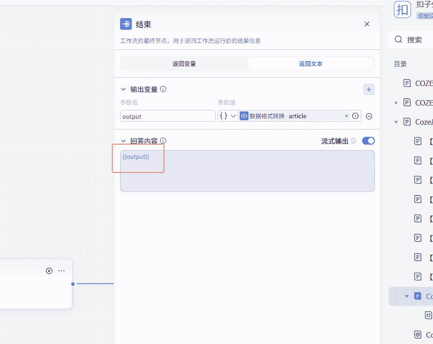

#### 测试

最后一步，测试。找到一篇小红书笔记，然后，试运行对话流，直接在对话窗口输入地址，当你看到数据，那就是成功了。

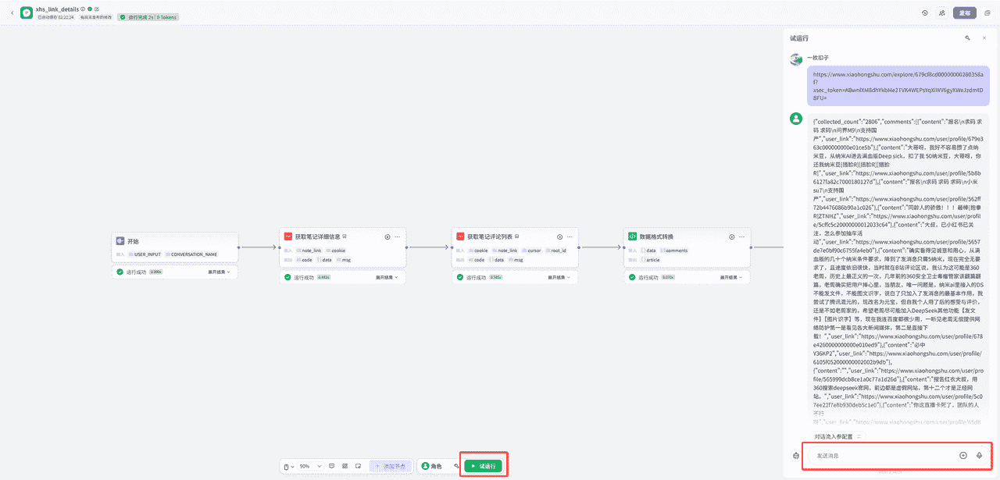

回到智能体的编排页面，同样的方式，也测试一下。确保对话流执行成功。

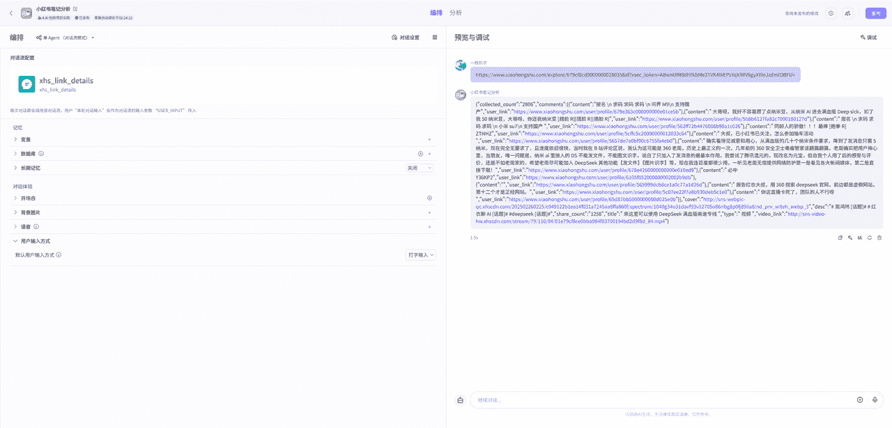

#### 发布

接下来是最重要的步骤：发布！

点发布后，只选择多维表格，然后，点配置

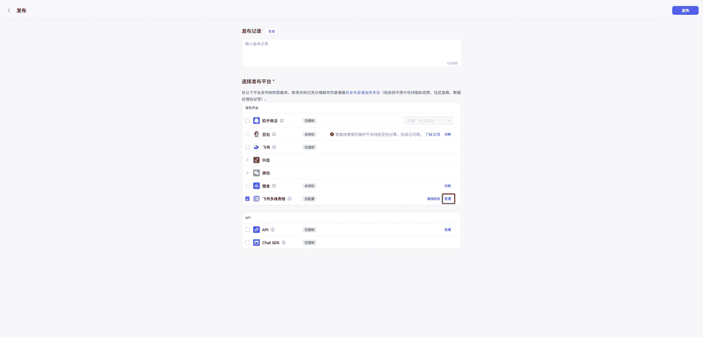

点击后，会打开配置页面。

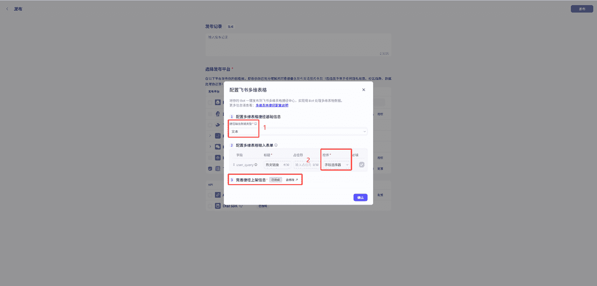

1.  是输出类型（选文本就行了）

1.  是输入类型，切记要选择字段选择器

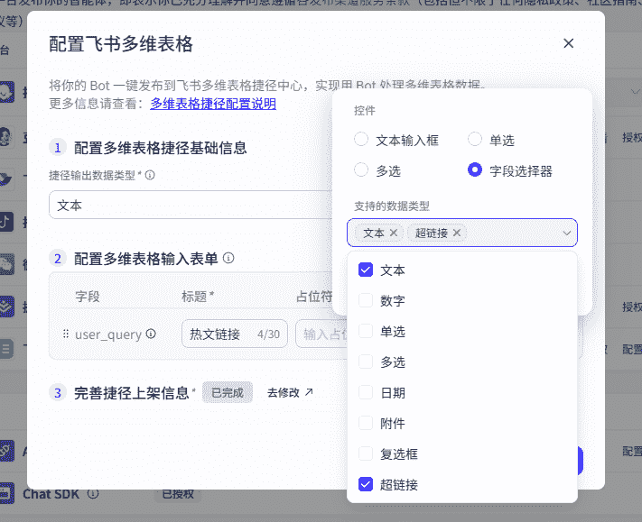

1.  要去完善上架信息。填个表格。表格本身没什么特点，在选发布范围的时候，可以选仅自己可用，否则审核时间就比较慢！

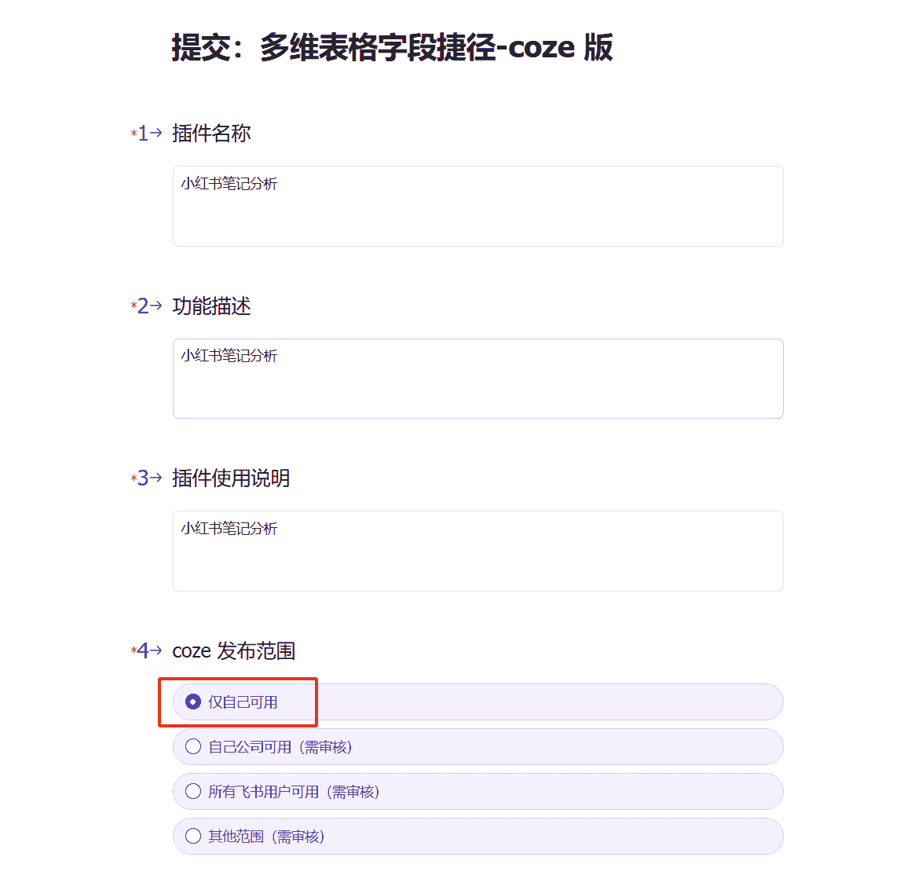

提交上架信息后，返回配置界面会显示已完成！

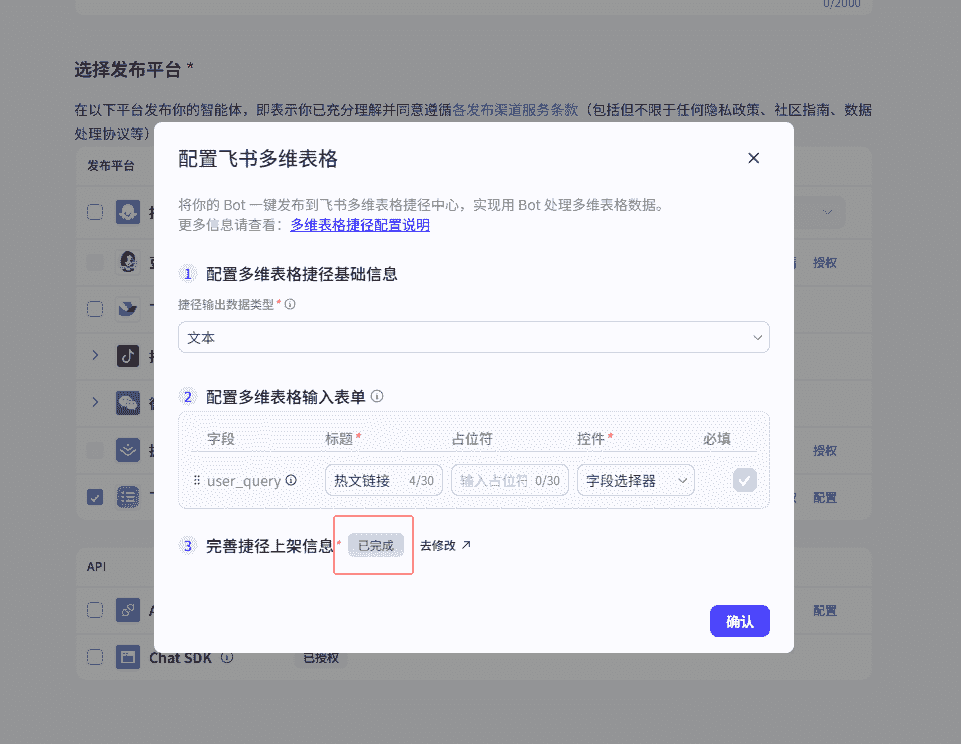

那么，就可以完成最终的提交了。嗯，配置比写工作流还烦！

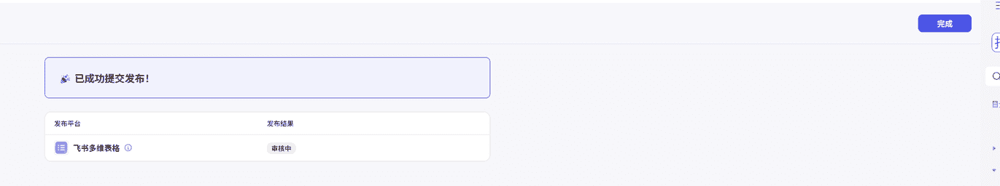

### 设计多维表格

#### 配置多维表格

进到飞书，新建一个多维表格！配置字段，新建一列，选择编辑列，然后如下图操作即可，完成相关设置。

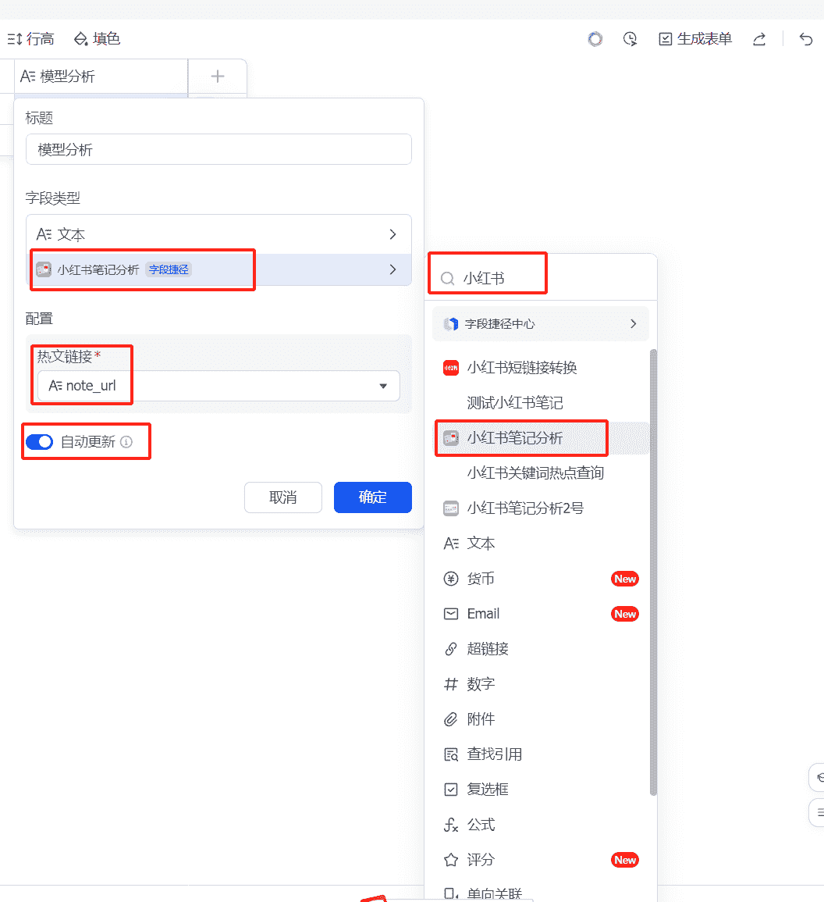

配置完，然后，打开自动更新，这里如果note_url如果有赋值，那么模型分析就会自动触发（trigger）。

我们可以测试一下。

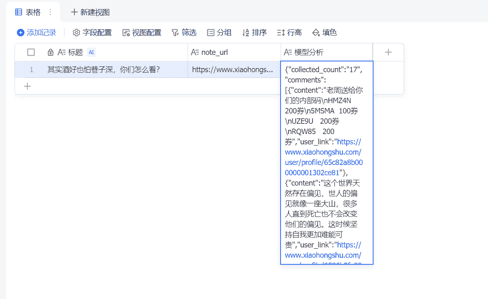

#### 配置其它列

我在第一列中设置了提取标题。

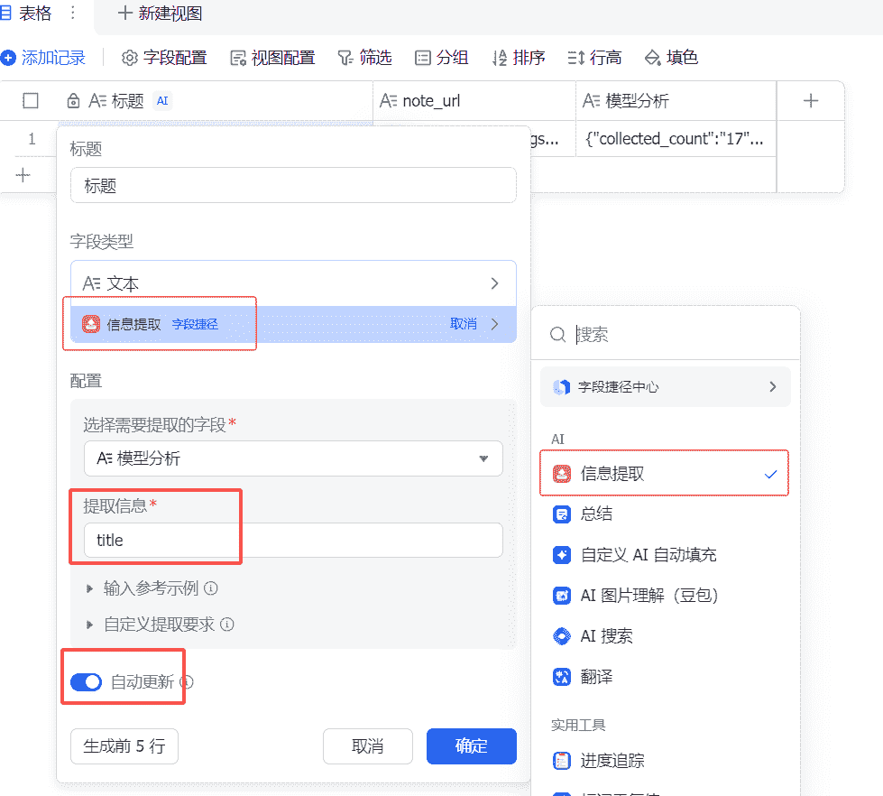

同理，我们可以在新建列，提取正文、点赞、转发、评论列表等数据，包含图文笔记的图片集合、视频笔记的视频链接。进行更多自动化处理。

比如，可扩展功能：笔记内容分析、仿写、改写，封面分析、标题拆解、图文复刻、视频提取分析（逐帧解析）分析视频、音频和字幕等数据分析。基于评论列表的舆情分析、情绪分析、线索挖掘、需求挖掘等。

### Coze 应用

现在，才到好玩的时候，因为我们不可能每**次都去复制一个链接贴进去，我们的需求是：根**据一个博主的链接，获取他的笔记，并全部自动写入到多维表格，多维表格再进行批量分析。

在前面两步中，我们已经完成了后端的准备工作。那么，接下来我们只需要完成找到博主的地址，批量读取笔记，并写入多维表格的note_url列，即可。

在我演示的应用中，这部分的UI比较复杂，因此，我们做一个简单版的：

#### **创建应用**

打开Coze，创建应用，可以选择PC模式。

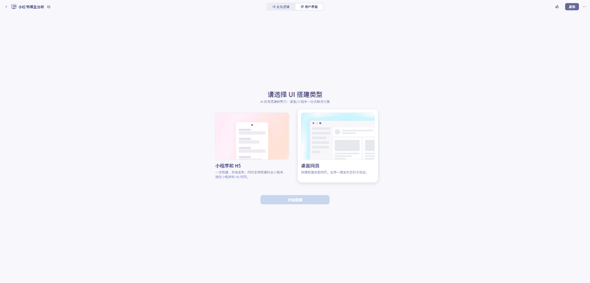

我们需要几个参数 1. 多维表格地址 2.多维表格对应的数据表名 3.小红书博主首页地址

界面设计如下，三个输入框，一个按钮。

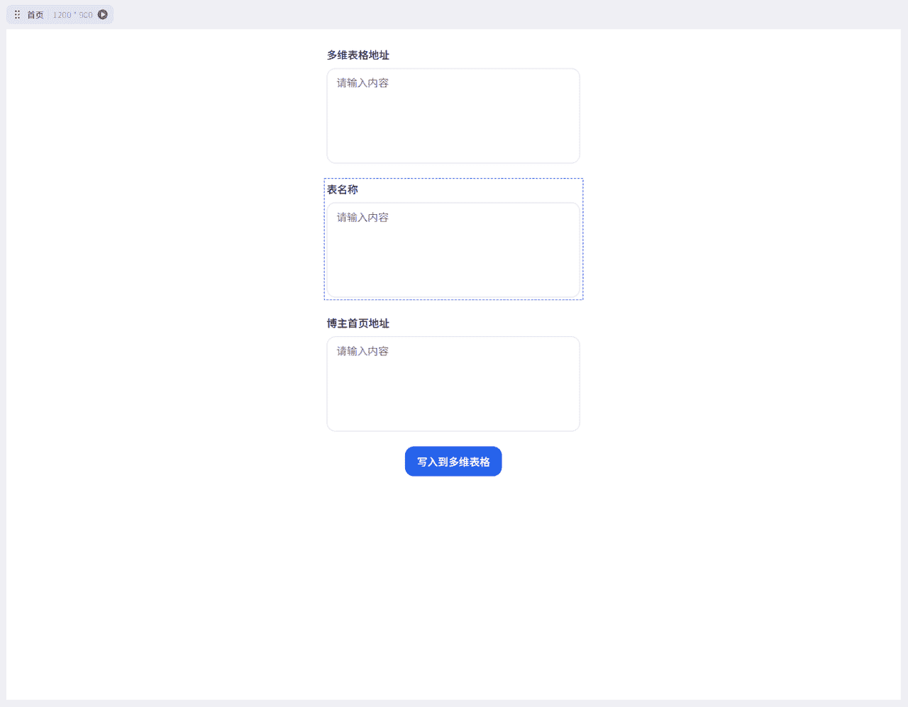

#### 开发工作流

界面设计完，我们去设计一个读取博主笔记列表的工作流，切换到业务逻辑，新建工作流。

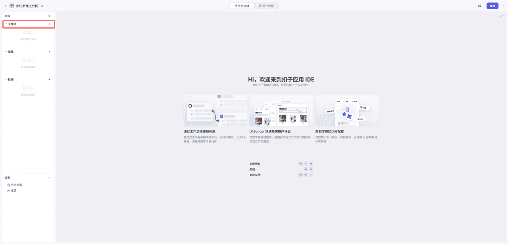

工作流如下，实际上只有三步，读取、转换、写入。

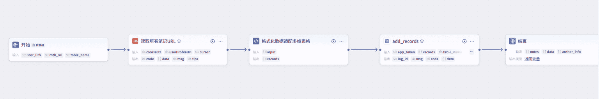

开始节点设置三个参数，分别代表 多维表格地址，表名称，博主首页地址。也是对应了我们界面上的三个输入框。

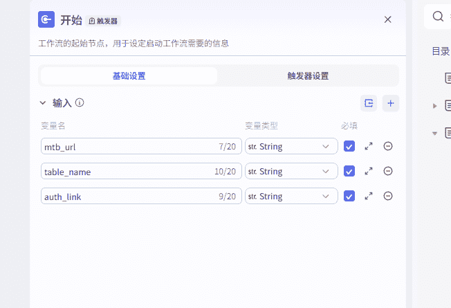

第一步就不讲了，与字段捷径里面的配置是一样的。只是要选读取作者笔记的插件。

将开始节点的auth_link关联到userProfileUrl，即可。

第二步的节点需要把数据转换为符合多维表格插件接收的数据格式。因此需要一个代码转换。

添加一个代码节点，复制代码进去

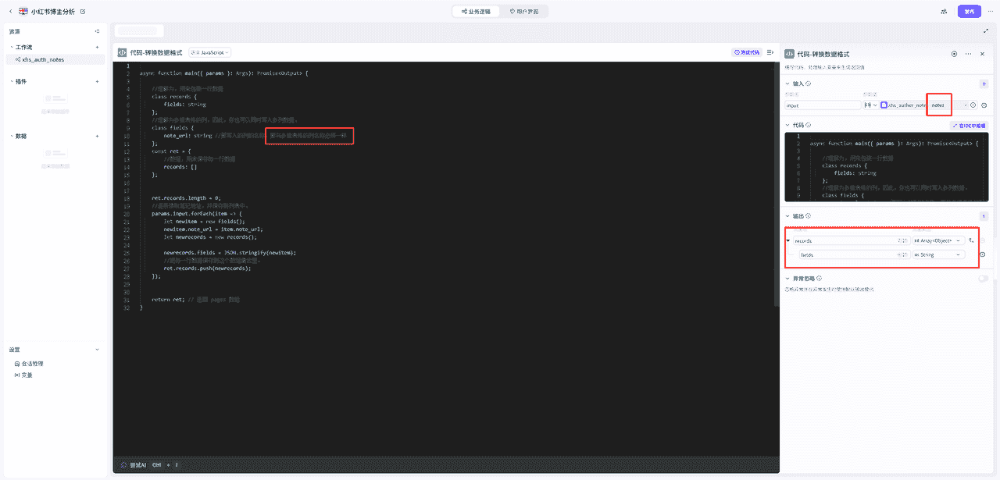

代码如下

```

async function main({ params }: Args): Promise&lt;Output&gt; {

    //理解为，用来包装一行数据
    class records {
        fields: string
    };
    //理解为多维表格的列，因此，你也可以同时写入多列数据。
    class fields {
        note_url: string //要写入的列的名称，要与多维表格的列名称必须一样
    };
    const ret = {
        //数组，用来保存每一行数据
        records: [] 
    };

    ret.records.length = 0;
    //逐条读取笔记地址，并保存到列表中。
    params.input.forEach(item =&gt; {
        let newitem = new fields();
        newitem.note_url = item.note_url;
        let newrecords = new records();
        
        newrecords.fields = JSON.stringify(newitem);
        //把每一行数据保存到这个数组集合里。
        ret.records.push(newrecords);  
    });

  
    return ret; // 返回 pages 数组
}
```

最后，在插件市场，搜索官方的多维表格插件

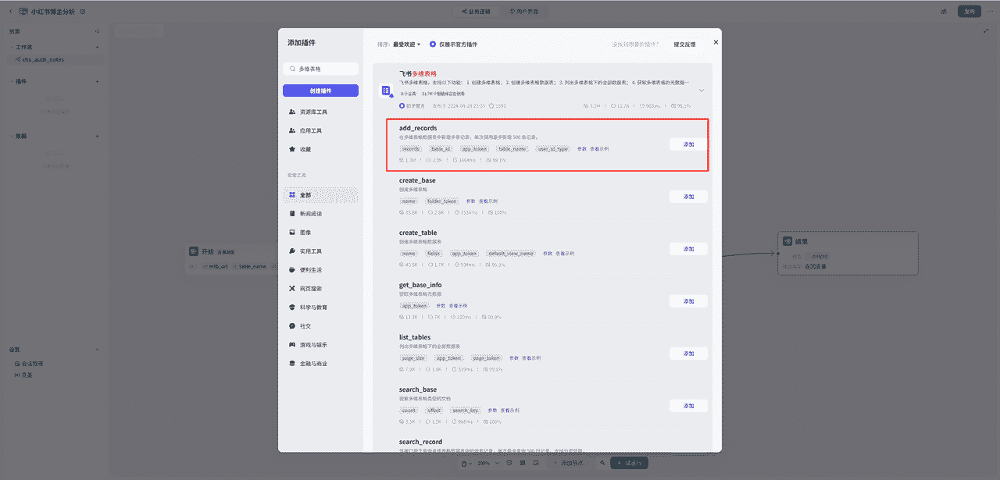

然后，选择 add_records，添加到工作流中。并分配配置参数，第一个参数，使用多维表格的url就行，第二个参数要使用我们代码转换后的数据，第三个参数一定要和你的表名称一致。

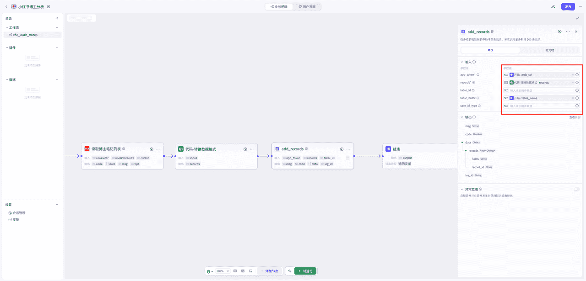

结束节点，就不重要了。配置一个值就行。

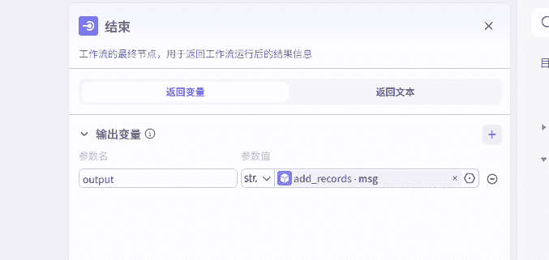

#### 测试工作流

我们需要先去多维表格复制链接和表明。按着我的设置来调整即可。

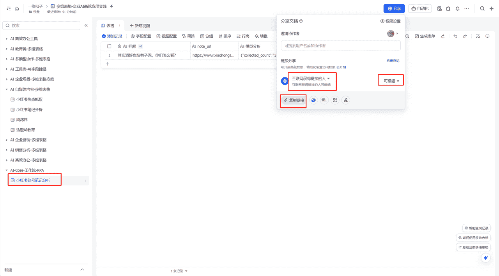

#### 注意授权

直接点击试运行，第一次运行，需要进行授权。

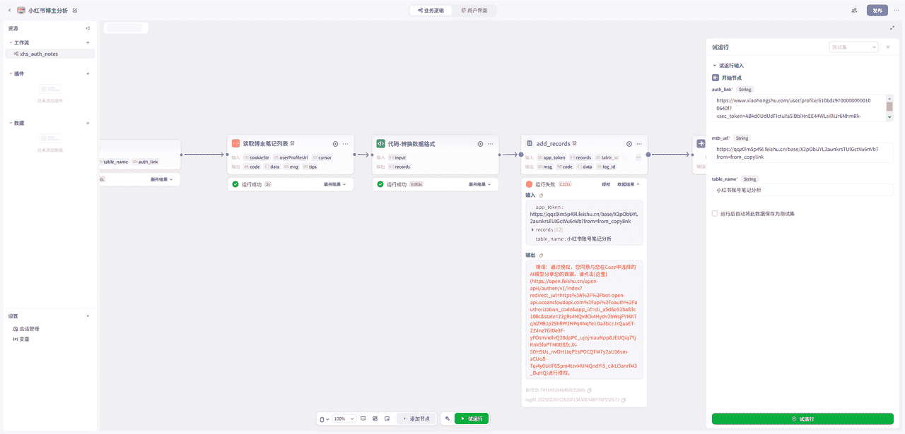

我们复制错误信息里面的链接，用浏览器打开，进行授权即可，提示授权完成后，再重新运行。

如果，运行成功了，那么你就可以切换到多维表格就会看到 他已经在自动工作了。

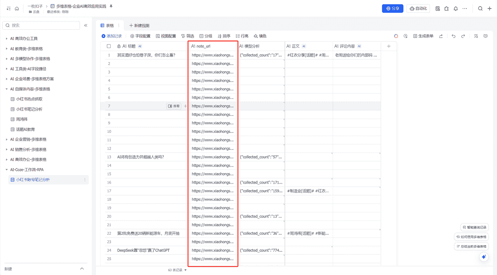

#### UI调用工作流

我们切换到UI部分，点击按钮，在右侧的属性面板中，选择事件，并选择点击时调用工作流。分别把三个输入框的值给到对应的参数。然后点击确定。

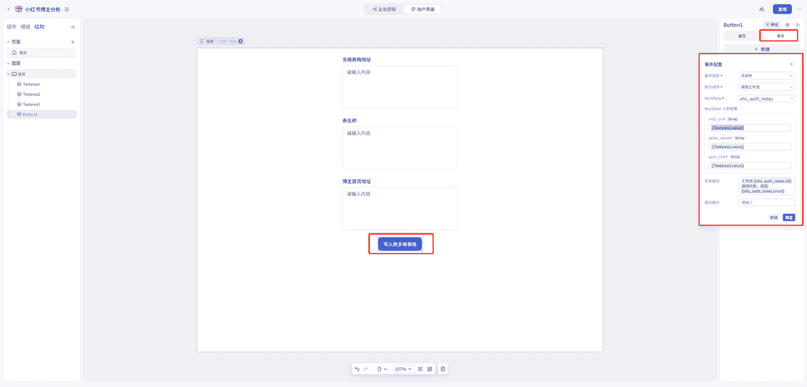

#### 预览测试

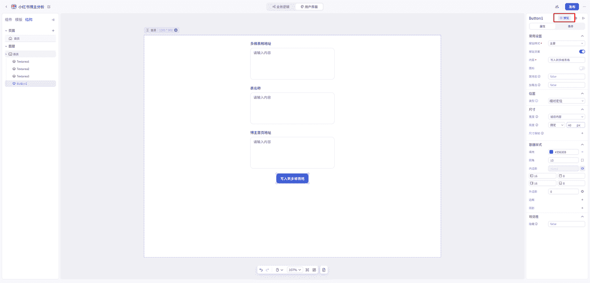

因为刚才那个表已经有数据了。那么我们可以复制这个表,或做成模版，选择只复制表结构。


刚才的那个数据已经自动解析完了。

我们继续，复制完成后，我们回到应用的预览页面，同样，把多维表格地址、表名、博主首页地址，输入进去即可。点击按钮后，结果如下图：


至此，我们的这个应用就算完成了。

# 三、总结

> 总结本次技术应用中可积累的代码和经验

> 我们学习了什么？

> 扩展思维

1.  Coze智能体+工作流，以及发布为字段捷径，与相关配置。

1.  插件与代码结合的方式。

1.  多维表格字段捷径简单用法。

1.  如何向多维表格写入数据。

1.  如何做一个简单的UI，并关联工作流。

+   这是我目前AI服务企业客户快速MVP基本方法，大家可以参考。最终交付形式多样，会根据客户需求选择最合适的高效、低成本技术栈。

+   需要为自己设计一套可交付的UI，提高用户体验。

+   要善于将多个技术进行组合使用，有奇效。

+   业务拆解能力非常重要，善于洞察核心问题。