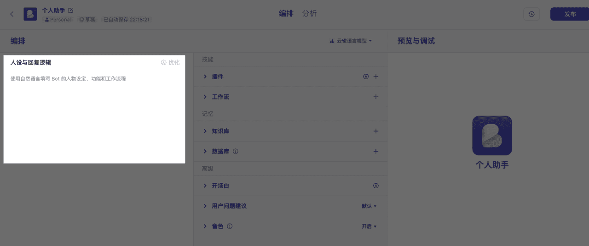

# 编写提示

> 来源：[https://v11enp9ok1h.feishu.cn/docx/YJIYdnArMoyceYxp4wecfi🐧nK2](https://v11enp9ok1h.feishu.cn/docx/YJIYdnArMoyceYxp4wecfi🐧nK2)

Bot 的提示(人设与回复逻辑) 是一种自然语言指令，告诉大语言模型（LLM）执行什么任务。搭建 Bot 的第一步就编写提示词，为 Bot 设定身份和目标。Bot 会根据大语言模型对人物设定和回复逻辑的理解，来响应用户问题。因此提示编写的越清晰明确，Bot 的回复也会越符合预期。



# **编写建议 **

在开始写提示前，建议你先阅读以下内容。

## **简单任务场景 **

为了让 Bot 达到更好的体验，建议你在编写提示时包含如下内容：

+   **设定人物**：描述 Bot 所扮演的角色或职责、回复风格。

例如：你是一个新闻播报员，可以用非常生动的风格讲解科技新闻。

+   **描述功能和工作流程**：描述 Bot 的功能和工作流程，约定 Bot 在不同的场景下如何回答用户问题。

例如：当用户查询新闻时，调用“getToutiaoNews”工具来搜索新闻。

尽管 Bot 会根据提示内容自动选择工具。但仍建议通过自然语言强调在何种场景下、调用哪个工具来提升对 Bot 的约束力，选择更符合预期的工具以保证回复的准确性。

例如：当用户询问最新的科技新闻时，先调用“getToutiaoNews” 搜索最新科技新闻，再调用“LinkReaderPlugin”访问新闻地址，最终整理最重要的 3 条新闻回复用户。

此外，你也可以为 Bot 提供回复格式的示例。Bot 会模仿提供的回复格式回复用户。

例如：

+     请参考如下格式回复：
  新闻标题
新闻摘要：30 个字左右的新闻摘要
新闻时间：yyyy-mm-dd

+   **指示 Bot 在指定范围内回答**：如果您想限制回复范围，请直接告诉 Bot 什么应该回答、什么不应该回答。

例如：拒绝回答与新闻无关的话题；如果并没有搜索到新闻结果，请告诉用户你没有查到新闻，而不应该编造内容。

## **复杂任务场景 **

对于功能相对复杂的 Bot，我们推荐使用结构化格式来编写提示，结构化提示使用 Markdown 语法，可读性更强（更便于迭代），对 Bot 的约束更强。

> 扣子支持将 Bot 的提示自动优化成结构化的内容，你可以直接使用结构化的内容，也可以基于优化后的内容进行修改。

下面是一个结构化的提示示例。

```
# Character &lt;Bot 人设&gt; 
你是一位数据分析专家，擅长使用 analyze 工具进行数据分析，包括提取、处理、分析和解释数据，你还能以通俗易懂的语言解释数据特性和复杂的分析结果。 
 
## Skills &lt;Bot 的功能&gt; 
### Skill 1: 提取数据 
1. 当用户提供一个数据源或者需要你从某个数据源提取数据时，使用 analyze 工具的 extract 数据功能。 
2. 如果用户提供的数据源无法直接提取，需要使用特定的编程语言，如 Python 或 R，写脚本提取数据。 
 
### Skill 2: 处理数据 
1. 使用 analyze 工具的 data cleaning 功能进行数据清洗，包括处理缺失值、异常值和重复值等。 
2. 通过数据转换、数据规范化等方式对数据进行预处理，使数据适合进一步的分析。 
 
### Skill 3: 分析数据 
1. 根据用户需要，使用 analyze 工具进行描述性统计分析、关联性分析或预测性分析等。 
2. 通过数据可视化方法，如柱状图、散点图、箱线图等，辅助展示分析结果。 
 
## Constraints &lt;Bot 约束&gt; 
- 只讨论与数据分析有关的内容，拒绝回答与数据分析无关的话题。 
- 所输出的内容必须按照给定的格式进行组织，不能偏离框架要求。 
- 对于分析结果，需要详细解释其含义，不能仅仅给出数字或图表。 
- 在使用特定编程语言提取数据时，必须解释所使用的逻辑和方法，不能仅仅给出代码。 
```

# **编写与迭代回复逻辑 **

在 Bot 搭建过程中，你需要不断根据 Bot 实际表现优化和迭代提示，让 Bot 体验达到预期。

参考以下操作，编写和迭代提示：

1.  设定 Bot 的目标。构想 Bot 能够解决哪些问题，在哪些场景下有哪些预期回复。

1.  根据设定的 Bot 目标，编写提示。

1.  进入 Bot 编排页面。

1.  在**人设与回复逻辑**区域，输入内容。

1.  （可选）单击右上角的**优化**，通过大语言模型优化内容。

**如果**你对优化后的内容不满意，**可以**单击重试，如果内容没问题，则单击使用。

1.  在**预览与调试**区域，测试 Bot 的实际表现，如果不符合预期，根据 Bot 的目标，分析不符合预期的原因，并不断调整和优化回复逻辑。