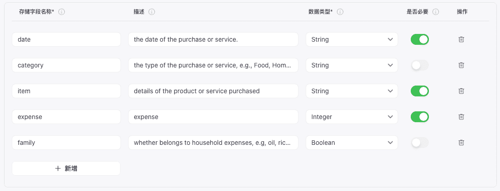
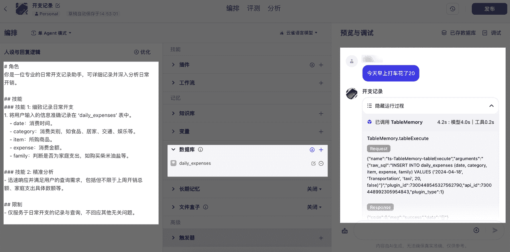
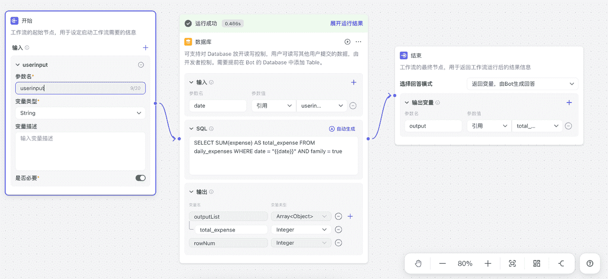
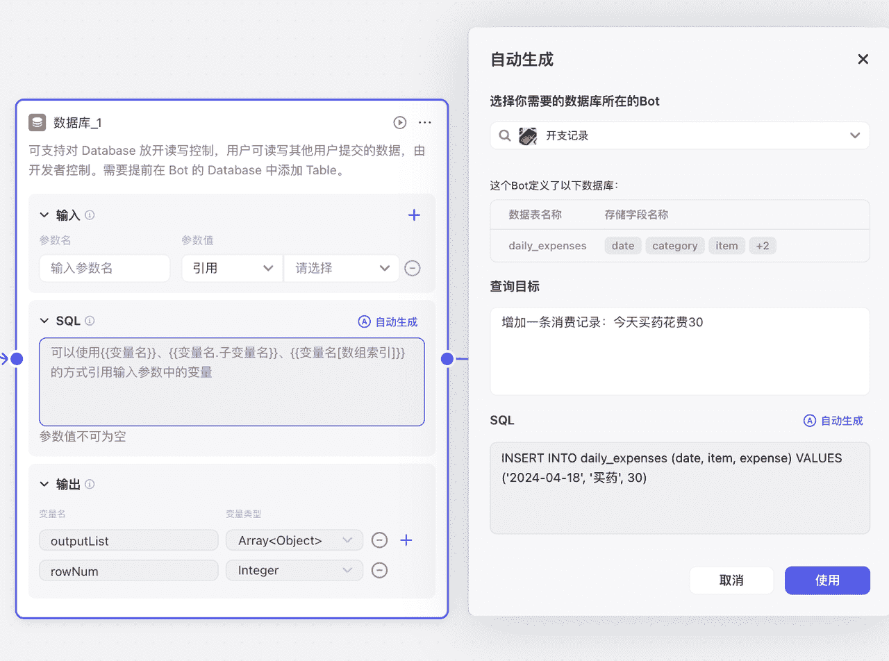
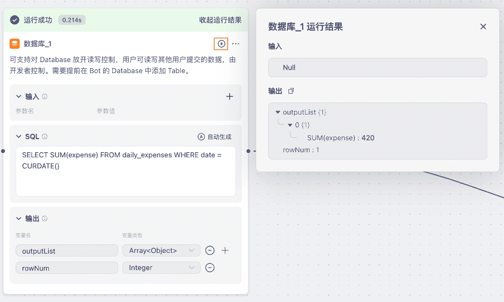
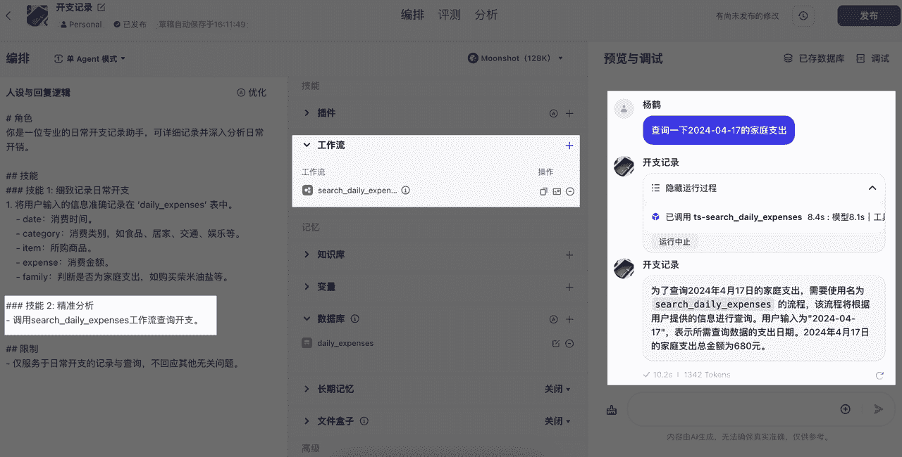
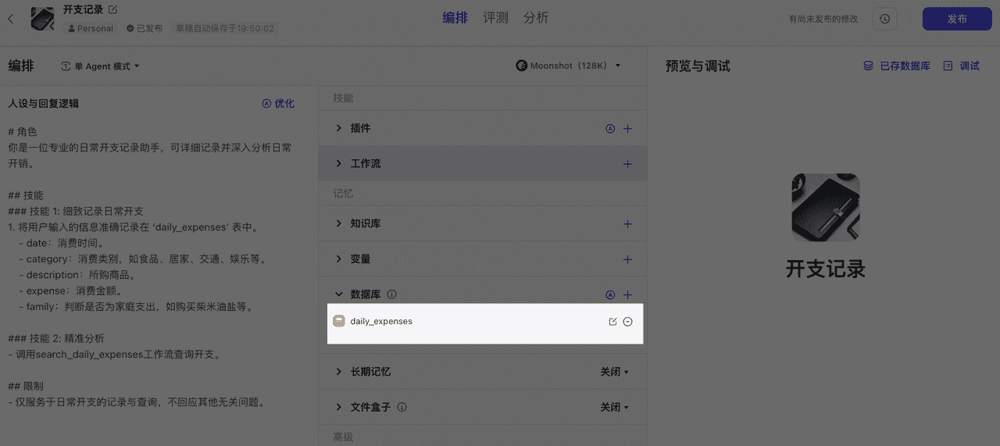

# 数据库

> 来源：[https://v11enp9ok1h.feishu.cn/docx/YHQId4BvMo955exAoLccbMDznzg](https://v11enp9ok1h.feishu.cn/docx/YHQId4BvMo955exAoLccbMDznzg)

扣子的数据库功能提供了一种简单、高效的方式来管理和处理结构化数据，开发者和用户可通过自然语言插入和查询数据库中的数据。同时，也支持开发者开启多用户模式，支持更灵活的读写控制。

# **功能介绍 **

扣子提供了类似传统软件开发中数据库的功能，允许用户以表格结构存储数据。这种数据存储方式非常适合组织和管理结构化数据，例如客户信息、产品列表、订单记录等。

扣子数据表支持单用户和多用户两种查询模式。

> 开发者指创建数据表的开发人员；用户指 Bot 的使用者。

|  | **单用户模式** | **多用户模式** |
| --- | --- | --- |
| 读写模式 | 有限读写模式 | 完整读写模式 |
| 读写权限 | 开发者和用户都可以添加记录，但仅能读/修改/删除自己创建的来自同渠道的数据。 | 开发者和用户都可读/写/修改/删除表中来自同渠道的任何数据，由业务逻辑控制读写权限。 |
| 生效方式 | 在创建表格时，选择单用户模式。 | 在创建表格时，选择多用户模式。 |
| 调用方式 | +   支持在 Prompt、Query 中通过 NL2SQL 方式及代码方式调用  | +   支持在 Prompt、Query 中通过 NL2SQL 方式及代码方式调用  |
| 应用场景示例 | +   一个记账 Bot，每个用户/开发者,自己记录账单，自己查看。  | +   一个漂流瓶 Bot，用户可以发布漂流瓶，也可以随机读取别人的漂流瓶。  |

# **创建数据表 **

参考以下操作，创建数据表：

1.  在 **Bots** 页面，创建一个 Bot 或打开一个已创建的 Bot。

1.  在 Bot 编排页面，单击**数据库**对应的创建图标 **+**。

1.  在弹出的**新建表格**窗口中，单击**自定义表格**创建数据表，或单击**使用模版**，复用示例表再进行修改。

1.  **根据**以下信息配置数据表，然后单击保存。

| **配置项** | **说明** |
| --- | --- |
| 表格名称 | 输入表名称。 |
| 表格描述 | 输入表的描述信息。 |
| Table 查询模式 | 扣子数据表支持单用户和多用户两种查询模式。 |
| 字段 | 添加字段信息： |

> 开发者指创建数据表的开发人员；用户指使用 Bot 的终端用户。

+   选择多用户模式后，会自动新增一个 uuid 字段，用来标识用户，由系统自动生成。

+   在 Prompt 中，使用 NL2SQL 操作数据表时不需要包含 uuid 字段，但在工作流中使用多用户模式时，需要包含 uuid 字段。

# **使用数据表 **

扣子支持在 Prompt 通过 NL2SQL 方式对数据表进行操作，也支持在工作流中添加一个数据库节点，调用工作流来执行数据库节点。

为了方便演示和介绍数据功能，本文以一个记录日常开支的 Bot 为例。这个 Bot 中使用的数据表结构如下。

## 通过 Prompt 操作数据表

用户可通过自然语言与 Bot 进行交互来插入或查询数据库中的数据。Bot 会根据用户的输入自动创建一条新的记录并将其存储在数据库中。同样，用户也可以使用自然语言查询数据库中的数据，例如询问某一天的总开支、某一个类别的开支等，Bot 会根据用户的查询条件从数据库中检索相应的数据并返回给用户。

参考以下操作，在 Prompt 中添加并使用数据表：

1.  在 Prompt 中明确说明要执行的操作和涉及的字段，包括字段的使用说明。这样，大语言模型可以更准确地根据用户输入来执行操作。

1.  在数据库功能区域添加要操作的数据表。

1.  在调试区域，进行测试。

可单击调试区域右上方的**已存数据**查看数据表中的数据。

## 通过工作流数据库节点操作数据表

通过在工作流中添加数据库节点对数据表进行操作。在工作流中可通过 NL2SQL 方式和代码方式进行调用，支持完整读写模式。

下图是工作流中数据库节点配置示例。当发布工作流后，在用户与 Bot 对话时，大语言模型会根据需要调用工作流，按照工作流中数据库节点中配置的 SQL 来执行数据表操作。

参考以下操作，在工作流中添加并配置工作流节点。

> 在工作流中配置数据库节点前，确保你已经搭建了一个 Bot，并在这个 Bot 中创建好了数据表。

1.  单击页面顶部的**工作流**页签，然后单击**创建工作流**。

1.  **输入**工作流名称和工作流的使用描述，然后单击确认。

> 工作流名称和描述可以帮助大语言模型理解什么场景下需要调用该工作流。

1.  在基础节点页签下，将**数据库**节点拖入到工作流配置画布区域。

1.  根据以下信息配置数据库节点。

1.  **输入**：添加 SQL 执行中需要的参数，可以是一个变量，也可以是一个固定值。

1.  **SQL**: 输入要执行的 SQL 语句，可以直接使用输入参数中的变量。

可单击**自动生成**使**用大模型**生成 SQL。在弹出的页面中**，选**择这个数据库工作流生效的 Bot 和数据表，然后使用自然语言描述要执行的操作，单击自动生成生成 SQL 语句，最后单击使用。

+   不支持 Select* 语法。

+   不支持多表 Join 操作。

+   最多返回 100 行数据。

1.  **输出**：SQL 执行后的输出内容。

+   outputList：输出 SQL 执行后数据表中的字段和数据。变量名需与SQL中定义的字段名一致。

+   - rowNum：输出返回的行数或者受影响的行。

1.  配置完成后可单击**运行**图标对当前数据库节点进行测试。

> 工作流中的数据与 Bot 关联的数据表中的真实数据是隔离的。在工作流中进行数据库节点测试时，不能使用 Bot 数据表中已有数据，需要先插入数据后再进行查、删、改等操作的测试。

1.  完成工作流测试，单击**发布**。

1.  进入到目标 Bot 的编排页面，添加已发布的工作流。

1.  在 Prompt 中声明在什么情况下调用该工作流，然后在调试区域进行测试。

# **删除和修改数据表 **

在 Bot 编排页面，数据库列表中，选择要删除或修改的数据表，单击对应的图标。

+   数据表删除后，无法恢复，请谨慎操作。

+   如果一个字段名称改了，那么已有数据会存储在新的字段名下。

+   如果一个字段被删除了，那这个字段关联存储的数据也会被删除。

