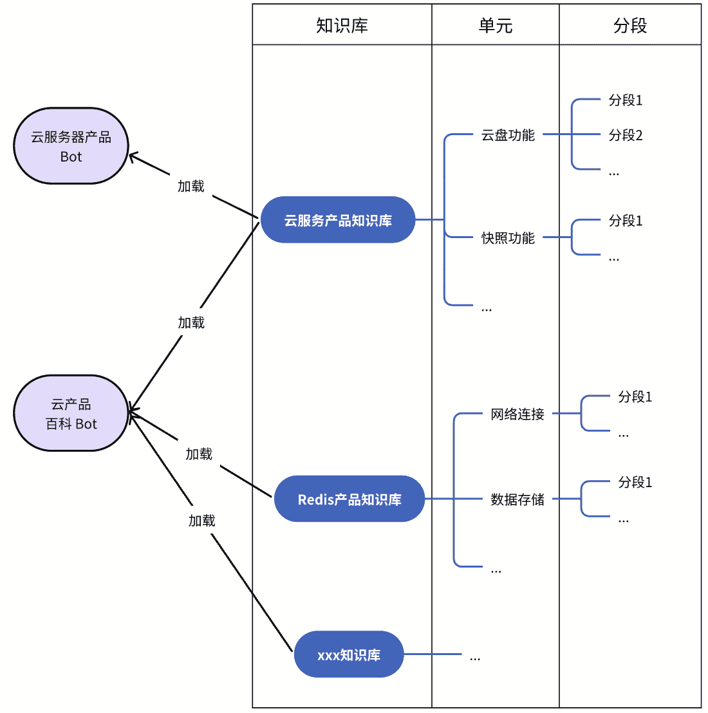
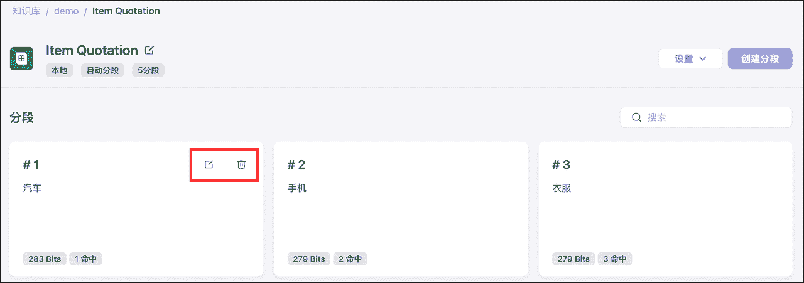
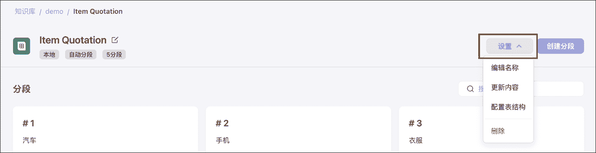
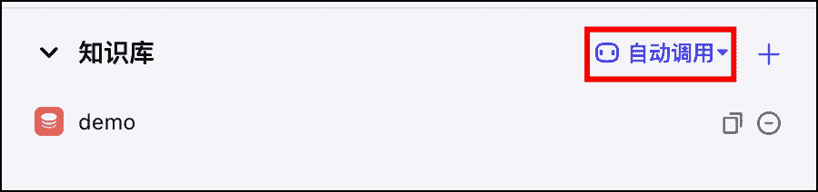
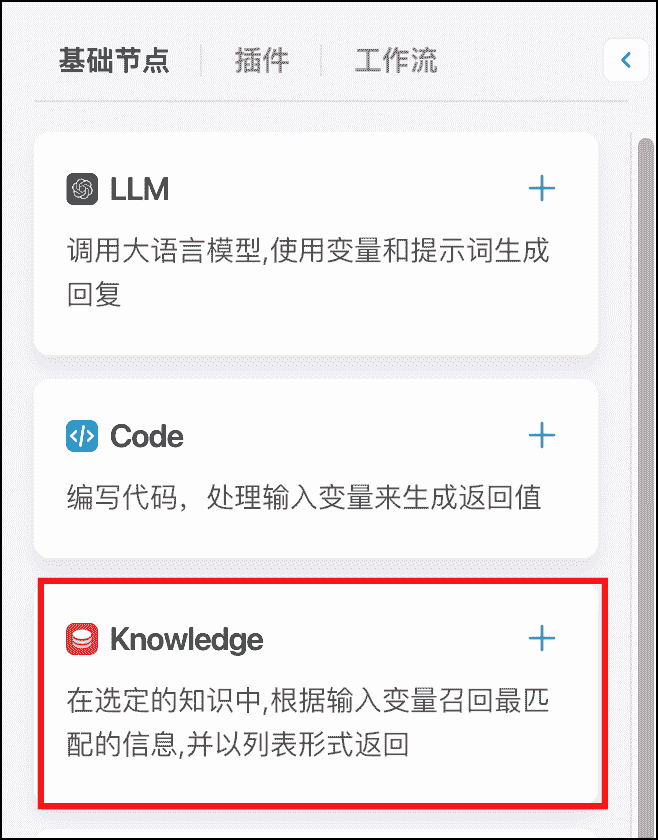

# 创建并使用知识库

> 来源：[https://v11enp9ok1h.feishu.cn/docx/W1KId9PIOojAR4x7gmdcnwFWnhf](https://v11enp9ok1h.feishu.cn/docx/W1KId9PIOojAR4x7gmdcnwFWnhf)

扣子的知识库功能提供了简单易用的方式来存储和管理外部数据，让你的 Bot 可以与指定的数据进行交互。将数据上传到知识库后，扣子会自动将你的文档分割成一个个内容片段进行存储，并通过向量搜索来检索最相关的内容来回答用户问题。

知识库由大到小可分为：

+   知识库：一整套领域知识，是 Bot 加载的最小单位。

+   单元：知识库的一部分，可上传的最小内容单位可以是一个.txt、.pdf、.csv文件或一个网页。

+   分段：一个单元切分成多个分段，模型查询的最小单位。分段内容的完整度和准确性度会影响模型回答问题的准确性。

# **创建知识库并上传文本内容 **

你可以将文本内容上传至知识库中，作为回复用户问题的内容源或通过向量搜索进行内容召回。例如你可以将产品使用文档上传至知识库中，创建一个专属的产品咨询顾问 Bot 来精准回答用户关于产品使用的相关问题。

参考以下操作，创建知识库并上传文本内容。

1.  登录[扣子](https://www.coze.cn/home)。

1.  在左侧导航栏的**工作区**区域，选择进入指定团队。

1.  在页面顶部进入**知识库**页面，并单击**创建知识库**。

1.  **在弹**出的页面配置知识库名称、描述，并单击确认。

> 一个团队内的知识库名称不可重复，必须是唯一的。

1.   在**单元**页面，单击**新增单元**。

1.  ** 在弹出的**页面选择要上传的数据格式，默认是文本格式，然后选择一种文本内容上传方式完成内容上传。

| **上传方式** | **操作步骤** |
| --- | --- |
| **本地文档** | 1.  在**文本格式**页签下，选择**本地文档**，然后单击**下一步**。  |
| **在线数据** | 扣子支持自动抓取指定URL的内容，也支持手动采集指定页面上的内容，上传到数据库。 |
| **Notion** | 1.  在**文本格式**页签下，选择 **Notion**，然后单击**下一步**。  |
| **自定义** | 1.  在**文本格式**页签下，选择**自定义**，然后单击**下一步**。  |

+   目前支持上传.txt, .pdf, .docx 格式的文件内容。

+   每个文件不得大于 20M。

+   一次最多可上传 10 个文件

1.  **自动分段与清洗：**系统会对上传的文件数据进行自动分段，并会按照系统默认的预处理规则处理数据。

1.  **自定义：**手动设置分段规则和预处理规则。

+   替换掉连续的空格、换行符和制表符

+   删除所有 URL 和电子邮箱地址

1.  输入要上传的网站地址。

1.  选择是否需要定期同步网站内容，如果需要选择内容同步周期。

1.  单击**确认**。

> 首次导入 Notion 数据和页面时，需要进行授权。

1.  **自动分段与清洗：**系统会对上传的文件数据进行自动分段，并会按照系统默认的预处理规则处理数据。

1.  **自定义：**手动设置分段规则和预处理规则。

+   替换掉连续的空格、换行符和制表符

+   删除所有 URL 和电子邮箱地址

> 每个分段最多可添加 2000 个字符。

# **创建知识库并上传表格数据 **

你可以通过本地文件或 API 的方式上传结构化的表格数据到知识库中。上传后的数据会直接按照索引列进行分片。

参考以下操作，创建知识库并上传表格数据。

1.  在页面顶部进入**知识库**页面，并单击**创建知识库**。

1.  **在弹**出的页面配置知识库名称、描述，并单击确认。

> 一个团队内的知识库名称不可重复，必须是唯一的。

1.   在**单元**页面，单击**新增单元**。

1.   在弹出的页面，选择**表格格式，**然后选择一种上传方式完成数据上传。

| **上传方式** | **操作步骤** |
| --- | --- |
| **本地文档** | 选择将本地文件中的表格数据上传至知识库中。 |
| **API** | 获取在线 API 的 JSON 数据，将 JSON 数据上传至知识库。 |
| **自定义** | 手动创建数据表结构和数据。 |

+   目前支持上传.csv和.xlsx格式的文件内容，且表格内需要有列名和对应的数据。

+   每个文件不得大于 20M。

+   一次最多可上传 10 个文件。

1.  指定数据范围：通过选择**数据表**、**表头**、**数据起始行**指定数据范围。

1.  确认表结构：系统已默认获取了表头的列名，你可以自定义修改列名，或删除某一列名。

1.  指定语义匹配字段：选择哪个字段作为搜索匹配的语义字段。在响应用户查询时，会将用户查询内容与该字段内容的内容进行比较，根据相似度进行匹配。

1.  确认表结构：系统已默认获取了表头的列名，你可以自定义修改列名，或删除某一列名。

1.  指定语义匹配字段：选择哪个字段作为搜索匹配的语义字段。在响应用户查询时，会将用户查询内容与该字段内容的内容进行比较，根据相似度进行匹配。

# **维护知识库内容 **

为了提升召回的准确率，你可以删除、新增或修改知识库内容。

## **管理知识库 **

在**知识库**页面，你可以看到已创建的知识库和每个知识库内的单元数量和创建时间等信息。

单击知识库或编辑图标，进入知识库详情页面。在知识库详情页，你可以：

+   新增内容：单击**新增单元**上传更多内容。

+   删除内容：单击目标单元的删除图标，删除该内容单元下的所有内容片段。

+   更新单元内的分段：单击目标单元的编辑图标或直接单击该单元名称。

+   开启引用：是否开启该单元中的内容引用。

> 如果不开启，即便 Bot 中使用了所属的知识库，该单元内容也不会被召回。

## **管理分段 **

在**知识库**页面，单击目标知识库，然后在知识库详情页单击目标单元， 进入单元详情页。在该页面，你可以对某一个分段内容进行修改或删除也可以更新单元下全部的分段。

+   单个分段操作：

+   **更新内容**：将鼠标悬浮至目标分段内容上，单击编辑图标修改分段的内容。

+   **删除**：将鼠标悬浮至目标分段内容上，单击删除图标删除该分段。

+   全部分段操作：单击**设置**然后选择要执行的操作。

对于不同类型的数据（文本格式、表格格式）可进行的管理操作说明如下表。

| **单元类型** | **操作说明** |
| --- | --- |
| 文本格式 | 在文本格式单元的右上角，单击**设置**后支持以下操作。 |
| 表格格式 | 在表格格式单元的右上角，单击**设置**后支持以下操作。 |

# **使用知识库 **

你可以将知识库直接与 Bot 进行关联用于响应用户回复；也可以在工作流中添加知识库节点，成为工作流中的一环。

## **在 Bot 内使用知识库 **

1.  登录[扣子](https://www.coze.cn/home)。

1.  在左侧导航栏的**工作区**区域，选择进入指定团队。

1.  在 **Bots** 页面，选择指定 Bot 并进入 Bot 详情页。

1.  在 Bot 编排页面的**知识库**区域，单击加号图标，添加指定的知识库。

1.  （可选）添加知识库后，可以在**自动调用**下拉界面内，调整知识库的配置项。

配置项说明：

| **配置项** | **说明** |
| --- | --- |
| 最大召回数量 | Bot 在调用知识库匹配用户输入内容时，返回的数据片段数量，数值越大返回的内容越多。 |
| 最小匹配度 | Bot 在调用知识库匹配用户输入内容时，会将达到匹配度要求的数据片段进行召回。如果数据片段未达到最小匹配度，则不会被召回。 |
| 调用方式 | 知识库的调用方式。 |

1.  （可选）在**预览与调试**区域调试 Bot 能力时，扩展**运行完毕**的内容可以查看知识库命中并召回的分片内容。

## 在工作流内使用 Knowledge 节点

1.  登录[扣子](https://www.coze.cn/home)。

1.  在左侧导航栏的**工作区**区域，选择进入指定团队。

1.  在页面顶部进入**工作流**页面，并打开指定的工作流。

1.  在左侧**基础节点**列表内，选择添加 **Knowledge** 节点。

