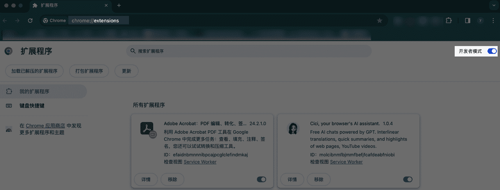
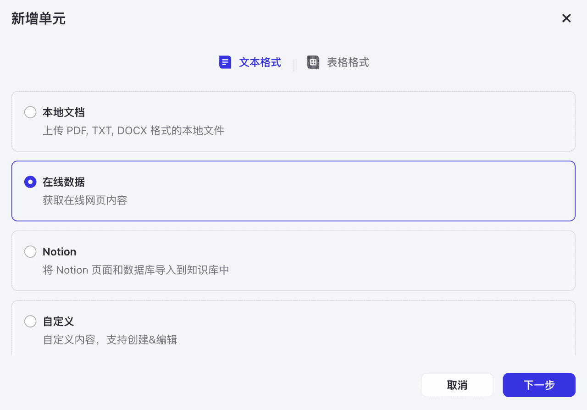
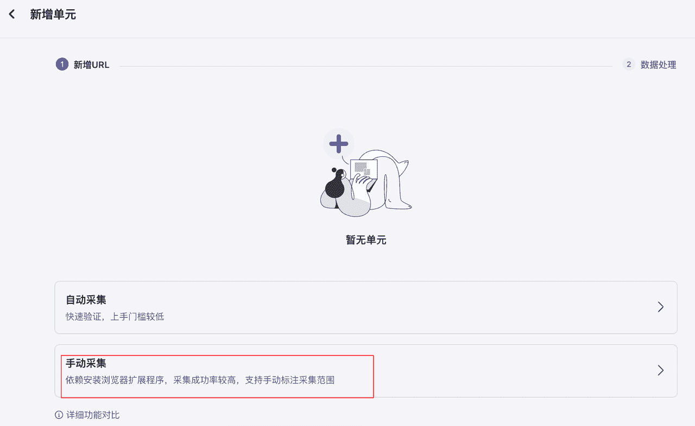

# 安装 Coze Scraper

> 来源：[https://v11enp9ok1h.feishu.cn/docx/OErAdiMIfoJAdox4utbcakNdn9e](https://v11enp9ok1h.feishu.cn/docx/OErAdiMIfoJAdox4utbcakNdn9e)

Coze Scraper 是一个用来提取网页上的文本内容，将这些内容上传到知识库的一个工具。你可以通过 Chrome 浏览器的应用商店进行安装，也可以将该工具下载到本地进行安装。

> Coze Scraper 目前仅支持 Chrome 浏览器。

## **通过应用商店安装 **

1.  打开 Chrome 浏览器。

1.  点击[本链接](https://chromewebstore.google.com/detail/coze-scraper/onpohiaebacahchaphmnehcnbjmamcbb)在 Chrome 应用商店中打开 Coze Scrapper 扩展程序。

1.  单击**添加至 Chrome**。

1.  在弹出的页面，单击**添加扩展程序**。

至[此扩展程序已成功](https://www.coze.cn/docs/guides/use_knowledge)安装至浏览器。完成安装后，你就可以使用该工具手动采集要上传到扣子知识库的内容了，详情请参考创建并使用知识库。

## **本地安装 **

参考以下操作，在本地安装 Coze Scrapper 工具。

1.  单击[这里](https://lf-coze-web-cdn.coze.cn/obj/coze-web-cn/browser-extension/artifacts/coze-extension-1.0.1.0.zip)下载安装包，然后解压下载的文件。

1.  打开 Chrome 浏览器。

1.  在浏览器中输入chrome://e**xtens**ions打开扩展程序页面，确认开发者模式处于打开状态。

1.  点击**加载已解压的扩展程序**，选择已解压的文件夹。

## 使用 Coze scraper 采集数据

至此扩展程序已成功安装至浏览器。完成安装后，你就可以使用该工具手动采集要上传到扣子知识库的内容了。

以下操作展示如何使用该工具手动采集数据上传到[知识库，更多关于](https://www.coze.cn/docs/guides/use_knowledge)知识库的内容，详情请参考创建并使用知识库。

1.  登录[扣子](https://www.coze.cn/home)。

1.  在左侧菜单栏，选择一个工作区。

1.  在工作区内，单击**知识库**页签。

1.  创建一个知识库或点击一个已存在的知识库。

1.  在知识库页面，单击**新增单元**。

1.  在**文本格式**页签下，选择**在线数据**，然后单击**下一步**。

1.  单击**手动采集**，然后在弹出的页面点击**权限授予**完成授权。

1.  **在弹**出的页面输入要采集内容的网址，然后单击确认。

1.  在弹出的页面上，点击页面下方文本标注按钮，开**始标**注**要提**取的内容，然后单击文本框上方的文本或链接按钮。

1.  单击**查看数据****查看已采集**的内容，确认无误后再点击完成并采集。

