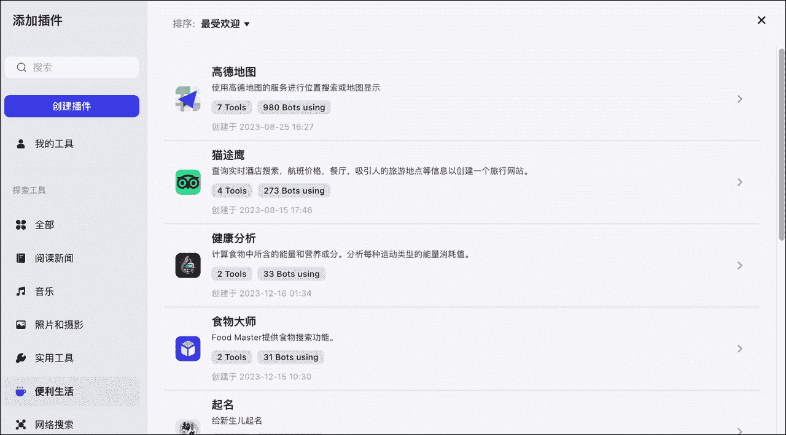

# 插件介绍

> 来源：[https://v11enp9ok1h.feishu.cn/docx/EzLodihSzo8zubxp0UPceHcAnKc](https://v11enp9ok1h.feishu.cn/docx/EzLodihSzo8zubxp0UPceHcAnKc)

# **什么是插件？ **

插件是一个工具集，一个插件内可以包含一个或多个工具（API）。

目前，扣子集成了超过 60 种类型的插件，包括资讯阅读、旅游出行、效率办公、图片理解等 API 及多模态模型。使用这些插件，可以帮助您拓展 Bot 能力边界。例如，在您的 Bot 内添加新闻搜索插件，那么您的 Bot 将拥有搜索新闻资讯的能力。

如果扣子集成的插件不满足您的使用需求，您还可以创建自定义插件来集成需要使用的 API。

# **操作导航 **

| **操作** | **描述** |
| --- | --- |
| 创建自定义插件 | 扣子提供了多种创建自定义插件的方式供您选择，相关操作步骤可参见以下文档。 |
| 使用插件 | 插[件可以直](https://www.coze.cn/docs/guides/use_plugin)接在 Bot 内使用，拓展 Bot 的能力边界。插件也可以作为节点添加到工作流，实现工作流的任务处理能力。详情参见使用插件。 |