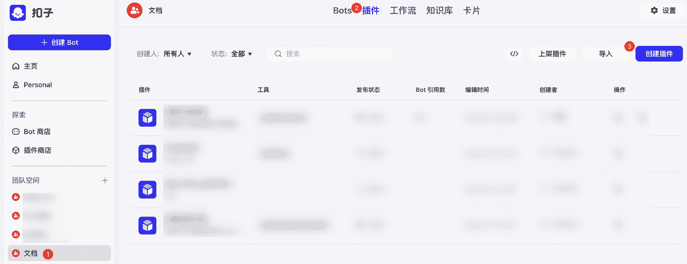
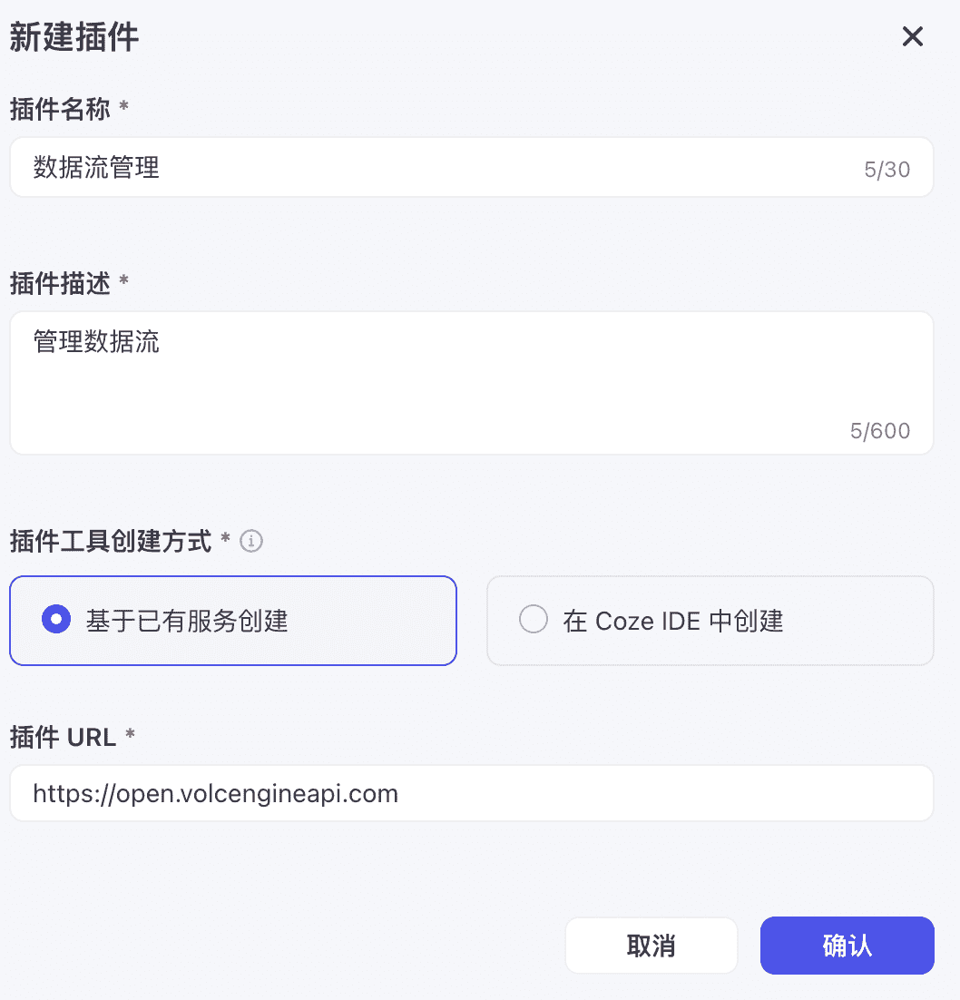
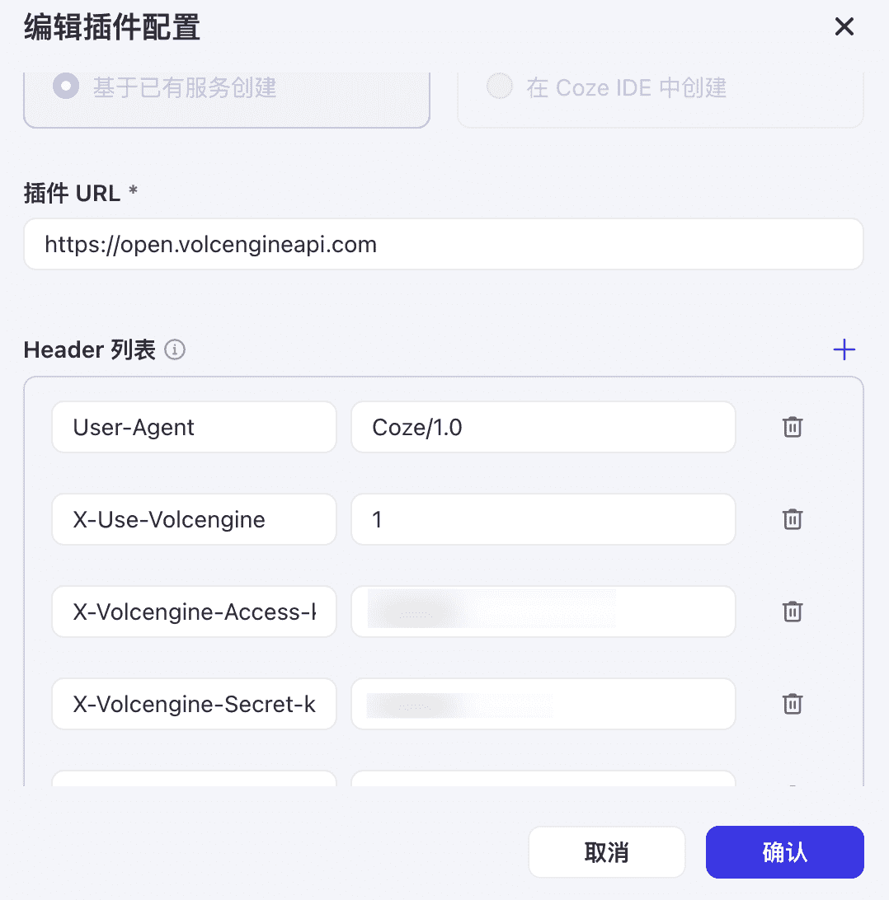
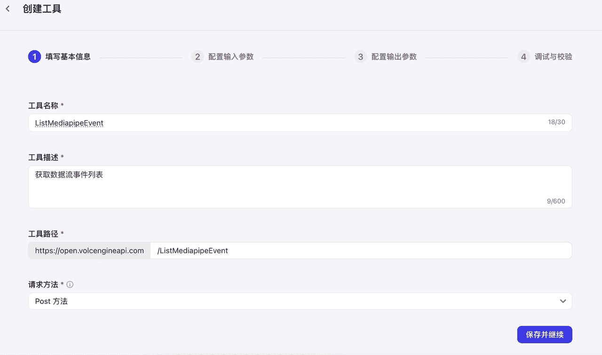
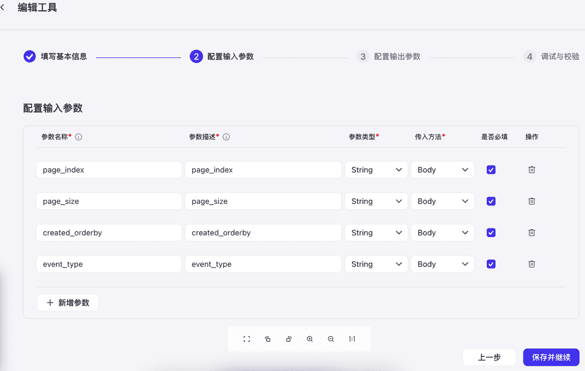
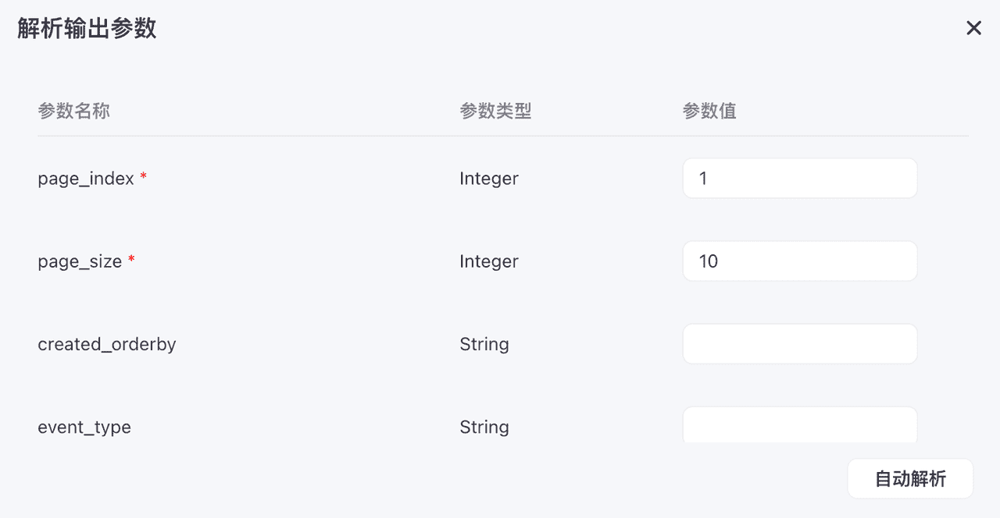
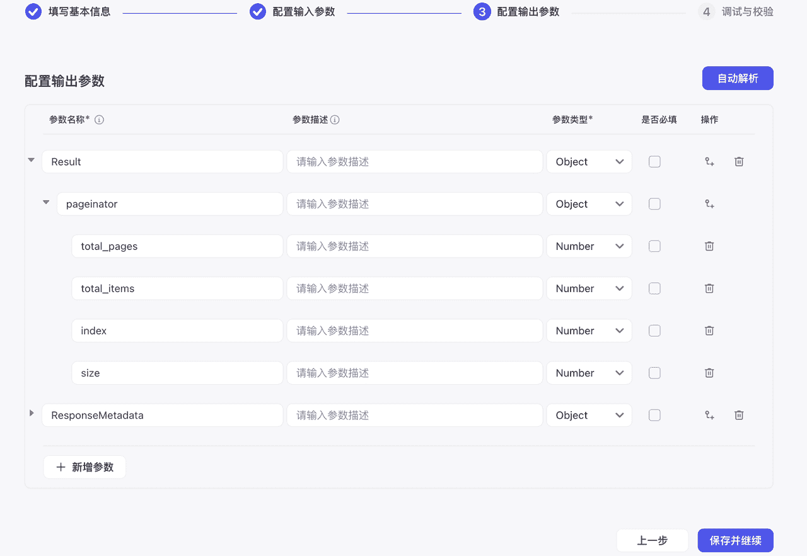
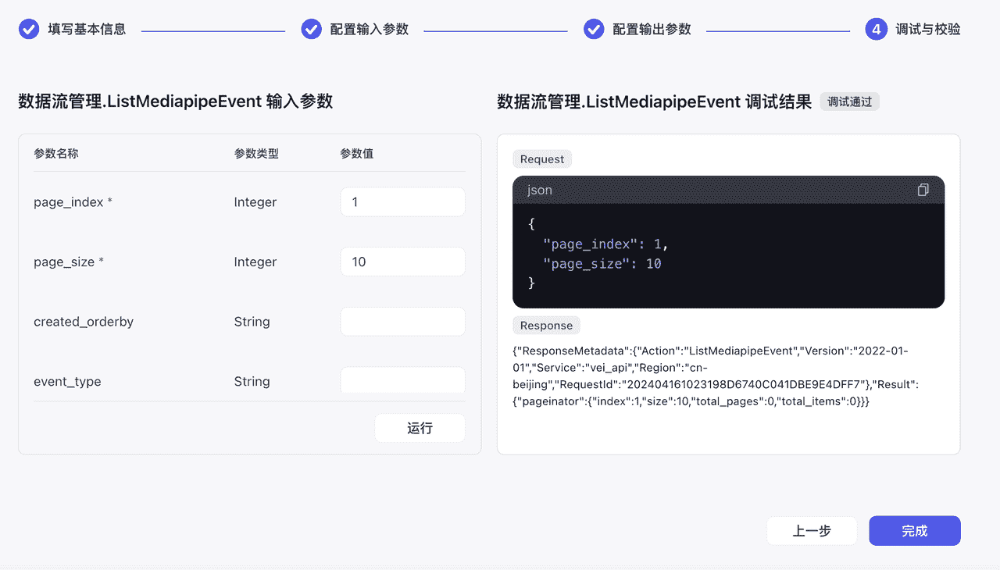
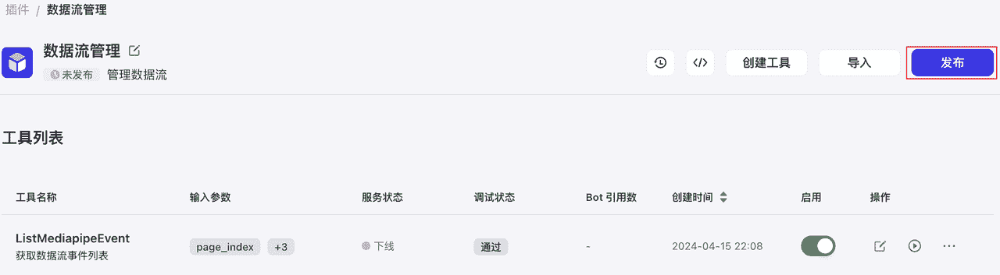
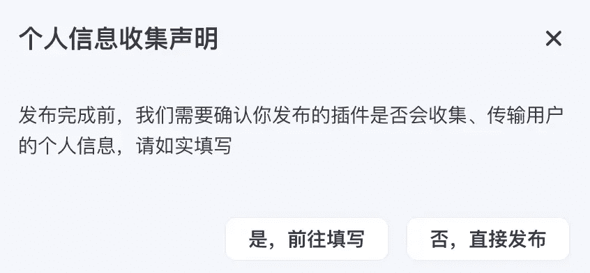

# 教程：基于 API 创建一个插件

> 来源：[https://v11enp9ok1h.feishu.cn/docx/SkAKdR0RhoBWclxbzokcVVSHnYc](https://v11enp9ok1h.feishu.cn/docx/SkAKdR0RhoBWclxbzokcVVSHnYc)

# **背景信息 **

在扣子中，一个插件可包含多个工具。插件与工具的关系就是 API 服务与 API endpoint 的关系。在创建插件时，首先需要将这个 API 服务注册为一个插件，然后再将这个服务下的 API endpoint 添加到插件中作为工具使用，最后将插件发布上线。

本教程以火山引擎边缘智能产品的列出数据流事件 (ListMediapipeEvent) API 为例，展示如何一步步创建一个插件。以下是这个接口的基本信息。

| **API 信息** | **说明** |
| --- | --- |
| 请求地址 | open.volcengineapi.com |
| Header | +   **X-**Use-Volcengine：固定值为 1。  |
| 接口（Endpoint） | ListMediapipeEvent |
| 请求参数和返回参数 | 参考 [API 文档](https://api.volcengine.com/api-explorer?action=ListMediapipeEvent&amp;groupName=%E6%95%B0%E6%8D%AE%E6%B5%81%E7%AE%A1%E7%90%86&amp;serviceCode=vei_api&amp;version=2022-01-01)。 |

# **准备工作 **

在开始前，确保你已经：

+   [申请了一](https://www.volcengine.com/docs/6261/64935)个火山引擎账号，并完成了实名认证。详情请参考实名认证。

+   申请了这个账号的 Access Key ID 和 Secret Access Key。详情请参考 Access Key（密钥）管理。

# **步骤一：创建插件 **

参考以下操作将上述接口导入为一个插件。

1.  登录[扣子](https://www.coze.cn/home)。

1.  选择一个工作空间，然后单击**插件**，再单击**创建插件**。

1.  完成插件基础信息配置：

1.  输入插件名称和描述。

1.  插件工具创建方式选择基于**已有服务创建**。

1.  插件 URL：输入 API 的服务地址。本教程是https://open.volcengineapi.com。

1.  将以下 Header 信息配置到 Header 列表中。

+   **X-**Use-Volcengine：固定值为 1。

+   X-Volcengine-Access-key：调用该接口的 AccessKey。

+   X-Volcengine-Secret-key：调用该接口使用的 Secret Access Key。

+   **Service**：服务代码，固定值vei_api。

+   **Region: 火山**引擎 API 支持的地域。本教程的 API 使用 cn-beijing。

+   **Version：AP**I  版本。本教程使用2022-01-01。

1.  授权方式选择**不需要**。

1.  单击**确认**完成插件创建。

# **步骤二：添加工具 **

完成插件创建后，就可以将该服务地址下的接口 (Endpoint) 添加到插件中了。

1.  在插件详情页面，单击**添加工具**。

1.  配置接口的基本信息，然后单击**保存并继续**。

+   输入工具名称和描述。

+   工具路径为接口名称ListMediapipeEvent，以“/”开始。

+   请求方法为 Post。

1.  单击**新增参数**配置请求参数，然后单击**保存并继续**。

1.  单击**自动解析****，然后在**弹出的页面输入请求参数值，再单击自动解析。

1.  接口调用成功后，会将返回参数自动填充到输**出参数列表**。你可以根据需求进行修改。单击保存并继续。

1.  在**调试与校验**页面，输入入参，然后单击**运行**测试接口。测试成功后，单击**完成**。

# **步骤三：发布插件 **

当添加的工具调试成功后，你就可以发布插件了。插件只有发布后，才可以被 Bot 使用。

1.  在插件页面，单击**发布**。

1.  **选择是否需要**收集个人信息。本教程的接口不涉及个人信息收集，选择否，直接发布。

