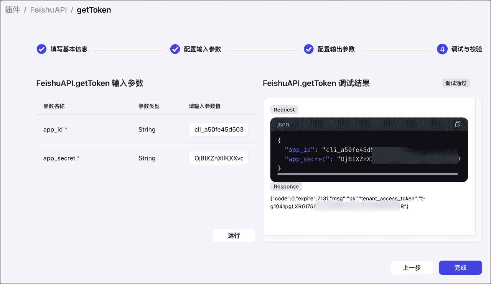

# 基于已有服务创建插件

> 来源：[https://v11enp9ok1h.feishu.cn/docx/V2RedkSnDohy2gxoAKec0oe5nkf](https://v11enp9ok1h.feishu.cn/docx/V2RedkSnDohy2gxoAKec0oe5nkf)

本文介绍如何通过插件页面向导创建自定义插件。创建插件后，必须发布插件才可以被 Bot 使用。

+   在个人空间下创建的插件，仅能被个人调用。

+   在团队空间下创建的插件，能被团队成员调用。

+   插件发布了新版本后，使用了这个插件的 Bot 会自动使用发布的最新版本。

# **操作步骤 **

1.  登录[扣子](https://www.coze.cn/home)。

1.  在左侧导航栏的**工作区**区域，选择进入指定团队。

1.  在页面顶部进入**插件**页面，或者在某一 Bot 的**编排**页面，找到**插件**区域并单击 **+** 图标。

1.  单击**创建插件**。

1.  在**新建插件****对话**框，根据以下信息完成配置并单击确认。

| **配置项** | **说明** |
| --- | --- |
| 插件图标 | 单击默认图标后，您可以上传本地图片文件作为新的图标。 |
| 插件名称 | 自定义插件名称，用于标识当前插件。建议输入清晰易理解的名称，便于大语言模型搜索与使用插件。 |
| 插件描述 | 插件的描述信息，一般用于记录当前插件的用途。 |
| 插件工具创建方式 | 选择**基于已有服务创建**。 |
| 插件 URL | 插件的访问地址或相关资源的链接。例如：https://www.example.com/api |
| Header 列表 | HTTP 请求头参数列表。您需要根据 API 自身的参数配置要求来填写。 |
| 授权方式 | 选择插件内 API 的鉴权方式。目前支持以下三种： |

+   **位置**：选择秘钥或令牌的传递位置，**Header**（请求头）或是 **Query** （查询参数）内。

+   **Parameter name**：秘钥或令牌对应的参数名称。

+   Service token / API key：秘钥或令牌的值。后续根据该值进行服务认证。

+   **client_id**：注册 OAuth 后获取的唯一标识符。

+   **client_secret**：与 client_id 匹配的密码。

+   **client_url**：验证通过后，模型会重定向到该 url。

+   **scope**：您的应用需要访问的资源范围或级别。

+   authorization_url：OAuth 提供商的 URL，用户会重定向到该 URL 进行应用授权。

+   authorization_content_type：向 OAuth 提供商发送数据时的内容类型。

1.  在已创建的插件页面，单击创建**工具**。

1.  在**填写基本信息**界面，完成配置并单击**保存并继续**。

| **配置项** | **说明** |
| --- | --- |
| 工具名称 | 用于标识当前工具。建议输入清晰易理解的名称，便于后续大语言模型搜索与使用工具。 |
| 工具描述 | 工具的描述信息，一般用于记录当前工具的用途。 |
| 工具路径 | 输入 API 路径。 |
| Request Method | 选择 API 的请求方式。 |

1.  在**配置输入参数**界面，单击**新增参数**添加输入参数，并单击**保存并继续**。

> **如果 AP**I 没有输入参数，则直接单击保存并继续。

| **配置项** | **说明** |
| --- | --- |
| 参数名称 | 参数名称，支持字母、数字或下划线。 |
| 参数描述 | 参数描述。准确的参数描述可以帮助用户或 LLM 理解当前参数的作用。 |
| 参数类型 | 参数的数据类型。 |
| 传入方法 | 参数传入方法。可选值： |
| 是否必填 | 参数是否必填。 |

1.  在**配置输出参数**界面，设置输出参数，并单击**保存并继续**。

您可以单击**自动解析**，在对话框内填写输入参数调用 API，平台将会根据 API** 响应结**果自动配置输出参数。您也可以单击新增参数，手动设置输出参数。

| **配置项** | **说明** |
| --- | --- |
| 参数名称 | 参数名称，支持字母、数字或下划线。参数名称 |
| 参数描述 | 参数描述。准确的参数描述可以帮助用户或 LLM 理解当前参数的作用。 |
| 参数类型 | 参数的数据类型。 |
| 是否必填 | 参数是否必须输出。 |
| 新增子项 | 当**参数类型**选择 **Object** 类型时，该配置项会显示加号（+）图标。单击加号图标可在当前 Object 参数内添加子参数。 |

1.  在**调试与校验**界面，填写输入参数，并单击**运行**。

1.  **在页面右**侧，查看**调试**结果为绿色标识的调试通过后，单击完成。

1.  在插件详情页的右上角，单击**发布**。

# **上架到商店 **

您可以将创建的插件发布到扣子商店，让更[多扣子用户发现、](https://www.coze.cn/docs/guides/publish_plugin_to_store)使用您的插件。详情请参考将插件上架到商店。