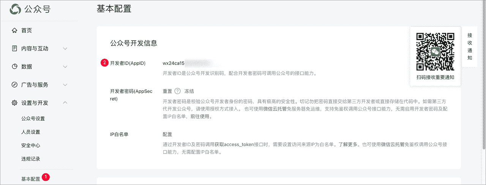
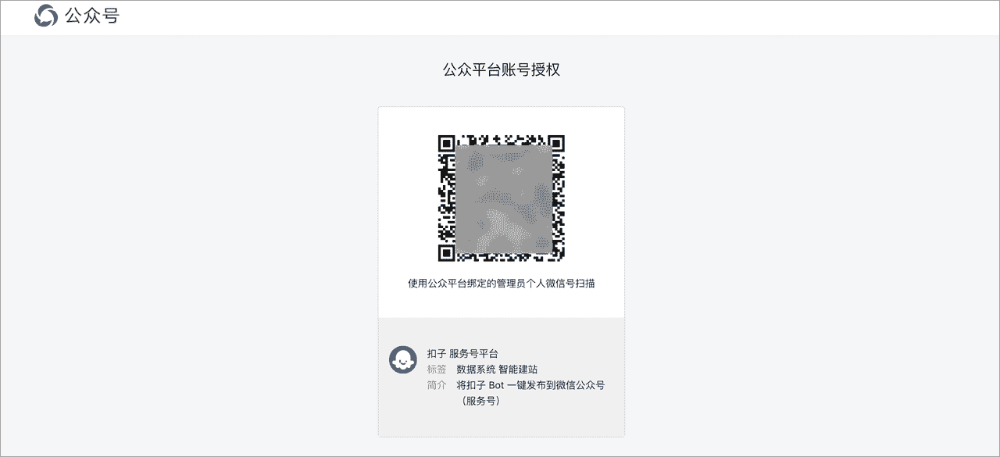
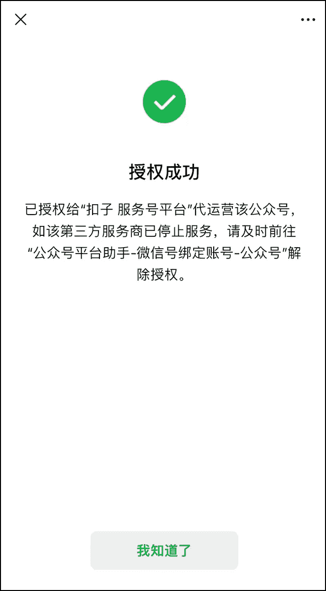
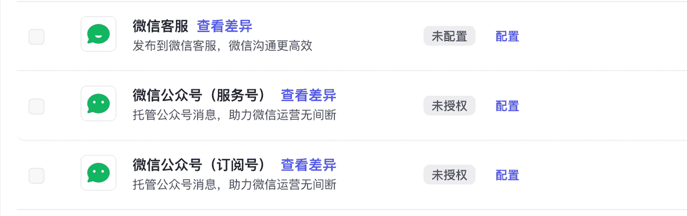
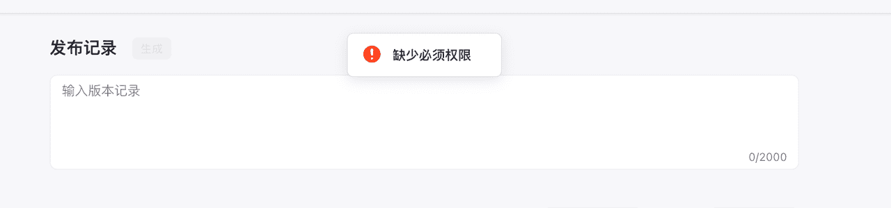

# 发布到🛰️服务号

> 来源：[https://v11enp9ok1h.feishu.cn/docx/GxktdSY6NoZIZOxN6Yjc3NzbnOb](https://v11enp9ok1h.feishu.cn/docx/GxktdSY6NoZIZOxN6Yjc3NzbnOb)

你可以将搭建的 Bot 发布到🛰️👸号（服务号）中。发布后，服务号就可以使用 Bot 回复用户消息，助力运营。

> 如果您之前绑定过🛰️服务号，则在** Bot 发布页面的**原绑定渠道区域会提示【即将下线】🛰️👸号（服务号），该场景下您需要先解绑原发布渠道，然后参考本文操作重新绑定🛰️👸号（服务号）渠道进行发布。

## **使用限制 **

+   一个 Bot 只能发布到一个企业服务号。

+   确保🛰️服务号已经完成了认证。未认证和认证中的服务号无法接收消息。

+   支持在回复服务号时上传图片，但图片大小不能超过 10 MB。

## **前提条件 **

+   已经创建了🛰️服务号。

+   已经配置了 Bot。

## 步骤一：获取🛰️服务号的开发者 ID

1.  访问[🛰️公众平台](https://mp.weixin.qq.com/)并登录你的服务号。

1.  在**设置与开发 > 基本配置**页面，获取**开发者ID(AppID)**。

## 步骤二：在扣子中配置并发布 Bot

1.  在 **Bots** 页面，选择需要发布的 Bot。

1.  在 Bot 编排页面，单击**发布**。

1.  在发布页面，找到**🛰️👸号（服务号）**发布渠道，单击**配置**。

1.  在 **AppID**** 输**入框内，填写🛰️服务号的开发者 ID，并单击保存。

1.  跳转到**公众平台账号授权**页面，使用公众平台绑定的管理员个人🛰️号扫描二维码。

1.  在🛰️移动端，根据页面提示选择服务号并确认授权。

授权成功的页面提示如下：

1.  返回 Bot 发布页面，选中**🛰️👸号（服务号）****发布**平台，并设置发布记录后，单击页面右上角的发布。

成功发布后，你可以前往🛰️服务号与 Bot 对话。

## **常见问题 **

1.  已经完成了渠道配置，但配置状态为未授权，如何解决？

+   **问题描述**

**如下图**所示，虽然完成了配置，但渠道的状态仍是未授权。

当在配置渠道信息点击**保存**按钮后出现报错信息，或者在授权回调时出现报错信息时就会出现未授权的问题。

+   **解决方案**

可尝试重新进行渠道配置：

1.  单击目标渠道的**配置**选项。

1.  解绑已绑定的账号，然后重新配置渠道信息。

1.  在扫码授权时，出现错误提示，如何解决？

+   **错误提示： 缺少必须权限**

解决方案：请确认在扫码时是否漏勾选了部分权限，重新扫码授权。

+   错误提示：请确认并选择正确的🛰️👸号类型

解决方案：请确认是否在订阅号渠道绑定了服务号，或者在服务号渠道绑定了订阅号。

+   **错误提示：该👸号曾经在扣子绑定过旧**版🛰️👸号发布渠道，请先解除绑定后重试

解决方案：确定该👸号是否在旧渠道方式绑定过。如果是，在【即将下线】🛰️👸号（服务号）渠道中解绑该账号。