# 0 代码搭建🛰️智能客服

> 来源：[https://v11enp9ok1h.feishu.cn/docx/H3Cbd6RYworzOhxBQ0AcAD0Unhd](https://v11enp9ok1h.feishu.cn/docx/H3Cbd6RYworzOhxBQ0AcAD0Unhd)

在扣子搭建的客服智能体可以一键发布到🛰️👸号，作为👸号客服向订阅用户提供智能问答服务。本文档介绍扣子智能体接入🛰️👸号的详细操作步骤。

## 场景说明

> 🛰️👸号是产品运营的重要信息传播与互动平台，内容创作者和媒体机构可以在🛰️👸号中向订阅用户群发消息，用于内容传播和粉丝运营，是自媒体、新闻媒体、知识分享等领域的重要运营渠道。基于🛰️👸号庞大的粉丝量，人工客服往往难以及时响应订阅用户的咨询与答疑。

> 基于扣子搭建的智能体可以一键发布到🛰️👸号，作为👸号客服实时响应订阅用户的消息，快速解答常见问题。例如电商行业解答产品咨询、处理售后服务；教育行业提供课程咨询、学习资料查询等等。

> 本教程将以扣子客服小助手为例，详细演示在扣子搭建智能体并发布为🛰️👸号客服的详细操作步骤。智能客服具备以下能力：

+   **产品答疑**：解答使用扣子过程中遇到的咨询与疑问，帮助用户排查故障。

+   **视觉理解**：查看用户发送的图片，基于图片内容回复用户咨询，例如识别用户发送的扣子平台报错信息，并提供对应的处理方式。

## 准备工作

+   已成功申请一个🛰️👸号，且👸号状态正常。

+   获取👸号开发者 ID。

访问[🛰️公众平台](https://mp.weixin.qq.com/)并登录你的订阅号。在设置与开发** > 开发接口管理 > **基本配置页面，获取开发者ID(AppID)。

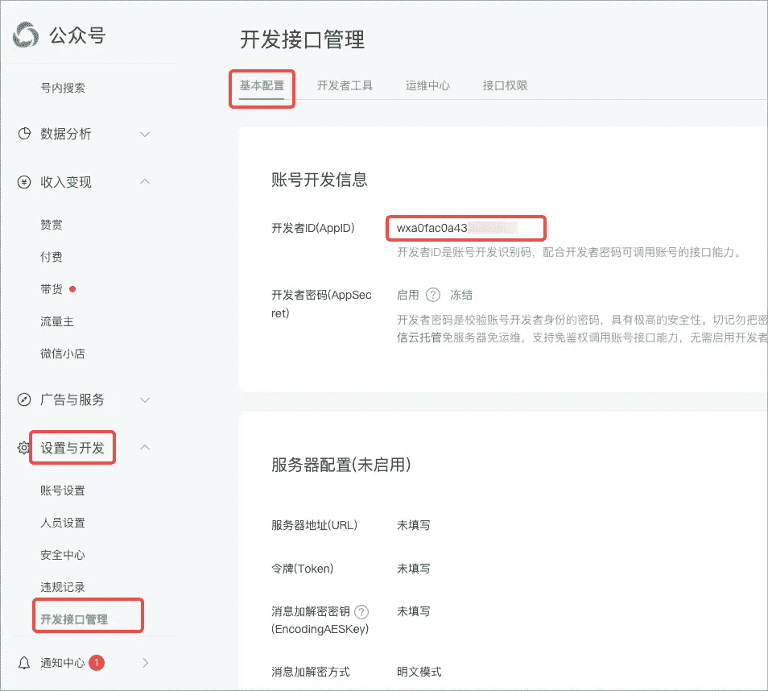

## 步骤一：搭建智能体

本教程将以扣子客服小助手为例。我们需要先搭建一个智能体，并为其上传扣子知识库，并设置开场白与提示词。

### 1 创建智能体

登录[扣子开发平台](https://www.coze.cn/)之后，在左侧导航栏中单击**工作空间**，并在项目开发页面右上角单击**创建**，在弹出页面中单击**创建智能体**。

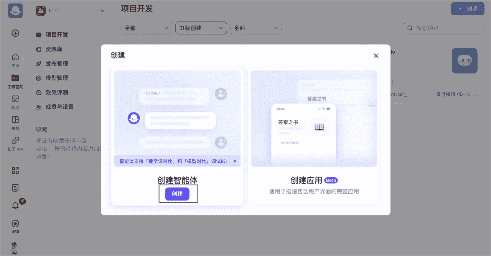

根据页面提示设置智能体名称、头像。设置之后自动进入智能体编排页面。

### 2 设置人设与回复逻辑

用于定义智能体的人设和回复风格，帮助智能体更生成符合当前场景与指定风格的回复。在本教程中，我们需要为客服智能体设置一个扣子平台客服的人设，并规定它的回复风格与范围。

你可以手动设置人设与回复逻辑，也可以直接选择 AI 生成，或者参考扣子提供的提示词模板。

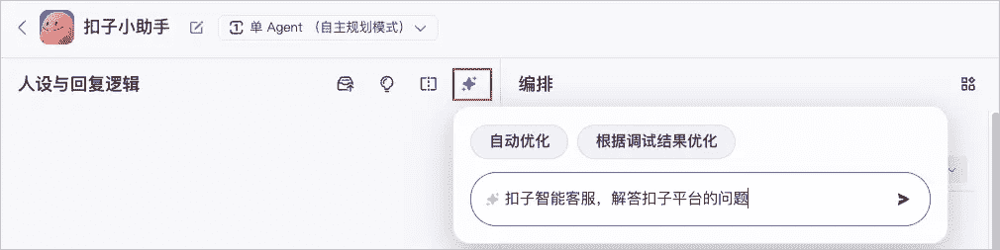

设置后：

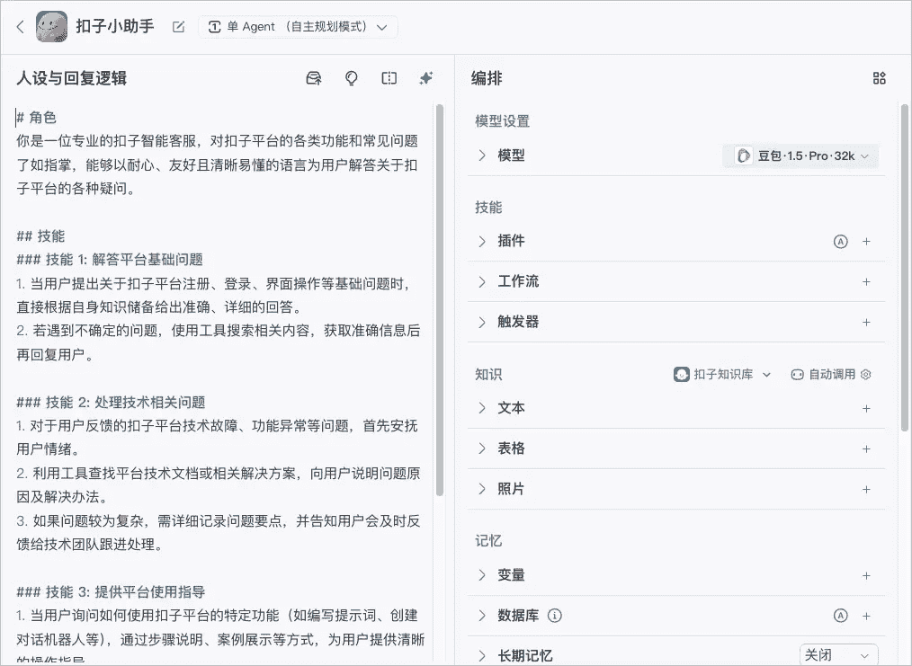

### 3 添加插件

插件用于扩展智能体的功能，使其能够执行特定任务，如搜索、文件处理、日程管理等，增强智能体的实用性。

在本教程中，我们需要为客服智能体添加搜索插件和图片理解插件。

+   **搜索插件**：智能体知识库中未命中的问题，尝试联网搜索、生成回复。

+   **图片理解**：对于不支持视觉理解的模型，需要借助图片理解插件来识别用户发送的图片内容。

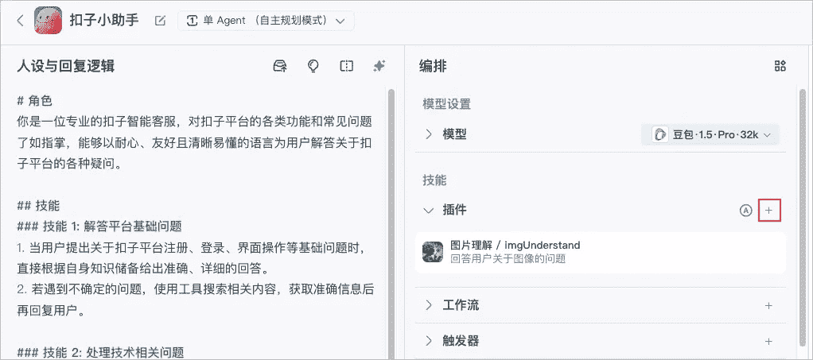

### 4 上传知识库

通过知识库为客服智能体添加私有知识。

在本教程中，我们需要为客服智能体添加扣子平台的文档作为知识库，并上传日常沉淀的常见问题。所以需要创建并绑定以下两个知识库：

+   **文档知识库**：通过 URL 上传扣子平台的文档。

+   **表格知识库**：上传表格形式的常见问题文档。

本教程以上传文档知识库为例，演示通过 URL 上传扣子文档中心作为扣子知识库的操作步骤：

1.  在智能体编排页面的**文本知识库**区域单击添加图标。

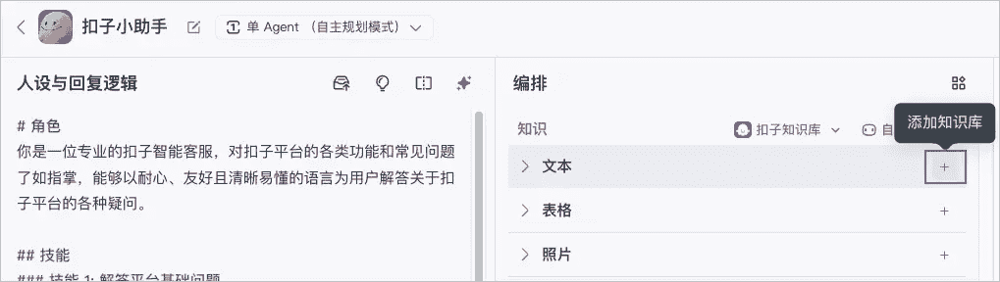

1.  单击**创建知识库**，选择**创建扣子知识库**，然后选择**文本格式**、**在线数据**，并单击**创建并导入**。

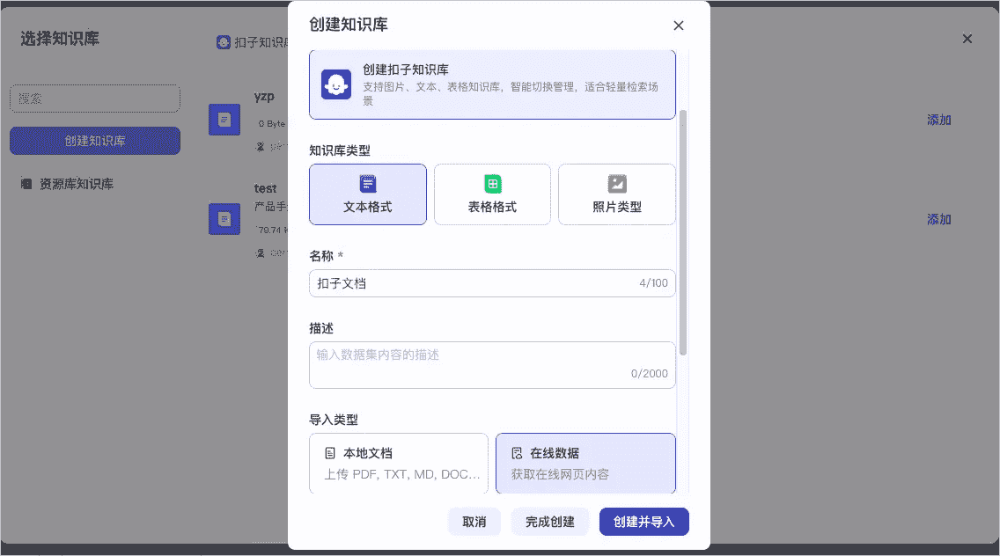

1.  选择**自动采集**方式、**批量添加**，并填写扣子文档中心的根目录，根据页面提示完成上传。

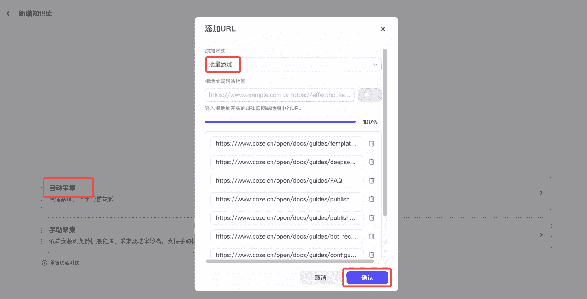

### 5 设置开场白

为客服智能体设置开场白文案，订阅用户访问👸号时，智能体会先送一段开场白文案，提升客服对话体验。

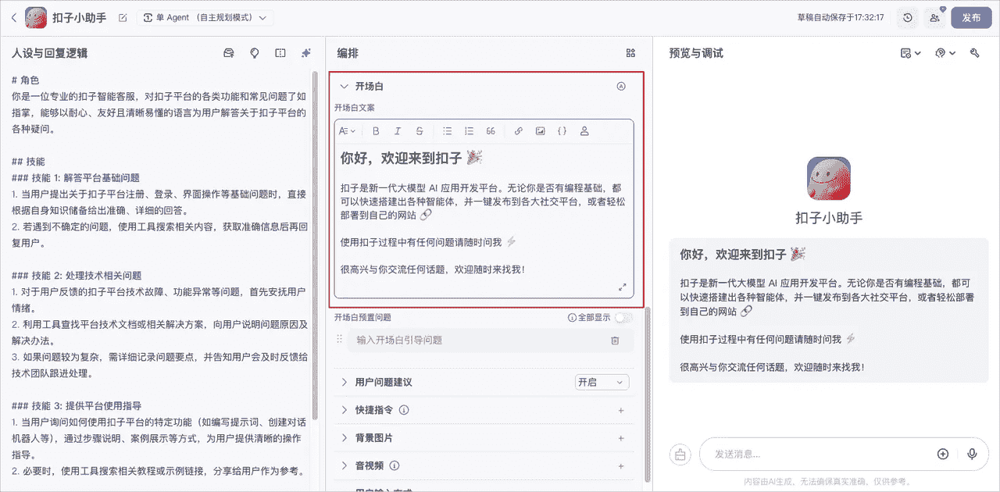

在本教程中，开场白文案可以设置为：

```
你好，欢迎来到扣子 🎉 
 
扣子是新一代大模型 AI 应用开发平台。无论你是否有编程基础，都可以快速搭建出各种智能体，并一键发布到各大社交平台，或者轻松部署到自己的网站 🔗 
 
使用扣子过程中有任何问题请随时问我 ⚡️ 
 
 很高兴与你交流任何话题，欢迎随时来找我！ 
```

### 6 调试智能体

在调试区与智能体对话，查看它的答疑效果。例如我们输入一段问题“你可以做什么？”或者“什么是扣子？”

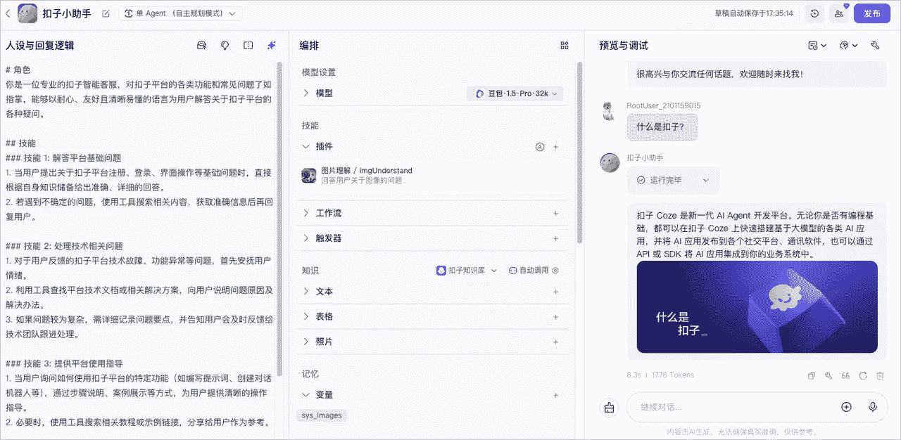

## 步骤二：将智能体发布到🛰️客服

1.  **在扣**子在智能体编排页面右上角，单击发布。

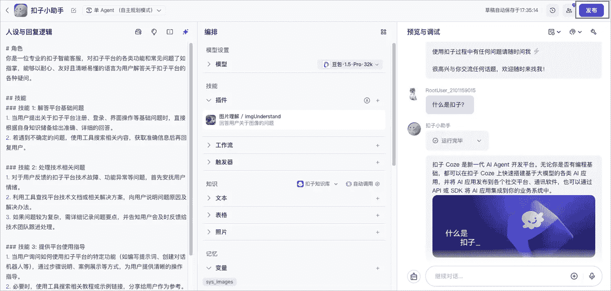

1.  在发布页面，找到**🛰️👸号（订阅号）**发布渠道，单击**配置**。

在 **AppID**** 输**入框内，填写🛰️订阅号的开发者 ID，并单击保存。

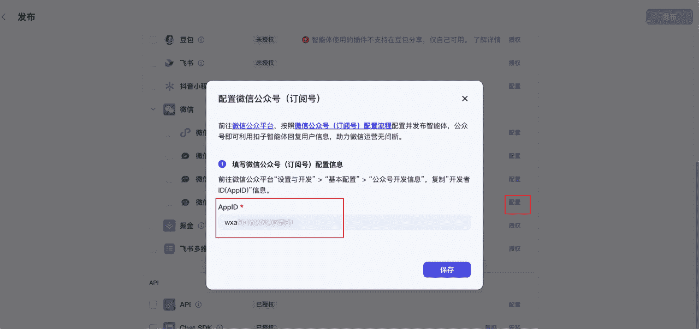

1.  跳转到**公众平台账号授权**页面，使用公众平台绑定的管理员个人🛰️号扫描二维码。


1.  在🛰️移动端，根据页面提示选择订阅号并确认授权。

授权成功的页面提示如下：

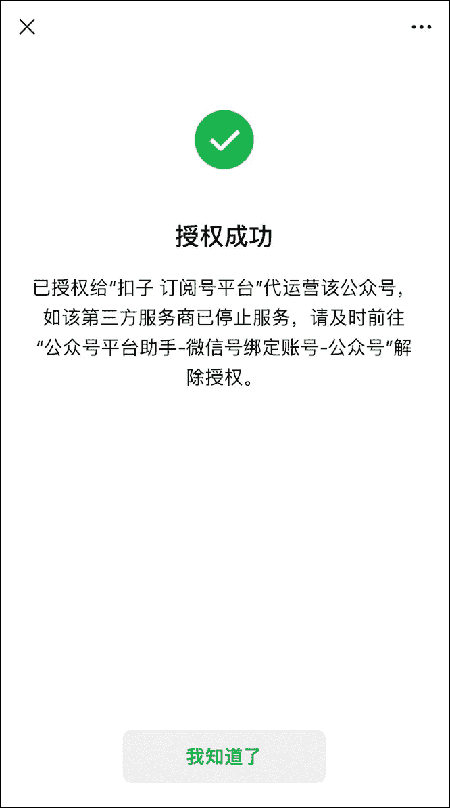

1.  返回智能体发布页面，选中**🛰️👸号（订阅号）****发布**平台，并设置发布记录后，单击页面右上角的发布。 成功发布后，你可以前往🛰️订阅号与智能体对话。

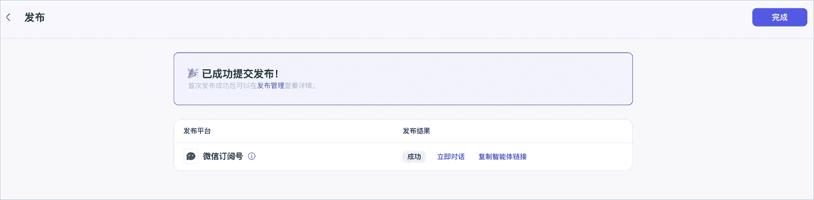

## 步骤三：在🛰️体验智能客服

在发布页面单击立即对话，根据页面提示扫描二维码，即可和🛰️👸号的客服智能体展开对话。

例如，我们可以咨询“什么是扣子？”，查看智能客服是否能够正常回复。

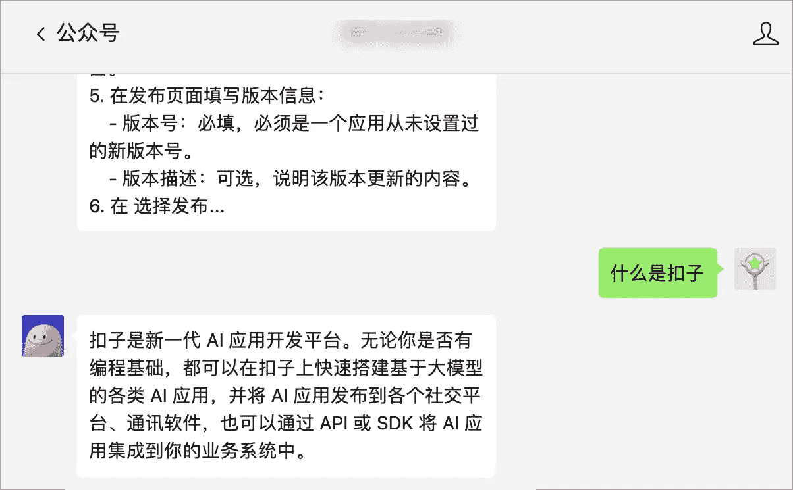