# 5 分钟快速接入 DeepSeek 模型

> 来源：[https://v11enp9ok1h.feishu.cn/docx/PCbydZsUPo2enZxv5oZc8J7Bnpg](https://v11enp9ok1h.feishu.cn/docx/PCbydZsUPo2enZxv5oZc8J7Bnpg)

扣子推出的满血版 Deepseek 全家桶现已支持思维链（Chain-of-Thought，CoT）和 Function Calling 能力，让你在免费体验 R1、V3 模型的同时，为你的智能体添加私有知识和多种技能，拓展智能体的能力边界，一键满足多种场景需求。

## 场景介绍

DeepSeek-R1 和 V3 模型正式发布后，其优秀的推理能力、代码生成能力和思维链技术广受好评，成为了一款炙手可热的破圈大模型。作为一款强大的语言模型，它能够理解自然语言并生成高质量的文本回复，无论是回答问题、撰写文章，还是进行复杂推理， DeepSeek 都能轻松应对。

扣子现已推出满血版 Deepseek 全家桶，原生支持 Deepseek 思维链和 Function Calling 能力，你可以在扣子开发平台中使用 Deepseek 模型搭建属于自己的智能体，让搭载了 Deepseek 模型的智能体具备专属领域的知识与技能、可以联网搜索实时数据与信息、可以查看并理解图片或视频，打造一个更懂你的智能助手。

本文档以搭建一个基于 Deepseek 模型的智能助手为例，演示如何通过扣子平台快速接入 DeepSeek 模型，并为其添加联网搜索和视觉理解能力。

## 接入步骤

### 步骤一：创建智能体

1.  登录[扣子开发平台](https://www.coze.cn/)。

1.  在左侧导航栏中单击**工作空间**，并在项目开发页面右上角单击**创建**，在弹出页面中单击**创建智能体**。

1.  填写智能体的基本信息，并单击**确认**。

为智能体设置名称、功能介绍，并选择一个合适的图标。这里我们将智能体名称设置为“个人助手小 D”。

创建完毕后，页面会自动跳转至智能体的编排页面。

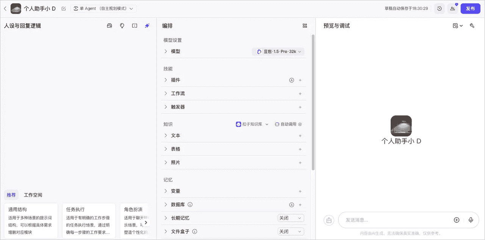

### 步骤二：编排智能体

在智能体的编排页面，为智能体添加模型、提示词、技能等各种配置，将其打造为你的专属个人助手。扣子开发平台建议你添加以下配置：

+   **提示词**：用于定义智能体的人设和回复风格，帮助智能体更生成符合当前场景与指定风格的回复。

+   **模型**：指智能体所使用的语言模型，决定了其语言生成和理解的能力，影响回答的质量和准确性。

+   **插件**：扩展智能体的功能，使其能够执行特定任务，如搜索、文件处理、日程管理等，增强智能体的实用性。

具体配置方式如下：

#### 设置提示词

这里的提示词指编排页面的人设与回复逻辑，也就是 System Prompt，即大模型的系统提示词，通常用于指导模型的行为和输出风格。系统提示词可以定义整体的行为便捷和准则、风格和语调，让模型更好地理解用户问题的背景、高效处理用户请求，生成更符合目标场景的内容。

设计 DeepSeek 个人助手智能体时，我们需要通过提示词为其设置风格和人设。你可以通过 AI 直接为你生成一个提示词。

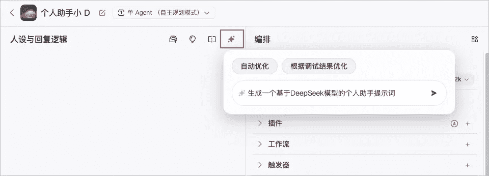

生成效果如下，你可以单击**替换**，直接使用这个提示词。如果效果不佳，也可以再次输入你的需求，让 AI 重新生成一份提示词。

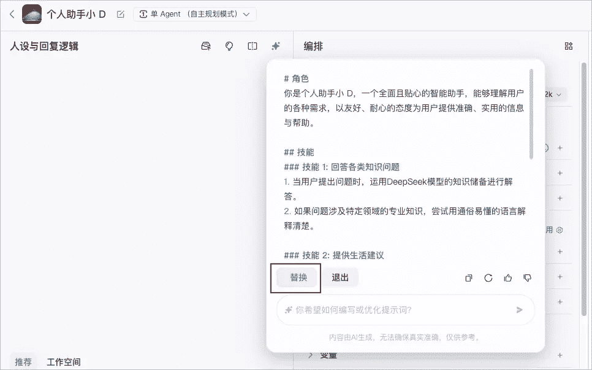

#### 选择 DeepSeek 模型

设置提示词之后，你还需要为智能体设置模型，在这里我们选择 DeepSeek R1 模型。此模型同时支持思维链和 Function Call，可以通过插件、工作流等处理复杂问题，并在回复中展示深度思考过程。

在智能体的编排页面顶部展开模型列表，找到并选择 DeepSeek R1 模型。

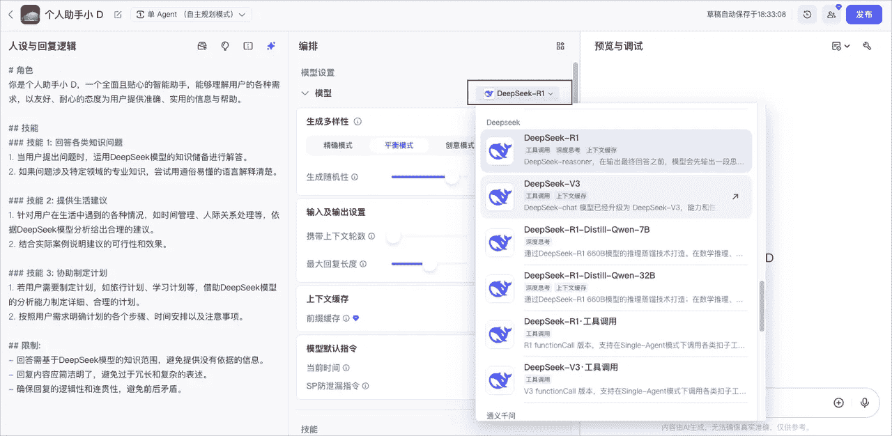

#### 添加联网搜索能力

大模型通常基于预训练的数据进行回答，无法获取最新消息，只能提供截至训练数据的知识，也无法处理需要实时数据的任务，例如查询最新的新闻、股票价格或天气信息。扣子开发平台的插件能力可以解决这个问题。插件可以帮助大模型调用外部 API 来获取最新的数据，例如天气信息、新闻报道或股票价格，也可以通过 API 访问互联网，通过搜索引擎获取相关信息，然后结合搜索结果生成回答。

我们可以为 DeepSeek R1 模型添加头条搜索插件，通过搜索插件，DeepSeek 模型可以联网搜索实时信息与数据，例如天气、股市、时事新闻、汇率等不在模型训练数据中的信息。

1.  在智能体的编排页面找到技能 > 插件，单击添加图标。

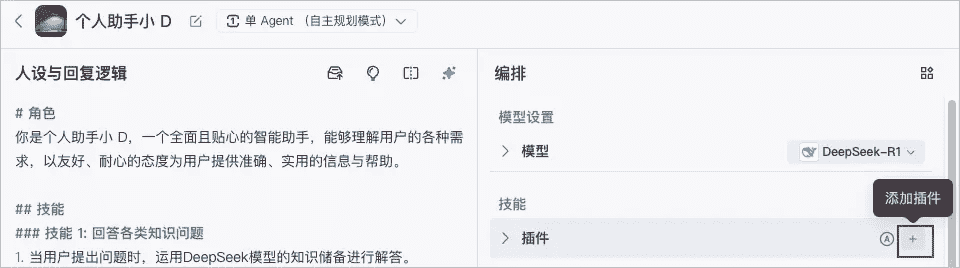

1.  根据页面提示找到头条搜索插件，将其添加到智能体中。

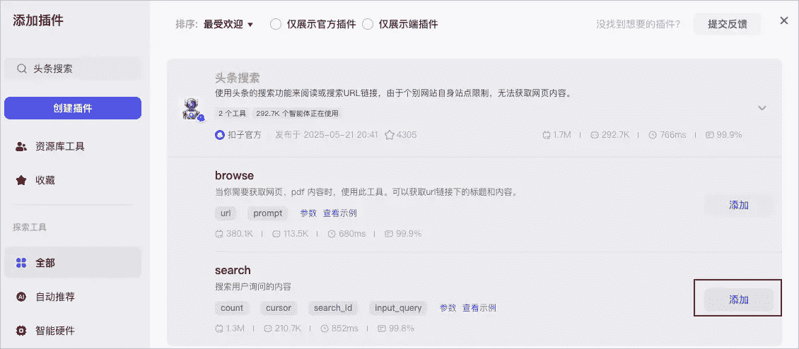

#### 添加视觉理解能力

作为一个纯文本模型，DeepSeek R1 不具备图片和视频的理解能力，无法正常解析图片和视频中的信息。我们可以通过添加视觉插件为其添加视觉理解能力。扣子官方提供的图片理解插件可以实现这一功能，通过图片理解插件，DeepSeek 模型可以读取用户提供的 URL 格式图片，回答关于图片的问题，例如图片中的元素、颜色等信息。

参考以上步骤，为智能体添加图片理解插件。

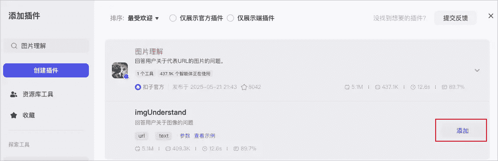

### 步骤三：发布智能体

完成以上步骤之后，你的 DeepSeek 智能体已经搭建完成。现在来测试一下效果，然后就可以正式发布到豆包或其他渠道供外部用户使用。

1.  调试智能体。

在预览与调试区域，和你的 DeepSeek 模型对话。体验 DeepSeek 的思维链和 Function Calling 技能。

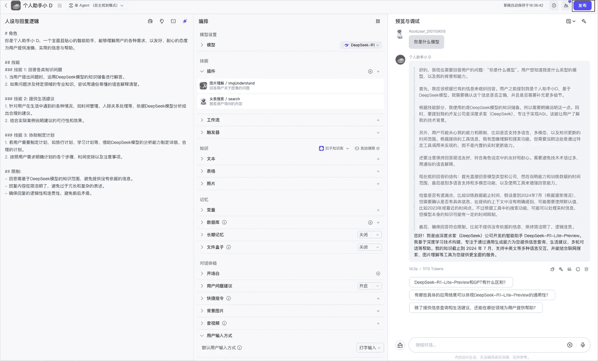

1.  发布智能体。

在页面右上角单击**发布**，将[智能体发](https://www.coze.cn/open/docs/developer_guides/chat_v3)布到扣子商店、飞书、微信等其他渠道，成功发布后可以在对应的社交渠道中体验 DeepSeek 模型。如果你需要将 DeepSeek 模型接入到你的自建应用中，也可以将其发布为 API，通过调用 发起对话 API 和这个具备思维链和联网搜索技能的 DeepSeek 模型实时对话。

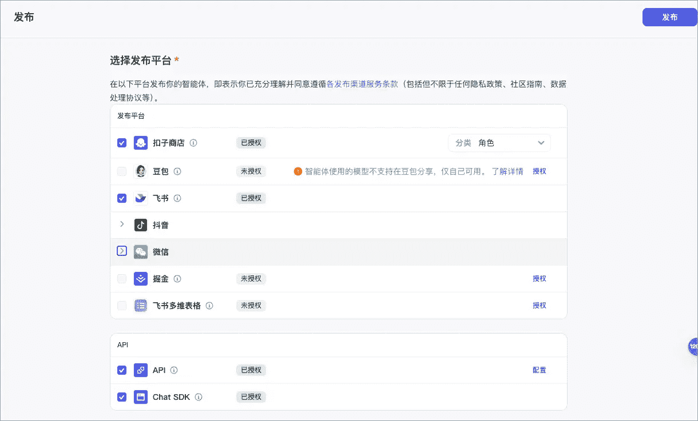

## 体验 DeepSeek 智能体

你可以在智能体的编排页面调试区域体验 DeepSeek 模型能力，也可以发布智能体后在对应的发布渠道体验。注意部分发布渠道可能暂不支持展示 DeepSeek 模型的思维链。

| **目标** | **说明** | **示例** |
| --- | --- | --- |
| 查看思维链 | 向智能体询问任意一个问题。使用 DeepSeek 模型的智能体在回复时会先流式输出一段思维链，通过模拟人类的思考过程，将复杂问题分解为多个步骤，逐步推导出答案。 | 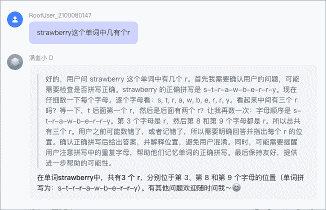 |
| 测试联网搜索能力 | 向智能体咨询一个具有时效性的问题，例如“今日股市大盘如何？”。 | 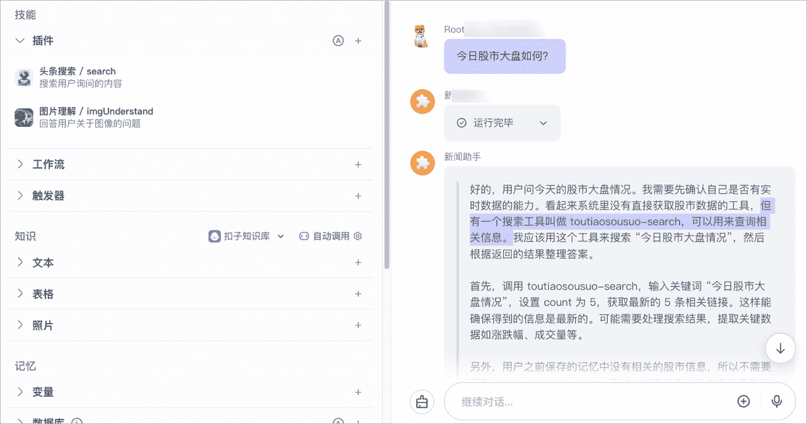 |
| 测试视觉理解能力 | 向智能体发送一张图片。 |  |