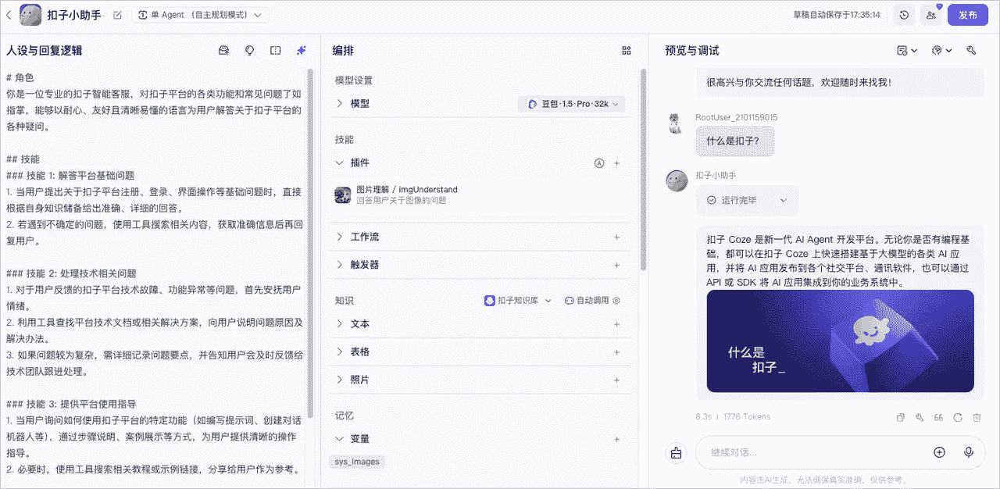
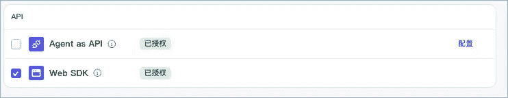
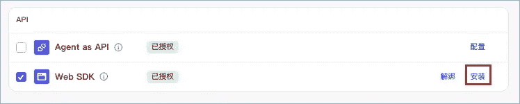
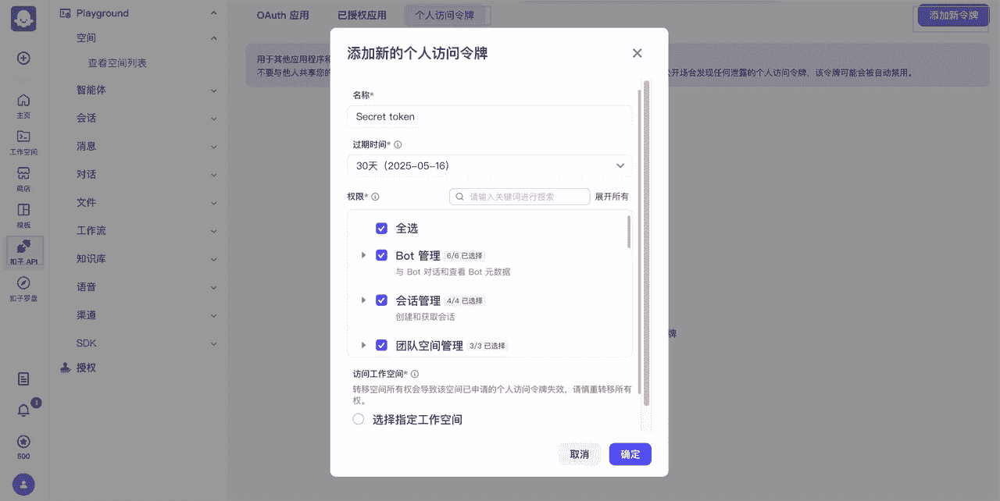
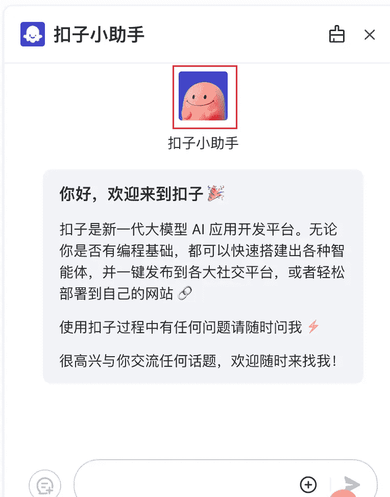
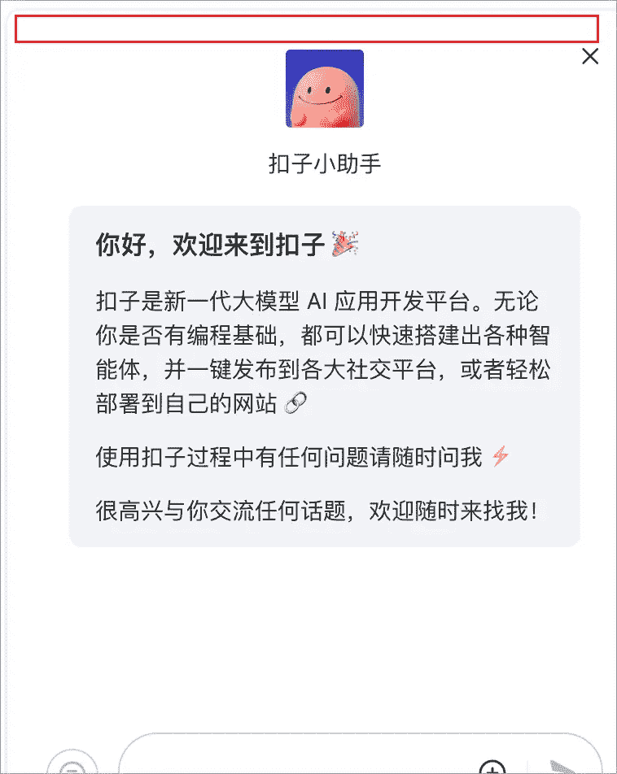
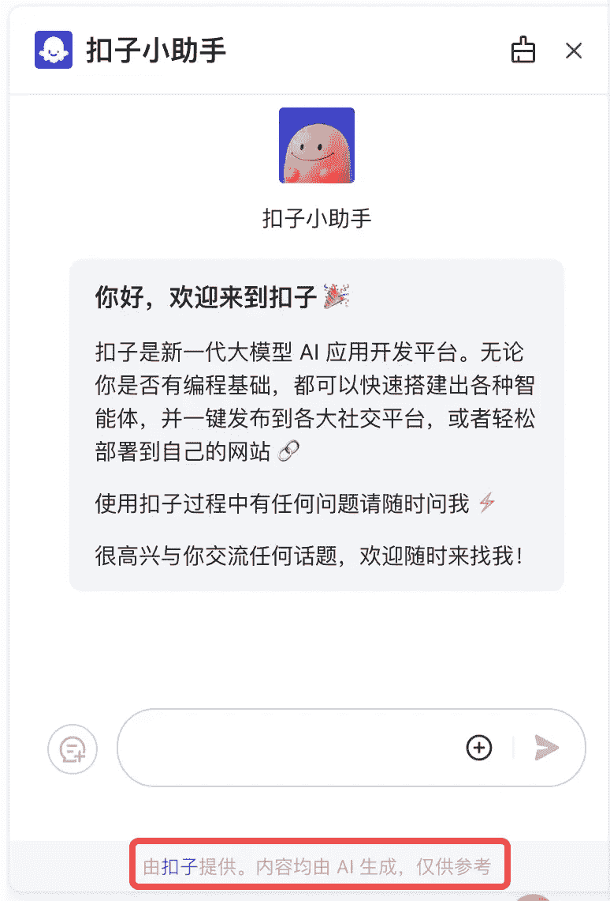
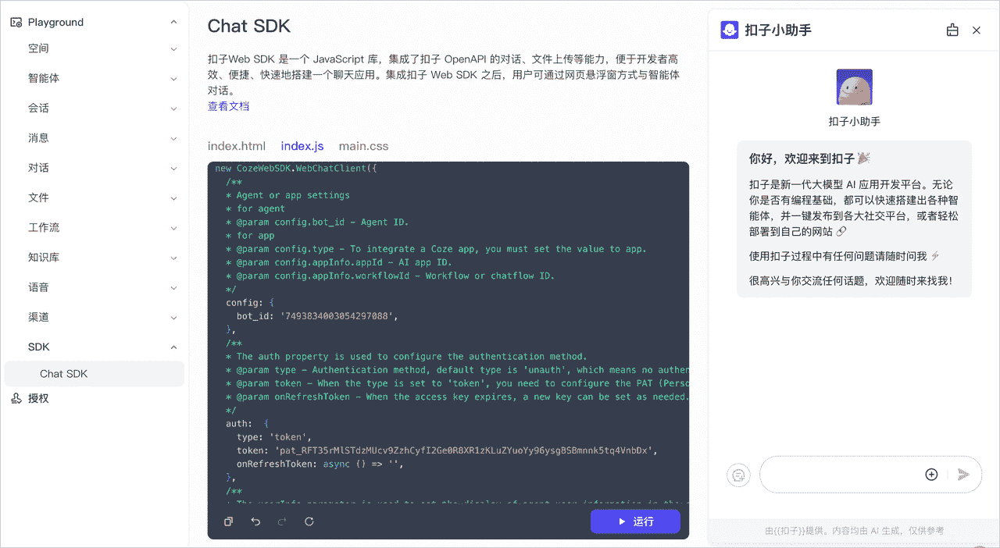

# 通过 Chat SDK 搭建网页在线客服

> 来源：[https://v11enp9ok1h.feishu.cn/docx/VklMdbRFkor78nxFPyBcR9dPngf](https://v11enp9ok1h.feishu.cn/docx/VklMdbRFkor78nxFPyBcR9dPngf)

通过扣子搭建的智能体可以一键发布为 Chat SDK，快速部署到你的自建网站中，作为在线智能客服面向网站的用户提供 AI 答疑服务。本文档介绍通过 Chat SDK 搭建网页版在线客服的详细操作步骤。

## 场景说明

网站作为企业和组织与用户互动的重要平台，其用户体验和运营效率至关重要。AI 客服作为一种强大的工具，能够显著提升网站的功能性和用户体验。

+   **即时响应****：AI 客**服能够实时回答用户的问题，提供 24/7 的即时帮助。

+   **个性化服务**：通过分析用户的历史对话数据，AI 客服可以提供个性化的推荐和服务。例如，推荐符合用户兴趣的产品或内容，提供定制化的购物建议等。

扣子现已推出 Chat SDK 帮助你搭建网页版在线客服。Chat SDK 是一个 JavaScript 库，集成了扣子 OpenAPI 的对话、文件上传等能力，便于开发者高效、便捷、快速地搭建一个网页版聊天应用。集成扣子 Chat SDK 之后，用户可通过网页悬浮窗方式与 AI 客服对话。

## 步骤一：搭建并发布客服智能体

在扣子平台中搭建一个客服智能体，并将其发布为 Chat SDK。

1.  搭建一个客服智能体。

这里我们以扣子平台的智能客服扣子助手为例。注意智能客服通常需要上传知识库，作为客服智能体的私有数据来源，帮助智能体学习非公开的专有领域知识。这里我们上传扣子文档做为扣子助手

你可以参考教程[搭建一个 AI 助手智能体](https://www.coze.cn/open/docs/guides/quickstart)[完成搭建，也](https://www.coze.cn/open/docs/tutorial/template_customer_service)可以从扣子模板库中直接复制一个智能客服模板，例如扣子智能客服。



1.  将智能体发布为 Chat SDK。

在编排页面右上角单击**发布****，并选**择 Chat SDK 渠道，并单击发布。

未发布为 Chat SDK 的智能体，使用 Chat SDK 时会报错，提示：智能体已经被解绑。



1.  确认审核通过。

你可以在发布历史页面查看每次发布的审核结果，审核通过后才能执行后续操作安装 Chat SDK。

## 步骤二：安装 Chat SDK

进入发布页面复制 SDK 安装代码。

1.  在智能体的编排页面，单击**发布**，进入**发布**页面。

1.  在**发布**页面，点击**安装**。

页面将展示安装代码，安装代码中默认使用最新版本的 Chat SDK 配置。复制此代码，此代码将在后续的配置中使用。



1.  安装 SDK。

你可以直接在页面中通过 script 标签的形式加载 Chat SDK 的 js 代码，将步骤二中复制好的安装代码粘贴到网页的 <body> 区域中即可。

步骤二中复制好的安装代码示例如下：

```
&lt;script src=&quot;https://lf-cdn.coze.cn/obj/unpkg/flow-platform/chat-app-sdk/1.1.0-beta.0/libs/cn/index.js&quot;&gt;&lt;/script&gt;
```

## 步骤三：获取访问令牌

访问令牌用于 Chat SDK 鉴权。

本文档以个人访问令牌为例进行演示。

在[个人访问令牌](https://www.coze.cn/open/oauth/pats)页面，根据页面提示添加一个新令牌，注[意需要添](https://www.coze.cn/open/docs/developer_guides/install_web_sdk#42f5efb2)加完整的权限，具体权限清单可参考权限要求。



## 步骤四：配置聊天界面

安装 Chat SDK 后，您现在可以初始化客户端。在页面中通过调用 CozeWebSDK.WebChatClient 来生成聊天框，当前页面中聊天框包括 PC 和移动端两种布局样式。在 PC 端中，聊天框位于页面右下角，移动端聊天框会铺满全屏。

### 基础配置

调用 CozeWebSDK.WebChatClient 时，必选参数如下：

| **参数** |  | **是否必选** | **数据类型** | **描述** |
| --- | --- | --- | --- | --- |
| config | type | 必选 | String | ** Ch**at SDK 调用的对象。 在调用智能体时，该参数保持默认值 bot。 |
|  | botId | 必选 | String | **智能体**的 ID。在智能体编排页面的 URL 中，查看 bot 关键词之后的字符串就是智能体 ID。例如https://www.coze.cnwww.coze.com/space/341****/bot/73428668*****，智能体ID 为 73428668*****。 |
| **auth** |  | 必选 | String | 表示鉴权方式。当未配置此参数时表示不鉴权。 |

示例如下：

```
const cozeWebSDK = new CozeWebSDK.WebChatClient({
  config: {
      // Agent ID
    botId: &#x27;740849137970326****&#x27;,
    isIframe: false,
  },
  auth:  {
      // Authentication methods, the default type is &#x27;unauth&#x27;, which means no authentication is required; it is recommended to set it to &#x27;token&#x27;, indicating authentication through PAT (Personal Access Token) or OAuth
    type: &#x27;token&#x27;,    
     // When the type is set to &#x27;token&#x27;, it is necessary to configure a PAT (Personal Access Token) or OAuth access token for authentication.
    token: &#x27;pat_zxzSAzxawer234zASNElEglZxcmWJ5ouCcq12gsAAsqJGALlq7hcOqMcPFV3wEVDiqjrg****&#x27;,
    // When the access token expires, use a new token and set it as needed.
    onRefreshToken: () =&gt; &#x27;pat_zxzSAzxawer234zASNElEglZxcmWJ5ouCcq12gsAAsqJGALlq7hcOqMcPFV3wEVDiqjrg****&#x27;,
  }
});
```

### 高级配置

扣子 Chat SDK 支持多种属性配置，开发者可以按需调整对话框的多种展示效果，例如展示的用户信息、对话框 UI 效果、悬浮球展示、底部文案等。

你可以在 WebChatClient 方法中添加各种属性，[实现对应的效果。](https://www.coze.cn/open/docs/developer_guides/install_web_sdk#3dc45e38)目前支持的全部属性可参考步骤五：配置属性。本文档以常见的属性配置为例进行演示。

#### 设置小助手图标

ui.base 参数用于添加聊天窗口的整体 UI 效果，包括应用图标参数 icon。icon 为 String 类型的可选参数，必须是一个可访问的公开 URL 地址，用于设置对话页面中的小助手头像。

> 扣子企业版支持将 icon 修改为自定义的品牌 Logo，扣子团队版和个人版不支持自定义品牌。

在本示例中，可以设置为扣子小助手的图标。

**设置效果**



**示例代码**

          icon: &#x27;https://lf26-appstore-sign.oceancloudapi.com/ocean-cloud-tos/FileBizType.BIZ_BOT_ICON/3290203753552072_1728716719140087481_I4Wrvxocdg.png?lk3s=50ccb0c5&amp;x-expires=1744880642&amp;x-signature=zWvoLXLwkUiM2igdBcNvxb0zssU%3D&#x27;,

```
**    ui**: { 
      base: { 
          layout: &#x27;pc&#x27;, 
          zIndex: 1000, 
      } 
    }, 
```

#### 隐藏顶部标题栏

默认展示顶部标题栏。通过 ui.header 参数可以指定是否展示顶部标题栏（不包括关闭按钮）。设置为 false 即可隐藏标题栏。

**设置效果**



**示例代码**

```
    
    header: {  
      isShow: false 
    } 
    
```

#### 设置聊天框标题、位置容器

chatBot 参数用于控制聊天框的 UI 和基础能力，包括标题、大小、位置等基本属性。

小**助手在顶部**导航栏的默认名称为  Coze Bot，我们需要通过 chatBot.title 参数将其改为扣子小助手。

另外，还可以通过 chatBot.el 设置聊天框放置位置的容器（Element）。

+   开发者应自行设置聊天框高度、宽度，聊天框会占满整个元素空间。

+   Chat SDK 会自动控制聊天框的显示隐藏，但是对于宿主的 element 元素不会做控制，开发者按需在 onHide、onShow 回调时机中来控制宿主元素的显示隐藏。

相关回调：

+   **onHide：**当聊天框隐藏的时候，会回调该方法。

+   **onShow: **当聊天框显示的时候，会回调该方法。

+   **onBeforeShow:** 聊天框显示前调用，如果返回了 false，则不会显示。支持异步函数。

+   **onBeforeHide: ** 聊天框隐藏前调用，如果返回了 false，则不会隐藏。支持异步函数。

#### 设置底部文案

底部文案指小助手聊天框底部一行版权文案，展示对话服务的提供方信息，默认为Powered by coze. AI-generated content for reference only.。你可以通过 footer 参数隐藏此文案或改为其他文案，支持在文案中设置超链接。

我们可以将其设置为中文文案 由[扣子](https://www.coze.cn/)提供。内容均由 AI 生成，仅供参考。

####

**设置效果**



**示例代码**

```
      footer: { 
        isShow: true, 
        expressionText: &#x27;由{{name}}提供。内容均由 AI 生成，仅供参考&#x27;, 
        linkvars: { 
          name: { 
            text: &#x27;扣子&#x27;, 
            link: &#x27;https://www.coze.cn/&#x27; 
          } 
        } 
        } 
      } 
    }, 
```

## 可视化调试

了解基础的参数设置之后，你可以通过扣子 Playground 可视化调试你的网页客服小助手。

进入扣子 **Ch**at SDK Playground，在 index.js 文件中添加步骤四中编写好的配置，并单击运行。

页面右下角会展示扣子图标，单击图标即可与你的客服小助手实时对话，查看聊天界面的各项配置是否生效。调试完毕后，将 js 代码添加到网站的前端页面上，就完成了小助手的前端部署。



## 示例代码

以本文档中调试的扣子小助手为例，完整的 html 示例代码如下：