# 通过飞书进行 SAML SSO 登录

> 来源：[https://v11enp9ok1h.feishu.cn/docx/Hin7dLwf8o3Z51xzVsscWk9Cnid](https://v11enp9ok1h.feishu.cn/docx/Hin7dLwf8o3Z51xzVsscWk9Cnid)

通过单点登录功能（即 Single Sign On，SSO）可实现飞书和扣子开发平台之间登录身份互通互认。企业用户只需登录飞书，就可以直接访问扣子开发平台中的企业工作空间，免去每次访问都需要输入扣子账号和密码的步骤。本文档以飞书为例，演示飞书作为 IdP 时，企业管理员开启 SSO 登录的详细操作步骤，帮助你理解企业 IdP 与扣子开发平台进行 SSO 的端到端配置流程。

## 场景说明

某企业使用飞书作为移动办公平台，在飞书中维护自己的员工身份信息。企业使用员工邮箱前缀作为员工的唯一标识，例如用户 Alice 的员工邮箱为 Alice_123@enterprise.com，该员工在扣子开发平台中作为企业成员的用户名为 Alice_123。

企业管理员购买了扣子企业版或团队版之后可以开启 SSO 登录，能够让 Alice 通过链接基于飞书已经登陆的身份直接跳转扣子开发平台，以企业成员的身份访问扣子企业版工作空间。

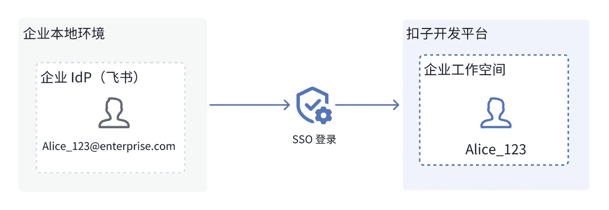

## 准备工作

+   已在扣子开发平台中创建企业组织、创建企业成员 Alice_123，并将其加入企业。

+   已获取飞书集成平台管理员权限、扣子开发平台企业超级管理员权限。

### 步骤一：在扣子中获取配置信息

在扣子平台中获取以下配置信息：

| **信息** | **查看方式** | **示例** |
| --- | --- | --- |
| SAML 服务提供者（SP）元数据 URL | 1.  扣子企业超级管理员登录扣子开发平台，切换到企业中。  | 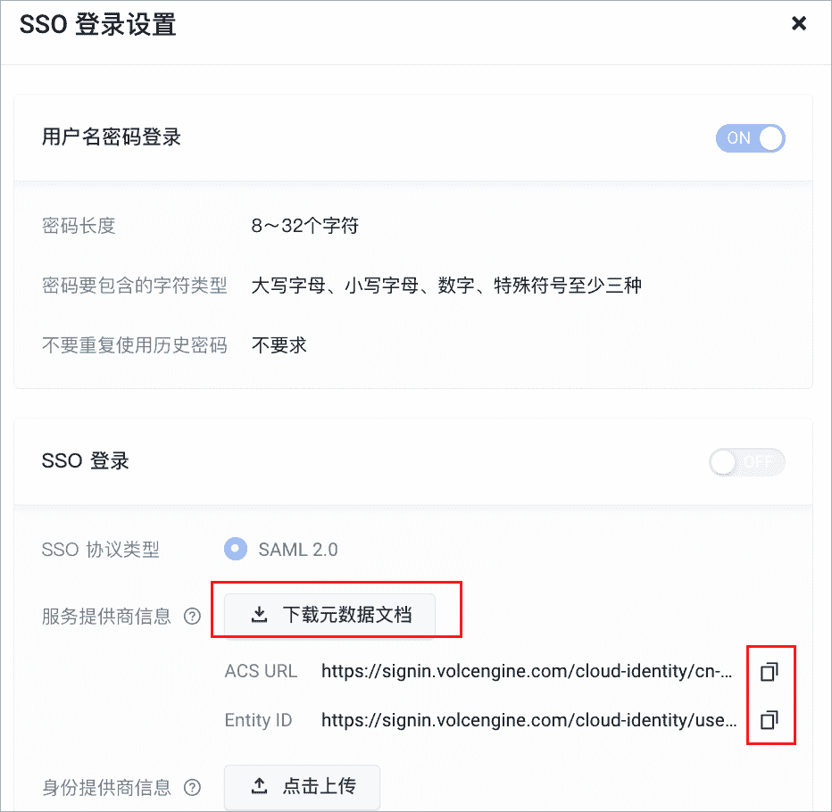 |
| 扣子企业超级管理员对应的火山引擎主账号 ID | [扣子企业](https://console.volcengine.com/user/basics/)超级管理员登录到火山引擎扣子平台后，在账号管理页面查看账号 ID。 | 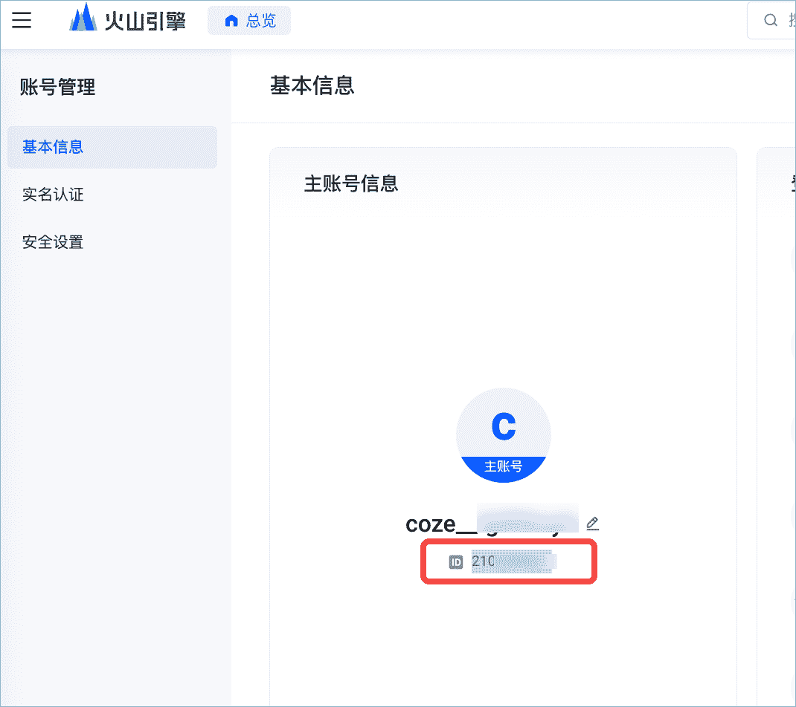 |
| 确认用户的唯一标识 | NameID 是 SAML 断言中用于标识用户的一个元素。它是一个唯一标识符，用于在 IdP 和 SP 之间唯一地标识用户。 | 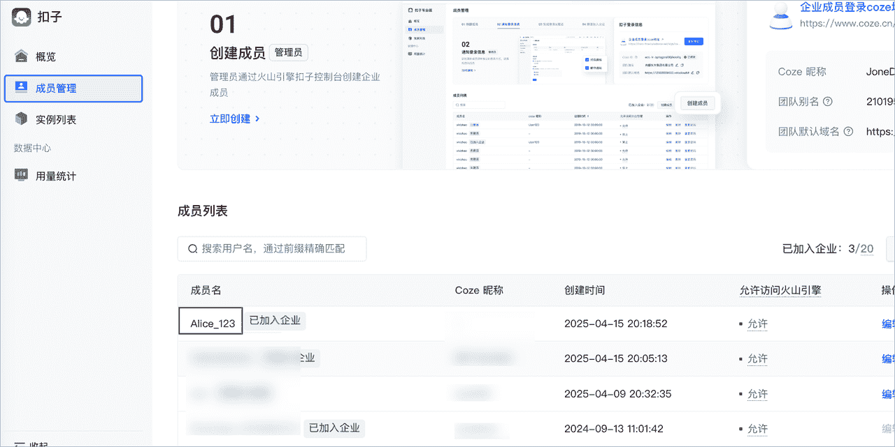 |

> 本示例中，SAML 响应的 Name ID 为邮箱名（不包含@及后缀），开始配置前请确认：

+   **企业用户** Alice 在火山扣子控制台 > 用户管理页面的用户名为 Alice_123。

+   企业用户 Alice 在飞书中配置的邮箱前缀同样为 Alice_123。

### 步骤二：在飞书集成平台创建并配置应用

作为身份提供商（IdP），飞书集成平台需要以应用的形式感知服务提供商扣子开发平台，实现**单点登录**。因此，企业管理员需要飞书集成平台创建对应扣子开发平台的应用，应用类型为自建应用。

1.  [使用飞书租户](https://anycross.feishu.cn/console/identity/sso-app-manager)的管理员用户或具有同等权限的飞书用户登录飞书集成平台。

1.  在身份集成 >** 应用单**点登录 > 应用管理页面中，单击新建应用，创建一个新的自建应用。

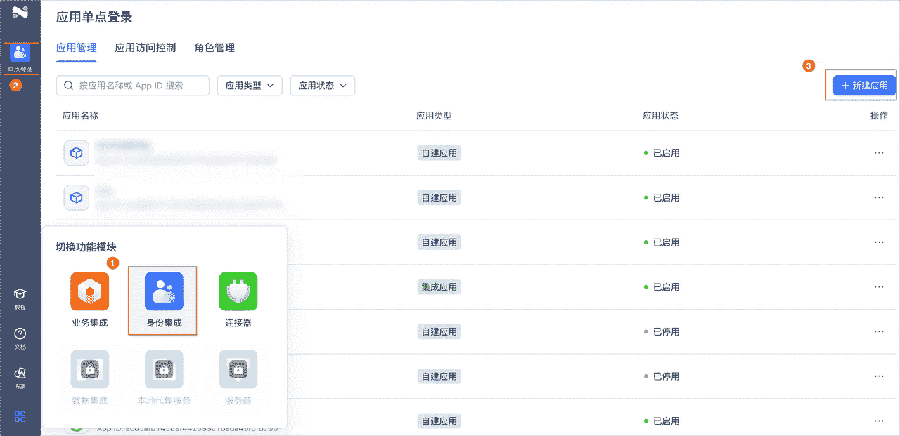

1.  在**新建应用**页面，选择应用类型为**自建应用**。

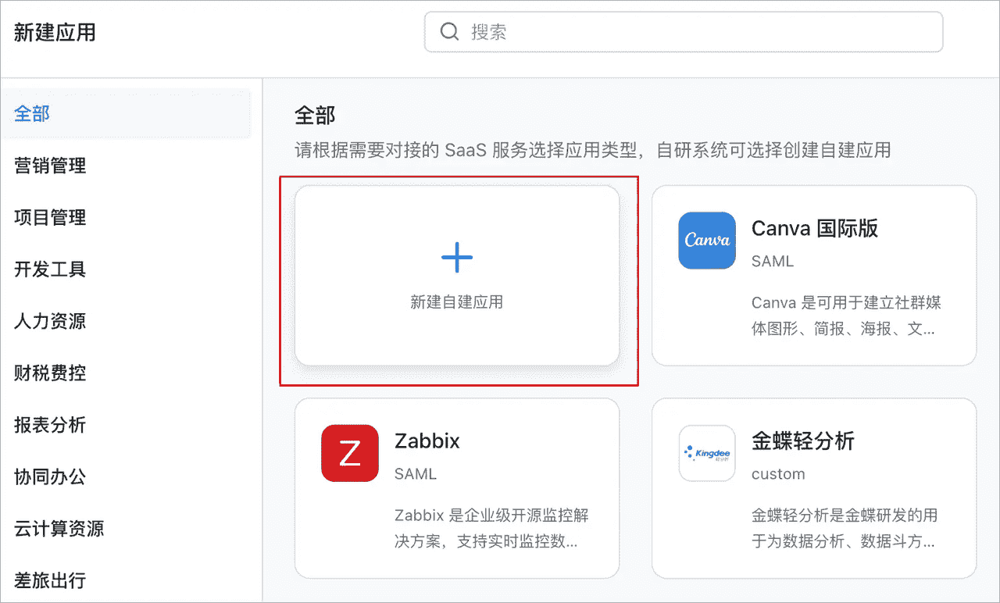

1.  在**基本配置****页面，**配置应用程序的名称等基本信息，然后单击下一步。

此示例中可以填写**应用名称**为**扣子开发平台**，该名称仅用作在 IdP 处展示。

1.  在**应用配置**页面填写 SAML 配置。

1.  在**更多配置**区域，展开配置，启用 SAML 2.0 协议。

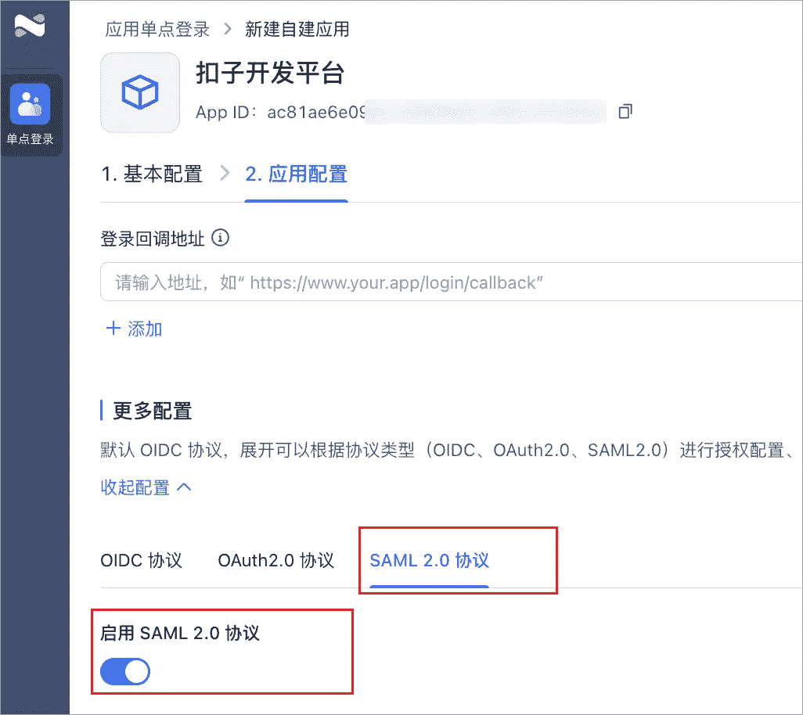

1.  填写以下设置，并单击**保存并启用**。

| **配置** | **说明** | **示例** |
| --- | --- | --- |
| 授权配置 | 在**快捷导入 SAML 元数据**区域，单击**上传文件**，上传步骤一中下载的 SP 元数据文件。 | 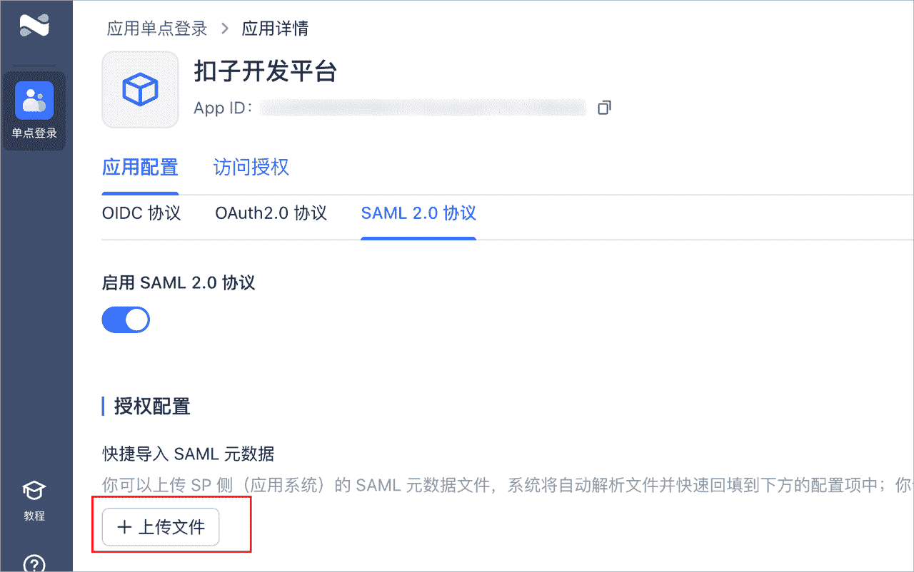 |
| 支持 IdP 侧发起登录 | 可选。配置 IdP 登录后，企业用户 Alice 可从飞书提供的登录地址访问扣子开发平台。 | IdP 登录： |
| Name ID 配置 | 选择进行 SSO 身份映射时使用的飞书用户字段。建议此处选择在飞书侧维护的全局唯一的、仅包含英文字母的字段。 | 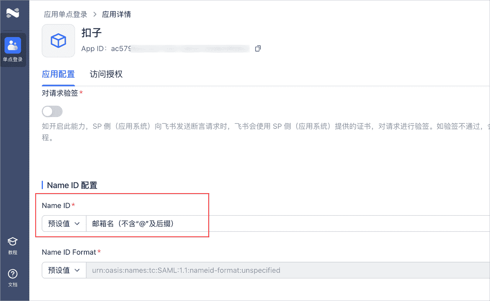 |
| SAML 2.0 协议端点 | 在页面右侧 **SAML 2.0 协议端点**区域中，单击**下载元数据文档**，下载身份提供商（IdP）元数据文件，并将其保存在本地目录。 | 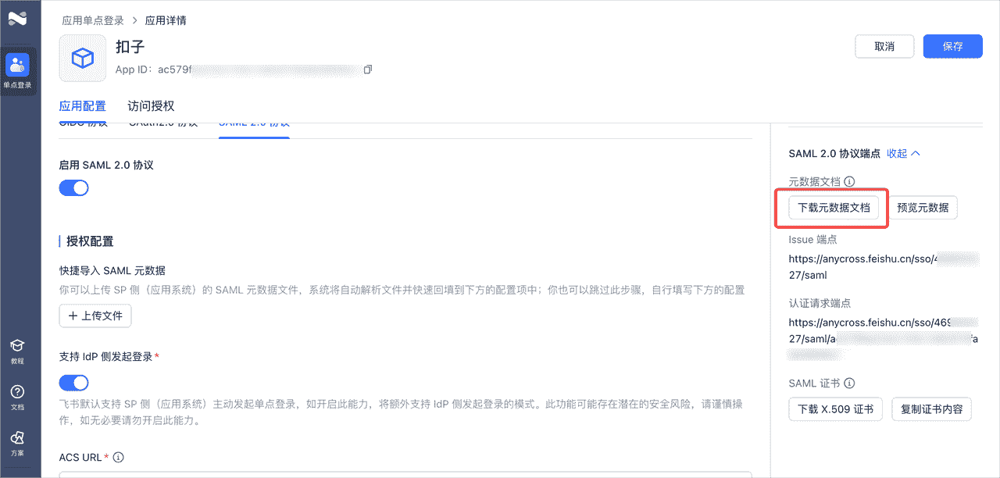 |

完整配置示例如下：

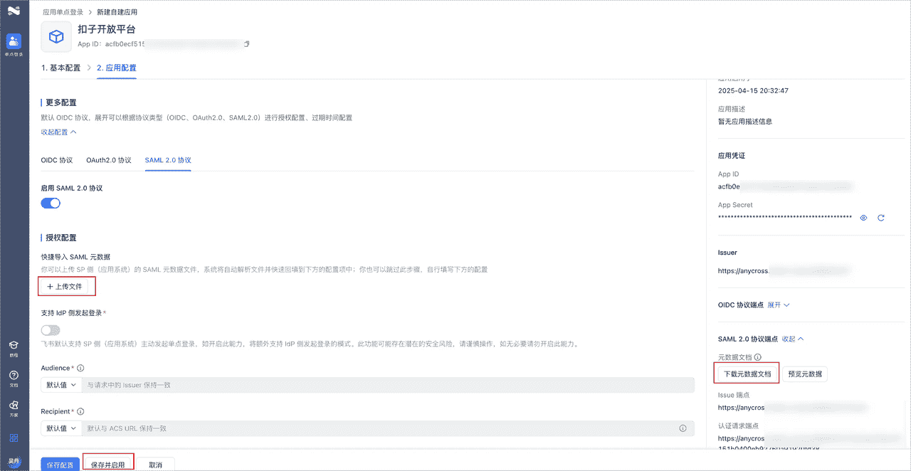

1.  配置完成后，点击**保存并启用**。

1.  确认可访问范围。

在刚创建的应用中的**访问授权****页面配置**可以进行单点登录的飞书用户范围。默认全部成员均可通过飞书用户身份以 SSO 方式登录扣子开发平台，访问企业工作空间。

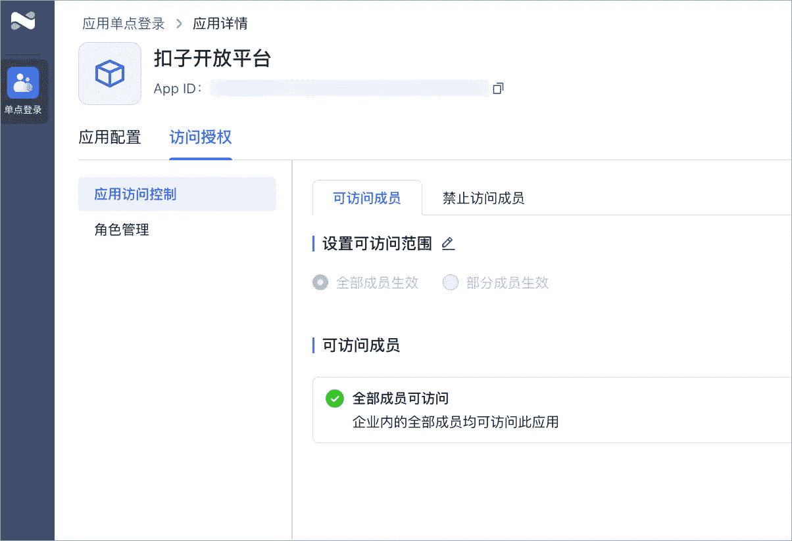

### 步骤三：在扣子中上传 IdP SAML 配置

在扣子平台中上传企业身份管理系统（IdP）的元数据信息，建立扣子平台对 IdP 的信任，并开启 SSO 登录，实现企业 IdP 通过用户 SSO 登录扣子平台。

1.  扣子企业超级管理员登录扣子开发平台，切换到企业中。

1.  在左侧导航栏选择**企业管理** > **SSO 配置**，并单击**去配置**。

1.  在弹出页面中 **SSO 登录** > **身份提供商信息**一栏，上传步骤一中下载的 IdP 元数据文档。

1.  在 **SSO 登录**区域，开启 SSO 登录。

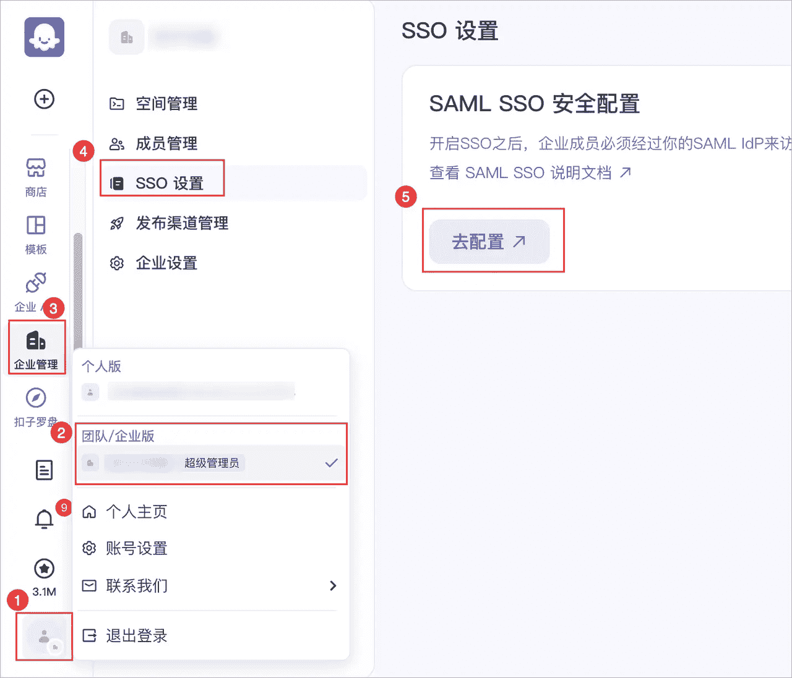

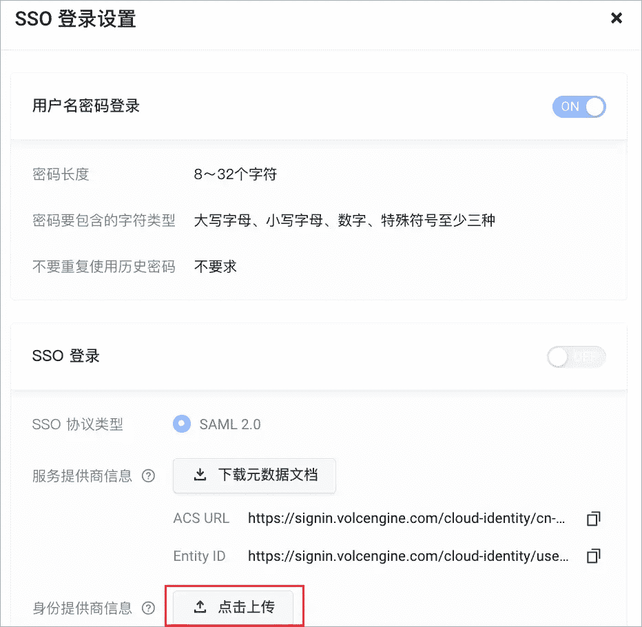

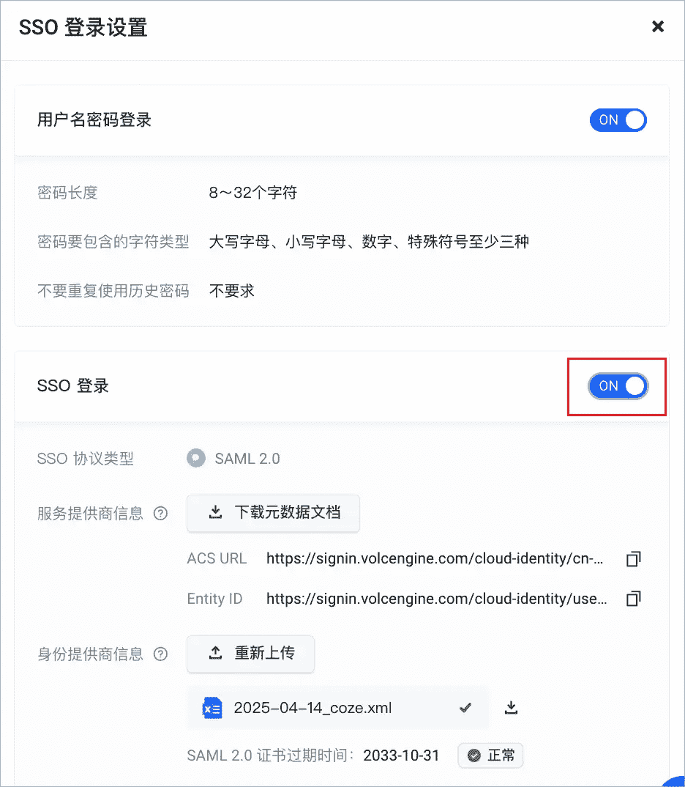