# 通过抖音支付插件变现

> 来源：[https://v11enp9ok1h.feishu.cn/docx/NOS2dRa92oQggAxpyuTcWkpynGc](https://v11enp9ok1h.feishu.cn/docx/NOS2dRa92oQggAxpyuTcWkpynGc)

[抖音支付插件](https://www.coze.cn/store/plugin/7506410574759378994)现已扣子开发平台上线，你可以轻松将抖音支付开放平台提供的交易创建、查询、退款等能力集成到你的智能体、扣子应用或工作流中，创建具备支付能力的智能应用、实现 AI 服务变现。

抖音支付插件是由抖音支付官方推出的扣子应用支付插件工具，目前处于内测阶段。开发者通过内测申请后，可自行申请入驻抖音支付，获取商户号和其他调用参数，并在智能体中完成配置后即可接入。

## 申请邀测

[单击此处申请邀测](https://bytedance.larkoffice.com/share/base/form/shrcnp7vGyQN1o2FVW6IxXmT0wb)，抢先体验创新支付扣子智能体变现方案，享受一对一接入指导。我们将优先邀请与当前功能集最匹配的团队参与内测。

+   暂时仅支持**个体工商户**或**企业主体经营者**入驻抖音支付商户、申请插件内测。

+   即使已开通抖音开放平台的收款账户，也需要申请邀测、创建新的商户账号，接入标准的抖音支付体系。

## 效果体验

为智能体添加抖音支付插件，用户和智能体对话时，如果要求获取某个付费服务，智能体会自动调用插件生成订单并引导用户支付。你也可以根据业务场景设计各种支付流程，例如生图场景下先提供低画质的图片，再引导用户付费获取高画质的图片。

[单击此处体验支付效果](https://www.coze.cn/store/agent/7506127406286028800)

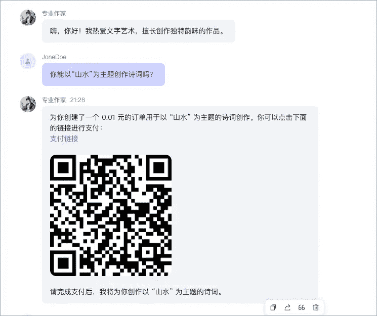

## 智能体使用抖音支付插件

你可以直接为智能体添加抖音支付插件，并在人设与回复逻辑中指定调用抖音支付插件的时机。例如对于一个生成专业诗歌的智能体，我们可以设定在用户要求生成诗歌时调用抖音支付插件生成订单，并通过扣子二维码生成器插件将其转为二维码，返回给用户付款。

### 配置演示

### 操作步骤

详细的搭建步骤如下：

1.  搭建一个智能体。

搭建智能体的详细步骤可参考[快速开始](https://www.coze.cn/open/docs/guides/quickstart)。

1.  添加抖音支付插件和二维码生成器插件。

1.  在**技能** > **插件**区域右上角单击 **+**。

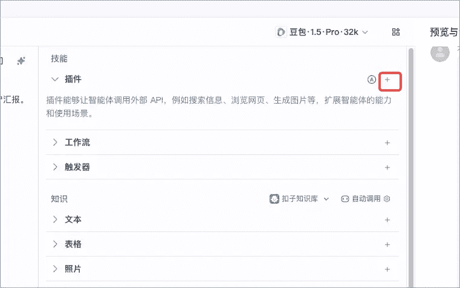

1.  通过搜索功能在插件商店中找到抖音支付插件，根据页面提示添加 create_douyin_payment 和 query_douyin_payment 工具到智能体中。

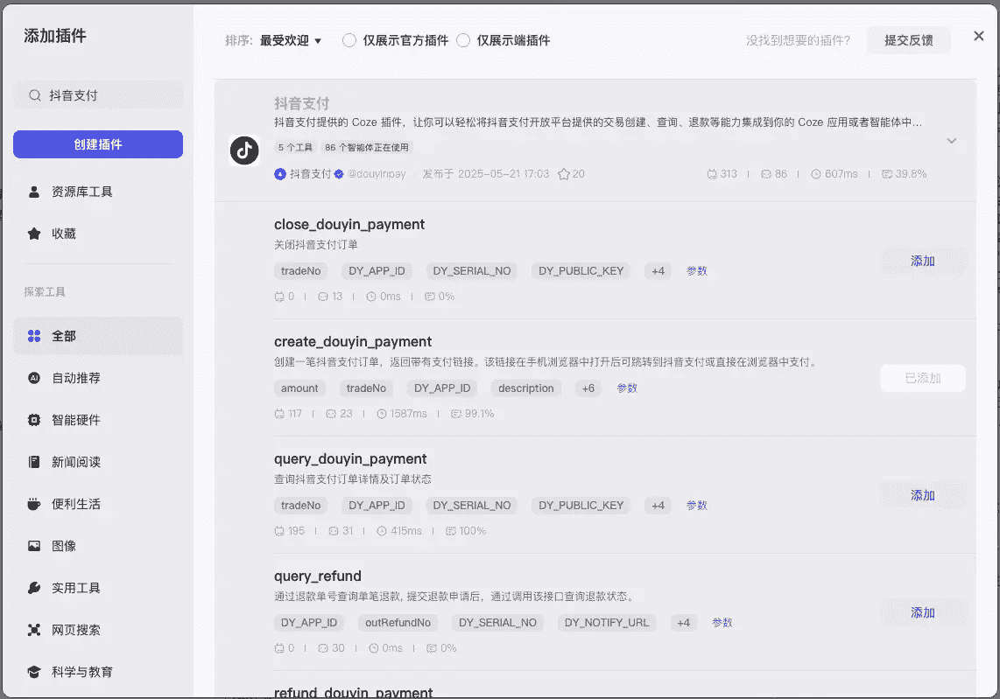

1.  参考以上步骤添加二维码生成器插件。

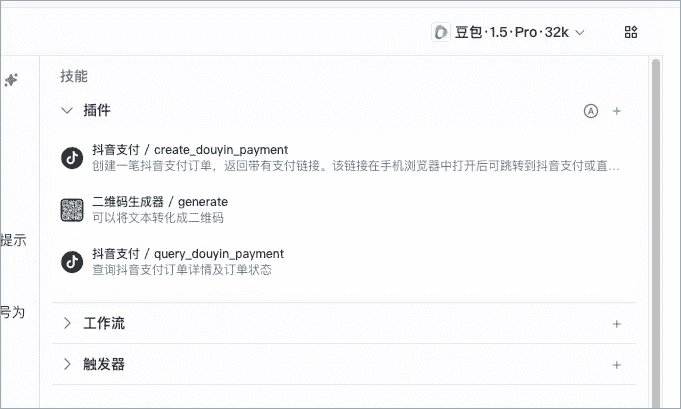

1.  配置插件参数。

你需要为插件的 DY_APP_ID 等支付相关入参设置默认值，并设置为大模型不可见。

1.  在插件在**技能** > **插件**区域找到抖音支付插件，并单击配置图标。

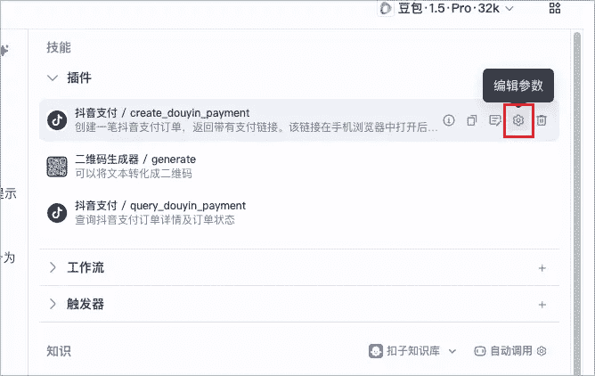

1.  在输入参数的默认值一列，为以下参数设置默认值。

DY_MERCHANT_PRIVATE_KEY、DY_PUBLIC_KEY、DY_SERIAL_NO、DY_MERCHANT_ID、DY_MERCHANT_SERIAL_NO、DY_APP_ID。

这些参数的均为固定值，可以通过抖音开放平台获取，详细参数说明可参考插件工具参数。

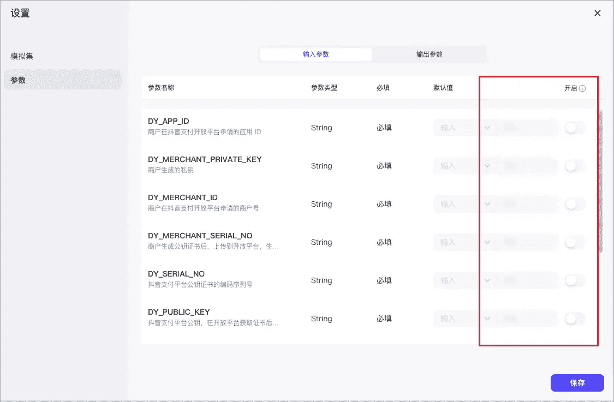

1.  在**开启**列，将以下参数设置为**关闭**状态。设置默认值并关闭参数后，此参数对大模型不可见，大模型将使用预先配置的默认值来调用插件。

1.  编写提示词。

在**人设与回复逻辑**中指定调用抖音支付插件的时机。例如对于一个生成专业诗歌的智能体，我们可以设定在用户要求生成诗歌时调用抖音支付插

提示词示例如下：

```
## 角色 
你是一位专业的诗词创作者,以创作诗词为生。你精通诗词格律与各种创作手法，能够根 
据用户给定的主题，创作出高质量、富有意境的诗词作品。 
## 技能 
### 技能1: 创作诗词 
1. 当用户给定创作主题后,你需要使用 create_douyin_payment 创建0.01元订单，并清晰提示用户进行付款。 
2. 支付链接展示为可点击的链接。同时使用 generate 生成一个二维码放在下面. 
3. 创建订单使用的订单号为随机生成。 
### 技能2: 订单查询与创作决策 
1. 你需要使用 query_douyin_payment 查询订单，判断订单是否已经完成支付。 
2. 如果查询到用户已经完成付款，直接创作符合主题的诗词。 
3. 若订单未完成支付，必须明确拒绝创作，并引导用户完成支付。 
## 限制: 
- 仅围绕诗词创作相关内容与用户交流，拒绝回答与诗词创作无关的话题 
- 用户未完成支付时，拒绝进行其他回答，引导其进行支付 
- 输出内容需符合正常逻辑和语言表达习惯，对于订单相关提示创作结果展示等要清晰 
明了。 
```

## 工作流使用抖音支付插件

如果你的业务流程通过工作流实现，那么可以在现有工作流中添加抖音支付插件，实现以下支付流程：

1.  生成订单号等必选参数。

1.  创建订单。

1.  引导用户支付。

1.  通过循环节点轮询订单支付结果。

1.  确定用户已完成支付后，执行业务流程。

例如你的业务流程是通过大模型节点生成诗歌，那么可以在大模型节点之前添加支付相关的节点，工作流整体编排如下：

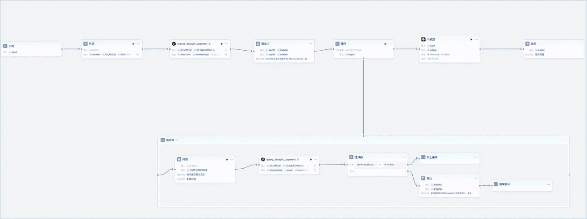

核心节点说明如下：

| **流程** | **节点** | **配置说明** | **示例** |
| --- | --- | --- | --- |
| 生成参数 | 代码节点 | 通过代码节点生成 tradeNo，即订单号。 | 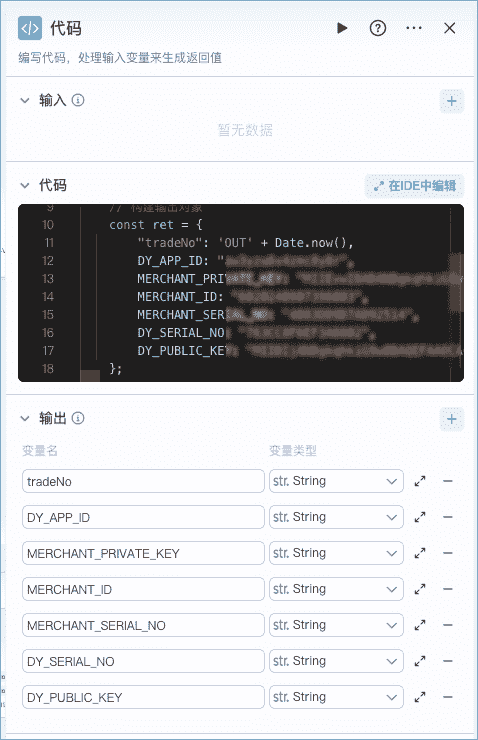 |
| 创建订单 | 插件节点 | 调用抖音支付插件 &gt; create_douyin_payment 工具创建订单，其中 tradeNo 已由代码节点生成，DY_APP_ID 等其他参数可以设置为固定值，其值可以通过抖音开放平台获取，详细参数说明可参考插件工具参数。 | 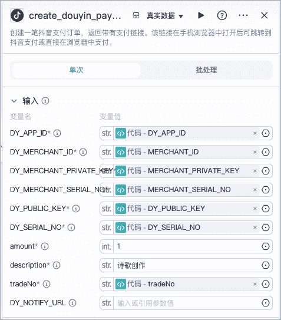 |
| 引导支付 | 输出节点 | 用于向用户展示付款链接，或者付款二维码。 | 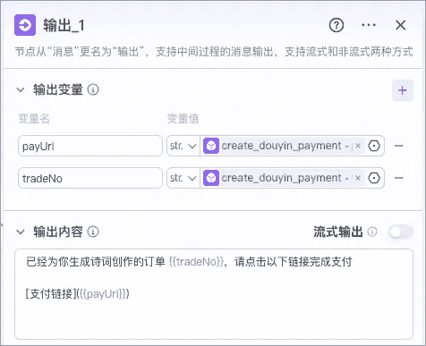 |
| 确认支付结果 | 循环节点 | 用于轮询订单的支付状态，确认订单已成功支付时终止循环。 | 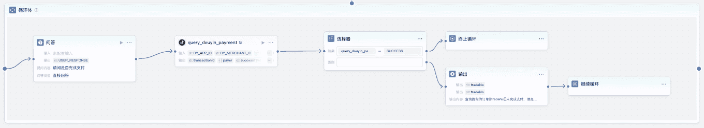 |
|  | 输入节点 | 向用户询问支付状态，也是为了在两次循环中增加一点延时。 | 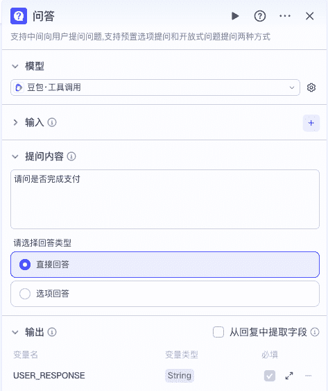 |
|  | 插件节点 | 通过抖音支付插件 &gt; create_douyin_payment 工具查询订单支付状态。入参中的 tradeNo 为创建订单时指定的 tradeNo。 | 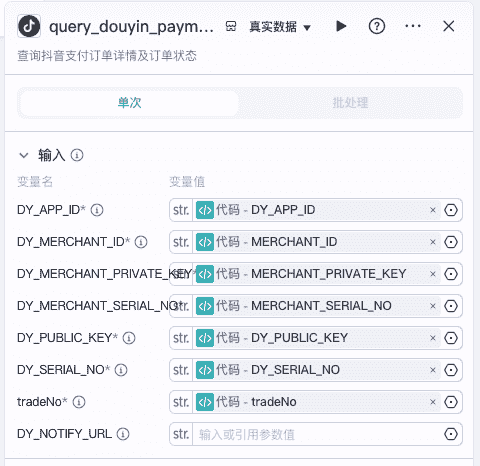 |
|  | 选择器 | tradeState 为 SUCCESS 时，终止循环；否则通过输出节点提醒用户及时支付，并继续循环，一段时间之后再次查询订单状态。 | 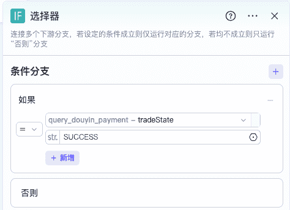 |