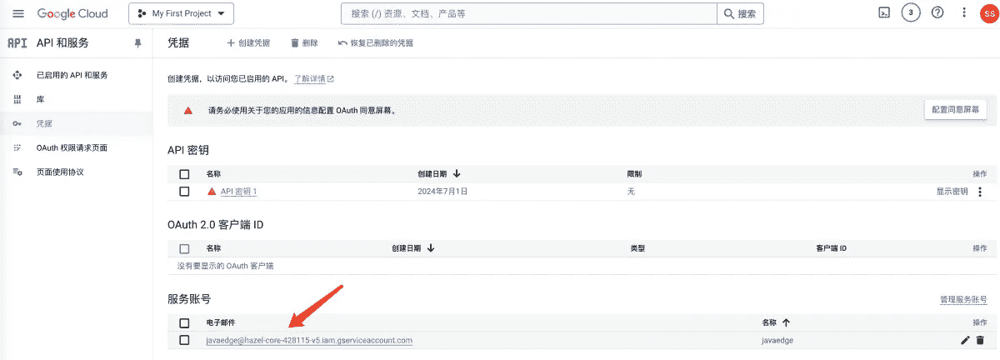
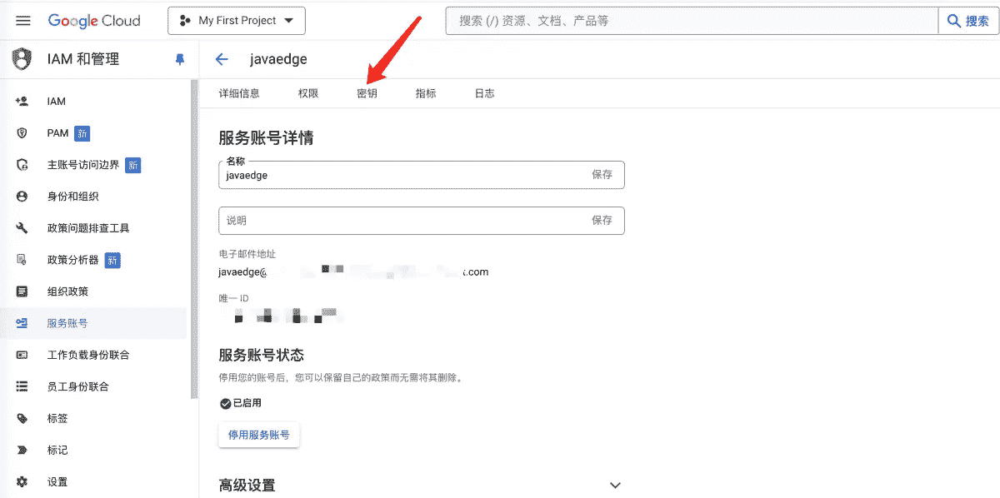
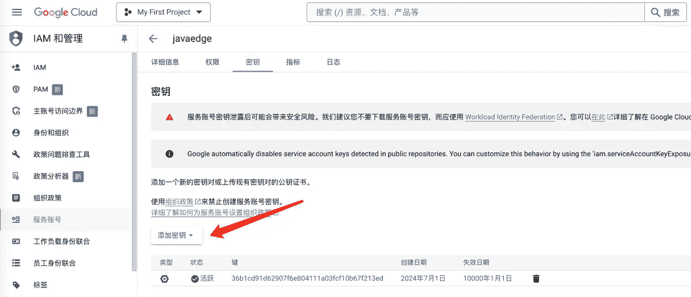
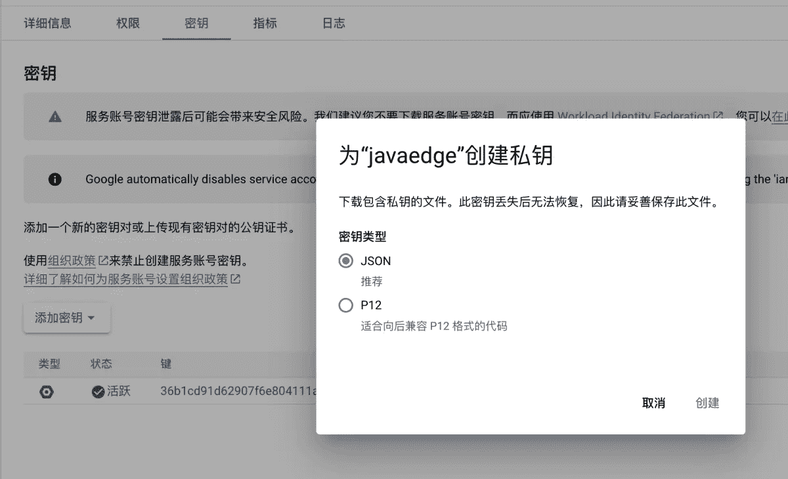
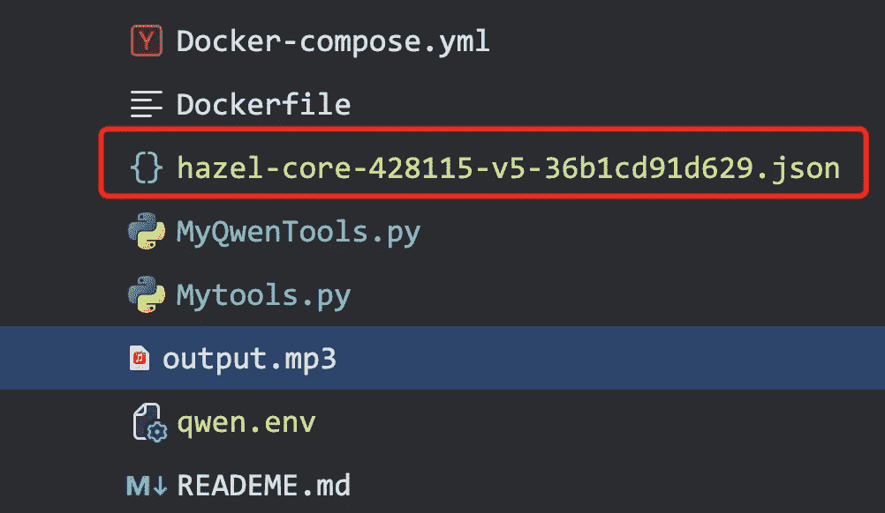
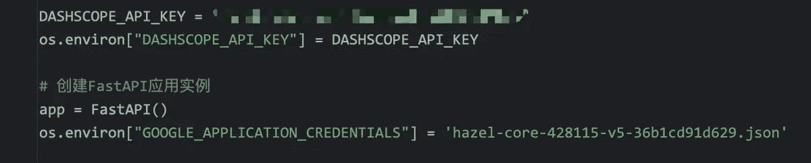
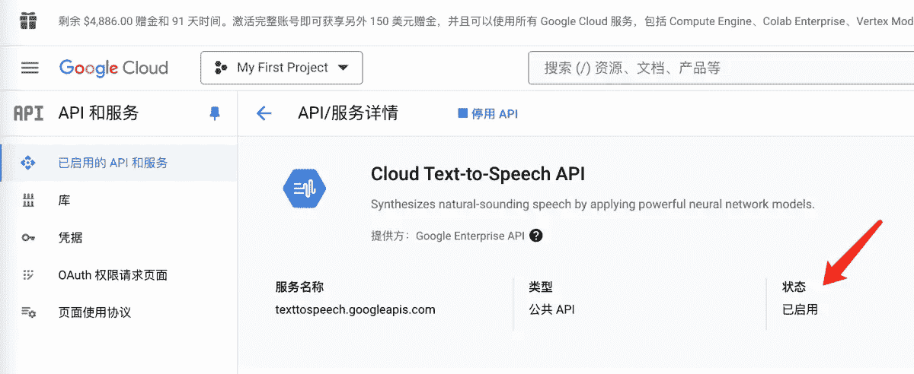
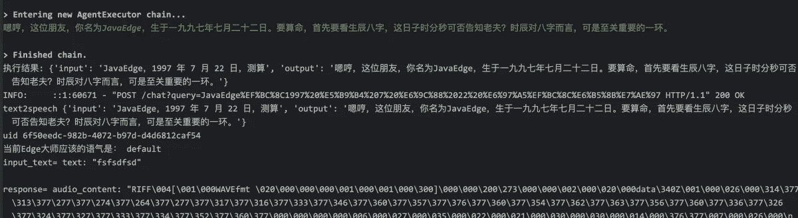
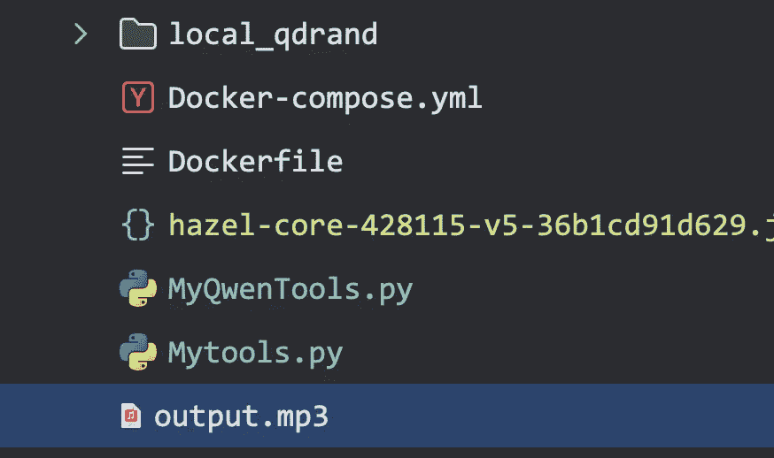

# AI 项目实战:TTS技术 为Agent提供语音交互功能

> 来源：`https://v11enp9ok1h.feishu.cn/docx/X5xNddVc0oUwWDxuTKzcKrAinXc`

## 项目实战(03)--Agent添加语音交互功能

## 1 语音逻辑设计

一个AI Agent应用的语音逻辑设计流程图。

### 1.1 基本流程

```
- 用户 -> Agent -> 文本回答
```

### 1.2 添加语音功能

```
- 用户 -> Agent -> 文本回答
           |
           v
        TTS服务 -> MSTTS -> 语音回答
```

基本流程基础上，增加`文本转语音`(`TTS`)服务。`Agent`生成的文本回答被发送到`TTS`服务，然后通过`MSTTS`(`Microsoft Text-to-Speech`)转换为语音回答。

### 1.3 完整流程

```
- 用户 -> Agent -> 文本回答
           |
           v (异步)
        TTS服务 -> MSTTS -> 语音回答
```

文本回答和语音回答是并行处理的。`Agent`生成文本回答后，同时开始`TTS`转换过程，这个过程被标记为"异步"。

### 1.4 设计思路

+ 模块化：将文本处理和语音转换分离，便于独立开发和维护。

+ 异步处理：文本回答可以立即呈现，而语音转换在后台进行，提高响应速度。

+ 灵活性：可以根据需求选择只使用文本回答或同时使用语音回答。

+ 技术整合：利用`MSTTS`等成熟技术，提高语音质量。

这种设计允许AI Agent应用在保持高效文本交互的同时，提供更丰富的语音交互体验。

## 2 TTS能力介绍

以`Google Cloud Text-To-Speech`服务为例说明。

> 开发人员可用`Text-to-Speech`创建可播放音频格式的自然发音的合成人类语音。可用由`Text-to-Speech`创建的音频数据文件来丰富应用功能或者扩大视频或录音等媒体。

>`Text-to-Speech`会将文本或语音合成标记语言（SSML）输入转换为音频数据，例如 MP3 或 LINEAR16（WAV 文件中使用的编码）。

### 2.1 基本示例

+`Text-to-Speech`适用于向用户播放人类语音音频的任何应用。您可以使用它将任意字符串、字词和句子转换为表述相同内容的人的语音。

+设想您有一个语音辅助应用，可以通过可播放音频文件，向您的用户提供自然语言反馈。您的应用可能会执行某个操作，然后向用户提供人类语音作为反馈。

> 例如，您的应用可能想要报告它已成功将某项活动添加到用户的日历中。您的应用会构建一个响应字符串向用户报告操作已成功，例如“我已将活动添加到您的日历中”。

+使用`Text-to-Speech`，您可以将该响应字符串转换为实际的人类语音以播放给用户，类似于下面提供的示例

#### 示例 1：Text-to-Speech 生成的音频文件

要创建音频文件，请向`Text-to-Speech`发送请求，如：

```
curl -H "Authorization: Bearer "$(gcloud auth print-access-token) -H "x-goog-user-project: <var>PROJECT_ID</var>" -H "Content-Type: application/json; charset=utf-8" --data "{
  'input':{
    'text':'I\'ve added the event to your calendar.'
  },
  'voice':{
    'languageCode':'en-gb',
    'name':'en-GB-Standard-A',
    'ssmlGender':'FEMALE'
  },
  'audioConfig':{
    'audioEncoding':'MP3'
  }
}" "https://texttospeech.googleapis.com/v1/text:synthesize"
```

### 2.2 语音合成

> 将文本输入转换为音频数据的过程称为合成，而输出合成则称为合成语音。`Text-to-Speech` 采用两种类型的输入：原始文本或 SSML 格式的数据（下文详解）。要创建新的音频文件，可调用 `API` 的 `synthesize` 端点。

> 语音合成过程会生成原始音频数据，格式为 `base64`编码字符串。您必须先将 `base64` 编码字符串解码为音频文件，应用才可以播放相应文件。大多数平台和操作系统都具备将base64 文本解码为可播放媒体文件的工具。

### 2.3 语音

> `Text-to-Speech` 生成自然人类语音的原始音频数据。也就是说，它生成的音频听上去像人在说话。当您向 `Text-to-Speech` 发送合成请求时，您必须指定“说出”字词的语音。

> `Text-to-Speech` 有多种自定义语音供您选择。语音因语言、性别和口音（适用于某些语言）而异。例如，你可以创建模仿带有英国口音的女性说英语的声音音频，如以上示例 1您也可以将同一文本转换为不同的语音，比方说有澳大利亚口音的男性说英语的声音。

### 2.4 WaveNet 语音

> `Text-to-Speech` 还同其他传统合成语音一起，提供优质的 `WaveNet` 生成语音。用户发现 `WaveNet` 生成语音比其他合成语音更温暖，更像人声。

> `WaveNet` 语音的主要不同之处在于生成语音所用的 `WaveNet` 模型。`WaveNet` 模型一直在使用真人发声的原始音频样本进行训练。因此，这些模型生成的合成语音，其音节、音位和字词的重音与音调更像人类。

### 2.5 其他音频输出设置

> 除了语音之外，您还可以配置语音合成创建的音频数据输出的其他方面。`Text-to-Speech` 支持您配置语速、音高、音量和采样率（单位为赫兹）。

### 2.6 语音合成标记语言 (SSML) 支持

> 可通过语音合成标记语言 (SSML) 对文本进行标记来增强 `Text-to-Speech` 生成的合成语音。SSML 可让您在 `Text-to-Speech` 生成的音频数据中插入暂停、首字母缩写词发音或其他细节。

注意：`Text-to-Speech` 不支持特定可用语言的部分 SSML 元素。

例如，您可以通过提供具有标记序数词的 SSML 输入的 `Text-to-Speech` 来确保合成语音正确地读出序数词。

+ 创建服务账号：



+ 为其创建密钥：



+ 添加密钥：



+ 新建 json 类型密钥：



+ 下载该 json 密钥存储到项目路径下：



项目配置该密钥：



+ 为项目启用 [`API` 服务](https://links.jianshu.com/go?to=https%3A%2F%2Fconsole.cloud.google.com%2Fapis%2Fapi%2Ftexttospeech.googleapis.com%2Fmetrics%3Fproject%3Dhazel-core-428115-v5)：



## 3 Voice函数的实现

```
@app.post("/chat")def chat(query: str, background_tasks: BackgroundTasks):
    master = Master()
    msg = master.run(query)
    unique_id = str(uuid.uuid4())
    background_tasks.add_task(master.background_voice_synthesis, msg, unique_id)return {"msg": msg, "id": unique_id}
```

```
def background_voice_synthesis(self, text: str, uid: str):# 无返回值，只是触发语音合成
    asyncio.run(self.get_voice(text, uid))
```

```
    # text 要转换为语音的文本async def get_voice(self, text: str, uid: str):print("text2speech", text)print("uid", uid)print("当前Edge大师应该的语气是：", self.emotion)# 默认 grpc 会报 503 错误，必须 rest 请求
        client = texttospeech.TextToSpeechClient(transport="rest")
        input_text = texttospeech.SynthesisInput(text="fsfsdfsd")print("input_text=", input_text)# Note: the voice can also be specified by name.# Names of voices can be retrieved with client.list_voices().
        voice = texttospeech.VoiceSelectionParams(
            language_code="en-US",
            name="en-US-Studio-O",)

        audio_config = texttospeech.AudioConfig(
            audio_encoding=texttospeech.AudioEncoding.LINEAR16,
            speaking_rate=1)

        response = client.synthesize_speech(
            request={"input": input_text, "voice": voice, "audio_config": audio_config})print("response=", response)# The response's audio_content is binary.with open("output.mp3", "wb") as out:
            out.write(response.audio_content)print('Audio content written to file "output.mp3"')
```

+ 终端输出：



+ 生成文件：



## 4 语音克隆+TTS增强

### 4.1 Bark

直达[官网](https://links.jianshu.com/go?to=https%3A%2F%2Fgithub.com%2FKevinWang676%2FBark-Voice-Cloning%2Fblob%2Fmain%2FREADME_zh.md)，第二代Bark声音克隆 🐶 & 全新中文声音克隆：


### 4.2 阿里Sambert语音合成

> 提供`SAMBERT+NSFGAN`深度神经网络算法与传统领域知识深度结合的文字转语音服务，兼具读音准确，韵律自然，声音还原度高，表现力强的特点。

> 语音合成`API`基于达摩院改良的自回归韵律模型，具有推理速度快，合成效果佳的特点。开发者可以通过以下链接，了解如何通过大模型服务平台调用Sambert语音合成`API`：

+ Sambert语音合成`API`基于达摩院改良的自回归韵律模型，支持文本至语音的实时流式合成。可被应用于：

+ 智能设备/机器人播报的语音内容，如智能客服机器人、智能音箱、数字人等。

+ 音视频创作中需要将文字转为语音播报的场景，如小说阅读、新闻播报、影视解说、配音等。

#### ① 将合成音频保存为文件

以下代码展示了将流式返回的二进制音频，保存为本地文件。

```
import os

from dotenv import load_dotenv
load_dotenv("qwen.env")
```

```
import sys
from dashscope.audio.tts import SpeechSynthesizer

result = SpeechSynthesizer.call(model='sambert-zhichu-v1',
                                text='今天天气怎么样',
                                sample_rate=48000)if result.get_audio_data() is not None:with open('output.wav', 'wb') as f:
        f.write(result.get_audio_data())print('SUCCESS: get audio data: %dbytes in output.wav' %(sys.getsizeof(result.get_audio_data())))else:print('ERROR: response is %s' % (result.get_response()))
```

#### ② 将合成音频通过设备播放

调用成功后，通过本地设备播放实时返回的音频内容。

运行示例前，需要通过`pip`安装第三方音频播放套件。

```
# Installation instructions for pyaudio:
# APPLE Mac OS X
#   brew install portaudio #   pip install pyaudio
# Debian/Ubuntu
#   sudo apt-get install python-pyaudio python3-pyaudio
#   or
#   pip install pyaudio
# CentOS
#   sudo yum install -y portaudio portaudio-devel && pip install pyaudio
# Microsoft Windows
#   python -m pip install pyaudio
```


```python
import dashscope
import sys
import pyaudio
from dashscope.api_entities.dashscope_response import SpeechSynthesisResponse
from dashscope.audio.tts import ResultCallback, SpeechSynthesizer, SpeechSynthesisResult

dashscope.api_key = 'sk-xxx'


class Callback(ResultCallback):
    _player = None
    _stream = None

    def on_open(self):
        print('Speech synthesizer is opened.')
        self._player = pyaudio.PyAudio()
        self._stream = self._player.open(
            format=pyaudio.paInt16,
            channels=1,
            rate=48000,
            output=True
        )

    def on_complete(self):
        print('Speech synthesizer is completed.')

    def on_error(self, response: SpeechSynthesisResponse):
        print('Speech synthesizer failed, response is %s' % (str(response)))

    def on_close(self):
        print('Speech synthesizer is closed.')
        self._stream.stop_stream()
        self._stream.close()
        self._player.terminate()

    def on_event(self, result: SpeechSynthesisResult):
        if result.get_audio_frame() is not None:
            print('audio result length:', sys.getsizeof(result.get_audio_frame()))
            self._stream.write(result.get_audio_frame())
        if result.get_timestamp() is not None:
            print('timestamp result:', str(result.get_timestamp()))


callback = Callback()
SpeechSynthesizer.call(
    model='sambert-zhichu-v1',
    text='你是睿智的JavaEdge',
    sample_rate=48000,
    format='pcm',
    callback=callback
)
```

执行完后，你就能听到系统语音播放内容了！
