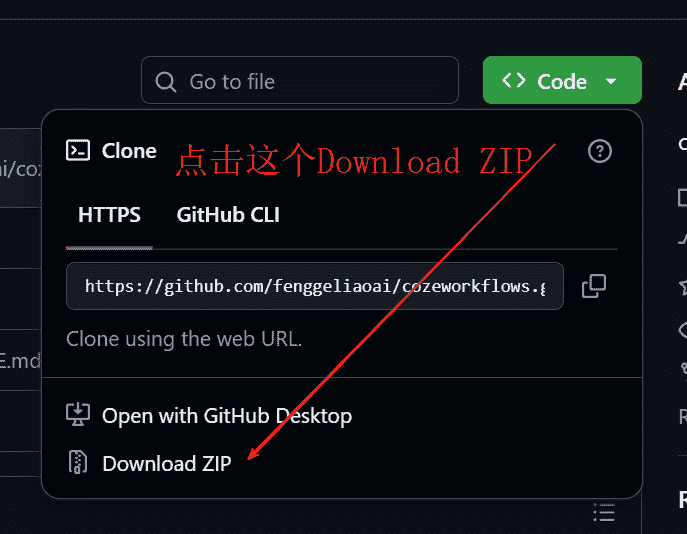
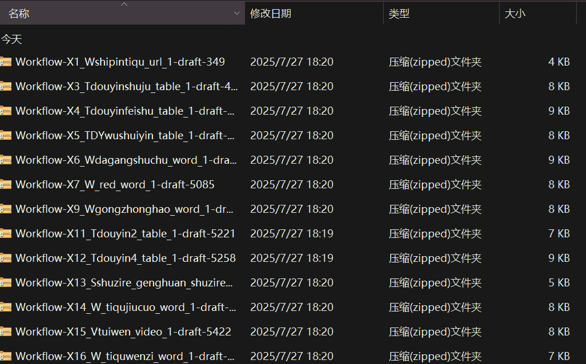
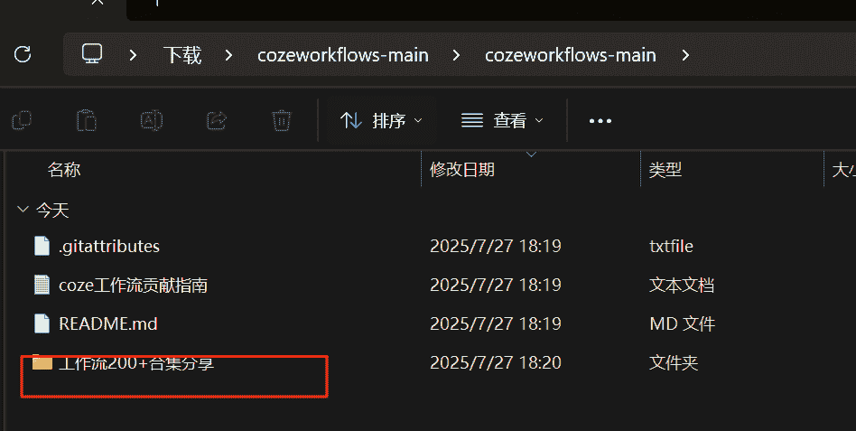
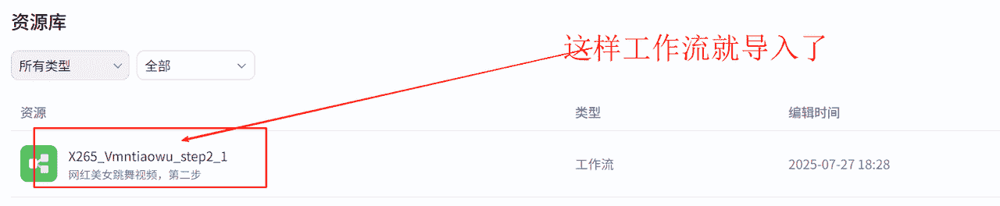

# Coze：200+ 实用大厂生产力工作流

> 来源：[https://v11enp9ok1h.feishu.cn/docx/FAKrdoX0DokRpUxAWabclCEdnxW](https://v11enp9ok1h.feishu.cn/docx/FAKrdoX0DokRpUxAWabclCEdnxW)

# 使用说明

### 第一步：获取工作流文件

我们提供两种方法来获取所有工作流文件，请根据您的熟悉程度选择其一。

#### 方法一：直接下载 ZIP 压缩包

如果您不使用 Git，可以按照以下步骤操作：

1.  在项目主页，点击绿色的 <> Code 按钮，然后在下拉菜单中选择 Download ZIP。

1.  下载完成后，找到这个 ZIP 文件并将其解压缩。

1.  解压后，您会得到一个文件夹，里面包含了所有的工作流 .json 文件。

### 第二步：在 Coze 中导入工作流

获取文件后，请按照以下步骤将其导入 Coze：

| 1.  登录 [Coze 官网](https://www.coze.cn/space)，进入您的个人空间，在左侧菜单中选择 “资源库”。 | 1.  点击页面右上角的 “导入” 按钮。 |
| --- | --- |
| 1.  在弹出的窗口中，点击 “上传文件”，然后找到并选择您在第一步中获取的任意一个工作流 .json 文件。 | 1.  文件上传后，确认信息无误，点击右下角的 “导入” 按钮。 |

1.  导入成功！您会在右下角看到成功提示，并且新的工作流已经出现在您的资源库列表中。

## 工作流完整列表: