# 适合设计Agent的提示词，能让Lovart作图更好看更高效！附邀请链接

> 来源：[https://v11enp9ok1h.feishu.cn/docx/TJE0dCiiIoimX7xiR7ncnd05nic](https://v11enp9ok1h.feishu.cn/docx/TJE0dCiiIoimX7xiR7ncnd05nic)

相信近期大家已经被Lovart的相关讯息刷屏好多次了，我在设计群里也看到了群友们陆陆续续拿到了邀请码。尝试了很多玩法，看得我也觉得真的非常强也很有趣，今天我也使用Lovart做了一些尝试，同时有一些使用方法和小技巧，也想给朋友们分享一下，希望对大家有帮助。今天的内容有点长但是保证干货，大家有更多玩法也欢迎评论区讨论~！

## 今天的目录：

> 概述. 简介与视频展示

> 1. 案例实测展示：IRENE的书店

> 第一步：Logo设计

> 第二步：办公应用设计

> 第三步：IP与周边设计

> 第四步：空间视觉效果

> 第四步：宣传画报

> 2. 其他方向的案例尝试：

> 2.01 小狐狸一条提示从插画到周边到故事版到视频，直出分镜稿

> 2.02 制作PPT模板

> 2.03 儿童节系列海报

> 2.04 一轮直出手账本

> 2.05 文字与材质结合的趣味海报

> 2.06 各种风格的线上宣传图

> 2.07 活动透明背景促销元素

> 2.08 高饱和扁平粗描边插画

> 2.09 反讽海报

> 2.10 时尚杂志海报

> 2.11 批量表情包

> 3. 小结

老规矩，先上网址：`www.lovart.ai`

Lovart为什么被这么多人关注，大概因为它是一个定位非常垂直方向非常清晰的AI Agent。通用Agent在细分的领域和方面可能不会那么极致，而“设计Agent”，它的一切流程最终的目标就是服务于设计和创意发散产出，针对一个点持续发力，简化设计的流程，并帮助设计师和创意工作者将灵感和想法去转换成专业精美的作品。

前几天看到自己我很喜欢的博主Ege也在玩，这个效果很不错。

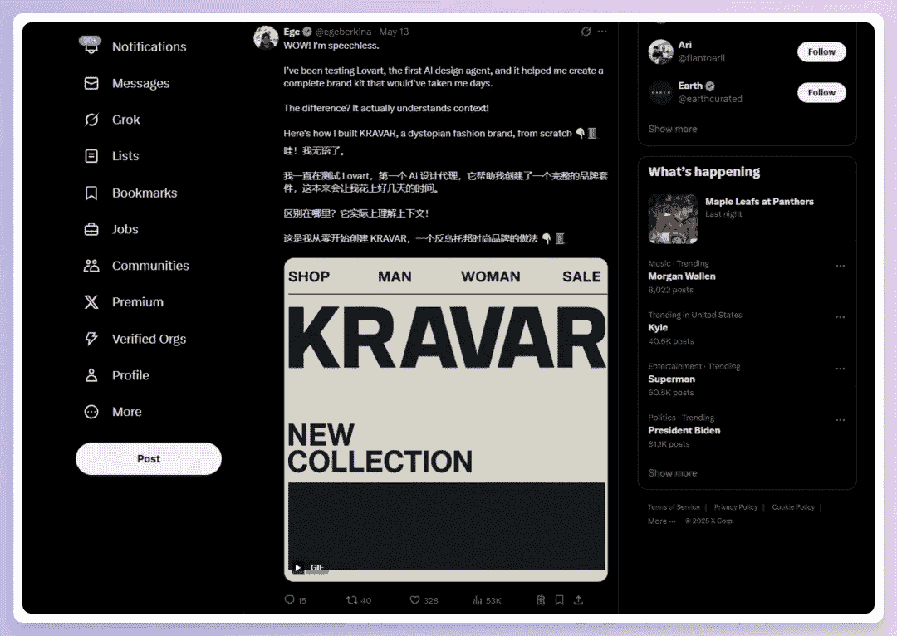

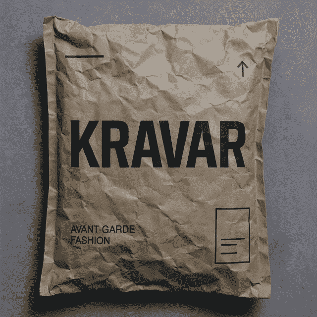

作品来源于X @egeberkina

推荐大家关注！他有很多玩法创意值得学习

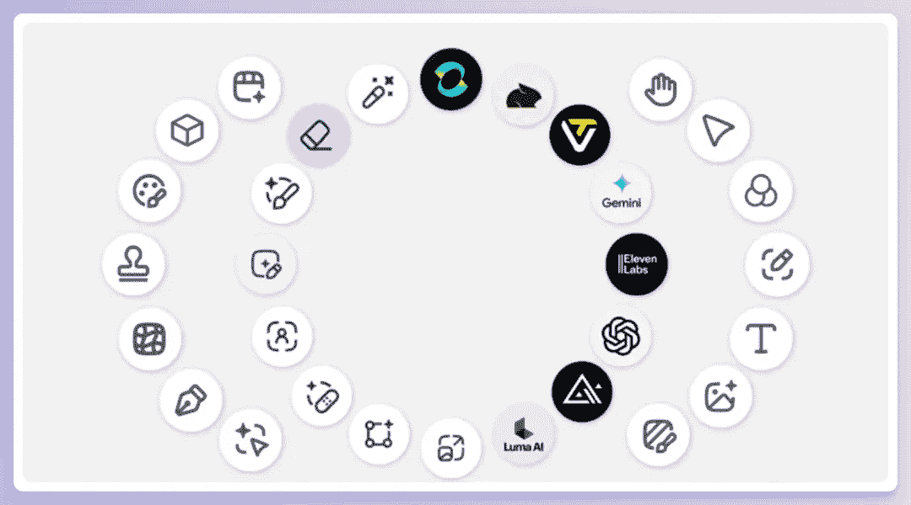

看官方的视频介绍，它不只有设计功能和AI绘图工具，还有文本生成、画布、故事板、音频、视频的功能集成。把这些内容集成在一起，打造一个沉浸式的创意工作区，真的是非常天才的思路。当然，具体好不好用，怎么用，走着，这就来体验体验！

首先，简单看看它的工作流程、功能方向，我从官方视频中为大家梳理了出来：

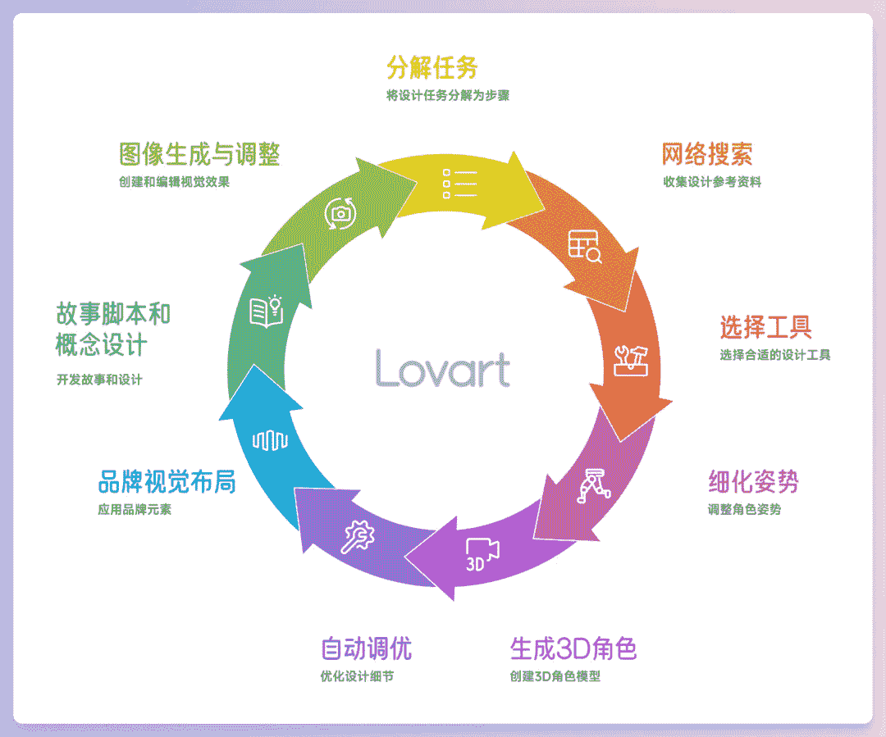

就我而言，对Lovart印象最深刻的就是，它和其他的AI绘图工具完全不是一个思路，它不仅有精确的文字，还能拆分文字为图层！这一手直接格局都被拉上了新层次。直接上视频，看看它的工作流思考、设计图输出和我修改文字的效果：

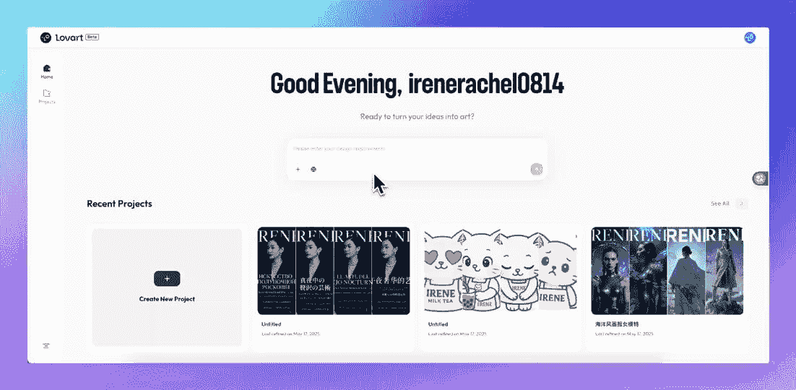

[518_1.mp4](https://internal-api-drive-stream.feishu.cn/space/api/box/stream/download/all/IVWTbbwiXoJzqHxcmAtcCJGQn0d)

既然有一个这样快捷便利、能快速实现想法的设计Agent了，我非常想尝试用它将我的梦想可视化。 比如身为一个（自己认为的）文艺青年，我想开一家书店，我可以让Lovart帮我把VI视觉做出来。

## 1. 案例实测展示：IRENE的书店

### 第一步：Logo设计

首先我把这个品牌的定位、要求、以及一些设想扔给Lovart， 叫它一次给我画8个Logo，让我做超拽的甲方，想怎么选就怎么选！

从这里开始输入提示词：

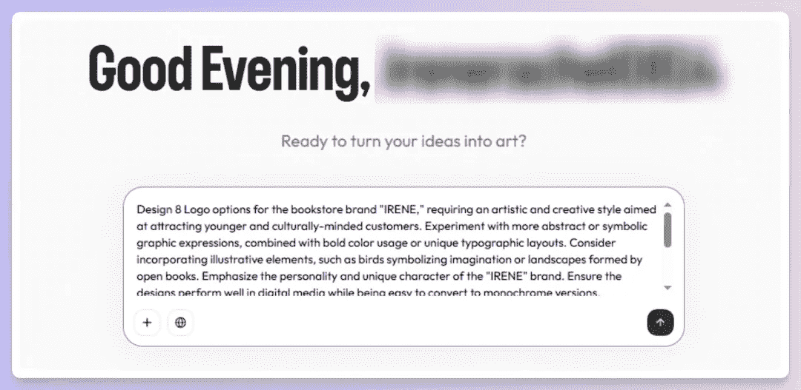

> Design 8 Logo options for the bookstore brand "IRENE," requiring an artistic and creative style aimed at attracting younger and culturally-minded customers. Experiment with more abstract or symbolic graphic expressions, combined with bold color usage or unique typographic layouts. Consider incorporating illustrative elements, such as birds symbolizing imagination or landscapes formed by open books. Emphasize the personality and unique character of the "IRENE" brand. Ensure the designs perform well in digital media while being easy to convert to monochrome versions.

> 为书店品牌"IRENE"设计8个标志方案，要求采用艺术创意风格，以吸引年轻和具有文化修养的顾客。尝试运用更加抽象或象征性的图形表现，结合大胆的色彩运用或独特的字体布局。考虑融入插画元素，如象征想象力的鸟类或由打开的书本构成的风景。突出"IRENE"品牌的个性和独特特征。确保设计在数字媒体中表现良好，同时易于转换为单色版本。

点击发送后我们进入了一个新的页面，界面简洁明了，左边可选择编辑工具，右边输入并查看流程进度，中央呈现结果。

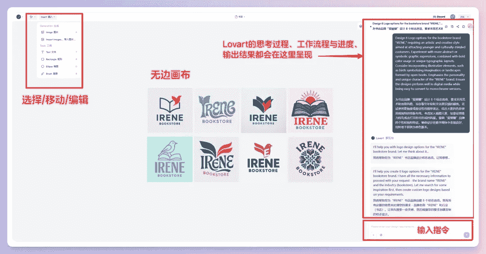

选择图片后，中央正上方工具栏会出现这些功能图标：

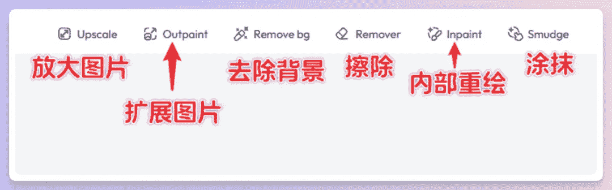

右边也会呈现它的思考。首先搜索灵感：

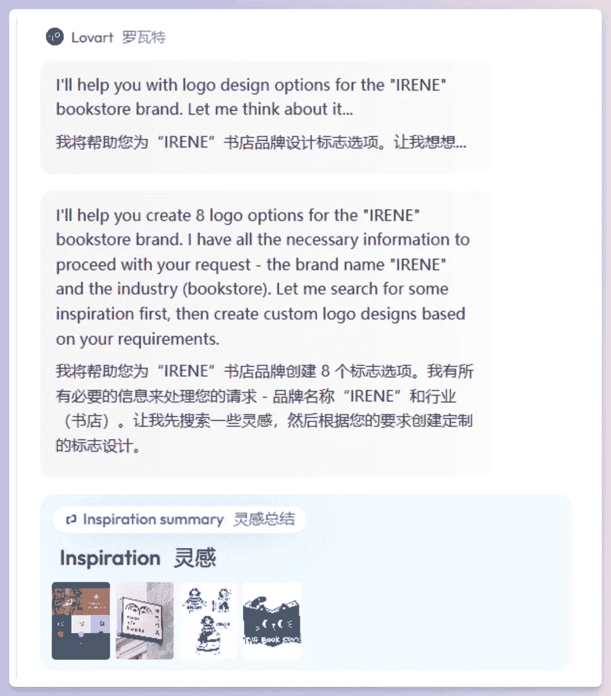

然后开始生成Logo，下面可以看见它调用了ChatGPT来创建图片：

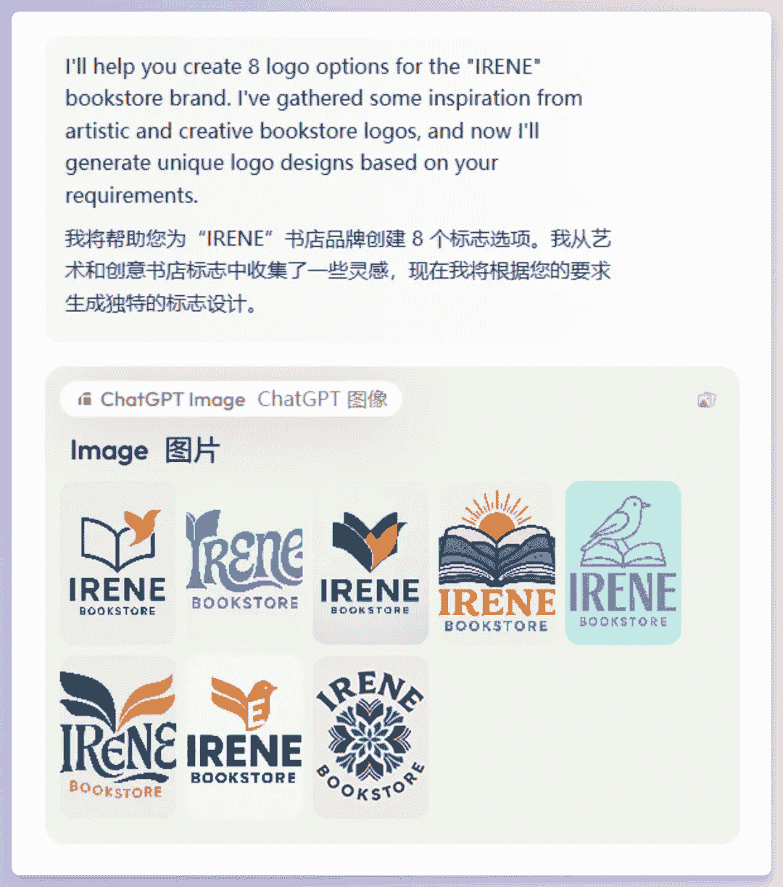

生成图像后，它还给了完整全面的分析。看到这里我是有点惊艳到的，首先，它记住了我最开始的要求，并且遵循要求，给出了多个差异较大各有风格的结果。同时，它列出了它的思考，表达出了Logo的概念含义。每个Logo的概念都列出来了。

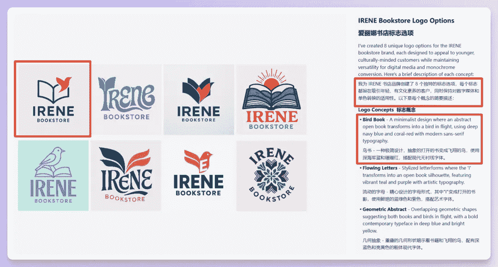

它会发起选择，问我更喜欢哪个，我选了第8个。

这个看起来很有意思，它有中心放对称效果，又有正负形，并且你猛一看像是花朵，仔细看既有花朵的感觉，又有打开的书封和竖立的书脊的形状。寓意上也能体现知识的绽放与美的启发，色调上看起来也有一些文艺与复古感，就它了。

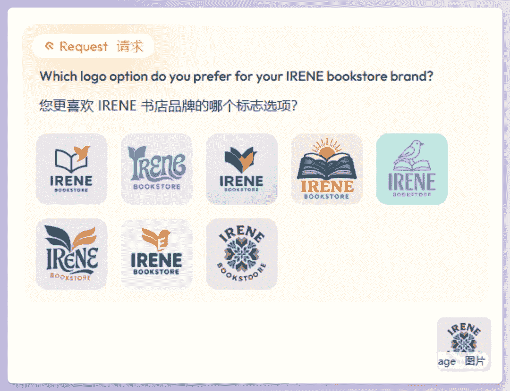

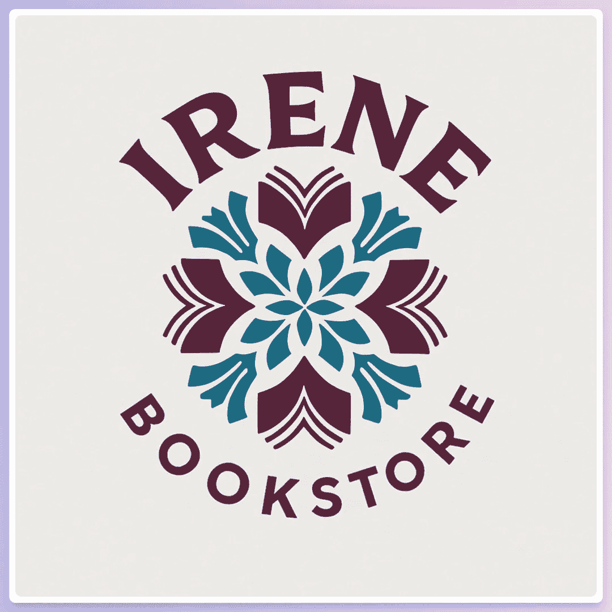

### 第二步：办公应用设计

既然有了品牌Logo了，可以做一些基于Logo的办公应用的效果图。 这一步一次性输出了24张图。

我这里写得比较长，主要是因为我当时还没有明白它的原理，只当做类似ChatGPT绘图那样的工具，所以描述非常详细。后面我会给大家分享， 简单的提示词同样可以有很不错的效果。

> Based on the minimalist modern style Logo designed for the bookstore brand "IRENE" , extend its visual identity (VI). Specific design tasks include: business cards, letterheads, envelopes, employee badges, shopping bags, takeout coffee cups, bookmarks, in-store signage (e.g., cashier, category indicators), social media avatars and cover images, and website header/footer.

> Provide at least two alternative layout or detail options for each design item. Requirements are to clearly showcase the visual effect of the design in actual applications, for example: business cards should have perspective views placed on a table or held in hand; shopping bags should have scene mockups of being carried; in-store signage should have simulation mockups installed on walls or next to bookshelves; social media graphics should have display mockups on mobile or computer screens. All mockups must ensure accurate application of the brand Logo, standard colors, and standard fonts.

> The design should follow the main minimalist modern style, using the Logo's primary color palette as the base, and can appropriately introduce accent colors to add vibrancy (e.g., small amounts of warm wood brown or cream white). Use sans-serif fonts that match or coordinate with the Logo's standard font. The design should incorporate the cultural atmosphere of a bookstore, using simple graphic elements or lines to emphasize the brand's professionalism and artistic sense. All design elements must consider accessibility, ensuring high text contrast and clear information hierarchy.

>

> 基于简约现代风格的标志，为“IRENE”书店品牌扩展其视觉识别。具体设计任务包括： 名片、信纸、信封、员工徽章、购物袋、外卖咖啡杯、书签、店内标识（例如收银台、分类指示）、社交媒体头像和封面图片，以及网站页眉/页脚。

> 为每个设计项目至少提供两种布局或细节选项。要求要清晰地展示设计在实际应用中的视觉效果，例如：名片应放在桌子上或手持的透视视图；购物袋应有携带场景的模型；店内标识应有安装在墙壁或书架旁边的模拟模型；社交媒体图形应有显示在手机或电脑屏幕上的模型。 所有元素必须确保品牌 Logo、标准颜色和标准字体的准确应用。

> 设计应遵循简约现代风格，以 Logo 的主色调为基础，并可以适当引入强调色以增添活力（例如，少量暖木棕色或奶油白色）。使用与 Logo 标准字体匹配或协调的无衬线字体。设计应融入书店的文化氛围，使用简单的图形元素或线条来强调品牌的专业感和艺术感。所有设计元素必须考虑可访问性，确保高文本对比度和清晰的信息层级。

提示词里写到的任务每个至少2张，11个项目，这里一次给了我24张，效率太高了。我也没想到它可以一次性给我这么多。有图形，色调准确，视觉效果也不错：

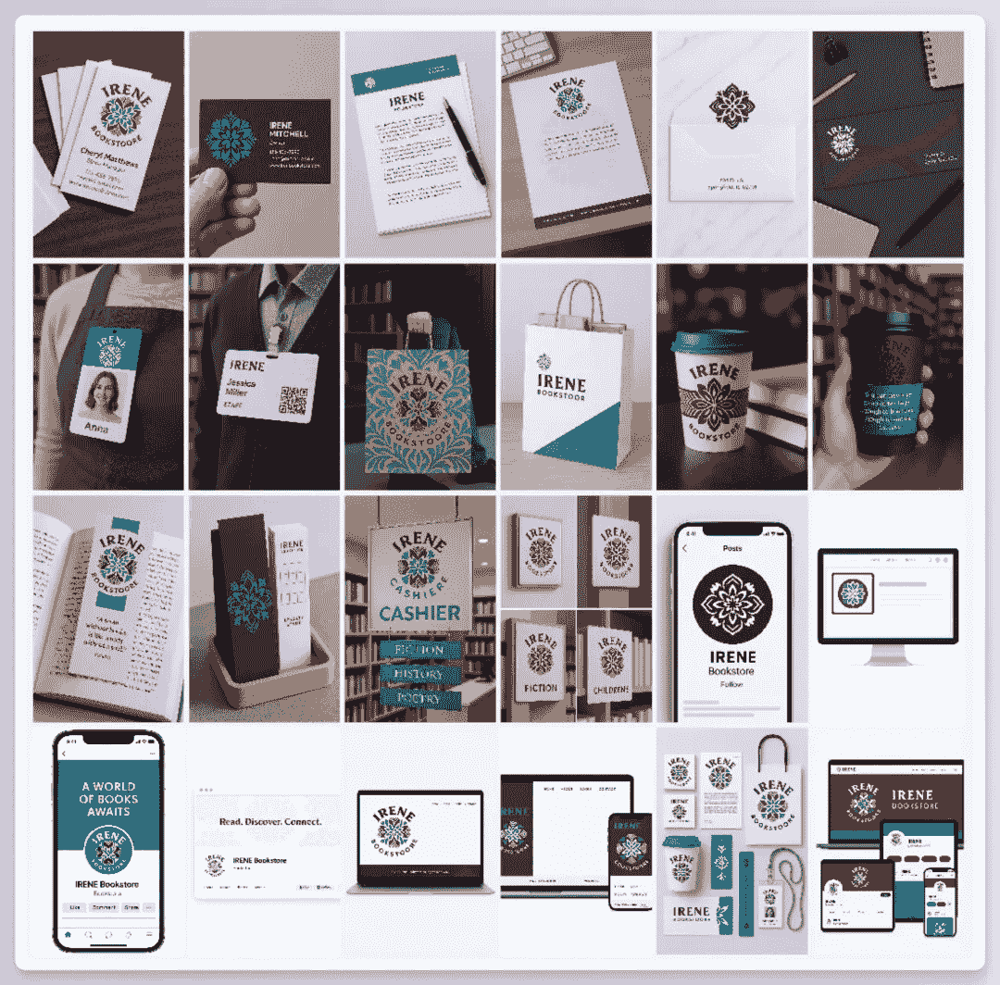

### 第三步：IP与周边设计

我想再给我的书店做一个IP，增加辨识度和记忆点，以及提高品牌粘性。都做到这里了，顺便再做一组IP周边。说做就做。

又是一堆过分要求哈哈哈。

> Create an IP character for the "IRENE" bookstore brand, named "Irene" (tentative name, can be adjusted based on design), depicting a little girl reading. The character style should be cute, lively, and full of curiosity, resonating with children and young women. Emphasis should be placed on the posture of the little girl holding a book and being absorbed in reading. Design multiple expressions and poses, such as: curiously flipping through a book, smiling happily, reading thoughtfully, etc. The character design should be simple and clear, with warm and soft colors, facilitating scalable application.

> Based on the IP character, design a series of peripheral stationery and apparel accessories.

> Stationery items:

+   Notebook covers (2 designs with different patterns)

+   Sticker set (including various "Irene" images and reading-related elements)

+   Pencil/ballpoint pen (with "Irene" image or brand Logo printed on the barrel)

+   Bookmarks (2 designs with different shapes or patterns)

+   File folder (transparent or frosted material, printed with "Irene" image)

> Apparel and accessories:

+   Cotton T-shirt (with a large "Irene" image or a combination of smaller images on the front, suitable for both boys and girls)

+   Tote bag/canvas bag (printed with a large "Irene" image or creative pattern)

+   Hat (baseball cap or bucket hat, embroidered or printed with "Irene"'s head)

+   Socks (with a small "Irene" image or book pattern on the cuff or body of the sock)

> All design items must include mockup which requirements should highlight the practicality and aesthetic appeal of the peripheral products.

>

> 为“艾琳”书店品牌创建一个 IP 角色，命名为“艾琳”，描绘一个正在阅读的小女孩。角色风格应可爱、活泼、充满好奇心，能与儿童和年轻女性产生共鸣。应强调小女孩手持书本、沉浸阅读的姿态。设计多种表情和姿势，例如：好奇地翻阅书本、开心微笑、认真思考等。角色设计应简洁明了，采用温暖柔和的色彩，便于可扩展应用。

> 基于 IP 角色，设计一系列周边文具和服装配件。

> 办公用品：

+   笔记本封面（2 种不同图案的设计）

+   标签套装（包括各种"Irene"图像和阅读相关元素）

+   铅笔/圆珠笔（笔杆上印有"Irene"图像或品牌 Logo）

+   书签（2 种不同形状或图案的设计）

+   文件夹（透明或磨砂材质，印有“Irene”图案）

> 服装和配饰：

+   棉质 T 恤（前胸印有大型“Irene”图案或组合多个小图案，适合男孩和女孩）

+   购物袋/帆布袋（印有大型“艾琳”图像或创意图案）

+   帽子（棒球帽或鸭舌帽，绣有或印有“艾琳”头像）

+   袜子（袜口或袜身有小“艾琳”图像或书籍图案）

> 所有设计物品必须突出周边产品的实用性和美观性.

然后Lovart又开始思考，输出了好长好长一段分析（这里省略了），然后开始做智能计划，开始行动：

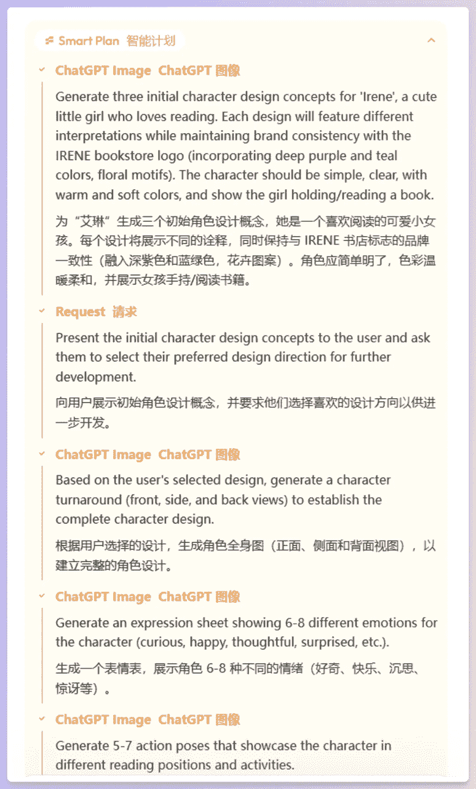

Lovart这个勤勤恳恳的设计小行家，给了我三个选择，遵循了整体调性、色调，看起来也比较可爱。我选择了第三个。

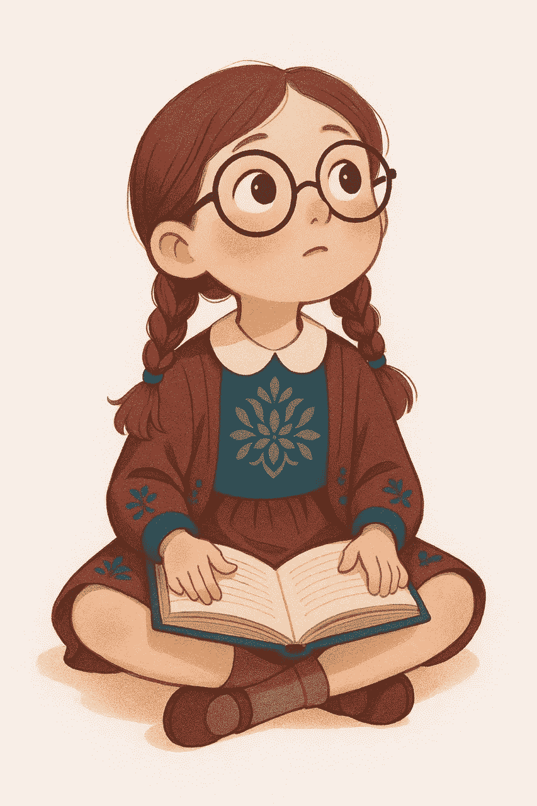

然后它继续输出周边，下面这个图中的都是根据前面的那条提示词，它陆续完成的：

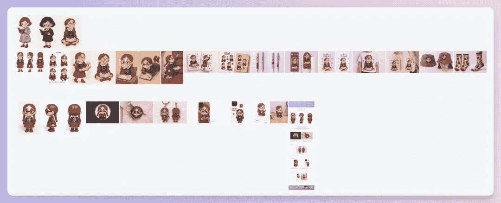

下面是更清晰的部分图片的展示，并且以下都是一次性输出的：

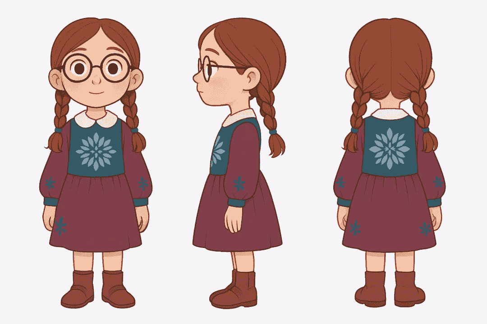

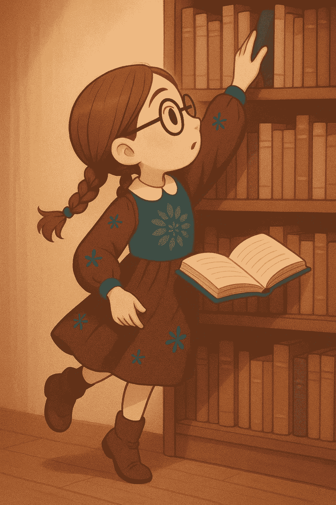

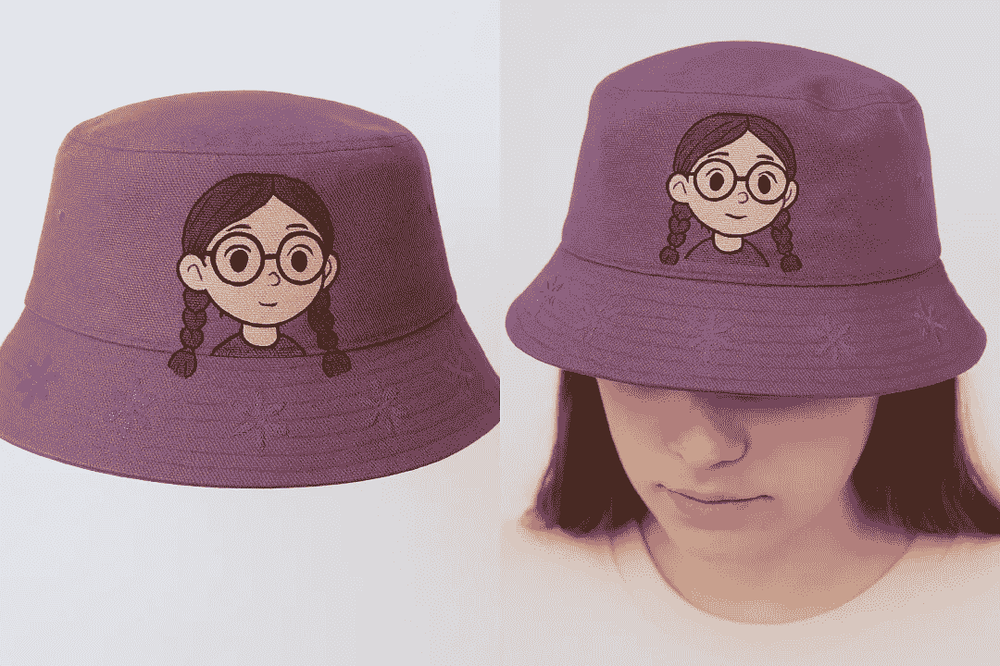

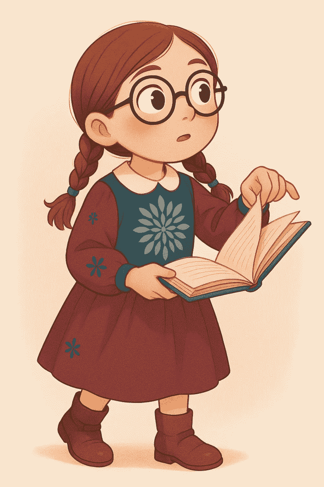

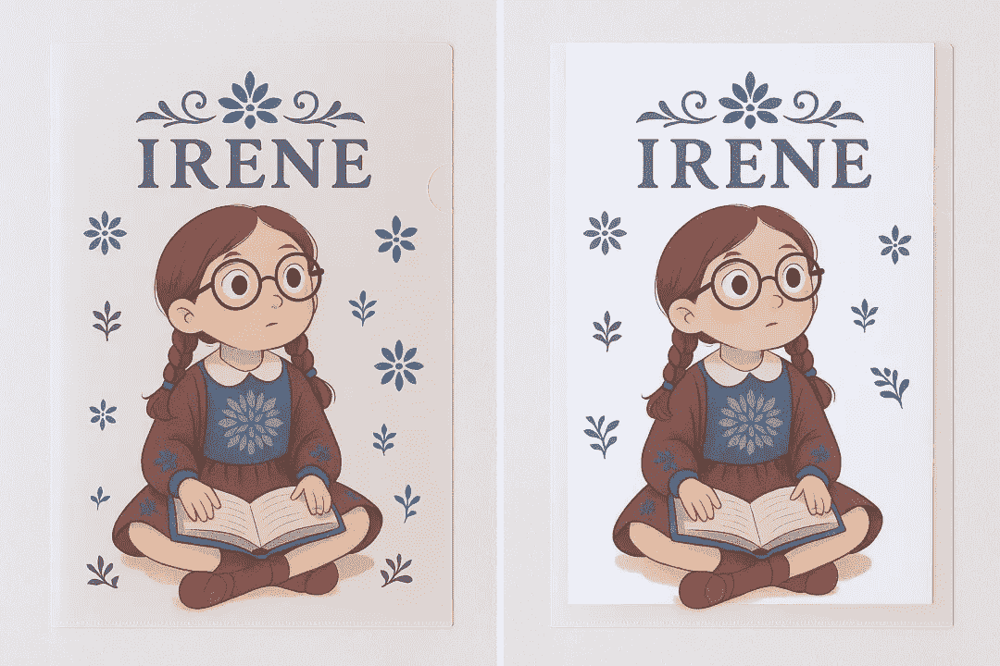

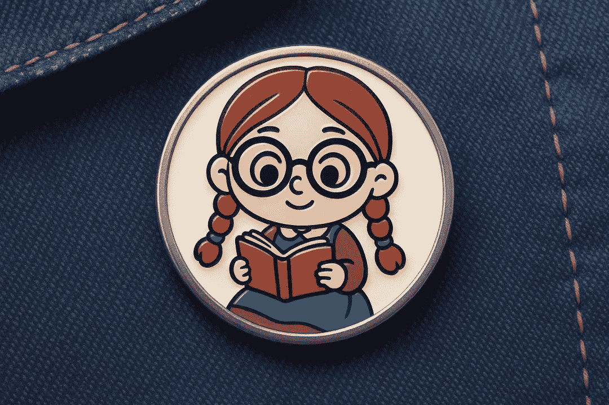

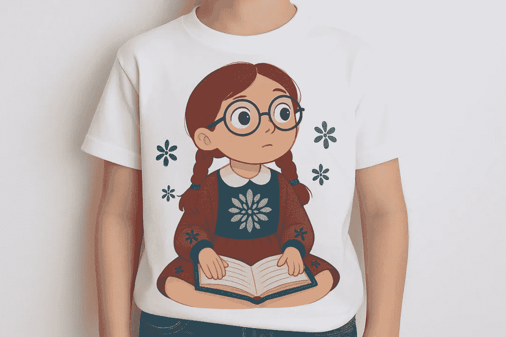

甚至它还输出了一个完整的长图，下面全部的内容都是它自己做的，我没有做任何修改：

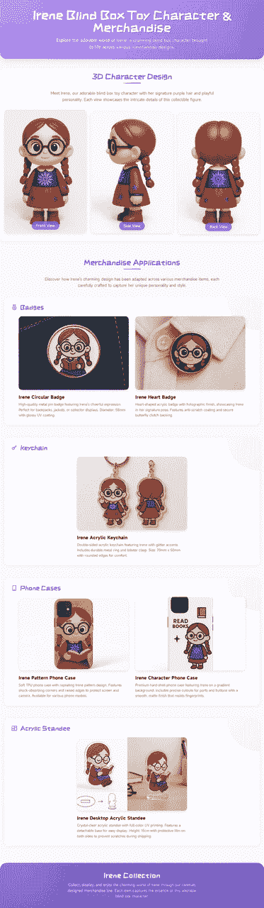

## 第四步：空间视觉效果

顺便做一些空间视觉效果和宣传海报的尝试， 这次是一次五张图。 选择前面三视图的图片下方会出现添加到聊天，点击将图片发送到聊天作为参考，然后对话框输入后面的提示词：

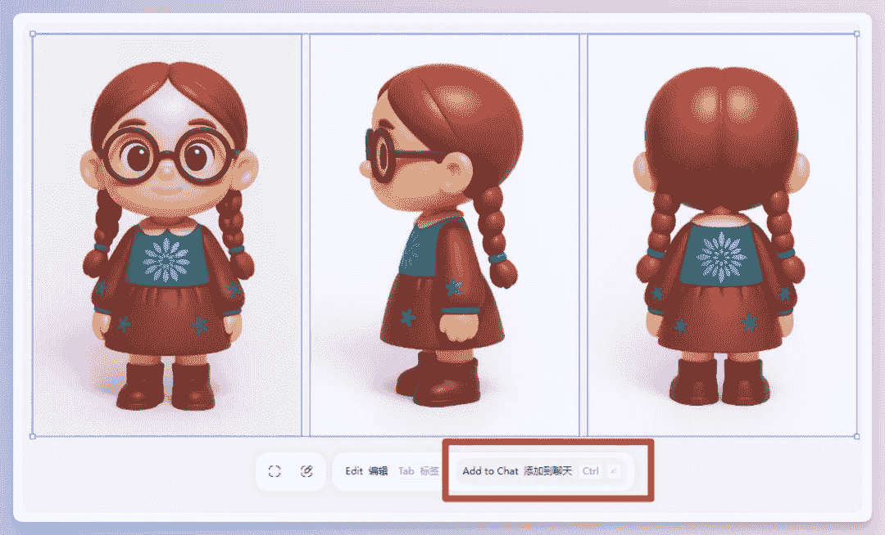

> Design a complete set of bookstore space visuals, warm, modern, and literary in tone, based on the logo style shown in Image 1 and the IP mascot shown in Image 2—a cute 3D cartoon girl with twin braids and glasses. Generate a series of images including:

+ Storefront facade: The logo is presented in embossed acrylic letters mounted on a wood-textured and light gray matte panel, lit with soft ambient lighting. A standing welcome sign features the mascot girl holding a book and smiling.

+ Main interior feature wall: Fabric or micro-cement texture background with a wall mural combining the logo and the mascot in a reading scene, surrounded by flying book pages for dynamic visual effect.

+ Reading zone & soft furnishing: A cozy corner with sofas, bookshelves, and reading tables. Pillows, curtains, wall art, and lamps display variations of the logo or mascot figure. Main colors: beige, light wood, gray-blue, with brand colors as accents.

+ Signage system and labels: Floor arrows, hanging section signs, and bookshelf tags, all designed with consistent logo graphic language or simplified mascot icons for unified branding.

+ Interactive installations and props: Include photo wall setups, character-themed sculpture pieces, decorative “book mountains,” and merchandise displays featuring the mascot and logo in creative forms.

> 基于图1所示的标志风格和图2所示的IP吉祥物（一个戴眼镜扎双辫的可爱3D卡通女孩），设计一套完整的书店空间视觉方案，营造温暖、现代且富有文艺气息的氛围。需要生成以下系列图像：

+ 店面外观：标志采用亚克力凸字安装在木纹和浅灰色哑光面板上，配以柔和的环境照明。入口处设立欢迎牌，展示手持书本微笑的吉祥物形象。

+ 室内主题特色墙：采用织物或微水泥质地的背景，配以结合标志和吉祥物的阅读场景壁画，周围点缀飞舞的书页，营造动态视觉效果。

+ 阅读区和软装：舒适的角落配备沙发、书架和阅读桌。抱枕、窗帘、墙面艺术品和灯具展现标志或吉祥物的变体设计。主色调：米色、浅木色、灰蓝色，品牌色作为点缀。

+ 导视系统和标签：地面箭头、悬挂分区标识和书架标签，均采用统一的标志图形语言或简化的吉祥物图标，保持品牌一致性。

+ 互动装置和道具：包括拍照墙布置、主题雕塑作品、装饰性"书山"，以及以创意形式展示吉祥物和标志的商品陈列。

看看它制作的空间预览效果，整体调性也是统一的：

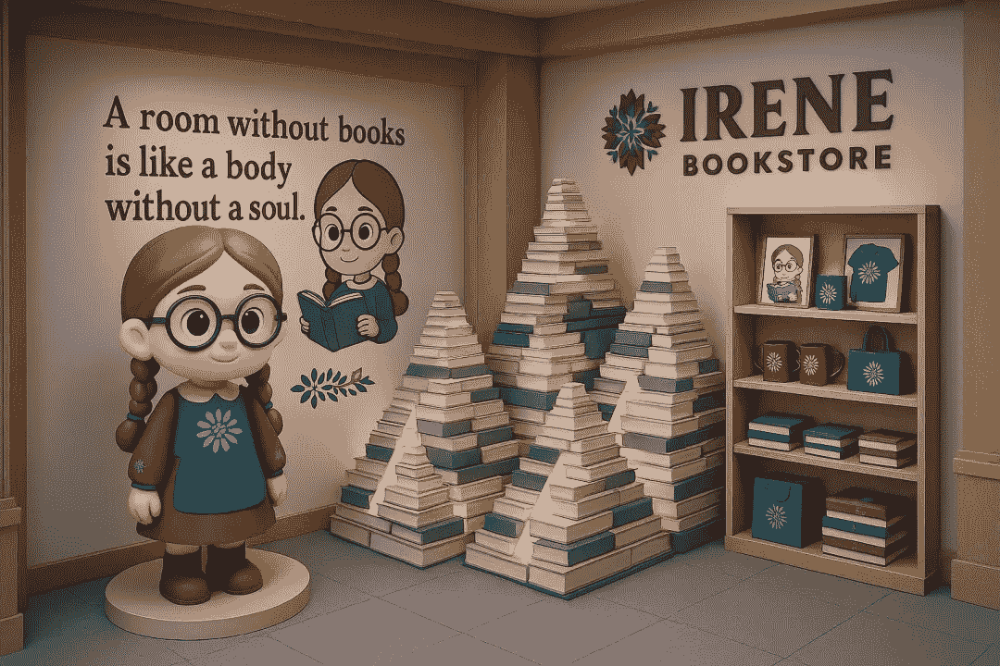

个人体验下来感觉Lovart应该做了调试和设置，ChatGPT生成图发黄的问题出现比较少了，比官网半天卷帘门一张还发黄好多了。偶尔有出现发黄偏暖之类的话，我这里分享一个使用小妙招，可根治GPT生成图片偶尔发黄的问题，Lovart在这里做了设置，我觉得非常好用。大家可以看我下面图片框选的部分。点击图层后右上角有这个图标，可以调整色温色调饱和度曝光等等。

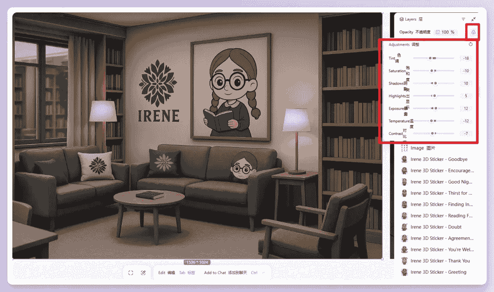

看看图片对比效果：

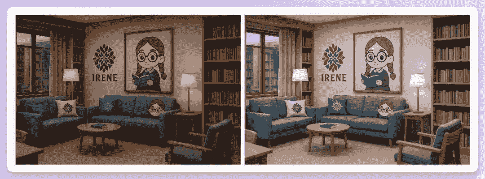

## 第四步：宣传画报

比如在儿童阅览区之类的，我还想尝试做一些趣味宣传画， 这里我也尝试了制作一组，6张。

+ A cute 3D cartoon girl with braids and round glasses, wearing a maroon floral dress, sitting cross-legged on the floor reading a space-themed book titled "太空探险". The background features hand-drawn rocket ships, stars, and planets in simple black lines. Add a bold Chinese title below: “探索宇宙”.

+ A cute 3D cartoon girl with braids and round glasses, holding a book titled "植物的秘密" with wide eyes, as green vines and small flowers peek from the book pages. The background shows line-art flowers and leaves surrounding her. Add a bold Chinese caption: “森林的低语”.

+ A cute 3D cartoon girl with braids and round glasses, reading a fantasy book titled "魔法学校", with sparkles in her eyes and magical glow reflecting on her face. In the background, line-art magic hats, stars, and wands are drawn simply. Add the caption: “咒语与奇迹”.

+ A cute 3D cartoon girl with braids and round glasses, sitting at a desk, chin on hand, pondering while reading a math book titled "数学的乐趣". The background is filled with simple math symbols like √, π, geometric shapes in hand-drawn line style. Caption below: “数字王国”.

+ A cute 3D cartoon girl with braids and round glasses, excitedly running with a book titled "小镇冒险记", looking adventurous. Behind her, line-art drawings of treasure maps, compass, and dashed paths. Caption: “冒险开始！”

+ A cute 3D cartoon girl with braids and round glasses, sitting on a pile of colorful books with a warm smile, hugging all her favourite books. The background shows flying book pages and a hand-drawn rainbow. Add the final caption: “我爱阅读”.

+ 一个戴圆框眼镜、扎着辫子的可爱3D卡通女孩，身穿栗色碎花连衣裙，盘腿坐在地板上阅读一本名为"太空探险"的太空主题图书。背景是用简单黑线手绘的火箭、星星和行星。底部添加醒目的中文标题："探索宇宙"。

+ 一个戴圆框眼镜、扎着辫子的可爱3D卡通女孩，睁大眼睛手持一本名为"植物的秘密"的书，书页中探出绿色藤蔓和小花。背景是环绕着她的线条艺术风格的花朵和树叶。添加醒目的中文说明："森林的低语"。

+ 一个戴圆框眼镜、扎着辫子的可爱3D卡通女孩，正在阅读一本名为"魔法学校"的奇幻书籍，眼中闪烁着光芒，脸上反射着魔法般的光芒。背景简单勾勒着线条艺术风格的魔法帽、星星和魔杖。添加说明："咒语与奇迹"。

+ 一个戴圆框眼镜、扎着辫子的可爱3D卡通女孩，坐在书桌前，手托着下巴，若有所思地阅读一本名为"数学的乐趣"的数学书。背景填满了手绘线条风格的数学符号，如√、π和几何图形。底部说明："数字王国"。

+ 一个戴圆框眼镜、扎着辫子的可爱3D卡通女孩，兴奋地拿着一本名为"小镇冒险记"的书奔跑，看起来充满冒险精神。她身后是线条艺术风格的藏宝图、指南针和虚线路径。说明："冒险开始！"

+ 一个戴圆框眼镜、扎着辫子的可爱3D卡通女孩，带着温暖的微笑坐在一堆彩色书籍上，怀抱着她所有喜爱的书籍。背景展现飞舞的书页和手绘彩虹。添加最后的说明："我爱阅读"。
