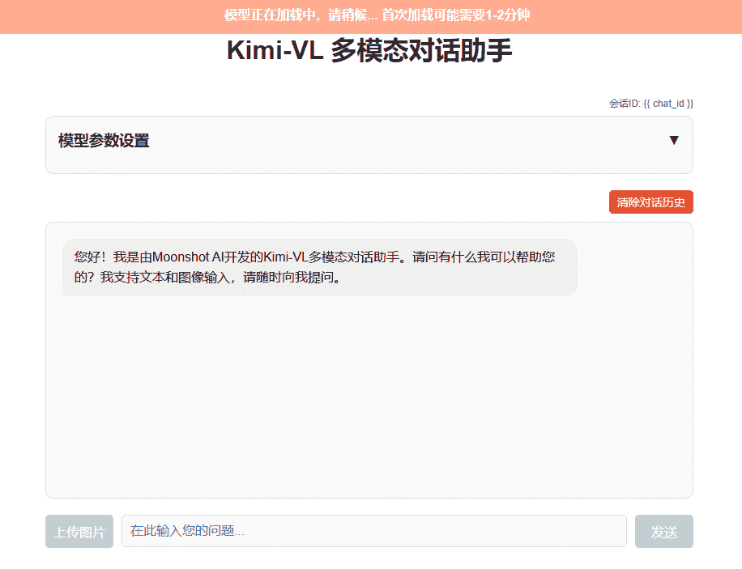
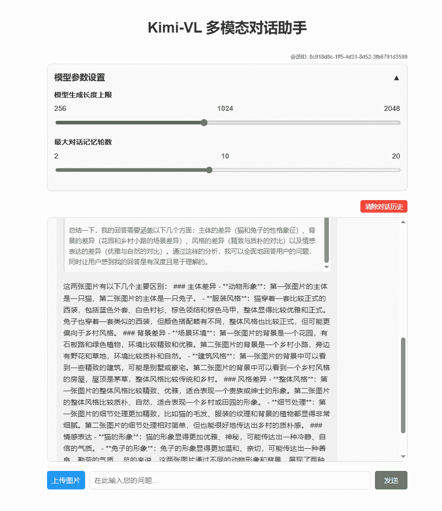

# Kimi-VL-多模态推理对话助手

> 来源：[https://v11enp9ok1h.feishu.cn/docx/SsuQdc4cEozSSfx13QPcPlkfnrd](https://v11enp9ok1h.feishu.cn/docx/SsuQdc4cEozSSfx13QPcPlkfnrd)

## 效果展示






## 环境准备

基础环境：

```
----------------
ubuntu 22.04
python 3.12
cuda 12.4
pytorch 2.6.0
----------------
另外：保证有足够的GPU显存，bfloat16精度下加载参考显存占用大小40GB（即最低要求为双卡4090或单卡A6000）
```

首先 `pip` 换源加速下载并安装依赖包

```
pip config set global.index-url https://pypi.tuna.tsinghua.edu.cn/simple

pip install transformers==4.48.2
pip install accelerate==1.6.0
pip install flask==3.1.0
pip install blobfile==3.0.0
pip install pillow==10.4.0
pip install modelscope==1.22.3
```

## 模型下载

使用 `modelscope` 中的 `snapshot_download()` 函数下载模型，第一个参数为模型名称，参数 `cache_dir` 为模型的下载路径。

新建 `model_download.py` 文件输入以下代码，并运行 `python model_download.py` 执行下载。

此处使用 `modelscope` 提供的 `snapshot_download()` 函数进行下载，该方法对国内的用户十分友好。

```
# model_download.py
from modelscope import snapshot_download

model_dir = snapshot_download('moonshotai/Kimi-VL-A3B-Thinking', cache_dir='请修改我！', revision='master')
print(f"模型下载完成，保存路径为：{model_dir}")
```

> 注意：请记得修改 `cache_dir` 为你自己的模型下载路径 ~

## 应用搭建

### 后端代码


```python
# app.py

from flask import Flask, request, jsonify, render_template, session
import torch
from transformers import AutoTokenizer, AutoModelForCausalLM, AutoProcessor
import gc
import re
import uuid
import json
import base64
import logging
from io import BytesIO
from PIL import Image

# 配置日志
# logging.basicConfig(level=logging.INFO, format='%(asctime)s - %(name)s - %(levelname)s - %(message)s')
# logger = logging.getLogger(__name__)

app = Flask(__name__)
app.secret_key = "kimi-chatbot-secret-key"  # 用于session加密
# 修改为合理的值：最大100MB
app.config['MAX_CONTENT_LENGTH'] = 100 * 1024 * 1024  # 限制上传文件大小
app.config['MAX_CONTENT_PATH'] = None

# 全局变量存储预加载的模型和tokenizer
MODEL_ID = "请修改我！！！"
tokenizer = None
model = None
processor = None
# 用于存储对话历史的字典
chat_histories = {}
# 默认值设置
DEFAULT_MAX_NEW_TOKENS = 1024
DEFAULT_MAX_HISTORY_LENGTH = 10

# 在应用启动前预加载模型
def load_model():
    global tokenizer, model, processor
    print("正在加载模型和tokenizer，请稍候...")
    
    # 加载processor (用于处理图像和文本)
    processor = AutoProcessor.from_pretrained(MODEL_ID, trust_remote_code=True)
    
    # 加载tokenizer
    tokenizer = AutoTokenizer.from_pretrained(MODEL_ID, trust_remote_code=True)
    
    # 加载模型
    model = AutoModelForCausalLM.from_pretrained(
        MODEL_ID,
        device_map="auto",
        torch_dtype=torch.bfloat16,
        trust_remote_code=True
    )
    print("模型加载完成！")

def clean_response(text):
    """清理模型响应中的特殊token"""
    # 先清理常见的结束标记，包括<|im_end|>和[EOS]
    text = re.sub(r'<\|im_end\|>(\s*\[EOS\])?', '', text)
    text = re.sub(r'\[EOS\]', '', text)
    
    # 保留思考标签
    # 如果存在思考标签，只清理标签内外的结束标记，保留标签本身
    = processor.batch_decode(
                                    generated_ids_trimmed, skip_special_tokens=True, clean_up_tokenization_spaces=False
                                )[0]
                                
                                # 清理响应，移除结束标记
                                cleaned_response = clean_response(response)
                                # logger.info(f"生成的响应: {cleaned_response[:50]}...")
                                
                                # 添加模型回复到历史记录
                                chat_histories[chat_id].append({"role": "assistant", "content": cleaned_response})
                                
                                # 如果历史记录太长，保留最新的max_history_length条
                                if len(chat_histories[chat_id]) > max_history_length * 2:  # 用户和助手消息各占一半
                                    chat_histories[chat_id] = chat_histories[chat_id][-max_history_length*2:]
                                
                                # 清理缓存
                                torch.cuda.empty_cache()
                                gc.collect()
                                
                                return jsonify({
                                    "response": cleaned_response,
                                    "chat_id": chat_id,
                                    "max_new_tokens": max_new_tokens,
                                    "max_history_length": max_history_length
                                })
                            except Exception as e:
                                # logger.error(f"多模态生成过程中出错: {str(e)}", exc_info=True)
                                return jsonify({"error": f"多模态生成过程中出错: {str(e)}"}), 500
            except Exception as e:
                # logger.error(f"处理多模态输入时出错: {str(e)}", exc_info=True)
                return jsonify({"error": f"处理多模态输入时出错: {str(e)}"}), 500
        
        # 传统文本输入处理（向后兼容）
        if not has_input:
            # logger.info("使用传统文本输入处理")
            
            # 判断是否有文本输入
            if not user_input and not request.form:
                return jsonify({"error": "请输入问题或上传图片"}), 400
            
            # 获取或初始化聊天历史
            if chat_id not in chat_histories:
                chat_histories[chat_id] = []
            
            # 添加用户消息到历史记录
            chat_histories[chat_id].append({"role": "user", "content": user_input})
            
            # 从历史记录构建消息列表，使用前端传递的历史长度
            messages = chat_histories[chat_id][-max_history_length*2:]  # 用户和助手消息各算一条
            
            # 应用chat模板
            inputs = tokenizer.apply_chat_template(messages, add_generation_prompt=True, return_tensors="pt", return_dict=True)
            
            # 生成响应
            with torch.no_grad():
                outputs = model.generate(**inputs.to(model.device), max_new_tokens=max_new_tokens)
            response = tokenizer.batch_decode(outputs[:, inputs["input_ids"].shape[-1]:])
            
            # 清理缓存
            torch.cuda.empty_cache()
            gc.collect()
            
            # 清理响应，移除结束标记
            cleaned_response = clean_response(response[0])
            
            # 添加模型回复到历史记录
            chat_histories[chat_id].append({"role": "assistant", "content": cleaned_response})
            
            # 如果历史记录太长，保留最新的max_history_length条
            if len(chat_histories[chat_id]) > max_history_length * 2:  # 用户和助手消息各占一半
                chat_histories[chat_id] = chat_histories[chat_id][-max_history_length*2:]
            
            return jsonify({
                "response": cleaned_response,
                "chat_id": chat_id,
                "max_new_tokens": max_new_tokens,
                "max_history_length": max_history_length
            })
    
    except Exception as e:
        import traceback
        error_details = traceback.format_exc()
        # logger.error(f"处理请求时发生错误: {str(e)}\n{error_details}")
        return jsonify({"error": str(e)}), 500

@app.route('/api/clear_history', methods=['POST'])
def clear_history():
    try:
        data = request.json
        chat_id = data.get('chat_id', session.get('chat_id'))
        
        if chat_id and chat_id in chat_histories:
            chat_histories[chat_id] = []
            return jsonify({"success": True, "message": "聊天历史已清除"})
        else:
            return jsonify({"success": False, "error": "无效的会话ID"}), 400
    except Exception as e:
        return jsonify({"success": False, "error": str(e)}), 500

if __name__ == '__main__':
    # 在另一个线程中预加载模型
    import threading
    threading.Thread(target=load_model).start()
    
    app.run(debug=True, host='0.0.0.0', port=5000, use_reloader=False) 
```


> 注意：同样记得修改 `MODEL_ID` 为你自己的模型下载路径 ~

## 运行应用

```
python app.py
```

应用将在 http://localhost:5000 上运行。

**注意**：启动后模型会在后台自动加载，这可能需要1-2分钟。在此期间，界面会显示"模型正在加载中"的提示，加载完成后才能开始对话。

## 使用方法

1. 在浏览器中打开 http://localhost:5000
2. 等待模型加载完成（顶部的橙色通知条消失）
3. 根据需要调整参数滑动条：
   - **生成长度上限**：控制每次回复生成的最大token数（范围：256-2048）
   - **历史记录长度**：控制对话中保留的最大轮数（范围：2-20）
4. 在输入框中输入您的问题
5. 点击"发送"按钮或按Enter键发送问题
6. 等待模型生成回复
7. 继续进行多轮对话，模型会记住之前的对话内容
8. 如需清除对话历史，点击"清除对话历史"按钮

## 参考代码及其使用

本次教程搭建了一个基于 Kimi-VL-A3B-Thinking 的前后端分离的对话助手，额外提供了参考代码供学习者参考
