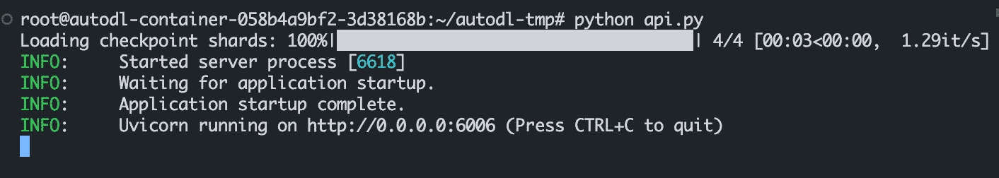
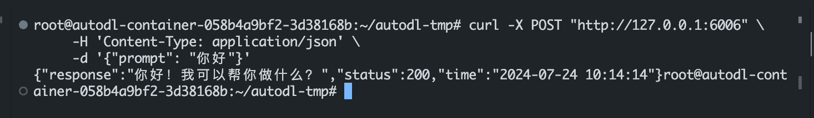
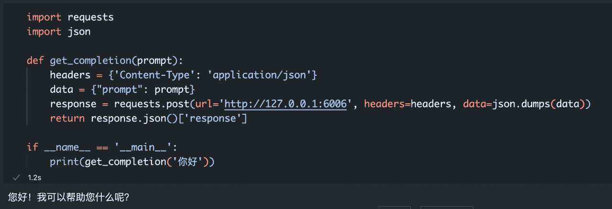

# Llama3_1-8B-Instruct FastApi 部署调用

> 来源：[https://v11enp9ok1h.feishu.cn/docx/NOOadVRBBoqwxtxmzgEcugWrn0b](https://v11enp9ok1h.feishu.cn/docx/NOOadVRBBoqwxtxmzgEcugWrn0b)

## 环境准备

本文基础环境如下：

```
----------------
ubuntu 22.04
python 3.12
cuda 12.1
pytorch 2.3.0
----------------
```

> 本文默认学习者已安装好以上 Pytorch(cuda) 环境，如未安装请自行安装。

首先 pip 换源加速下载并安装依赖包

```
# 升级pip
python -m pip install --upgrade pip
# 更换 pypi 源加速库的安装
pip config set global.index-url https://pypi.tuna.tsinghua.edu.cn/simple

pip install fastapi==0.111.1
pip install uvicorn==0.30.3
pip install modelscope==1.16.1
pip install transformers==4.43.2
pip install accelerate==0.32.1
```

> 考虑到部分同学配置环境可能会遇到一些问题，我们在AutoDL平台准备了LLaMA3-1的环境镜像，点击下方链接并直接创建Autodl示例即可。

> **h**ttps://www.codewithgpu.com/i/datawhalechina/self-llm/self-llm-llama3.1

## 模型下载

使用 modelscope 中的 snapshot_download 函数下载模型，第一个参数为模型名称，参数 cache_dir 为模型的下载路径。

新建 model_download.py 文件并在其中输入以下内容，粘贴代码后请及时保存文件，如下图所示。并运行 python model_download.py 执行下载，模型大小为 15GB，下载模型大概需要 5 分钟。

```
import torch
from modelscope import snapshot_download, AutoModel, AutoTokenizer
import os
model_dir = snapshot_download(&#x27;LLM-Research/Meta-Llama-3.1-8B-Instruct&#x27;, cache_dir=&#x27;/root/autodl-tmp&#x27;, revision=&#x27;master&#x27;)
```

> 注意：记得修改 cache_dir 为你的模型下载路径哦~

## 代码准备

新建 api.py 文件并在其中输入以下内容，粘贴代码后请及时保存文件。以下代码有很详细的注释，大家如有不理解的地方，欢迎提出 issue 。

```
from fastapi import FastAPI, Request
from transformers import AutoTokenizer, AutoModelForCausalLM
import uvicorn
import json
import datetime
import torch

# 设置设备参数
DEVICE = &quot;cuda&quot;  # 使用CUDA
DEVICE_ID = &quot;0&quot;  # CUDA设备ID，如果未设置则为空
CUDA_DEVICE = f&quot;{DEVICE}:{DEVICE_ID}&quot; if DEVICE_ID else DEVICE  # 组合CUDA设备信息

# 清理GPU内存函数
def torch_gc():
    if torch.cuda.is_available():  # 检查是否可用CUDA
        with torch.cuda.device(CUDA_DEVICE):  # 指定CUDA设备
            torch.cuda.empty_cache()  # 清空CUDA缓存
            torch.cuda.ipc_collect()  # 收集CUDA内存碎片

# 创建FastAPI应用
app = FastAPI()

# 处理POST请求的端点
@app.post(&quot;/&quot;)
async def create_item(request: Request):
    global model, tokenizer  # 声明全局变量以便在函数内部使用模型和分词器
    json_post_raw = await request.json()  # 获取POST请求的JSON数据
    json_post = json.dumps(json_post_raw)  # 将JSON数据转换为字符串
    json_post_list = json.loads(json_post)  # 将字符串转换为Python对象
    prompt = json_post_list.get(&#x27;prompt&#x27;)  # 获取请求中的提示

    messages = [
            {&quot;role&quot;: &quot;system&quot;, &quot;content&quot;: &quot;You are a helpful assistant.&quot;},
            {&quot;role&quot;: &quot;user&quot;, &quot;content&quot;: prompt}
    ]

    # 调用模型进行对话生成
    input_ids = tokenizer.apply_chat_template(messages,tokenize=False,add_generation_prompt=True)
    model_inputs = tokenizer([input_ids], return_tensors=&quot;pt&quot;).to(&#x27;cuda&#x27;)
    generated_ids = model.generate(model_inputs.input_ids,max_new_tokens=512)
    generated_ids = [
        output_ids[len(input_ids):] for input_ids, output_ids in zip(model_inputs.input_ids, generated_ids)
    ]
    response = tokenizer.batch_decode(generated_ids, skip_special_tokens=True)[0]
    now = datetime.datetime.now()  # 获取当前时间
    time = now.strftime(&quot;%Y-%m-%d %H:%M:%S&quot;)  # 格式化时间为字符串
    # 构建响应JSON
    answer = {
        &quot;response&quot;: response,
        &quot;status&quot;: 200,
        &quot;time&quot;: time
    }
    # 构建日志信息
    log = &quot;[&quot; + time + &quot;] &quot; + &#x27;&quot;, prompt:&quot;&#x27; + prompt + &#x27;&quot;, response:&quot;&#x27; + repr(response) + &#x27;&quot;&#x27;
    print(log)  # 打印日志
    torch_gc()  # 执行GPU内存清理
    return answer  # 返回响应

# 主函数入口
if __name__ == &#x27;__main__&#x27;:
    # 加载预训练的分词器和模型
    model_name_or_path = &#x27;/root/autodl-tmp/LLM-Research/Meta-Llama-3___1-8B-Instruct&#x27;
    tokenizer = AutoTokenizer.from_pretrained(model_name_or_path, use_fast=False)
    model = AutoModelForCausalLM.from_pretrained(model_name_or_path, device_map=&quot;auto&quot;, torch_dtype=torch.bfloat16)

    # 启动FastAPI应用
    # 用6006端口可以将autodl的端口映射到本地，从而在本地使用api
    uvicorn.run(app, host=&#x27;0.0.0.0&#x27;, port=6006, workers=1)  # 在指定端口和主机上启动应用
```

> 注意：记得修改 model_name_or_path 为你的模型下载路径哦~

## Api 部署

在终端输入以下命令启动api服务：

```
python api.py
```

加载完毕后出现如下信息说明成功。



默认部署在 6006 端口，通过 POST 方法进行调用，可以使用 curl 调用，如下所示：

```
curl -X POST &quot;http://127.0.0.1:6006&quot; \
     -H &#x27;Content-Type: application/json&#x27; \
     -d &#x27;{&quot;prompt&quot;: &quot;你好&quot;}&#x27;
```



也可以使用 python 中的 requests 库进行调用，如下所示：

```
import requests
import json

def get_completion(prompt):
    headers = {&#x27;Content-Type&#x27;: &#x27;application/json&#x27;}
    data = {&quot;prompt&quot;: prompt}
    response = requests.post(url=&#x27;http://127.0.0.1:6006&#x27;, headers=headers, data=json.dumps(data))
    return response.json()[&#x27;response&#x27;]

if __name__ == &#x27;__main__&#x27;:
    print(get_completion(&#x27;你好&#x27;))
```

得到的返回值如下所示：

```
{&quot;response&quot;:&quot;你好！很高兴能为你提供帮助。有什么问题我可以回答或者协助你完成吗？&quot;,&quot;status&quot;:200,&quot;time&quot;:&quot;2024-06-07 12:24:31&quot;}
```

