# 5种Agentic AI设计模式

> 来源：[https://v11enp9ok1h.feishu.cn/docx/RVBAdId6toFSTRx50gkcbcSTnIh](https://v11enp9ok1h.feishu.cn/docx/RVBAdId6toFSTRx50gkcbcSTnIh)

Agentic行为允许大型语言模型(LLMs)通过整合自我评估、规划和协作来优化输出！

如图展示了构建AI智能体时最常用的5种设计模式：

1.  **反思模式**

1.  **工具使用模式**

1.  **ReAct（推理与行动）模式**

1.  **规划模式**

1.  **多智能体模式**

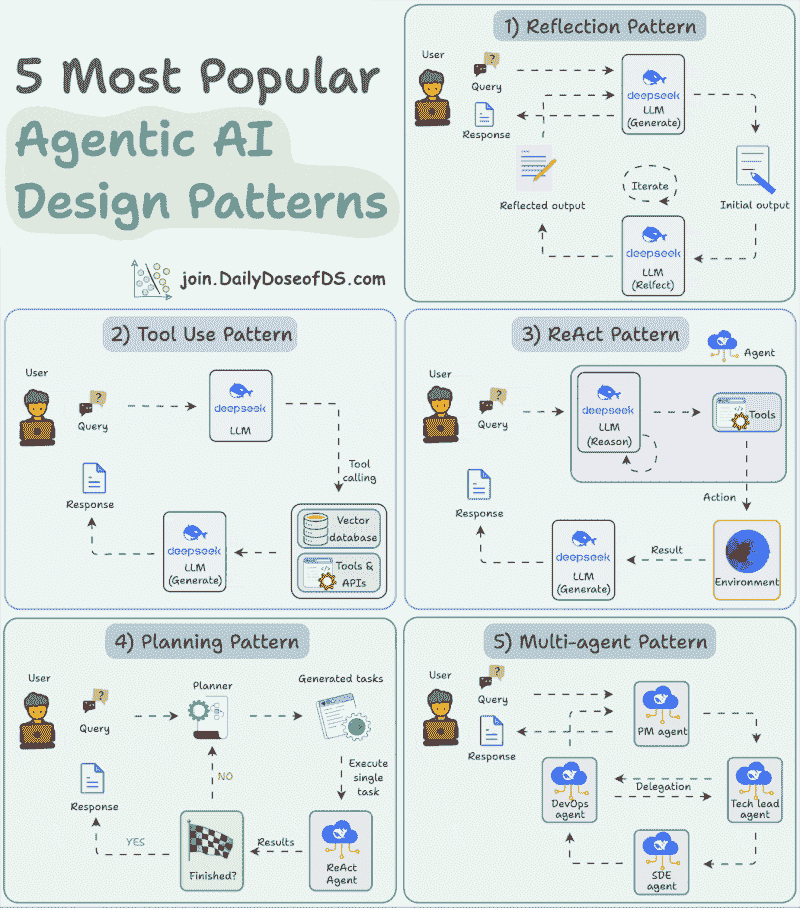

### 反思模式

AI通过审查自身工作来发现错误并迭代改进，直至生成最终响应。

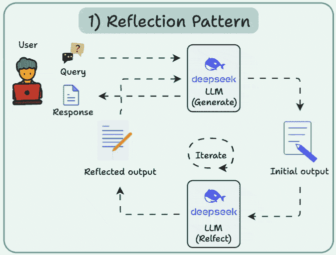

**工作流**：

+   用户（User）提出查询（Query）

+   deepseek LLM（生成）创建初始输出（Initial output）

+   deepseek LLM（反思）审查并改进输出（Reflected output）

+   迭代（Iterate）优化直至生成最终响应

### 工具使用模式

工具使LLMs能够通过以下方式收集更多信息：

+   查询向量数据库

+   执行Python脚本

+   调用API等

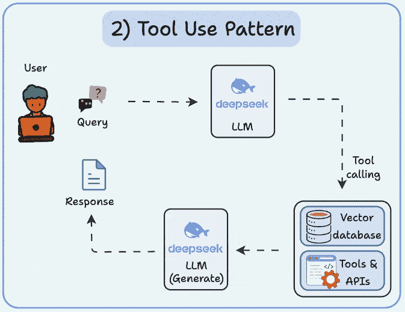

这很有帮助，因为LLM不再仅仅依赖其内部知识。

**工作流**：

+   用户提出查询

+   deepseek LLM决定调用工具（Tool calling）

+   访问向量数据库（Vector database）和工具与API（Tools & APIs）

+   基于工具返回结果生成最终响应

### ReAct（推理与行动）模式

ReAct结合了上述两种模式：

+   智能体反思生成的输出

+   使用工具与世界交互

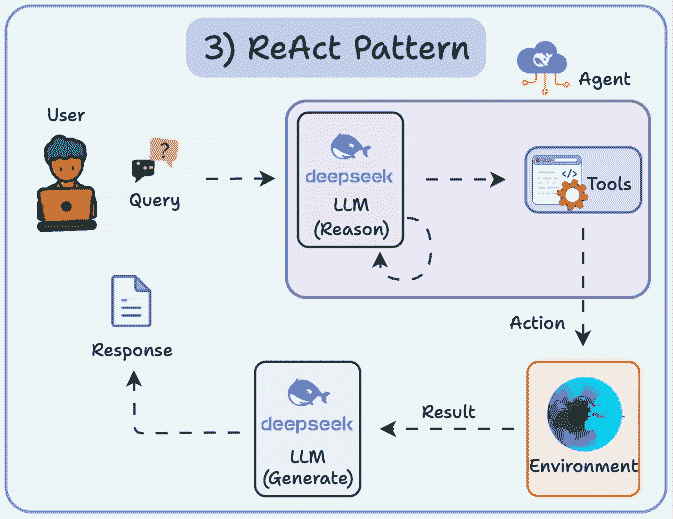

ReAct智能体以"思考→行动→观察"（Thought → Action → Observation）的循环运行，重复直至达成解决方案或最终答案。这类似于人类解决问题的方式：

**工作流**：

1.  用户提出查询

1.  deepseek LLM（推理）分析问题并决定行动方案

1.  调用工具（Tools）执行行动

1.  观察环境（Environment）反馈结果

1.  deepseek LLM（生成）基于结果生成响应

#### ReAct模式详细流程

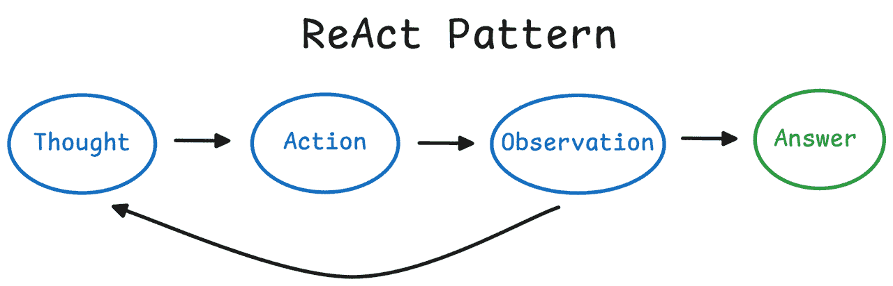

**ReAct模式循环**：

plaintext

```
思考（Thought）→ 行动（Action）→ 观察（Observation）→ 回答（Answer）
       ↑                                       |
       └───────────────────────────────────────┘
```

注意：像CrewAI这样的框架默认主要使用这种模式。

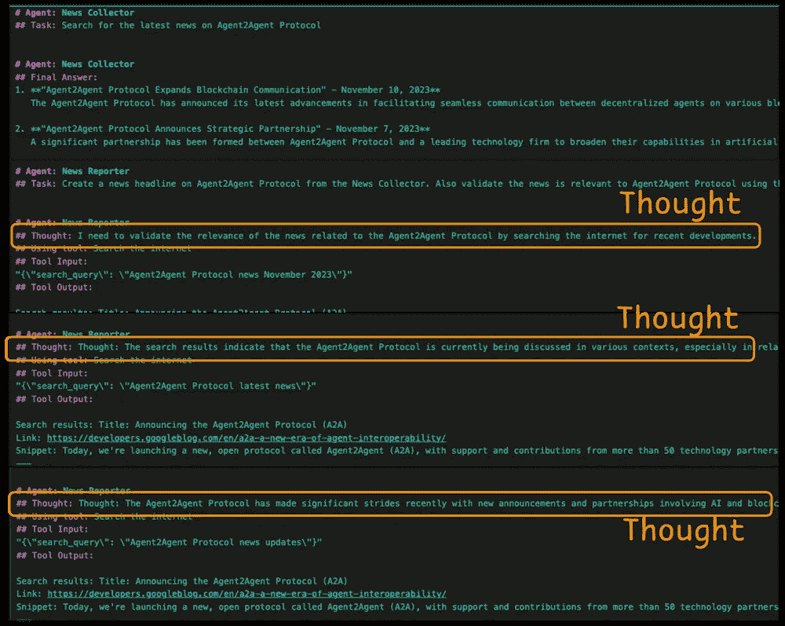

如上所示，智能体在生成响应前会经历一系列思考活动。这就是实际应用中的ReAct模式！

### 规划模式

不是一次性解决任务，AI通过以下方式创建路线图：

+   细分任务（Subdividing tasks）

+   概述目标（Outlining objectives）

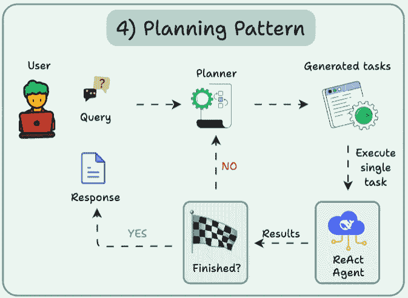

这种战略思维能更有效地解决任务。

注意：在CrewAI中，指定"planning=True"即可使用规划功能。

**工作流**：

1.  用户提出查询

1.  规划器（Planner）生成任务计划（Generated tasks）

1.  ReAct智能体执行单个任务（Execute single task）

1.  检查任务是否完成（Finished?）

+   是（YES）：生成最终响应

+   否（NO）：返回规划器调整计划

### 多智能体模式

**多智能体模式核心特点**：

+   存在多个智能体，每个智能体都有特定的角色和任务（

+   每个智能体也可以访问工具

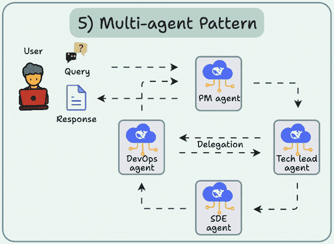

所有智能体共同协作以交付最终结果，同时在需要时将任务委派给其他智能体。

**工作流**：

1.  用户提出查询

1.  PM智能体接收请求并进行初步处理

1.  任务委派（Delegation）：

+   PM智能体将任务分配给Tech lead智能体

+   Tech lead智能体协调SDE智能体执行具体任务

+   DevOps智能体提供技术支持并反馈结果

1.  各智能体协作完成任务后，生成最终响应

# 五级Agentic AI系统

Agentic AI系统不仅能生成文本，还能做决策、调用函数，甚至运行自主工作流。

以下图示解释了AI智能体的五个级别从简单响应器到完全自主智能体：

1.  **基础响应器**

1.  **路由模式**

1.  **工具调用**

1.  **多智能体模式**

1.  **自主模式**

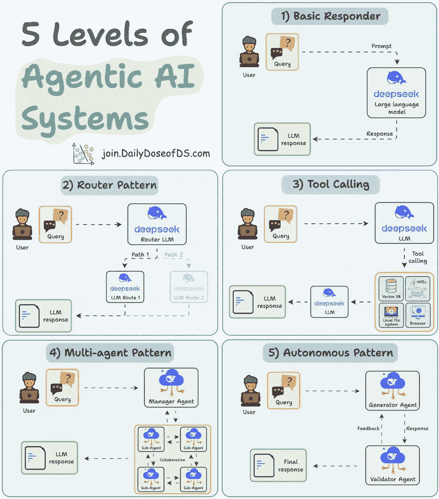

### 基础响应

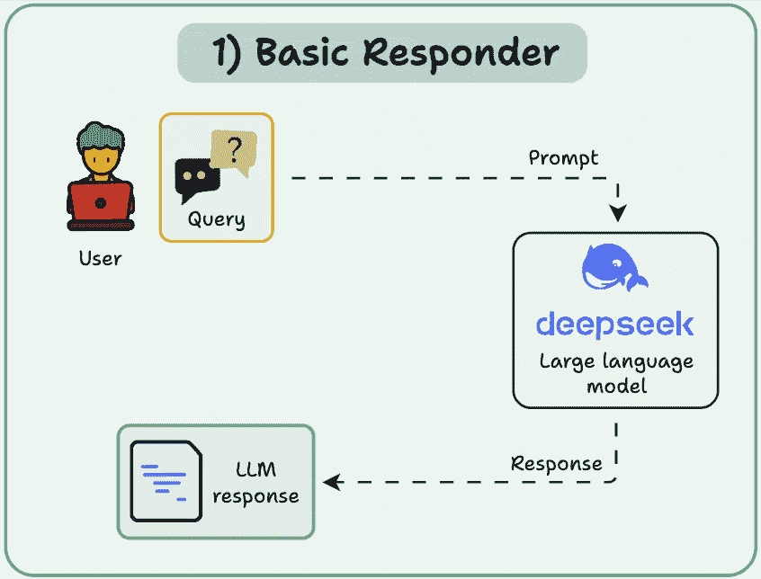

**工作流程**：

+   用户提出查询（Query）

+   通过提示词（Prompt）输入到deepseek大型语言模型

+   模型直接生成响应（LLM response）

**特点**：

+   由人类引导整个流程

+   LLM只是一个通用响应器，接收输入并产生输出

+   对程序流程几乎没有控制权

### 路由模式

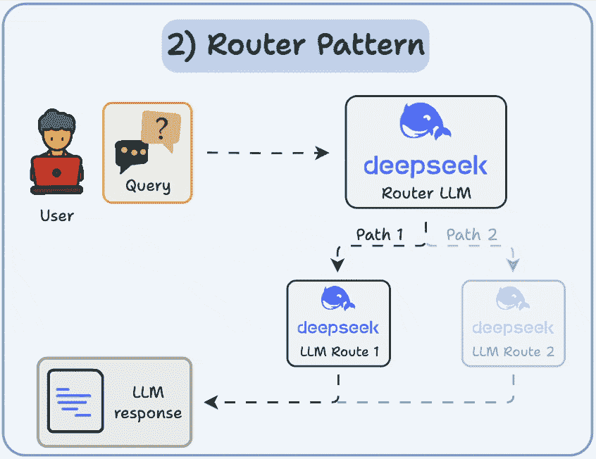

**工作流程**：

+   用户提出查询

+   deepseek路由LLM决定采用路径1（Path 1）或路径2（Path 2）

+   对应路径的LLM生成响应

**特点**：

+   人类定义流程中存在的路径/函数

+   LLM对采用哪个函数或路径做出基本决策

### 工具调用

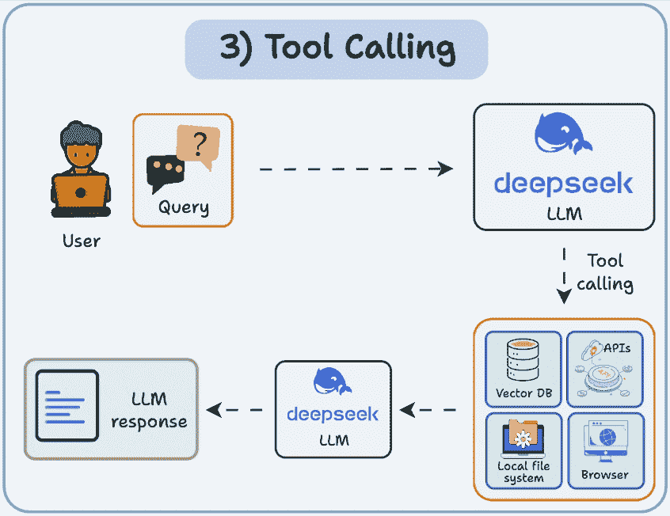

**工作流程**：

+   用户提出查询

+   LLM决定调用工具（Tool calling）

+   可访问的工具包括：

+   向量数据库（Vector DB）

+   APIs

+   本地文件系统（Local file system）

+   浏览器（Browser）

+   工具返回结果后，LLM生成最终响应

**特点**：

+   人类定义LLM可访问的工具集以完成任务

+   LLM决定何时使用这些工具以及执行的参数

### 多智能体模式

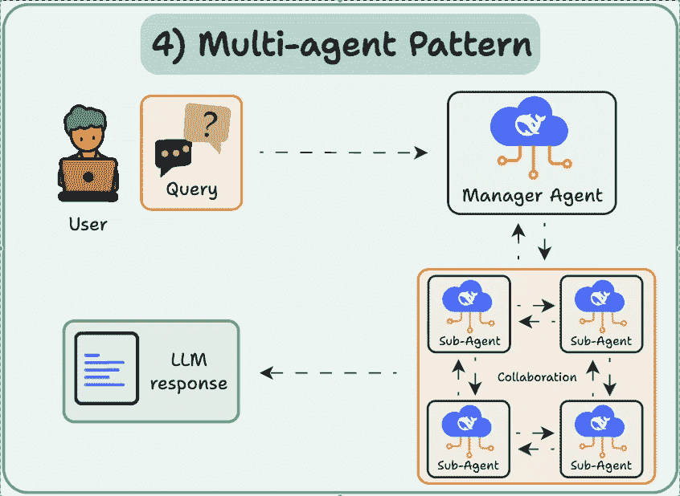

**工作流程**：

+   用户提出查询

+   管理器智能体（Manager Agent）协调多个子智能体（Sub-Agent）

+   子智能体之间通过协作（Collaboration）完成任务

+   生成最终响应

**特点**：

+   管理器智能体迭代协调多个子智能体并决定下一步

+   人类规划智能体之间的层级关系、角色和工具等

### 自主模式

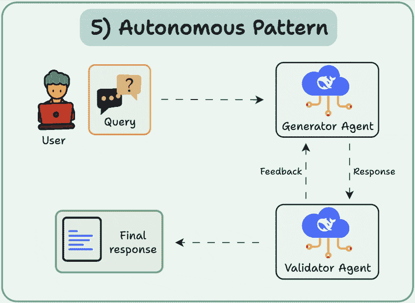

**工作流程**：

1.  用户提出查询

1.  生成器智能体（Generator Agent）创建响应

1.  验证器智能体（Validator Agent）提供反馈（Feedback）

1.  生成器根据反馈优化响应

1.  生成最终响应（Final response）

**特点**：

+   最高级别的模式，LLM能独立生成和执行新代码

+   有效充当独立的AI开发者

+   自主迭代和优化，最小化人类干预