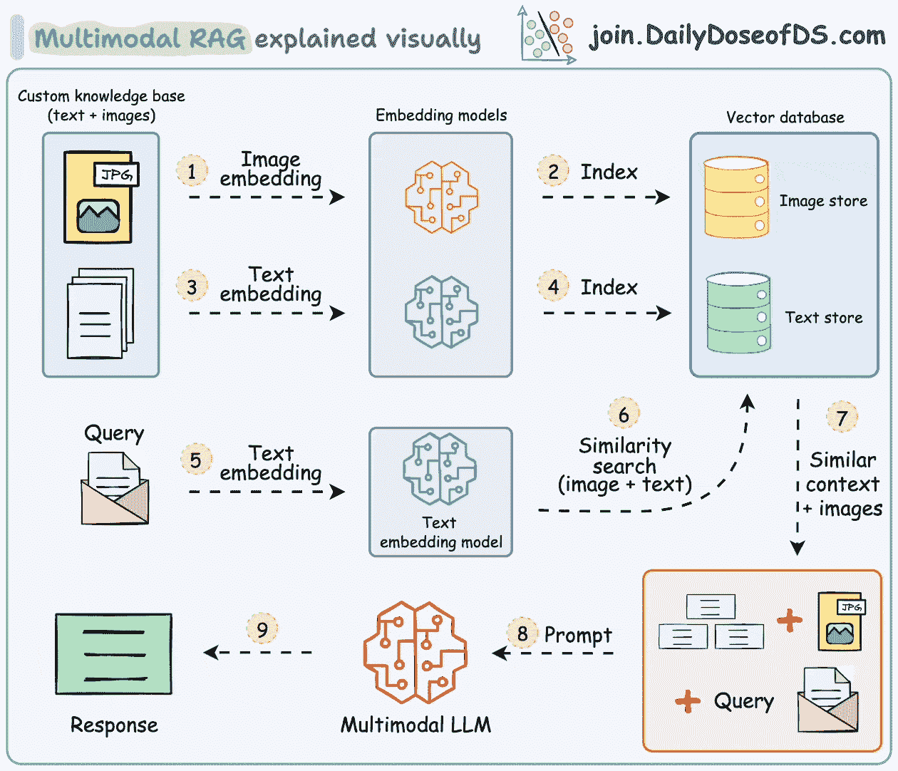
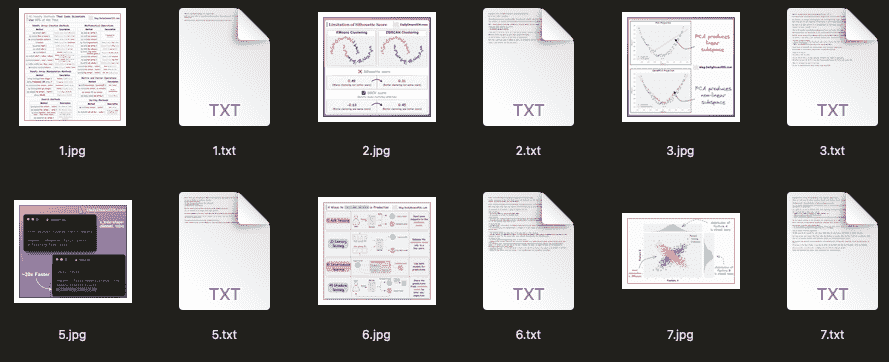
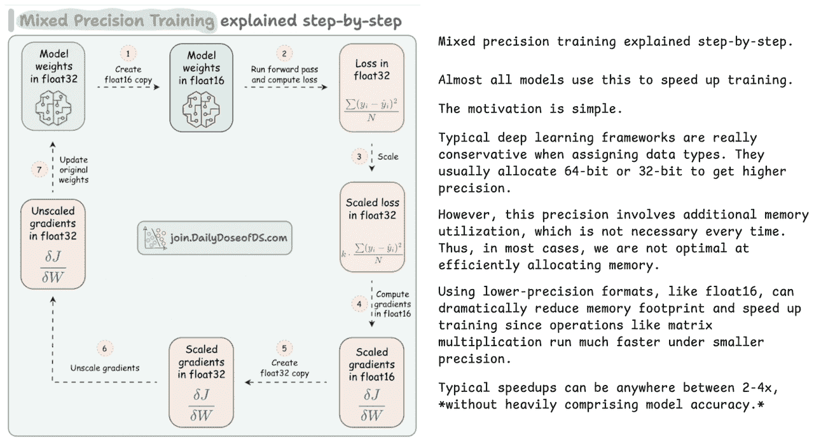
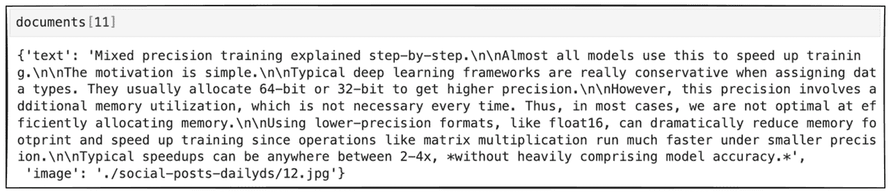

# 逐步介绍构建多模态 RAG 系统的过程

> 来源：[https://v11enp9ok1h.feishu.cn/docx/LPSidJ6uXo7OePxHBOocj5KpnQd](https://v11enp9ok1h.feishu.cn/docx/LPSidJ6uXo7OePxHBOocj5KpnQd)

在本节中，我们将逐步介绍构建多模态 RAG 系统的过程。

1.  收集文本-图像对的数据集。

1.  生成嵌入：使用 CLIP 为图像创建嵌入，使用转换器为文本创建嵌入，为每种模态创建嵌入。

1.  将嵌入存储在向量数据库中：使用 Qdrant 存储这些多模式嵌入。

1.  检索相关数据：查询矢量数据库以根据多模式输入检索最相关的信息。

1.  生成响应：结合检索到的数据，使用 LLM 生成连贯且具有上下文感知的响应。



### 数据集准备

该 zip 文件包含：

+   **JPG 文件**：与帖子相关的图像。

+   **TXT 文件**：与每幅图像相关的文本内容。

每个图像和文本文件共享相同的文件名，从而可以轻松配对它们。



**以下是一个示例：**



我们将使用此内容 + 图像对数据集来构建一个多模式 RAG 系统，该系统可以：

1.  使用 CLIP 嵌入图像及其对应的文本。

1.  将这些嵌入存储在向量数据库（Qdrant）中以便有效检索。

1.  使用文本、图像或两者的组合来查询系统。

1.  使用集成检索到的多模式信息的 LLM（通过 Ollama 的 Llama3.2 Vision）生成上下文感知响应。

提取这个数据集并将其加载到 Python

首先，我们收集以下txt文件名和文件名称的列表：jpg

```
from glob import glob

image_files = glob(&quot;social-posts-dailyds/*.jpg&quot;)

text_files = glob(&quot;social-posts-dailyds/*.txt&quot;)

&gt;&gt;&gt; len(image_files), len(text_files)
(40,40)
```

得到

```
&gt;&gt;&gt; image_files[1], text_files[1]
(&#x27;social-posts-dailyds/9.jpg&#x27;, &#x27;social-posts-dailyds/15.txt&#x27;)
```

如上所示，对应的文件名并不相同，因此将它们汇总到字典列表中，如下所示：

```
documents = []

for i in range(1, len(image_files)+1):
    text_file  = f&#x27;./social-posts-dailyds/{i}.txt&#x27;
    image_file = f&#x27;./social-posts-dailyds/{i}.jpg&#x27;
    
    text = open(text_file).read()
    doc = {&quot;text&quot;: text, &quot;image&quot;:image_file}
    documents.append(doc)
```

其结构如下：

