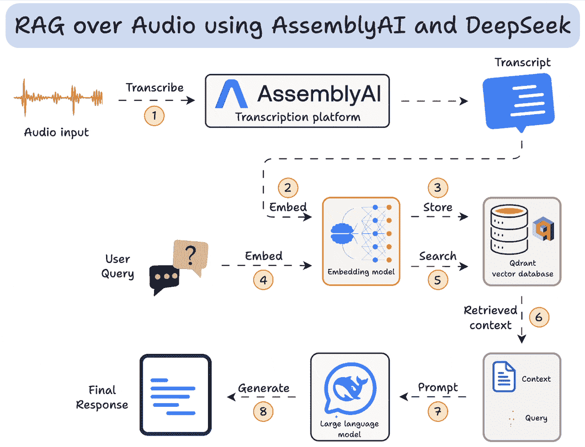
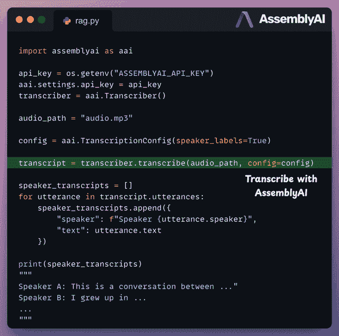
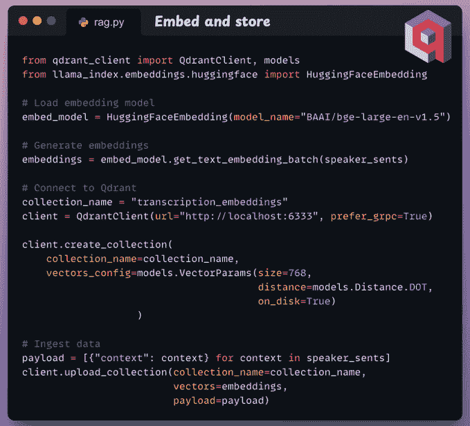
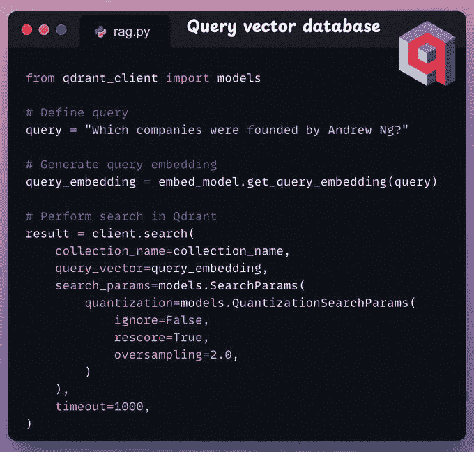
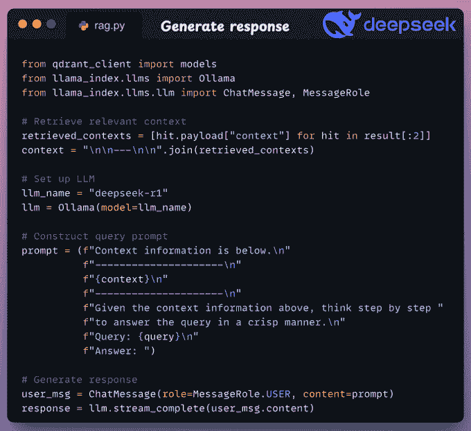

# 用 DeepSeek-R1 基于音频文件构建一个 RAG 应用程序

> 来源：[https://v11enp9ok1h.feishu.cn/docx/R4ERdDQydoeURrxyR6xcXRSnnNH](https://v11enp9ok1h.feishu.cn/docx/R4ERdDQydoeURrxyR6xcXRSnnNH)

**以下是应用程序的概述：**

+   步骤 1）获取音频文件并使用[**AssemblyAI**](https://assemblyai.com/?utm_source=dailydose&utm_medium=newsletter_sponsor&utm_campaign=tutorial&utm_content=rag_demo)对其进行转录。

+   步骤 2-3）将其存储在 Qdrant 矢量数据库中。

+   步骤 4-6）查询数据库以获取上下文。

+   步骤 7-8）使用 DeepSeek-R1 作为 LLM 生成响应。

### 实施

我们使用[**AssemblyAI**](https://assemblyai.com/?utm_source=dailydose&utm_medium=newsletter_sponsor&utm_campaign=tutorial&utm_content=rag_demo)[转录](https://assemblyai.com/?utm_source=dailydose&utm_medium=newsletter_sponsor&utm_campaign=tutorial&utm_content=rag_demo)带有说话者标签的音频。具体步骤如下

嵌入转录本并将其存储在矢量数据库中

+   加载嵌入模型并生成嵌入。

+   连接到 Qdrant 并创建一个集合。

+   存储嵌入。

现在进行检索，我们查询向量数据库来检索成绩单中与查询相似的句子：

+   将查询转换为嵌入。

+   搜索矢量数据库。

+   检索最佳结果。

最后，检索上下文后：

+   我们构建一个提示。

+   我们通过 Ollama 使用 DeepSeek-R1 来生成响应。