# 高级RAG

> 来源：[https://v11enp9ok1h.feishu.cn/docx/R9n9ddPDfo3lKIxi3oWc31fJnYe](https://v11enp9ok1h.feishu.cn/docx/R9n9ddPDfo3lKIxi3oWc31fJnYe)

## 一、In simple, What is simple RAG?

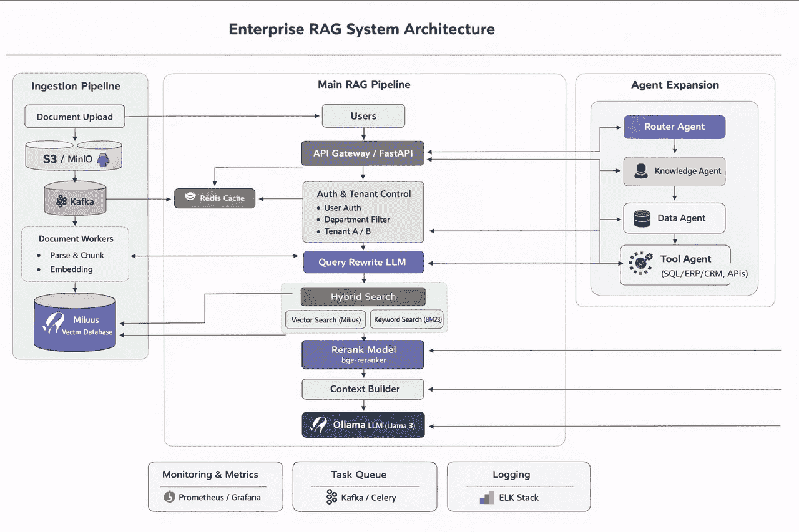

> **基本RAG**需要从**外部知识数据库中获取文档****，然后****，将这些**文档与**用户的查询一起**被传输**到LLM**，用于生成响应。从本质上讲，RAG包括一个检索组件、一个外部知识数据库和一个生成组件。

**在基本的RAG场景中**，大致有如下步骤：

首先将文本划分为多个块，使用Transformer Encoder模型将这些块嵌入到向量中，将这些向量存储到向量数据库并建立索引，查询会检索向量数据库中相关的上下文，这些上下文和查询一起生成最终的LLM提示，并引导LLM合成响应。

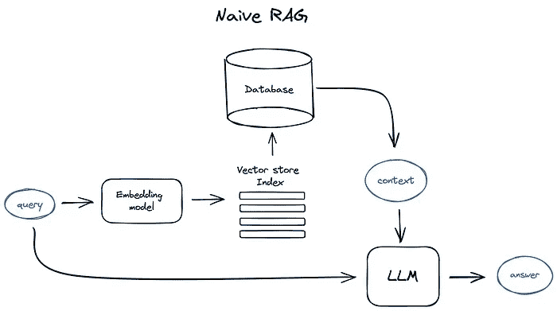

**RAG系统包含三个关键模块：**

> **Retriever****：**从上下文相关的知识源中检索文本段落；

> **Reranker**（可选）：对检索到的段落重新打分和重新排序；

> **Generator****：**将上下文与检索到的段落集成以生成输出文本

## 二、使用LangChain和Huggingface实现基本RAG

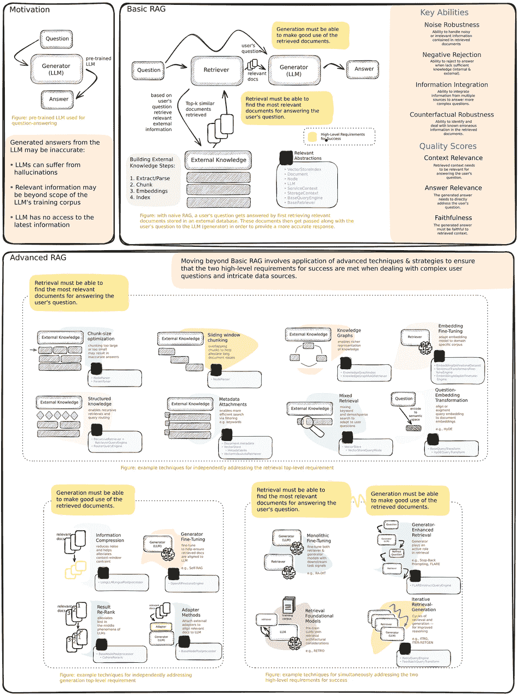

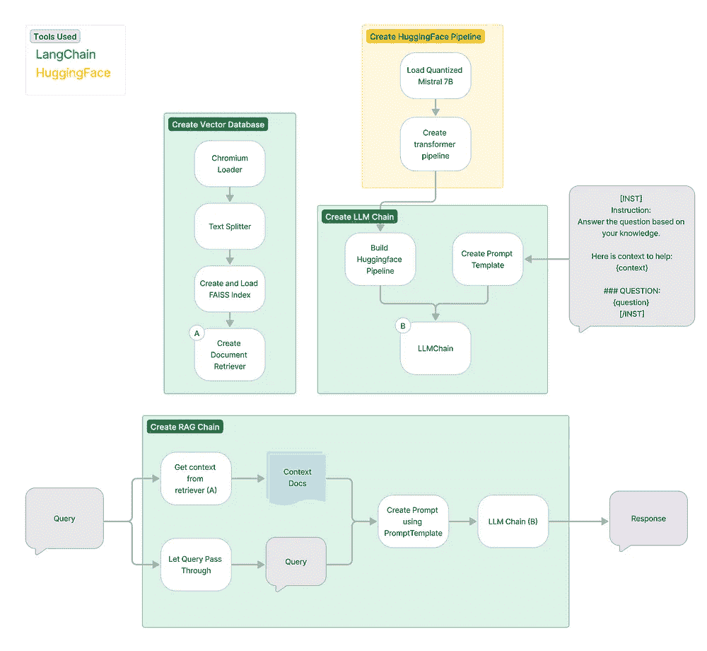

## 三、高级RAG

> 最基本、最简单的RAG系统有时候会检索不到**相关的上下文，**因此需要**一些更高**级**的方法**来增强RAG系统，比如：查询转换、重排序等。

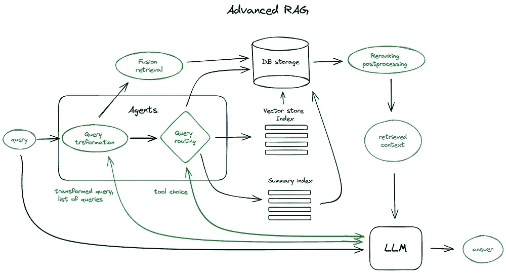

### 3.1 高级RAG（检索增强生成）技术涵盖以下内容：

+   **基本RAG**：它涉及从外部知识数据库中检索文档，并将这些文档与用户的查询一起传递给LLM以生成响应。主要组件是检索组件、外部知识数据库和生成组件。

>

+   **RAG的成功要求：**一个成功的RAG系统应该有两个主要功能：检索必须找到与用户查询最相关的文档，生成必须有效地利用这些文档来回答用户查询。

>

+   **高级RAG：**构建高级RAG需要应用更复杂的技术和策略来满足成功要求。这些技术既可以独立地满足其中一个高级成功需求，也可以同时满足这两个需求。

>

+   **高级检索技术：**这包括通过网格搜索执行超参数调整，以及为递归或路由检索构建外部知识。

>

+   **️高级生成技术：**这包括充分利用检索到的文档，对结果进行重新排序，以及使用信息压缩来减少噪声。

>

+   **同时定位检索和生成的高级技术：**这包括生成器增强检索和迭代检索生成器RAG。

### 3.2 高级RAG常用的技术

1.  **基本索引**

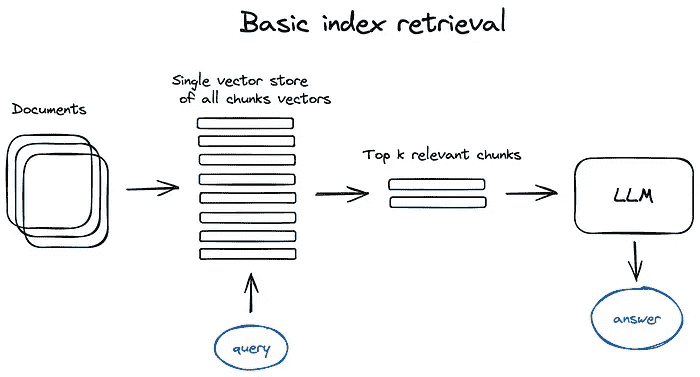

1.  **分层索引**

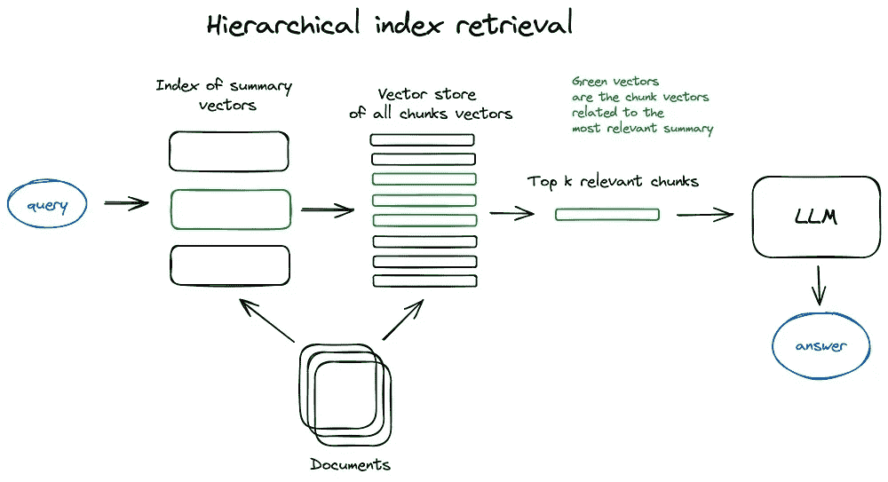

1.  **语句窗口检索**

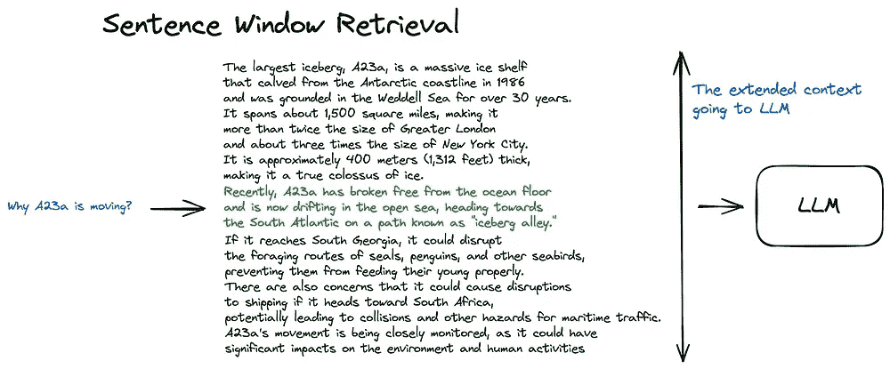

1.  **父文档检索器**

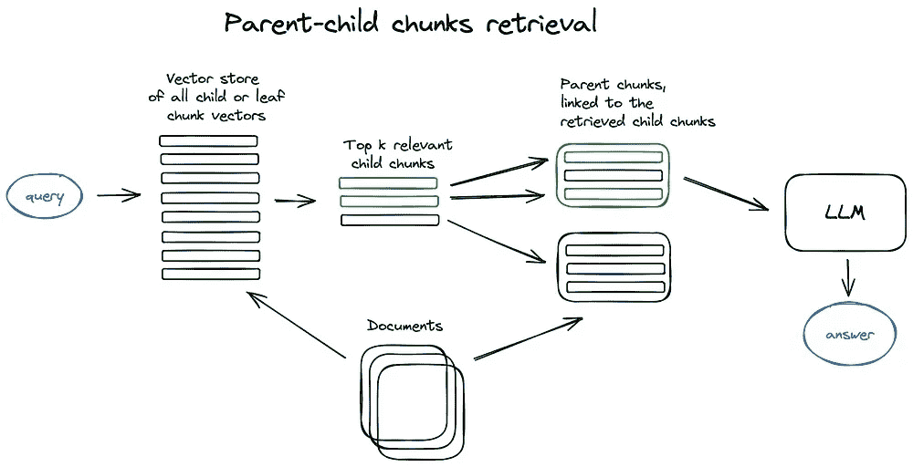

1.  **融合检索**

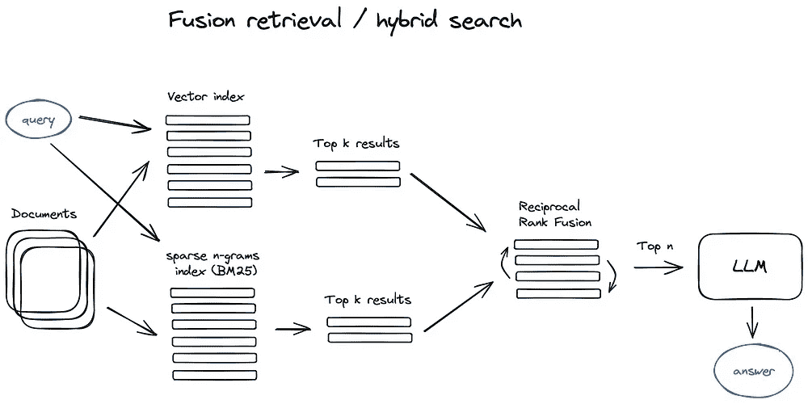

1.  **查询转换**

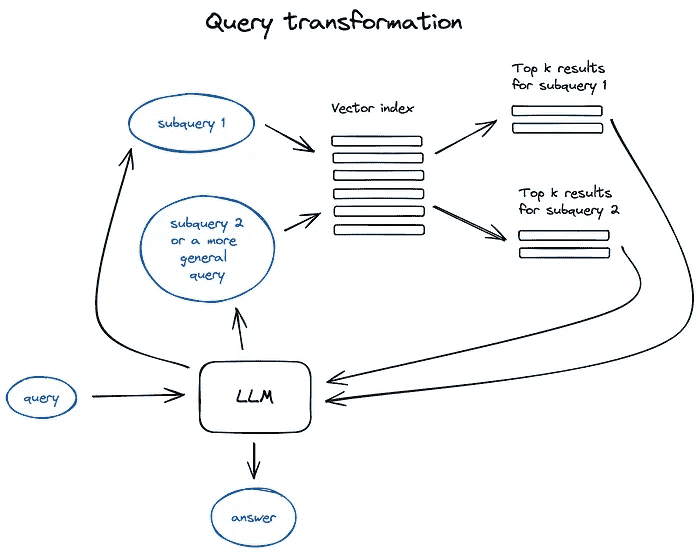

1.  **聊天引擎检索**

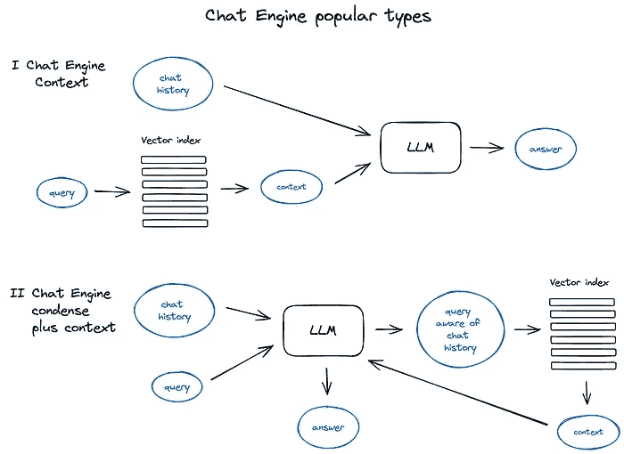

1.  **多文档检索**

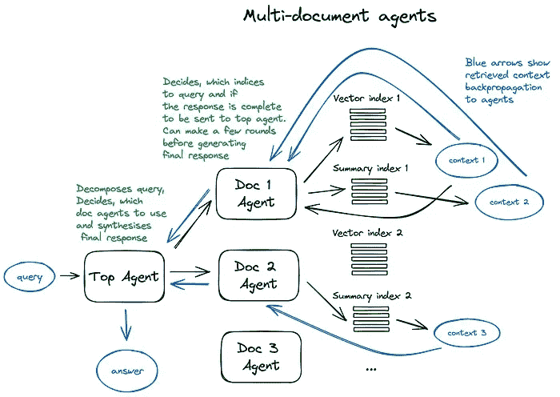

## LLM 的高级 RAG 技术总结：

+   RAG 通过集成外部知识检索来增强语言模型，从而提高生成准确性、相关性和信息覆盖率。

+   检索器的进步提升了长格式和关键字查询的词汇、语义和上下文相关性匹配信号。

+   Reranker 架构专注于精确预测相关性，采用结合预训练、模型大小和网络架构的策略。

+   生成器通过截断、蒸馏、加权、工作记忆和实体接地技术无缝地整合外部证据。

+   混合 RAG 系统将两个 LLM 结合在一起，以最大限度地提高 SLM 的质量和效率，以实现可扩展性和吞吐量。

<https://v11enp9ok1h.feishu.cn/sync/Ipw1d27gNsv3OAbo3N7cks4ZnJf>