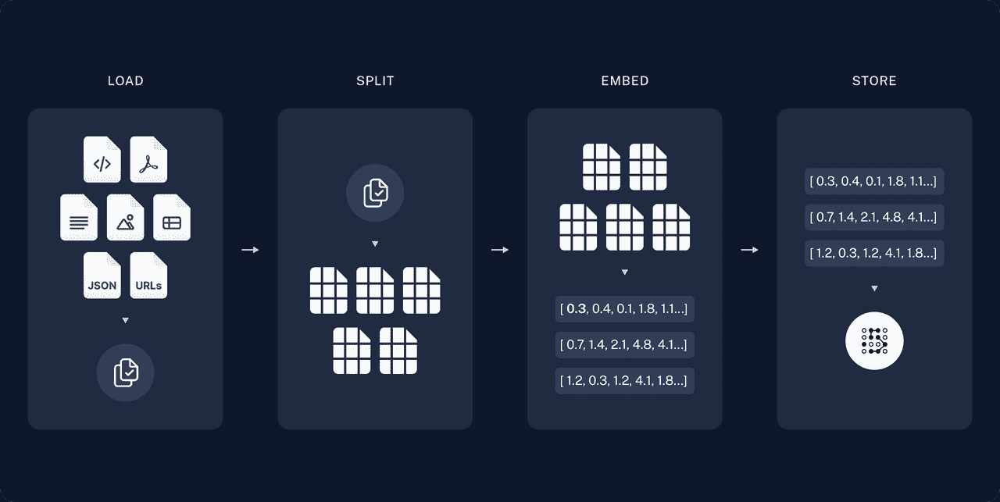
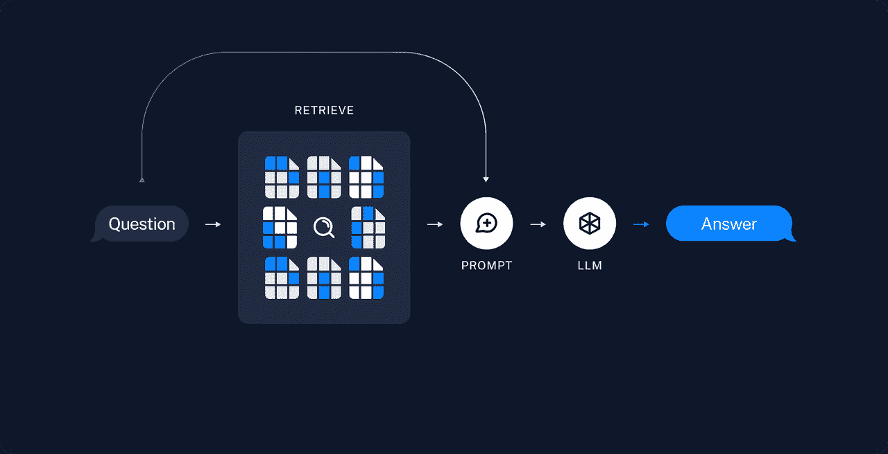

# 构建检索增强生成 (RAG) 应用程序

> 来源：[https://v11enp9ok1h.feishu.cn/docx/DesydGBEOoumsuxFdHLcYHFEnqX](https://v11enp9ok1h.feishu.cn/docx/DesydGBEOoumsuxFdHLcYHFEnqX)

<https://v11enp9ok1h.feishu.cn/sync/VztedzIoUstVPDb6RNMctK8Unie>

> LLM 所实现的最强大的应用之一是复杂的问答 (Q&A) 聊天机器人。这些应用程序可以回答有关特定源信息的问题。这些应用程序使用一种称为检索增强生成 (RAG) 的技术。

> 本教程将介绍如何基于文本数据源构建一个简单的问答应用程序。在此过程中，我们将介绍典型的问答架构，并重点介绍更多高级问答技术的资源。还将了解 LangSmith 如何帮助我们跟踪和理解我们的应用程序。随着我们的应用程序变得越来越复杂，LangSmith 将变得越来越有用。

## 什么是 RAG

+ RAG 是一种利用附加数据增强 `LLM` 知识的技术。

+ `LLM` 可以推理广泛的主题，但他们的知识仅限于他们接受训练的特定时间点的公共数据。如果您想构建能够推理私有数据或模型截止日期后引入的数据的 AI 应用程序，则需要使用模型所需的特定信息来增强模型的知识。将适当的信息引入模型提示的过程称为检索增强生成 (RAG)。

+ `LangChain` 有许多组件，旨在帮助构建问答应用程序以及更广泛的 `RAG` 应用程序。

**注意**：这里我们专注于非结构化数据的问答。如果您对结构化数据的 `RAG` 感兴趣，请查看我们关于通过 `SQL` 数据进行问答的教程。

# 概念

## 典型的 RAG 应用程序有两个主要组件：

+ **索引**：从源中提取数据并对其进行索引的管道。这通常在线下进行。

+ **检索和生成**：实际的 `RAG` 链，它在运行时接受用户查询并从索引中检索相关数据，然后将其传递给模型。

从原始数据到答案最常见的完整序列如下：

1. **加载**：首先我们需要加载数据。这是通过 [`DocumentLoaders`](https://python.langchain.com/v0.2/docs/concepts/#document-loaders) 完成的。

1. **拆分**：[`文本拆分器`](https://python.langchain.com/v0.2/docs/concepts/#text-splitters) 将大块内容拆分 `Documents` 成小块内容。这对于索引数据和将数据传递到模型都很有用，因为大块内容更难搜索，并且不适合模型的有限上下文窗口。

1. **存储**：我们需要一个地方来存储和索引我们的分割，以便以后可以搜索它们。这通常使用 [`VectorStore`](https://python.langchain.com/v0.2/docs/concepts/#vectorstores) 和 [`Embeddings`](https://python.langchain.com/v0.2/docs/concepts/#embedding-models) 模型来完成。



### 检索和生成

1. **检索**：根据用户输入，使用 [`检索器`](https://python.langchain.com/v0.2/docs/concepts/#retrievers) 从存储中检索相关分割。

1. **生成**：[`ChatModel`](https://python.langchain.com/v0.2/docs/concepts/#chat-models) / [`LLM`](https://python.langchain.com/v0.2/docs/concepts/#llms) 使用包含问题和检索到的数据的提示生成答案。



# 设置

## Jupyter Notebook

[本指南（以及文档中的大多数其他指南）](https://jupyter.org/) 使用 `Jupyter` 笔记本，并假设读者也使用 `Jupyter` 笔记本。`Jupyter` 笔记本非常适合学习如何使用 `LLM` 系统，因为经常会出现问题（意外输出、`API` 故障等），而在交互式环境中阅读指南是更好地理解它们的好方法。

[本教程](https://jupyter.org/install) 和其他教程可能最方便在 `Jupyter` 笔记本中运行。请参阅此处了解安装说明。

## 安装

要安装 `LangChain`，请运行：

```
pip install langchain
```

### LangSmith

使用 [`LangChain`](https://smith.langchain.com/) 构建的许多应用程序将包含多个步骤，并多次调用 `LLM` 调用。随着这些应用程序变得越来越复杂，能够检查链或代理内部究竟发生了什么变得至关重要。最好的方法是使用 `LangSmith`。

通过上面的链接注册后，请确保设置环境变量以开始记录跟踪：

```
export LANGCHAIN_TRACING_V2="true"
export LANGCHAIN_API_KEY="..."
```

或者，如果在笔记本中，您可以使用以下方式设置它们：

```
import getpass
import os

os.environ["LANGCHAIN_TRACING_V2"] = "true"
os.environ["LANGCHAIN_API_KEY"] = getpass.getpass()
```

# 预览

在本指南中，我们将在网站上构建一个 QA 应用程序。我们将使用的具体网站是 Lilian Weng 撰写的 `LLM Powered Autonomous Agents` 博客文章，该网站允许我们针对文章内容提出问题。

我们可以创建一个简单的索引管道和 `RAG` 链，用大约 20 行代码来完成此操作：

```
pip install -qU langchain-openai
```

```
import getpass
import os

os.environ["OPENAI_API_KEY"] = getpass.getpass()

from langchain_openai import ChatOpenAI

llm = ChatOpenAI(model="gpt-3.5-turbo-0125")
```

```
import bs4
from langchain import hub
from langchain_chroma import Chroma
from langchain_community.document_loaders import WebBaseLoader
from langchain_core.output_parsers import StrOutputParser
from langchain_core.runnables import RunnablePassthrough
from langchain_openai import OpenAIEmbeddings
from langchain_text_splitters import RecursiveCharacterTextSplitter

# Load, chunk and index the contents of the blog.
loader = WebBaseLoader(
    web_paths=("https://lilianweng.github.io/posts/2023-06-23-agent/",),
    bs_kwargs=dict(
        parse_only=bs4.SoupStrainer(
            class_=("post-content", "post-title", "post-header")
        )
    ),
)
docs = loader.load()

text_splitter = RecursiveCharacterTextSplitter(chunk_size=1000, chunk_overlap=200)
splits = text_splitter.split_documents(docs)
vectorstore = Chroma.from_documents(documents=splits, embedding=OpenAIEmbeddings())

# Retrieve and generate using the relevant snippets of the blog.
retriever = vectorstore.as_retriever()
prompt = hub.pull("rlm/rag-prompt")


def format_docs(docs):
    return "\n\n".join(doc.page_content for doc in docs)


rag_chain = (
    {"context": retriever | format_docs, "question": RunnablePassthrough()}
    | prompt
    | llm
    | StrOutputParser()
)

rag_chain.invoke("What is Task Decomposition?")
```

**API 参考：** [`WebBaseLoader`](https://api.python.langchain.com/en/latest/document_loaders/langchain_community.document_loaders.web_base.WebBaseLoader.html) | [`StrOutputParser`](https://api.python.langchain.com/en/latest/output_parsers/langchain_core.output_parsers.string.StrOutputParser.html) | `RunnablePassthrough` | `OpenAIEmbeddings` | `RecursiveCharacterTextSplitter`

# 详细演练

让我们一步一步地浏览上面的代码来真正理解发生了什么。

### 1. 索引：加载

我们首先需要加载博客文章内容。我们可以使用 [`DocumentLoaders`](https://api.python.langchain.com/en/latest/documents/langchain_core.documents.base.Document.html) 来实现这一点，它们是从源加载数据并返回 `Documents` 列表的对象。`Document` 是一个包含 `page_content` 和 `metadata` 属性的对象，其中 `page_content` 是 `str`，`metadata` 是 `dict`。

在本例中，我们将使用 [`WebBaseLoader`](https://python.langchain.com/v0.2/docs/integrations/document_loaders/web_base/)，它用于 `urllib` 从 Web URL 加载 HTML 并将其解析为文本。我们可以通过向解析器传递参数来自定义 HTML - 文本解析（请参阅 `BeautifulSoup` 文档）。在本例中，只有类为 `"post-content"`、`"post-title"` 或 `"post-header"` 的 HTML 标签是相关的，因此我们将删除所有其他标签。

```
import bs4
from langchain_community.document_loaders import WebBaseLoader

# Only keep post title, headers, and content from the full HTML.
bs4_strainer = bs4.SoupStrainer(class_=("post-title", "post-header", "post-content"))
loader = WebBaseLoader(
    web_paths=("https://lilianweng.github.io/posts/2023-06-23-agent/",),
    bs_kwargs={"parse_only": bs4_strainer},
)
```

> **API 参考：** [`WebBaseLoader`](https://api.python.langchain.com/en/latest/document_loaders/langchain_community.document_loaders.web_base.WebBaseLoader.html)

```
43131
```

```
print(docs[0].page_content[:500])
```

```

      LLM Powered Autonomous Agents
    
Date: June 23, 2023  |  Estimated Reading Time: 31 min  |  Author: Lilian Weng


Building agents with LLM (large language model) as its core controller is a cool concept. Several proof-of-concepts demos, such as AutoGPT, GPT-Engineer and BabyAGI, serve as inspiring examples. The potentiality of LLM extends beyond generating well-written copies, stories, essays and programs; it can be framed as a powerful general problem solver.
Agent System Overview#
In
```

`DocumentLoader`：从源加载数据作为列表的对象 `Documents`。

+ [`文档`](https://python.langchain.com/v0.2/docs/how_to/#document-loaders)：有关如何使用的详细文档 `DocumentLoaders`。

+ [`集成`](https://python.langchain.com/v0.2/docs/integrations/document_loaders/)：160 多种集成可供选择。

+ [`接口`](https://api.python.langchain.com/en/latest/document_loaders/langchain_core.document_loaders.base.BaseLoader.html)：基本接口的 API 参考。

### 索引：拆分

我们加载的文档长度超过 42k 个字符。这太长了，许多模型的上下文窗口都放不下。即使对于那些可以在上下文窗口中容纳完整帖子的模型，模型也很难在很长的输入中找到信息。

为了解决这个问题，我们将把 `Document` 嵌入和向量存储分成块。这应该可以帮助我们在运行时只检索博客文章中最相关的部分。

在本例中，我们将文档拆分为 1000 个字符的块，块之间有 200 个字符的重叠。重叠有助于降低将语句与与其相关的重要上下文分离的可能性。我们使用 `RecursiveCharacterTextSplitter`，它将使用常用分隔符（如换行符）递归拆分文档，直到每个块的大小合适。这是针对一般文本用例的推荐文本拆分器。

我们进行设置 `add_start_index=True`，以便每个分割文档在初始文档中开始的字符索引被保存为元数据属性 `start_index`。

```
from langchain_text_splitters import RecursiveCharacterTextSplitter

text_splitter = RecursiveCharacterTextSplitter(
    chunk_size=1000, chunk_overlap=200, add_start_index=True
)
all_splits = text_splitter.split_documents(docs)

len(all_splits)
```

> **API 参考：** `RecursiveCharacterTextSplitter`

```
66
```

```
len(all_splits[0].page_content)
```

```
all_splits[10].metadata
```


# LangChain 文档处理与检索增强生成（RAG）管道

```
{
  'source': 'https://lilianweng.github.io/posts/2023-06-23-agent/',
  'start_index': 7056
}
```

## 文档分割与转换

### TextSplitter

`TextSplitter`：将 `s` 列表拆分`Document`为较小块的对象。`s` 的子类`DocumentTransformer`。

+   [阅读操作方法文档](https://python.langchain.com/v0.2/docs/how_to/#text-splitters)，详细了解如何使用不同方法拆分文本

+   [代码（py或js）](https://python.langchain.com/v0.2/docs/integrations/document_loaders/source_code/)

+   [科学论文](https://python.langchain.com/v0.2/docs/integrations/document_loaders/grobid/)

+   [接口](https://api.python.langchain.com/en/latest/base/langchain_text_splitters.base.TextSplitter.html)：基本接口的 API 参考。

### DocumentTransformer

`DocumentTransformer`：对对象列表执行转换的对象`Document`。

+   [文档](https://python.langchain.com/v0.2/docs/how_to/#text-splitters)：有关如何使用的详细文档`DocumentTransformers`

+   [集成](https://python.langchain.com/v0.2/docs/integrations/document_transformers/)

+   [接口](https://api.python.langchain.com/en/latest/documents/langchain_core.documents.transformers.BaseDocumentTransformer.html)：基本接口的 API 参考。

## 3. 索引：存储

现在我们需要索引 66 个文本块，以便我们可以在运行时搜索它们。最常见的方法是嵌入每个文档拆分的内容，并将这些嵌入插入到向量数据库（或向量存储）中。当我们想要搜索我们的拆分时，我们会采用文本搜索查询，嵌入它，然后执行某种“相似性”搜索，以识别与我们的查询嵌入最相似的嵌入的存储拆分。最简单的相似性度量是余弦相似性 - 我们测量每对嵌入（高维向量）之间角度的余弦。

[我们可以使用`Chroma`](https://python.langchain.com/v0.2/docs/integrations/vectorstores/chroma/) 向量存储和 `OpenAIEmbeddings`模型在单个命令中嵌入和存储所有文档分割 。

```
from langchain_chroma import Chroma
from langchain_openai import OpenAIEmbeddings

vectorstore = Chroma.from_documents(documents=all_splits, embedding=OpenAIEmbeddings())
```

> API 参考：`OpenAIEmbeddings`

`Embeddings`：文本嵌入模型的包装器，用于将文本转换为嵌入。

+   [文档](https://python.langchain.com/v0.2/docs/how_to/embed_text/)：有关如何使用嵌入的详细文档。

+   [集成](https://python.langchain.com/v0.2/docs/integrations/text_embedding/)：30 多种集成可供选择。

+   [接口](https://api.python.langchain.com/en/latest/embeddings/langchain_core.embeddings.Embeddings.html)：基本接口的 API 参考。

`VectorStore`：向量数据库的包装器，用于存储和查询嵌入。

+   [文档](https://python.langchain.com/v0.2/docs/how_to/vectorstores/)：有关如何使用向量存储的详细文档。

+   [集成](https://python.langchain.com/v0.2/docs/integrations/vectorstores/)：40 多种集成可供选择。

+   [接口](https://api.python.langchain.com/en/latest/vectorstores/langchain_core.vectorstores.VectorStore.html)：基本接口的 API 参考。

这样就完成了管道的索引部分。此时，我们有一个可查询的向量存储，其中包含博客文章的分块内容。给定一个用户问题，理想情况下，我们应该能够返回回答该问题的博客文章片段。

## 检索和生成：检索

现在让我们编写实际的应用程序逻辑。我们想要创建一个简单的应用程序，它接受用户问题，搜索与该问题相关的文档，将检索到的文档和初始问题传递给模型，然后返回答案。

[首先，我们需要定义](https://python.langchain.com/v0.2/docs/concepts/#retrievers/)搜索文档的逻辑。LangChain 定义了一个 `Retriever` 接口，它包装了一个索引，可以`Documents`根据字符串查询返回相关内容。

最常见的类型`Retriever`是`VectorStoreRetriever`，它使用向量存储的相似性搜索功能来方便检索。任何`VectorStore`都可以轻松转换`Retriever`为`VectorStore.as_retriever()`：

```
retriever = vectorstore.as_retriever(search_type="similarity", search_kwargs={"k": 6})

retrieved_docs = retriever.invoke("What are the approaches to Task Decomposition?")

len(retrieved_docs)
```

```
6
```

```
print(retrieved_docs[0].page_content)
```

```
Tree of Thoughts (Yao et al. 2023) extends CoT by exploring multiple reasoning possibilities at each step. It first decomposes the problem into multiple thought steps and generates multiple thoughts per step, creating a tree structure. The search process can be BFS (breadth-first search) or DFS (depth-first search) with each state evaluated by a classifier (via a prompt) or majority vote.
Task decomposition can be done (1) by LLM with simple prompting like "Steps for XYZ.\n1.", "What are the subgoals for achieving XYZ?", (2) by using task-specific instructions; e.g. "Write a story outline." for writing a novel, or (3) with human inputs.
```

向量存储通常用于检索，但也有其他方法可以进行检索。

`RetrieverDocument`：根据文本查询返回的对象

+   [文档](https://python.langchain.com/v0.2/docs/how_to/#retrievers)：有关界面和内置检索技术的更多文档。其中包括：

+   [MultiQuery Retriever](https://python.langchain.com/v0.2/docs/how_to/MultiQueryRetriever/) 生成输入问题的变体，以提高检索命中率。

+   [MultiVector Retriever](https://python.langchain.com/v0.2/docs/how_to/multi_vector/) 而是生成嵌入的变体，也是为了提高检索命中率。

+   [Max marginal relevance](https://www.cs.cmu.edu/~jgc/publication/The_Use_MMR_Diversity_Based_LTMIR_1998.pdf) 选择检索到的文档之间的相关性和多样性，以避免传递重复的上下文。

+   [可以在向量存储](https://python.langchain.com/v0.2/docs/how_to/self_query/) 检索期间使用元数据过滤器（例如使用自查询检索器）过滤文档。

+   [集成](https://python.langchain.com/v0.2/docs/integrations/retrievers/)：与检索服务的集成。

+   [接口](https://api.python.langchain.com/en/latest/retrievers/langchain_core.retrievers.BaseRetriever.html)：基本接口的 API 参考。

## 5. 检索和生成：生成

让我们将所有这些放在一起形成一个链，该链接受问题、检索相关文档、构建提示、将其传递给模型并解析输出。

我们将使用 `gpt-3.5-turbo` OpenAI 聊天模型，但可以替换任何 `LLM` `LangChain` `ChatModel`。

```
pip install -qU langchain-openai
```

```
import getpass
import os

os.environ["OPENAI_API_KEY"] = getpass.getpass()

from langchain_openai import ChatOpenAI

llm = ChatOpenAI(model="gpt-3.5-turbo-0125")
```

我们将使用签入 LangChain 提示中心（此处）的 RAG 提示。

```
from langchain import hub

prompt = hub.pull("rlm/rag-prompt")

example_messages = prompt.invoke(
    {"context": "filler context", "question": "filler question"}
).to_messages()

example_messages
```

```
[HumanMessage(content="You are an assistant for question-answering tasks. Use the following pieces of retrieved context to answer the question. If you don't know the answer, just say that you don't know. Use three sentences maximum and keep the answer concise.\nQuestion: filler question \nContext: filler context \nAnswer:")]
```

```
print(example_messages[0].content)
```

```
You are an assistant for question-answering tasks. Use the following pieces of retrieved context to answer the question. If you don't know the answer, just say that you don't know. Use three sentences maximum and keep the answer concise.
Question: filler question 
Context: filler context 
Answer:
```

我们将使用`LCEL` `Runnable`协议来定义链，从而使我们能够

+   以透明的方式将组件和功能连接在一起

+   在 LangSmith 中自动追踪我们的链条

+   获得开箱即用的流式、异步和批量调用。

实现如下：

```
from langchain_core.output_parsers import StrOutputParser
from langchain_core.runnables import RunnablePassthrough


def format_docs(docs):
    return "\n\n".join(doc.page_content for doc in docs)


rag_chain = (
    {"context": retriever | format_docs, "question": RunnablePassthrough()}
    | prompt
    | llm
    | StrOutputParser()
)

for chunk in rag_chain.stream("What is Task Decomposition?"):
    print(chunk, end="", flush=True)
```

> API 参考：`StrOutputParser` | `RunnablePassthrough`

```
Task Decomposition is a process where a complex task is broken down into smaller, more manageable steps or parts. This is often done using techniques like "Chain of Thought" or "Tree of Thoughts", which instruct a model to "think step by step" and transform large tasks into multiple simple tasks. Task decomposition can be prompted in a model, guided by task-specific instructions, or influenced by human inputs.
```

让我们剖析一下 `LCEL` 来了解发生了什么。

首先：每个组件（`retriever`、`prompt` 等）都是`Runnable`的实例。这意味着它们实现相同的方法（例如 `sync` 和 `async`、`invoke` 或 `stream`、`batch`），这使得它们更容易连接在一起。它们可以通过运算符连接到`RunnableSequence`（另一个`Runnable`）。`llm`、`invoke`、`stream`、`batch` 等。

`LangChain` 会在遇到`|`操作符时自动将某些对象转换为 `Runnable`。这里，`format_docs`被转换为`RunnableLambda`，带有 `"context"` 和 `"question"` 的字典被转换为`RunnableParallel`。细节并不重要，重要的是，每个对象都是一个 `Runnable`。

让我们追踪一下输入问题如何流经上述可运行程序。

正如我们上面所看到的，输入`prompt`预计是一个带有键 `"context"` 和 `"question"` 的字典。因此，该链的第一个元素构建了可运行程序，它将根据输入问题计算这两个值：

+   `retriever` | `format_docs` 将问题传递给检索器，生成`Document`对象，然后`format_docs`生成字符串；

+   `RunnablePassthrough()` 将输入的问题保持不变。


也就是说，如果你构造

```
chain = (
    {"context": retriever | format_docs, "question": RunnablePassthrough()}
    | prompt
)
```

然后`chain.invoke(question)`将构建一个格式化的提示，准备进行推理。（注意：使用 LCEL 进行开发时，使用这样的子链进行测试是可行的。）

该链的最后步骤是`llm`，运行推理，以及`StrOutputParser()`，仅从 LLM 的输出消息中提取字符串内容。

您可以通过其LangSmith 跟踪来分析此链的各个步骤。

## 内置链条

如果需要，LangChain 包含实现上述 LCEL 的便捷函数。我们编写了两个函数：

+   `create_stuff_documents_chain`指定如何将检索到的上下文输入到提示和 LLM 中。在这种情况下，我们将“填充”内容到提示中 - 即，我们将包含所有检索到的上下文，而无需任何总结或其他处理。它主要实现我们上面的`rag_chain`，使用输入键`context`和`input` - 它使用检索到的上下文和查询生成答案。

+   `create_retrieval_chain`添加检索步骤并通过链传播检索到的上下文，将其与最终答案一起提供。它的输入键为`input`，输出包括`input`、`context`和`answer`。

```
from langchain.chains import create_retrieval_chain
from langchain.chains.combine_documents import create_stuff_documents_chain
from langchain_core.prompts import ChatPromptTemplate

system_prompt = (
    "You are an assistant for question-answering tasks. "
    "Use the following pieces of retrieved context to answer "
    "the question. If you don't know the answer, say that you "
    "don't know. Use three sentences maximum and keep the "
    "answer concise."
    "\n\n"
    "{context}"
)

prompt = ChatPromptTemplate.from_messages(
    [
        ("system", system_prompt),
        ("human", "{input}"),
    ]
)

question_answer_chain = create_stuff_documents_chain(llm, prompt)
rag_chain = create_retrieval_chain(retriever, question_answer_chain)

response = rag_chain.invoke({"input": "What is Task Decomposition?"})
print(response["answer"])
```

> **API 参考：**`create_retrieval_chain` | `create_stuff_documents_chain` | `ChatPromptTemplate`

```
Task Decomposition is a process in which complex tasks are broken down into smaller and simpler steps. Techniques like Chain of Thought (CoT) and Tree of Thoughts are used to enhance model performance on these tasks. The CoT method instructs the model to think step by step, decomposing hard tasks into manageable ones, while Tree of Thoughts extends CoT by exploring multiple reasoning possibilities at each step, creating a tree structure of thoughts.
```

### 返回[来源](https://python.langchain.com/v0.2/docs/tutorials/rag/#returning-sources)

在问答应用中，向用户展示用于生成答案的来源通常很重要。LangChain 的内置功能`create_retrieval_chain`会将检索到的源文档传播到密钥中的输出`context`：

```
for document in response["context"]:
    print(document)
    print()
```

```
page_content='Fig. 1. Overview of a LLM-powered autonomous agent system.\nComponent One: Planning#\nA complicated task usually involves many steps. An agent needs to know what they are and plan ahead.\nTask Decomposition#\nChain of thought (CoT; Wei et al. 2022) has become a standard prompting technique for enhancing model performance on complex tasks. The model is instructed to “think step by step” to utilize more test-time computation to decompose hard tasks into smaller and simpler steps. CoT transforms big tasks into multiple manageable tasks and shed lights into an interpretation of the model’s thinking process.' metadata={'source': 'https://lilianweng.github.io/posts/2023-06-23-agent/'}

page_content='Fig. 1. Overview of a LLM-powered autonomous agent system.\nComponent One: Planning#\nA complicated task usually involves many steps. An agent needs to know what they are and plan ahead.\nTask Decomposition#\nChain of thought (CoT; Wei et al. 2022) has become a standard prompting technique for enhancing model performance on complex tasks. The model is instructed to “think step by step” to utilize more test-time computation to decompose hard tasks into smaller and simpler steps. CoT transforms big tasks into multiple manageable tasks and shed lights into an interpretation of the model’s thinking process.' metadata={'source': 'https://lilianweng.github.io/posts/2023-06-23-agent/', 'start_index': 1585}

page_content='Tree of Thoughts (Yao et al. 2023) extends CoT by exploring multiple reasoning possibilities at each step. It first decomposes the problem into multiple thought steps and generates multiple thoughts per step, creating a tree structure. The search process can be BFS (breadth-first search) or DFS (depth-first search) with each state evaluated by a classifier (via a prompt) or majority vote.\nTask decomposition can be done (1) by LLM with simple prompting like "Steps for XYZ.\n1.", "What are the subgoals for achieving XYZ?", (2) by using task-specific instructions; e.g. "Write a story outline." for writing a novel, or (3) with human inputs.' metadata={'source': 'https://lilianweng.github.io/posts/2023-06-23-agent/', 'start_index': 2192}
```

### 选择[模型](https://python.langchain.com/v0.2/docs/tutorials/rag/#choosing-a-model)

`ChatModel`：`LLM` 支持的聊天模型。接收一系列消息并返回一条消息。

+   [文档](https://python.langchain.com/v0.2/docs/how_to/#chat-models)

+   [集成](https://python.langchain.com/v0.2/docs/integrations/chat/)：25 多种集成可供选择。

+   [接口](https://api.python.langchain.com/en/latest/language_models/langchain_core.language_models.chat_models.BaseChatModel.html)：基本接口的 API 参考。

`LLM`：文本输入文本输出法学硕士 (`LLM`)。输入一个字符串并返回一个字符串。

+   [文档](https://python.langchain.com/v0.2/docs/how_to/#llms)

+   [集成](https://python.langchain.com/v0.2/docs/integrations/llms/)：75 多种集成可供选择。

+   [接口](https://api.python.langchain.com/en/latest/language_models/langchain_core.language_models.llms.BaseLLM.html)：基本接口的 API 参考。

[在此处](https://python.langchain.com/v0.2/docs/tutorials/local_rag/)查看具有本地运行模型的 RAG 指南。

### 自定义[提示](https://python.langchain.com/v0.2/docs/tutorials/rag/#customizing-the-prompt)

[如上所示，我们可](https://smith.langchain.com/hub/rlm/rag-prompt)以从提示中心加载提示（例如，此 RAG 提示）。提示也可以轻松自定义：

```
from langchain_core.prompts import PromptTemplate

template = """Use the following pieces of context to answer the question at the end.
If you don't know the answer, just say that you don't know, don't try to make up an answer.
Use three sentences maximum and keep the answer as concise as possible.
Always say "thanks for asking!" at the end of the answer.

{context}

Question: {question}

Helpful Answer:"""
custom_rag_prompt = PromptTemplate.from_template(template)

rag_chain = (
    {"context": retriever | format_docs, "question": RunnablePassthrough()}
    | custom_rag_prompt
    | llm
    | StrOutputParser()
)

rag_chain.invoke("What is Task Decomposition?")
```

> **API 参考：**[`PromptTemplate`](https://api.python.langchain.com/en/latest/prompts/langchain_core.prompts.prompt.PromptTemplate.html)

```
'Task decomposition is the process of breaking down a complex task into smaller, more manageable parts. Techniques like Chain of Thought (CoT) and Tree of Thoughts allow an agent to "think step by step" and explore multiple reasoning possibilities, respectively. This process can be executed by a Language Model with simple prompts, task-specific instructions, or human inputs. Thanks for asking!'
```

查看[LangSmith 跟踪](https://smith.langchain.com/public/da23c4d8-3b33-47fd-84df-a3a582eedf84/r)

## 下一步

基于数据构建基本问答应用程序的步骤：

+   [使用文档加载器](https://python.langchain.com/v0.2/docs/concepts/#document-loaders)加载数据

+   [使用文本分割器](https://python.langchain.com/v0.2/docs/concepts/#text-splitters)对索引数据进行分块，使模型更容易使用

+   [嵌入数据](https://python.langchain.com/v0.2/docs/concepts/#embedding-models)并将数据存储在[矢量存储中](https://python.langchain.com/v0.2/docs/how_to/vectorstores/)

+   [检索](https://python.langchain.com/v0.2/docs/concepts/#retrievers)先前存储的块以响应传入的问题

+   使用检索到的块作为上下文生成答案

上述每个部分都有很多功能、集成和扩展可供探索。除了上面提到的深入资源外，下一步还包括：

+   [返回来源](https://python.langchain.com/v0.2/docs/how_to/qa_sources/)：了解如何返回源文档

+   [流式传输](https://python.langchain.com/v0.2/docs/how_to/streaming/)：了解如何流式传输输出和中间步骤


+   [添加聊天记录](https://python.langchain.com/v0.2/docs/how_to/message_history/)：了解如何将聊天记录添加到您的应用

<https://v11enp9ok1h.feishu.cn/sync/Ipw1d27gNsv3OAbo3N7cks4ZnJf>
