# 大模型微调与RAG的选型

> 来源：[https://v11enp9ok1h.feishu.cn/docx/O0UDdAwK3o8Ik0x3lnfcoWdIn6g](https://v11enp9ok1h.feishu.cn/docx/O0UDdAwK3o8Ik0x3lnfcoWdIn6g)

## **RAG系列**

> 本文介绍了**RAG**以及**RAG pipeline**的整个流程，包括**请求转换**、**路由**和**请求构造**、**索引**和**检索**、生成和评估等，其中引用了大量有价值的论文。

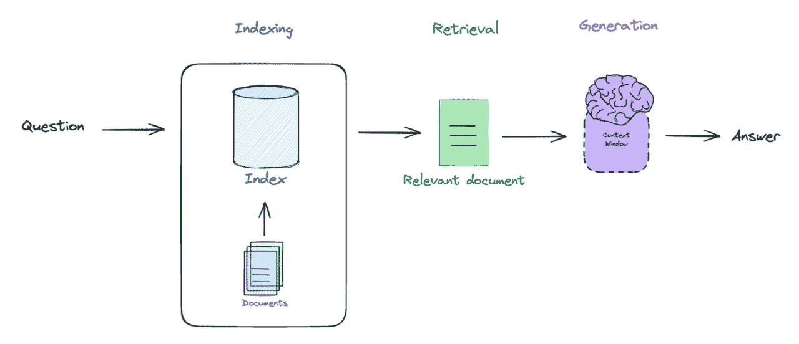

### **请求转换**

请求转换是为了提高查询结果的准确性而对用户请求进行重构、优化的过程。

**为什么需要RAG？**

> **问题1**：**LLM**s并不了解你的数据，且无法获取与此相关的最新数据，它们是事先使用来自互联网的公共信息训练好的，因此并不是专有数据库的专家也不会针对该数据库进行更新。

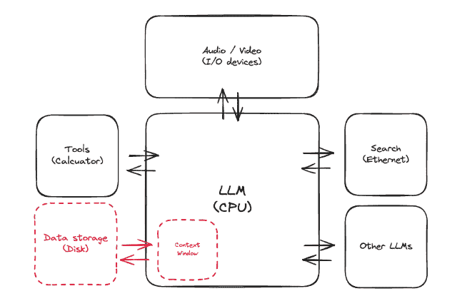

> **问题2****：**上下文窗口-每个**LLM**都有一个**tokens**的最大限制(通常平均为100tokens，约75个单词)，用于限制用户每次提交的tokens数据，这会导致丢失上下文窗口之外的上下文，进而影响准确性、产生检索问题和幻觉等。

> **问题3**：[中间遗失](https://cloud.tencent.com/developer/tools/blog-entry?target=https%3A%2F%2Farxiv.org%2Fabs%2F2307.03172%3Futm_source%3Ddiv.beehiiv.com%26utm_medium%3Dreferral%26utm_campaign%3Drag-say-what&source=article&objectId=2403938)-即使LLMs可以一次性接收所有的数据，但它存在[根据](https://cloud.tencent.com/developer/tools/blog-entry?target=https%3A%2F%2Farxiv.org%2Fabs%2F2307.03172%3Futm_source%3Ddiv.beehiiv.com%26utm_medium%3Dreferral%26utm_campaign%3Drag-say-what&source=article&objectId=2403938)信息在文档中的位置来检索信息的问题。研究表明如果相关信息位于文档中间(而非开头或结尾时)时就会导致严重的性能降级。

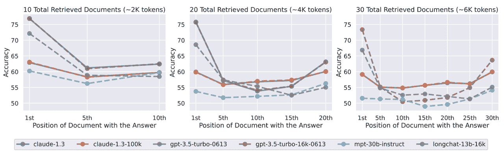

> **因此，我们需要RAG。**

#### **请求转换**

##### **请求分解**

> 由于用户问题可能太含糊、太特殊或缺少上下文，因此LLM可能无法很好地处理这些问题。通常会建议在将请求发送到嵌入模型之前对其进行重构。下面是一些重构方式：

> [**重写-检索-读取**](https://cloud.tencent.com/developer/tools/blog-entry?target=https%3A%2F%2Farxiv.org%2Fabs%2F2305.14283%3Futm_source%3Ddiv.beehiiv.com%26utm_medium%3Dreferral%26utm_campaign%3Drag-say-what&source=article&objectId=2403938)**:** 这种[方式](https://cloud.tencent.com/developer/tools/blog-entry?target=https%3A%2F%2Farxiv.org%2Fabs%2F2305.14283%3Futm_source%3Ddiv.beehiiv.com%26utm_medium%3Dreferral%26utm_campaign%3Drag-say-what&source=article&objectId=2403938)**注重对用户的查询进**行**重构(而不仅**仅是采用retrieve**r或r**eader，左侧图示)**。它使****用一个LLM生成**一个查询，然后使用web查询引擎来检索内容(中间图示)。此外还需要在pipeline中使用一个小型语言模型来进一步对齐结果

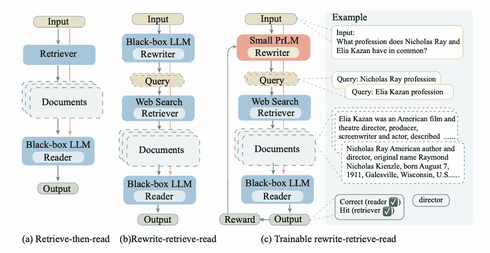

[**对问题进行浓缩或改写**](https://cloud.tencent.com/developer/tools/blog-entry?target=https%3A%2F%2Fsmith.langchain.com%2Fhub%2Flangchain-ai%2Fweblangchain-search-query%3Futm_source%3Ddiv.beehiiv.com%26utm_medium%3Dreferral%26utm_campaign%3Drag-say-what%26tab%3D0&source=article&objectId=2403938)**：**通常用于会话中，通过把**对话改写成一个好的**独立问题来给聊天机器人提供上下文。Langchain的一个提示模板示例如下：

```
&quot;Given the following conversation and a follow up question, rephrase the follow up \ question to be a standalone question.

Chat History: {chat_history}
Follow Up Input: {question}
```

> **RAG Fusion**: 将**RAG**和倒数排名融合([RRF](https://cloud.tencent.com/developer/tools/blog-entry?target=https%3A%2F%2Farxiv.org%2Fabs%2F2402.03367%3Futm_source%3Ddiv.beehiiv.com%26utm_medium%3Dreferral%26utm_campaign%3Drag-say-what&source=article&objectId=2403938))结合。生成多个**查询**(从多个角度添加上下文)，并使用倒数分数对查询结果重新排序，然后将文档和分数进行融合，从而得到更全面和准确的回答。

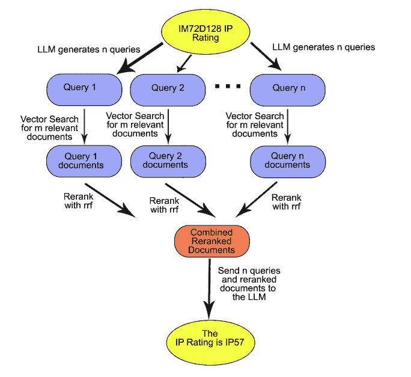

> **Ste****p-Back Prompti**ng：这是一种**更加技术性的**提示技术，通过LLM的抽象来衍生出更高层次的概念和首要原则。这是一个对用户问题的迭代过程，用于生成一个"后退一步"的问题(step back question)，然后使用该问题对应的回答来生成最终的回答。

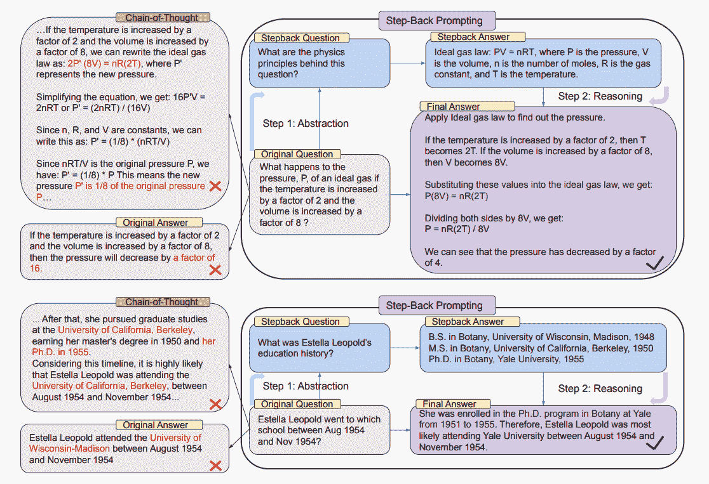

> **Query Expansion**：这是一个通过为**LLM****提供一个**查询并生成新的内容来扩展查询的过程。适用于文档检索，特别是Chain-of-Thought(CoT 思维链)提示。

> **使用生成的答案进行扩展**：该方式中，让LLM基于我们的查询生成一个假设的回答，然后将该回答追加到我们的查询中，并执行嵌入搜索。通过使用假设的答案来扩展查询，这样在进行嵌入搜索时可以检索到其他相关向量空间，进而可以提供更准确的回答。

> **使用多个查询进行扩展**：使用LLM基于我们的查询来生成额外的类似查询[，然后将这](https://cloud.tencent.com/product/vdb?from_column=20065&from=20065)**些额**外的查询和原始查询一起传给向量数据库进行检索，从而可以大大提升准确性。注意需要通过对提示进行迭代来评估哪些提示会产生最佳结果。

##### 伪文档(Psuedo documents)

**伪文档嵌入 (HyDE)**：当向**向量数据库**询问问题时，该数据库有可能不会很好地标记相关性。因此**更好**的方式是先创建一个假设的回答，然后再查询匹配的向量。

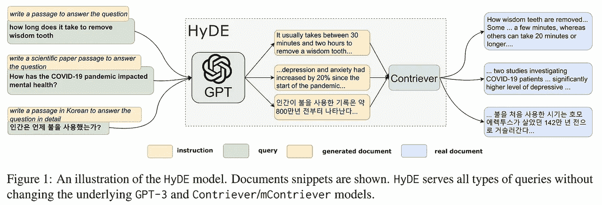

> 作为**RAG**流程的第一个步骤，**查询转换**并不存在**正确**或**错误****的方**式。这是一个带有实验性质的领域，只有通过构建才能知道哪些方式最适合你的使用场景 。

### [**路由和请求构造**](https://cloud.tencent.com/developer/tools/blog-entry?target=https%3A%2F%2Fdiv.beehiiv.com%2Fp%2Frouting-query-construction&source=article&objectId=2403938)

#### **路由**

路由为了将请求发送到与与请求内容相关的存储。

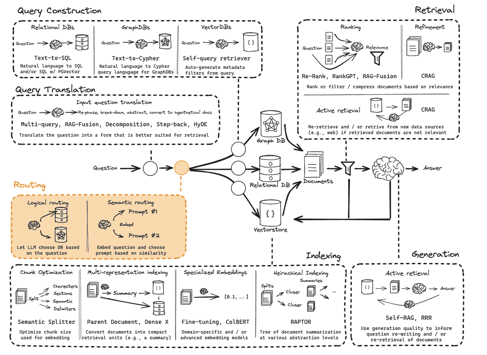

由于环境中可能存在多个**数据库**和**向量存储****，而答案可能位于其中其**中任何**一个，因**此**需要对查询进**行路由。基于用户查询和预定义的选择，LLM可以决定：

+    正确的数据源

+    需要执行的动作：例如，**概括** vs **语义搜索**

+    是否并行执行**多个选择**，并校对结果([多路由功能](https://cloud.tencent.com/developer/tools/blog-entry?target=https%3A%2F%2Fflight.beehiiv.net%2Fv2%2Fclicks%2FeyJhbGciOiJIUzI1NiIsInR5cCI6IkpXVCJ9.eyJ1cmwiOiJodHRwczovL2RvY3MubGxhbWFpbmRleC5haS9lbi9zdGFibGUvbW9kdWxlX2d1aWRlcy9xdWVyeWluZy9yb3V0ZXIvcm9vdC5odG1sP3V0bV9zb3VyY2U9ZGl2LmJlZWhpaXYuY29tJnV0bV9tZWRpdW09cmVmZXJyYWwmdXRtX2NhbXBhaWduPXJvdXRpbmctYW5kLXF1ZXJ5LWNvbnN0cnVjdGlvbiIsInBvc3RfaWQiOiJmMjBjYTYxMy1jYWQ3LTQzNzktOWVlMy1hNzY2YWZkMGY2NTkiLCJwdWJsaWNhdGlvbl9pZCI6IjQ5NjYzOGM1LTY5ZWQtNDdiZS1hNzllLTgxZDVhZGRmNWYwNCIsInZpc2l0X3Rva2VuIjoiNDgxYmZmOTAtZjY0ZC00YWU0LTk0OTMtMjg1ZjcyN2Q2Y2VjIiwiaWF0IjoxNzEwNzUwMzM5LCJpc3MiOiJvcmNoaWQifQ.yHvmWg9TdPGOwiu6Q3z849jjbMYCOhHDIo1sDjbX-Bw&source=article&objectId=2403938))

**下面是一些路由请求的方式：**

> **逻辑路由**：在这种情况下，我们让LLM根据预定义的路径来决定参考知识库的哪个部分。这对于创建非确定性链非常有用，一个步骤的输出产生下一个步骤。该方式用于通过LLM来选择知识库。

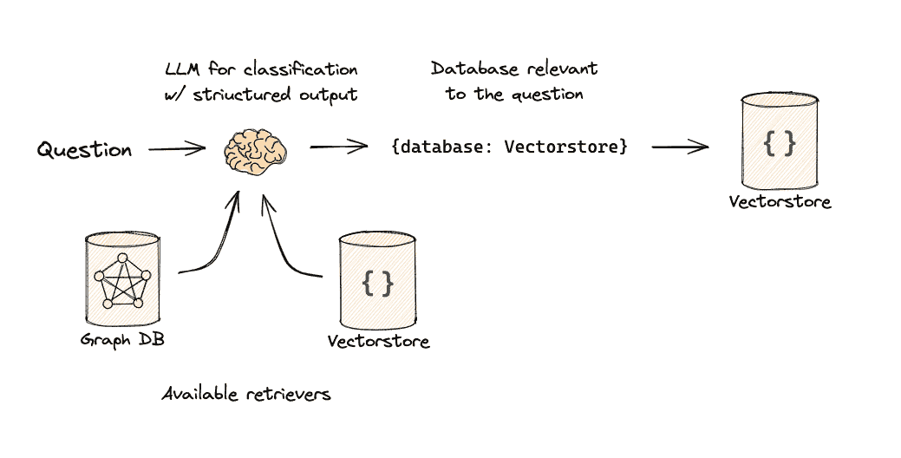

下面是一个逻辑路由的[例子](https://cloud.tencent.com/developer/tools/blog-entry?target=https%3A%2F%2Fgithub.com%2Flangchain-ai%2Frag-from-scratch%2Fblob%2Fmain%2Frag_from_scratch_10_and_11.ipynb&source=article&objectId=2403938)，用于根据用户的编程语言来选择合适的数据源：

```
from typing import Literal

from langchain_core.prompts import ChatPromptTemplate
from langchain_core.pydantic_v1 import BaseModel, Field
from langchain_openai import ChatOpenAI

# Data model
class RouteQuery(BaseModel):
    &quot;&quot;&quot;Route a user query to the most relevant datasource.&quot;&quot;&quot;

    datasource: Literal[&quot;python_docs&quot;, &quot;js_docs&quot;, &quot;golang_docs&quot;] = Field(
        ...,
        description=&quot;Given a user question choose which datasource would be most relevant for answering their question&quot;,
    )

# LLM with function call 
llm = ChatOpenAI(model=&quot;gpt-3.5-turbo-0125&quot;, temperature=0)
structured_llm = llm.with_structured_output(RouteQuery)

# 构造提示，根据用户问题中的编程语言类型类选择合适的数据源
system = &quot;&quot;&quot;You are an expert at routing a user question to the appropriate data source.

```

> 下面是使用方式。用户给出**question**，然后调用**router.invoke**让LL**M找出合适的数据源，最**终会在result.datasource中返回python_docs。

```
question = &quot;&quot;&quot;Why doesn&#x27;t the following code work:

from langchain_core.prompts import ChatPromptTemplate

prompt = ChatPromptTemplate.from_messages([&quot;human&quot;, &quot;speak in {language}&quot;])
prompt.invoke(&quot;french&quot;)
&quot;&quot;&quot;

result = router.invoke({&quot;question&quot;: question})
```

> **语义路由**：使用**基于上下文****的提示来**增强用户查询的强大方法。可**以帮助**L**LMs快速**、经济地选择路由(可以**预定义或自定义选项)，产生确**定性的结果。该方式用于通过LLM选择提示。

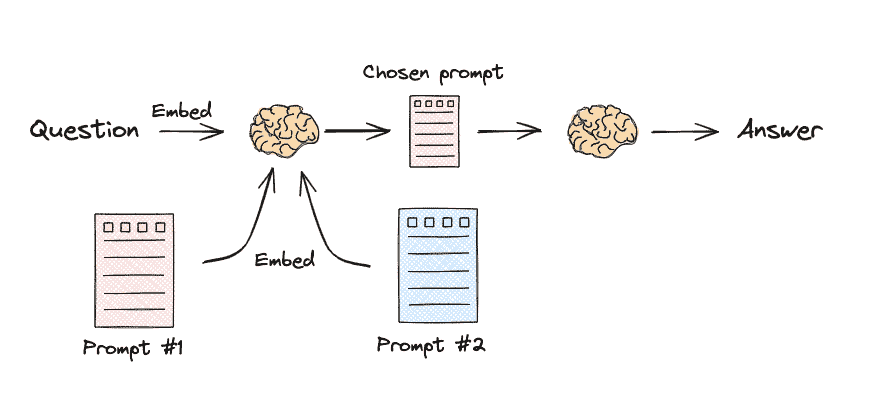

下面是一个使用语义路由的例子，它嵌入了两个提示模板，分别用于处理物理和数学问题，然后通过匹配用户问题和提示模板的相似性程度来选择合适的提示模板，然后应用到LLM中。

```
from langchain.utils.math import cosine_similarity
from langchain_core.output_parsers import StrOutputParser
from langchain_core.prompts import PromptTemplate
from langchain_core.runnables import RunnableLambda, RunnablePassthrough
from langchain_openai import ChatOpenAI, OpenAIEmbeddings

# 创建两个提示模板，一个用于解决物理问题，另一个用于解决数学问题
```

#### **请求构造**

请求构造是为了解决针对**特定类型数据库查询**的问题。

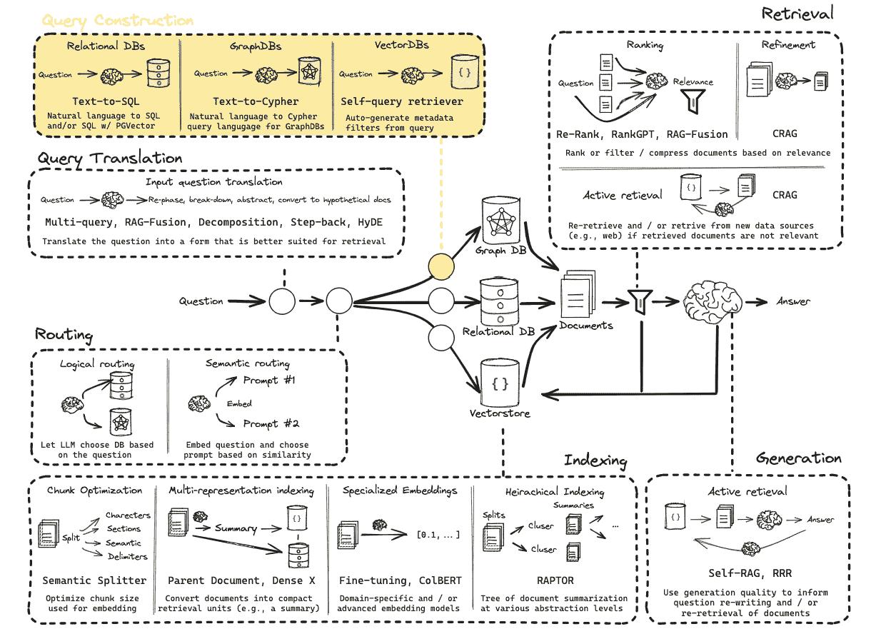

> 在定义好路由之后是否就可以跨[**数据存储**](https://cloud.tencent.com/product/cdcs?from_column=20065&from=20065)发送请求？如果使用的是**非结构化数据****存储就可以，**但实际中，大部分数据都保存在结构化数据库中，因此在构造请求的同时需要考虑到数据库的类型。

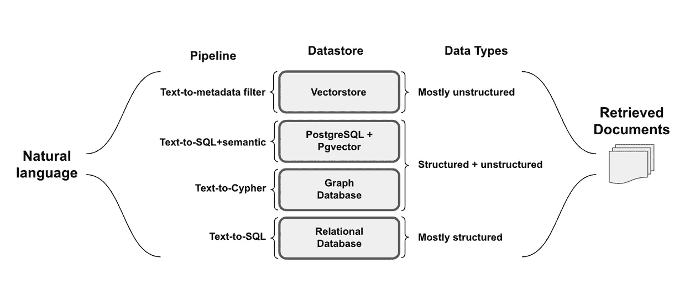

> 我们很容易会假设和**LLMs****交互**使用的是自然语言，但这**是不对的****，查询采**用的语言**类型取**决[**于和数据存储**](https://cloud.tencent.com/product/cdb-overview?from_column=20065&from=20065)的交互方式，因此在构建查询时需要牢记数据库的查询语言(从使用SQL的关系型数据库到使用相关结构化元数据的非结构化数据)。

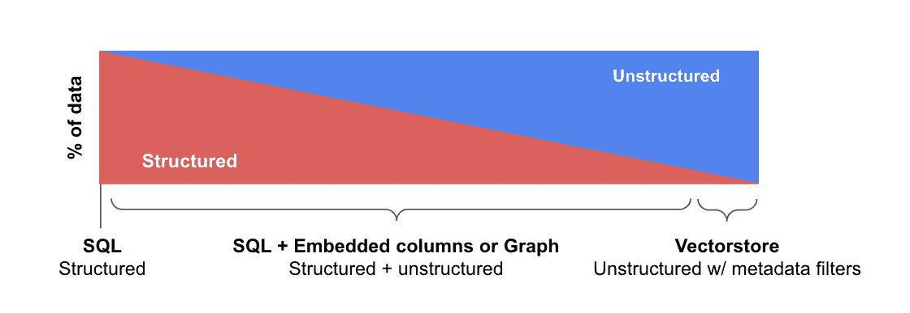

**A** **自**查询检索器-Self-query retriever (文本->元数据的过滤器)：

> 向量数据库中带有**清晰元数据文件**的非结构化数据可以启用此类**retriever****。任**何用户**问题(****自然语**言格式)都可以被拆分为一个查询和一个过滤器(如根据年、电影、艺术家)。通过提升发送到LLM的数据质量，可以大大提升Q&A的工作流表现。

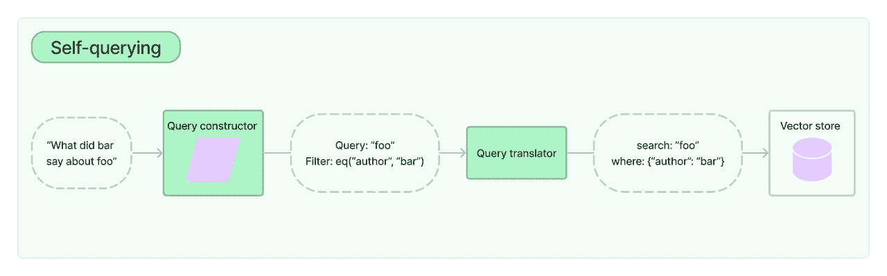

**B** **文本-> SQL:** 通常**LLMs**对**Text2SQL**的表现不佳，去年有很多初创公司就将焦点放在如何解决此类问题上。

> 从创建虚构的**表**和**字段**到用户查询中的**拼写**错误等原因都可能导致**LLMs****执行失**败。鉴于**这种数**据**库相**当**普遍**，**因此**出**现了很多帮助LLM准**确创建SQL查询的方式，但都与特定的知识库相关，因此不存在可以用于多种数据库的通用方式。对于一个新的数据库，只能通过构建、迭代、修复来优化LLMs的表现。

> Create Table + Sel**ect  3****：在了解更多高级技术之前**，这是获得模型**在数据库上的**表现基线的最直接的方法。在Prompt设计中，对于每张表，可以包括一个CREATE TABLE描述，并在一个SELECT语句中提供三个示例行。

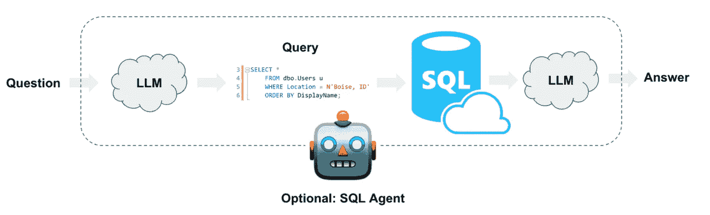

> ** **[**少量样本示例**](https://cloud.tencent.com/developer/tools/blog-entry?target=https%3A%2F%2Fflight.beehiiv.net%2Fv2%2Fclicks%2FeyJhbGciOiJIUzI1NiIsInR5cCI6IkpXVCJ9.eyJ1cmwiOiJodHRwczovL2FyeGl2Lm9yZy9hYnMvMjMwNS4xMjU4Nj91dG1fc291cmNlPWRpdi5iZWVoaWl2LmNvbSZ1dG1fbWVkaXVtPXJlZmVycmFsJnV0bV9jYW1wYWlnbj1yb3V0aW5nLWFuZC1xdWVyeS1jb25zdHJ1Y3Rpb24iLCJwb3N0X2lkIjoiZjIwY2E2MTMtY2FkNy00Mzc5LTllZTMtYTc2NmFmZDBmNjU5IiwicHVibGljYXRpb25faWQiOiI0OTY2MzhjNS02OWVkLTQ3YmUtYTc5ZS04MWQ1YWRkZjVmMDQiLCJ2aXNpdF90b2tlbiI6IjQ4MWJmZjkwLWY2NGQtNGFlNC05NDkzLTI4NWY3MjdkNmNlYyIsImlhdCI6MTcxMDc1MDMzOSwiaXNzIjoib3JjaGlkIn0.idZ2UxiXfgFV3pCOdpvacl4EqoSU2uPXNd2oEGpnBws&source=article&objectId=2403938)：为**LLM**提供少量**Q&A**示例来帮助它理解如何构建请求，通过这**种方式可以**提**升10~1**5%的准确性。根据示例的质量和使用的模型，添加更多的示例可以获得更高的准确性。在有大量示例的情况下，可以将其保存在向量存储中，然后通过对输入查询进行语义搜索，动态选择其中的一部分。

> ** ****RAG + **Fine-tuning：相比**于只是为了让语言模型**能**够理解**而将整个schema添加到提示中，使用经过调优的schema RAG和ICL的模型可以将准确性提高20%以上。

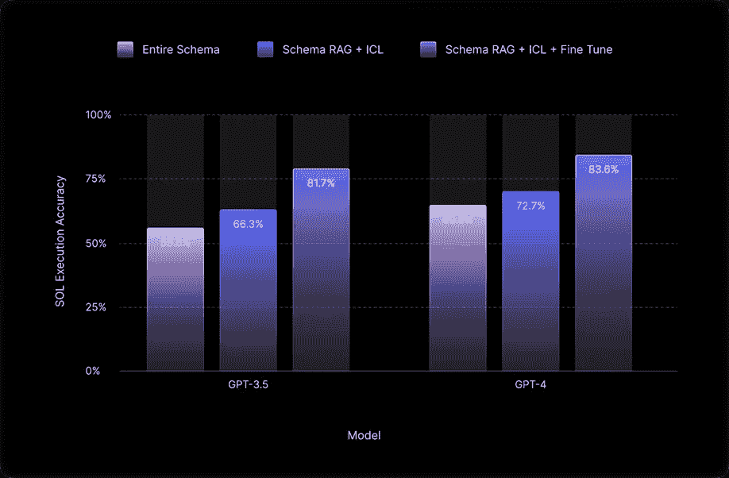

> **用户拼写错误****：通过搜****索合适的名词而不**是使用包含正确拼写的向量存储，是减少用户特定错误的一种好方法。这在早期的Text2SQL中是一个特别令人烦恼的问题。

**C** **文本-> Cyphe**r：与图数据库有关，用于表达无法使用表格形式表示的关系。

> **Cypher**是这类数据库的查询语言。text-2-Cypher 是一项复杂的任务，对于此类任务，推荐使用GPT4。

> **知识图谱可以**[**有效**](https://cloud.tencent.com/developer/tools/blog-entry?target=https%3A%2F%2Farxiv.org%2Fabs%2F2311.07509%3Futm_source%3Ddiv.beehiiv.com%26utm_medium%3Dreferral%26utm_campaign%3Drouting-and-query-construction&source=article&objectId=2403938)**提高检索的准确性**，因此数据格式不应该局限于**表**和**2D结构**。

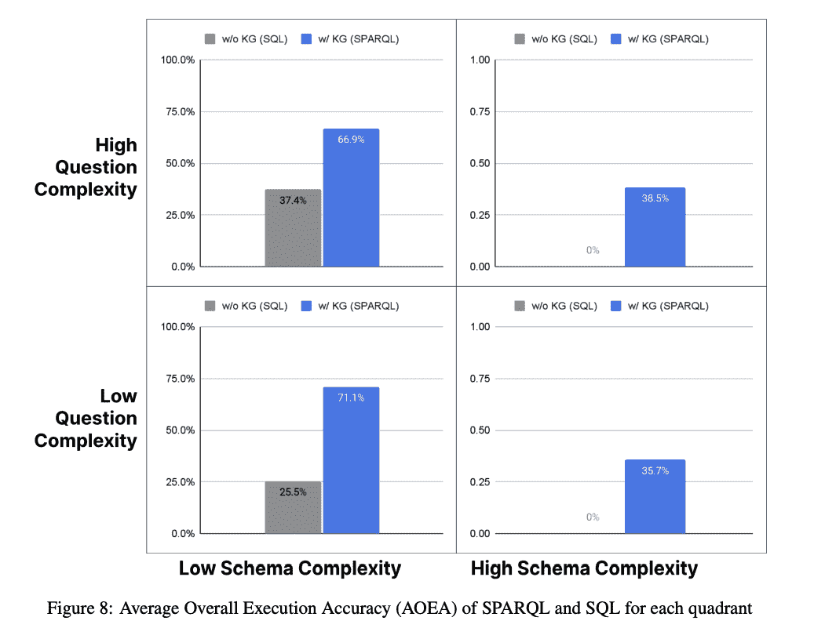

下面是构造请求的[例子](https://cloud.tencent.com/developer/tools/blog-entry?target=https%3A%2F%2Fblog.langchain.dev%2Fquery-construction%2F%3Futm_source%3Ddiv.beehiiv.com%26utm_medium%3Dreferral%26utm_campaign%3Drouting-and-query-construction&source=article&objectId=2403938)：**Examples** **Data source** **References**     Text-to-metada[**ta-f**](https://cloud.tencent.com/developer/tools/blog-entry?target=https%3A%2F%2Fpython.langchain.com%2Fdocs%2Fmodules%2Fdata_connection%2Fretrievers%2Fself_query%2F%3Fref%3Dblog.langchain.dev%23constructing-from-scratch-with-lcel&source=article&objectId=2403938)ilt**er Vectorst**ores Doc[**s   **](https://cloud.tencent.com/developer/tools/blog-entry?target=https%3A%2F%2Fpython.langchain.com%2Fdocs%2Fuse_cases%2Fqa_structured%2Fsql%3Fref%3Dblog.langchain.dev&source=article&objectId=2403938)**T**e[**xt-t**](https://cloud.tencent.com/developer/tools/blog-entry?target=https%3A%2F%2Fblog.langchain.dev%2Fllms-and-sql%2F&source=article&objectId=2403938)**o**-[**SQL **](https://cloud.tencent.com/developer/tools/blog-entry?target=https%3A%2F%2Fblog.langchain.dev%2Fincorporating-domain-specific-knowledge-in-sql-llm-solutions%2F&source=article&objectId=2403938)SQL[** DB Docs**](https://cloud.tencent.com/developer/tools/blog-entry?target=https%3A%2F%2Fgithub.com%2Flangchain-ai%2Flangchain%2Fblob%2Fmaster%2Fcookbook%2Fretrieval_in_sql.ipynb%3Fref%3Dblog.langchain.dev&source=article&objectId=2403938), b**log, blog   Te**xt-t**o**-SQL+** **Semantic PGVecvtor supported SQL DB Cookbook   Text-to-Cypher Graph databases Blog, Blog, Docs

### [**索引**](https://cloud.tencent.com/developer/tools/blog-entry?target=https%3A%2F%2Fdiv.beehiiv.com%2Fp%2Fadvanced-rag-series-indexing&source=article&objectId=2403938)

> 在LLM中，文档会以**chunk**进行切分，**索引**用于**找到与查询相关的chunk**

> **chunk****划分**和**嵌入**是实现准确检索的**索引核心部分**。简单来说，**嵌入向量**是将一个大而复杂的**数据集****转化**为一组能**够捕捉所****嵌入的数**据本质的数字。这样就可以将用户请求转化为一个嵌入向量(一组数字)，然后基于语义相似性来检索信息。它们在高纬度空间的呈现如下(相似的词的距离相近)：

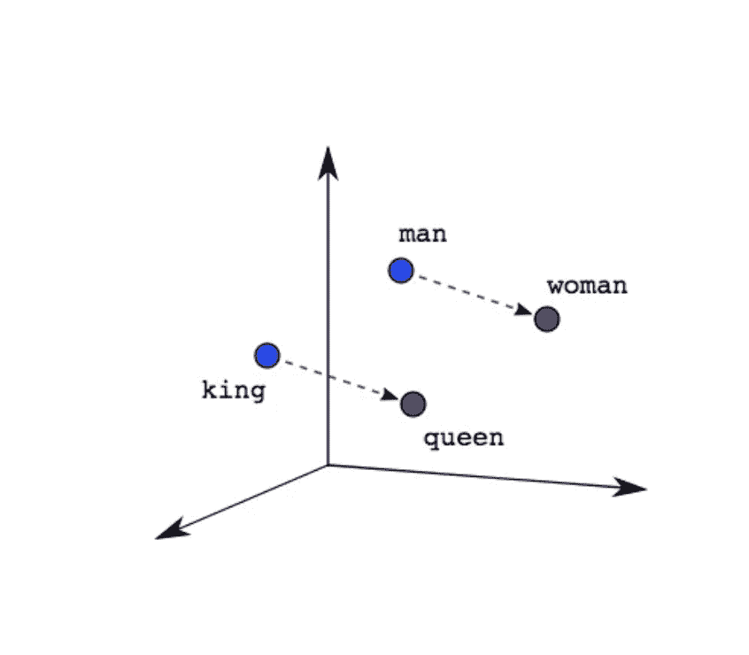

> 回到**chunk划分**，为了方便理解，假设有一个大型文档，如电子书**。你希望**从**这本书中解**答问题，但由于它远**超L****LMs****的上下文窗口，我们**可能需要对其分块，然后将于用户问题相关的部分提供给LLM。而当执行分块时，我们不希望因为分块而丢失故事的角色上下文，此时就会用到索引。

**下面是一些索引方式：**

#### **chunk优化**

+   首先需要考虑数据本身的长度，它定义了chunk的划分策略以及使用的模型。例如，如果要嵌入一个句子，使用sentence transformer可能就足够了，但对于大型文档，可能需要根据tokens来划分chunk，如使用 text-embedding-ada-002。

+   其次需要考虑的是这些嵌入向量的最终使用场景。你需要创建一个Q&A机器人？一个摘要工具？还是作为一个代理工具，将其输出导入到其他LLM中进一步处理？如果是后者，可能需要限制传递到下一个LLM的上下文窗口的输出长度。

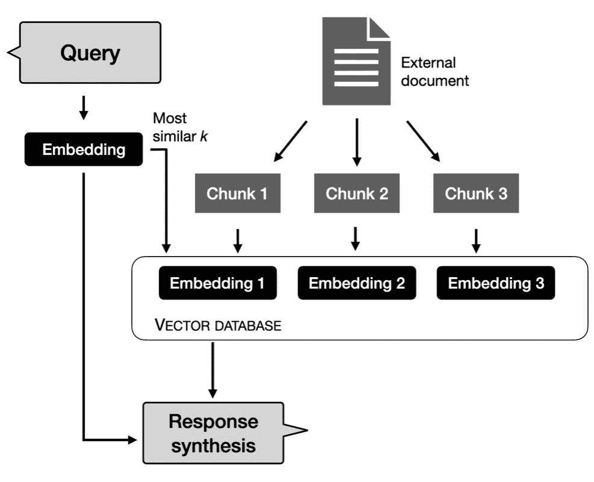

**下面提供了几种实现策略：**

##### **基于规则**

使用分隔符(如空格、标点符号等)来切分文本：

+    **固定长度**：最简单的方式是根据固定数目的**字符**来划分**chunk**。在这种方式下，缓解**上下文遗失**的方式是**在每个chunk中**添加重[叠的](https://cloud.tencent.com/developer/tools/blog-entry?target=https%3A%2F%2Fgithub.com%2FFullStackRetrieval-com%2FRetrievalTutorials%2Fblob%2Fmain%2Ftutorials%2FLevelsOfTextSplitting%2F5_Levels_Of_Text_Splitting.ipynb&source=article&objectId=2403938)部分(可自定义)。但这种方式并不理想，可以使用langchain的CharacterTextSplitter进行测试：

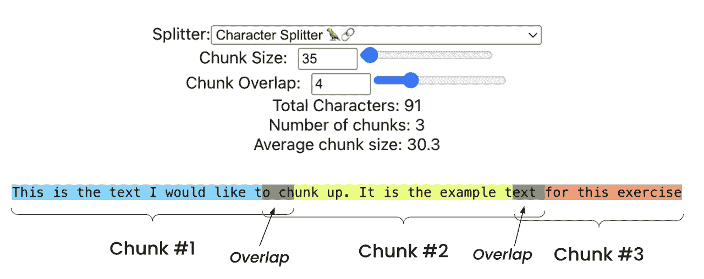

然后是所谓的结构**感知拆分器**，即基于**句子**、**段落**等划分**chunk**。

+    **NLTK语句分词器****(**Sentence [Tokenizer](https://cloud.tencent.com/developer/tools/blog-entry?target=https%3A%2F%2Fwww.youtube.com%2Fwatch%3Fapp%3Ddesktop%26v%3DvyyTpL8QKgc%26utm_source%3Ddiv.beehiiv.com%26utm_medium%3Dreferral%26utm_campaign%3Dadvanced-rag-series-indexing&source=article&objectId=2403938)**)****：将给定**的文本切分为语句。这种方式虽然简单，但仍然受限于对底层文本的语义理解，即便在一开始的测试中表项良好，但在上下文跨多个语句或段落的场景下仍然不理想(而这正是我们希望LLM查询的文本)。

> [**Spacy**](https://cloud.tencent.com/developer/tools/blog-entry?target=https%3A%2F%2Fashutoshtripathi.com%2F2020%2F05%2F04%2Fhow-to-perform-sentence-segmentation-or-sentence-tokenization-using-spacy-nlp-series-part-5%2F%3Futm_source%3Ddiv.beehiiv.com%26utm_medium%3Dreferral%26utm_campaign%3Dadvanced-rag-series-indexing&source=article&objectId=2403938)**语句分割器(****S**enten**ce Split****ter)**：另一种是基于语句进行拆分，在希望引用小型chunks时有用。但仍存在和NLTK类型的问题。

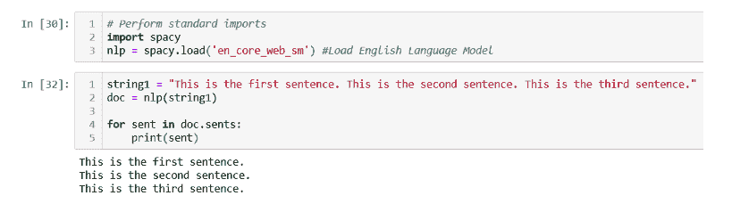

##### **递归结构感知拆分(Recursive struct**ure aware splitting)

> **结合固定长度和结构****感知策略可以得到**递归结构感**知拆分策**略。L**angch**ain文档中大量采用**了这种方式，其好**处是可以更好地控制上下文。为了方便语义搜索，此时chunk大小不再相等，但仍然不适合结构化数据。

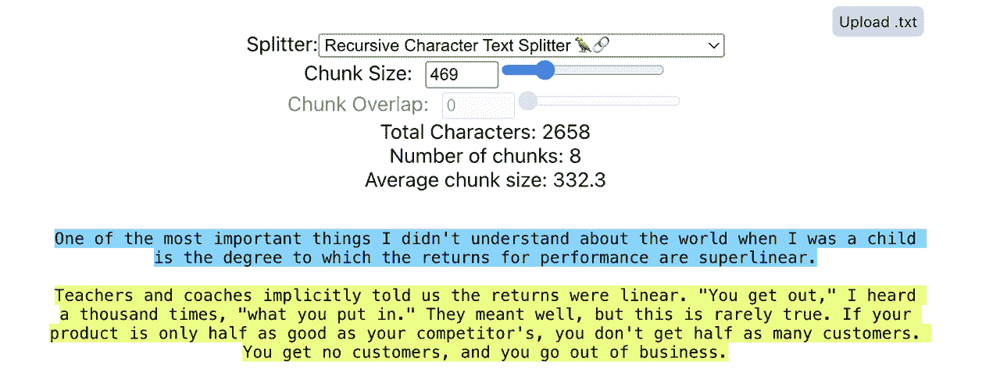

##### **内容感知拆分**

> **对于非结构化数**据来说，上面几种策略可能就足**够了**，但对于结构化数据，就需**要根据结构本身类**型**进行拆分。**这**就是为什**么有专门用**于Ma**rkdown、LaTeX、HTML、带表格的pdf、多模式(即文本+图像等)的文本拆分器。

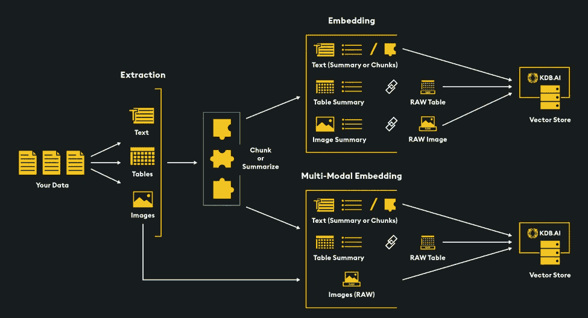

#### **多表示索引**

> **相比于将整**个文档进行拆分，然后根据语义相似性检索出 top-k的结果，那如果将文本转换为压缩的检索单元会怎样？例如，压缩为摘要。

##### [**父文档**](https://cloud.tencent.com/developer/tools/blog-entry?target=https%3A%2F%2Fclusteredbytes.pages.dev%2Fposts%2F2023%2Flangchain-parent-document-retriever%2F%3Futm_source%3Ddiv.beehiiv.com%26utm_medium%3Dreferral%26utm_campaign%3Dadvanced-rag-series-indexing&source=article&objectId=2403938)**  **(Parent Document)

> 这种场景下可以根据用户的请求**检索**到最相关的**chunk**并传递该chunk所属的**父文档****，而不**是仅仅将某个chunk**传递给LLM。通过这**种方式可**以提升**上下文并增**强检索能****力。但如果父文档比**L**LM的上下文窗口还**要大怎么办？为了**匹配上下文窗口，我们可**以将较大的chunks和较小的chunks一起传递给LLM(而不是整个父文档)。

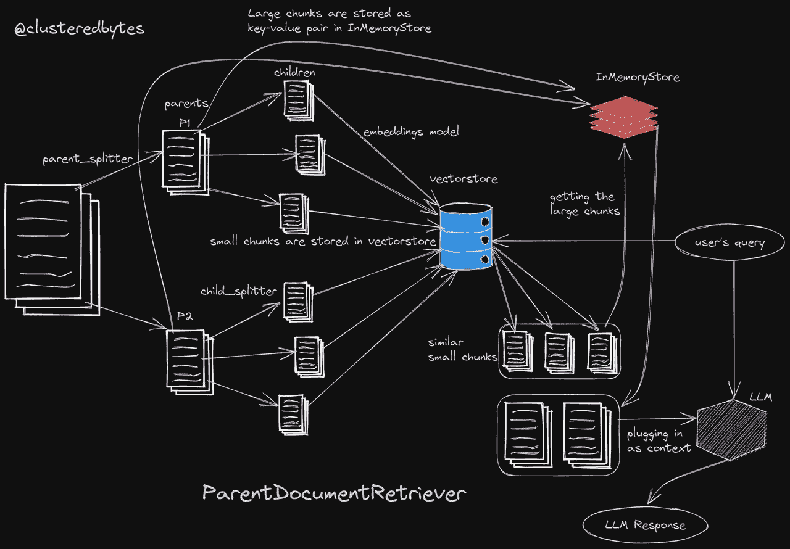

上面**vectorstores**中存储的是较小的 **chunks**，使用**InMemoryStore**存储**较大的 chunk**。

> 在使用时文档会被分为**大小两种****chunk**，其中**小chunk**都有其所属的**大chunk**。由于"chunk越小，**其表达的语义精确性更高**"，因此在查询时，首先检索到较小的chunk，而较小的chunk的元数据中保存了其所属的大chunk，因而可以将小chunk和其所属的大chunk一起传递给LLM。

##### 密集检索(Dense X Retrieval)

密集检索是一种使用**非语句**或**段落chunk**进行**上下文检索**的新方法。在下面[论文](https://cloud.tencent.com/developer/tools/blog-entry?target=https%3A%2F%2Farxiv.org%2Fpdf%2F2312.06648.pdf%3Futm_source%3Ddiv.beehiiv.com%26utm_medium%3Dreferral%26utm_campaign%3Dadvanced-rag-series-indexing&source=article&objectId=2403938)中，作者将其称之为"**proposition**"，一个proposition包含：

+   文本中的不同含义：需要捕获这些含义，这样所有propositions一起就能在语义上覆盖整个文本。

+   最小单元：即不能再进一步拆分propositions。

+   上下文相关和自包含：即每个propositions应该包含所有必需的上下文。

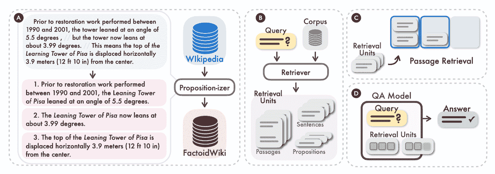

**Proposition级**级别的检索比**语句级**别的检索和**篇章级**别的检索分别高35%和22.5%(显著提高)。

#### **特定嵌入**

**领域特定** & **高级嵌入**模型。

+   ** Fine-tuning**：对**嵌入模型**进行微调可以帮助改进**RAG pipeline****检索**相关文档的能力。这里，我们使用**LLM**生成的查询、文本语料库以及两者之间的交叉参考**映射来磅**数嵌入模[型理解需要查找的语料](https://cloud.tencent.com/developer/tools/blog-entry?target=https%3A%2F%2Ftwitter.com%2Fjerryjliu0%2Fstatus%2F1702111739549192512%3Fref_src%3Dtwsrc%255Etfw%257Ctwcamp%255Etweetembed%257Ctwterm%255E1702111739549192512%257Ctwgr%255E20f772fc032debe35c32d983dae803dd325ddf11%257Ctwcon%255Es1_%26ref_url%3Dhttps%253A%252F%252Fdiv.beehiiv.com%252Fp%252Fadvanced-rag-series-indexing&source=article&objectId=2403938)库。微调嵌入模型可以帮助提升大约5~10%的表现。
 下面是Jerry Liu对微调嵌入模型的建议：

1.  **在项目开**始时**，需**要在嵌入文档前对基础模型进行微调

1.  **由于生**产**环境中的文档分布可能会发生**变化，因**此在微调查询适配器(quer**y adapter)时需要确保嵌入的文档不会发生变化。

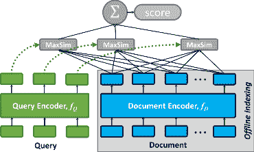

+   ** **[**ColBERT**](https://cloud.tencent.com/developer/tools/blog-entry?target=https%3A%2F%2Fgithub.com%2Fstanford-futuredata%2FColBERT%3Futm_source%3Ddiv.beehiiv.com%26utm_medium%3Dreferral%26utm_campaign%3Dadvanced-rag-series-indexing&source=article&objectId=2403938)：这是一个检索模型，它能够基于**BERT**在大规模数据集上实现可扩展的**搜索**(毫秒级别)。这里，快速和准确**检索**是关键。
 它会将每个**段落编码为**toke**n级****嵌入的矩阵**(如下蓝色所示)。当执行一个搜索时，它会将用户查询编码为另**一个to**ken级嵌入的矩阵(如上绿色所示)。然后基于上下文匹使用"可扩展的向量相似性(MaxSim)操作"来匹配查询段落。

#### **分层索引**

> [**斯坦福大学研**](https://cloud.tencent.com/developer/tools/blog-entry?target=https%3A%2F%2Farxiv.org%2Fhtml%2F2401.18059v1%3Futm_source%3Ddiv.beehiiv.com%26utm_medium%3Dreferral%26utm_campaign%3Dadvanced-rag-series-indexing&source=article&objectId=2403938)究人员基于不同层次的文**档摘**要树提出了RAPTOR**模型**，即通过对文本块的聚类进行**摘要来**实现更准确的检索。文本摘要涵盖了更大范围的上下文，跨越不同的尺度，包括主题理解和细粒度的内容。检索增强的文本摘要涵盖了更大范围不同主题理解和粒度的上下文。

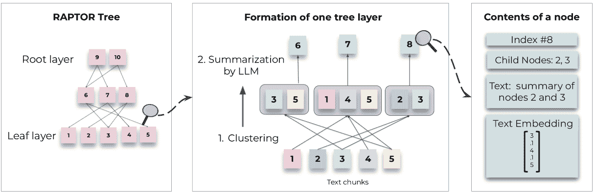

> 通过**递归**摘要进行**检索**可以显著提升模型表现。"在涉及**复杂多步骤推理****的问答任务中**，我们**展示了最佳**结果。例如，通过将**RAPTOR检**索与GPT-4相结合，我们可以在QuALITY基准测试的最佳表现上提高20%的绝对准确率。"

**llamaindex****提供了这种**[**实现**](https://cloud.tencent.com/developer/tools/blog-entry?target=https%3A%2F%2Fgithub.com%2Frun-llama%2Fllama_index%2Fblob%2Fmain%2Fllama-index-packs%2Fllama-index-packs-raptor%2Fexamples%2Fraptor.ipynb&source=article&objectId=2403938)**。**

### [**检索**](https://cloud.tencent.com/developer/tools/blog-entry?target=https%3A%2F%2Fdiv.beehiiv.com%2Fp%2Fadvanced-rag-series-retrieval&source=article&objectId=2403938)

> 检索可以看做是对索引到的数据的进一步提炼。

> 在完成**数据检索**之后，下一步需要根据用户的请求来获**取相**关数据。**最常见和最**直接的方法**是从**之前索引的数据(最近的邻居**)中识别并获**取与用[户查](https://cloud.tencent.com/developer/tools/blog-entry?target=https%3A%2F%2Fweaviate.io%2Fblog%2Fdistance-metrics-in-vector-search%3Futm_source%3Ddiv.beehiiv.com%26utm_medium%3Dreferral%26utm_campaign%3Dadvanced-rag-series-retrieval&source=article&objectId=2403938)询在语义上最接近的chunks。类似如下向量空间：

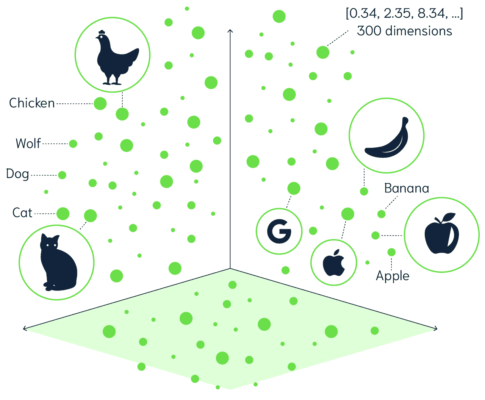

**检索**并不是一步到位的，而是从**查询****转换**开始的一系列步骤，**以及如何通过**检索来**提升获取**到相关的chunk**s之后的检**索质量。假设我们已经根据**相似性****搜****索，从向量数****据库中找到前 k **个 chunks，但由于大部分chunks存在重复内容或无法适应LLM的上下文窗口。因此在将chunks传递给LLM之前，我们需要通过一些检索技术来提升上下文的质量。

**LLMs**的**世界中，并不****存在一劳**永逸的方法，需要根据使用场景和chunks的特性来找到合适的技术。下面是一些典型的方法：

#### **Ranking**

##### Prompt Compression

##### **RAG-fusion**

####

#### **Ranking**

如果我们想要从数据库的**chunk**中查找答案，可以选择**Reranking**，它是一种可以给LLM提供最相关上下文的有效策略。有多种实现方式：

+    提升多样性：最常见的方法是[**最大边缘相关性**](https://cloud.tencent.com/developer/tools/blog-entry?target=https%3A%2F%2Fwww.cs.cmu.edu%2F~jgc%2Fpublication%2FThe_Use_MMR_Diversity_Based_LTMIR_1998.pdf%3Futm_source%3Ddiv.beehiiv.com%26utm_medium%3Dreferral%26utm_campaign%3Dadvanced-rag-series-retrieval&source=article&objectId=2403938)(Maximum [**Marginal**](https://cloud.tencent.com/developer/tools/blog-entry?target=https%3A%2F%2Ftowardsdatascience.com%2Fenhancing-rag-pipelines-in-haystack-45f14e2bc9f5&source=article&objectId=2403938) **Relevance-MMR)，**这可以通过因子a)与请求的相似度或b)与已选的文档的距离等因子来实现。
 这里有必要提一下Haystack的DiversityRanker：

1.  首先计算每个文档的**嵌入向量**，然后使用一个sentence-transformer模型进行查询搜索

1.  将语义上和**查询**最接近的文档作为第一个选择的文档

1.  对于剩下的每个文档，会计算和所选择文档的平均相似性

1.  然后选择和所选择文档最不相似的文档

1.  然后重复上述步骤，直到选出所有文档，这样就得到了一个整体多样性从高到低排序的文档列表。

+    下面介绍了几种重排序的方式，称为reranker。

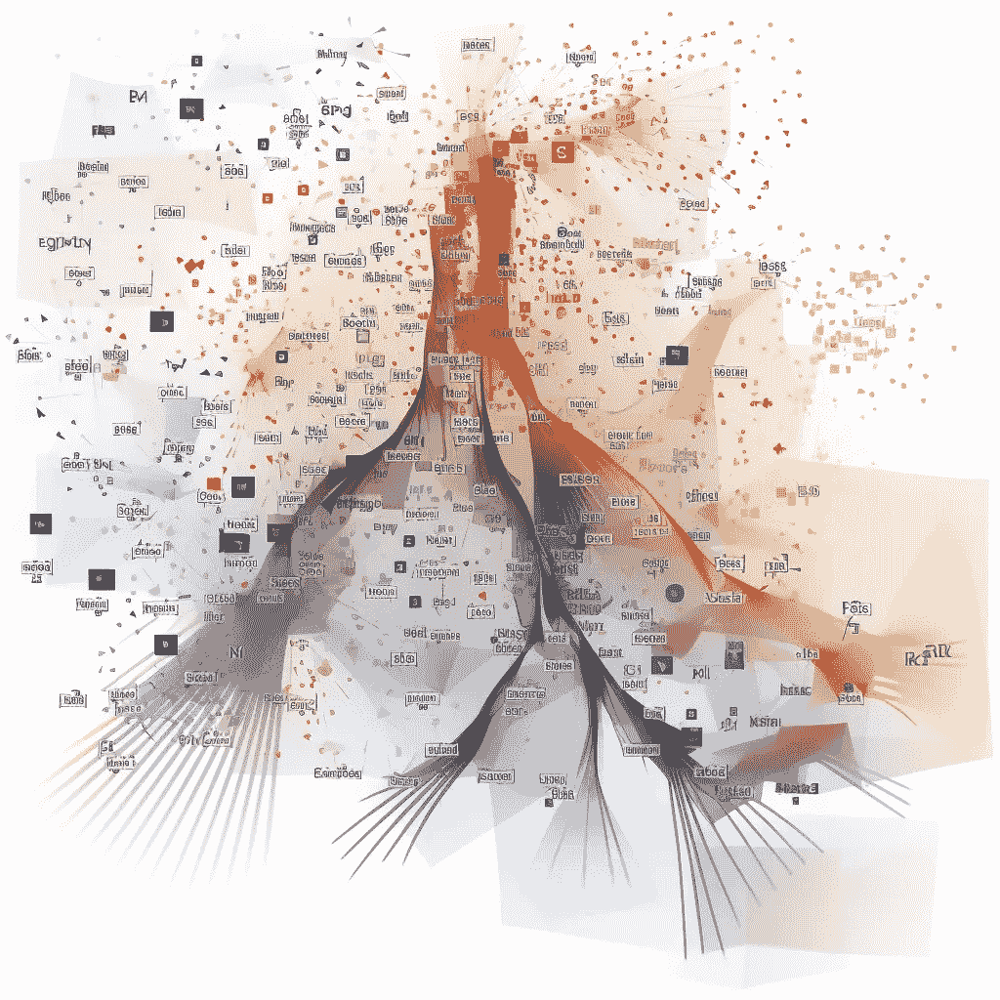

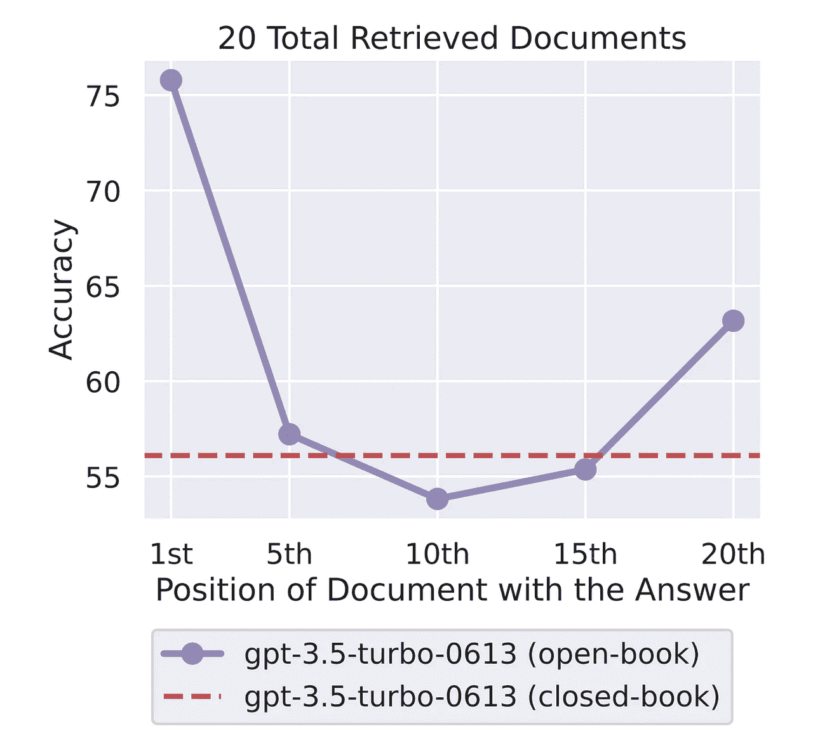

1.  LostInTheMiddleReranker

1.  ** ****CohereRerank**

1.  ** ****bge-rerank**

1.  **RankGPT**

> LostInTheMiddleReranker：这是Haystack的另一个解决LLM不擅长从文档中间检索信息的问题的方法。它通过重排序来让最佳的文档位于上下文窗口的开头和结尾。建议在相关性和多样性之后再使用该Reranker。

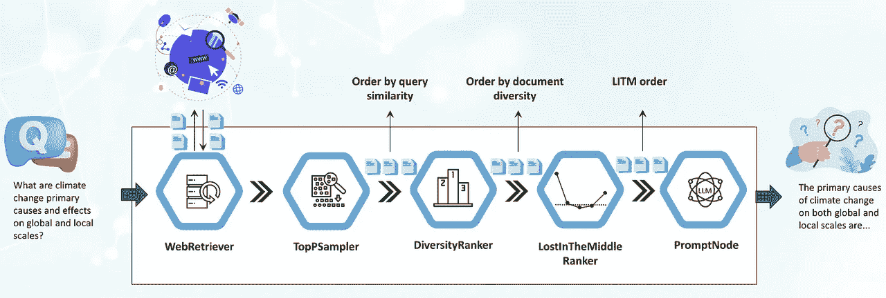

> [**CohereRerank**](https://cloud.tencent.com/developer/tools/blog-entry?target=https%3A%2F%2Ftxt.cohere.com%2Frerank%2F%3Futm_source%3Ddiv.beehiiv.com%26utm_medium%3Dreferral%26utm_campaign%3Dadvanced-rag-series-retrieval&source=article&objectId=2403938)：通过Cohere的Rerank endpoint实现，它会将一开始的搜索结果和用户的请求进行比较，并基于请求文本和文档之间的语义相似性来重新计算结果，而不仅仅根据向量的查询结果。

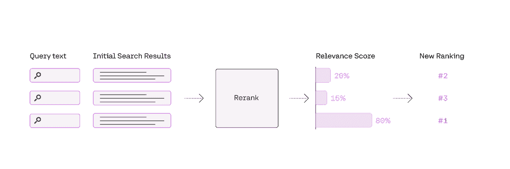

> [bge-rerank](https://cloud.tencent.com/developer/tools/blog-entry?target=https%3A%2F%2Fwww.llamaindex.ai%2Fblog%2Fboosting-rag-picking-the-best-embedding-reranker-models-42d079022e83%3Futm_source%3Ddiv.beehiiv.com%26utm_medium%3Dreferral%26utm_campaign%3Dadvanced-rag-series-retrieval&source=article&objectId=2403938)：除了要选择[出最](https://cloud.tencent.com/developer/tools/blog-entry?target=https%3A%2F%2Fwww.llamaindex.ai%2Fblog%2Fboosting-rag-picking-the-best-embedding-reranker-models-42d079022e83%3Futm_source%3Ddiv.beehiiv.com%26utm_medium%3Dreferral%26utm_campaign%3Dadvanced-rag-series-retrieval&source=article&objectId=2403938)适合你的数据的嵌入模型外，还需要重点关注可以和该嵌入模型配合使用的检索器(retriever)。我们使用命中率和平均倒数排名(Mean Reciprocal Rank-MRR)作为retriever的评估指标。命中率是指在前k个检索到的chunks中找到正确答案的频率，MRR是排名中最相关的文档在排名中的的位置。从下面可以看到，JinaAI-Base嵌入中用到的bge-rerank-large 或 cohere-reranker 看起来非常适用于该数据集。下表中需要注意的是，嵌入模型并不是最好的rerankers。Jina最擅长嵌入，而bge reranker则最擅长重新排序。

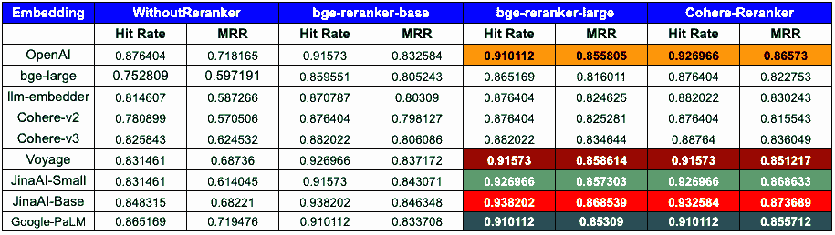

> mxbai-rerank-v1：最新的一种重排序模型是由Mixedbread团队开发的开源项目，称为SOTA。其表现声称要优于Cohere和bge-large。

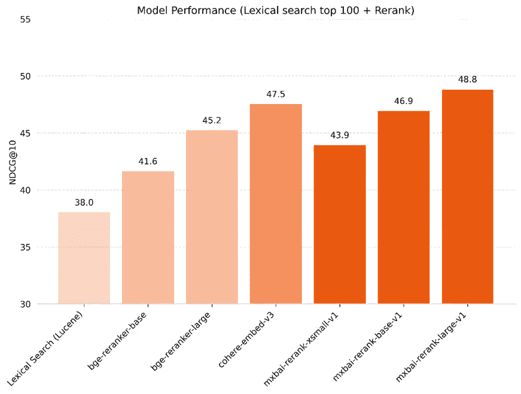

> [RankGPT](https://cloud.tencent.com/developer/tools/blog-entry?target=https%3A%2F%2Farxiv.org%2Fpdf%2F2304.09542.pdf&source=article&objectId=2403938)：这是使用现有的LLMs(如GPT3.5)重排检索文档的方法之一，且重排质量好于Cohere。为了解决检索上下文大于LLM的上下文窗口的问题，该方法使用了一种"滑动窗口"策略，即在滑动窗口内实现渐进排名。这种方式击败了其他大部分reranker，其中包括Cohere。这种方式下需要注意的是延迟和成本，因此适用于优化小型开源模型。

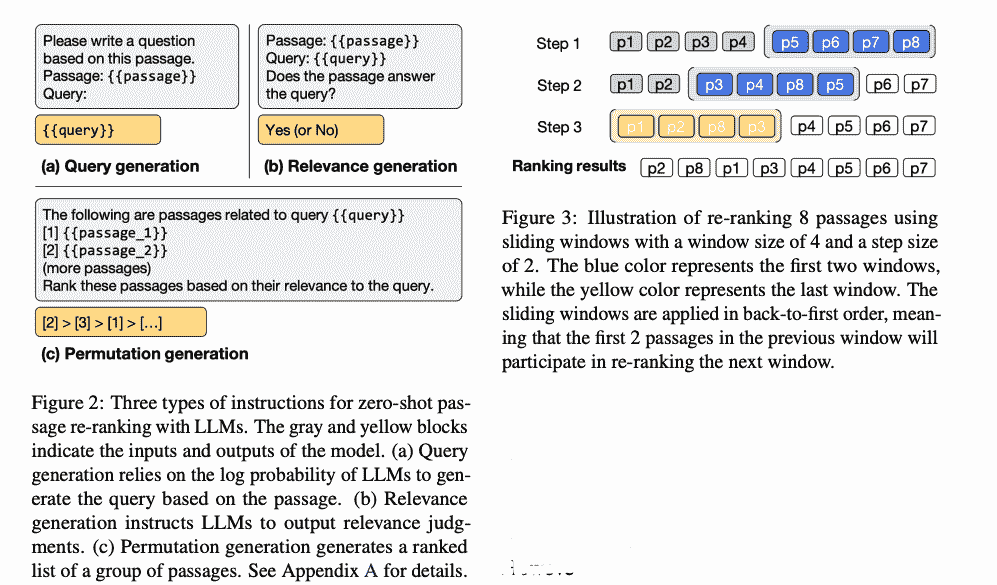

##### 提示压缩(Prompt Compression)

这里有必要介绍一下Prompt Compression，它和Reranking关系密切。这是一种通过压缩无关信息(即和用户查询无关)来降低检索到的文档的技术，有如下方式：

+    [LongLLMLingua](https://cloud.tencent.com/developer/tools/blog-entry?target=https%3A%2F%2Farxiv.org%2Fabs%2F2310.06839%3Futm_source%3Ddiv.beehiiv.com%26utm_medium%3Dreferral%26utm_campaign%3Dadvanced-rag-series-retrieval&source=article&objectId=2403938)：该方式基于Sel[ective-Co](https://cloud.tencent.com/developer/tools/blog-entry?target=https%3A%2F%2Farxiv.org%2Fabs%2F2310.05736%3Futm_source%3Ddiv.beehiiv.com%26utm_medium%3Dreferral%26utm_campaign%3Dadvanced-rag-series-retrieval&source=article&objectId=2403938)ntext 和 LLMLing[ua](https://cloud.tencent.com/developer/tools/blog-entry?target=https%3A%2F%2Fllmlingua.com%2F%3Futm_source%3Ddiv.beehiiv.com%26utm_medium%3Dreferral%26utm_campaign%3Dadvanced-rag-series-retrieval&source=article&objectId=2403938) 框架，是用于提示压缩的SOT[A方法，](https://cloud.tencent.com/developer/tools/blog-entry?target=https%3A%2F%2Farxiv.org%2Fabs%2F2307.03172%3Futm_source%3Ddiv.beehiiv.com%26utm_medium%3Dreferral%26utm_campaign%3Dadvanced-rag-series-retrieval&source=article&objectId=2403938)针对成本和延迟进行了优化。除此之外，LongLLMLingua采用了一种"采用问题感知由粗到细的压缩方法、文档重新排序机制、动态压缩比例以及压缩后的子序列恢复等策略来提升大型语言模型对关键信息的感知能力"的方式来提升检索质量。该方法特别适用于长上下文文档，解决"中间遗失"问题。

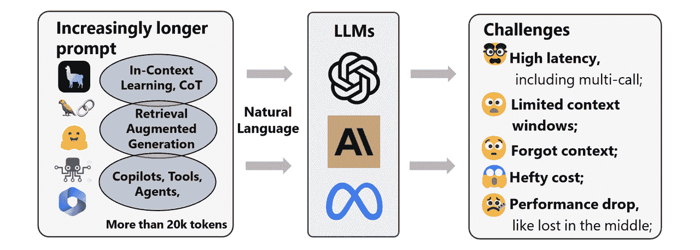

[RECOMP](https://cloud.tencent.com/developer/tools/blog-entry?target=https%3A%2F%2Farxiv.org%2Fabs%2F2310.04408%3Futm_source%3Ddiv.beehiiv.com%26utm_medium%3Dreferral%26utm_campaign%3Dadvanced-rag-series-retrieval&source=article&objectId=2403938)：使用"压缩器"，该方法使用文本摘要作为LLMs的上下文来降低成本并提升推理质量。两个压缩器分别表示： a)提取压缩器，用于从检索的文档中选择相关语句；b)抽象压缩器，用于根据多个文档的合成信息来创建摘要。

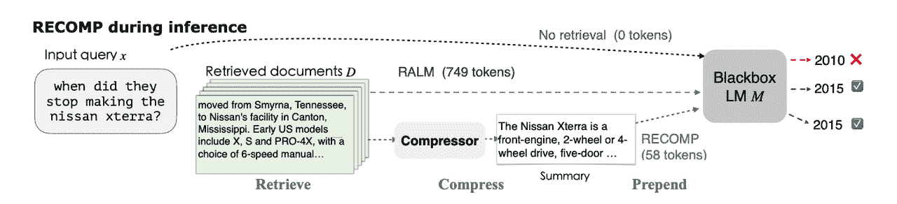

Walking Down the Memory Maze：该方法引入了MEMWALKER的概念，即按照树的格式来处理上下文。该方法会对上下文划分chunk，然后对每个部分进行概括。为了回答一个查询，该模型会沿着树结构来迭代提示，以此来找出包含问题答案的段。特别适用于较长序列。

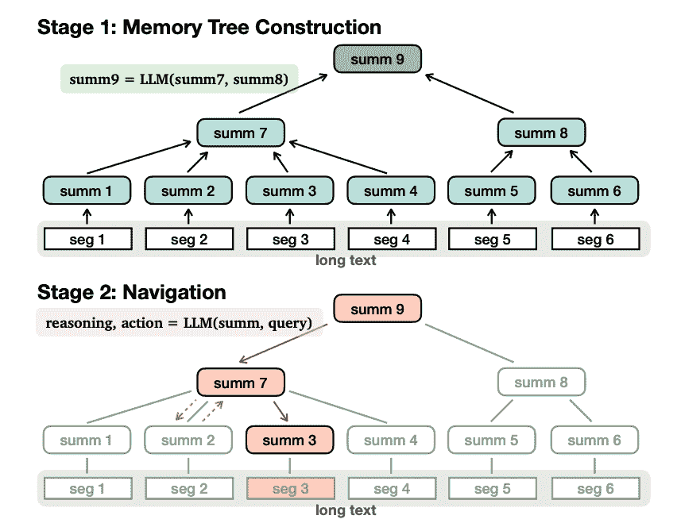

##### **RAG-fusion**

这是 Adrian Raudaschl提出的一种方法，使用Reciprocal Rank Fusion (RRF)和生成查询来提高检索质量。该方法会使用一个LLM根据输入生成多个用户查询，并为每个查询运行一个向量搜索，最后根据RRF聚合并优化结果。在最后一步中，LLM会使用查询和重排序列表来生成最终输出。这种方法在响应查询时具有更好的深度，因此非常流行。

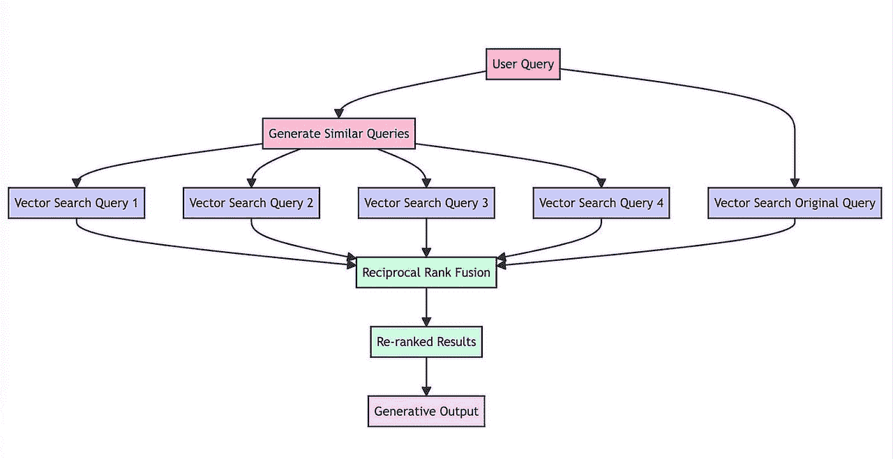

#### **改进**

##### [**CRAG**](https://cloud.tencent.com/developer/tools/blog-entry?target=https%3A%2F%2Fgithub.com%2FHuskyInSalt%2FCRAG%3Ftab%3Dreadme-ov-file&source=article&objectId=2403938)** (Corrective Retrieval A**ugmented Generation)

该方法旨在解决从静态和有限数据中进行次优检索的局限性，它使用一个轻量的检索评估器


从[下面](https://cloud.tencent.com/developer/tools/blog-entry?target=https%3A%2F%2Fgithub.com%2FHuskyInSalt%2FCRAG%3Ftab%3Dreadme-ov-file&source=article&objectId=2403938)报告结果可以看出其极大提升了基于RAG方法的表现：


##### [**FLARE**](https://cloud.tencent.com/developer/tools/blog-entry?target=https%3A%2F%2Farxiv.org%2Fabs%2F2305.06983%3Futm_source%3Ddiv.beehiiv.com%26utm_medium%3Dreferral%26utm_campaign%3Dadvanced-rag-series-retrieval&source=article&objectId=2403938) (Forward Looking Active Retrieval)

该方法特别适用于长文本生成，它会生成一个临[时的"下一个语句"](https://cloud.tencent.com/developer/tools/blog-entry?target=https%3A%2F%2Fwww.linkedin.com%2Fpulse%2Fdifference-between-high-probability-low-text-robert-koch%2F&source=article&objectId=2403938)，并根据该语句是否包含低概率tokens来决定是否执行检索。该方法可以很好地决定什么时候进行检索，可以降低幻觉以及非事实的输出。

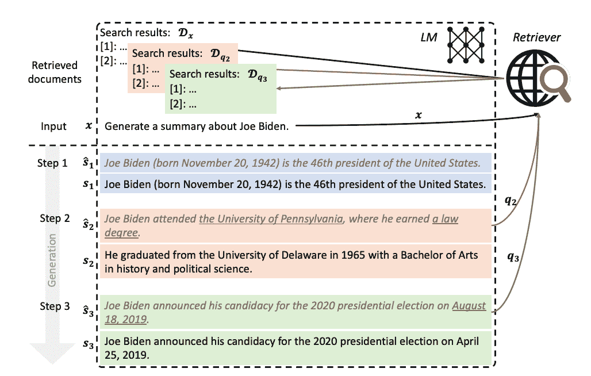

> 上图展示了FLARE的工作原理。当用户输入x ，并检索出结果Dx，FLARE会迭代生成一个临时的"下一句"(灰色字体)，然后检查它是否包含低概率的tokens(下划线表示)，如果包含(步骤2和3)，则系统会检索相关的文档并重新生成语句。

考虑到需要优化的变量数目，检索可能比较棘手，但通过对用户场景和数据类型进行映射，可以大大降低成本、延迟并提升准确性。

下面将面对文本生成(Generation)，并思考一些评估策略。

### [**生成和评估**](https://cloud.tencent.com/developer/tools/blog-entry?target=https%3A%2F%2Fdiv.beehiiv.com%2Fp%2Fadvanced-rag-series-generation-evaluation&source=article&objectId=2403938)

#### **生成(generation)**

使用索引和检索可以保证输出的完整性，接下来，需要在为用户生成结果之前对结果进行评估，并通过决策步骤来触发相应的动作。Language Agents (CoALA) 的认知架构是一个很好的框架，可以将其放在上下文中，通过对检索到的信息的评估来获得一组可能性。如下图所示：

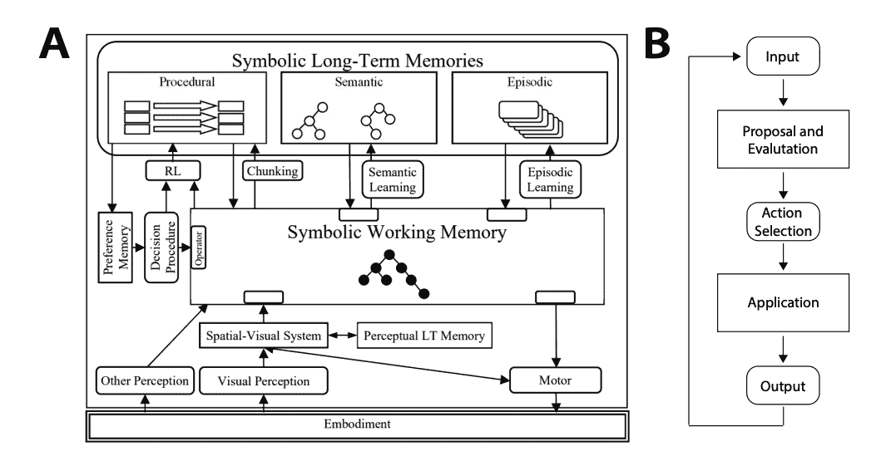

有如下几种方法可以实现这一动作选择决策程序：

##### Corrective RAG (CRAG)

在上一章(检索)中有提到过该方法，但它与本章节内容有所重叠，因此有必要展开介绍一下。

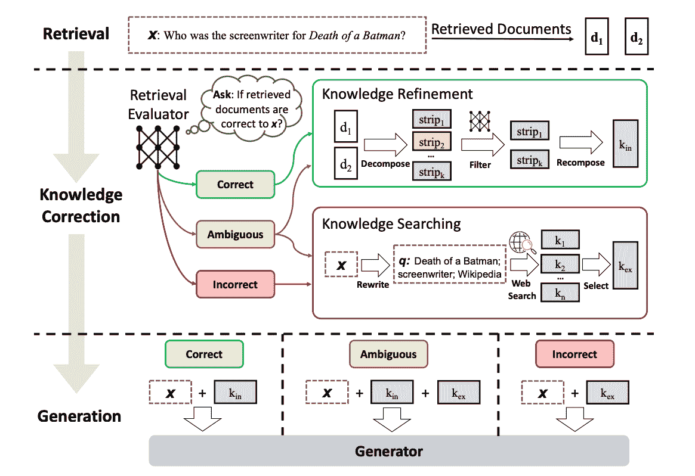

CRAG使用轻量级"检索评估器"来增强generation，检索评估器会为每个检索到的文档生成一个置信值。该值确定了需要触发的检索动作。例如，评估器可以根据置信值来为检索到的文档标记到三个桶(正确、模糊、不正确)中的某个桶中。

如果所有检索到的文档的置信值都低于阈值，retriever会认为"不正确"，然后会通过触发外部知识源(如web搜索)动作来生成合格的结果。

如果至少有一个检索到的文档的置信值大于阈值，则会假设此次检索是"正确的"，然后会触发 knowledge refinement来改进检索到的文档。 knowledge refinement需要将文档拆分为"知识条(knowledge strips)"，然后根据相关性对每个strip打分，最相关的知识会被重新组合为generation使用的内部知识。

当检索评估器对自己的判断没有信心时会标记为"模糊"，此时会同时采用上述策略。见如下决策树：

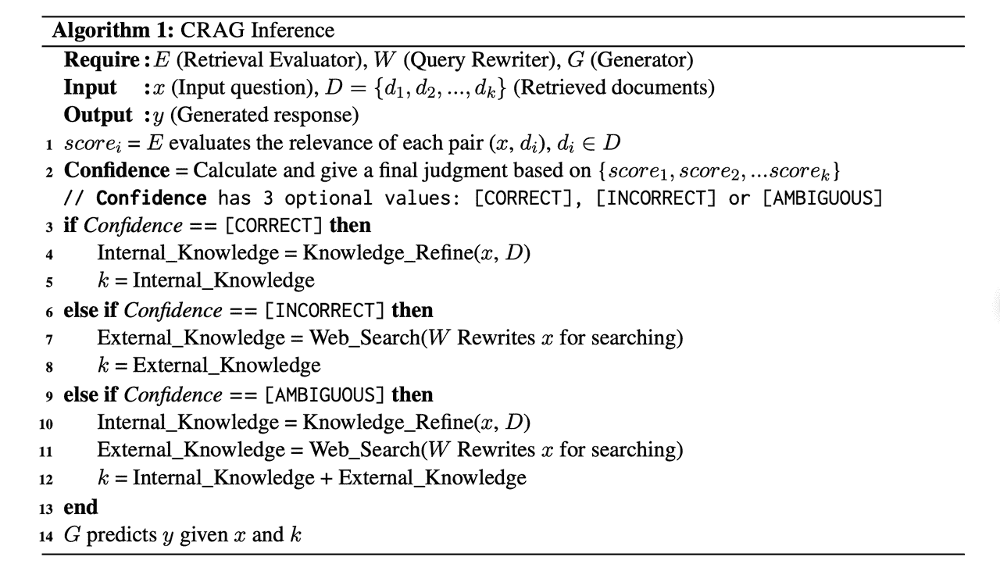

上述方法跨了四个数据来生成最佳结果。下表中可以看到，CRAG显著优于RAG。self-CRAG则使这些差距更加明显，并且展示了CRAG作为RAG流水线"即插即用"的适应性。另外一个CRAG由于其他方法(如Self-RAG)的点是它可以灵活地替换底层LLM，如果未来可能要采用更加强大的LLM，这一点至关重要。

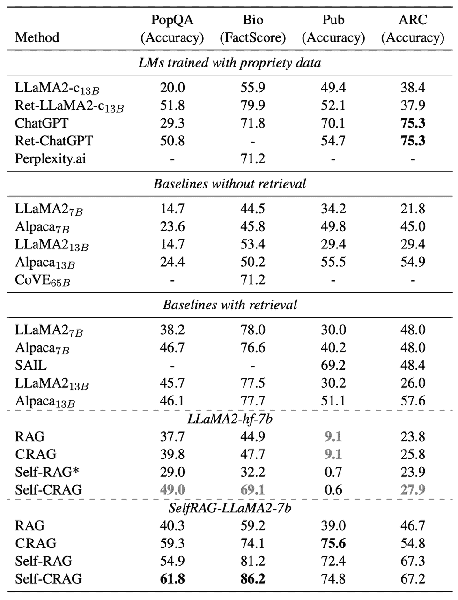

CRAG的一个明显限制是它严重依赖检索评估器的质量，并且容易受到网络搜索可能引入的偏见的影响。因此可能需要对检索评估器进行微调，且需要分配必要的"护栏"来确保输出的质量和准确性。

##### [**Self-RAG**](https://cloud.tencent.com/developer/tools/blog-entry?target=https%3A%2F%2Farxiv.org%2Fabs%2F2310.11511%3Futm_source%3Ddiv.beehiiv.com%26utm_medium%3Dreferral%26utm_campaign%3Dadvanced-rag-series-generation-and-evaluation&source=article&objectId=2403938)

这是另一种可以提升LLM的质量和事实性，同时保持其多功能性的框架。与其检索固定数目的段落(不管这些段落是相关还是不相关的)，该框架则更关注按需检索和自我反省。

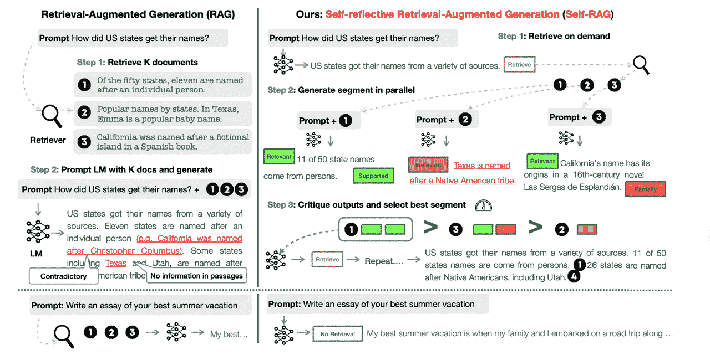

1.  将任一LLM训练为可以对自己生成的结果进行自我反省的模型(通过一种称为reflection tokens(retrieval 和 critique) 的特殊tokens)。检索是由retrieval token触发的，该token是由LLM根据输入提示和之前的生成结果输出的。

1.  然后LLM会通过并行处理这些检索到的段落来并发生成结果。该步骤会触发LLM生成用于评估这些结果的critique tokens。

1.  最后根据"真实性"和"相关性"来选择用于最终generation的最佳结果。论文中描述了算法，其中tokens的定义如下：

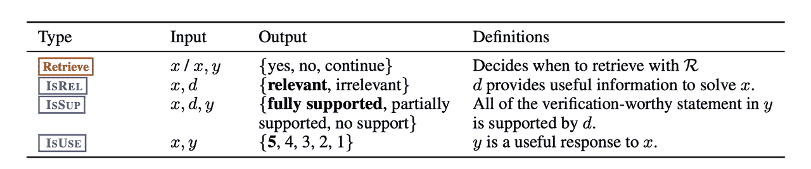

下面Langchain的[示意图](https://cloud.tencent.com/developer/tools/blog-entry?target=https%3A%2F%2Fblog.langchain.dev%2Fagentic-rag-with-langgraph%2F%3Futm_source%3Ddiv.beehiiv.com%26utm_medium%3Dreferral%26utm_campaign%3Dadvanced-rag-series-generation-and-evaluation&source=article&objectId=2403938)展示了基于上述定义的reflection token的Self-RAG 推理决策算法。

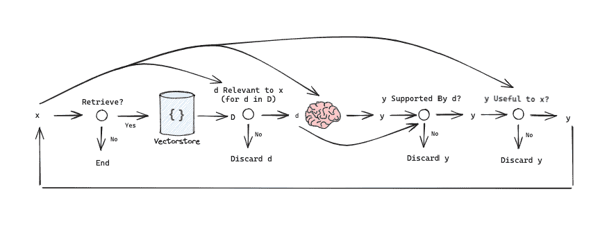

就表现而言，无论是否进行检索，Self-RAG都显著优于基线(参考CRAG的Benchmark)。需要注意的是，可以通过在CRAG之上构建Self-CRAG来进一步提升模型表现。

该框架的成本和延迟受到LLM调用的数量的限制。可以通过一些变通方法，比如一次生成一代，而不是两次为每个块生成一代进行优化。

##### RRR (Rewrite-Retrieve-Read)

> RRR模式[Ma et al., 2023a]引入了 重写-检索-读写 流程，利用LLM来强化rewriter模块，从而实现对检索查询的微调，进而提高reader的下游任务表现。

该框架假设用户查询可以被LLM进一步优化(及重写)，从而实现更精确的检索。虽然这种方式可以通过LLMs的查询重写过程来提升表现，但也存在推理错误或无效查询之类的问题，因此可能不适用于部署在生产环境中。


为了解决上图中描述的问题，需要在rewriter上添加一个可训练的小型LLM(如上图红色部分所示)来持续提升训练的表现，使之兼具可扩展性和高效性。这里的训练包含两个阶段："预热"和增强学习，其关键是将可训练模块集成到较大的LLM中。

#### **评估**

RAG pipeline中实现评估的方式有很多种，如使用一组Q&A作为测试数据集，并将输出与实际答案进行对比验证。但这种方式的缺点是不仅需要花费大量时间，并且增加了针对数据集本身优化pipeline的风险(而非可能存在很多边缘场景的现实世界)。

##### [**RAGAs**](https://cloud.tencent.com/developer/tools/blog-entry?target=https%3A%2F%2Fgithub.com%2Fexplodinggradients%2Fragas%3Ftab%3Dreadme-ov-file%26utm_source%3Ddiv.beehiiv.com%26utm_medium%3Dreferral%26utm_campaign%3Dadvanced-rag-series-generation-and-evaluation&source=article&objectId=2403938)

[RAGAs](https://cloud.tencent.com/developer/tools/blog-entry?target=https%3A%2F%2Fblog.langchain.dev%2Fevaluating-rag-pipelines-with-ragas-langsmith%2F&source=article&objectId=2403938)(RAG Assessment的简称)是一个用于评估RAG pipeline的开源框架，它可以通过如下方式评估pipeline：

+   提供基于"[ground  truth](https://cloud.tencent.com/developer/tools/blog-entry?target=https%3A%2F%2Fdomino.ai%2Fdata-science-dictionary%2Fground-truth&source=article&objectId=2403938)"(真实数据)来生成测试数据的方式

+   为检索和generation阶段以独立或端到端的方式提供基于指标的评估

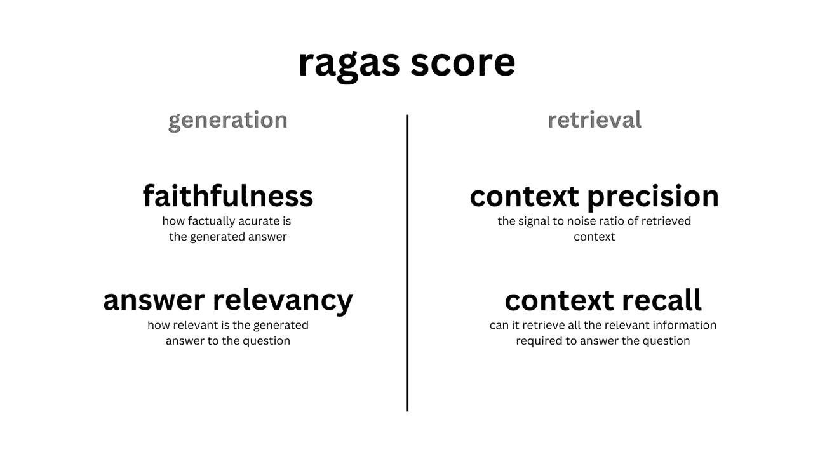

它使用如下RAG特征作为指标：

1.  真实性：事实一致性

1.  回答相关性：问题和查询的相关性

1.  上下文准确性：校验相关chunks的排名是否更高

1.  批判(Critique)：根据预定义的特征(例如无害和正确性)评估提交

1.  上下文回顾：通过比较ground truth和上下文来校验是否检索到所有相关信息

1.  上下文实体回顾：评估上下文检索到的和ground truth中的实体数目

1.  上下文相关性：检索到的上下文和提示的相关性

1.  回答语义相似性：生成的答案和实际的语义相似性

1.  回答正确性：评估生成答案与实际答案的准确性和一致性

[**上面提供了**](https://cloud.tencent.com/developer/tools/blog-entry?target=https%3A%2F%2Fdocs.ragas.io%2Fen%2Fstable%2F%3Futm_source%3Ddiv.beehiiv.com%26utm_medium%3Dreferral%26utm_campaign%3Dadvanced-rag-series-generation-and-evaluation%23&source=article&objectId=2403938)一组可以全面评估RAG的列表，推荐阅读Ragas文档。

###### [**Langsmith**](https://cloud.tencent.com/developer/tools/blog-entry?target=https%3A%2F%2Fwww.langchain.com%2Flangsmith%3Futm_source%3Ddiv.beehiiv.com%26utm_medium%3Dreferral%26utm_campaign%3Dadvanced-rag-series-generation-and-evaluation&source=article&objectId=2403938)

Langchain的Langsmith可以作为上面上下文中的可观测性和监控工具。

> [LangSmith](https://cloud.tencent.com/developer/tools/blog-entry?target=https%3A%2F%2Fdocs.smith.langchain.com%2F%3Fref%3Dblog.langchain.dev%26utm_source%3Ddiv.beehiiv.com%26utm_medium%3Dreferral%26utm_campaign%3Dadvanced-rag-series-generation-and-evaluation&source=article&objectId=2403938) 是一个可以帮助调试、测试、评估和监控基于任何LLM空间构建的chains和agents平台。

通过将Langsmith和RAG进行结合可以帮助我们更深入地了解结果。通过Langsmith评估logging和tracing部分可以更好地了解到对哪个阶段进行优化可以提升retriever或generator。

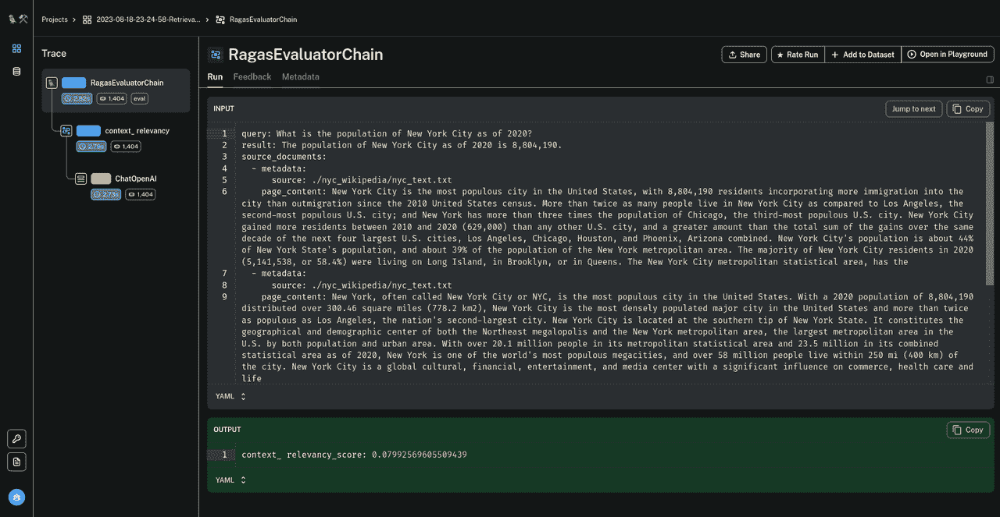

##### [**DeepEval**](https://cloud.tencent.com/developer/tools/blog-entry?target=https%3A%2F%2Fgithub.com%2Fconfident-ai%2Fdeepeval%3Futm_source%3Ddiv.beehiiv.com%26utm_medium%3Dreferral%26utm_campaign%3Dadvanced-rag-series-generation-and-evaluation&source=article&objectId=2403938)

另一种值得提及的评估框架称为DeepEval。它提供了14种以上涵盖RAG和微调的指标，包括G-Eval、RAGAS、Summarization、Hallucination、Bias、Toxicity 等。

这些指标的自解释信很好地说明了指标评分的能力，使之更易于调试。这是跟上面的RAGAs的关键区别。

[此外，它还有](https://cloud.tencent.com/developer/tools/blog-entry?target=https%3A%2F%2Fdocs.pytest.org%2Fen%2Fstable%2Fcontents.html%3Futm_source%3Ddiv.beehiiv.com%26utm_medium%3Dreferral%26utm_campaign%3Dadvanced-rag-series-generation-and-evaluation&source=article&objectId=2403938)一些不错的特性，如集成Pytest (开发者友好)，其模块化组件等也是开源的。

Evaluate → Iterate → Optimize

通过生成和评估阶段，我们不仅可以部署一个RAG系统，还可以评估、迭代并针对我们设计的特定场景进行优化。

<https://v11enp9ok1h.feishu.cn/sync/Ipw1d27gNsv3OAbo3N7cks4ZnJf>