# 构建Agentic RAG系统的架构

> 来源：[https://v11enp9ok1h.feishu.cn/docx/Q8ehdPkeTodYptxi3ewcABglnJb](https://v11enp9ok1h.feishu.cn/docx/Q8ehdPkeTodYptxi3ewcABglnJb)

2024年，随着 LLM 和 RAG 技术的发展，AI Agent 系统成为焦点。AI Agent 是能够在最小人工干预下进行复杂决策和任务执行的自主系统，这些系统通过增强生产力，重新定义了个人和组织解决问题的方式。

2025 年将是“Agent 之年”！今天，我们将探讨 Agentic RAG 系统的类型及其架构，并深入了解其运作机制。

## Agentic RAG系统：RAG与AI Agent系统的结合

为了简单理解 Agentic RAG，我们可以拆解这个术语：它是 RAG 与 AI Agent 的结合。

### 什么是 RAG？

RAG（Retrieval-Augmented Generation，检索增强生成）是一个框架，旨在通过将外部知识源集成到生成过程，来增强生成式 AI 模型的表现。其工作原理如下：

> **检索（Retrieval）：**这一部分从外部知识库、数据库或其他数据存储库中获取相关信息。这些信息源可以包括结构化或非结构化数据，如文档、API，甚至实时数据流。

> **增强（Augmented）：**检索到的信息用于指导和支持生成模型。这确保了输出更准确，基于外部数据，并且上下文丰富。

> **生成（Generation）：**生成式 AI 系统（如 GPT）将检索到的知识与自身的推理能力结合，生成最终的输出。

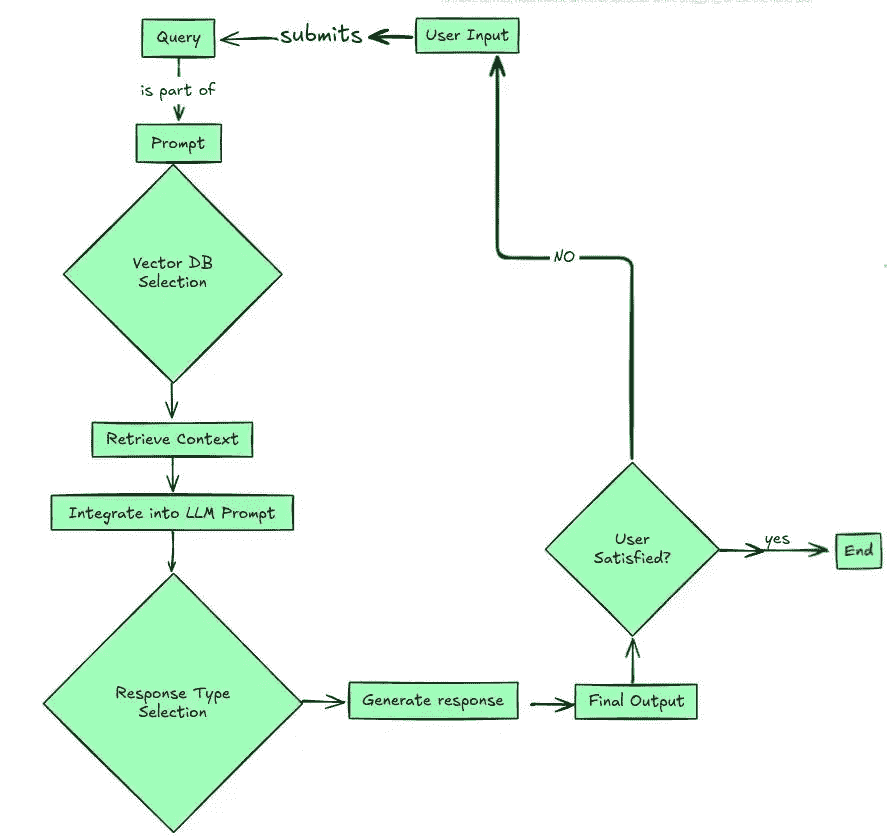

RAG 在处理复杂查询或需要最新、特定领域知识的任务中尤其有价值。

### 什么是AI Agent？

下面是 AI Agent 在回答查询“2024 年谁赢得了欧洲杯？告诉我更多细节！”时的工作流程：

> 初始指令：用户输入查询，例如“2024 年谁赢得了欧洲杯？告诉我更多细节！”。

> **LLM 处理与工具选择：**LLM 解析查询，判断是否需要外部工具（如网页搜索）。它启动相应的功能调用以获取更多信息。

> **工具执行与上下文检索：**选择的工具（例如搜索 API）检索相关信息，在这里，它获取关于 2024 年欧洲杯决赛的详细资料。

> **响应生成：**新信息与原始查询结合后，LLM 生成完整的最终回应：“西班牙以 2-1 战胜英格兰，在 2024 年 7 月的柏林决赛中赢得了欧洲杯。”

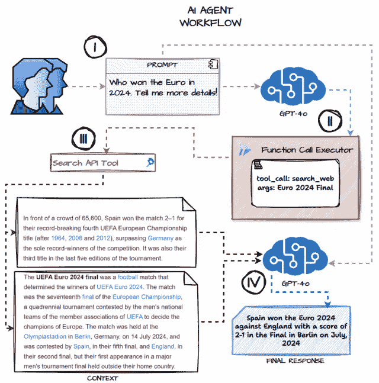

简而言之，Agentic AI 系统包含以下核心组件：

LLM：操作的大脑

LLM 作为中央处理单元，负责解析输入并生成有意义的响应。

> **输入查询：**用户提供的问题或命令，启动 AI 的操作。

> **理解查询：**AI 分析输入内容，以理解其含义和意图。

> **响应生成：**根据查询，AI 制定合适且连贯的回应。

#### 记忆系统：情境智能的关键

记忆使 AI 能够保持并利用过去的交互，为更加符合情境的回应提供支持。

> **短期记忆：**保存最近的交互，便于即时使用。

> **长期记忆：**长期存储信息，供持续参考。

> **语义记忆：**保持一般知识和事实，支持信息化互动。

这些展示了 AI 如何集成用户提示、工具输出和自然语言生成。

#### AI Agent 的定义

AI Agent 是自主的软件系统，设计用于通过与环境互动，执行特定任务或实现某些目标。AI Agent 的主要特征包括：

> **感知：**它们感知或检索有关环境的数据（例如，通过 API 或用户输入）。

> **推理：**它们分析数据并做出有根据的决策，通常利用像 GPT 这样的 AI 模型进行自然语言理解。

> **行动：**它们在现实或虚拟世界中执行动作，如生成响应、触发工作流或修改系统。

> **学习：**高级 Agent 通常会根据反馈或新数据进行自我适应并提高其表现。

> AI Agent 能够处理多个领域的任务，如客户服务、数据分析、工作流自动化等。

### 总结

Agentic RAG 系统结合了 RAG 与自主 AI Agent 的能力。RAG 通过外部知识源增强生成模型的输出，而 AI Agent 则通过感知、推理、行动和学习，自主执行任务。这种组合使得 AI 系统不仅能够生成基于事实的回答，还能通过实时数据和环境交互，不断适应并提高效率，拓展了 AI 的应用场景，如客户服务和工作流自动化等领域。

为什么我们应该关注 Agentic RAG 系统？

首先，以下是基本 RAG 技术的局限性：

> **何时检索：**系统可能难以判断何时需要进行检索，从而导致答案不完整或不够准确。

> **文档质量：**检索到的文档可能与用户的问题不匹配，进而削弱回答的相关性。

> **生成错误：**模型可能会“幻觉”出不准确或不相关的信息，而这些信息并未被检索内容支持。

> **答案精度：**即便有相关文档，生成的回答可能无法直接或充分回答用户的查询，使得输出结果不可靠。

> **推理问题：**系统无法处理复杂的查询，缺乏对细节的深入理解。

> **适应性有限：**传统系统无法动态调整策略，例如选择 API 调用或网页搜索。

#### Agentic RAG 的重要性

理解 Agentic RAG 系统，帮助我们为上述挑战和特定任务部署合适的解决方案，并确保与预期使用场景的一致性。以下是其关键性原因：

**量身定制的解决方案**

不同类型的 Agentic RAG 系统针对不同级别的自主性和复杂性进行了设计。例如：

Agentic RAG 路由器：Agentic RAG 路由器是一个模块化框架，根据查询的意图和复杂性，动态地将任务路由到适当的检索、生成或执行组件。

**自我反思 RAG：**自我反思 RAG 集成了内省机制，使系统能够通过迭代评估检索相关性、生成质量和决策准确性，来优化响应，直到输出最终结果。

了解这些类型有助于确保最佳的设计和资源利用。

##### 风险管理

Agentic 系统涉及决策过程，这可能带来如错误行动、过度依赖或误用等风险。了解每种类型的范围和局限性，可以有效降低这些风险。

**创新与可扩展性**

区分不同类型的系统使得企业能够将其从基础实施扩展到能够应对企业级挑战的复杂代理。

简而言之，Agentic RAG 能够规划、适应和迭代，以找到适合用户需求的最佳解决方案。

### 总结

Agentic RAG 系统的优势在于其能够克服传统 RAG 技术的局限性，如检索时机、文档质量、生成错误等问题。通过理解不同类型的 Agentic RAG 系统（如 Agentic RAG 路由器和自我反思 RAG），我们能够根据具体任务需求部署量身定制的解决方案。此类系统不仅能够处理复杂决策，还能帮助管理风险、推动创新与可扩展性，使得企业在面对复杂挑战时，能够更高效、更可靠地应对。

## Agentic RAG：将 RAG 与 AI Agent 相结合

结合 AI Agent 和 RAG 工作流，下面是 Agentic RAG 的架构：

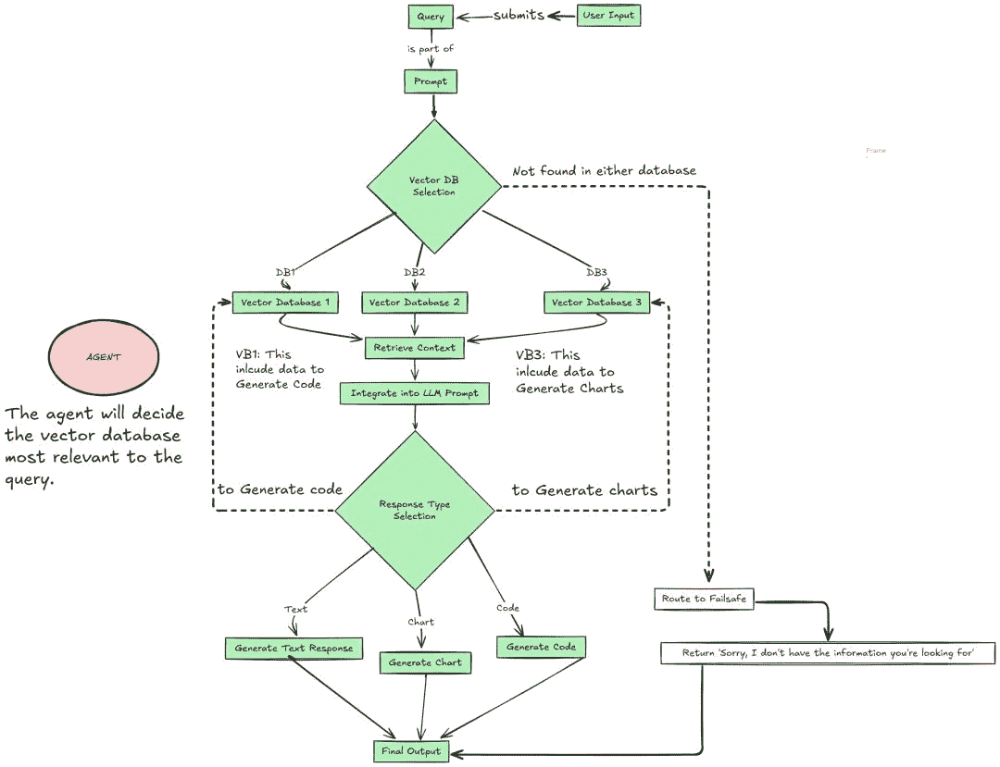

> Agentic RAG 将 RAG 的结构化检索和知识集成能力与 AI Agent 的自主性和适应性相结合。其工作原理如下：

> **动态知识检索：**配备 RAG 的 Agent 可以即时检索特定信息，确保其操作时使用的是最新且与上下文相关的数据。

> **智能决策：**Agent 处理检索到的数据，应用高级推理来生成解决方案、完成任务或深入准确地回答问题。

> **面向任务的执行：**与静态的 RAG 管道不同，Agentic RAG 系统能够执行多步骤任务，适应变化的目标，或根据反馈调整其方法。

> **持续改进：**通过学习，Agent 不断改进其检索策略、推理能力和任务执行能力，随着时间的推移变得更加高效和有效。

### Agentic RAG 的应用

以下是 Agentic RAG 的应用场景：

Agentic RAG 代表了 RAG 与自主 AI Agent 之间的强大协同作用，使系统能够以无与伦比的智能、适应性和相关性进行操作。这是构建不仅仅是知情的，而且能够独立执行复杂、知识密集型任务的 AI 系统的重大进展。

#### 总结

Agentic RAG 通过结合 RAG 的检索能力与 AI Agent 的自主决策和适应性，开创了全新的工作模式。Agent 能够实时检索最新数据，并通过智能推理生成解决方案、执行任务或提供深度回答。与传统的静态 RAG 管道不同，Agentic RAG 能够执行复杂的多步骤任务，并通过反馈不断改进自己的执行策略。它在客户支持、内容创作、研究辅助和工作流自动化等多个领域具有广泛应用，并为构建高效、自主的 AI 系统铺平了道路。

我希望你现在已经对 Agentic RAG 有了清晰的了解，在下一部分中，我将向你介绍一些重要且流行的 Agentic RAG 系统及其架构。

#### Agentic RAG 路由器

正如前面提到的，"Agentic"一词意味着系统像智能代理一样，能够推理并决定使用哪些工具或方法来检索和处理数据。通过结合检索（例如数据库搜索、网络搜索、语义搜索）和生成（例如 LLM 处理），该系统确保以最有效的方式回答用户的查询。

类似地，Agentic RAG 路由器是设计用来动态地将用户查询路由到合适的工具或数据源，从而增强 LLM 能力的系统。此类路由器的主要目的是将检索机制与 LLM 的生成能力相结合，以提供准确且具有上下文的响应。

这种方法弥合了 LLM（基于现有数据训练的静态知识）与需要从实时或特定领域数据源动态检索知识之间的差距。通过结合检索和生成，Agentic RAG 路由器使得以下应用成为可能：

问答 数据分析 实时信息检索 推荐生成

## Agentic RAG 路由器架构

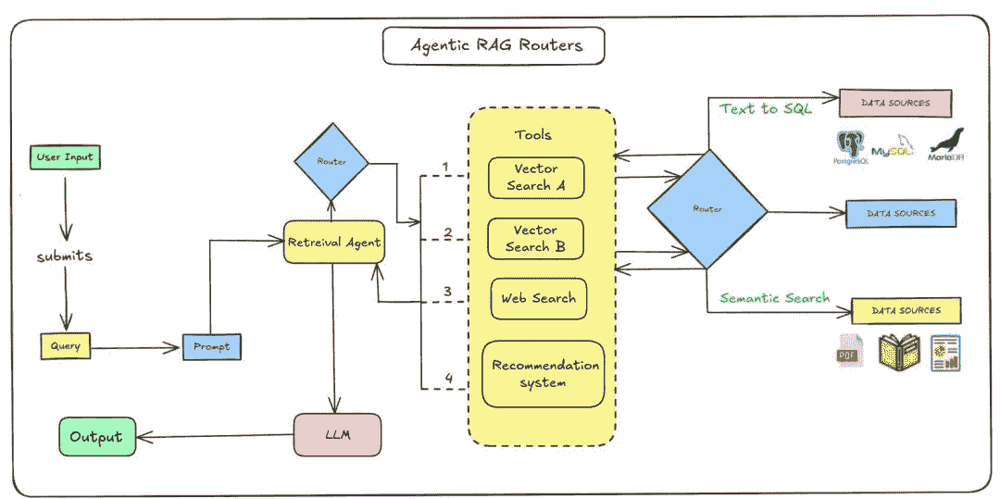

下图展示了 Agentic RAG 路由器如何运作。我们来分析一下各个组件和流程：

### 用户输入与查询处理

用户输入：用户提交查询，这是系统的入口点。可以是问题、命令或请求特定数据。

查询：用户输入被解析并格式化成系统可以理解的查询。

检索 Agent

检索 Agent 是核心处理单元，负责协调如何处理查询。它评估：

**查询的意图**

需要的信息类型（结构化、非结构化、实时、推荐）。

**路由器**

路由器决定使用哪些工具来处理查询：

> **向量搜索：**使用语义嵌入检索相关文档或数据。

> **网络搜索：**访问实时信息。

> **推荐系统：**基于用户先前的互动或上下文相关性推荐内容。

> **文本转 SQL：**将自然语言查询转换为 SQL 命令来访问结构化数据库。

### 工具

这些工具是模块化且专业化的：

> **向量搜索 A 和 B：**旨在通过语义嵌入搜索匹配内容，适用于非结构化数据如文档、PDF 或书籍。

> 网络搜索：访问外部实时在线数据。

> 推荐系统：利用 AI 模型提供用户特定的建议。

### 数据源

> **系统连接到多种数据源：**

> 结构化数据库：用于存储组织良好的信息（例如 SQL 系统）。

> 非结构化源：如 PDF、书籍、研究论文等。

> 外部仓库：用于语义搜索、推荐和实时网络查询。

### LLM 集成

> 检索到的数据被传递给 LLM：

> LLM 将检索到的信息与其生成能力结合，创建出连贯且易于理解的回应。

### 输出

> 最终的响应被以清晰且可操作的格式返回给用户。

### Agentic RAG 路由器的类型

以下是 Agentic RAG 路由器的类型：

#### 单一 Agentic RAG 路由器

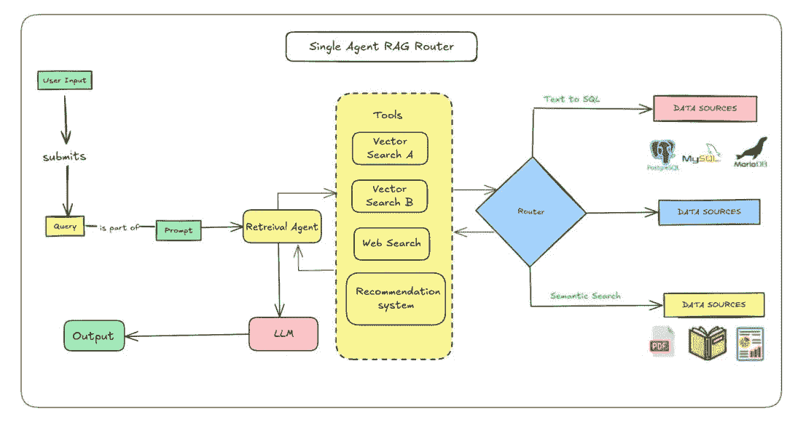

在这种设置中，只有一个统一的 Agent 负责所有的路由、检索和决策任务。适用于只有单一查询类型的应用，比如检索特定文档或处理基于 SQL 的请求。

在单一 Agentic RAG 路由器中：

查询提交：用户提交查询，单一的检索代理处理该查询。

通过单一 Agent 路由：检索 Agent 评估查询并将其传递给一个路由器，路由器决定使用哪些工具（例如向量搜索、网络搜索、文本转 SQL、推荐系统）。

> 工具访问：路由器根据需要连接查询到一个或多个工具。

> **文本转 SQL：**与 PostgreSQL 或 MySQL 等数据库交互以处理结构化查询。

> **语义搜索：**从 PDF、书籍或非结构化数据源中检索数据。

> **网络搜索：**获取实时在线信息。

> **推荐系统：**基于上下文或用户资料提供建议。

> **LLM 集成：**检索到的数据被传递给 LLM，LLM 结合其生成能力生成响应。

> **输出：**将响应以清晰、可操作的格式返回给用户。

该方法适合于数据源和工具较少的简单用例，结构集中且高效。

#### 多 Agentic RAG 路由器

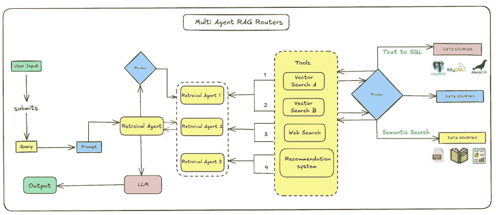

这种架构涉及多个 Agent，每个 Agent 处理特定类型的任务或查询。这种方法适合复杂系统，支持高查询量和多样化的数据源。

在多 Agentic RAG 路由器中：

> 查询提交：用户提交查询，初步由检索代理处理。

> **分布式检索 Agent：**系统采用多个检索 Agent，每个 Agent 专注于特定任务类型。例如：

> 检索 Agent 1 可能处理基于 SQL 的查询。

> 检索 Agent 2 可能专注于语义搜索。

> 检索 Agent 3 可能优先处理推荐或网络搜索。

> **单独的工具路由器：**每个检索 Agent 将查询路由到其指定的工具，工具从共享池中选择（例如向量搜索、网络搜索等）。

> 工具访问与数据检索：每个工具根据其检索 Agent 的需求访问相关数据源。

> **LLM 集成与合成：**所有检索到的数据都传递给 LLM，LLM 合成这些信息并生成连贯的响应。

> **输出：**最终的处理响应返回给用户。

### 总结

Agentic RAG 路由器将智能决策、强大的检索机制和 LLM 结合在一起，创建了一个多功能的查询响应系统。架构通过最佳方式将用户查询路由到适当的工具和数据源，确保响应的高相关性和准确性。无论是使用单一路由器还是多个路由器设置，设计都会根据系统的复杂性、可扩展性需求和应用要求进行优化。

## 查询规划型 Agentic RAG

查询规划型 Agentic RAG 是一种方法论，旨在通过利用多个可并行化的子查询跨多个数据源来高效地处理复杂查询。这种方法结合了智能查询分解、分布式处理和响应合成，提供准确且全面的结果。

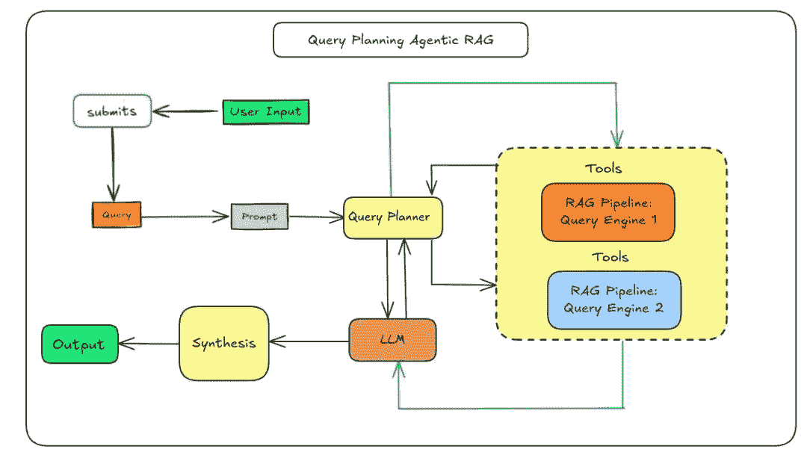

**以下是其核心组件：**

用户输入与查询提交

用户输入：用户将查询或请求提交给系统。

输入的查询将被处理并传递到下游进行进一步处理。

查询规划器是协调整个过程的核心组件。它：

解释用户提供的查询。

为下游组件生成适当的提示。

决定调用哪些工具（查询引擎）来回答查询的具体部分。

**工具**

工具是包含查询引擎的专用管道（例如 RAG 管道），包括：

查询引擎 1

查询引擎 2

这些管道负责从外部知识源（例如数据库、文档或 API）检索相关信息或上下文。

检索到的信息会返回给查询规划器进行整合。

**LLM**

LLM 作为复杂推理、自然语言理解和响应生成的合成引擎

它与查询规划器进行双向交互：

接收来自查询规划器的提示。

根据检索到的信息提供上下文相关的响应或优化后的输出。

**合成与输出**

合成：系统将来自工具的检索信息和 LLM 的响应结合，生成连贯的答案或解决方案。

输出：最终合成的结果以清晰的格式呈现给用户。

**关键亮点**

模块化设计：架构允许在工具选择和集成方面具有灵活性。

高效的查询规划：查询规划器作为智能中介，优化哪些组件被使用以及使用的顺序。

RAG：通过利用 RAG 管道，系统增强了 LLM 的知识，提供最新的、特定领域的信息。

迭代交互：查询规划器确保工具和 LLM 之间的迭代合作，逐步改进响应。

### 总结

查询规划型 Agentic RAG 方法通过智能分解查询、分布式处理和响应合成，能有效处理复杂查询。这种方法不仅增强了 LLM 的能力，还提高了信息检索的精度和时效性，确保最终输出是综合且符合用户需求的答案。

### 自适应 RAG

自适应 RAG（Adaptive RAG）是一种通过根据传入查询的复杂度调整查询处理策略，来提高 LLM 灵活性和效率的方法。

自适应 RAG 根据查询的复杂性动态选择回答问题的不同策略——从简单的单步骤方法到更复杂的多步骤方法，甚至在某些情况下不进行检索的过程。这一选择通过一个分类器来实现，该分类器分析查询的性质，并确定最佳的处理方法。

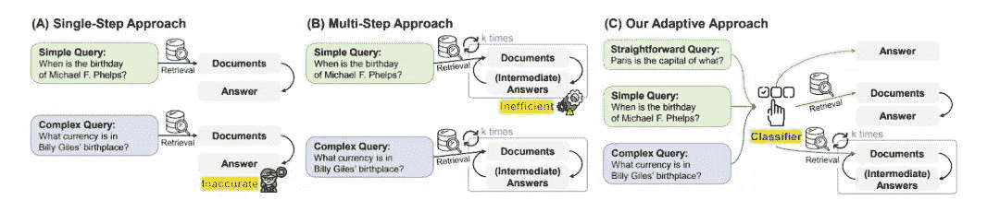

以下是单步骤、多步骤和自适应方法的比较：

> **单步骤方法（Single-Step Approach）**

> 工作原理：对于简单和复杂的查询，执行一次检索，并直接从检索到的文档中生成答案。

> **局限性：**

> 对于像“Michael F. Phelps 的生日是什么时候？”这样的简单查询效果很好，但对于“Billy Giles 出生地使用什么货币？”这类复杂查询则效果差，因为缺乏中间推理。

> 这种方法在复杂查询中会导致答案不准确。

> **多步骤方法（Multi-Step Approach）**

> 工作原理：无论查询简单还是复杂，都经过多轮检索，逐步生成中间答案以完善最终的回应。

> 局限性：尽管强大，但对于简单查询来说，它引入了不必要的计算开销。例如，反复处理“Michael F. Phelps 的生日是什么时候？”是低效和冗余的。

> **自适应方法（Adaptive Approach）**

> 工作原理：此方法使用分类器来确定查询的复杂性并选择合适的策略：

> 简单查询：直接生成答案，无需检索（例如，“巴黎是哪个国家的首都？”）。

# 自适应 RAG

普通查询：使用单步骤检索过程。

复杂查询：采用多步骤检索进行迭代推理和答案完善。

## 优势

对于简单查询减少不必要的开销，同时保证复杂查询的高准确度。

灵活适应各种查询复杂性。

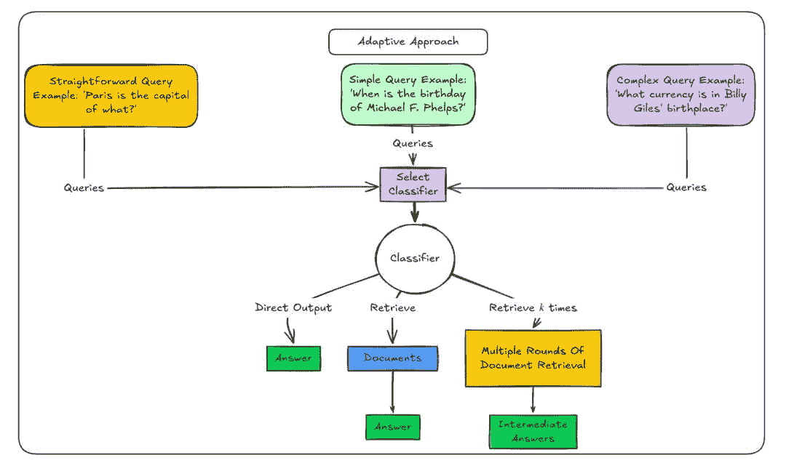

## 自适应 RAG 框架

### 分类器角色

一个较小的语言模型预测查询的复杂性。

它通过自动标注的数据集进行训练，标签来源于过去模型的输出和数据中的固有模式。

### 动态策略选择

对于简单或直接的查询，框架避免浪费计算资源。

对于复杂查询，确保通过多轮检索进行充分的迭代推理。

以下是来自 `LangGraph` 的自适应 RAG 系统架构流程示例：

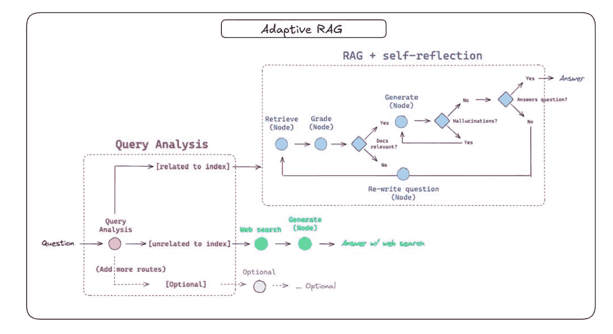

## 查询分析

该过程首先分析用户查询，以确定最合适的检索和生成路径。

### 步骤 1：路径确定

> 查询根据与现有索引（数据库或向量存储）的相关性进行分类。

> [与索引相关]：如果查询与已索引内容对齐，则将其路由到 `RAG` 模块进行检索和生成。

> [与索引无关]：如果查询超出索引范围，则路由到 Web 搜索或其他外部知识源。

### 步骤 2：可选路径

#### 检索节点

根据查询从索引数据库中检索文档。

这些文档传递到下一阶段进行评估。

#### 评分节点

评估检索到的文档的相关性。

#### 决策点

如果文档相关：继续生成答案。

如果文档无关：重新编写查询以获得更好的检索，并返回到检索节点。

#### 生成节点

基于相关文档生成响应。

生成的响应进一步评估以确保准确性和相关性。

#### 自我反思步骤

它回答了问题吗？

如果是：过程结束，答案返回给用户。

如果否：查询将进行另一次迭代，可能进行额外优化。

#### 幻觉检查

如果发现幻觉（不准确或虚构的事实）：重新编写查询，或触发额外检索进行修正。

#### 重新编写问题节点

优化查询以获得更好的检索结果，并将其重新带入处理流程。

这确保模型动态适应并处理边缘情况或不完整数据。

## Web 搜索处理无关查询

如果在查询分析阶段，查询被认为与索引知识库无关：

生成节点与 Web 搜索：系统直接进行 Web 搜索，并使用检索到的数据生成回应。

Web 搜索回应：生成的回答直接返回给用户。

## 总结

自适应 RAG 是一种智能且资源意识强的框架，通过利用定制化的查询策略，提高了响应质量和计算效率。它能够根据查询的复杂性灵活调整策略，确保对于简单查询减少不必要的计算开销，同时保证复杂查询的高准确度。

# Agentic Corrective RAG

Agentic Corrective RAG（主动型纠错 RAG）

传统 RAG 存在的核心问题包括：

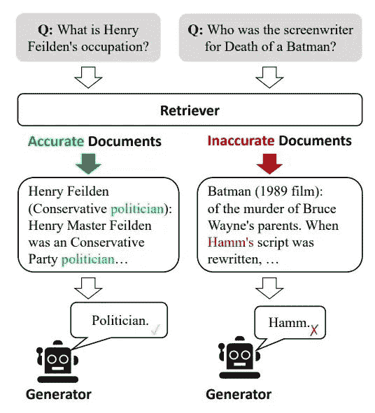

> 低质量的检索器：引入大量无关或误导性信息，阻碍模型获取准确知识，并增加生成过程中的幻觉风险。

> 不加筛选的文档利用：许多 RAG 系统无差别地使用所有检索到的文档，无论其相关性如何，导致错误或不必要数据的整合。

> 低效的文档处理：当前 RAG 方法通常将完整文档作为知识来源，即使大部分文本无关，也会稀释生成质量。

> 依赖静态语料库：基于固定数据库的检索系统无法适应动态信息需求，提供的文档往往有限或次优。

CRAG（Corrective RAG，纠错 RAG）旨在通过引入自我纠错机制，改进文档利用效率，提高生成质量，解决上述问题。具有以下关键特性：

- 检索评估器：轻量组件，用于评估检索到的文档对查询的相关性和可靠性，并分配置信度评分。
- 触发动态行为：根据置信度评分触发不同检索行为（例如“正确”“模糊”“错误”）。
- 结合网络搜索：补充和优化静态数据库检索的结果。
- 分解-重组算法：选择性提取检索文档中的关键信息，丢弃无关部分，优化输入到生成器的数据。
- 即插即用能力：可无缝集成至现有 RAG 系统，无需大规模修改。

## 纠错 RAG 的工作流程

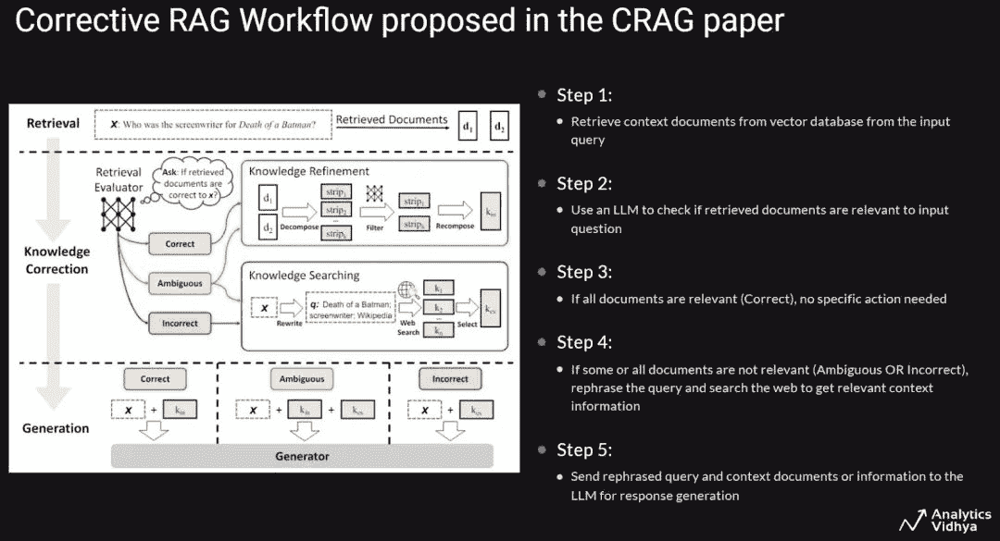

### 检索

> 从向量数据库中使用输入查询检索上下文文档，初步收集可能相关的信息。

> 相关性检查

> 利用 `LLM` 评估检索文档的相关性，确保文档适合问题。

> 验证相关性

> 若所有文档相关：无需纠错，直接进入生成步骤。

> 若存在模糊或错误文档：进入步骤 4。

> 查询重写和搜索

> 若文档模糊或错误：

> 基于 `LLM` 的反馈重写查询。

> 执行网络搜索或替代检索以获取更新且准确的上下文信息。

### 响应生成

> 将优化后的查询和相关上下文文档（原始或纠正后）发送至 `LLM` 生成最终答案。

> 正确的文档：直接使用检索文档生成答案。

> 模糊的文档：结合原始和新上下文文档生成答案。

> 错误的文档：使用纠正后的查询和新检索的文档生成答案。

> 此工作流程通过迭代纠错和优化，确保高精度响应。

## 主动型纠错 RAG 系统的工作流程

通过结合一些检查点，针对上下文缺失的查询执行网络搜索，系统的主要步骤如下：

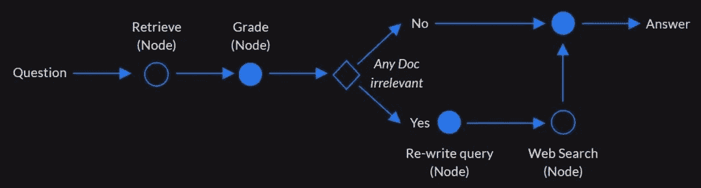

1. **查询（Question）**

   用户输入的问题启动流程。

2. **检索节点（Retrieve Node）**

   系统从向量数据库中检索潜在回答的上下文文档。

3. **评估节点（Grade Node）**

   由 `LLM` 评估文档的相关性：

   - 完全相关：进入生成答案的节点。
   - 部分无关：标记问题并重写查询。

### 评估后的分支场景

> 生成答案节点：如果所有文档都相关，`LLM` 快速生成响应。

> 重写查询节点：若结果有误，重写查询以改善检索。

> 网络搜索节点：通过网络搜索获取额外上下文。

> 生成答案节点：利用优化后的查询和新数据生成答案。

## 主动型纠错 RAG 架构

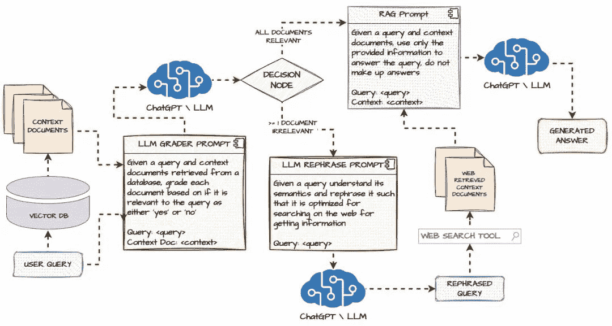

### 核心步骤

> 查询与初始检索：用户输入查询，系统从向量数据库检索上下文文档。

> 文档评估：`LLM` 评估每个文档的相关性。

> 完全相关：直接生成答案。

> 存在无关文档：触发纠正步骤。

> 查询重写：`LLM` 重写查询以优化网络检索。

> 附加检索：网络搜索获取改进的上下文文档。

> 响应生成：通过验证的上下文文档生成答案。

### CRAG 的作用

> 错误修正：通过识别无关文档并检索更好的上下文，迭代提高准确性。

> 主动调整：根据 `LLM` 的评估，动态调整操作（如重写查询、执行网络搜索）。

> 事实性保障：通过验证的上下文文档生成答案，降低幻觉或错误响应的风险。

## 总结

Agentic Corrective RAG 通过动态纠正和优化检索结果，有效提升了生成质量，同时最大限度减少了因无关或错误文档带来的误导。它为 RAG 系统的可靠性、灵活性和效率提供了一种创新性解决方案。

# 自反射 RAG

自反射 RAG（Self-reflective RAG）是自然语言处理（NLP）中的一种高级方法，将检索方法与生成模型结合，同时引入自我反思和逻辑推理机制。它通过对检索与生成过程中的低质量结果进行自我校正（如重写问题、剔除不相关或虚假的文档）来提高整体输出质量。

## 关键特性

### 动态检索（按需适应性检索）

不同于传统 RAG 固定检索文档的方式，自反射 RAG 基于生成过程动态决定是否需要检索，并调用“反思标记”作为信号进行判断。

#### 反思标记（Reflection Tokens）

> 检索标记：判断是否需要从外部获取更多信息。

> 批判标记：自评生成内容的质量、相关性或完整性，确保生成结果符合引文来源。

### 质量保证

`LLM` 使用批判标记自评输出质量（如是否有支持性证据或生成片段的逻辑一致性），显著减少幻觉问题。

### 灵活可控

通过反思标记，模型能根据任务需求动态调整行为，既能处理需检索任务，也能独立生成无需检索的内容。

### 性能提升

动态检索与自我批判的结合使自反射 RAG 在生成高质量、有证据支持的输出上优于传统 RAG 和标准 `LLM`。

## 自反射 RAG 的架构

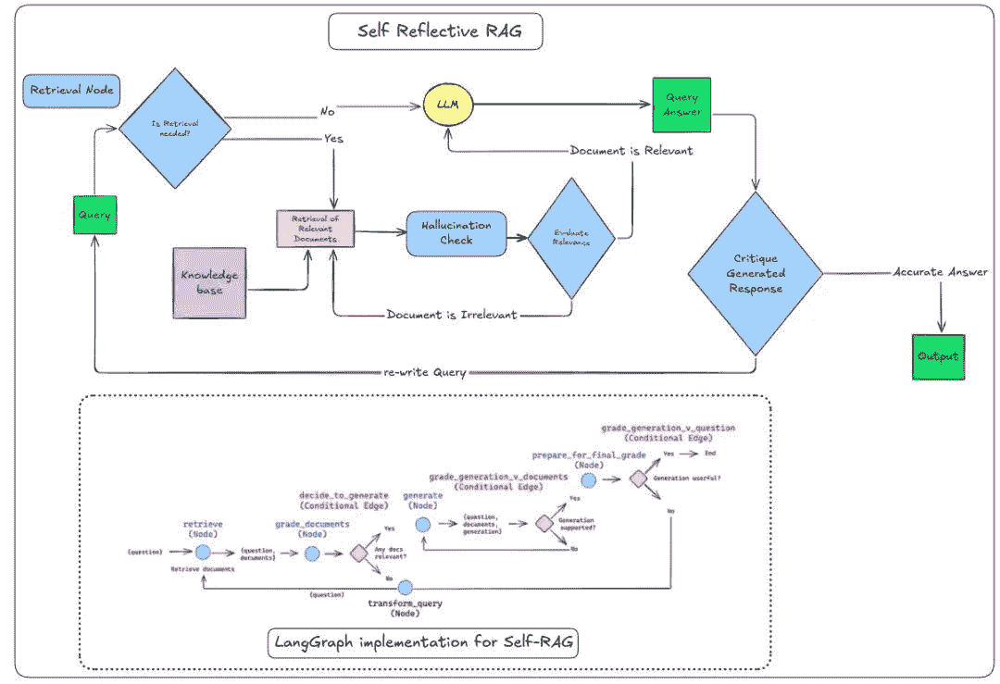

## 核心流程

> 初始查询

> 查询进入系统，模型评估是否需要检索外部信息。

> 按需检索

> 如果不需要检索，直接由 `LLM` 生成回答；

> 若需要检索，系统调用知识库获取相关文档。

> 文档评估与筛选

> 检索到的文档会经过相关性评估，无关文档被剔除，若必要会重新检索。

> 生成与验证

> `LLM` 根据相关文档生成初步回答。

> 对生成的回答进行“幻觉检查”（验证答案是否符合上下文，避免不支持的内容）。

> 自反思与迭代

> 系统批判性地评估回答质量，若不满意则重写查询或重新生成，直至输出准确答案。

> 最终输出

> 生成经过验证的准确回答作为最终结果。

基本的 `RAG` 流程是通过检索的文档生成输出内容。高级 `RAG` 方法（例如路由）允许 `LLM` 根据查询选择不同的检索器。自反射 `RAG` 在此基础上增加了反馈循环机制，可以在需要时重新生成查询或重新检索文档。状态机非常适合这种迭代过程，它定义了步骤（例如检索、查询优化）和状态转换，使系统能够动态调整，例如在检索到的文档无关时重新查询。

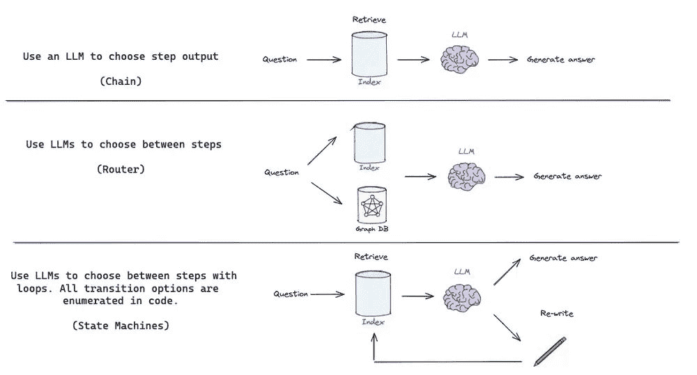

## 传统 RAG 和自反射 RAG 的区别

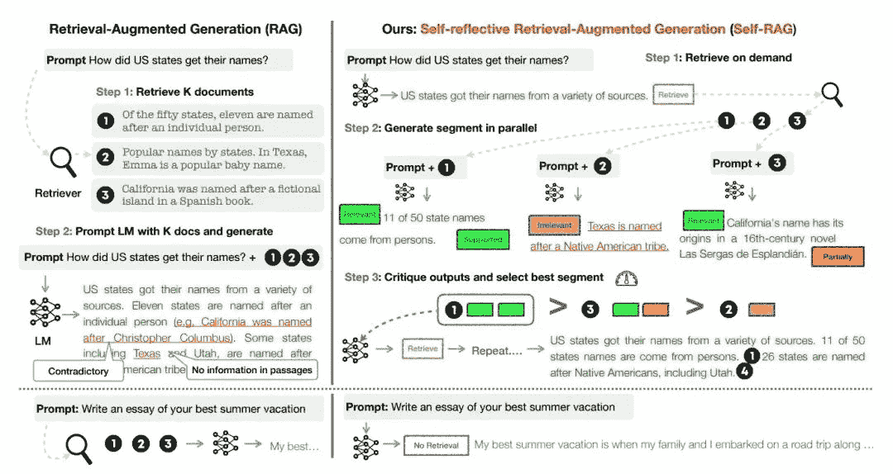

### 查询“美国各州名字的由来”

> 传统 `RAG`：

> 检索大量文档（包括可能无关的信息），生成混杂回答，容易出现逻辑错误或矛盾。

> 自反射 `RAG`：

> 按需检索与州名来源相关文档，分段生成具体答案（如“得州命名的历史”“加州的名字来源”），逐段验证并整合，确保回答准确。

### 生成“描述一次暑假旅行”

> 传统 `RAG`：不必要地检索外部文档，浪费资源。

> 自反射 `RAG`：识别任务无需检索，直接生成基于个人经验的回答。

## 总结

自反射 RAG 的优势在于动态决策能力、自我批判机制和输出质量保证，其通过反思与迭代机制大幅提升了回答的准确性、相关性和逻辑性，特别适用于需要证据支持的复杂任务或对高质量生成内容有严格要求的场景。

# Speculative RAG

Speculative RAG 是一种智能框架，旨在使 `LLM` 在回答问题时更快速且更准确。它通过以下两种语言模型的分工实现这一目标：

> 一个小型的专用模型，快速起草潜在答案。

> 一个大型的通用模型，核查这些草稿并选择最佳答案。

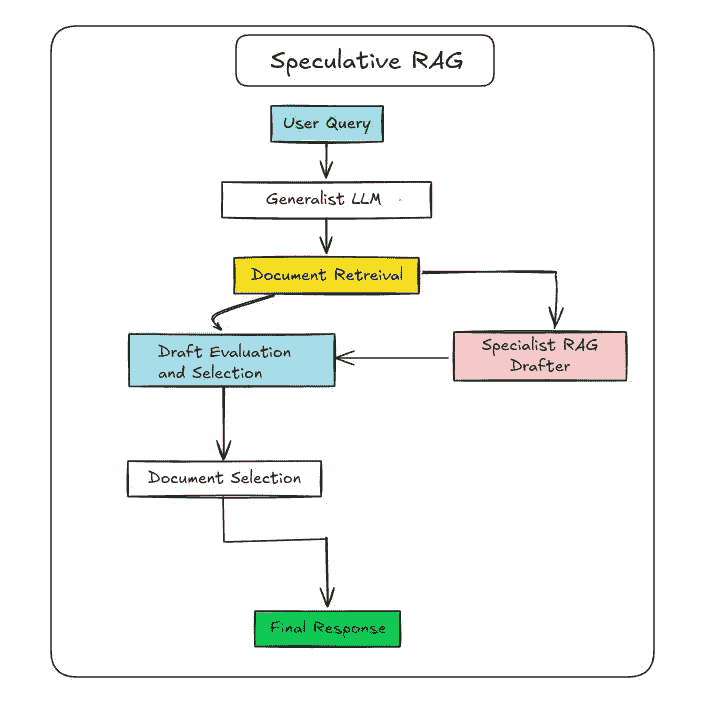

## 为什么需要 Speculative RAG？

当你提出问题，尤其是需要精准或最新信息的问题（如“新款 iPhone 的最新功能是什么？”）时，常规的 `LLM` 通常存在以下问题：

> 可能“幻觉”：模型可能会自信地给出错误或虚构的答案。

> 依赖过时知识：如果模型没有接受最新数据的训练，就无法提供最新事实。

> 复杂推理耗时：如果需要处理大量信息（如长文档），模型可能响应缓慢。

这时 `RAG` 登场。`RAG` 从数据库或搜索引擎中检索实时相关文档，并利用这些文档生成答案。但问题在于，`RAG` 在处理大量数据时仍可能速度慢且资源消耗大。

## Speculative RAG 的工作原理

可以将 Speculative RAG 想象成一个两人团队解决难题的过程：

> 步骤 1：收集线索

> “检索器”负责查找与问题相关的文档。例如，如果你问“谁在1980年的电影《朝九晚五》中扮演 Doralee Rhodes？”检索器会提取关于这部电影或音乐剧的文章。

> 步骤 2：起草答案（小型模型）一个较小、速度更快的语言模型（专用起草者）基于这些文档工作：

> 快速创建多个可能答案的草稿。

> 为每个草稿提供推理依据（如说明“此答案基于此来源”）。

> 这个模型类似于快速绘制想法的初级侦探。

> 草稿 1：“Dolly Parton 在1980年的电影《朝九晚五》中扮演了 Doralee Rhodes。”

> 草稿 2：“Doralee Rhodes 是2010年音乐剧《朝九晚五》中的角色。”

> 步骤 3：验证最佳答案（大型模型）一个较大、更强大的语言模型（通用验证者）随后介入，执行以下任务：

> 检查每个草稿的准确性和相关性。

> 根据置信度对草稿评分。

> 选择最佳草稿作为最终答案。

> 草稿 1 得到高分，因为它匹配了电影和问题。

> 草稿 2 得到低分，因为它与音乐剧相关而非电影。

> 最后系统自信地输出：“Dolly Parton 在1980年的电影《朝九晚五》中扮演了 Doralee Rhodes。”

## 为什么这种方法聪明？

> 更快的响应：较小的模型负责起草草稿，加快了速度。

> 更准确的答案：较大的模型专注于审查草稿，确保高质量结果。

> 高效资源利用：较大的模型不会浪费时间处理不必要的细节，只负责验证。

## Speculative RAG 的主要优点

> 平衡性能：小模型快速起草，大模型验证准确性。

> 避免浪费精力：大模型只检查小模型建议的内容。

> 实际应用场景：适合回答需要推理和实时、最新信息的复杂问题。

Speculative RAG 就像拥有一个聪明的助手（专用起草者）和一个细致的编辑（通用验证者），确保你的答案既快速又准确！

## RAG 方法对比

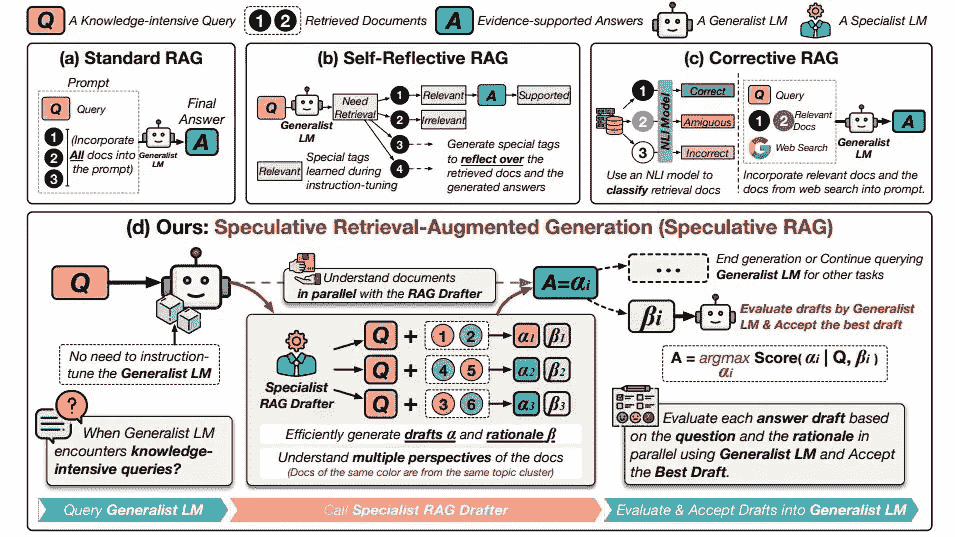

### 标准 RAG

工作方式：从知识库中检索文档并直接将其融入通用语言模型的输入中。

弱点：给通用语言模型增加了负担（需要同时理解文档并生成答案），无法区分相关和无关信息。

### 自反射 RAG

新增内容：通用语言模型学会分类检索文档是否相关，并根据这些分类调整自身。

弱点：需要对通用语言模型进行额外的指令微调，效率可能较低。

### CRAG

新增内容：使用外部自然语言推理（`NLI`）模型将文档分类为“正确”“模糊”或“错误”，再将它们融入通用语言模型的提示中。

弱点：增加了一个额外的 `NLI` 步骤，降低了处理速度。

### Speculative RAG

关键创新：将任务分为两部分：

一个专用 `RAG` 起草者（较小的模型）快速生成多个草稿及其推理依据。

通用语言模型评估这些草稿并选择最佳答案。

具体流程：

问题输入：系统接收需要知识密集型的问题，并检索相关文档。

并行起草：专用起草者对检索文档的子集并行工作，每个子集生成：

- 草稿答案 (`α`)
- 相关推理 (`β`)

验证和选择：通用语言模型评估所有草稿 (`α1`、`α2`、`α3`) 及其推理，并分配分数，选择最可信的草稿作为最终答案。

> Speculative RAG 框架在速度和准确性之间实现了完美平衡：

> 小型专用语言模型负责主要工作（基于检索的文档起草答案）。

> 大型通用语言模型确保最终输出准确且有据可依。

> 这种方法通过减少延迟并保持最先进的准确性，优于之前的方法。

# Self Route Agentic RAG

Self Route Agentic RAG 是一种 `Agentic RAG` 系统的设计模式，其中 `LLM` 在处理查询时扮演了主动决策的角色。该方法依赖于 `LLM` 的自我反思能力，判断它是否能够根据提供的上下文生成准确的响应。如果模型判定无法生成可靠的答案，它会将查询路由到其他方法（如长上下文模型）进行进一步处理。此架构利用 `LLM` 的内部校准机制判断可答性，以优化性能和成本。

该方法首次提出于论文《Retrieval Augmented Generation or Long-Context LLMs? A Comprehensive Study and Hybrid Approach》，结合了 `RAG` 与长上下文（`LC`），在保持与 `LC` 相当性能的同时实现了成本效率。

## Self Route 的关键组件

### LLM 决策

评估查询是否可以用提供的上下文回答。

### 路由

如果查询可回答，立即处理；否则，将其路由到具有更多或完整上下文的长上下文模型。

### 效率与准确性

在避免不必要计算的同时，仅在需要时使用长上下文模型，实现了成本效率和平衡性能。

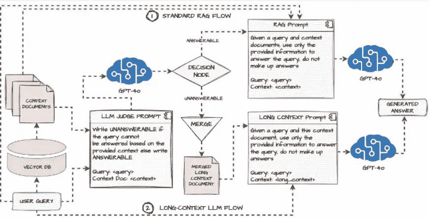

## 标准 RAG 流程

### 输入查询与上下文检索

用户提交查询。

使用向量数据库检索相关的上下文文档，根据查询与预索引文档的匹配程度选取内容。

### 决策节点

长上下文 `LLM`（如 `GPT-4o` 或 `Gemini`）接收查询与上下文文档。

使用 `LLM` 判断提示（`Judge Prompt`）：

判断上下文是否足够回答查询。

### 决策结果

如果判定为可回答（`ANSWERABLE`），进入标准 `RAG` 提示流程。

如果判定为不可回答（`UNANSWERABLE`），切换至长上下文 `LLM` 流程。

### RAG 提示（针对可回答的查询）

当上下文足够时，使用以下提示生成响应：

`GPT-4o` 模型处理 `RAG` 提示，根据提供的上下文生成答案。

### 回答生成

## 长上下文 LLM 流程

### 触发条件

> 如果决策节点判定查询不可回答，进入长上下文 `LLM` 流程。

> 合并上下文文档：

> `LLM` 判断提示识别出上下文不足，因此通过合并操作将多个相关文档整合为单一的长上下文文档，以增强上下文连续性。

> 长上下文提示：

> 使用合并后的文档作为输入，并生成以下提示：

> `GPT-4o` 模型处理长上下文提示，根据丰富的上下文生成响应。

### 回答生成

#### 关键特性与工作流程

##### 动态决策

架构动态评估上下文是否足以回答查询，确保系统能根据输入复杂度进行适应性调整。

##### 双层回答生成

标准 `RAG` 流程：处理具有足够上下文的简单查询。

长上下文 `LLM` 流程：处理需要扩展或合并上下文的复杂查询。

#### 精细化控制的提示

在 `RAG` 提示和长上下文提示中加入明确指令，确保模型严格基于提供的上下文生成答案，避免产生幻觉。

#### 可扩展的向量数据库

系统通过在决策前从向量数据库中检索相关上下文，高效扩展查询处理能力。

# 总结

> 随着 RAG 领域的不断发展，Agentic RAG 系统已经成为一项变革性创新，将传统的 RAG 工作流程与 AI Agent 的自主性和适应性相结合。这种融合使系统能够动态地检索相关知识，智能优化上下文，并以高精度执行多步骤任务。

> 从 Agentic RAG Routers 和 Self-Reflective RAG 到诸如 Speculative RAG 和 Self-Route RAG）这样的高级架构，每种方法都针对特定挑战（如无关检索、推理错误或计算效率低下）提出了解决方案。这些系统在提升准确性、适应性和可扩展性方面表现出了显著进步，应用领域覆盖了客户支持、工作流自动化和研究辅助等多种场景。

> 通过将生成式 AI 与先进的检索机制相结合，Agentic RAG 不仅提高了效率，还为未来的 AI 创新奠定了基础。随着我们迈向 2025 年，这些技术将重新定义我们利用数据、自动化工作流以及解决复杂问题的方式，使其成为企业和开发者不可或缺的工具组合。
