# 基于RAG实现一套企业智能客服系统

> 来源：[https://v11enp9ok1h.feishu.cn/docx/Iek1dmpSBoiepCxYPsCcgG5Onzc](https://v11enp9ok1h.feishu.cn/docx/Iek1dmpSBoiepCxYPsCcgG5Onzc)

## 基于RAG实现一套企业智能客服系统

以下网站是美团外卖中的常见问题：

[**美团外卖 - 常见问题**](https://waimai.meituan.com/help/faq)

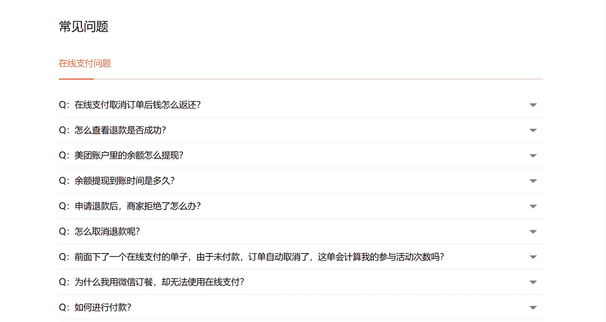

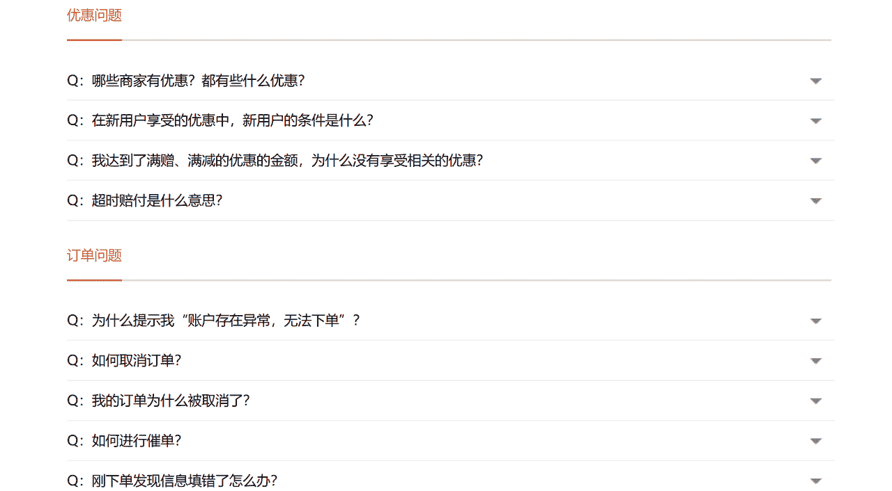

> 我们希望利用它和**大模型**的自然语言理解能力来打造一套企业智能客服系统。

> 首先，我们如果直接在**ChatGPT**中问：美团外卖中在线支付取消订单后钱怎么返还？

+   **ChatGPT****给的答案是：**

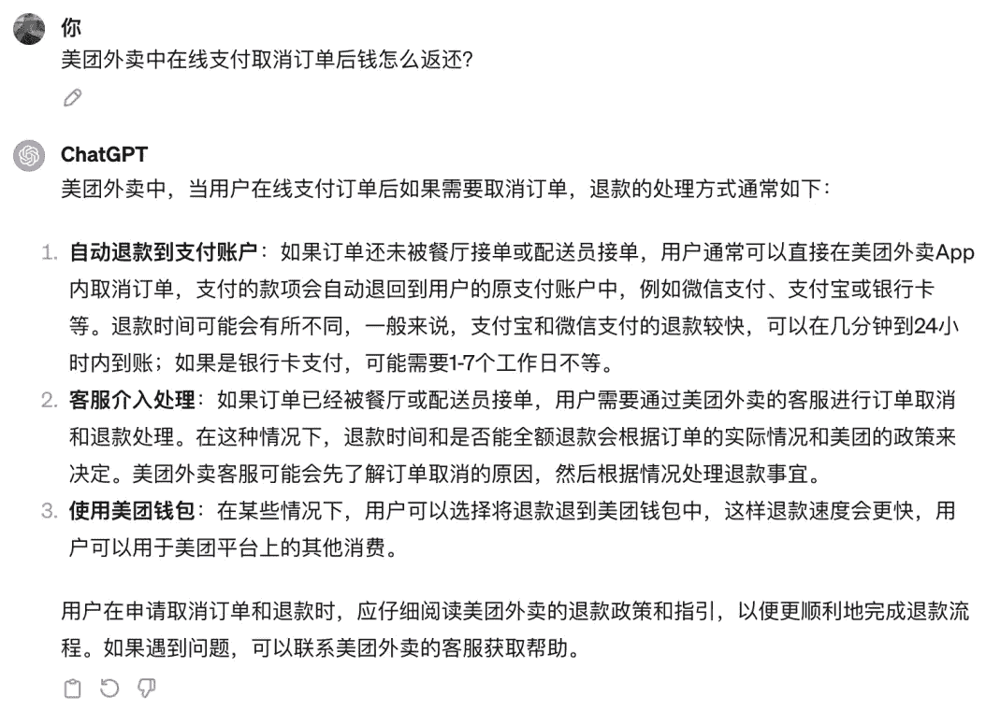

+    **而智能客服的答案为：**

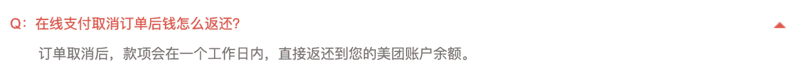

所以，直接利用**ChatGPT**来作为智能客服系统行不通**，它能够理解你**的问题，但是它并不能给你确切的答案，因为对于ChatGPT来说**，它并不知道企业内部的**专有数据，而这个时候，我们就可以利用langchain4j来给企业内部搭一套智能客服系统。

## 整理数据

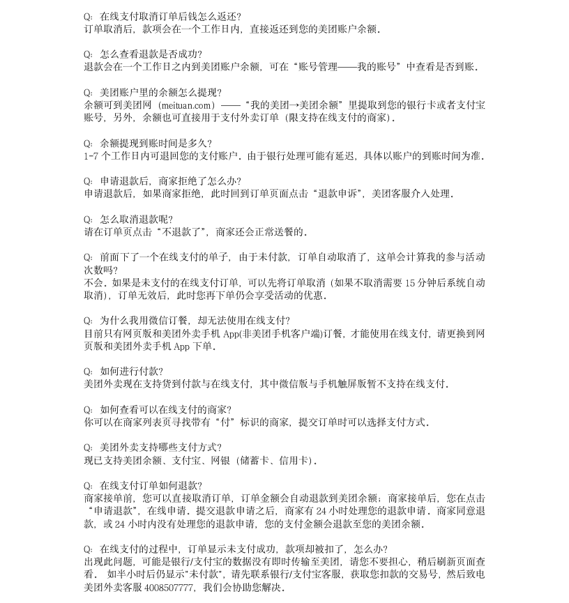

[meituan-qa.txt](https://internal-api-drive-stream.feishu.cn/space/api/box/stream/download/all/JF5RbdU9voZUCUxIidwcwH3yn8c)

## 功能实现

### 创建一个工程

直接创建一个普通的**Maven**工程就可以了，然后引入**langchain4j**的依赖和你选择的**大模型**依赖，我这里使用**open-ai**：

```
&lt;dependency&gt;
  &lt;groupId&gt;dev.langchain4j&lt;/groupId&gt;
  &lt;artifactId&gt;langchain4j&lt;/artifactId&gt;
  &lt;version&gt;0.27.1&lt;/version&gt;
&lt;/dependency&gt;

&lt;dependency&gt;
  &lt;groupId&gt;dev.langchain4j&lt;/groupId&gt;
  &lt;artifactId&gt;langchain4j-open-ai&lt;/artifactId&gt;
  &lt;version&gt;0.27.1&lt;/version&gt;
&lt;/dependency&gt;
```

以及**slf4j**的依赖：

```
&lt;dependency&gt;
  &lt;groupId&gt;org.tinylog&lt;/groupId&gt;
  &lt;artifactId&gt;tinylog-impl&lt;/artifactId&gt;
  &lt;version&gt;2.6.2&lt;/version&gt;
&lt;/dependency&gt;
&lt;dependency&gt;
  &lt;groupId&gt;org.tinylog&lt;/groupId&gt;
  &lt;artifactId&gt;slf4j-tinylog&lt;/artifactId&gt;
  &lt;version&gt;2.6.2&lt;/version&gt;
&lt;/dependency&gt;
```

**在****main****方法中进行简单测试：**

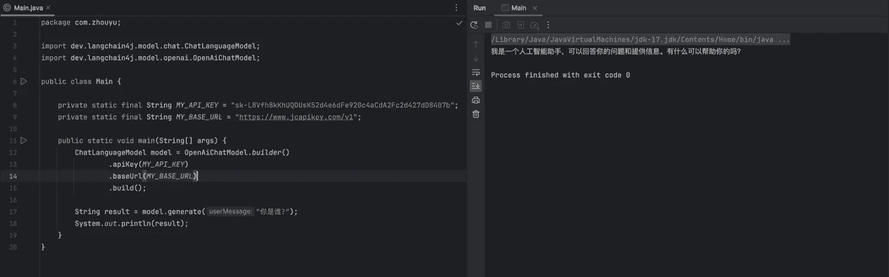

### 定义Agent

我们可以定义一个智能客服专门的**Agent**，比如CustomerSe**rvice**Agent，后续就可以直接这个Agent来充当客服回答问题了，比如：

```
public interface CustomerServiceAgent {

    // 用来回答问题的方案
    String answer(String question);

    // 利用AiServices创建一个CustomerServiceAgent的代理对象
    static CustomerServiceAgent create() {

        // 创建模型
        ChatLanguageModel model = OpenAiChatModel.builder()
                .apiKey(MY_API_KEY)
                .baseUrl(MY_BASE_URL)
                .build();

        // 指定模型，创建并返回代理对象
        return AiServices.builder(CustomerServiceAgent.class)
                .chatLanguageModel(model)
                .build();
    }
}
```

以上Customer**Servic**eAgent接口，提供了一个**answer**方法用来回答**问题，同时提供了cr**eate方法用来利用AiServices生成CustomerServiceAgent代理对象，比如我们可以直接这么来创建并使用CustomerServiceAgent：

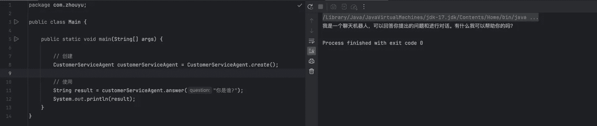

### 导入知识库

上面create方法创建出来的CustomerServiceAgent目前来说只拥有普通大模型的功能，此时的它还没有企业内部的信息，要想让它成为一个智能客服系统，需要将前面整理出来的问答数据送给CustomerServiceAgent。

**加载并解析文件**

我们需要这么来做，首先加载并解析问答txt文件：

```
// 加载并解析文件
Document document;
try {
    Path documentPath = Paths.get(CustomerServiceAgent.class.getClassLoader().getResource(&quot;meituan-qa.txt&quot;).toURI());
    DocumentParser documentParser = new TextDocumentParser();
    document = FileSystemDocumentLoader.loadDocument(documentPath, documentParser);
} catch (URISyntaxException e) {
    throw new RuntimeException(e);
}
```

以上代码我们使用FileSystemDocumentLoader来加载本地文件，利用TextDocumentParser来解析txt文件，最终得到"meituan-qa.txt"文件所对应的Document对象。

####

#### 切分文件

然后需要对文件进行切分，把"meituan-qa.txt"文件中的内容切分成问答对，"meituan-qa.txt"文件内容格式已经被我整理好了，比如：

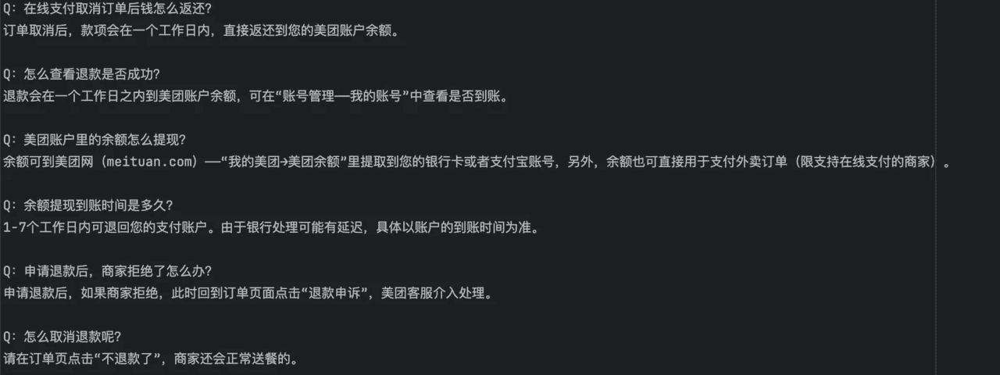

所以我们可以使用正则表达式"\\s*\\R\\s*\\R\\s*"来进行切分，我们自定义一个DocumentSplitter来实现：

```
/**
 * 大都督周瑜（微信: dadudu6789）
 */
public class CustomerServiceDocumentSplitter implements DocumentSplitter {

    @Override
    public List&lt;TextSegment&gt; split(Document document) {

        List&lt;TextSegment&gt; segments = new ArrayList&lt;&gt;();

        String[] parts = split(document.text());
        for (String part : parts) {
            segments.add(TextSegment.from(part));
        }

        return segments;
    }

    public String[] split(String text) {
        return text.split(&quot;\\s*\\R\\s*\\R\\s*&quot;); 
    }
    
}
```

然后使用以下代码对Document对象进行切分就可以了：

```
// 切分文件
DocumentSplitter splitter = new CustomerServiceDocumentSplitter() ;
List&lt;TextSegment&gt; segments = splitter.split(document);
```

切分结果为：

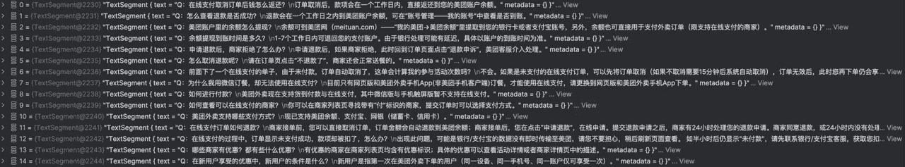

其中每个TextSegment对象就表示切分之后的一段文本，在本项目中就是一个问答对。

#### 文本向量化

得到切分之后的文本后，就可以对文本进行向量化处理了，比如你可以直接使用open-ai的向量化模型接口来进行向量化：

```
EmbeddingModel embeddingModel = OpenAiEmbeddingModel.builder()
    .apiKey(MY_API_KEY)
    .baseUrl(MY_BASE_URL)
    .build();
List&lt;Embedding&gt; embeddings = embeddingModel.embedAll(segments).content();
```

得到的向量化结果为：

```
EmbeddingModel embeddingModel = new AllMiniLmL6V2QuantizedEmbeddingModel();
List&lt;Embedding&gt; embeddings = embeddingModel.embedAll(segments).content();
```

不同的向量化模型效果肯定是有区别，比如A1、A2两个文本，open-ai计算出来的向量可能是比较相似的，而AllMiniLmL6V2QuantizedEmbeddingModel则可能计算出来的向量之间差别较大，所以在实际工作中还是建议使用效果更好的向量化模型。

#### 向量存储

正对拆分后的文本得到向量后，就需要把文本和向量之间的映射关系存储下来，使用CustomerServiceAgent在回答问题时，能够根据向量相似度找到和用户问题相似的知识库问题。

存储向量的代码大致为：

```
EmbeddingStore&lt;TextSegment&gt; embeddingStore = new InMemoryEmbeddingStore&lt;&gt;();
embeddingStore.addAll(embeddings, segments);
```

这是把向量和文本数据直接存在了JVM内存中，本质上就是一个CopyOnWriteArrayList，该List中存储的是Entry对象，而Entry对象则分别存储了文本和向量。

实际工作中，我们肯定需要文本和向量存储可持久化的向量数据库中，你可以选择Chroma、Milvus这种专门的向量数据库，也可以使用Elasticsearch、Redis、PostgreSQL、MongoDb来存储，比如使用Redis需要这么来做。

首先普通的Redis是不支持向量存储和查询的，需要额外的redisearch模块，我这边是直接使用docker来运行一个带有redisearch模块的redis容器的，命令为：

```
docker run -p 6379:6379 redis/redis-stack-server:latest
```

注意端口6379不要和你现有的Redis冲突了。

然后就可以使用以下代码把向量存到redis中了：

```
EmbeddingStore&lt;TextSegment&gt; embeddingStore = RedisEmbeddingStore.builder()
    .host(&quot;127.0.0.1&quot;)
    .port(6379)
    .dimension(384)
    .build();
embeddingStore.addAll(embeddings, segments);
```

这里的dimension表示向量维度，也就是上面数组的大小，执行完以上代码后向量和文本就会存储到Redis中了。

可以使用以下命令来查看：

```
redis-cli FT.SEARCH embedding-index &quot;*&quot; LIMIT 0 10
```

能得到结果就证明是正常的：

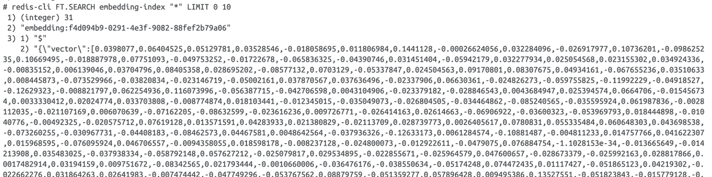

如果想删除某个index和对应数据，可以：

```
redis-cli FT.DROPINDEX embedding-index DD
```

## 组装ContentRetriever

当把向量存入向量数据库后，就可以组装一个ContentRetriever用来后续进行内容查找了，组装代码为：

```
ContentRetriever contentRetriever = EmbeddingStoreContentRetriever.builder()
        .embeddingStore(embeddingStore)
        .embeddingModel(embeddingModel)
        .maxResults(5) // 最相似的5个结果
        .minScore(0.8) // 只找相似度在0.8以上的内容
        .build();
```

以上代码将向量数据库和向量模型组装成了一个ContentRetriever，并指定ContentRetriever后续查找内容时，只返回相似度在0.8以上的前5个结果。

我现在针对以下原始问题来进行提问：

```
Q：余额提现到账时间是多久？
1-7个工作日内可退回您的支付账户。由于银行处理可能有延迟，具体以账户的到账时间为准。
```

我的问题和原始问题并不完全相同，但是我希望ContentRetriever能根据我的问题找到和问题相似的原始问题和答案：

```
Query query = new Query(&quot;余额提现什么时候到账？&quot;);
List&lt;Content&gt; retrieve = contentRetriever.retrieve(query);
```

但是得到的答案为：

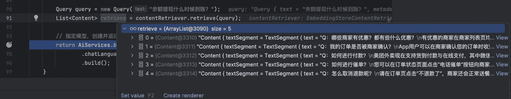

## 效果优化

发现答案不太理想，我们预期的原始问题并没有在这5个中，我们换成open-ai的向量化模型来试试，注意使用open-ai得到的向量维度为1536，所以记得修改dimension：

```
ContentRetriever contentRetriever = EmbeddingStoreContentRetriever.builder()
                .embeddingStore(embeddingStore)
                .embeddingModel(embeddingModel)
                .maxResults(5) // 最相似的5个结果
                .minScore(0.8) // 只找相似度在0.8以上的内容
                .build();
```

改为之后得到的结果为：

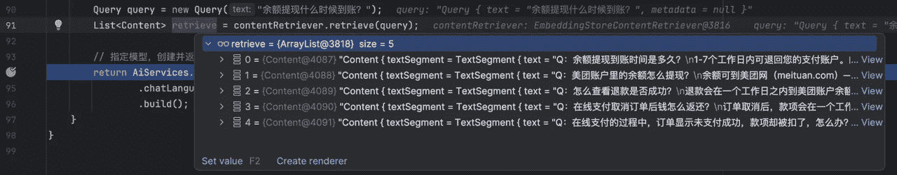

发现答案就比较理想了，"余额提现到账时间是多久？"排在了第一个，说明和原始问题最匹配，这里也能看出不同向量化模型之间的差距。

当然，我们也可以从另外一个角度来进行优化，由于我们在做文本向量化时，使用的是“问题+答案”一起做的向量化，而查询的时候只使用了“问题”做向量化，由于两者不一致，导致某些较弱的向量化模型生成出来的向量偏离的更远，导致在做向量匹配时出现了差距，那能不能在做文本向量化时，也只使用“问题”来做向量化呢？

我们之前是把整个TextSegment对象一起做的向量化，相当于“问题+答案”一起做的向量化：

```
List&lt;Embedding&gt; embeddings = embeddingModel.embedAll(segments).content();
```

所以我们只需要将TextSegment中的问题提取出来然后做向量化就可以了，可以这么做：

```
EmbeddingModel embeddingModel = new AllMiniLmL6V2QuantizedEmbeddingModel();
// 将问题抽取出来单独进行向量化
List&lt;TextSegment&gt; questions = new ArrayList&lt;&gt;();
for (TextSegment segment : segments) {
    questions.add(TextSegment.from(segment.text().split(&quot;\n&quot;)[0]));
}
List&lt;Embedding&gt; embeddings = embeddingModel.embedAll(questions).content();
```

记得将dimension改回384，然后我们来看效果：

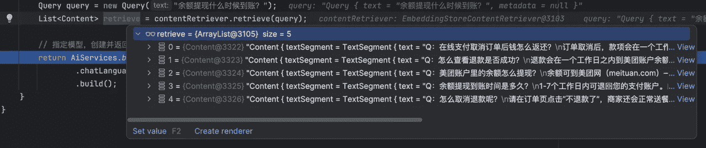

效果比上一次提升了，至少原始问题已经出现了，之所以还没有出现在第一个，那就是AllMiniLmL6V2QuantizedEmbeddingModel这个向量化模型确实效果不咋地，比较它比较小，而不想open-ai那种大的向量化模型。

## 整合大模型

当我们能根据用户问题匹配到原始问题和答案后，该如何将问题的答案返回给用户呢？比如今天是2024年3月17号，假如用户问“今天的余额提现，最晚什么时候能到账？”，作为智能客服系统，能不能直接告诉客户具体的日期呢，而不是只返回一个“1-7个工作日内可退回您的支付账户”让客户来算日期，实现这个功能就可以结合大模型来实现了。

在创建了ContentRetriever之后，我们可以通过AiServices来整合它与大模型：

```
// 构造ChatMemory，用来保存历史聊天记录
ChatMemory chatMemory = MessageWindowChatMemory.withMaxMessages(10);

// 指定模型，创建并返回代理对象
return AiServices.builder(CustomerServiceAgent.class)
    .chatLanguageModel(model)
    .contentRetriever(contentRetriever)
    .chatMemory(chatMemory)
    .build();
```

通过AiServices指定了大模型、ContentRetriever，以及一个用来记录历史聊天记录的ChatMemory，这样AiServices就可以创建出来一个CustomerServiceAgent代理对象进行使用了：

```
// 创建
CustomerServiceAgent customerServiceAgent = CustomerServiceAgent.create();

// 使用
String result = customerServiceAgent.answer(&quot;今天的余额提现，最晚什么时候能到账？&quot;);
System.out.println(result);
```

让我们来看看结果：

```
根据以上信息，余额提现到账时间为1-7个工作日内，具体以账户的到账时间为准。因此，最迟可能在7个工作日内到账。您可以在美团账户的“账号管理——我的账号”中查看是否到账。
```

没有达到我们想要的效果，我们可以这么问：

```
// 创建
CustomerServiceAgent customerServiceAgent = CustomerServiceAgent.create();

// 使用
String result = customerServiceAgent.answer(&quot;今天的余额提现，最晚哪天能到账？给我具体的日期&quot;);
System.out.println(result);
```

给的答案是：

```
如果提现是在工作日内进行的话，最晚最晚会在7个工作日内到账。如果提现是在周五进行的话，最晚会在下周的周五到账。
```

我继续问：

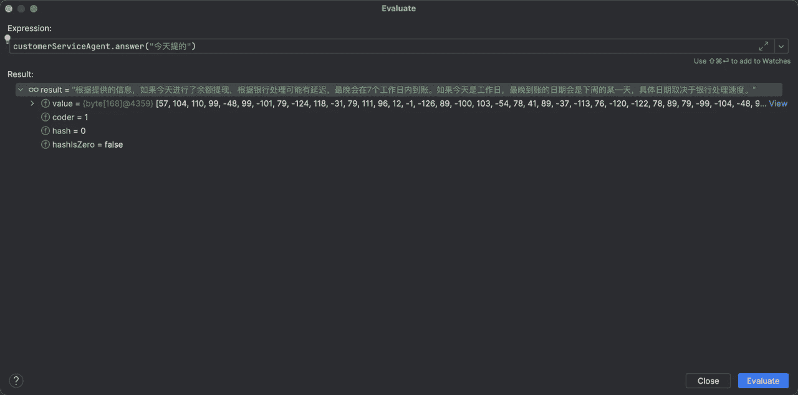

继续问：


继续问：

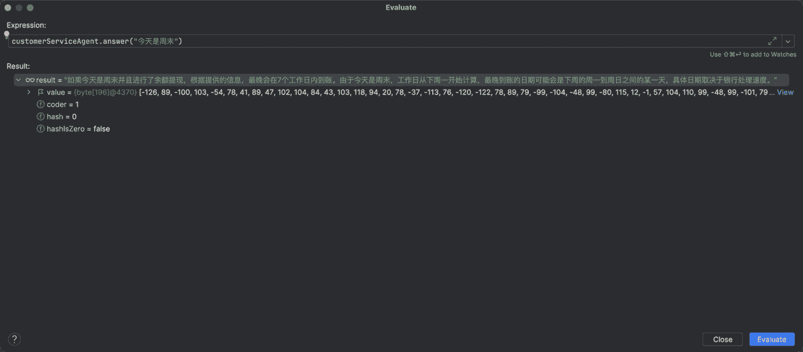

通过这个过程，我们发现虽然整合了大模型，但是大模型似乎对今天是不是周末、是不是工作日这些不太智能，那这就需要利用langchain4j的Tools技术了。

## Tool

定义一个Tool：

```
public class DateCalculator {

    @Tool(&quot;计算指定天数后的具体日期&quot;)
    String date(Integer days) {
        return LocalDate.now().plusDays(days).toString();
    }
}
```

@Tool就表示定义了一个Tool，这个Tool需要绑定到AiService中：

```
return AiServices.builder(CustomerServiceAgent.class)
                .chatLanguageModel(model)
                .contentRetriever(contentRetriever)
                .chatMemory(chatMemory)
                .tools(new DateCalculator())
                .build();
```

这样大模型在得到初步答案后，会自动匹配到这个Tool，因为我问的是“最晚”，所以大模型能把“1-7”中的“7”提出来并传给我定义的Tool，从而算出具体的日期：

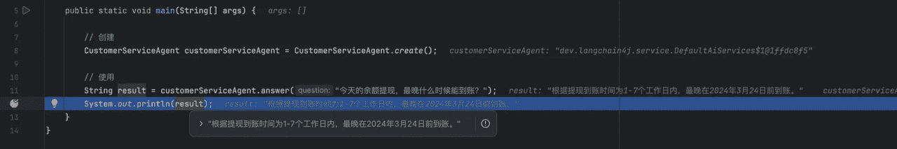

到这，一个智能客服系统算是初具雏形了，这中间也涉及到了langchain4j中最为关键的几个核心组件，大家可以基于以上流程在自己公司内部也搭建这么一套系统，当然，可能需要针对实际情况做各种优化，接下来，让我们来针对每个组件来进一步分析其实现原理，从而能够更好的针对实际情况进行调整或扩展。

<https://v11enp9ok1h.feishu.cn/sync/Ipw1d27gNsv3OAbo3N7cks4ZnJf>