# RAG Flow的设计思路

> 来源：[https://v11enp9ok1h.feishu.cn/docx/EqsVd24iaoK74kxzfXCcKrzzn0e](https://v11enp9ok1h.feishu.cn/docx/EqsVd24iaoK74kxzfXCcKrzzn0e)

# RAG Flow的设计思路

> **本文，我们将从三个方面深入探****讨**RAG Flow的设计思路，分别是典型的 RAG Flow模式、特定的 RAG 流实现以及最佳的行业案例。

> 在**典**型的 RAG Flow模式方面，我们将介绍以下3种微调阶段模式和4种推理阶段模式。

## **一、微调阶段**

### **1、检索器微调**

在RAG流程中，对检索器的微调，常用方法包括：

+   **直接微调**。根据自有的领域数据或开源的检索数据，对稠密检索器进行微调

+   添加可训练的Adapter 模块。API -base的编码模型，无法直接微调。添加Adapter模块，可以让Embedding更好的表示私有的数据。另一方面通过Adapter模块，可以更好地对齐下游任务

+   LSR(LM-supervised Retrieval）根据LLM最后生成的结果去微调检索器

+   **LLM Reward RL**。仍然是以LLM输出结果作为监督信号。通过强化学习让Retriever去对齐生成器。

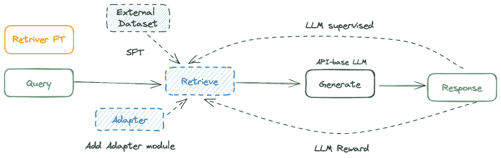

### **2、生成器微调**

对生成器的微调，主要的方法包括：

+   **直接微调**。通过外部数据集微调可以为生成器补充额外的知识。定制化模型输入和输出

+   **GPT-4蒸馏**。使用开源模型时，一个简单且有效的方法就是从利用GPT-4批量构建微调数据，来提高开源模型的能力

+   **基于反馈的强化学习(RLHF)****。**根据最终的生成回答的反馈进行强化学习，除了使用人类评价，也可以使用GPT-4作为评判法官。

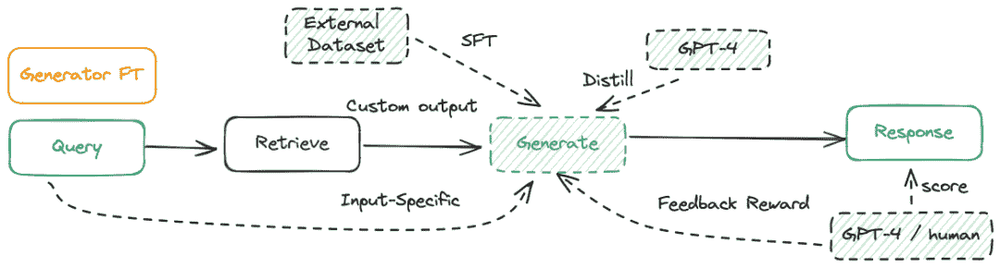

### **3、协同微调**

**在RAG系统中同时对检**索器和生成器进行微调，这也是Modular RAG的特点之一。需要注意是，系统微调强调的是让检索器和生成器之间的配合。分别对检索器和生成器微调严格上属于前两者的组合，并不是属于协同。

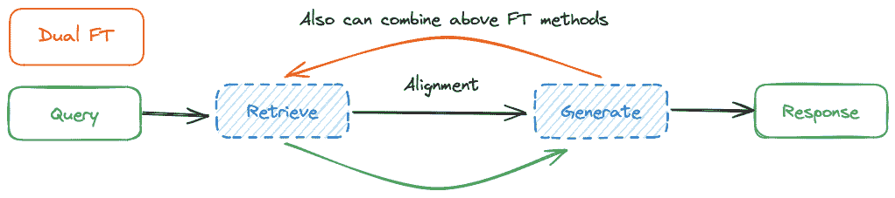

一个典型的实现如**RA-DIT**。分别对LLM和检索器进行微调。LM-ft组件通过更 新LLM来最大化给定检索增强指令情况下正确答案的可能性。R-ft组件通过更 新检索器来最小化检索器分数分布与LLM偏好之间的KL散度。

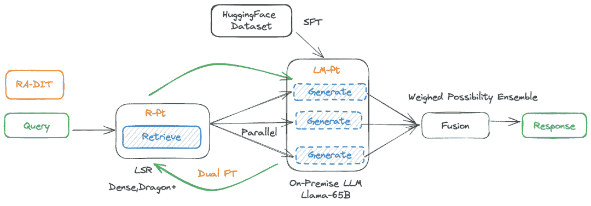

## **二、推理阶段**

### **一、Sequential**

线性的结构的**RAG Flow**，**模块线性的组织成流水线，**如果拥有Pre-Retr**ieval 和Po**st-Retrieval 两个Module Type，则是典型的Advanced RAG范式，如果去掉则是典型的Naive RAG范式。

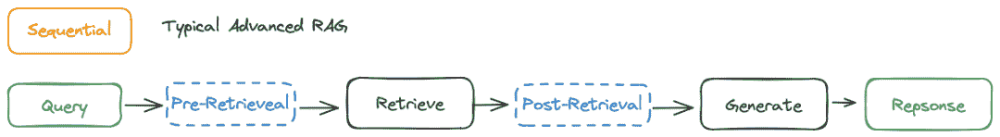

Sequential是目前使用最多的RAG Pipeline，其中在最常使用的搭配如下，在检索前增加Query Rewrite，在检索后增加Rerank的算子。例如QAnything。

Rewrite-Retrieve-Read也是典型的序列结构。其中jQuery Rewrite模块是一个小型的可训练的语言模型，并通过最终LLM的输出结果作为奖励.在强化学习的背景下，重写器优化被形式化为一个马尔科夫决策过程。检索器选用了稀疏编码器BM25。

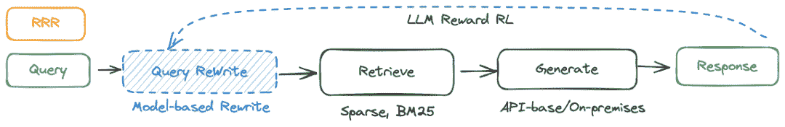

### **2、Conditional**

条件结构的RAG Flow，根据不同的条件选择不同的RAG路线。通常由一个Routing模块进行路由，判断依据包括通常包括Query的关键词或语义。路由到不同的路线，通常根据问题的类型，适用的场景路由到不同的Flow中。

例如当用户提问到严肃的问题，政治问题或是娱乐问题，对大模型幻觉的容忍度是不同的。不同路由分支通常在检索源、检索流程、配置信息、模型选择和Prompt上进行差异化。

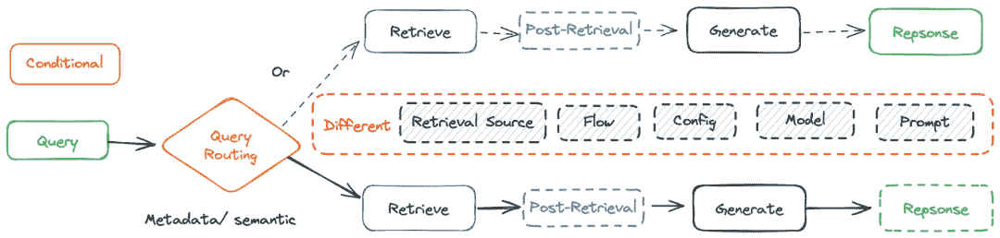

一个Conditional RAG的经典Implementation 是semantic Router。

### **3、Branching**

分支结构的RAG Flow。不同于Conditional中是要在多条分支中选择一条，Branching则是有多个分支并行。从结构上可以分成两类：

+   **检索前分支 (Multi-Query,**** **Parallel Retrieval)。对原始Query进行扩展，得到多个子Query，然后对每一个子Query分别进行检索，检索后就可以选择立即根据子问题和对应检索来的内容生成答案，也可以只使用拓展检索出来的内容最后合并到统一上下文中进行生成

+   **检索后分支 (Single Query, ****P**arallel Generation)。 保持原来的Query，检索到多个文档块后，并行使用原始Query和每一个文档块进行生成，最后将生成的结果合并到一起。

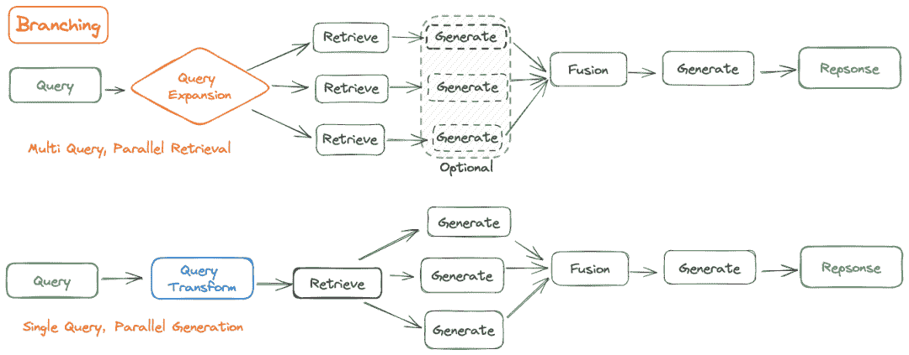

REPLUG就是一个典型的检索后分支的分结构，根据每一个分支预测token的概率，通过Weighted possibility Ensemble 将不同的分支聚合，并通过最后生成结果作作为反馈微调检索器Contriever。

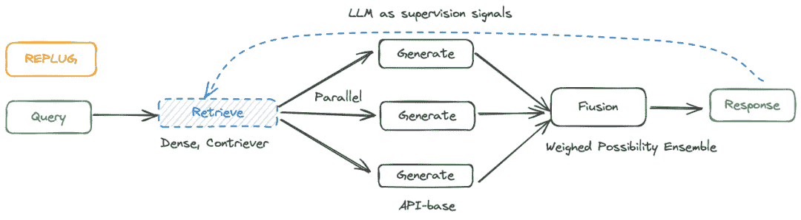

### **4、Loop**

> 具有环状结构的RAG Flow，这也是的Modular RAG的一个重要特点，检索和推理步骤相互影响的。通常包括一个Judge模块，用于控制流程。具体又可以分成迭代、递归和主动检索三种。

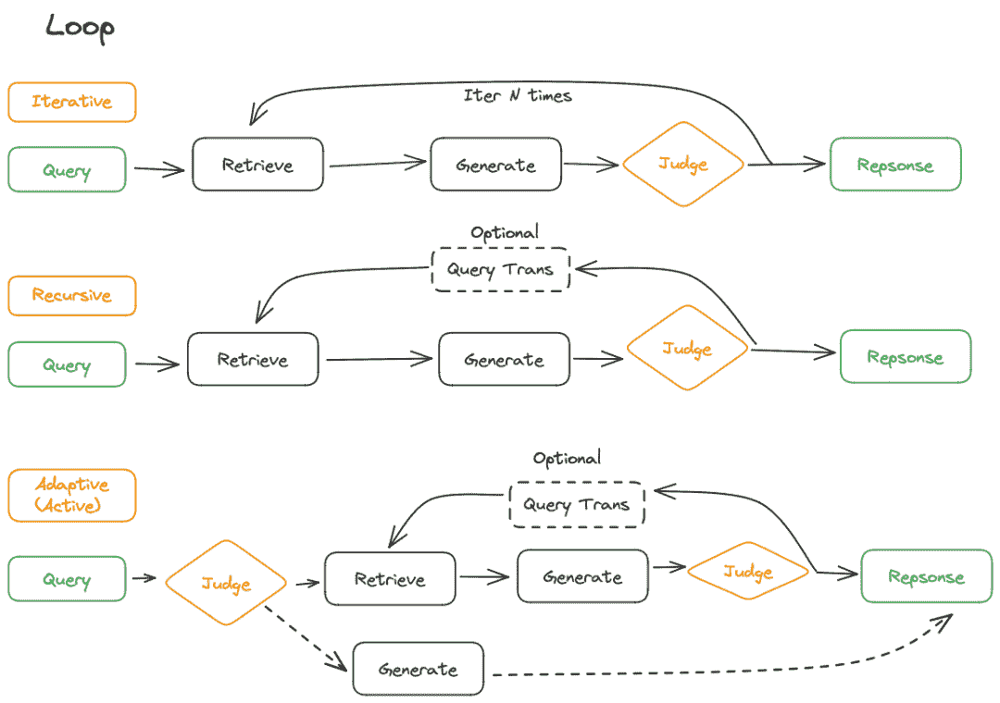

#### Iterative Retrieval

+   有时候单次检索和生成的并不能很好的解决一些需要大量知识的复杂的问题。因此可以使用迭代的方式进行RAG,通常来说迭代检索都有一个固定的迭代次数。迭代检索一个典型的案例是是ITER-RETGEN。

+   在每次迭代中，ITER-RETGEN利用前一次迭代的模型输出作为特 定上下文，帮助检索更相关的知识，这可能有助于改进模型生成。循序的终止通过预设的迭代次数来判断。

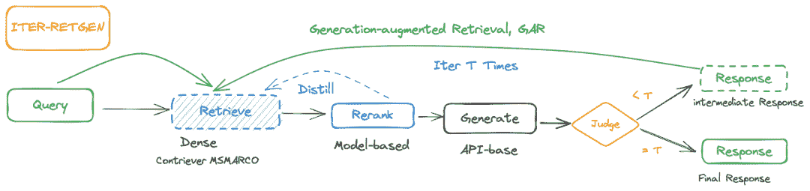

#### Recursive Retrieval

不同于迭代检索，递归检索的特点是有明显依赖上一步并不断深入的检索。通常有判断机制作为递归检索的出口。在RAG系统中，递归检索的通常要搭配Query Transformation，每次检索时依赖于新改写后的Query。。

一个典型的递归检索实现例如ToC。从初始问题(Ambiguous Question,AQ) ,通过递归执行RAC（递归澄清方法,Retrieval-Augmented Clarification）逐步插入子节点到澄清树中，在每个扩展步骤中，根据当前查询重新对段落进行重新排名并生成一个(Disambiguous Question,DQ)。树的探索在达到了最大数量的有效节点或最大深度时结束。构建了澄清树后，TOC收集所有有效节点并生成一个全面的长文本答案来回答AQ。

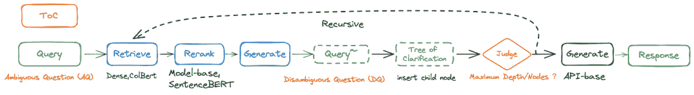

#### Adaptive (Active) Retrieval

随着RAG的发展，逐步超越被动的检索的方式，出现了自适应的检索（也被称作主动检索），这一方面也是受益于LLM的强大能力。在核心思想上与LLM Agent相似。

RAG系统可以主动判断的检索时机，以及判断时候结束整个流程，输出最终的结果。根据判断的依据，又可以分成和Prompt-base和Tuning-base

+   **Prompt-base.** 通过Prompt Engineering的方式让LLM对流程进行控制。一个典型的实现案例是FLARE。它的核心思想是LM应该仅在缺乏所需知识时进行检索，以避免被动检索增强的LM中出现不必要或不适当的检索。FLARE迭代地生成下一个临时句子，并检查是否包含低概率标记。如果是这样，系统将检索相关文档并重新生成句子。

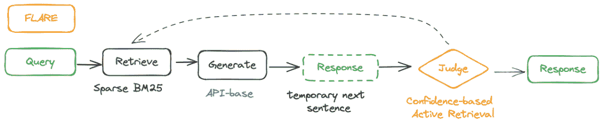

+   **Tuning-base**.对LLM进行微调使其生成特殊的token，以此来触发检索或生成。这种思想可以追溯到Toolformer中，通过生成特俗的内容，来辅助调用工具。在RAG系统中则是用于控制检索和生成两个步骤。一个典型的案例是Self-RAG。具体而言，

1.  给定一个输入提示,和前面的生成结果，首先预测特殊token “Retrieve"判断是否通过检索段落对继续的生成进行增强是有帮助。

1.  如果有帮助，调用检索模型。模型会生成一个critique token来评估检索段的相关 性, 下一个响应片段, 和一个批判令牌来评估响应片段中的信息是否得到了检索段的支持.

1.  最后, 一个新的批判令牌评估响应的整体效用。模型会并行处理这些内容，并选择最佳结果作为最终的输出。

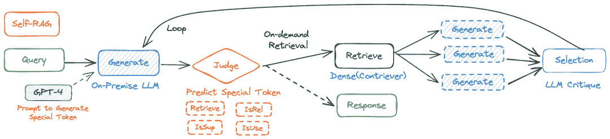

## **三、行业最佳实践**

上面的章节提到了了很多论文，论文的特点决定了他们的方法**更多的是从细节出发，解决具体的细节问题。而RAG是更是一个在工业领域大放异彩的**技术，下面我们将从RAG Flow的角度介绍几个行业最佳的RAG实践，看看在真实应用场景下应该如何构建RAG Flow。

**1、OpenAI**

> 从OpenAI Demo day 的演讲整理所得，并不能完全代表OpenAI的实际操作。在提升RAG的成功案例中，OpenAI团队从45%的准确率开始，尝试了多种方法并标记哪些方法最终被采用到生产中。他们尝试了假设性文档嵌入（HyDE）和精调嵌入等方法，但效果并不理想。通过尝试不同大小块的信息和嵌入不同的内容部分，他们将准确率提升到65%。

>

> 通过**Reranking**和对不同类别问题特别处理的方法，他们进一步提升到85%的准确率。最终，通过提示工程、查询扩展和其他方法的结合，他们达到了98%的准确率。团队强调了模型精调和RAG结合使用时的强大潜力，尤其是在没有使用复杂技术的情况下，仅通过简单的模型精调和提示工程就接近了行业领先水平。

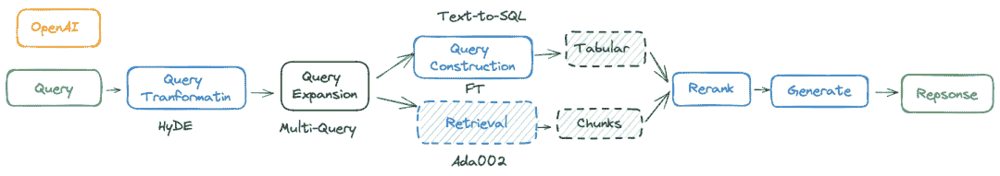

### **2、Baichuan**

基于百川的宣传资料整理（[**查看原文**](https://v11enp9ok1h.feishu.cn/docx/EqsVd24iaoK74kxzfXCcKrzzn0e?from=from_copylink)），由于资料有限，对于部分细节笔者进行了适当猜测和补充。

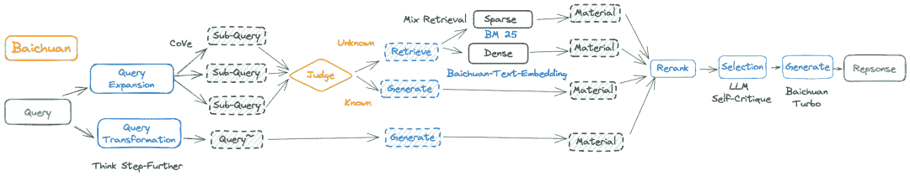

**针对用户**日益复杂的问**题，Baic**h**ua**n借鉴了Meta的CoVe技术，将复杂Prompt拆分为多个独立且可并行检索的搜索友好型查询，使大模型能够对每个子查询进行定向知识库搜索。此外，他们还利用自研的TSF（Think-Step Further)技术来推断和挖掘用户输入背后更深层的问题，以更精准、全面地理解用户意图。TSF的技术细节并没有披露，猜测其本质应该是对Step-back prompting方法的改良。

**在检索步骤中，百川智能自研了Baichuan-Text-Embedding向量模型，对超过1.5T tokens的****高****质量中文数据进行**预训**练，并通过自**研损失函数解决了对比学习方式依赖batchsize的问题。该向量模型登顶了C-MTEB。同时引入稀疏检索和 rerank模型（未披露），形成向量检索与稀疏检索并行的混合检索方式，大幅提升了目标文档的召回率，达到了95%。

此外还引入了**self-Critique**让大模型基于 **Prompt**、从相关性和可用性等角度对检索回来**的内容自省，**进行二次查看，从中筛选出与 Prompt 最匹配、最优质的候选**内容。由于在**整**个Baichuan** RAG Flow中分支较多，也并没有具体披露，Rera**nk和selec**tion是之仅对检索分支出来的内容，还是对其他分支中已经已经生成的内容也要进行。在这里，合理猜测是对全部Material进行重排序和筛序。

### **3、Databricks**

**Databricks**作为大数据领域中领先的服务商，在RAG设计上依然保持了自己特点和优势（查看原文）。用户输入问题，通过从事先处理好的文本向量索引里面获取问题相关信息，加上提示词工程，生成回答。上半部分Unstructured Data pipeline就输主流的RAG方法，并没有特殊之处。

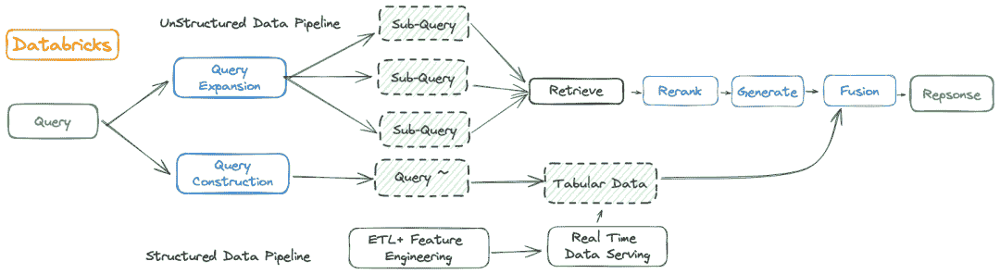

下半部分为Str**uctured Dat**a Pipeline，是 Databricks 特征工程处理流程，也是Databricks RAG最大的特点。Databricks从自身专业的大数据角度出发，从原来的准确度较高的数据存储中进行额外的检索，充分发挥自身在Real Time Data Serving 上的优势。

可以看到**Databricks**在GenAI时代的策略是助具有广泛市场需求的RAG应用，将自身强大的Lakehouse数据处理能与生成式AI技术深度融合，构建出一体化解决方案。

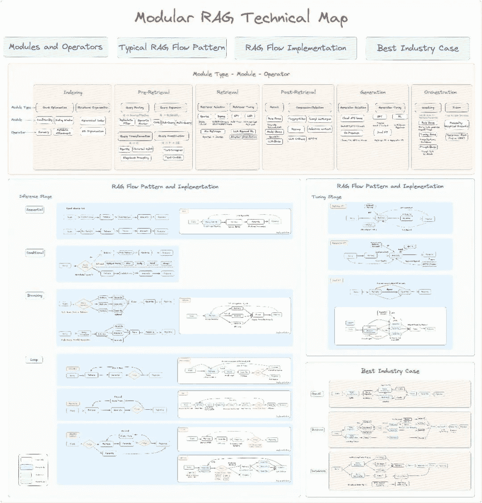

## **总结**

本文主要介绍了Moudal RAG的第二个部分，从三个方面深**入探讨RAG Flow的设计思路**，分别是典型的 RAG Flow模式、特定的 RAG 流实现以及最佳的行业案例。

我们可以看到的是，利用RAG算子构造自己的RAG Flow，具有很大的灵活性者也说明RAG自身就是一个组合程度高、定制化程度高，也需要针对不同的业务问题进行动态适应。