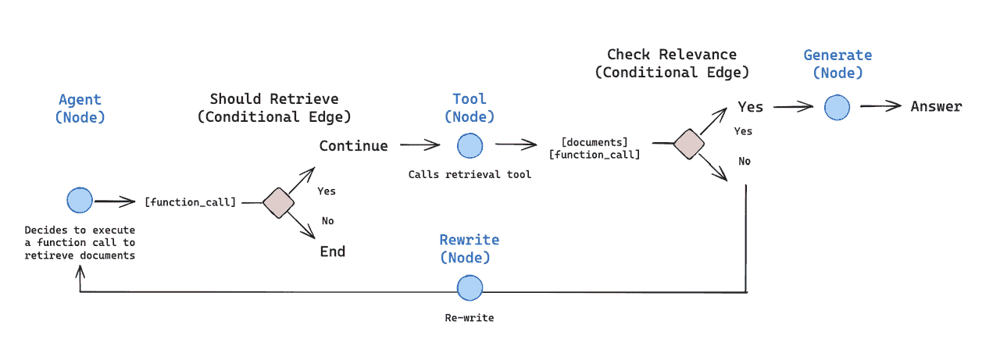

# Agentic RAG

> 来源：[https://v11enp9ok1h.feishu.cn/docx/BuUxdwRk3odXEPxD8jscKYfRnRb](https://v11enp9ok1h.feishu.cn/docx/BuUxdwRk3odXEPxD8jscKYfRnRb)

## 在本教程中，我们将构建一个[检索代理](https://python.langchain.com/docs/tutorials/qa_chat_history)。

当你希望 LLM 决定是从向量存储中检索上下文还是直接响应用户时，检索代理非常有用。

在本教程结束时，你将学习以下任务：

1. 获取并预处理将用于检索的文档。
2. 为语义搜索索引这些文档并为代理创建检索工具。
3. 构建一个代理 RAG 系统，可以决定何时使用检索工具。



## 设置

让我们下载所需的软件包并设置我们的 API 密钥：

```
%%capture --no-stderr
%pip install -U --quiet langgraph "langchain[openai]" langchain-community langchain-text-splitters
```

```
import getpass
import os


def _set_env(key: str):
    if key not in os.environ:
        os.environ[key] = getpass.getpass(f"{key}:")


_set_env("OPENAI_API_KEY")
```

### 预处理文档

1. [获取 RAG 系统所需的文档。我们](https://lilianweng.github.io/)将使用 Lilian Weng 的优秀博客中最新的三个页面。首先，使用 `WebBaseLoader` 以下实用程序获取页面内容：

```
from langchain_community.document_loaders import WebBaseLoader

urls = [
    "https://lilianweng.github.io/posts/2024-11-28-reward-hacking/",
    "https://lilianweng.github.io/posts/2024-07-07-hallucination/",
    "https://lilianweng.github.io/posts/2024-04-12-diffusion-video/",
]

docs = [WebBaseLoader(url).load() for url in urls]
```

```
docs[0][0].page_content.strip()[:1000]
```

1. 将获取的文档拆分成更小的块，以便索引到我们的向量存储中：

```
from langchain_text_splitters import RecursiveCharacterTextSplitter

docs_list = [item for sublist in docs for item in sublist]

text_splitter = RecursiveCharacterTextSplitter.from_tiktoken_encoder(
    chunk_size=100, chunk_overlap=50
)
doc_splits = text_splitter.split_documents(docs_list)
```

```
doc_splits[0].page_content.strip()
```

### 创建检索工具

现在我们有了分割的文档，我们可以将它们索引到用于语义搜索的向量存储中。

1. 使用内存向量存储和 OpenAI 嵌入：

```
from langchain_core.vectorstores import InMemoryVectorStore
from langchain_openai import OpenAIEmbeddings

vectorstore = InMemoryVectorStore.from_documents(
    documents=doc_splits, embedding=OpenAIEmbeddings()
)
retriever = vectorstore.as_retriever()
```

1. 使用 LangChain 的预建创建检索工具 `create_retriever_tool`：

```
from langchain.tools.retriever import create_retriever_tool

retriever_tool = create_retriever_tool(
    retriever,
    "retrieve_blog_posts",
    "Search and return information about Lilian Weng blog posts.",
)
```

1. 试用工具：

```
retriever_tool.invoke({"query": "types of reward hacking"})
```

### 生成查询

> [**现在**](https://langchain-ai.github.io/langgraph/concepts/low_level/#nodes)我们开始为我们的代理 RAG 图构建组件（节点和边）。

> 请注意，组件将在包含带有 [**聊天消息**](https://python.langchain.com/docs/concepts/messages/) 列表的键的 `MessagesState` 图形状态上运行。`messages`

1. 构建一个 `generate_query_or_respond` 节点。它将调用 LLM，根据当前图状态（消息列表）生成响应。根据输入消息，它将决定使用检索工具进行检索，或直接回复用户。请注意，我们 `retriever_tool` 通过 `bind_tools` 授予聊天模型访问我们之前创建的工具的权限：

```
from langgraph.graph import MessagesState
from langchain.chat_models import init_chat_model

response_model = init_chat_model("openai:gpt-4.1", temperature=0)


def generate_query_or_respond(state: MessagesState):
    """Call the model to generate a response based on the current state. Given
    the question, it will decide to retrieve using the retriever tool, or simply respond to the user.
    """
    response = (
        response_model
        .bind_tools([retriever_tool]).invoke(state["messages"])
    )
    return {"messages": [response]}
```

1. 尝试随机输入：

```
input = {"messages": [{"role": "user", "content": "hello!"}]}
generate_query_or_respond(input)["messages"][-1].pretty_print()
```

**输出：**

```
================================== Ai Message ==================================

Hello! How can I help you today?
```

1. 提出一个需要语义搜索的问题：

```
input = {
    "messages": [
        {
            "role": "user",
            "content": "What does Lilian Weng say about types of reward hacking?",
        }
    ]
}
generate_query_or_respond(input)["messages"][-1].pretty_print()
```

**输出：**

```
================================== Ai Message ==================================
Tool Calls:
retrieve_blog_posts (call_tYQxgfIlnQUDMdtAhdbXNwIM)
Call ID: call_tYQxgfIlnQUDMdtAhdbXNwIM
Args:
    query: types of reward hacking
```

### 对文件进行评分

1. 添加 [条件边](https://langchain-ai.github.io/langgraph/concepts/low_level/#conditional-edges) `grade_documents`，用于判断检索到的文档是否与问题相关。

> 我们将使用一个具有结构化输出模式的模型 `GradeDocuments` 进行文档评分。该函数将根据评分决策（或）`grade_documents` 返回要前往的节点名称：`generate_answer` 或 `rewrite_question`

```
from pydantic import BaseModel, Field
from typing import Literal

GRADE_PROMPT = (
    "You are a grader assessing relevance of a retrieved document to a user question. \n "
    "Here is the retrieved document: \n\n {context} \n\n"
    "Here is the user question: {question} \n"
    "If the document contains keyword(s) or semantic meaning related to the user question, grade it as relevant. \n"
    "Give a binary score 'yes' or 'no' score to indicate whether the document is relevant to the question."
)


class GradeDocuments(BaseModel):
    """Grade documents using a binary score for relevance check."""

    binary_score: str = Field(
        description="Relevance score: 'yes' if relevant, or 'no' if not relevant"
    )


grader_model = init_chat_model("openai:gpt-4.1", temperature=0)


def grade_documents(
    state: MessagesState,
) -> Literal["generate_answer", "rewrite_question"]:
    """Determine whether the retrieved documents are relevant to the question."""
    question = state["messages"][0].content
    context = state["messages"][-1].content

    prompt = GRADE_PROMPT.format(question=question, context=context)
    response = (
        grader_model
        .with_structured_output(GradeDocuments).invoke(
            [{"role": "user", "content": prompt}]
        )
    )
    score = response.binary_score

    if score == "yes":
        return "generate_answer"
    else:
        return "rewrite_question"
```

1. 使用工具响应中的不相关文档运行此操作：

```
from langchain_core.messages import convert_to_messages

input = {
    "messages": convert_to_messages(
        [
            {
                "role": "user",
                "content": "What does Lilian Weng say about types of reward hacking?",
            },
            {
                "role": "assistant",
                "content": "",
                "tool_calls": [
                    {
                        "id": "1",
                        "name": "retrieve_blog_posts",
                        "args": {"query": "types of reward hacking"},
                    }
                ],
            },
            {"role": "tool", "content": "meow", "tool_call_id": "1"},
        ]
    )
}
grade_documents(input)
```

1. 确认相关文件分类如下：


```text
input = {
    "messages": convert_to_messages(
        [
            {
                "role": "user",
                "content": "What does Lilian Weng say about types of reward hacking?",
            },
            {
                "role": "assistant",
                "content": "",
                "tool_calls": [
                    {
                        "id": "1",
                        "name": "retrieve_blog_posts",
                        "args": {"query": "types of reward hacking"},
                    }
                ],
            },
            {
                "role": "tool",
                "content": "reward hacking can be categorized into two types: environment or goal misspecification, and reward tampering",
                "tool_call_id": "1",
            },
        ]
    )
}
grade_documents(input)
```

# 重写问题

## 构建 `rewrite_question` 节点

检索工具可能会返回一些可能不相关的文档，这表明需要改进原始用户问题。为此，我们将该 `rewrite_question` 节点称为：

```text
REWRITE_PROMPT = (
    "Look at the input and try to reason about the underlying semantic intent / meaning.\n"
    "Here is the initial question:"
    "\n ------- \n"
    "{question}"
    "\n ------- \n"
    "Formulate an improved question:"
)


def rewrite_question(state: MessagesState):
    """Rewrite the original user question."""
    messages = state["messages"]
    question = messages[0].content
    prompt = REWRITE_PROMPT.format(question=question)
    response = response_model.invoke([{"role": "user", "content": prompt}])
    return {"messages": [{"role": "user", "content": response.content}]}
```

## 尝试一下

```text
input = {
    "messages": convert_to_messages(
        [
            {
                "role": "user",
                "content": "What does Lilian Weng say about types of reward hacking?",
            },
            {
                "role": "assistant",
                "content": "",
                "tool_calls": [
                    {
                        "id": "1",
                        "name": "retrieve_blog_posts",
                        "args": {"query": "types of reward hacking"},
                    }
                ],
            },
            {"role": "tool", "content": "meow", "tool_call_id": "1"},
        ]
    )
}

response = rewrite_question(input)
print(response["messages"][-1]["content"])
```

**输出：**

```text
What are the different types of reward hacking described by Lilian Weng, and how does she explain them?
```

# 生成答案

## 构建 `generate_answer` 节点

如果我们通过评分员检查，我们可以根据原始问题和检索到的上下文生成最终答案：

```text
GENERATE_PROMPT = (
    "You are an assistant for question-answering tasks. "
    "Use the following pieces of retrieved context to answer the question. "
    "If you don't know the answer, just say that you don't know. "
    "Use three sentences maximum and keep the answer concise.\n"
    "Question: {question} \n"
    "Context: {context}"
)


def generate_answer(state: MessagesState):
    """Generate an answer."""
    question = state["messages"][0].content
    context = state["messages"][-1].content
    prompt = GENERATE_PROMPT.format(question=question, context=context)
    response = response_model.invoke([{"role": "user", "content": prompt}])
    return {"messages": [response]}
```

## 尝试一下

```text
input = {
    "messages": convert_to_messages(
        [
            {
                "role": "user",
                "content": "What does Lilian Weng say about types of reward hacking?",
            },
            {
                "role": "assistant",
                "content": "",
                "tool_calls": [
                    {
                        "id": "1",
                        "name": "retrieve_blog_posts",
                        "args": {"query": "types of reward hacking"},
                    }
                ],
            },
            {
                "role": "tool",
                "content": "reward hacking can be categorized into two types: environment or goal misspecification, and reward tampering",
                "tool_call_id": "1",
            },
        ]
    )
}

response = generate_answer(input)
response["messages"][-1].pretty_print()
```

**输出：**

```text
================================== Ai Message ==================================

Lilian Weng categorizes reward hacking into two types: environment or goal misspecification, and reward tampering. She considers reward hacking as a broad concept that includes both of these categories. Reward hacking occurs when an agent exploits flaws or ambiguities in the reward function to achieve high rewards without performing the intended behaviors.
```

# 组装图表

- 从 `a` 开始 `generate_query_or_respond` 并确定我们是否需要调用 `retriever_tool`
- 使用以下方式进入下一步 `tools_condition`：
- 如果 `generate_query_or_respond` 返回 `tool_calls`，则调用 `retriever_tool` 以检索上下文
- 否则，直接回复用户
- 根据问题相关性对检索到的文档内容进行评分（`grade_documents`）并进入下一步：
- 如果不相关，请使用重写问题 `rewrite_question`，然后 `generate_query_or_respond` 再次调用
- 如果相关，则继续使用检索到的文档上下文 `generate_answer` 生成最终响应

API 参考：[`StateGraph`](https://langchain-ai.github.io/langgraph/reference/graphs/#langgraph.graph.state.StateGraph) | [`开始`](https://langchain-ai.github.io/langgraph/reference/constants/#langgraph.constants.START) | [`结束`](https://langchain-ai.github.io/langgraph/reference/constants/#langgraph.constants.END) | [`ToolNode`](https://langchain-ai.github.io/langgraph/reference/prebuilt/#langgraph.prebuilt.tool_node.ToolNode) | [`tools_condition`](https://langchain-ai.github.io/langgraph/reference/prebuilt/#langgraph.prebuilt.tool_node.tools_condition)

```text
from langgraph.graph import StateGraph, START, END
from langgraph.prebuilt import ToolNode
from langgraph.prebuilt import tools_condition

workflow = StateGraph(MessagesState)

# Define the nodes we will cycle between
workflow.add_node(generate_query_or_respond)
workflow.add_node("retrieve", ToolNode([retriever_tool]))
workflow.add_node(rewrite_question)
workflow.add_node(generate_answer)

workflow.add_edge(START, "generate_query_or_respond")

# Decide whether to retrieve
workflow.add_conditional_edges(
    "generate_query_or_respond",
    # Assess LLM decision (call `retriever_tool` tool or respond to the user)
    tools_condition,
    {
        # Translate the condition outputs to nodes in our graph
        "tools": "retrieve",
        END: END,
    },
)

# Edges taken after the `action` node is called.
workflow.add_conditional_edges(
    "retrieve",
    # Assess agent decision
    grade_documents,
)
workflow.add_edge("generate_answer", END)
workflow.add_edge("rewrite_question", "generate_query_or_respond")

# Compile
graph = workflow.compile()
```

## 可视化图表

```text
from IPython.display import Image, display

display(Image(graph.get_graph().draw_mermaid_png()))
```


# 运行 agentic RAG


```python
for chunk in graph.stream(
    {
        "messages": [
            {
                "role": "user",
                "content": "What does Lilian Weng say about types of reward hacking?",
            }
        ]
    }
):
    for node, update in chunk.items():
        print("Update from node", node)
        update["messages"][-1].pretty_print()
        print("\n\n")
```

## 输出：

```
Update from node generate_query_or_respond
================================== Ai Message ==================================
Tool Calls:
  retrieve_blog_posts (call_NYu2vq4km9nNNEFqJwefWKu1)
 Call ID: call_NYu2vq4km9nNNEFqJwefWKu1
  Args:
    query: types of reward hacking

Update from node retrieve
================================= Tool Message ==================================
Name: retrieve_blog_posts

(Note: Some work defines reward tampering as a distinct category of misalignment behavior from reward hacking. But I consider reward hacking as a broader concept here.)
At a high level, reward hacking can be categorized into two types: environment or goal misspecification, and reward tampering.

Update from node generate_answer
================================== Ai Message ==================================

Lilian Weng categorizes reward hacking into two types: environment or goal misspecification, and reward tampering. She considers reward hacking as a broad concept that includes both of these categories. Reward hacking occurs when an agent exploits flaws or ambiguities in the reward function to achieve high rewards without performing the intended behaviors.
```

## Why does Reward Hacking Exist?

Pan et al. (2022) investigated reward hacking as a function of agent capabilities, including (1) model size, (2) action space resolution, (3) observation space noise, and (4) training time. They also proposed a taxonomy of three types of misspecified proxy rewards.

## Let's Define Reward Hacking

Reward shaping in RL is challenging. Reward hacking occurs when an RL agent exploits flaws or ambiguities in the reward function to obtain high rewards without genuinely learning the intended behaviors or completing the task as designed. In recent years, several related concepts have been proposed, all referring to some form of reward hacking.
