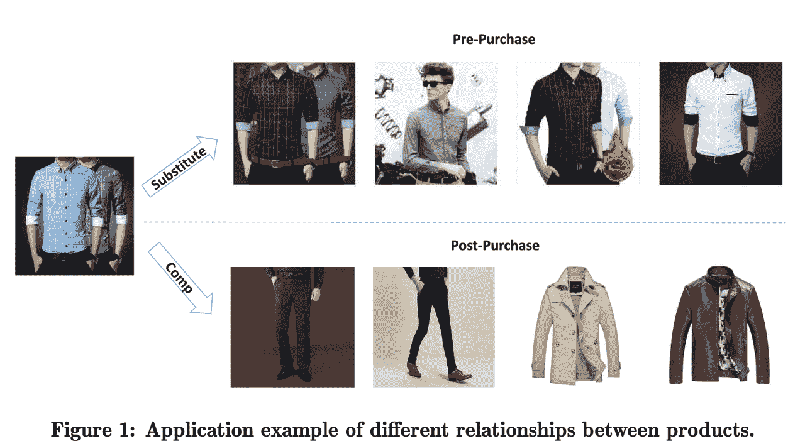
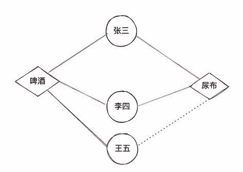
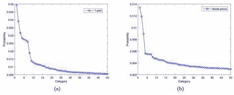

# Swing(Graph-based)

> 来源：[https://v11enp9ok1h.feishu.cn/docx/GIOodRj5Lo02pQxiHmactnMOnvb](https://v11enp9ok1h.feishu.cn/docx/GIOodRj5Lo02pQxiHmactnMOnvb)

## 动机

大规模推荐系统需要实时对用户行为做出海量预测，为了保证这种实时性，大规模的推荐系统通常严重依赖于预先计算好的产品索引。产品索引的功能为：给定种子产品返回排序后的候选相关产品列表。



相关性产品索引主要包含两部分：替代性产品和互补性产品。例如图中的不同种类的衬衫构成了替代关系，而衬衫和风衣裤子等构成了互补关系。用户通常希望在完成购买行为之前尽可能看更多的衬衫，而用户购买过衬衫之后更希望看到与之搭配的单品而不是其他衬衫了。

## 之前方法局限性

+   基于 Cosine, Jaccard, 皮尔逊相关性等相似度计算的协同过滤算法，在计算邻居关联强度的时候只关注于 Item-based (常用，因为item相比于用户变化的慢，且新Item特征比较容易获得)，Item-based CF 只关注于 Item-User-Item 的路径，把所有的User-Item交互都平等得看待，从而忽视了 User-Item 交互中的大量噪声，推荐精度存在局限性。

+   对互补性产品的建模不足，可能会导致用户购买过手机之后还继续推荐手机，但用户短时间内不会再继续购买手机，因此产生无效曝光。

## 贡献

提出了高效建立产品索引图的技术。

主要包括：

+   Swing 算法利用 user-item 二部图的子结构捕获产品间的替代关系。

+   Surprise 算法利用商品分类信息和用户共同购买图上的聚类技术来建模产品之间的组合关系。

## Swing算法

Swing 通过利用 User-Item-User 路径中所包含的信息，考虑 User-Item 二部图中的鲁棒内部子结构计算相似性。

+   什么是内部子结构？

以经典的啤酒尿布故事为例，张三同时购买了啤酒和尿布，这可能是一种巧合。但两个甚至多个顾客都同时购买了啤酒尿布，这就证明啤酒和尿布具有相关关系。这样共同购买啤酒和尿布的用户越多，啤酒和尿布的相关度就会越高。



图中的红色四边形就是一种Swing子结构，这种子结构可以作为给王五推荐尿布的依据。

+   通俗解释：若用户   和用户   之间除了购买过   外，还购买过商品   ，则认为两件商品是具有某种程度上的相似的。也就是说，商品与商品之间的相似关系，是通过用户关系来传递的。为了衡量物品   和   的相似性，比较同时购买了物品   和   的用户   和用户 $v$， 如果这两个用户共同购买的物品越少，即这两个用户原始兴趣不相似，但仍同时购买了两个相同的物品   和 $j$， 则物品   和   的相似性越高。

+   计算公式

其中$U_i$ 是点击过商品i的用户集合，$I_u$ 是用户u点击过的商品集合，$\alpha$是平滑系数。

是用户权重参数，来降低活跃用户的影响。

+   代码实现

+   Python （建议自行debug方便理解）

```
from itertools import combinations
import pandas as pd
alpha = 0.5
top_k = 20
def load_data(train_path):
    train_data = pd.read_csv(train_path, sep=&quot;\t&quot;, engine=&quot;python&quot;, names=[&quot;userid&quot;, &quot;itemid&quot;, &quot;rate&quot;])#提取用户交互记录数据
    print(train_data.head(3))
    return train_data

def get_uitems_iusers(train):
    u_items = dict()
    i_users = dict()
    for index, row in train.iterrows():#处理用户交互记录 
        u_items.setdefault(row[&quot;userid&quot;], set())
        i_users.setdefault(row[&quot;itemid&quot;], set())
        u_items[row[&quot;userid&quot;]].add(row[&quot;itemid&quot;])#得到user交互过的所有item
        i_users[row[&quot;itemid&quot;]].add(row[&quot;userid&quot;])#得到item交互过的所有user
    print(&quot;使用的用户个数为：{}&quot;.format(len(u_items)))
    print(&quot;使用的item个数为：{}&quot;.format(len(i_users)))
    return u_items, i_users 

def swing_model(u_items, i_users):
    # print([i for i in i_users.values()][:5])
    # print([i for i in u_items.values()][:5])
    item_pairs = list(combinations(i_users.keys(), 2)) #全排列组合对
    print(&quot;item pairs length：{}&quot;.format(len(item_pairs)))
    item_sim_dict = dict()
    for (i, j) in item_pairs:
        user_pairs = list(combinations(i_users[i] &amp; i_users[j], 2)) #item_i和item_j对应的user取交集后全排列 得到user对
        result = 0
        for (u, v) in user_pairs:
            result += 1 / (alpha + list(u_items[u] &amp; u_items[v]).__len__()) #分数公式
        if result != 0 :
            item_sim_dict.setdefault(i, dict())
            item_sim_dict[i][j] = format(result, &#x27;.6f&#x27;)
    return item_sim_dict

def save_item_sims(item_sim_dict, top_k, path):
    new_item_sim_dict = dict()
    try:
        writer = open(path, &#x27;w&#x27;, encoding=&#x27;utf-8&#x27;)
        for item, sim_items in item_sim_dict.items():
            new_item_sim_dict.setdefault(item, dict())
            new_item_sim_dict[item] = dict(sorted(sim_items.items(), key = lambda k:k[1], reverse=True)[:top_k])#排序取出 top_k个相似的item
            writer.write(&#x27;item_id:%d\t%s\n&#x27; % (item, new_item_sim_dict[item]))
        print(&quot;SUCCESS: top_{} item saved&quot;.format(top_k))
    except Exception as e:
        print(e.args)

if __name__ == &quot;__main__&quot;:
    train_data_path = &quot;./ratings_final.txt&quot;
    item_sim_save_path = &quot;./item_sim_dict.txt&quot;
    top_k = 10 #与item相似的前 k 个item
    train = load_data(train_data_path)
    u_items, i_users = get_uitems_iusers(train)
    item_sim_dict = swing_model(u_items, i_users)
    save_item_sims(item_sim_dict, top_k, item_sim_save_path)
```

+   Spark（仅为核心代码需要补全配置才能跑通）

```
object Swing {

  def main(args: Array[String]): Unit = {
    val spark = SparkSession.builder()
      .appName(&quot;test&quot;)
      .master(&quot;local[2]&quot;)
      .getOrCreate()
    val alpha = 1 //分数计算参数
    val filter_n_items = 10000 //想要计算的item数量 测试的时候取少点
    val top_n_items = 500 //保存item的score排序前500个相似的item
    val model = new SwingModel(spark)
      .setAlpha(alpha.toDouble)
      .setFilter_N_Items(filter_n_items.toInt)
      .setTop_N_Items(top_n_items.toInt)
    val url = &quot;file:///usr/local/var/scala/common/part-00022-e17c0014.snappy.parquet&quot;
    val ratings = DataLoader.getRatingLog(spark, url)
    val df = model.fit(ratings).item2item()
    df.show(3,false)
//    df.write.mode(&quot;overwrite&quot;).parquet(dest_url)
  }

}
```

```
/**
    * swing
    * @param ratings 打分dataset
    * @return
    */
  def fit(ratings: Dataset[Rating]): SwingModel = {

    def interWithAlpha = udf(
      (array_1: Seq[GenericRowWithSchema],
       array_2: Seq[GenericRowWithSchema]) =&gt; {
        var score = 0.0
        val u_set_1 = array_1.toSet
        val u_set_2 = array_2.toSet
        val user_set = u_set_1.intersect(u_set_2).toArray //取交集得到两个item共同user

        for (i &lt;- user_set.indices; j &lt;- i + 1 until user_set.length) {
          val user_1 = user_set(i)
          val user_2 = user_set(j)
          val item_set_1 = user_1.getAs[Seq[String]](&quot;_2&quot;).toSet
          val item_set_2 = user_2.getAs[Seq[String]](&quot;_2&quot;).toSet
          score = score + 1 / (item_set_1
            .intersect(item_set_2)
            .size
            .toDouble + alpha.get)
        }
        score
      }
    )
    val df = ratings.repartition(defaultParallelism).cache()
    
    val groupUsers = df
      .groupBy(&quot;user_id&quot;)
      .agg(collect_set(&quot;item_id&quot;)) //聚合itme_id
      .toDF(&quot;user_id&quot;, &quot;item_set&quot;)
      .repartition(defaultParallelism)
    println(&quot;groupUsers&quot;)
    groupUsers.show(3, false)//user_id|[item_id_set]: 422|[6117,611,6117] 

    val groupItems = df
      .join(groupUsers, &quot;user_id&quot;)
      .rdd
      .map { x =&gt;
        val item_id = x.getAs[String](&quot;item_id&quot;)
        val user_id = x.getAs[String](&quot;user_id&quot;)
        val item_set = x.getAs[Seq[String]](&quot;item_set&quot;)
        (item_id, (user_id, item_set))
      }//i_[user(item_set)]
      .toDF(&quot;item_id&quot;, &quot;user&quot;)
      .groupBy(&quot;item_id&quot;)
      .agg(collect_set(&quot;user&quot;), count(&quot;item_id&quot;))
      .toDF(&quot;item_id&quot;, &quot;user_set&quot;, &quot;count&quot;)
      .filter(&quot;size(user_set) &gt; 1&quot;)//过滤掉没有交互的
      .sort($&quot;count&quot;.desc) //根据count倒排item_id数量
      .limit(filter_n_items.get)//item可能百万级别但后面召回的需求量小所以只取前n个item进行计算
      .drop(&quot;count&quot;)
      .repartition(defaultParallelism)
      .cache()
    println(&quot;groupItems&quot;) //得到与itme_id有交互的user_id
    groupItems.show(3, false)//item_id|[[user_id,[item_set]],[user_id,[item_set]]]: 67|[[562,[66, 813, 61, 67]],[563,[67, 833, 62, 64]]]

    val itemJoined = groupItems
      .join(broadcast(groupItems))//内连接两个item列表
      .toDF(&quot;item_id_1&quot;, &quot;user_set_1&quot;, &quot;item_id_2&quot;, &quot;user_set_2&quot;)
      .filter(&quot;item_id_1 &gt; item_id_2&quot;)//内连接 item两两配对
      .withColumn(&quot;score&quot;, interWithAlpha(col(&quot;user_set_1&quot;), col(&quot;user_set_2&quot;)))//将上面得到的与item相关的user_set输入到函数interWithAlpha计算分数
      .select(&quot;item_id_1&quot;, &quot;item_id_2&quot;, &quot;score&quot;)
      .filter(&quot;score &gt; 0&quot;)
      .repartition(defaultParallelism)
      .cache()
    println(&quot;itemJoined&quot;)
    itemJoined.show(5)//得到两两item之间的分数结果 item_id_1 item_id_2 score
    similarities = Option(itemJoined)
    this
  }

  /**
    * 从fit结果，对item_id进行聚合并排序，每个item后截取n个item，并返回。
    * @param num 取n个item
    * @return
    */
  def item2item(): DataFrame = {

    case class itemWithScore(item_id: String, score: Double)
    val sim = similarities.get.select(&quot;item_id_1&quot;, &quot;item_id_2&quot;, &quot;score&quot;)
    val topN = sim
      .map { x =&gt;
        val item_id_1 = x.getAs[String](&quot;item_id_1&quot;)
        val item_id_2 = x.getAs[String](&quot;item_id_2&quot;)
        val score = x.getAs[Double](&quot;score&quot;)
        (item_id_1, (item_id_2, score))
      }
      .toDF(&quot;item_id&quot;, &quot;itemWithScore&quot;)
      .groupBy(&quot;item_id&quot;)
      .agg(collect_set(&quot;itemWithScore&quot;))
      .toDF(&quot;item_id&quot;, &quot;item_set&quot;)//item_id |[[item_id1:score],[item_id2:score]]
      .rdd
      .map { x =&gt;
        val item_id_1 = x.getAs[String](&quot;item_id&quot;)
        val item_set = x   //对itme_set中score进行排序操作
          .getAs[Seq[GenericRowWithSchema]](&quot;item_set&quot;)
          .map { x =&gt;
            val item_id_2 = x.getAs[String](&quot;_1&quot;)
            val score = x.getAs[Double](&quot;_2&quot;)
            (item_id_2, score)
          }
          .sortBy(-_._2)//根据score进行排序
          .take(top_n_items.get)//取top_n
          .map(x =&gt; x._1 + &quot;:&quot; + x._2.toString)
        (item_id_1, item_set)
      }
      .filter(_._2.nonEmpty)
      .toDF(&quot;id&quot;, &quot;sorted_items&quot;)
    topN
  }
}
```

## Surprise算法

首先在行为相关性中引入连续时间衰减因子，然后引入基于交互数据的聚类方法解决数据稀疏的问题，旨在帮助用户找到互补商品。互补相关性主要从三个层面考虑，类别层面，商品层面和聚类层面。

+   类别层面

首先通过商品和类别的映射关系，我们可以得到 user-category 矩阵。随后使用简单的相关性度量可以计算出类别   的相关性。

即，$N(c_{i,j})$为在购买过$i$类之后购买$j$类的数量，$N(c_{j})$为购买$j$类的数量。

由于类别之间的种类差异，每个类别的相关类数量存在差异，因此采用最大相对落点来作为划分阈值。



例如图(a)中T恤的相关类选择前八个，图(b)中手机的相关类选择前三个。

+   商品层面

商品层面的相关性挖掘主要有两个关键设计：

+   商品的购买顺序是需要被考虑的，例如在用户购买手机后推荐充电宝是合理的，但在用户购买充电宝后推荐手机是不合理的。

+   两个商品购买的时间间隔也是需要被考虑的，时间间隔越短越能证明两个商品的互补关系。

最终商品层面的互补相关性被定义为：

,其中物品$j$属于物品$i$所属类别的的相关类别，且$j$ 的购买时间晚于$i$。

+   聚类层面

+   如何聚类？

传统的聚类算法（基于密度和 k-means ）在数十亿产品规模下的淘宝场景中不可行，所以作者采用了标签传播算法。

+   在哪里标签传播？

Item-item 图，其中又 Swing 计算的排名靠前 item 为邻居，边的权重就是 Swing 分数。

+   表现如何？

快速而有效，15分钟即可对数十亿个项目进行聚类。

+   设   表示商品   的聚类标签，则聚类层面的相似度可以表示为：

最终聚类层面的相关度计算同上面商品层面的计算公式

+   线性组合：

,其中$\omega=0.8$是作者设置的权重超参数。

Surprise算法通过利用类别信息和标签传播技术解决了用户共同购买图上的稀疏性问题。