# 基于物品的协同过滤（ItemCF）的原理

> 来源：[https://v11enp9ok1h.feishu.cn/docx/OQjPdEUf3oXxTmxp4JMcFPW2nmb](https://v11enp9ok1h.feishu.cn/docx/OQjPdEUf3oXxTmxp4JMcFPW2nmb)

## 一、推荐系统召回层的主要策略

> 📕采用的就是多路召回策略，同时多路中包含基于 `Embedding` 的召回通道

### 1.1 `ItemCF`：基于物品的协同过滤

#### 1.1.1 ItemCF 的原理

**原理**：基于物品相似度进行推荐，而物品相似度的计算基于用户历史行为（共现矩阵）

**基本思想**：若用户喜欢物品，且物品与物品，那么用户很可能也喜欢物品

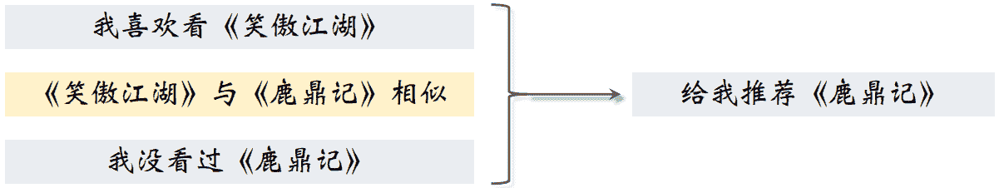

推荐系统如何度量物品的相似性？

1. **知识图谱**：两本书的作者相同，所以两本书相似

1. 基于全体用户的行为判断两个物品的相似性（`ItemCF` 使用的方法）

+ e.g. 如何判断《笑傲江湖》和《鹿鼎记》相似？
+ 看过《笑傲江湖》的用户也看过《鹿鼎记》
+ 给《笑傲江湖》好评的用户也给《鹿鼎记》好评

1. **物品相似度**：

+ 原理：如果喜欢物品、物品的用户有很大的重叠，那么物品与物品相似
+ 计算两个物品的相似度：余弦相似度
+ 把每个物品表示为一个稀疏向量（用户-物品共现矩阵的列向量），向量的每个元素对应一个用户，元素的值就是用户对物品的兴趣分数
+ 相似度 就是两个物品向量夹角的余弦

1. **预估用户对候选物品的兴趣：**

+ 从用户的历史行为得到用户对各个物品 的的兴趣分数

1. 比如下图量化用户对物品的兴趣方式为：点击、点赞、收藏、转发这 4 种行为各算一分

1. 两个物品的相似度

1. 相乘、累加

1. 有 2000 个候选物品，计算用户对每个候选物品的兴趣分数，返回其中分数最高的 100 个物品

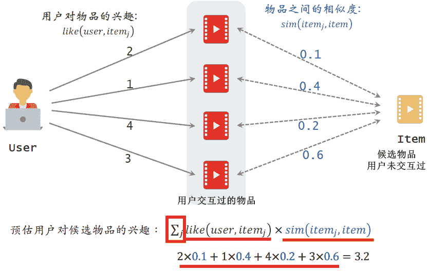

#### 1.1.2 物品相似度的计算

两个物品相似：两个物品的受众重合度越高，两个物品越相似

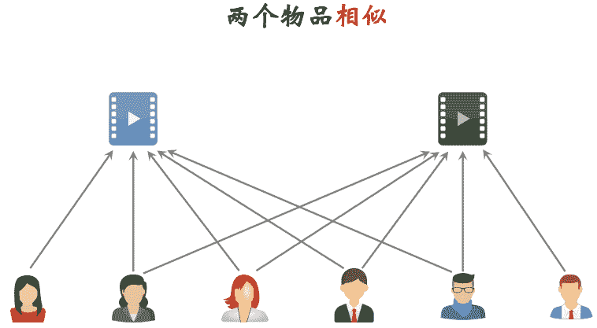

**如何计算两个物品之间的相似度**？

+ 喜欢物品 的用户记作集合
+ 喜欢物品 的用户记作集合
+ 定义交集
+ 不考虑喜欢程度：
>
+ 考虑喜欢程度：
>
+ 其实这个公式计算的就是余弦相似度，将每个物品表示为一个向量，向量的每个元素对应一个用户，元素的值就是用户对物品的兴趣分数，两个物品向量的夹角的余弦就是上述公式

#### 1.1.3 `ItemCF` 召回通道

> `ItemCF` 用于召回的完整流程：利用离线维护的两个索引在线上做快速召回

为了能在线上做到实时推荐，系统必须事先做离线计算，建立并维护两个索引：

1. **用户→物品 索引**：用户最近交互过的 `n` 个物品

+ 记录每个用户最近点击、交互过的物品 `ID`
+ 给定任意用户 `ID`，可以找到他近期感兴趣的物品列表，并且得到兴趣分数

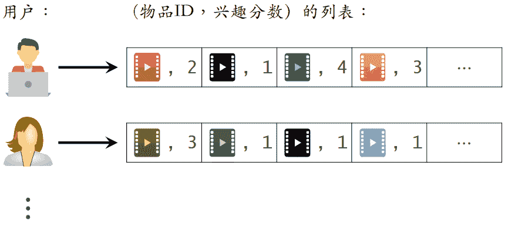

1. **物品→物品 索引**：每个物品相似度最高的 `k` 个物品

+ 计算物品之间的两两相似度（这个计算量会比较大）
+ 对于每个物品，索引它最相似的 `k` 个物品
+ 给定任意物品 `ID`，可以快速找到它最相似的 `k` 个物品，并且得到相似度分数

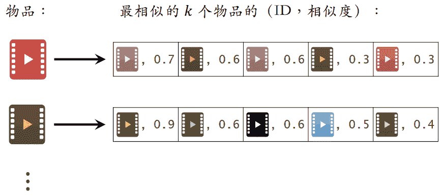

**线上做召回**的流程：

1. 利用两个索引，每次取回 `nk` 个物品

1. 给定用户 `ID`，通过“用户→物品”索引，找到用户近期感兴趣的物品列表 `last-n`

1. 对于 `last-n` 列表中的每个物品，通过“物品→物品”的索引，找到 `top-k` 相似物品

1. 对于取回的相似物品（最多有 `nk` 个，因为存在重复），预估用户对每个物品 的兴趣分数：

> 如果取回的物品 `ID` 存在重复，就去重，将分数加起来（即上面公式中的 ）

1. 返回分数最高的 100 个物品，作为 `ItemCF` 召回通道的召回结果

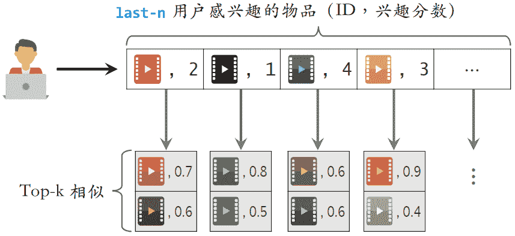

**为什么要用索引？**

+ 数据库中包含上亿个物品，如果挨个计算用户对所有物品的兴趣分数，计算量会爆。索引的意义在于避免枚举所有的物品。用索引，离线的计算量大，需要维护两个索引，但好处是线上计算量小，每次线上召回都很快，可以做到在线实时计算

+ 比如 `n=200`，`k=10`，最多取回 `nk = 2000` 个物品，只需要计算用户对物品对这 2000 个物品的兴趣分数，这样计算量很小，可以做到在线实时计算

### 1.2 `Swing` 模型

+ `Swing` 模型是 `ItemCF` 的一个变型，在工业界很常用。

Swing 模型和 ItemCF 的唯一区别：如何定义物品的相似度

+ `ItemCF`：两个物品重合的用户比例高，则判定两个物品相似
+ `Swing`：额外考虑重合的用户是否来自一个小圈子，降低来自同一个小圈子的用户的权重

**ItemCF 的不足之处**：

+ `ItemCF` 计算物品相似度的公式为 ，但假如重合的用户集合 `V` 是一个小圈子，很可能导致系统错误的判断两篇笔记相似度很高

+ 比如某个🛰️群里分享了两篇笔记，🛰️群里很多人都点开了两篇笔记，就造成一个问题，实际上两篇笔记受众完全不同，但是很多用户同时交互过两篇笔记，导致系统错误的判断两篇笔记相似度很高

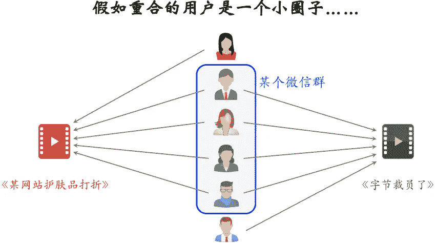

> **解决方法**：降低小圈子用户的权重。我们希望两个物品重合的用户广泛而且多样，而不是集中在一个小圈子里

+ 如果一个小圈子的用户同时交互两个物品，不能说明两个物品相似
+ 但反过来，如果大量不相关的用户同时交互两个物品，则说明两个物品有相同的受众

>
> **`Swing` 模型的原理**：给用户设置权重，解决小圈子问题

#### 1.2.1 物品相似度的计算

**计算两个用户之间的重合度：**（判断两个用户是否来自一个小圈子）

+ 用户 喜欢的物品记作集合
+ 用户 喜欢的物品记作集合
+ 定义两个用户的重合度：

+ 若用户 和用户 的重合度高，则它们可能来自一个小圈子，要降低它们的权重

+ 具体做法是在计算物品相似度时，将 `overlap` 放到分母上

**计算两个物品之间的相似度**：

+ 喜欢物品 的用户记作集合
+ 喜欢物品 的用户记作集合

+

**两个物品的相似度**：

+

+ 是人工设置的参数，需要调参

### 1.3 `UserCF`：基于用户的协同过滤

#### 1.3.1 UserCF 的原理

**原理**：基于用户相似度进行推荐

1. **基本思想**：若用户 和用户 相似，且用户 喜欢某物品，那么用户 也可能喜欢该物品

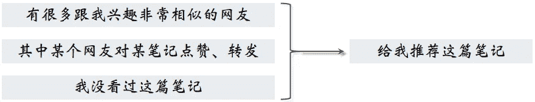

**推荐系统如何度量用户的相似性？**

1. 点击、点赞、收藏、转发的笔记（即用户历史感兴趣的物品）有很大的重合，每个用户都有一个列表，存储了点击、点赞、收藏、转发的笔记 `ID`，对比两个用户的列表，重合越多则说明两个用户越相似（`UserCF` 使用的方法）

1. 关注的作者有很大的重合

1. [**用户相似度**](https://www.yuque.com/xf015y/wo1guk/mgtv8w#JZzXh)：

+ 原理：如果用户 和用户 喜欢的物品有很大的重叠，那么 和 相似

+ 把每个用户表示为一个稀疏向量（用户-物品共现矩阵的行向量），向量每个元素对应一个物品，元素的值就是用户对该物品的兴趣分数，或者是用户对物品的兴趣程度 / 物品的热门程度（以降低热门物品的权重）

+ 相似度 就是两个用户向量夹角的余弦

1. **预估用户 对候选物品 的兴趣**：

1. 计算用户 和各个用户 之间的相似度

1. 计算用户 对物品 的兴趣分数

1. 相乘、累加

e.g. 有 2000 个候选物品，注意计算用户对每个候选物品的兴趣分数，返回其中分数最高的 100 个物品

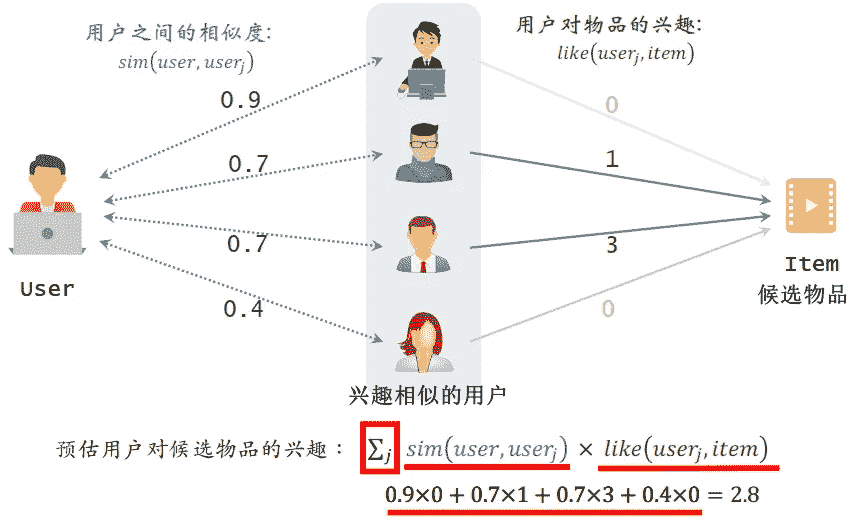

#### 1.3.2 用户相似度的计算

两个用户相似：两个用户喜欢的物品的重合度越高，两个用户越相似

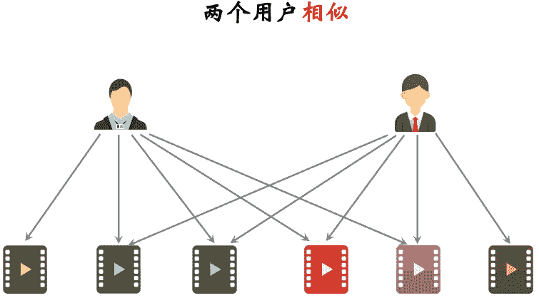

**如何计算两个用户之间的相似度？**

+ 用户 喜欢的物品记作集合
+ 用户 喜欢的物品记作集合
+ 定义交集
+ **两个用户的相似度：**

+ 原始：

+ 即，不论冷门 or 热门，物品权重都为 1，同等对待

+ 问题：eg. 书籍推荐：

+ 《哈利波特》是非常热门的物品，不论中学生还是大学老师都喜欢看，那么《哈利波特》无法反映用户独特的兴趣，对于计算用户相似度没有用

+ 反过来，重合的物品越冷门，越能反映出用户的兴趣。比如两个用户都喜欢《深度学习》一书，说明两个用户可能是同行；更进一步，如果两位用户都喜欢《深度学习推荐系统》，那么两个用户可能是更小领域的同行

+ **降低热门物品权重**：

> ：喜欢物品 的用户数量，反应物品的热门程度

+ 即，冷门物品的权重高，热门物品的权重低

#### 1.3.3 `UserCF` 召回通道

> `UserCF` 用于召回的完整流程：利用离线维护的两个索引在线上做快速召回

为了能在线上做到实时推荐，系统必须事先做离线计算，建立并维护两个索引：

1. **用户→用户 索引**：相似度最高的 `k` 个用户（区别于 `ItemCF` 用的物品→物品 索引）

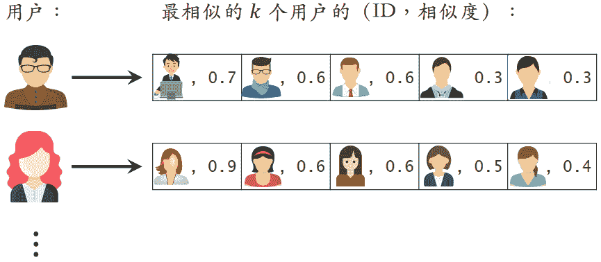

+ 计算用户之间的两两相似度（这个计算量会比较大）
+ 对于每个用户，索引他最相似的 `k` 个用户
+ 给定任意用户 `ID`，可以快速找到他最相似的 `k` 个用户，并且得到用户相似的分数

1. **用户→物品 索引**：用户近期交互过的 `n` 个物品（和 `ItemCF` 用的用户→物品 索引相同）

+ 记录每个用户最近点击、交互过的物品 `ID`
+ 给定任意用户 `ID`，可以找到他近期感兴趣的物品列表，并且得到兴趣分数

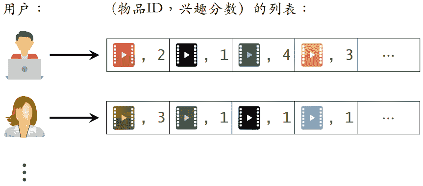

**线上做召回**的流程：

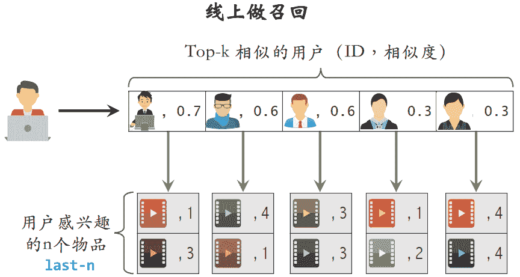

1. 利用两个索引，每次取回 `nk` 个物品

1. 给定用户 `ID`，通过“用户→用户”索引，找到 `top-k` 相似用户

1. 对于每个 `top-k` 相似用户，通过“用户→物品”索引，找到用户近期感兴趣的物品列表 `last-n`

1. 对于取回的相似物品（最多 `nk` 个，因为存在重复），预估用户 对每个物品 的兴趣分数：

+ 如果取回的物品 `ID` 存在重复，就去重，将分数加起来（即上面公式中的 ）

1. 返回分数最高的 100 个物品，作为 `UserCF` 召回通道的召回结果

## 二、向量召回通道

### 2.1 矩阵补充 `Matrix Completion`

> 矩阵补充是向量召回最简单的一种方法，不过现在已经不太常用这种方法了

**矩阵补充的本质**：

1. 将用户 `ID`、物品 `ID` 做 [`embedding`](https://www.yuque.com/xf015y/wo1guk/olm9ll#c1R48)，映射成向量

1. 用两个 `embedding` 向量的内积 来预估用户 `u` 对物品 `i` 的兴趣

1. 让 拟合真实观测的兴趣分数，学习模型的 `embedding` 层参数

**注意：**

[`矩阵补充`](https://www.yuque.com/xf015y/wo1guk/mgtv8w#WmErb)模型是个学术界的模型，存在诸多缺点，在实践中效果远不及双塔模型，工业界不用矩阵补充模型

**结构：**

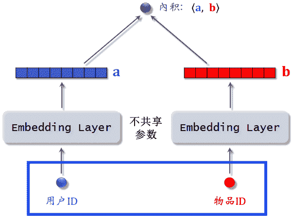

#### 2.1.1 训练

**基本想法：**

+ 用户 `embedding` 参数矩阵记作 `A`。第  号用户对应矩阵的第   列，记作向量

+ 物品 `embedding` 参数矩阵记作 `B`。第  号物品对应矩阵的第   列，记作向量

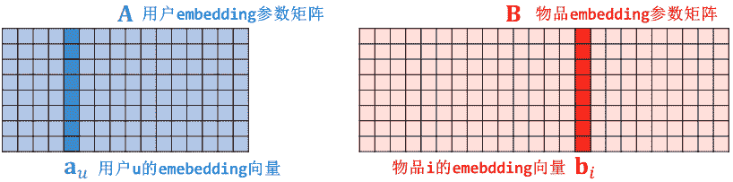

+ 内积 是第 `u` 号用户对第 `i` 号物品兴趣的预估值

+ 内积越大，说明用户 `u` 对物品 `i` 的兴趣越强

+ **训练模型的目的是学习两个 `embedding` 参数矩阵 `A` 和 `B`，使得预估值拟合真实观测的兴趣分数**

+ **数据集**：(用户 `ID`, 物品 `ID`, 兴趣分数) 的三元组集合，记作

+ 数据集中的兴趣分数是系统记录的，eg.

+ 曝光但未点击 → 0 分

+ 点击、点赞、收藏、转发 → 各算 1 分

+ 分数最低是 0，最高是 4

**训练**：

+ 前向传播：

+ `Embedding` 层：将用户 `ID`、物品 `ID` 映射成向量

+ 第 `u` 号用户 → 向量

+ 第 `i` 号物品 → 向量

+ 输出：两个向量的内积 ，代表第 `u` 号用户对第 `i` 号物品兴趣的预估值

+ 求解最优化问题，得到参数 `A` 和 `B`

+ 目标函数最小化：

+ 梯度下降法求参数

#### 2.1.2 为什么叫矩阵补充模型？

+ 如下图所示的用户-物品共现矩阵，矩阵每一行对应一个用户，每一列对应一个物品，矩阵中的每个元素表示一个用户对一个物品的真实兴趣分数。

+ 系统里的物品很多，一个用户交互过的物品只是系统中的极少数。如下图所示，绿色位置表示曝光给用户的物品，灰色位置表示没有曝光的物品。曝光给用户的物品就会得到一个真实的兴趣分数，而对没曝光的物品我们不知道用户是否感兴趣。

+ 用绿色位置的数据训练模型，训练好后就可以预估出所有灰色位置的分数，也就是将矩阵中的元素补全，因此称作矩阵补充模型

+ 将矩阵元素补全后，就可以做推荐，给定一个用户，选择用户对应的行中分数较高的物品推荐给该用户

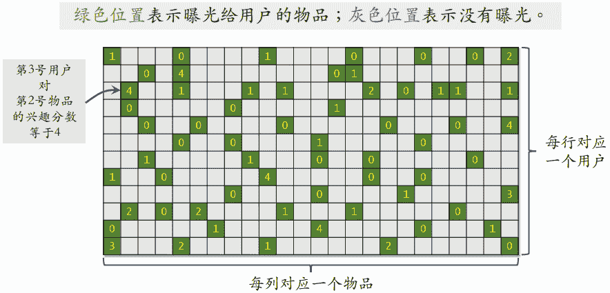

#### 2.1.3 缺点 / 实践中效果不好

矩阵补充并不是工业界能 `work` 的方法，在实践中不会用矩阵补充

1. 缺点 1：仅用 `ID` `embedding`，没利用物品、用户属性

+ 物品属性：类目、关键词、地理位置、作者信息等
+ 用户属性：性别、年龄、地理位置、感兴趣的类目等
+ [`双塔模型`](https://www.yuque.com/xf015y/wo1guk/mgtv8w#WmErb)可以看作矩阵补充的升级版，不单单使用用户 `ID` 和物品 `ID`，还会使用各种物品属性和用户属性

1. **缺点 2：负样本的选取方式不对**

+ 样本：用户 `u` 和 物品 `i` 的二元组，记为

+ 正样本：曝光之后，有点击、交互的物品。（正确的做法）
+ 负样本：曝光之后，没有点击、交互的物品。（错误的做法）

+ [`这是一种`](https://www.yuque.com/xf015y/wo1guk/mgtv8w#uTVMe)想当然的做法，在实践中不 `work`，正确的正负样本选取方法见 link

1. **缺点 3：训练模型的方法不好**

+ 用向量内积 作为兴趣分数的预估，可以 `work`，但是效果不如余弦相似度，工业界普遍使用余弦相似度，而不是用内积

+ 用平方损失（回归问题，让预估的兴趣分数 拟合真实的兴趣分数），不如用交叉熵损失（分类问题），工业界通常做分类，判定一个样本是正样本还是负样本

#### 2.1.4 线上服务

##### 2.1.4.1 模型存储

[训练](https://www.yuque.com/xf015y/wo1guk/mgtv8w#ullX5)之后，要将模型存储在正确的地方，以便于做召回

1. [训练](https://www.yuque.com/xf015y/wo1guk/mgtv8w#ullX5)得到矩阵 `A` 和 `B`

> 后续 线上做召回 时，会用到 `A`、`B` 这两个矩阵，这两个矩阵可能会很大。比如📕有几亿个用户、几亿篇笔记，那么这两个矩阵的列数都是好几亿，为了快速读取和快速查找，需要特殊的存储方式

+ `A` 的每一列对应一个用户
+ `B` 的每一列对应一个物品

1. 将矩阵 `A` 的列存储到 `key-value` 表

+ `key` 是用户 `ID`，`value` 是 `A` 的一列
+ 给定用户 `ID`，返回一个向量（用户的 `embedding`）

#### 2.1.4.1 矩阵 `B` 的存储和索引

矩阵 `B` 的存储和索引比较复杂，不能简单地用 `key-value` 表存储

+   原因：

+   解决方案：需要将物品向量存储到 `Milvus`、`Faiss`、`HnswLib` 等向量数据库中，以便能够进行近似最近邻查找，避免暴力枚举，实现线上实时计算

#### 2.1.4.2 线上召回服务

> 在训练好模型，并将 embedding 向量做存储之后，可以开始做线上服务

> 某用户刷📕的时候，📕的后台会开始做召回

1.  把用户 `ID` 作为 `key`，查询 `key-value` 表，得到该用户的 embedding 向量，记作

1.  最近邻查找：将用户向量 作为 `query`，查找用户最有可能感兴趣的 top-k 个物品（即使内积最大化的 `k` 个物品），作为召回结果

> 向量召回需要最近邻查找

+   第 `i` 号物品的 embedding 向量记作

+   计算内积，是用户对第 `i` 号物品兴趣的预估

+   返回内积最大的 `k` 个物品

**问题**：如果暴力枚举所有物品，[时间复杂度](https://www.yuque.com/xf015y/wo1guk/mgtv8w#eyuz4)正比于物品数量，速度太慢，根本做不到线上的实时计算

解决方法：实践中近似最近邻查找。`Milvus`、`Faiss`、`HnswLib` 等向量数据库都支持近似最近邻查找

+   优点：即使有几亿个物品，最多也只需要几万次内积。这些算法的结果不是最优的，但不会比最优结果差多少

#### 2.1.4.3 近似最近邻查找

支持近似最近邻查找的系统：`Milvus`、`Faiss`、`HnswLib` 等向量数据库

衡量最近邻的标准：

+   欧式距离最小（`L2` 距离）

+   向量内积最大（内积相似度）：矩阵补充用的就是内积相似度

+   向量夹角余弦最大（`cosine` 相似度）：推荐系统最常用的是余弦相似度，其最近邻是向量夹角最小的

+   有些系统不支持余弦相似度，解决方法：将所有向量都做归一化，是其二范数都为 1，则内积就等于余弦相似度

**例**：如下图 1 所示，每个点代表一个物品的 [embedding](https://www.yuque.com/xf015y/wo1guk/mgtv8w#ullX5) 向量，embedding 向量都是模型训练得到的。右下角的五角星代表一个用户的 embedding 向量。现在要召回这个用户可能感兴趣的物品，就需要计算向量 `a` 和所有点的相似度

+   如果用暴力枚举，计算量正比于点的数量（即物品的数量）。想要减少最近邻查找的计算量，必须要避免暴力枚举

+   一种加速最近邻查找的方法：

1.  在做线上服务之前，先对数据做预处理，把数据划分成很多区域（如何划分取决于衡量最近邻的标准，如果是余弦相似度，那么划分结果就是图 2 所示的扇形；如果用欧氏距离，那么划分的结果就是多边形）

1.  每个区域用一个单位向量表示（下图 2），向量长度都为 1

1.  建立索引，将每个区域的向量作为 `key`，将区域中所有点的列表作为 `value`

假如有一亿个点，划分成一万个区域，索引上一共有一万个 `key` 值（即一万个单位向量，每个向量都能取回对应区域的所有点）。建立了这样的索引，就能在线上快速做召回了

线上做召回时：对于用户的 embedding 向量

1.  首先将向量 和索引中的一万个向量做对比，计算它们的相似度

+   1 亿个物品划分到 1 万个区域，因此这一步的计算量就是 1 万次

1.  计算相似度后，如下图 4 所示，发现索引中橙色的向量和 最相似，则通过索引找到这个区域内的所有点，每个点对应一个物品

1.  接下来计算点 和区域内所有点的相似度

+   1 亿个物品划分到 1 万个区域，平均每个区域 1 万个点，因此这一步的计算量也是 1 万次

1.  假如找向量 最相似的 3 个点，也就是夹角最小的 3 个点，找到如图 4 的蓝圈中的 3 个点，就是最近邻查找的结果

因此，近似最近邻查找只需要计算 万次 数量级的相似度，而原始的最近邻查找（暴力枚举）需要计算 亿次 数量级的相似度，快了 1 万倍

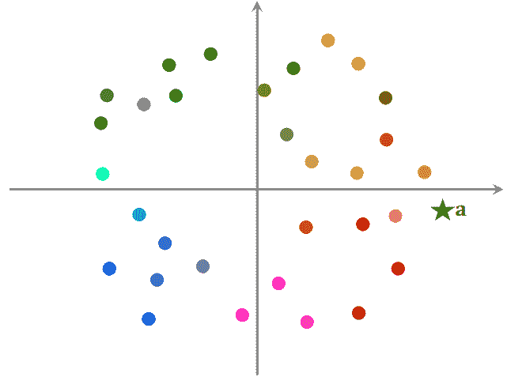

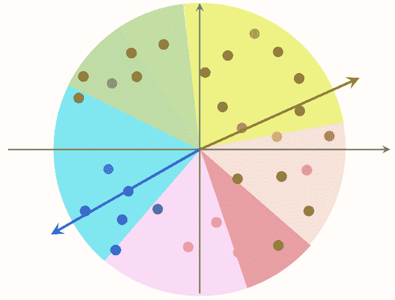

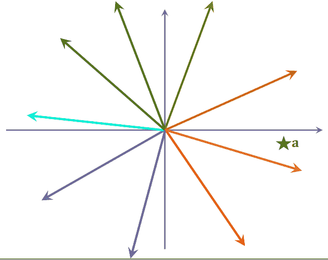

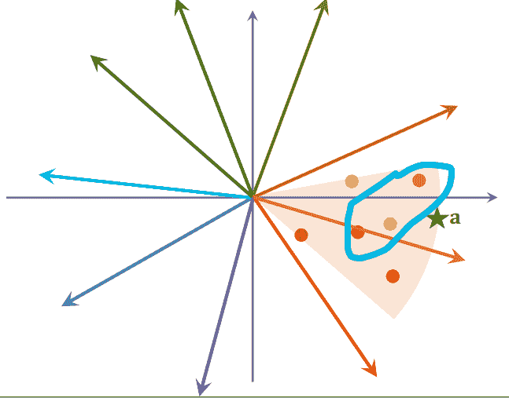

## 2.2 双塔模型 DSSM

> 双塔模型可以看作矩阵补充模型的升级版，不仅仅使用了用户 `ID` 和物品 `ID`，还会使用各种物品属性和用户属性。

> 训练双塔模型是二元分类任务，让模型区分正负样本

双塔模型是推荐系统中最重要的召回通道，没有之一。

+   双塔模型有两个塔：用户塔、物品塔。两个塔各输出一个向量，分别作为用户、物品的表征

+   两个向量的内积 or 余弦相似度作为对兴趣的预估值（现在更常用余弦相似度）

+   余弦相似度 = 两个向量的内积 / 两个向量各自 2 范数的积，其实就相当于对两个向量求归一化再做内积

+   三种训练双塔模型的方式：

+   `Pointwise`：每次用一个用户、一个物品（可正可负）

+   `Pairwise`：每次用一个用户、一个正样本物品、一个负样本物品，训练目标是最小化 `Triplet Loss`

+   `Listwise`：每次用一个用户、一个正样本物品、多个负样本物品，训练用 `softmax` 激活函数和交叉熵损失函数

### 2.2.1 模型结构

双塔模型相较于矩阵补充模型的不同之处，就在于使用了 `ID` 之外的多种特征，作为双塔的输入

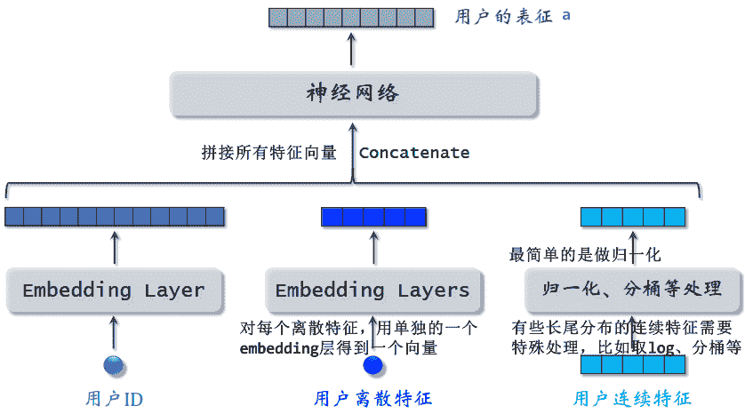

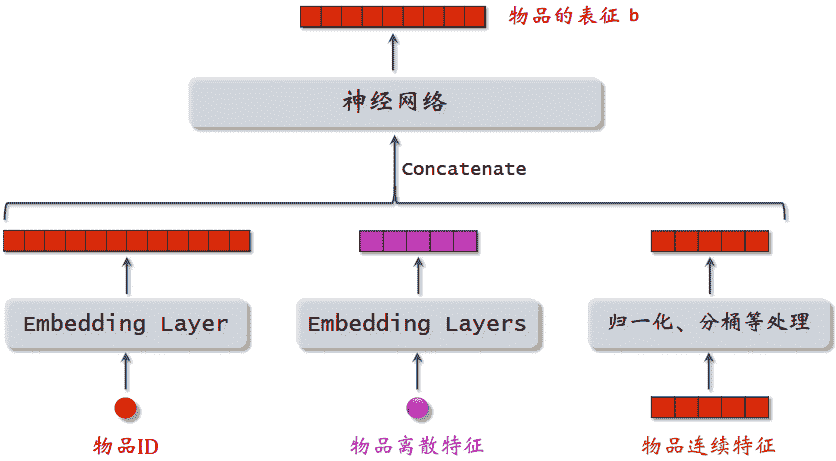

双塔模型的总体结构：

+   余弦相似度的大小介于 `[-1, 1]` 之间

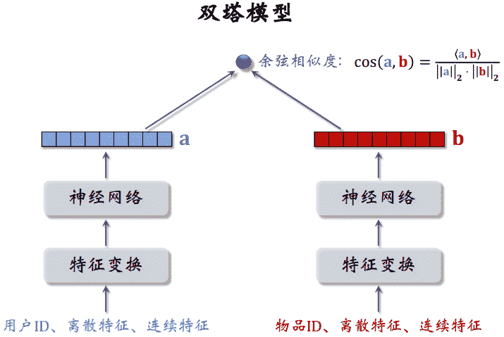

#### 错误的召回模型结构设计

下图这种结构应该是粗排 or 精排模型，没办法应用到召回

+   下层红框内结构和双塔模型一样，都是分别提取用户和物品特征，得到两个特征向量

+   上层绿框内的结构就不一样了，直接将两个向量做 `concatenate`，输入到神经网络。

这种结构属于前期融合，在进入全连接层（神经网络）之前，就将特征向量拼起来了。前期融合模型不适用于召回，是排序模型

+   假如[将这种模型用于召回](https://www.yuque.com/xf015y/wo1guk/mgtv8w#eyuz4)，就必须把所有物品的特征都挨个输入模型，预估用户对所有物品的兴趣。假设共有 1 亿个用户，每做一次召回，就要将这个模型跑 1 亿次，这种计算量显然不可行，如果用这种模型，就没法用近似最近邻查找算法加速计算

+   这种模型通常用于排序，从几千个候选物品种选出几百个，计算量不会太大

召回只能用双塔模型这样的后期融合模型：双塔模型属于后期融合，两个塔在输出最终相似度的时候才融合起来

+   可以用[近似最近邻查找](https://www.yuque.com/xf015y/wo1guk/mgtv8w#eyuz4)加速计算，不用遍历所有物品

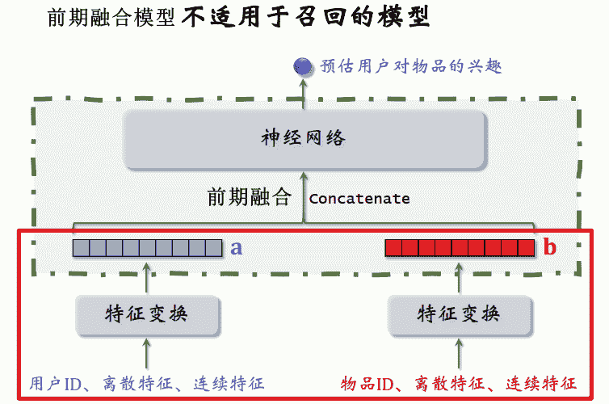

### 2.2.2 训练方法

双塔模型的训练有 3 种方式：实际上可以同时使用多种训练方式（比如📕就是 `pointwise` 和 `listwise` 都用），相当于 `ensemble`，比单独用一个效果好

1.  `Pointwise`：独立看待每个正样本、负样本，做简单的二元分类

1.  `Pairwise`：每次取一个正样本、一个负样本（同一个用户的）

> [Facebook 基于 embedding 召回的方法：Embedding-based Retrieval in Facebook Search, 2020](https://readpaper.com/paper/3036320503)

1.  `Listwise`：每次取一个正样本、多个负样本（同一个用户的），训练方式类似于多元分类

> Youtube：[Sampling-bias-corrected neural modeling for large corpus item recommendations, 2019](https://readpaper.com/paper/2972801466)

召回模型正负样本的选择：详见[下一节](https://www.yuque.com/xf015y/wo1guk/mgtv8w#uTVMe)，参考上述 Facebook 和 Youtube 的两篇论文

+   正样本：用户点击的物品

+   负样本：

+   没有被召回的？（简单负样本）

+   召回但是被粗排、精排淘汰的？（困难负样本）

+   曝光但是未点击的？（错误）

#### 2.2.2.1 Pointwise 训练

+   将召回看作二元分类任务

+   对于正样本，鼓励 接近 +1

+   对于负样本，鼓励 接近 -1

+   控制正负样本数量为 1：2 或者 1：3（业内经验）

+   可能的原因：真实的推荐场景也是正样本远少于负样本，因此控制训练集的正样本数少于负样本数，使得训练集分布接近测试集分布，效果更好

#### 2.2.2.2 Pairwise 训练

+   输入是三元组：用户、物品正样本、物品负样本

+   两个物品使用相同的 embedding 层、全连接层（共享参数），来得到物品的表征向量

+   基本想法：鼓励 大于 ，且两者之差越大越好，最好前者比后者大 `m`，`m` 是超参数，需要调参，比如设为 1

+   如果 大于 ，则没有损失（`损失 = 0`）

+   否则，损失等于

+   损失函数：

+   `Triplet hinge loss`：

+   `Triplet logistic loss`：

是大于 0 的超参数，控制损失函数的形状，需要手工设置

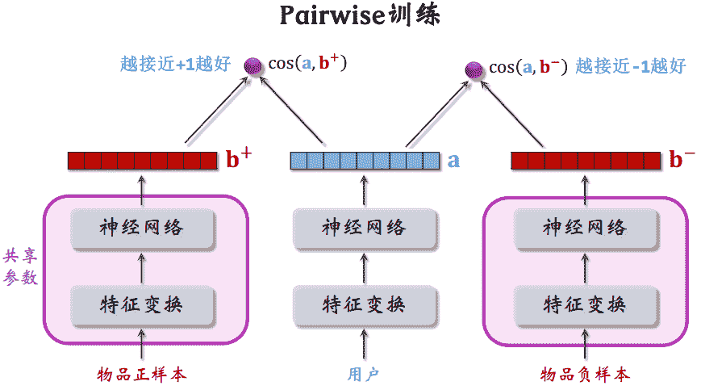

#### 2.2.2.3 Listwise 训练

+   一条数据包含：

+   一个用户，特征向量记作

+   一个正样本，特征向量记作

+   多个负样本，特征向量记作

> 似乎在 `listwise` 训练双塔模型的时候，用到的负样本越多，训练效果越好，但是负样本太多会增大计算代价

+   鼓励 尽量大（越接近 +1 越好）

+   鼓励 尽量小（越接近 -1 越好）

+   损失函数：交叉熵损失

+   训练要最小化交叉熵，也就是最大化 ，也就是最大化正样本的余弦相似度，最小化负样本的余弦相似度

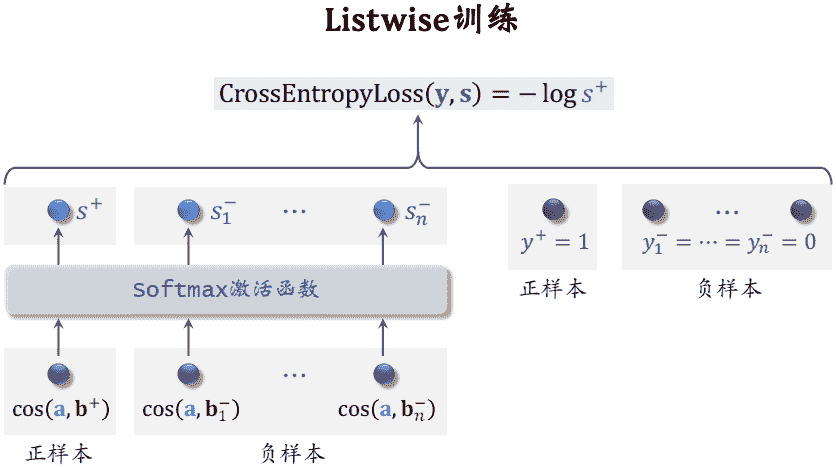

### 2.2.3 正负样本的选取

> 训练双塔模型需要用到正样本和负样本，选对正负样本作用大于改进模型结构

正样本：曝光而且有点击的 用户-物品 二元组（说明用户对物品感兴趣）

负样本：

1.  简单负样本：

1.  全体物品

1.  `batch` 内负样本

1.  困难负样本：被召回，但是被排序淘汰的物品

1.  错误负样本：曝光、但是未点击的物品做召回的负样本

训练数据：工业界的常用做法是将简单负样本和困难负样本混合起来作为训练数据

+   50% 的负样本是从全体物品中随机非均匀抽样而来（简单负样本）

+   50% 的负样本是从没通过排序的物品中随机抽样而来（困难负样本）

#### 2.2.3.1 正样本

正样本：曝光而且有点击的 用户-物品 二元组（说明用户对物品感兴趣）

问题：少部分物品占据大部分点击（二八法则），导致正样本大多是热门物品。拿过多的热门物品作为正样本，会对冷门物品不公平，这样会让热门物品更热，冷门物品更冷

解决方案：对冷门物品做过采样，or 对热门物品做降采样

+   过采样 `up-sampling`：一个样本出现多次

+   降采样 `down-sampling`：一些样本被抛弃，抛弃的概率与样本点击次数正相关

#### 2.2.3.2 负样本

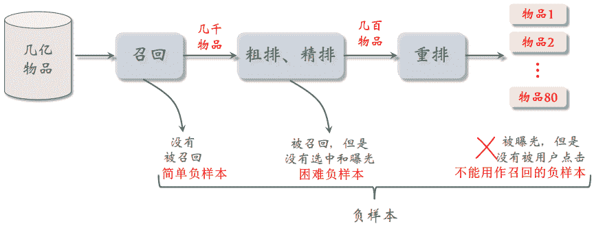

三类负样本：

1.  简单负样本：

+   全体物品：几亿个物品里只有几千个被召回，即几乎所有的物品都没有被召回，因此 `全体物品 ≈ 未被召回的物品`，而未被召回的物品大概率是用户不感兴趣的。因此，可以从全体物品中随机抽样，作为负样本

+   均匀抽样：对冷门物品不公平

+   正样本大多是热门物品，如果均匀抽样来产生负样本，负样本大多是冷门物品

+   非均匀抽样：目的是打压热门物品

+   负样本的抽样概率与热门程度（点击次数）正相关，增大热门物品成为负样本的概率

0.75 是经验值

+   `batch` 内负样本：一个 `batch` 内有 `n` 个正样本，一个用户和 `batch` 内其余 `n - 1` 个物品组成负样本，这个 `batch` 内共 `n(n-1)` 个负样本，都是简单负样本（如下图所示，对第一个用户来说，第二个物品就相当于从全体物品中随机抽样而来，第一个用户大概率不会喜欢第二个物品）

+   问题：一个物品出现在 `batch` 内的概率 点击次数，因此物品成为负样本的概率 点击次数，而不是 ，这会导致热门物品成为负样本的概率过大，对热门样本打压的太狠了，会造成偏差

+   解决方法：修正偏差，避免过分打压热门物品

+   物品 `i` 被抽样到的概率：

+   预估用户都物品 `i` 的兴趣：

+   做训练时调整为：

+   训练结束后，在线上做召回的时候，还是用原来的余弦相似度：

> Youtube：[Sampling-bias-corrected neural modeling for large corpus item recommendations, 2019](https://readpaper.com/paper/2972801466)

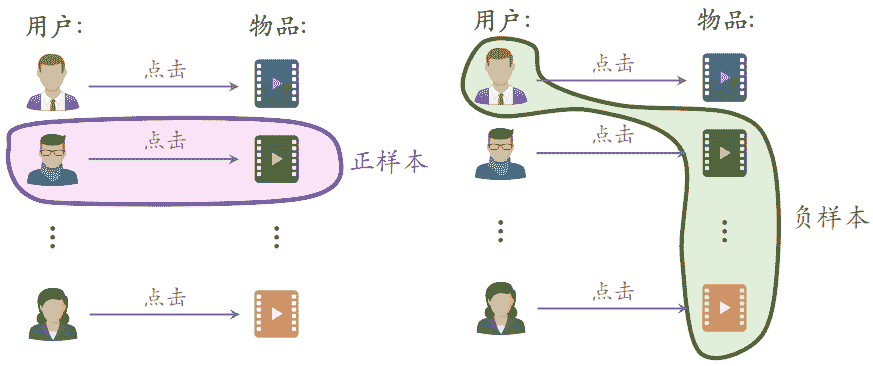

1.  困难负样本：被召回，但是被排序淘汰的物品

1.  被粗排淘汰的物品（比较困难）：这些物品被召回，说明多少和用户兴趣有些相关；但是被粗排淘汰，说明用户对这些物品的兴趣不够强

1.  精排分数靠后的物品（非常困难）：物品能通过精排进入粗排，说明已经是用户比较感兴趣的物品了，但未必是用户最感兴趣的物品

> 训练双塔模型是二元分类任务，让模型区分正负样本：

+   全体物品（简单负样本）分类准确率高

+   被粗排淘汰的物品（比较困难的负样本）容易被错分为正样本

+   精排分数靠后的物品（非常困难的负样本）更容易被错分为正样本

1.  错误负样本：曝光、但是未点击的物品做召回的负样本

+   训练召回模型不能用这类负样本！！！训练排序模型才会用这类负样本

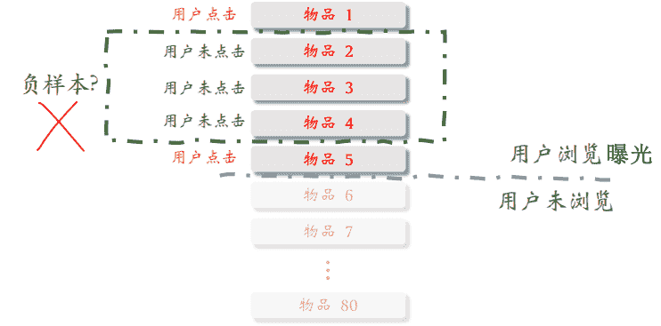

选择负样本的原理：召回的目标——快速找到用户可能感兴趣的物品。也就是说召回的任务是区分 用户不感兴趣的物品 和 比较感兴趣的物品，而不是区分 比较感兴趣的物品 和 非常感兴趣的物品（排序才区分）！

+   全体物品（简单负样本）：绝大多数是用户根本不感兴趣的

+   被排序淘汰的物品（困难负样本）：用户可能感兴趣，但是不够感兴趣

+   有曝光没点击的物品（错误负样本，没用）：用户感兴趣，可能碰巧没点击。曝光给用户的几十个物品已经非常符合用户的兴趣点了，只是用户不可能点击所有曝光的物品，没有点击不代表不感兴趣，可能只是用户对别的物品更感兴趣，点击了别的，或者只是碰巧没点击。曝光但没点击的物品已经算非常匹配了，甚至可以用来做召回的正样本，因此如果将其作为召回的负样本，双塔模型的效果一定会变差！

### 2.2.4 线上召回服务

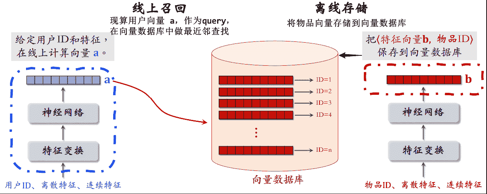

1.  离线存储：做完训练，计算每个物品的特征向量，将物品向量 存储到向量数据库，供线上最近邻查找

+   离线存储物品向量，但用户向量的处理完全不同，不要实现计算和存储用户向量，而是当用户发起推荐请求时，调用神经网络在线上现算（下面第 2.a 步）

+   [向量数据库](https://www.yuque.com/xf015y/wo1guk/mgtv8w#eyuz4)会建立索引（就是将向量空间划分成很多区域），以便加速最近邻查找

1.  线上召回时（用户发起推荐请求），

1.  给定用户 `ID`、用户画像，线上调用用户塔的神经网络现算用户向量

1.  将 [作为 query](https://www.yuque.com/xf015y/wo1guk/mgtv8w#eyuz4)，查询向量数据库（做最近邻查找），找到余弦相似度最高的 `k` 个物品，返回 `k` 个物品 `ID`，作为这条召回通道的结果

为什么要事先存储物品向量，而在线上现算用户向量？

+   每做一次召回，只用到一个用户向量，但要用到几亿个物品向量。因此拿神经网络现算一个用户向量，计算量不大，算得起；但几亿个物品向量要在线上计算，代价过大，算不起

+   用户兴趣动态变化，而物品特征相对较稳定。因此线上实时计算用户向量，更有利于推荐效果；但事先存储物品向量是 OK 的

### 2.2.5 模型更新

两种模型更新方式：

1.  全量更新（天级别）：训练整个模型，包括 embedding 层和全连接层

+   今天凌晨，用昨天全天的数据训练整个神经网络，做 1 `epoch` 的随机梯度下降

+   注意是在昨天的模型参数基础上做训练更新，而不是随机初始化重新训练

+ 用昨天的数据只训练 1 epoch，也就是说每天的数据只用一遍

+ 发布新的用户塔神经网络（用于在线上实时计算用户向量，作为召回的 `query`）和物品向量（这几亿个物品向量存入向量数据库，重新建立索引，供线上做最近邻查找），供线上召回使用

+ 全量更新对数据流、系统的要求比较低

1. 增量更新（小时/分钟级别，实时）：只需要训练 `embedding 层`

+ 用实时数据训练神经网络，只更新 `ID Embedding`，锁住全连接层

+ 因为用户兴趣会随时发生变化，所以需要更快地更新用户 `ID Embedding`，以便捕捉用户的兴趣变化（小时级或者几十分钟的延迟）

> 这里增量更新用户 `ID Embedding` 存在几十分钟的延迟，但是实际上我们感知的推荐时效性可能更快，比如点击了一篇文章后，下一次刷新就会推荐同一主题的文章。这是因为时效性包含两块：模型、特征。应该是用户的 `last-n` 行为特征起作用了，所以时效性更快

+ 实时收集线上数据，做流式处理，生成 `TFRecord` 文件

+ 对模型做 `online learning`，增量更新 `ID Embedding` 参数（不更新神经网络其它部分的参数）

+ 发布用户 `ID Embedding`（哈希表的形式，给定用户 `ID` 可以查出 `ID Embedding`），供用户塔在线上计算用户特征向量

实际的系统：全量更新 & 增量更新相结合

+ 每隔几十分钟，发布最新的用户 `ID Embedding`，供用户塔在线上计算用户向量，以便捕捉到用户最新的兴趣点

注意：如下图所示，今天凌晨的全量更新，是基于昨天凌晨全量训练出来的模型，而不是用增量训练出来的模型！在完成本次全量更新后，之前增量更新得到的模型就可以扔掉了。然后再基于今天凌晨全量更新的模型，做分钟级别的增量更新

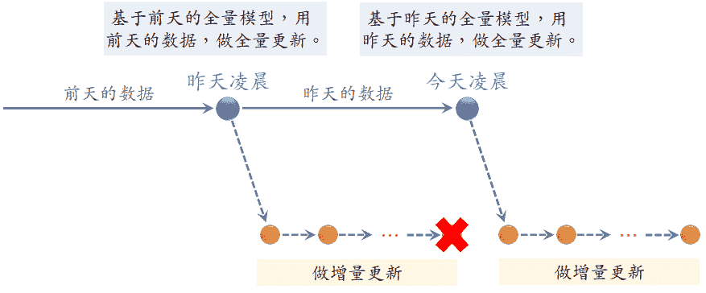

问题：能否只做增量更新，不做全量更新？

+ 答案：效果不好，既做全量又做增量效果最好

+ 原因：

1. 小时级数据有偏，分钟级数据偏差更大

+ 在不同的时间段，用户的行为是不一样的，因此小时级/分钟级的数据和全天数据的统计值有差别

1. 随机打乱优于按顺序排列数据，因此全量训练效果优于增量训练

+ 全量更新：`random shuffle` 一天的数据（为了消除偏差），做 1 epoch 训练

+ 增量更新：按照数据从早到晚的顺序，做 1 epoch 训练

# 三、其他召回通道

## 3.1 地理位置召回

### 3.1.1 GeoHash 召回

+ 原理/想法：用户可能对附近发生的事感兴趣

+ `GeoHash`：对经纬度的编码（二进制哈希码），表示地图上的一个长方形区域

+ 维护索引：`GeoHash`（作为索引）→ 该地点的优质笔记列表（按时间倒排，最新的排在最前面）

+ 召回：用户定位的 `GeoHash` → 该地点（地图上一个长方形区域内）最新的 `k` 篇优质笔记

+ 这条召回通道没有个性化

+ 因为只看地理位置，不考虑个性化，因此才要选择优质笔记，否则召回的笔记既没有个性化又不优质，大概率通不过粗排/精排

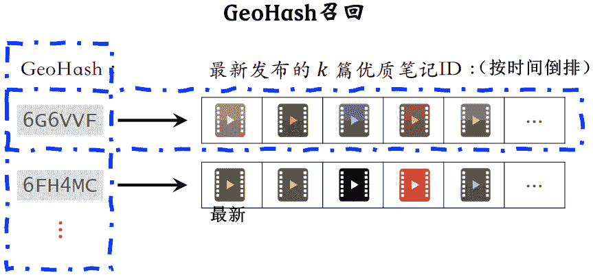

### 3.1.2 同城召回

> 和 `GeoHash` 召回唯一的区别：用城市作为索引

+ 原理/想法：用户可能对同城发生的事感兴趣

+ 索引：城市 → 优质笔记列表（按时间倒排）

+ 召回：用户所在的城市 & 曾经生活过的城市 → 对应城市最新的 `k` 篇优质笔记

+ 这条召回通道没有个性化

## 3.2 作者召回

### 3.2.1 关注作者

+ 原理/想法：用户对关注的作者发布的笔记感兴趣

+ 维护的索引：

+ `用户 → 关注的作者列表`

+ `作者 → 发布的笔记列表`（按时间倒排）

+ 召回：用户 `ID` → 关注的所有作者 → 每个作者最新发布的笔记

### 3.2.2 有交互作者

+ 原理/想法：如果用户对某篇笔记感兴趣（点赞、收藏、转发），那么用户可能对该作者的其他笔记感兴趣

> eg. 用户 A 在📕上碰巧看到了玉石加工的二十篇，觉得很有意思，因此看完并点了赞，但他没有买玉石或收藏玉石的打算，因此不管关注这些作者，单个他推这些作者新发布的玉石雕刻视频，也很可能会看完

+ 索引：用户 `ID` → 有交互的作者列表

+ 作者列表需要定期更新，最简单的策略就是保留最新交互的作者，删除一段时间没有交互的作者

+ 召回：用户 `ID` → 所有有交互的作者 → 每个作者最新的笔记

### 3.2.3 相似作者

+ 原理/想法：如果用户喜欢某作者，那么用户可能喜欢相似的作者

+ 索引：作者 → 相似作者列表（`k` 个作者）

+ 作者相似性：计算方式类似于 `ItemCF`，如果两个作者的粉丝有很大的重合，就判定两个作者相似

+ 召回：用户 `ID` → 感兴趣的 `n` 个作者 → 每个作者相似的 `k` 个作者（共 `nk` 个） → 最新的 `nk` 篇笔记

+ 感兴趣的作者：包括用户关注的作者 & 用户有交互的作者

## 3.3 缓存召回

+ 背景：精排输出几百篇笔记，送入重排；重排做多样性抽样，选出几十篇推给用户。因此精排结果有一大半都没有曝光，被浪费，但实际上可能只是碰巧随机抽样没被抽到

+ 想法/原理：复用前 `n` 次推荐精排的结果

+ 召回：将精排前 50（打分高）、但是没有曝光的笔记缓存起来，作为一条召回通道

+ 精排前 50 都是用户非常感兴趣的笔记，值得再次尝试

+ 问题：缓存大小固定（假设 100 篇），因此需要退场机制，以确保缓存里最多只有 100 篇笔记。

+ 最简单粗暴的退场机制规则：

+ 一旦笔记成功曝光，就从缓存退场

+ 如果超出缓存大小，就移除最先进入缓存的笔记

+ 笔记最多被召回 10 次，达到 10 次就退场

+ 每篇笔记最多保存 3 天，达到 3 天就退场

+ 细化规则：eg. 加入想要扶持曝光比较低的笔记，那么可以根据笔记的曝光次数来设置规则，让低曝光的笔记在缓存里存更长的时间

# 过滤

## 曝光过滤——`Bloom Filter`

**曝光过滤问题**：如果某个用户看过某个物品，则不该把该物品曝光给该用户

+ 原因：实验表明重复曝光同一物品会损害用户体验。但并非所有推荐系统都有曝光过滤，比如 `YouTube` 的长视频推荐场景，看过的视频可以再次推荐

+ 执行阶段：`召回`阶段

+ 方法一：暴力对比

1. 对于每个用户，记录已经曝光给他的物品

+ 📕只召回 1 个月以内的笔记，因此也只需要记录每个用户最近一个月的曝光历史

1. 对于每个召回的物品，判断它是否已经给该用户曝光过，排除掉曾经曝光过的物品

+ 缺点：一位用户看过 `n` 个物品（历史曝光），本次召回 `r` 个物品，如果暴力对比，需要 `O(nr)` 的时间

+ 📕 `n` 的量级大概是几千（一个用户最近一个月的曝光物品数），每次推荐召回 `r` 的量级也是几千，暴力对比的计算量太大，因此实践中不用暴力对比，而使用 `Bloom Filter`（方法三）

+ 方法二：`哈希表`—— 字节用的过滤方法

+ 同方法一，但是将历史曝光物品存储到哈希表，判断每个召回物品是否被曝光过的时间复杂度 `O(1)`，因此只需要 `O(r)` 的时间复杂度

+ 方法三：`Bloom Filter`——📕用的过滤方法

+ `Bloom Filter` 判断一个物品 `ID` 是否在已曝光的物品集合中——肯定能干掉所有已曝光物品，不会重复推荐，但有可能误伤

+ 如果判断为 `NO`，则该物品一定不在集合中

+ 如果判断为 `YES`，则不能确定，只能说该物品很可能在集合中（因此，可能会误伤，错误判断未曝光物品为已曝光，将其过滤掉）

+ `Bloom Filter` 过滤的原理：`k` 和 `m` 都是需要设置的参数

+ `Bloom Filter` 把物品集合表征为一个 `m` 维二进制向量（每个元素是一个 `bit`，取值 `0` or `1`）

+ 每个用户有一个曝光物品的集合（长为 `n`），表征为一个向量，需要 `m bits` 的存储

+ `Bloom Filter` 有 `k` 个哈希函数，每个哈希函数把物品 `ID` 映射成介于 `0` 和 `m-1` 之间的整数

+ `Case 1`：设 `k = 1`，即只用一个哈希函数

+ 给一个用户存储一个 `m bits` 的二进制向量，初始值全 `0`

+ 将每个已曝光物品的 `ID` 通过哈希函数映射到该二进制向量的某一位上，将值修改为 `1`

+ 用户发起请求后召回一波物品，对每个召回物品，也通过哈希函数映射到该二进制向量的某一位

+ 如果对应位为 `0`，说明该物品是未曝光物品，无需过滤

+ 如果对应位为 `1`，说明该物品可能是已曝光物品（存在误判概率），需要过滤

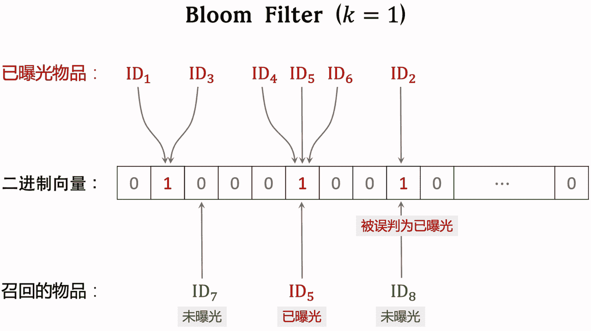

+ `Case 2`：假设 `k = 3`，即使用 3 个哈希函数

+ 给一个用户存储一个 `m bits` 的二进制向量，初始值全 `0`

+ 针对每个已曝光物品，分别使用三个哈希函数，将物品 `ID` 映射到三个位置上，将这三个位置的值都设为 `1`

+ 针对每个召回物品，同样分别使用三个哈希函数，将物品 `ID` 映射到三个位置上

+ 若三个位置上的值不全为 `1`，说明该物品是未曝光物品，无需过滤

+ 若三个位置上的值都为 `1`，说明该物品可能是已曝光物品（存在误判概率），需要过滤

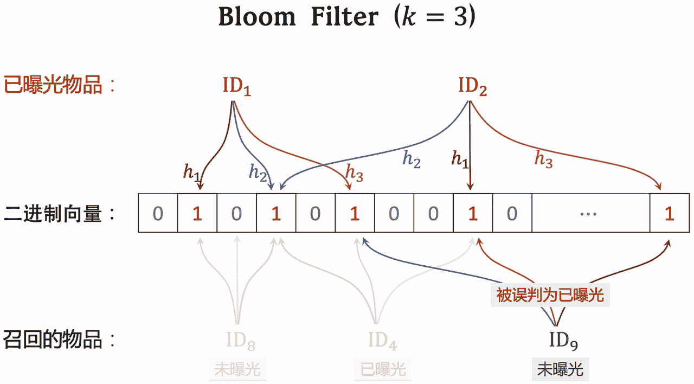

+ `Bloom Filter` 的误伤概率：

+ 设曝光物品集合大小为 `n`，二进制向量维度为 `m`，使用 `k` 个哈希函数

+ `Bloom Filter` 的误伤概率为

+ `n` 越大，向量中的 `1` 越多，误伤概率越大（未曝光物品的 `k` 个位置恰好都是 `1` 的概率大）

+ `m` 越大，向量越长，越不容易发生哈希碰撞

+ `k` 太大、太小都不好，`k` 有最优取值

+ 人为设定可容忍的误伤概率为 ，那么最优参数为

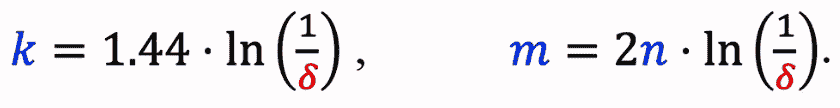

+ `k` 是很小的整数

+ `m` 比 `n` 大几倍，即每个物品只需占几个 bits 的存储

+ `Bloom Filter` 的缺点：`Bloom Filter` 只支持添加物品，不支持删除物品。从集合中移除物品，无法消除它对二进制向量的影响，不能简单讲 `k` 个位置从 `1` 改为 `0`，会影响其他物品，因为向量的元素是所有物品共享的，这相当于移除了多个物品

+ 问题：实践中，每天都需要从物品集合中移除年龄大于 1 个月的物品（📕超龄物品不可能被召回，没必要将它们记录在 `Bloom Filter`，这样降低了 `n` 可以降低误伤率）。但 `Bloom Filter` 不支持物品的删除，想要删除一个物品，需要重新计算整个集合的二进制向量

+ 那如何处理呢？

+ 曝光过滤的链路：

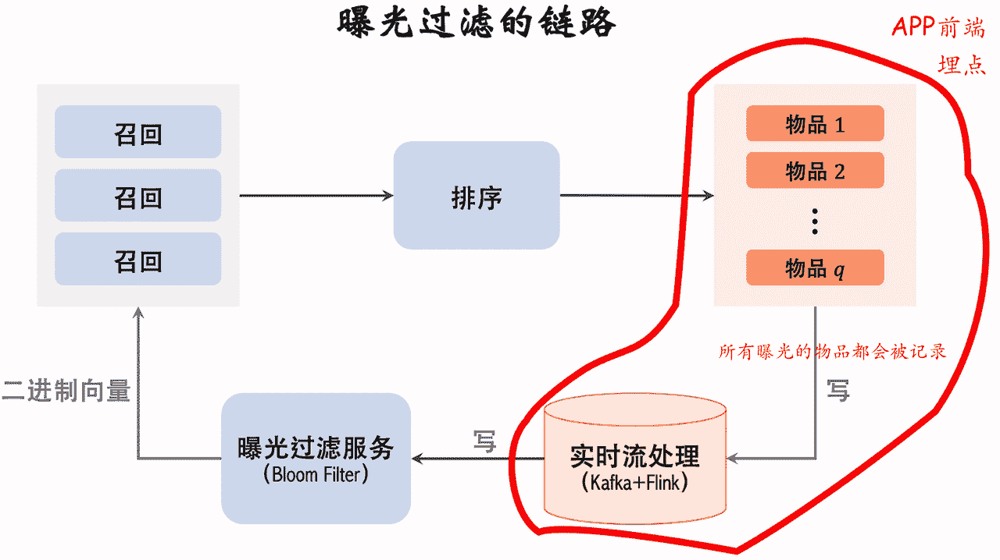

1. `APP` 的前端有埋点，所有曝光的物品都会被记录——实时流处理

+ 这个落表的速度要足够快，否则可能会出问题。因为用户推荐页面两次刷新也就间隔几分钟，快的话也就一二十秒，在下一刷之前，就要把本次曝光的物品写到 `Bloom Filter` 上，否则下一刷很可能会出重复的物品。因此，要用实时流处理，比如把曝光物品写入 `Kafka` 消息队列，用 `Flink` 做实时计算。

1. `Flink` 实时读取 `Kafka` 消息队列，计算曝光物品的哈希值，把结果写到 `Bloom Filter` 的二进制向量上

+ 用这样的实时链路，在曝光发生几秒之后，用户的 `Bloom Filter` 就会被修改，之后就能避免重复曝光

+ 问题：实时流容易出问题，如果挂掉了，或者延时足够大，那么用户上一刷出现的物品可能被重复推荐——📕的首页推荐以前经常出这种问题

1. 曝光过滤具体用在召回完成之后，召回服务器请求曝光过滤服务，曝光过滤服务将这位用户的二进制向量发送给召回服务器，在召回服务器上用 `Bloom Filter` 计算这位用户召回的各个物品的哈希值，和二进制向量对应位做对比，过滤已曝光的物品

1. 剩余的物品都是未曝光的，发送给排序服务器

<https://v11enp9ok1h.feishu.cn/sync/Ipw1d27gNsv3OAbo3N7cks4ZnJf>
