# 推荐系统——物品冷启动

> 来源：[https://v11enp9ok1h.feishu.cn/docx/LG9Pd2pDfo2K5Yx8TYictcs3nGb](https://v11enp9ok1h.feishu.cn/docx/LG9Pd2pDfo2K5Yx8TYictcs3nGb)

# 物品冷启动的召回通道

#  物品冷启动召回的难点

**召回的依据/用到的物品信息**：（✅ 代表新笔记有的信息，❌ 代表新笔记没有的信息）

+   ✅ 笔记内容，包括自带的图片、文字、地点等

+   ✅ 算法或人工标注的标签

+   ❌ **没有用户点击、点赞等交互信息**

+   点击、点赞等统计数据可以反映出笔记本身的质量，以及什么样的用户喜欢这篇笔记

+   走不了 UserCF、ItemCF 召回通道，因为需要物品和用户的交互信息，而新笔记没有

+   ❌ 没有（有效的）笔记 ID embedding

+   很多召回和排序模型都有 embedding 层，将每个笔记 ID 映射到一个向量。这个向量是从用户跟笔记交互的行为中学习出来的，而冷启动的时候这个向量才刚刚初始化，还没通过反向传播更新，因此新笔记 ID 的 embedding 向量还啥都不是，反映不出笔记的特点

+   笔记的 ID embedding 是召回和排序中最重要的特征之一，缺少这个特征会让召回和排序变得很不准

**冷启召回的难点**：

1.  缺少用户交互，还没学好笔记 ID embedding，导致双塔模型效果不好

+   双塔模型是推荐系统中最重要的召回通道，没有之一，离开双塔模型，很难做好新笔记的推荐。

+   缺少笔记 ID embedding，不只会影响召回，还会影响排序，让排序模型的预估做不准

1.  缺少用户交互，导致 ItemCF 不适用

+   ItemCF 也是很重要的召回通道，但是想要用 ItemCF 召回通道，就需要知道有哪些用户跟这个物品有过交互，但和新物品发生过交互的用户非常少，所以 ItemCF 对新用户不适用

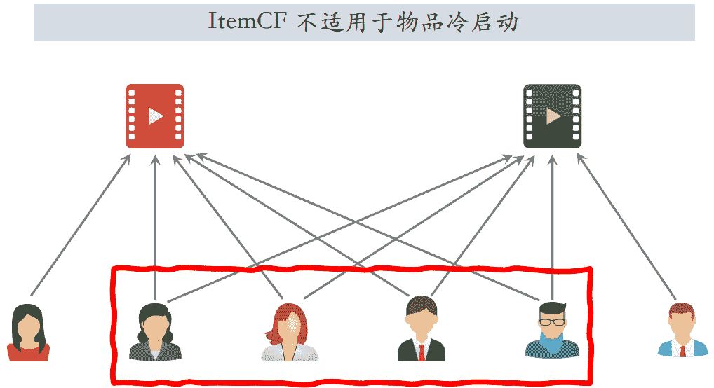

**冷启动适用的召回通道**：

1.  ❌ ItemCF 召回（不适用）

1.  ❓ [**双塔模型（改造**](https://www.yuque.com/xf015y/wo1guk/ud7yvq#CsLs5)**后适用）**

1.  ✅ [**类目、关键词召回**](https://www.yuque.com/xf015y/wo1guk/ud7yvq#nE2kl)**（适用）**：在新笔记刚发布时，这两种召回通道最有用；但在笔记发布一段时间后，这两种召回通道会失效

1.  ✅ [**聚类召回**](https://www.yuque.com/xf015y/wo1guk/ud7yvq#qNqU4)**（适用）**：也是对刚刚发布的新笔记有效，一篇笔记发布一两个小时后就不太可能被该通道召回了

+   基于内容相似度，给用户推荐（和历史交互物品）相似内容的物品

1.  ✅** Look-Alike 人群扩散召回（适用）**：适用于发布了一段时间、但是点击次数不高的低曝光物品

+   基于用户相似度（类似于 UserCF 的思想），将笔记推荐给种子用户的相似用户

物品从发布到热门，主要的透出渠道会经历三个阶段：

1.  [**类目/关键词召回**](https://www.yuque.com/xf015y/wo1guk/ud7yvq#nE2kl)**、**[**聚类召回**](https://www.yuque.com/xf015y/wo1guk/ud7yvq#qNqU4)**（冷启动召回）**：是基于内容的召回通道，适用于刚刚发布的物品

1.  **Look-Al**ike 人群扩散召回（冷启动召回）：适用于已发布一段时间（有点击）、但是点击次数不高的低曝光物品

1.  [**双塔**](https://www.yuque.com/xf015y/wo1guk/mgtv8w#WmErb)**、**[**ItemCF**](https://www.yuque.com/xf015y/wo1guk/mgtv8w#AdwU3)**、**[**Swing**](https://www.yuque.com/xf015y/wo1guk/mgtv8w#rGD7U)** 等等（正常物品召回）**：是基于用户行为的召回通道，适用于点击次数较高的物品

## 改造双塔模型 - 适用于冷启动

原本的**双塔模型**：

+   物品/笔记 ID 是物品塔最重要的特征 ，会通过神经网络的 embedding 层转换为笔记 ID embedding

+   **问题**：每篇笔记都有一个 ID embedding 向量，需要从用户和笔记的交互中学习，可是新笔记还没有跟几个用户交互过，所以新笔记的 ID embedding 向量还没有学好。如果直接用双塔模型做新笔记的召回，效果不太好

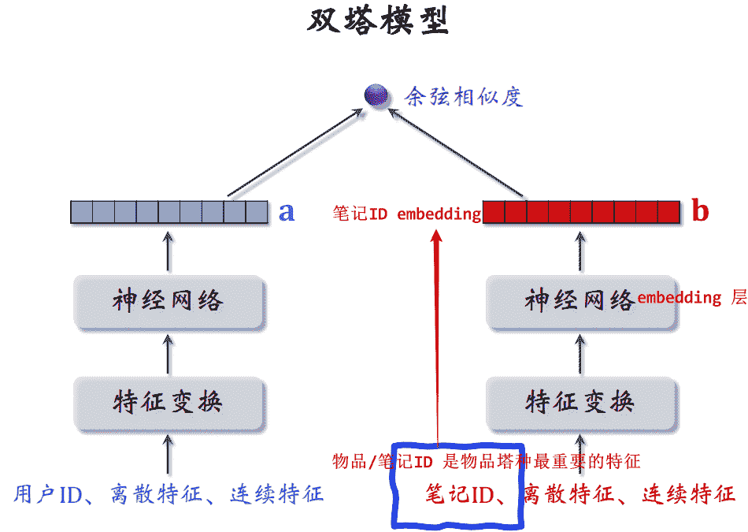

**两种改进方案**：

1.  **改进方案一**：新笔记使用 default embedding

+   物品塔做 ID embedding 时，让所有新笔记共享一个 ID，而不是用新笔记自己真正的 ID

+   Default embedding：共享的 ID 对应的 embedding 向量。

+   这个向量是学出来的，而不是随机初始化来的

+   到下次模型训练的时候，新笔记才有自己的 ID embedding 向量

+   新笔记发布之后，逐渐会有点击和交互，这些信号可以用来学习笔记的 ID embedding

1.  **改进方案二**：利用相似笔记 embedding 向量

+   查看 **top k** 内容最相似的**高曝光笔记**

+   相似 可以用图片、文字、类目来定义，用多模态神经网络将一片笔记的图文内容表征为一个向量

+   用高曝光笔记，是因为它们的 ID embedding 通常学的比较好

+   **把 **k 个高曝光笔记的 embedding 向量取平均，作为新笔记的 embedding

**多个向量召回池**：

+   在实践中通常会用多个向量召回池，让新笔记有更多的曝光机会

+   1 小时新笔记

+   6 小时新笔记

+   24 小时新笔记

+   30 天笔记

> 假如只有一个 30 天笔记的召回池，那么新笔记被召回的几率很小，很难得到曝光

+   所有召回池共享同一个双塔模型，因此多个召回池不会增加训练的代价

## 类目、关键词召回通道

**用户画像**：记录了用户的兴趣点

+   感兴趣的**类目**：美食、科技数码、电影……

+   感兴趣的**关键词**：纽约、职场、搞笑、程序员、大学……

**一、基于类目的召回通道**：

+   系统维护**类目索引**：**类目** → 笔记列表（按时间排序，最新的笔记排在最前面）

+   **用类**目索引做召回：用户画像 → 用户感兴趣的类目 → 笔记列表

+   取回笔记列表上前 k 篇笔记（即最新的 k 篇）

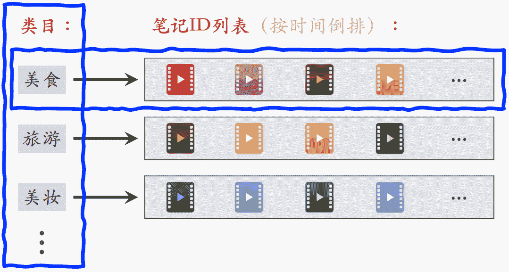

**二、基于关键词的召回通道**：

+   系统维护**关键词索引**：**关键词** → 笔记列表（按时间排序，最新的笔记排在最前面）

+   根据用户画像上的**关键词****做召回**：用户画像 → 用户感兴趣的关键词 → 笔记列表

基于类目 or 关键词召回的缺点：

1.  **只对刚刚发布的新笔记有效**，留给每篇笔记的窗口期很短

+   类目索引和关键词索引都是按笔记发布时间倒排，刚发布的笔记排在最前面

+   做召回的时候，每次取回的是某类目 / 关键词下最新的 k 篇笔记

+   笔记发布几小时后，大概率会被排在几百、几千的位置上，就大概率再没有机会被召回

1.  **弱个性化，不够精准**

+   按照用户感兴趣的类目 or 关键词做召回其实是比较宽泛的

+   eg. 假如我喜欢观赏鱼，属于宠物类目，但是最新发布的 100 篇宠物笔记可能都是猫和狗，大概率没有我感兴趣的观赏鱼，于是召回的 100 篇都是我不感兴趣的

基于类目 or 关键词召回的优点：

1.  能让刚刚发布的新笔记立刻获得曝光，有利于提升作者的发布积极性

## 聚类召回

:::info

聚类召回（基于物品内容的召回通道）

+   **基本思想****：根据用**户的点赞、收藏、转发记录，推荐内容相似的笔记

+   假设如果用户喜欢一个物品，那么用户会喜欢内容相似的其他物品

+   **线下训练**：多模态神经网络 把 图文内容 映射到 向量

+   使用聚类召回，需要事先训练一个多模态神经网络，用来将笔记图文表征为向量

+   并对向量做聚类，划分为 1000 cluster，然后对每个 cluster 建索引

+   **线上服务**：用户喜欢的笔记 → 特征向量 → 最近的 Cluster → 新笔记
:::

聚类召回的**基本思想**：

+   **如果用户**[喜欢一篇](https://www.yuque.com/xf015y/wo1guk/ud7yvq#zRIIN)笔记，那么他会喜欢内容相似的笔记（需要判断两片笔记的内容相似度，可以用神经网络来做）

+   事先训练一个**多模态神经网络****，基**于笔记的类目和图文内容（输入），把笔记映射到向量（输出）

+   向量的相似度，就是笔记内容的相似度

+   对笔记向量做聚类，划分为 1000 cluster，记录每个 cluster 的中心方向（可以用 k-means 聚类，聚类时可以指定用余弦相似度）

聚类召回**索引**的建立：

+   一篇新笔记发布之后，用神经网络把它的图文内容映射到一个特征向量

+   和 1000 个 cluster 中心向量（对应 1000 个 cluster）做比较，找到最相似的向量，作为新笔记的 cluster，将新笔记的 ID 添加到该 cluster 的索引上

+   索引：cluster → 笔记 ID 列表（按时间排序，最新的笔记排在最前面）

**线上召回**：

1.  给定用户 ID，找到他的 last-n 交互的笔记列表，把这些笔记作为种子笔记

1.  把每篇种子笔记映射到向量，和 1000 个 cluster 中心向量做比较，寻找最相似的 cluster（知道了用户对哪些 cluster 感兴趣）

1.  从每个 cluster 的笔记列表中，取回最新的 m 篇笔记

1.  最多共取回 nm 篇新笔记

聚类召回的**缺点**：（同类目 & 关键词召回通道的缺点）只对刚刚发布的新笔记有效，一篇笔记发布一两个小时后就不太可能被召回了

### 内容相似度模型

**提取一篇笔记图文特征**：笔记内容 → 向量

1.  CNN 提取图片特征，得到图片向量

1.  BERT 提取文字特征，得到文字向量

1.  concat 图片向量和文字向量，输入到全连接层，输出表征这篇笔记的特征向量

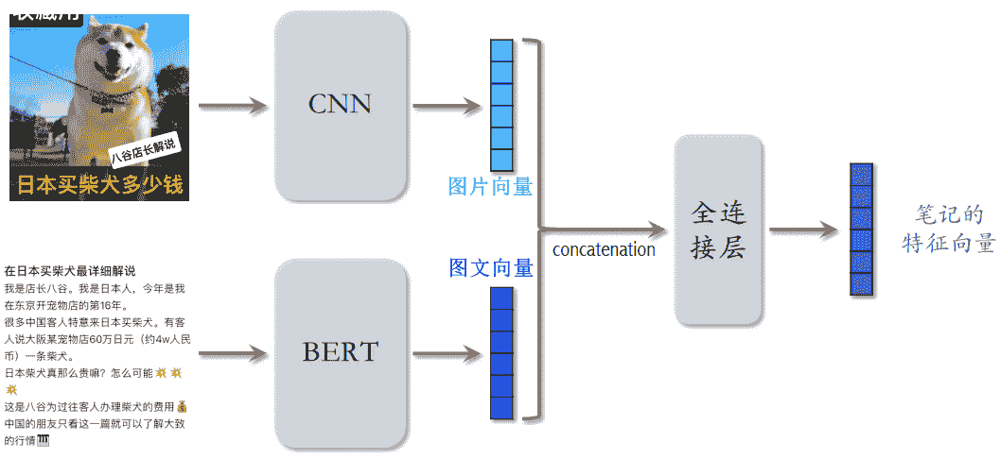

**两篇笔记内容相似度**：如果两篇笔记的内容相似，它们的向量会相似

1.  分别得到两片笔记的特征向量 a 和 b

1.  计算两个向量 a 和 b 夹角的余弦相似度（[-1, 1]），用来衡量两篇笔记的相似度

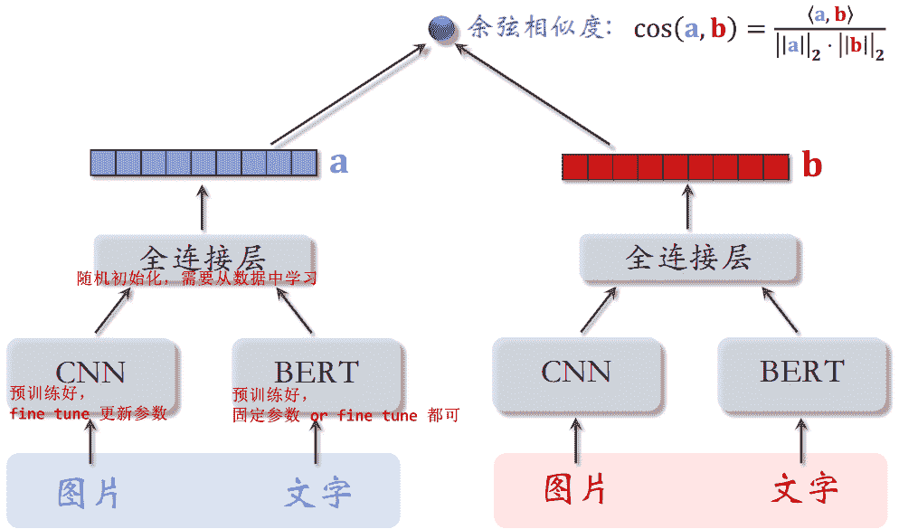

**内容相似度模型的训练**：和[双塔模型的训练](https://www.yuque.com/xf015y/wo1guk/mgtv8w#djxj4)类似

+   每个**训练样本是三元组** <正样本笔记，种子笔记，负样本笔记>

+   将三篇笔记输入到神经网络（参数相同），输出三个向量

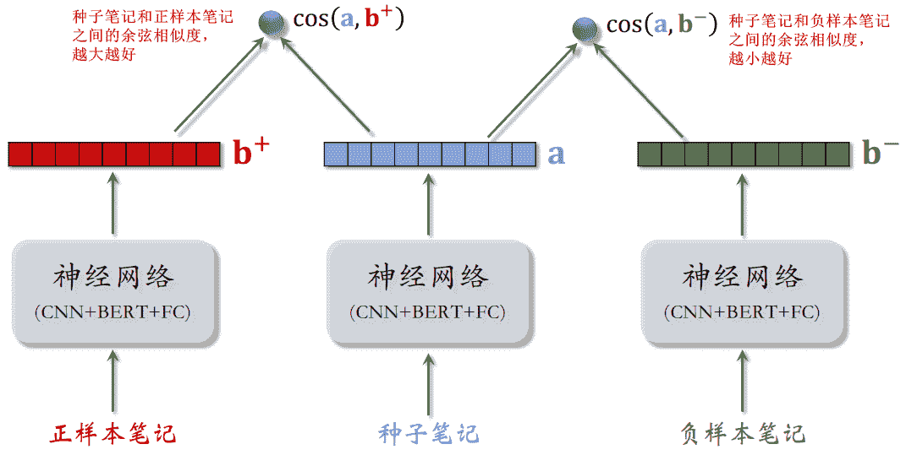

+   **训练目标**：**鼓励** **大于** **，且两者之差越大越好**。让种子笔记和正样本的相似度尽量大，让种子笔记和负样本的相似度尽量小，也就是让这两个余弦相似度的差尽量大

+   Triplet hinge loss：

+   Triplet logistic loss：

正负样本的选取：

+   **正样本的选取**：<种子笔记，正样本>，即选取相似度高的笔记

1.  方法一：人工标注二元组的相似度

+   缺点：代价大，不划算

1.  方法二：**算法自动选正样本**

+   筛选条件：

+   条件一：只用高曝光笔记作为二元组（因为高曝光的有充足的用户交互信息，算法选择正样本会比较准）

+   条件二：两片笔记有相同的二级类目，比如都是“菜谱教程”，可以过滤掉完全不想死的笔记

+   用 ItemCF 的物品相似度选择正样本

+   **负样本的选取**：<种子笔记，负样本>

+   从全体笔记中随机选出满足条件的：

+   字数较多（神经网络提取的文本信息有效）

+   笔记质量高，避免图文无关的劣质笔记

## 2.4 Look-Alike 人群扩散召回

:::info

Look-Alike 人群扩散召回：适用于发布一段时间已有点击、但是点击次数不高的低曝光物品

新笔记已发布一段时间，和其有_交互行为_的用户为种子用户，根据_用户相似度_，将笔记推送给其种子用户的相似用户。

:::

起源 / Look-Alike 在互联网广告中的应用：

1.  假设广告主是特斯拉，已知 Model3 的典型用户的特征如下左图所示

1.  **找出符合**所有特征的用户群体，称作种子用户，这样的用户数量不会很多，可能只有几万人。

> 但是潜在的符合条件的用户可能很多，而我们缺少他们的部分信息，而无法找到他们。比如，很多用户不标自己的学历和年龄。

> 广告主可能想给 100 万人投放广告，但目前只找到几万的种子用户，该如何发现 100 万潜在的目标用户呢？

1.  **Look-Alike 人群扩散**：寻找和种子用户相似的用户，将找到的这些用户称作 Look-Alike 用户

+   Look-Alike 人群扩散只是一**个框架，具体该怎么扩散，**最重要的问题在于如何定义两个用户的相似度？

+   **UserCF**：两个用户有共同的兴趣点越多就越相似

+   **Embedding**：两个用户 Embedding 向量的余弦相似度越大就越相似

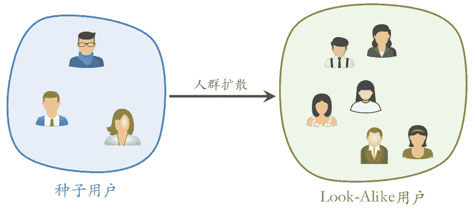

### Look-Alike 用于新笔记召回

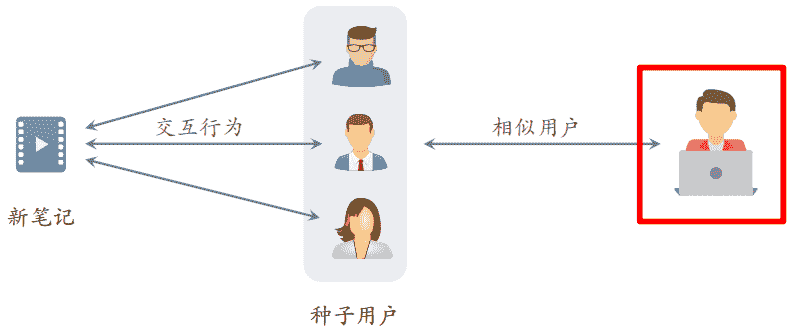

**

冷启动**场景下，Look-Alike 的主要思想：

+   如果用户有点击、点赞、收藏、转发等行为 —— 说明用户对笔记可能感兴趣

+   对于发布一段时间已有交互、但是交互次数不高的**低曝光新**笔记，把有交互的用户作为新笔记的种子用户

+   用 look-alike 在相似用户中扩散：如果一个用户和种子用户相似，那么他也可能对这篇新笔记感兴趣，可以将这篇笔记推荐给他

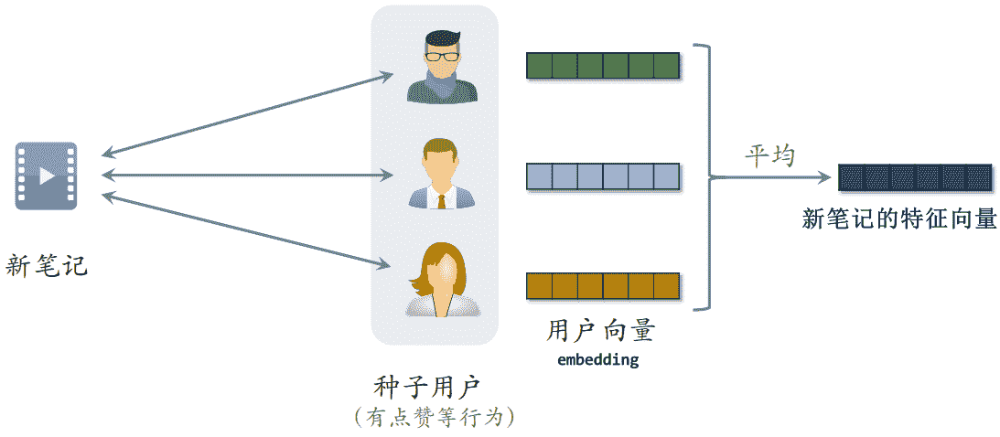

1.  一篇新笔记，系统会将其推荐给很多用户，少数用户会对笔记感兴趣，**会点击、**点赞、收藏、转发，将这些**用户称作种子用户**（但新笔记推荐不准，因此有交互行为的用户数量很少）

1.  取回每个种子用户的 embedding 向量（可以复用双塔模型渠道的用户向量）

1.  取这些种子用户 embeddi**ng 向量的均值**，得到一个向量，作为表征新笔记的特征向量（这个向量反映出什么样的用户对该笔记感兴趣）

+   这个特征向量要做**近线更新**：近线指的是不用实时更新，能做到分钟级的更新即可

+   特征向量是有交互的用户的向量的平均

+   每当有用户交互该物品，（几分钟后）更新笔记的特征向量

**线上召回 流程**：

1.  将新笔记的特征向量都放在向量数据库里，向量数据库支持最近邻查找

1.  如果有用户刷一下📕，就要给这个用户做一次推荐

1.  用双塔模型计算这个用户的特征向量

1.  拿该用户的特征向量作为 query，在向量数据库中做最近邻查找，取回几十篇笔记，作为 Look-Alike 召回通道的召回结果

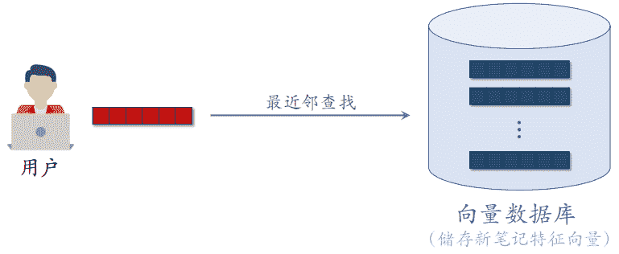

#  流量调控

**:::info

物品**冷启动：流量调控

+   **流量调控：流量怎么**在新物品、老物品中分配，工业界常用做法是让流量向新笔记倾斜，帮助新笔记获得更多的曝光机会

+   **流量调控是物品冷**启动最重要的一环，直接影响作者发布指标。

+   流量调控的发展通常会经历这几个阶段：

1.  在推荐结果中**强插**新笔记（最原始的做法）

1.  对新笔记做[**提权（boost）**](https://www.yuque.com/xf015y/wo1guk/ud7yvq#q2yFr)（排序时给新笔记的权重做 boost，调权重有点麻烦）

1.  通过**提权**，对新笔记做[**保量**](https://www.yuque.com/xf015y/wo1guk/ud7yvq#JQpZA)（较高级的做法，eg. 尽量保证每篇新笔记都呢个在前 24 h 获得至少 100 次曝光。保量的手段也是提权，但提权的策略更复杂、更精细）

1.  [**差异化保量**](https://www.yuque.com/xf015y/wo1guk/ud7yvq#QwYPc)（更高级的技术。在笔记刚发布时，根据笔记的质量，决定保量的目标是多少次曝光）

保量也是通过提权做的

:::

**扶持新笔记的目的**（为什么流量要向新笔记倾斜？）：

+   **目的一：促进发布，增大内容池**

+   新笔记获得的曝光越多，作者创作积极性越高

+   反映在发布渗透率、人均发布量（作者侧指标）

+   **目的二：挖掘优质笔记**

+   做探索，让每篇新笔记都能获得足够曝光

+   否则即使笔记质量特别高，没有获得足够多的曝光，系统也无法发现这是优质笔记，不会给这篇笔记更多的流量，让它变成热门笔记

+   因此要保证每篇新笔记在初始的探索阶段都能获得足够多的曝光，比如获得 100 次曝光

+   挖掘的能力反映在高热笔记占比（内容侧指标）

**工业界的做法**（对新发布物品的扶持）：

+   假设推荐系统只分发年龄 ＜ 30 天的笔记

+   发布超过 30 天的笔记通常不会出现在推荐结果中，只能通过搜索和其他渠道曝光

+   假设采用自然分发，新笔记（年龄 < 24 h）的曝光占比为 1/30

+   因此，若采用自然分发，新老笔记公平竞争，新笔记的曝光机会非常少

+   扶持新笔记，即让新笔记的曝光占比远大于 1/30

+   也就是说，新笔记的流量远远大于自然分发的流量

**业界流量调控技术的发展**：（原始 → 高级）

1.  在推荐结果中**强插**新笔记

1.  对新笔记做[**提权（boost）**](https://www.yuque.com/xf015y/wo1guk/ud7yvq#q2yFr)：排序时给新笔记的权重做 boost，比如加 or 乘上一个系数，但调权重较麻烦

1.  通过**提权**，对新笔记做[**保量**](https://www.yuque.com/xf015y/wo1guk/ud7yvq#JQpZA)：保量 —— eg. 尽量保证每篇新笔记都呢个在前 24 h 获得至少 100 次曝光

+   保量的手段也是提权，但提权的策略更复杂、更精细

1.  [**差异化保量**](https://www.yuque.com/xf015y/wo1guk/ud7yvq#QwYPc)：在笔记刚发布时，根据笔记的质量，决定保量的目标是多少次曝光

> 保量也是通过提权做的

## 新笔记提权（boost）

**目标**：让新笔记有更多的机会曝光

+   如果纯做自然分发，24 h 新笔记的占比为 1/30

+   需要做人为干涉，让新笔记占比大幅提升

**干涉的阶段**：干涉**粗排、重排**环节，给新笔记提权

+   因为粗排、重排这两个环节是漏斗，会过滤掉大量笔记

**干涉的方法**：对新笔记提权，让新笔记有更多的机会通过漏斗（粗排和重排）

+   可以给新笔记的分数乘上一个大于 1 的系数

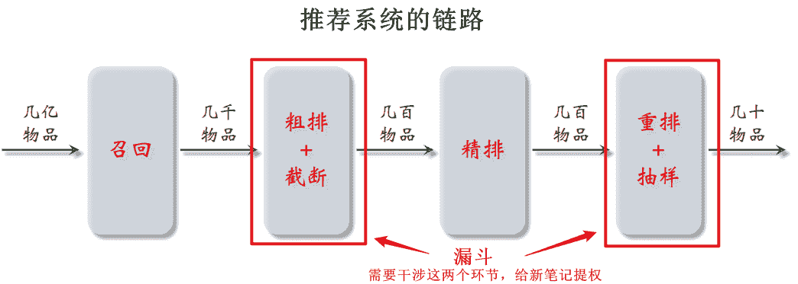

**新笔记提权的优缺点**：

1.  **优点**：容易实现，投入产出比好。在前期没有足够人力的情况下，这种流量调控方案比较好

1.  **缺点**：

1.  **需要人为设置一些提权系**数，乘到排序模型的分数上，但曝光量对提权系数很敏感

+   提权系数设大一点，可能就会将很多低质量的新笔记排在前面；系数小一点，给新笔记的曝光可能不足

1.  很难精确控制曝光量，容易过度曝光和不充分曝光

+   即使再仔细地调提权参数，也做不到对曝光量的精准控制

##  保量

**新笔记保量****：不**论笔记质量高低，都保证在发布后的前 24 小时获得 100 次曝光（保量的目标）

做法：在原有提权系数的基础上，乘上额外的提权系数

+   差异化对待不同发布时间、不同曝光次数的笔记

+   如下图所示，保量目标是 24 小时获得 100 次曝光，离 100 次曝光差得越多，提权系数就越大，以争取更多的曝光机会

+   按等比例计算，12 h 应获得 50 次曝光，若超过 12 h 未达到 50 次曝光，就加大扶持力度，比如将提权系数设为 1.2

+   若 12 h 已经达到 50 次曝光，则无需加大扶持力度，将提权系数设为 1.0

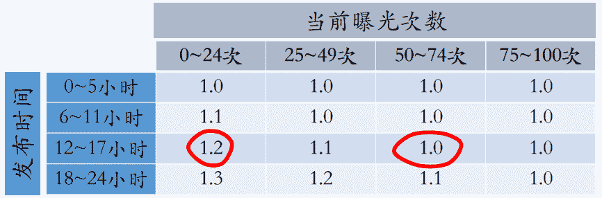

**更先进的保量**做法：

动态提权保量：

+   目标时间：比如 24 h

+   目标曝光：比如 100 次

+   发布时间：比如笔记已经发布 12 h

+   已有曝光：比如笔记已经获得 20 次曝光

**保量的难点**：**保量的成功率远低于 100%**：很多笔记在 24 h 达不到 100 次曝光，可能原因：

1.  推荐链路上存在问题：**召回、排序存在不足**

1.  比如新笔记的召回做的不好，某些类型的新笔记很难被召回，即便提权系数再高，也很难获得曝光

1.  或者也可能是排序模型的问题，对新笔记的预估做的不准

1.  **提权系数调的不好，导致曝光不足**

1.  **线上环境变化会导致保量失败**：

+   线上环境变化：新增召回通道、升级排序模型、改变重排打散规则

+   每当线上环境变化后，都需要重新调整提权系数

> 不正确的解决办法：给所有新笔记一个很大的提权系数（比如 4 倍），直到达到 100 次曝光为止，这样的保量成功率很高，为什么不用这种简单粗暴的方法？

> —— 给新笔记的分数提权（boost）越多，不一定对新笔记越有利

1.  好处：分数提升越多，新笔记的曝光次数越多

1.  坏处：把笔记推荐给不太合适的受众

+   点击率、点赞率等指标会偏低（因为是强制提升的分数，用户可能不太感兴趣）

+   上述指标偏低，长期会受推荐系统打压，难以成长为热门笔记

也就是说，过了冷启动阶段后，之前大力度的扶持可能会起到反作用

## 差异化保量

差异化保量和保量的区别：

+   **保量**：不论新笔记质量高低，都做扶持，eg. 在前 24 h 给出 100 次曝光

+   **差异化保量**：不同笔记有不同保量目标，根据内容质量、作者质量等决定保量目标，eg. 普通笔记保 100 次曝光，内容优质的笔记保 100 ~ 500 次曝光

+   **基础保量**：24 h 100 次 曝光

+   **内容质量**：用模型评价内容质量高低，给予额外保量目标，上限是加 200 次曝光

+   可以用多模态神经网络判定图文视频的质量高低

+   **作者质量**：根据作者历史上的笔记质量，给予额外保量目标，上限是加 200 次曝光

+   一篇笔记最少有 100 次保量，最多有 500 次保量

# 物品冷启的 AB 测试

**:::info

物品冷启**动的 AB 测试

推荐系统常用的 AB 测试只考察用户侧消费指标，而物品冷启动的 AB 测试还需要额外考察作者侧发布指标。后者远比前者复杂，且所有已知的实验方案都存在缺陷。

+   冷启的 AB 测试需要观测**作者发布指标**和**用户消费指标**

+   各种 AB 测试的方案都有缺陷

+   设计方案的时候，问自己几个问题：

1.  新笔记分为实验组、对照组，这两组新笔记会不会抢流量？ → AB 测试的 diff/收益 可能在推全后会消失

1.  **新笔记、老笔记怎么抢流量，AB 测试和推全后抢流量的方式是否一致？→ **如果 AB 测试和 推全后新笔记、老笔记抢流量的方式不一致， 那 AB 测试结果可能不准（推全后 diff/收益 减小）

1.  同时隔离笔记、用户，会不会让内容池变小？ → 如果内容池变小，肯定会影响推荐效果，损害用户体验

1.  如果对新笔记做保量，会发生什么？ → 比如保量目标 100 次是固定的，若新笔记从实验组获得了很多曝光（比如 80 次），就不容易出现在对照组（因为只需要获得 20 次曝光，就能达到保量目标），因此实验结果不准确
:::

**新笔记冷启的 AB 测试关注的**[**指标**](https://www.yuque.com/xf015y/wo1guk/ud7yvq#t2FhM)：

1.  **作者侧指标**：→ [**作者侧实验**](https://www.yuque.com/xf015y/wo1guk/ud7yvq#TYOoQ)

1.  发布渗透率、人均发布量 （AB 测试考察作者侧指标比较困难）

1.  **用户侧指标**：→ [**用户侧实验**](https://www.yuque.com/xf015y/wo1guk/ud7yvq#i0AIx)

1.  对新笔记的点击率、交互率

1.  大[盘指标：消费时长、日活、月](https://www.yuque.com/xf015y/wo1guk/ud7yvq#a7k51)活 —— 标准的 AB 测试关注的指标 → 推荐系统标准的 AB 测试

##  推荐系统标准的 AB 测试

+   用户：随机分为实验组（使用新策略）和对照组（使用旧策略），每组 50% 的用户

+   笔记：不分组

+   对比两组用户消费指标的 diff

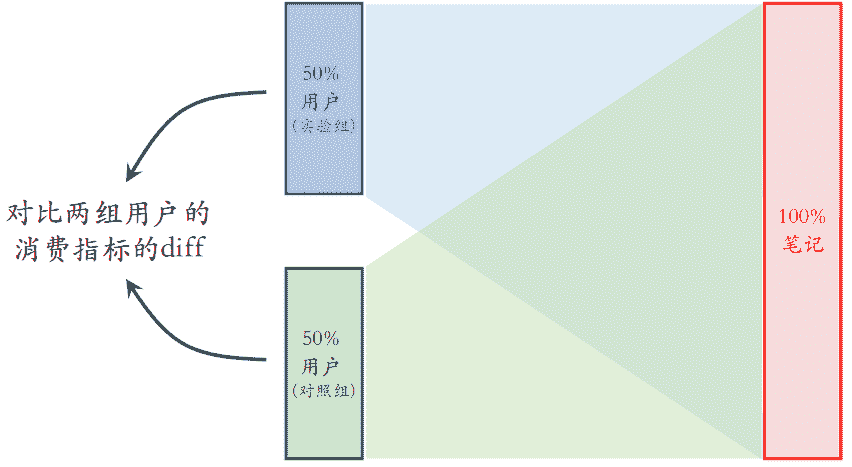

## 用户侧实验

[推荐系统标准的 AB 测试](https://www.yuque.com/xf015y/wo1guk/ud7yvq#a7k51)，可以用于冷启的用户侧实验，比如考察新的冷启策略对新笔记点击率的影响、对用户消费时长的影响等。

+   但这种测试方法存在不足之处，不过不算严重，结果还算可信

+   **缺点**：**新策略对用户体验的伤害没有 AB 观测**到的那么严重（推全后 diff 会减小）

+   限定：保量 100 次曝光

+   假设：新笔记曝光越低，用户使用 APP 时长越低（这是合理的假设，因为新笔记的推荐通常不准）

+   新策略：把新笔记排序时的权重增大两倍（新策略会导致消费指标下降）

+   结果（只看消费指标）：

+   AB 测试的 diff 是负数（策略组不如对照组）

+   如果推全，diff 会缩小（比如 -2% → -1%）

+   **原因分析**：

+   实验组使用新的冷启策略后，会看到更多新笔记，因此消费指标会变差

+   但是保量 100 次的目标是确定的，新笔记从实验组得到了更多曝光（比如 80 次），那么从对照组得到的曝光就会减少（20 次即可）

+   因此，对照组看到更少的新笔记，消费指标会变好

+   消费指标在实验组变差，在对照组变好，导致 AB 测试观测到的 diff 很大，而推全后消费指标实际跌不了那么多

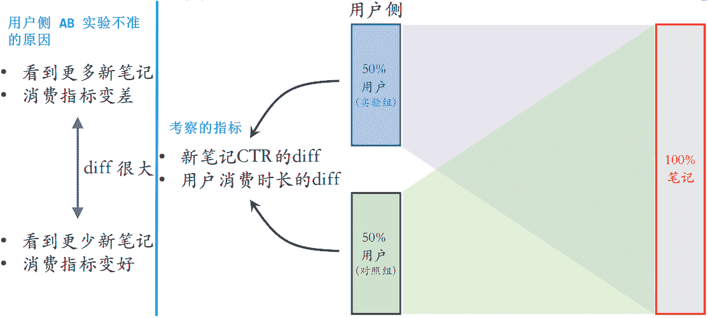

## 作者侧实验

> 作者侧实验不太好做，没有很完美的实验方案

**方案一**：

+   方案：

+   用户：不做分组

+   老笔记：不做分组（自然分发，不受新旧策略影响）

+   新笔记：按作者分为实验组（用新策略）和对照组（旧策略），各 50%

+   **缺点 1**：**新笔记之间会抢流量**

+   设定：

+   新老笔记走各自队列，没有竞争

+   重排分给新笔记 1/ 3 流量，分给老笔记 2/3 流量

+   新策略：把新笔记的权重增大两倍

+   结果（只看发布指标）：

+   AB 测试的 diff 是正数（策略组优于对照组）

+   如果推全，diff 会消失（比如 2%→ 0%）

+   原因分析：

+   新笔记的流量占比（1/3）不变，因此不会和老笔记发生竞争，但是新笔记和新笔记之间会抢流量

+   AB 测试时，对照组和实验组使用了不同的冷启策略，实验组新笔记提权后能抢到更多曝光机会，对照组新笔记的曝光就会减少，两组的发布指标就会产生 diff

+   如果将新策略推全，给所有作者的新笔记都提权，那么就不存在两组新笔记之间抢流量的情况，就不会出现 diff

+   **缺点 2**：**新笔记和老笔记抢流量**

+   设定：新老笔记自由竞争

+   新策略：把新笔记排序时的权重增大两倍

+   AB 测试时，50% 新笔记（带策略，实验组）跟 100% 老笔记抢流量

+   推全后，100% 新笔记（带策略）和 100% 老笔记抢流量

+   因此，作者侧 AB 测试结果与推全结果存在差异，比如 AB 测试结果是发布渗透率涨了 2 个百分点，但推全后可能大盘的渗透发布率只涨了 1 个百分点

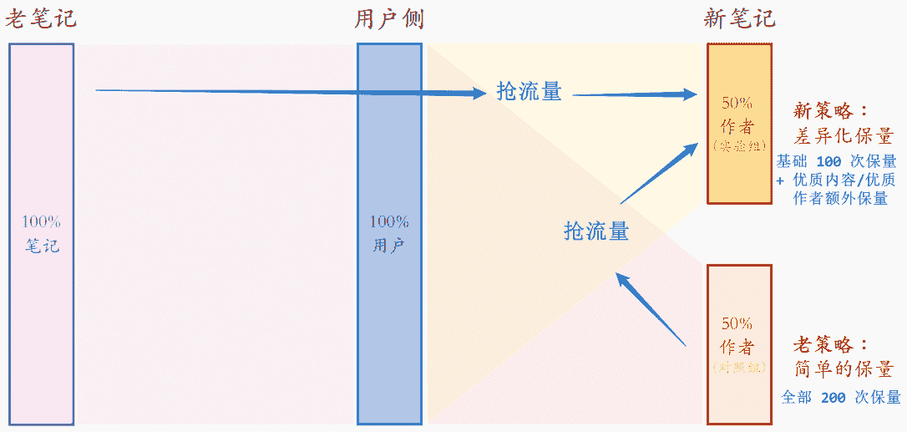

**方案二**：

+   方案：

+   用户：分为实验组和对照组，实验组用户只能看到实验组的新笔记，对照组的用户只能看到对照组的新笔记，避免两组新笔记抢流量，因此比方案一的结果更可信

+   老笔记：不做分组

+   新笔记：分为实验组和对照组

+   **对比方案一**：

+   **优点**：新笔记的两个桶不抢流量，作者侧实验结果更可信。AB 测试的 diff 推全后不会消失

+   **相同点**：新笔记和老笔记抢流量，作者侧 AB 结果与推全结果有些差异

+   **缺点**：新笔记池减小一半，对用户体验造成负面影响

+   50 % 的用户只能看到 50 % 的新笔记，新笔记内容池减小了一半，最符合用户兴趣的笔记可能也少了一半，因此要从差一些的笔记中再选取来补足，这会影响用户体验，造成消费侧指标下跌。也就是说为了做 AB 测试，会导致大盘变差，公司的业务会受损失

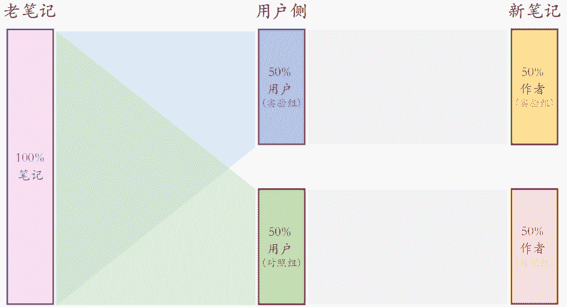

**方案三**：

+   方案：用户、老笔记、新笔记都分为实验组和对照组

+   相当于将📕切分成了 2 个 APP

+   **优点**：是最优方案，实验结果最精准。如果 AB 测试发现指标涨了，推全之后也会涨那么多

+   **缺点**：但这种方案不太实际可行，把📕切成两个 APP，内容池小了一半，会严重损害用户体验，消费指标一定会大跌，损害公司业务，代价太大

<https://v11enp9ok1h.feishu.cn/sync/Ipw1d27gNsv3OAbo3N7cks4ZnJf>