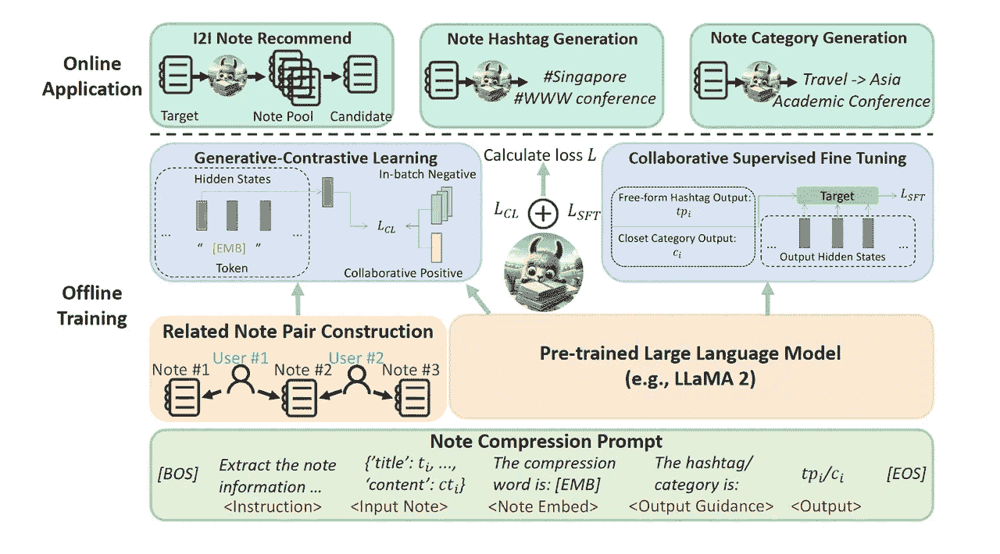
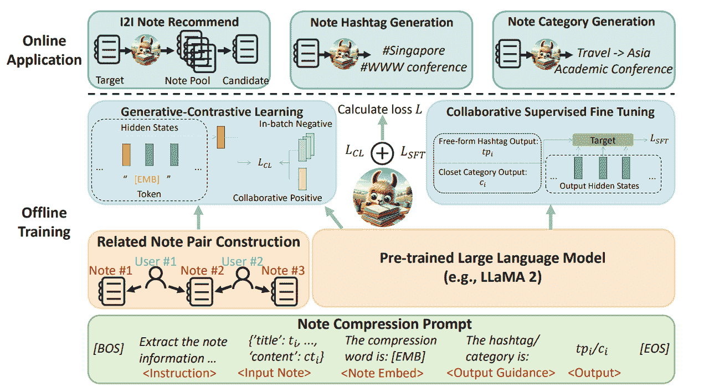
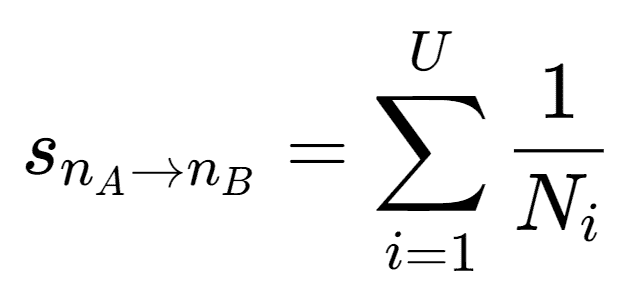
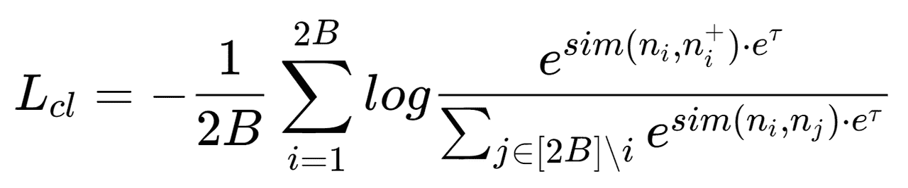
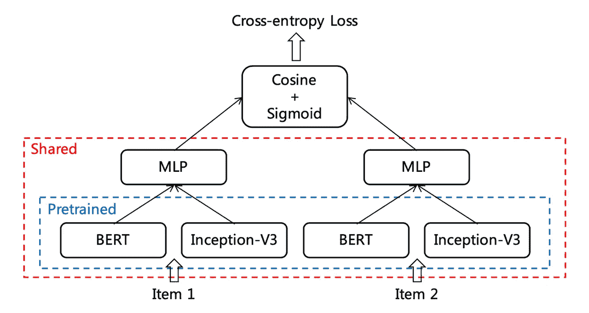
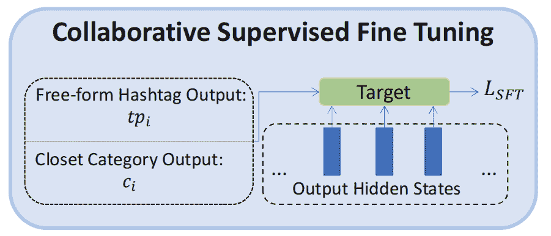
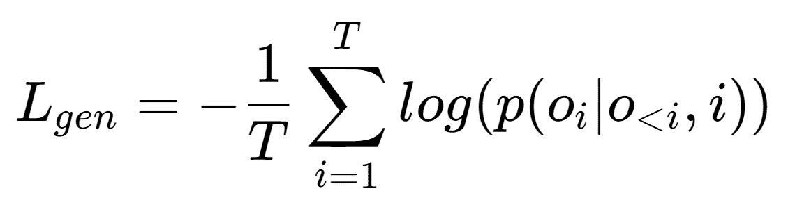
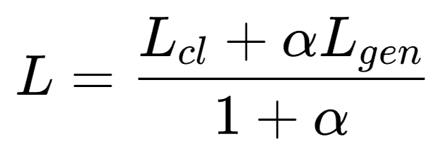

# 📕怎么利用LLM做推荐系统的

> 来源：[https://v11enp9ok1h.feishu.cn/docx/WAiKdGUNyozWLxx76YMcKpgqnNg](https://v11enp9ok1h.feishu.cn/docx/WAiKdGUNyozWLxx76YMcKpgqnNg)

> **本文介绍了****大语言****模型在📕笔记推**荐场景下的落地应用，主要是围绕如何利用LLM的表征能力来生成更适用于i2i召回的文本embedding，思路简单，落地也容易，个人觉得实践价值非常高，值得学习。

## 方法介绍

**方法分为三个部分**，一个输入的**prompt构建**和训练时用到的**两个预训练任务**：

+   笔记压缩prompt构建

+   生成式对比学习

+   协同监督微调

## 背景

> [**为了解**](https://zhida.zhihu.com/search?q=%E5%A4%9A%E6%A8%A1%E6%80%81&zhida_source=entity&is_preview=1)决推荐**中的物品冷**启动问题，在召回阶段中往往会增加一路使用内容多模态表征的i2i召回，这路召回由于只使用了纯内容的特征，和老物品便可以公平比较，不会产生因为新物品后验行为少而导致无法被召回的问题。

**在现有的多模态i2i召回方法在文本****侧一般都是用一个B****ERT经****过预训练后生成em****bedding然后基****于embedding的相似度****来**进行召回，但是这样可能也会存在一些问题：

1.  **BERT表征能力不足**。相较于**BERT**，**使用参数量更大的LLM来生成****embedding****可能可以**学习到[**一些更为**](https://zhida.zhihu.com/search?q=%E8%AF%AD%E4%B9%89%E4%BF%A1%E6%81%AF&zhida_source=entity&is_preview=1)长尾的信息，同时仅使用Bert生成的embedding只能代表文本的语义信息，和下游推荐任务的目标存在一定的不一致

>

1.  **标签类别信息利用不够充分**。**一篇图文笔记的标签和类别往往代表他的中心思想，对于确定两个笔****记是否相关至关重要，但现有**的Bert方法只是将标签和类别视为内容的一个组成部分（实际上BERT做预训练时除了MLM任务应该也会有标题预测标签/类别这种任务，这个论述感觉站不住脚），而文章发现，使用笔记内容生成标签和类别的过程和生成笔记的embedding十分类似，都是讲笔记的关键信息压缩成有限的内容，因此引入一个生成标签和类别的任务可能会提升最终embedding的质量。

## 具体方法

### item2item 推荐

+   **🌟🌟核心工作：利用** LLM 生成主题标签/类别用于增强笔记embedding

+   目前的LLM用户推荐大多数都是对比学习

+   一个疑问：如何判断用户/item是否相关？也就是说这个相关性判断的越准确，数据质量越高，有监督学习效果越好。

### **方法分为三个部分，一个输入的pro**mpt构建和训练时用到的两个预训练任务：

+   **笔记压缩prompt构建**

+   **生成式对比学习（Generative-C**ontrastive Learning）

+   **协同监督微调（Collaborative Sup**ervised Fine-Tuning）

### **具体流程如下**

+   [**首先在离**](https://zhida.zhihu.com/search?q=%E8%AE%AD%E7%BB%83%E6%A0%B7%E6%9C%AC&zhida_source=entity&is_preview=1)线训练阶段，首先根据用户行为构建出很多的相关笔记对，作为训练样本

+   然后使用LLaMA 2作为backbone进行训练，在训练时一方面使用相关笔记对进行对比学习，另一方面还加入了一个标题和标签生成任务来提高前者embedding生成的质量，

+   在线则使用模型生成的笔记embedding做ANN召回相关的笔记，同时也可以生成笔记的标签和类别来辅助其他任务。

### 工作1：Note Compression Prompt 笔记压缩prompt

> 这里在构建prompt的时候同时考虑到了两个预训练任务，

+   一方面为了能够借助**将笔记的文本内容压缩到一个****token****中**，再使用这个**token****映射的向**量来进行生成式对比学习，也作为最终输出的文本表征，

+   另一方面也想通过**标签**和**类别**生成任务，**用来加强前者文本表征的能力**，**具体的prompt模板如下：**

> Prompt: [BOS]<Instruction> <Input Note> The compression word is:"[EMB]". <Output Guidance> <Output>[EOS]

[BOS]代表句子开头，[EOS]代表句子结尾，[EMB]则代表最终[要输出文](https://zhida.zhihu.com/search?q=%E5%85%A8%E8%BF%9E%E6%8E%A5%E5%B1%82&zhida_source=entity&is_preview=1)本表征所对应的那个token，最终会将这个token对应的隐向量经过一个全连接层映射后得到最终的表征向量。

> **同时，针对类别生成和标签生成**使用了不同的prompt，但是模板都是同一个，具体来说，如果是做类别生成，那么prompt就是这样的：

> <Instruction>: Extract the note information in json format, compress it into one word for recommendation, and generate the category of the note. <Input Note>: {’title’: , ’topic’: , ’content’: }. <Output Guidance>: The category is: <Output>:

+   如果是用来做标签生成，那么prompt就是这样的：

> <Instruction>: Extract the note information in json format, compress it into one word for recommendation, and generate <j> topics of the note. <Input Note>: {’title’: , ’content’: }. <Output Guidance>: The <j> topics are: <Output>: <j> topics from

+   [**由于标签**](https://zhida.zhihu.com/search?q=%E9%9A%8F%E6%9C%BA%E9%87%87%E6%A0%B7&zhida_source=entity&is_preview=1)**有****很多，大模型可以不断生成**，所以这**里从原始标签**里随机采**样 j 个****标签****作为生**成的内容，并且在prompt里规定了只能生成 j 个标签。

+   **在p**r**om**pt构建输入完成后，便可以把[EMB]这个特殊token最终输出的隐向量当成笔记的文本表征，同时也能够根据笔记的内容生成对应的标签和类别。

### 工作2：Generative-Contrastive Learning 对比学习

虽然大模型通过SFT和RLHF预训练之后能够表征的语义信息是非常丰富的，但是直接用在下游推荐任务中却不一定好，主要是因为大模型的预训练任务是为了获取语义信息，而下游推荐的目标却是为了点击率，两个目标存在差距，所以这个生成式对比学习就是为了在大模型的预训练中引入推荐的协同过滤信号，从而使得生成的embedding更适用于下游的推荐任务。

具体来说，首先统计一周时间窗口内每个用户点击笔记A后再点击笔记B的次数，然后算出一个共现分数，作为协同过滤的信号，计算两篇笔记共现分数的公式如下：

+   这里  是用户的个数，  代表用户的点击次数，实际上就是对活跃用户进行了降权，防止某些高活用户什么笔记都点导致计算的共现分数不准确。

+   在计算得到所有笔记两两之间的共现分后，然后再卡阈值，将低于或高于某个阈值的笔记进行过滤，最后对于每个笔记，都会得到和其相关的笔记集合，再两两构建笔记对作为输入的正样本。

+   进一步，对于每个笔记，都使用[EMB]这个特殊[**toke**](https://zhida.zhihu.com/search?q=%E6%8D%9F%E5%A4%B1%E5%87%BD%E6%95%B0&zhida_source=entity&is_preview=1)n的隐向量经过全连接层映射得到的向量作为文本表征向量 便可以采用对比学习的方式来进行学习，正样本就是构建好的相关笔记对，对应向量记作 负样本采用batch内负采样，对应向量记作  损失函数使用对比学习的Info-NCE:

相似度计算采用[余弦相似度](https://zhida.zhihu.com/search?q=%E4%BD%99%E5%BC%A6%E7%9B%B8%E4%BC%BC%E5%BA%A6&zhida_source=entity&is_preview=1):

通过这种方式进行训练，便可以使得LLM学到一些用户行为相关的信息，从而生成更好的文本表征服务于下游推荐任务。

顺[便说一](https://zhida.zhihu.com/search?q=%E4%BA%A4%E5%8F%89%E7%86%B5&zhida_source=entity&is_preview=1)下，这个思路其实和📕之前发的另一篇论文提到的CB2CF其实是一脉相承的，只不过另外一篇同时用了文本和图像特征，损失函数用的交叉熵。

### 工作3：联合建模以上两项任务提高Embedding质量

> 这个任务实际上就是一个做标签/类别生成任务的SFT，加了协同两个字可能是因为要跟前面引入了协同过滤信号的GCL对应起来，为什么要加这样一个任务呢?

**两个原因：**

1.  [只用LLM](https://zhida.zhihu.com/search?q=%E5%A4%A7%E7%82%AE%E6%89%93%E8%9A%8A%E5%AD%90&zhida_source=entity&is_preview=1)生成句子embedding有点像大炮打蚊子的感觉，没有充分发挥LLM强大的生成能力。这边猜测应该是因为生成的标签和类别还可以用于一些其他场景，比如当一些笔记缺乏标签，或者类别不正确是可以使用LLM为其补充信息。

1.  可以提高上一步生成式对比学习生成的embedding的质量。这是由于生成标签/类别和生成笔记embedding一样，都是旨在总结整个笔记内容。所以加了这个预训练任务可能可以提高生成最终生成的embedding的质量

**模型：**

具体来说，在CSFT里面要同时做类别和标签预测，文章提到为了提高训练效率并防止遗忘问题，会从每个批次中选择 r 个笔记用于标签生成任务，而剩余的笔记则分配用于类别生成任务。CSFT的损失函数如下，其实就是把输出部分的token计算下loss:

最终模型的loss由两项加起来，并且用 α 作为超参控制两个loss的权重：

