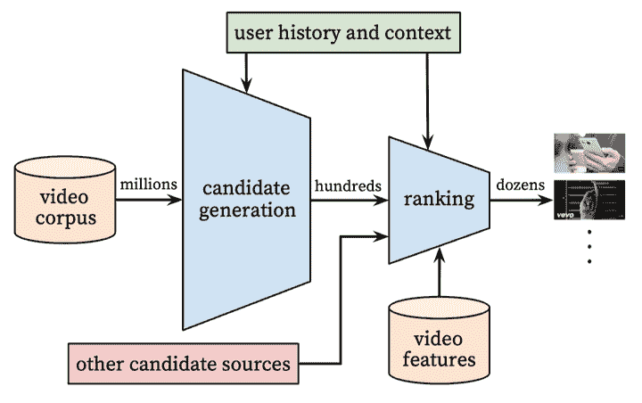
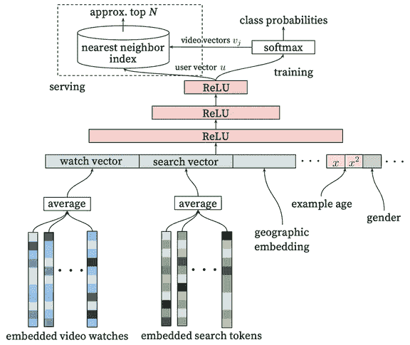
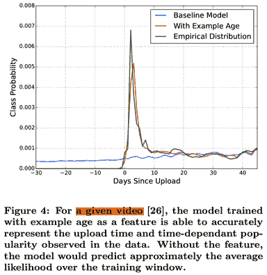
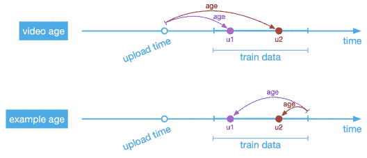
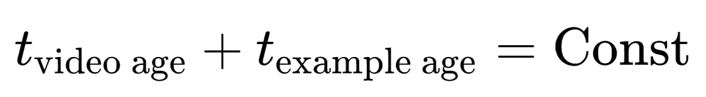
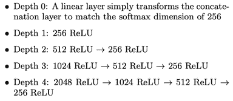
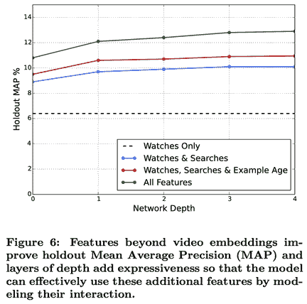
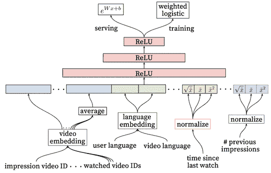
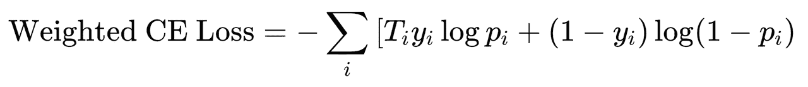
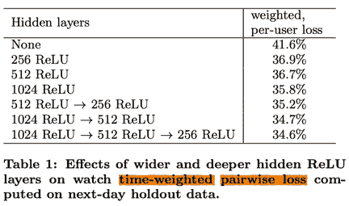

# Youtube DNN推荐系统

> 来源：[https://v11enp9ok1h.feishu.cn/docx/A4eKd6QPJoKK6QxoXRqcPQGInCh](https://v11enp9ok1h.feishu.cn/docx/A4eKd6QPJoKK6QxoXRqcPQGInCh)

# 整体架构

整体架构是标准的先检索后精排：

# 候选生成（检索）

把**推荐**看成一个**分类问题**。时刻   用户   在背景  下对每个视频  的观看可能建模为：

> **这么定义**显然变成类别很多（视频数量）的分类问题，分母计算量很大，直接优化肯定不行。作者使用了负采样（Negative Sampling）方法，所有类别太多，只从中选择一些作为负类（相当于对上式中的分母做了个近似）。负类基于样本分布抽取而来 ^{[10]}，每个正样本会对应抽取几千个负样本。负采样是针对类别数很多情况下的常用方法。

+   **DNN**的任务是学习用户表示向量    ，把它视为用户历史和背景的函数。

+   视频    的表示向量   本身就是模型训练参数。表示向量都是 256维。

+   模型首先把用户的各种历史和背景信息抽取为向量，然**后把这些向量拼接起来**送进一个多层DNN，DNN的宽度逐层减半。

+   DNN的输出就作为此用户的向量   。

+   所以模型的关键是输入的各种信号，即用户的历史和背景信息。

<https://v11enp9ok1h.feishu.cn/sync/VztedzIoUstVPDb6RNMctK8Unie>

模型训练后即可得到每个**视频的表示向量**，以及每个**用户的表示向量****（利用特**征可提前计算好**，特征不**依**赖于****特定ite**m）**，只要拿这**个用户向量去检索最相似的 N 个视频即可，可以直接用常见的向量检索库，如Faiss等。

## **训练数据的选取**

> **训练样本**来自于用户在youtu**be各个****展位的日志，不仅限于推荐展**位。训练数据来**源于用****户的隐**式数据（虽然有显式数据，但规模小好几个量级）训练模型，用户看完了的视频作为正样本。负样本是通过负采样选取的，所以训练数据中可以不包括负样本。

+   **一个经验是**训练数据中对于**每个用户选取相**同的样本数，保证用户等权重。这样可以改进线上A/B测试的效果。

+   另一个经验是要**避免让模型知道不该知道的信息****。一个例子是如果模型知道用户**最**后的行为是搜**索了 **“Tayl****or Swi**ft”，那**模型可能会倾向**于推荐搜索页面搜 “Taylor Swift” 时搜出的视频，这不是推荐模型的期望行为。解决方法是扔掉时序信息，使用无序的搜索tokens来表示搜索queries（直接平均）。

> 基于这个例子就把时序信息扔掉理由挺勉强的，解决这种特殊场景的信息泄露会有更针对性的方法，比如把搜索query与搜索结果行为绑定让它们不可分。Google后面是有时序建模相关的工作的

## 模型输入特征

DNN的好处是可以把各种离散和连续的特征都输入进去。论文中提到检索模型中使用到的特征：

+   用户的观看历史：使用用户最近的 50 次观看历史。视频数量为 1 Million。观看历史中的视频向量（256维）被直接平均后输入到模型中。

+   用户的搜索历史：使用用户最近的 50 次搜索历史。每个query被分解为unigram和bigram，然后所有这些token对应的向量（256维）被直接平均后输入到模型中。token数量为 1 Million。

+   用户的人口统计特征：对新用户的推荐会比较有帮助。

+   用户的地理位置和设备特征

简单的二元和连续特征，如用户的性别、登录状态和年龄，归一化到 [0, 1] 区间的实数值后直接输入网络。

## 特征 “Example Age”

视频有明显的**生命周期**，

**例如****：****刚上传**时比之后更受欢迎，所以视频流行度随着时间的分布是高度非稳态的（下图中的绿色曲线）。

因为模型是**基于历史数据训练****获得的，所以它对**每个视频的预测**会倾向于拟合**此视频在训练数据中的平均观看情况（上图中的蓝色曲线）。

> 通过引入 **example age**** 这个特征来捕捉视频的**生命周期，效果见上图红色曲线。example age 定义为 𝑡max⁡−𝑡tmax−t ，其中 𝑡max⁡tmax 为训练数据**中所有样本时间的最大****值， t 为当前样本时****间。既然训****练**数据样本量巨大， 𝑡max⁡tmax 就近似等于选取的训练数据所在的时间段的右端点时间。线上预测时，直接把 example age 全都设为0或一个小的负值即可，不依赖于各个视频的上传时间。

+   **加入这种时间bia**s的传统方**法是使用v**ideo age，也即一个video从上传到样本的时间跨度。

+   对于给定视频，可以使用下图理解**video age**** **和 **example age** 的差异：

+   对于某个视频的不同样本，video age 和 example age 的定义其实是等价的，因为它们的和是一个常数：

+   可以从数学上更严格地说明 video age 和 example age 的定义在当前检索模型结构下是可以做到效果近似的。先给出一个简单数学结论：

> 对于任意足够好（高阶可导）的函数  ，基于泰勒展开，我们总能找到合适的函数  和   ，使得   。

> 在 **example age** 的定义下，前面的检索模型相当于是在学习函数  ，而   ，其中   对应上面的   ，是个只与视频   有关的值。近似成立的依据来自**上一段的结论。所以****    。 在上面**的检索**模型中，是可以很方便地**把 t_v 这个信息加到模型中的，也即可以认为模型是可以计算   的。  就是在 video age 定义下模型学习的函数。这就说明了 video age 和 example age 两个定义在当前检索模型结构下效果是近似的。

**但 ****example age**** 的定义方式也有些特别的好处：**

+   **最大优势是**线上预测时 **example age** **是常数值，所以用户向量**计算的输入值是不依赖于候选item的，这样用户向量只要计算一次即可。这应该是作者使用 example age 定义的本质原因。

+   对于不同的视频，它们对应的** ****example age** 所在范围一致，只依赖于训练数据选取的时间跨度，便于归一化。

**当然也有坏处**，比如**不方便做在线的持续训练。**

## 实验结果

为了验证特征和模型结构对推荐效果的影响，作者做了以下的实验。结论如下：

+   对于DNN的层级，作者尝试了 0 ~ 4 层，实验结果是层数越多效果越好，但4层之后的提升就很有限，而且层数越多训练越难收敛。

+   **特征越多效果越好**，见下图：

# 排序

+   排序模型的结构类似检索模型，如下图。**但训练数据和目标函数都不相同**。模型优化的目标是每次展示的平均观看时间。作者认为按点击率排序会倾向于把诱惑用户点击（用户未必真感兴趣）的视频排前面，而观看时间能更好地反映出用户对视频的兴趣。

> **把****训练看成一个二分类问题**，其中训练数据中的正样本是视频展示后用户点击**了该视频，负样**本则是展示后未点击。如果只是这**样**的话，那优化的目标就是点击率了。如何把目标变成优化平均观看时长？奥秘在训练样本的权重。所有负样本的权重都为 1，而正样本的权重为点击后的视频观看时长  。所以模型的损失函数是如下的加权交叉熵：

线上使用时，只要基于   排序候选视频即可，也即选取值  最大的那些视频。

为什么优化这样的加权Loss，其实就是在近似优化平均观看时长呢？

+   假设训练数据总共包含** N** 个样本，其中有   个**正样本**，显然在youtube**这个**场景下。按上面的样本权重选取方式，模型学到的几率如下：

**从式子的右边看：**

**从式子的左边看：**

**所以有：**

dwq

**故基于值  **** **排序视频近似等价于基于预估观看时长排序视频。

## 模型输入特征

**特征分为两大类:**

1.  一类是展示（impression）相关的特征，如视频属性等；

1.  另一类是query相关的特征，如 user/context 属性。

模**型中包含几百个特征，其****中**类别特征和连续特征大致各占一半。作者说还是花了很多功夫在特征工程上的，主要挑战是如何表示用户的时序行为，以及把用户行为与待评分的视频关联上。

> **最重要的特征**，是那些描述用户历史上与待评分视频，或类似视频已有的交互行为信号。例如用户与待评分视频所在频道的交互历史：用户观看了此频道的多少视频？用户最后一次观看同主题视频是什么时候？这些特征的泛发性很好，对待评分视频的预测很有帮助。

把检索模型的信息以特征形式传入进排序模型也很有帮助:

+   **例如:  ****哪些检索模型提名了这个**候选视频？它们都给出了什么分数？

+   描述视频历史展示频率的特征对于在推荐中引入 “流失” 也很关键（连续的请求不会返回相同的列表）。如果最近给用户推荐了一个视频但用户没观看，那么模型会在下一次页面加载时自动降低这个视频的展示可能。

**对于****类别特征****，使用嵌入向量进行表示:**

+   嵌入向量的维度建议选择与词汇量大小的对数成比例，即   如果某个类别的取值特别多，可以限定一个值，长尾的值对应的表示为全0的向量。

**对连续特征的归一化处理方式很很影**响训练的收敛性。使用了如下的归一化方式:

+   对于连续变量   ，假设它的取值分布为   ，通过以下公式把   归一化为    ：

>

+   说白了   就是   在整体取值中的百分比排序位置。

+   具体归一化时，会使用 x 训练数据中取值分布的四分位值插值得到近似的    。除了归一化后的     ，  和  也会加入到输入中。这也是处理连续特征的常见手段

## 实验结果

定义了一个加权逐对损失 **“wei**ghted, p**er-u**ser loss”：给定一个**用户，**每次选定同页面展示的一对样本作为比较对象，一个为正（展示后点击），一个为负（展示后未点击），权重来自于正样本的观看时间。如果负样本的得分比正样本高，就认为正样本的观看时间被误识别了。weighted, per-user loss 就是误识别观看时间占总观看时间的比例。

+   结果DNN结构越深，效果越好，但到了3层深度收益就很小了。

+   在3层模型时，如果不使用连续变量的幂次变换   和  ，损失会上升 0.2%

+   如果训练时不对正样本做观看时间加权，即正负样本等权重，损失会上升 4.1%

###

# 总结

几个值得 **take-home** 的结论：

+   仔细选择训练数据，避免不恰当的信息泄露。

+   DL时代特征处理依旧重要，了解下对连续特征按分布归一化的方法。

+   使用 **example age** 特征处理 time bias，这样线上检索时可以预先计算好用户向量。

+   排序模型训练使用基于观看时长加权的CE，这样产生的排序可以近似认为是基于期望观看时长进行的排序。

<https://v11enp9ok1h.feishu.cn/sync/Ipw1d27gNsv3OAbo3N7cks4ZnJf>