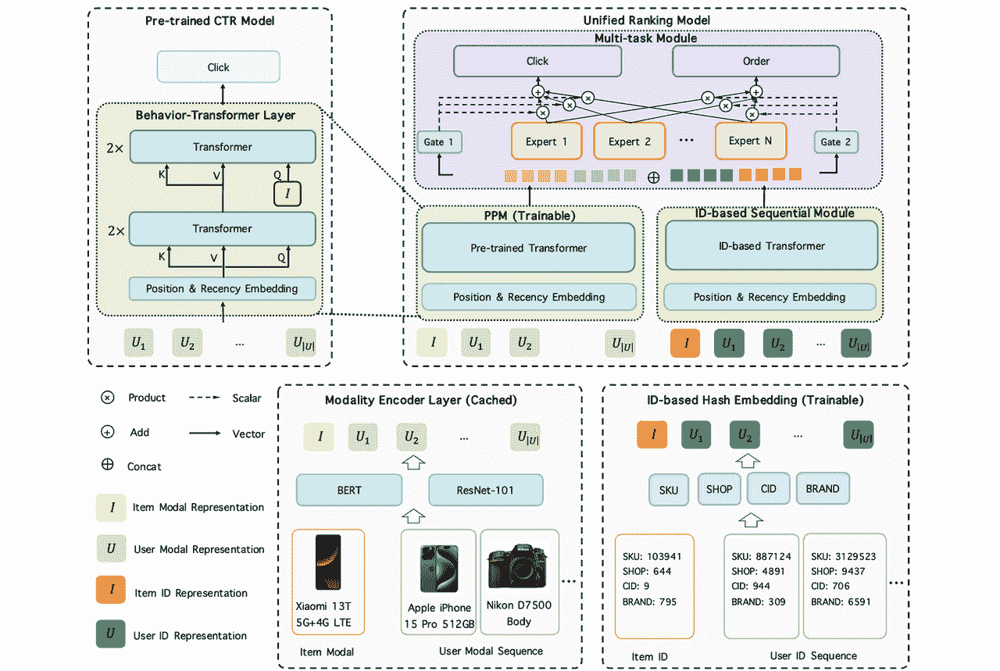
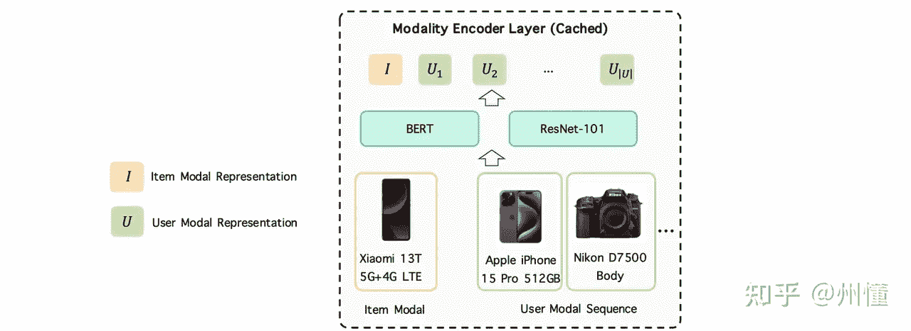
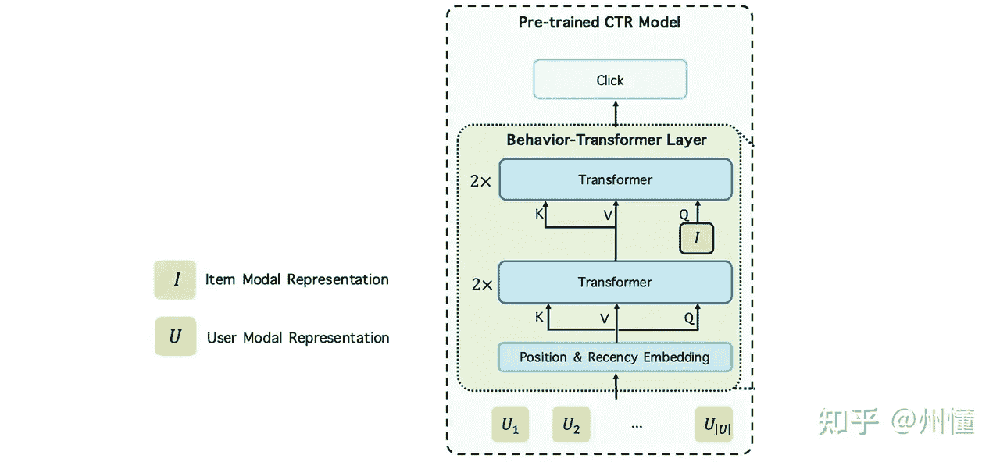
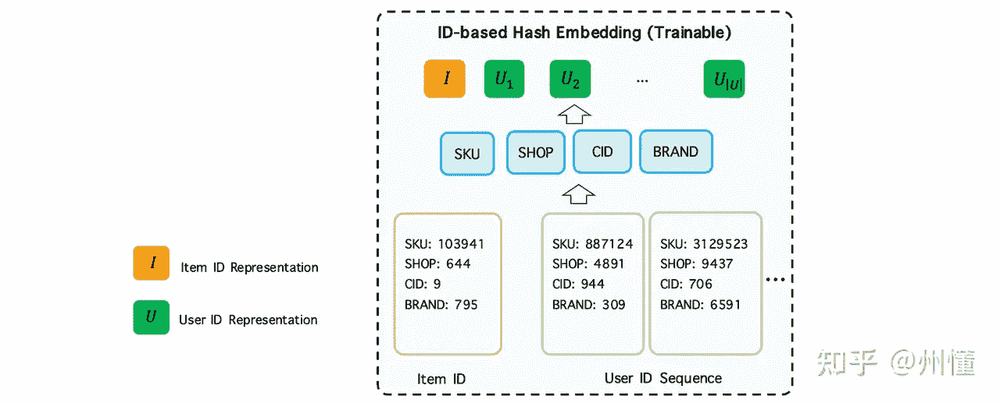
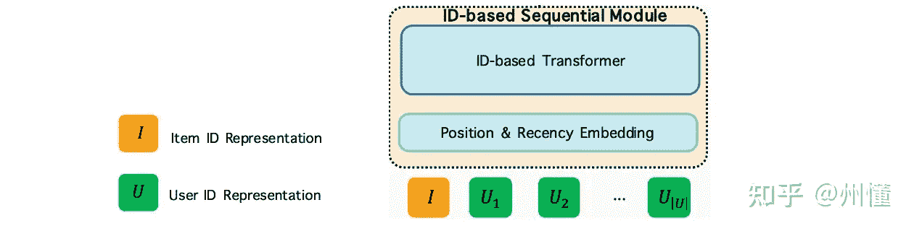
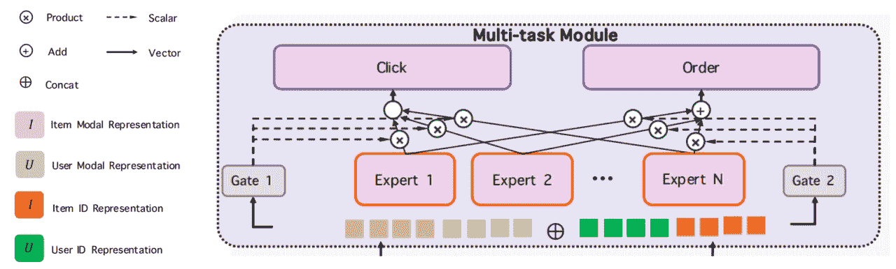
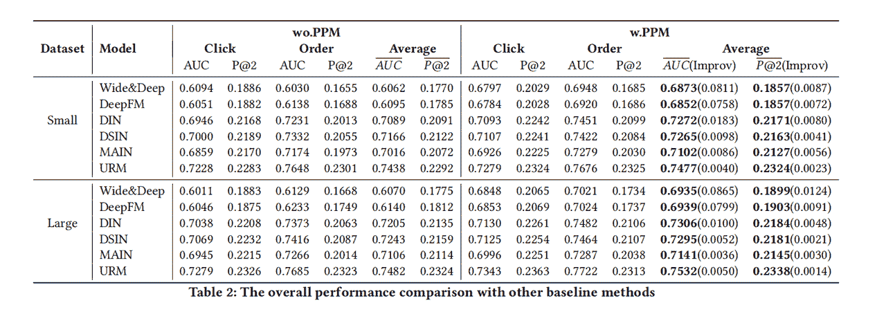
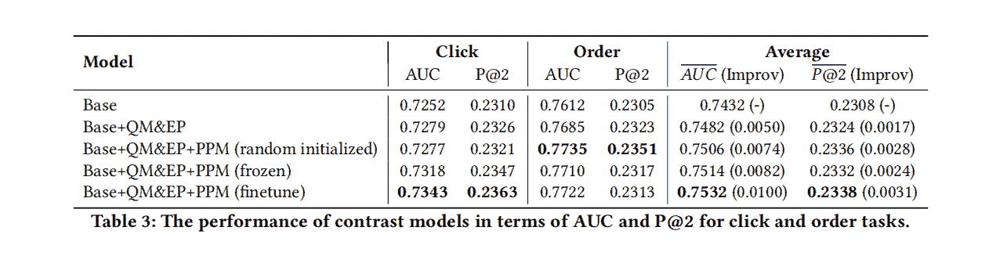
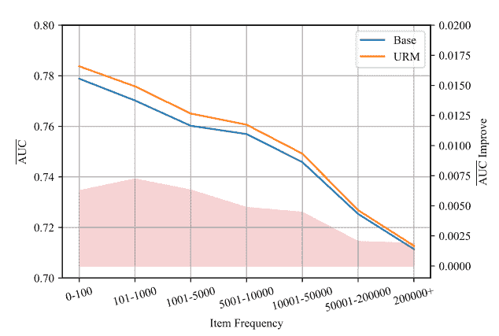
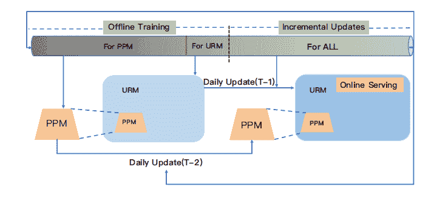

# 京东——多模态预训练模型推荐系统

> 来源：[https://v11enp9ok1h.feishu.cn/docx/EhtzdvesGo9X9ZxkXUIcp4SKn2b](https://v11enp9ok1h.feishu.cn/docx/EhtzdvesGo9X9ZxkXUIcp4SKn2b)

#  京东PPM:多模态预训练模型当作插件用于CTR预估

---

## 前言

当前**推荐系统**还严重依赖**ID特征**, 下文记为IDRec, 它存在两方面问题:

1.  物品冷启动问题, 这些ID embedding未充分训练, 表现会差很多

1.  受迭代效率限制, IDRec通常没法使用太长时间的数据进行训练

**引入多模态预训**练模型的先验**知识可以部分缓解物品冷启动**问题, 同时减少对训练数据样本量的依赖。但预训**练模型的参数量**很大,** 推**理延迟会增加, 业务上落地困难, 同时, 如果想要使用End2End的方式训练, 训练成本也会非常高, 这些都阻碍了预训练多模态模型在推荐场景的落地应用。

> 为了缓解这个问题, 提出了一种**插件式**的多模态预训练模型(Pre-train**ed **Plug-in **Mo**del, 简称PPM), **它以多**模态特征为输入**, 使用大**规模数据集预训练, 然后集成到IDRec**模型**中**, **这里, PP**M会缓存网络中**的部分中间结果, 只有少部分子集的参数会参与训练与推理, 可以实现End2End部署, 而不增加推理延迟。

## 方法

**PPM**的整体框架如下图所示, 主要分成两部分

### 预训练的**CTR模型**

这一部分的模型, 以多模态信息为输入, 与ID无关, 并辅**以CTR**作为监督信号进行学习, 主要包含以下3层:

#### ** 模态编**码层(Modality Encoder Layer,简称ME)

> **模态编码层**(ME)用于获取高质量的**文本模态**表征和**图像视觉模态**表征, 在这一层中, 会基于电商场景数据, 使用查询匹配(Query Matc**hing**)**任务和实体预**测(E**nt**ity **Pred**i**ctio**n)任务对预训练模型(BERT和**ResNet)****进行微调。**微调后文本模型和视觉模型会被冻结住, 然后从这些冻结后的文本模型和视觉模型中分别提取出固定长度的dense表征, 将它们拼接后，就得到给定商品的多模态表征。

1.  **查询匹配任务**

同**SimCS**E, 结合用户行为**反馈(是否**点击), 使用对比查询匹配任务来微调文本模型。记(𝑥𝑖,𝑦𝑖)为文本的pair对, 分别表示搜索的Query以及对应用户点击商品的文本序列信息, 在经过文本模型编码后, 得到对应的文本表征, 分别记为 和 。然后使用对比学习(InfoNCE Loss)进行训练:

其中  表示batch size, 而𝜏 为温度系数.

1.  **实体预测任务**

使用**ResNet-101**作为**Vision**基础模型, 然后使用电商**场景数据**, 基于物品预测任务来进行**模型微调**。具体地, 在给定商品 的图片, 模型的目标是要去**预测**图片中的关键实体 , 训练目标是:

#### 行为变换层(Behavior-Transformer Layer)

**为了从用**户物品的交互历史中学习到**用户偏好**, 首先从模态编码层抽取物品表征, 如下图所**示, 其**中, 为用户的交互历史的物品表征。

然后再使用**双向****Transformer**去捕获上下文信息, 如下图所示:

一步步来看这里的过程:

**Step1**: 以用户交互历史的**模态表征** 为输入, 同时也考虑**位置编码** 和**时间间隔编码** , 即:

**这里位置编**码和时间间隔编码一开始是做随机初始化。

**Step2**: 拼接用户交互历史表征:

**Step3**: 基于双向Transformer模块计算:

其中,  表示T**rans**form**er模块的第  层, **Trm表示双向Transformer模块, 其对应的输入𝑞 、𝑘、𝑣都使用 。

**Step4:** 以**Target Item**的模态表征作为**Query**, 上面的输出作为**Key**和**Value**, 再做Target Attenti**on, **最**后一层的**输出即作为融合User和Item后的表征。

####  CTR预测层

通过将**Transformer**模块得到的**user**和target item的表征**concat**起来, 再过几层MLP去预测点击率。需要留意的是, 这里只使用点击单目标, 不同于后面的URM会使用点击&下单的多目标。损失函数使用交叉熵损失:

### 统一排序模型(Unified Ranking Model)

预训练的**CTR模型**会被集成到**IDRec模型****中进行端**到端训练。为了**加速训练过**程并最小化推理延**迟，一**开**始会缓存多模****态特征，**从而支持在行为**变换层和C**T**R预测层中**训练。统一排序模块包括3个模块, 基于ID的序列模块(IDSM)、PPM模块和多任务模块。

#### 基于ID的序列模块(简称IDSM)

记给定用户𝑢按时间顺序的交互历史** , 长**度为**𝑛。每个**交互**商品的库**存I**D, 店**铺I**D, 品牌ID, **类目**ID等的Em**bedding会被Concat起来,作为该交互商品的表征, 如下图所示:

同时, 也加入位置信息和时间间隔, 因此该模块的输入为:

**和2.1.2章节类似,****这里也会过**Transformer, 只是这里是ID类信息, 而非多模态信息:

####  PPM

这个模块的**结构**和**IDSM**基本一样, 除了输入是**多模态特征,** 每个商**品 ** 的标题和**图片经由**  编码得到文本和图像表征, 同时为了加速训练过程以及减少线上推理延迟, 这些表征会被缓存到HDFS, 而其它模型参数则会通过预加载预训练的CTR模型来初始化。

#### 多任务模块

这里的多任务主要是预估**用户点击**,**加购物车**,**购买**等任务, 这些任务之间有一定的相关性和不少差异。

**例如:**用户购买之前肯定会点击商品，但用户点击产品却不一定是出于购买的目的，**很可能只是**对**新发布的手机好**奇。使**用MMo**E来**做多任务关系**学习, 输入𝑥为将基于模态的表征、基于ID的表征、以及其它特征一起concat起来

**如下图所示:**

给定**𝑁个**专家Expert和𝐾**个任**务, 则第𝑘个**任务**的输出为:

其中,  表示gate:

融合不同Expert的输出后, 第𝑘个任务的预测结果为:

其中,   表示第𝑘个任务的Tower.

## 实验部分

### 模型效果

论文对比了各**基线模型**增加**PPM****的对比**实验,** 离线指**标上都有显著提升, 同时论文所提URM取得了SOTA的效果.

### 消融实验

作者做了消融实验验证论文所提各模块的有效性:

### 物品冷启动

离线实验验证了所提方法在物品冷启动问题上的效果

### 线上AB测试

**URM**在线上的整体流程如下图所示, PPM是T-2更新的, URM是T-1更新的:

在线上AB实验期间, PPM在**UCTR**(人均点击次数)指标提升**1.09%**, 在**UCVR**(人均购买次数)提升**0.28%**, 同时, 还使**长尾内容曝光**提升了**10%**

<https://v11enp9ok1h.feishu.cn/sync/Ipw1d27gNsv3OAbo3N7cks4ZnJf>