# 从0-1搭建推荐系统

> 来源：[https://v11enp9ok1h.feishu.cn/docx/Xu1cdhzrnoh06txSygKcWnpcnIc](https://v11enp9ok1h.feishu.cn/docx/Xu1cdhzrnoh06txSygKcWnpcnIc)
> <https://v11enp9ok1h.feishu.cn/sync/VztedzIoUstVPDb6RNMctK8Unie>

## 互联网的增长引擎——推荐系统

在推荐系统领域，特别是 YouTube 所在视频推荐领域，主要面临三个挑战：

1. `Scale`(规模大)：海量的 `user` 与 `item`，很多现有的推荐算法能够在小的数据集上表现得很好，但在 YouTube 效果不佳。YouTube 需要构建高度专业化的分布式学习算法和高效的服务系统来处理庞大的用户和视频数量。

1. `Freshness`(更新快)：这体现在两方面，一方面视频更新频繁，需要在新发布视频和已有存量视频间进行 `balance`；另一方面用户行为更新频繁，模型需要很好的追踪用户的实时行为。

1. `Noise`(噪声)：相较于庞大的视频库，用户的行为是十分稀疏的，同时，很难获得用户满意度的显示信号，基本上能获得的都是用户的隐式反馈信号。噪音的另一个方面就是视频本身很多数据都是非结构化的（音频或视频数据）。这两点对算法的鲁棒性提出了很高的挑战。

## 系统总览

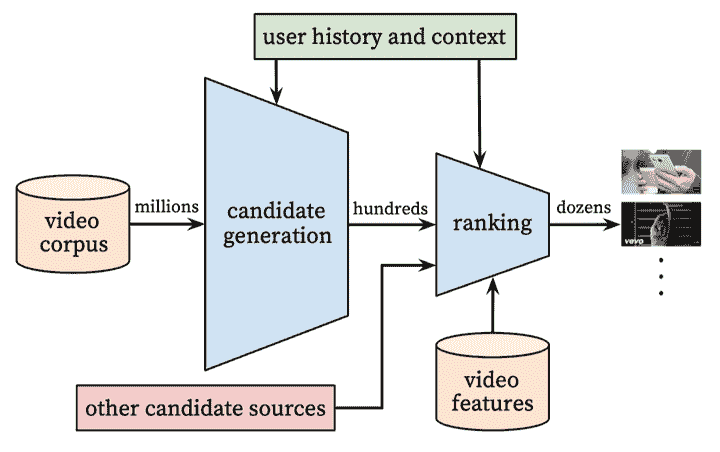

- 上图中的 `millions`、`hundreds`、`dozens` 表示数据量的级别，全部的 `video corpus` 大概是 `millions` 级别，经过 `candidate generation` 之后大概是 `hundreds` 级别，经过 `ranking` 之后大约是 `dozens` 级别。

- `Candidate Generation Model`：输入包括 `millions video corpus`、`user history and context`，对召回系统的要求是“低延时”，旨在快速高效地筛选部分视频集合。

- `Ranking Model`：输入包括 `hundreds video corpus`、`user history and context`、`other candidate sources`、`video features`，旨在得到“高精度”的 `TOP N`。

## 召回-候选集生成

### 问题建模

将召回建模成一个“超大规模多分类”问题。即在时刻 `t`，用户 `U`（上下文信息 `C`）会观看 `item` `i` 的概率（每个具体的视频视为一个类别），用公式表达如下：

- 上式为一个 `softmax` 多分类器。`V` 是视频库中所有视频的集合，数量在百万级别。

- 其中 `u` 为用户表征“`embedding`”，而 `vj` 则是视频 `j` 的 `embedding` 向量。`DNN` 任务是根据用户的历史和 `context` 来学习用户的 `embedding` 向量。

### 模型结构

`DNN` 架构如下图所示：

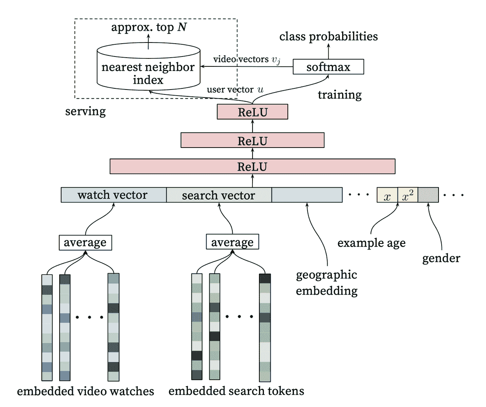

> 整个模型架构是包含三个隐层的 `DNN` 结构。输入是用户浏览历史、搜索历史、用户基础信息和其余上下文信息 `concat` 成的输入向量；输出分线上和离线训练两个部分。

> 离线训练阶段输出层为 `softmax` 层。线上则直接利用 `user` 向量查询相关商品，最重要问题是在查询的性能。利用类似局部敏感哈希（`Locality Sensitive Hashing`）。

### 输入特征

使用 `DNN` 的一个关键优点是，`DNN` 的输入可以方便的处理离散和连续变量。

#### 主要特征

- 历史搜索 `query`：把历史搜索的 `query` 分词后的 `token` 的 `embedding` 向量进行平均，能够反映用户的整体搜索历史状态

- 用户基础信息：性别、年龄、地域等

- 其他上下文信息：设备、登录状态等

#### example age（视频上传时间）特征

- 为了拟合用户对 `fresh content` 的 `bias`，模型引入了“`Example Age`”这个特征，`sample log` 距离当前的时间作为 `example age`。例如：24 小时前，用户观看该视频，会产生日志，这个 `example age` 就是 24。而在线上服务阶段，该特征被赋予 0 值甚至是一个比较小的负数。这样的做法类似于在广告排序中消除 `position bias`。

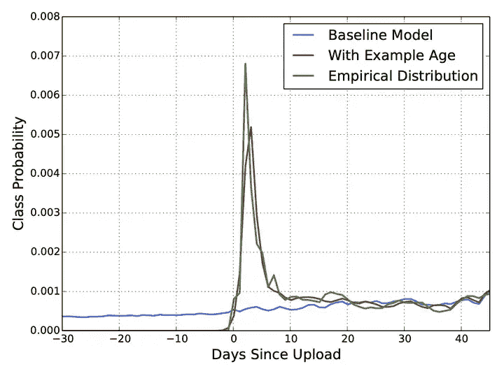

- 同时也验证了，`example age` 这个 `feature` 能够很好的把视频的 `freshness` 的程度对 `popularity` 的影响引入模型中。

- 从下图中我们也可以看到，在引入“`Example Age`”这个 `feature` 后，模型的预测效力更接近经验分布；而不引入 `Example Age` 的蓝线，模型在所有时间节点上的预测趋近于平均，这显然是不符合客观实际的。

### 样本和上下文选择

在这里，正样本是用户所有完整观看过的视频，其余可以视作负样本。

此外，还进行了如下设计：

1. 使用更广的数据源：训练样本是从 YouTube 所有的用户记录里产生的，而并非只是通过推荐系统产生的。其他场景比如搜索等的数据也要用到，这样也能为推荐场景提供一些 explore

1. 为每个用户生成固定数量训练样本：为了减少高度活跃用户对于 `loss` 的过度影响，防止一小部分超级活跃用户主导损失函数。

1. 无序化处理：Youtube 并没有选择时序模型，而是完全摒弃了序列关系，采用 `avg pooling` 的方式对历史记录进行了处理。这是因为考虑时序关系，用户的推荐结果将过多受最近观看或搜索的一个视频的影响。文章中给出一个例子，如果用户刚搜索过“taylor swift”，你就把用户主页的推荐结果大部分变成 taylor swift 有关的视频，这其实是非常差的体验。为了综合考虑之前多次搜索和观看的信息，YouTube 丢掉了时序信息，讲用户近期的历史纪录等同看待。但是上述仅是 YouTube 工程师的经验之谈。

1. 上下文选择：用户在浏览视频时候，常常是序列式的，比如按集观看。基于共现的思想，在这种情况下有一些特殊性，比如看了第一集很可能再看第二集，但看了第二集则鲜有可能再看第一集。因此在选择训练样本的时候，

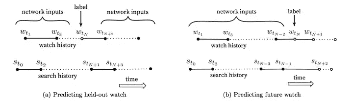

- 图(a) 利用上下文信息预估中间的一个视频；

- 图(b) 利用之前的所有信息，预估下一个视频。

- 图(b) 的方式在 `A/B test` 中表现更佳。传统的协同过滤类的算法，都采用的图(a) 中的方式，没有考虑不对称的浏览模式。此外，只留最后一次观看行为做测试集主要是为了避免引入 future information，产生与事实不符的数据穿越。

### 特征集以及网络深度

- 本小节主要评估输入特征以及网络层数对于实验效果的影响，评价指标是 `MAP(MeanAverage Precision)`。

- 第 0 层以及输出层都是采用固定的 256 维度。依次增加网络深度（+512 → +1024 → +2048→ ...），预测效果如下图：

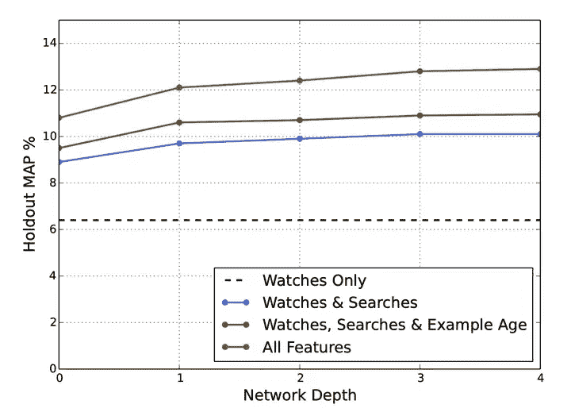

可以很明显看出，在观看历史特征基础上增加特征很明显的提升了准确率；

从网络深度看，随着网络深度加大，预测准确率在提升，但继续增加第四层网络准确率已经没有显著的提升了。

### 在线服务（serving）

对于在线服务来说，有严格的性能要求，YouTube 没有重新跑一遍模型，而是通过保存用户的 `embedding` 和视频的 `embedding`，通过最近邻搜索的方法得到 top N（`approx topN`）的结果。

## 排序

- `ranking` 是对生成的候选集做进一步细粒度的排序，可以参考更多维度的特征。通常，排序阶段还涉及到对多个不同召回源进行有效集成，不同召回源的打分有时候并没有可比性，所以排序阶段也需要解决此类问题。

- 如果召回阶段采用多路召回，每一路召回因为采取的策略或者模型不同，所以各自的召回模型得分不可比较，比如利用协同过滤召回找到的候选 `Item` 得分，与基于兴趣标签这一路召回找到的候选 `Item` 得分，完全是不可比较的。

- 在目标的设定方面，只使用 `ctr` 指标是不合适的（可能会有“标题党”或者“封面党”的问题），有些靠关键词（“clickbait”）吸引用户高点击的视频未必能够被播放。

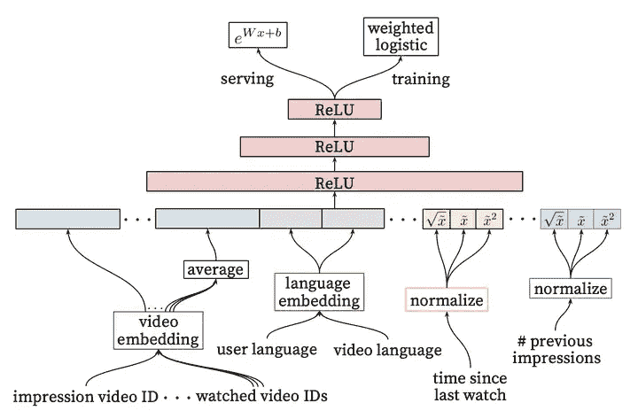

### 特征工程

> 为什么需要特征工程？

- 机器学习模型的能力边界在于对数据的拟合和泛化，那么数据及表达数据的特征本身就决定了机器学习模型效果的上限

#### 推荐系统有哪些可供利用的特征

> 特征工程：即利用工程手段从“用户信息”“物品信息”“场景信息”中提取特征的过程

> 特征：是对某个行为过程相关信息的抽象表达（转换为机器能学习的数学形式）

> 构建推荐系统特征工程的原则：尽可能地让特征工程抽取出的一组特征，能够保留推荐环境及用户行为过程中的所有“有用”信息，并且尽量摒弃冗余信息

推荐系统中的常用特征：

- 用户行为数据：人与物之间的连接日志

- 用户行为分为两种：

- 显性反馈行为：一般来说显性反馈行为的收集难度过大，数据量小，仅用显性反馈的数据不足以支持推荐系统训练过程的最终收敛

- 隐性反馈行为：是目前特征挖掘的重点

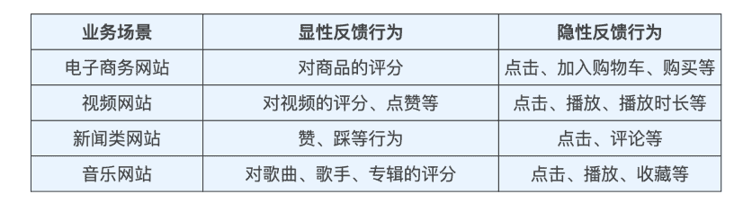

- 用户行为类特征的两种处理方式：

- 将代表用户行为的物品 id 序列转换成 `multi-hot` 向量，将其作为特征向量

- 预先训练好物品的 `embedding`，再通过平均或者类似于 `DIN` 模型注意力机制的方法生成历史行为 `Embedding` 向量，将其作为特征向量

- 用户关系数据：人与人之间的连接记录

- 强关系（显性）：eg. 关注、好友关系等

- 弱关系（隐形）：eg. 互相点赞、同一个社区、同看一部电影等

- 用户关系数据的使用方式：

- 将用户关系作为召回层的一种物品召回方式

- 通过用户关系建立关系图，使用 [`Graph Embedding`](https://www.yuque.com/xf015y/wo1guk/cy3ym6#bFxq3) 的方法生成用户和物品的 `Embedding`

- 直接利用关系数据，通过“好友”的特征为用户添加新的属性特征

- 利用用户关系数据，直接建立社会化推荐系统

- 处理方法：`multi-hot` 编码、`embedding` 等

- 属性、标签类数据：直接描述用户 or 物品的特征

- 用户特征：eg. 人口属性数据（性别、年龄、住址等），用户兴趣标签

- 物品特征：eg. 物品标签，物品属性（商品类别、价格；电影分类、年代、演员、导演等）

- 属性、标签类数据的使用方式：

- 通过 `multi-hot` 编码的方式将其转换成特征向量

- 先转换成 `Embedding`，再输入推荐模型

- 内容类数据：同样是描述物品或用户的数据，但相比标签类特征，内容类数据往往是大段的描述型文字、图片，甚至视频

- 需要通过自然语言处理、计算机视觉等技术手段先提取关键内容特征，再输入推荐系统

- 场景信息（上下文信息）：“时间”，通过 `GPS`、`IP` 地址获得的地点信息，当前所处推荐页面

- 统计类特征：通过统计方法计算出的特征

- eg. 历史 `CTR`、历史 `CVR`、物品热门程度、物品流行程度等，本质上是一些粗粒度的预测指标

- 一般是连续型特征，仅需经过标准化归一化等处理就可以直接输入推荐系统进行训练

- 组合类特征：将不同特征组合后生成的新特征

- eg. “年龄 + 性别”组成的人口属性分段特征（segment）

- 组合类特征的处理方式：

- 人工组合、人工筛选（早期推荐模型不具备特征组合能力）

- 模型自动处理（深度学习推荐系统）

### 特征处理

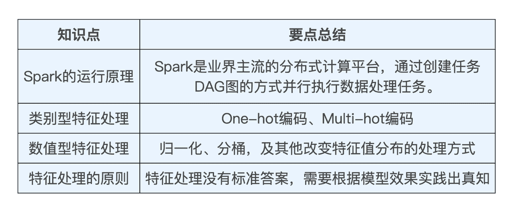

广义上，特征可以分为两类：

- 类别、`ID` 型特征：无法用数字表示的信息。eg. 电影风格、`ID`、标签、用户性别、时间等

- 数值型特征：能用数字直接表示的特征。eg. 用户的年龄、收入、电影播放时长、点击量、点击率等

特征处理的目的：把所有的特征全部转换成一个数值型的特征向量

- 数值型特征：可以直接将这个数值放到特征向量的相应维度上（当然还要先对特征尺度、特征分布做一些处理）

- 类别、`ID` 型特征：使用 `one-hot` 编码 or `multi-hot` 编码转换为数值向量

#### 数值型（连续型）特征的处理：归一化、分桶

> 将数值型特征放入特征向量之前，要先在特征尺度、特征分布两方面做一些处理

> 特征尺度：

- 问题：特征取值范围不统一

- eg. 两个特征：电影评价次数 `fr` 的取值范围为 `[0, 10000]`，电影平均评分 `fs` 的取值范围为 `[0, 5]`。这两个特征尺度差距太大，导致 `fr` 的特征波动会完全掩盖掉 `fs` 的作用

- 处理方法：归一化

- 统一各特征的量纲，将不同连续特征的尺度拉平到一个区域内，通常是 `[0, 1]`，或者做 `0` 均值归一化（将原始数据集归一化为均值为 0、方差为 1 的数据集）

> 特征分布：

- 问题：特征值分布不均匀

- eg. 1000 部电影的平均评分的分布，大量集中在 3.5 分附近（密度大），特征的区分度不高

- 处理方法 1：离散化——分桶 `Bucketing`

- 就是将样本按照某特征的值从高到低排序，然后按照桶的数量找到分位数，将样本分到各自的桶中（每个桶的样本数相同），再用桶 ID 作为特征值

- 目的：防止连续值带来的过拟合现象及特征值分布不均匀的情况

- 处理方法 2：加非线性函数——通过 `xa`、`loga(x)`、`log(1−xx)` 等非线性操作改变特征分布，让模型能更好地学习特征内包含的有价值信息

- 但由于没法通过人工的经验判断哪种特征处理方式更好，所以可以索性把归一化后的原特征值、平方、开方等都输入模型，让模型自己做选择

- 目的：更好地捕获特征与优化目标之间的非线性关系，增强这个模型的非线性表达能力

特征处理没有标准答案，需要根据模型效果实践出真知

## Embedding —— 更高阶的特征处理方法

> 用 `Embedding` 方法进行相似物品推荐，几乎是业界最流行的做法

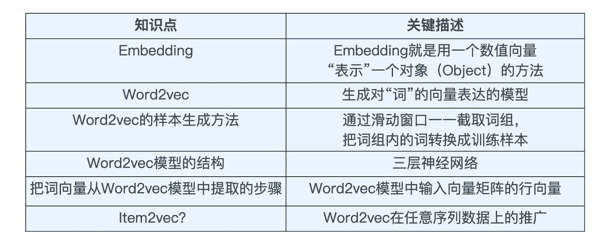

`Embedding`：是用一个低维稠密的数值向量“表示”一个对象（`Object`）的方法

- 主要作用：将稀疏向量转换成稠密向量，同时示对象之间的潜在关系

- “表示”：即 `Embedding` 向量能够表达相应对象的某些特征，同时向量之间的距离反映了对象之间的相似性

- `Embedding` 向量之间的运算甚至能够包含词之间的语义关系信息

- eg. `Embedding(woman)=Embedding(man)+[Embedding(queen)-Embedding(king)]`

- `Embedding` 在其他领域的应用：eg. `Embedding(键盘)` 和 `Embedding(鼠标)` 的距离比较近

`Embedding` 技术对深度学习推荐系统的重要性：

- `Embedding` 是处理稀疏特征的利器：`Embedding` 层负责将稀疏高维特征向量转换成稠密低维特征向量

- `Embedding` 可以融合大量有价值信息，本身就是极其重要的特征向量

> `Embedding` 不仅是一种处理稀疏特征的方法，也是融合大量基本特征，生成高阶特征向量的有效手段

### 序列数据的 Embedding 方法

#### Word2vec——经典的 Embedding 方法

`Word2vec` 模型：生成对“词”的向量表达的模型

- 两种形式：

- `CBOW` 模型：假设句子中每个词的选取都由相邻的词决定，输入是 周边的词，预测的输出是

- `Skip-gram` 模型：假设句子中的每个词都决定了相邻词的选取，输入是 ，预测的输出是 周边的词（按照一般的经验，`Skip-gram` 模型的效果会更好一些，以下都以 `ski-gram` 模型为例）

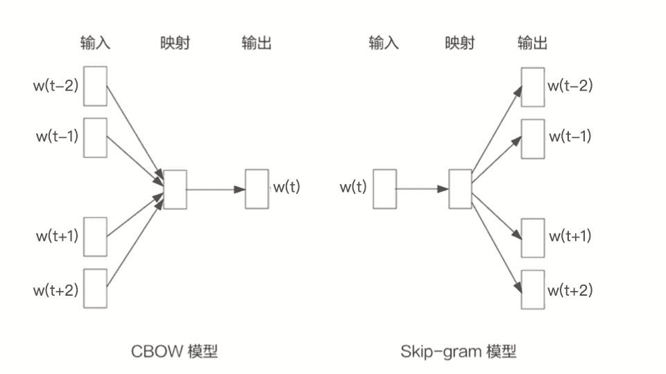

# Word2vec 训练样本的生成过程

通过`滑动窗口`截取词组，把词组内的词转换成训练样本

+ 从语料库中抽取一个句子，选取一个长度为 `2c+1`（目标词前后各选 `c` 个词）的滑动窗口，将滑动窗口由左至右滑动，每移动一次，窗口中的词组就形成了一个训练样本。根据 `Skip-gram` 模型，输入是样本的中心词，输出是所有的相邻词

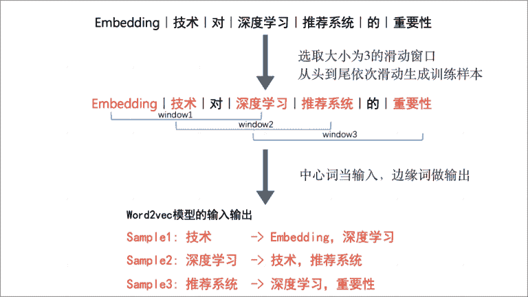

## Word2vec 的模型结构：三层神经网络

+ 输入：维度为 `V`（即语料库词典的大小），是由输入词转换来的 `one-hot` 向量

+ 隐层：维度为 `N`（最终每个词的 `embedding` 向量维度也是 `N`）。隐层没有激活函数

+ 输出：维度为 `V`，是由多个输出词转换来的 `multi-hot` 向量（相当于多分类）。采用 `softmax` 激活函数

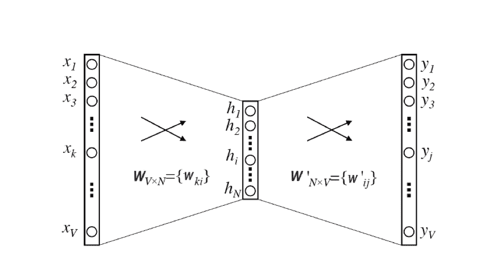

### 从 Word2vec 模型中提取出词向量的方法

> 输入向量矩阵（输入层到隐层的权重矩阵）的第 `i` 行的行向量就是第 `i` 个词的 `Embedding`（输入时 `one-hot` 向量，只有第 `i` 行为 1），维度为 `N`，即隐层的维度

> 转换为词向量查找表后，每行的权重就成了对应词的 `embedding` 向量

## Item2vec：Word2vec 在任意序列数据上的推广

`Item2Vec` 模型的技术细节几乎和 `Word2vec` 完全一致，只要能够用序列数据的形式把我们要表达的对象表示出来，再把序列数据“喂”给 `Word2vec` 模型，我们就能够得到任意物品的 `Embedding` 了

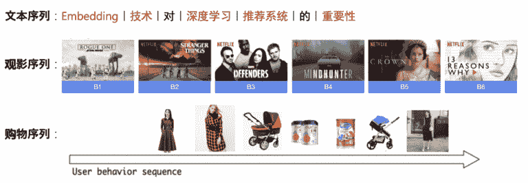

对于推荐系统来说，`Item2vec` 可以利用物品的 `Embedding` 直接求得它们的相似性，或者作为重要的特征输入推荐模型进行训练，这些都有助于提升推荐系统的效果

## 图数据的 `Graph Embedding` 方法

互联网中不只有序列数据，还有图结构数据

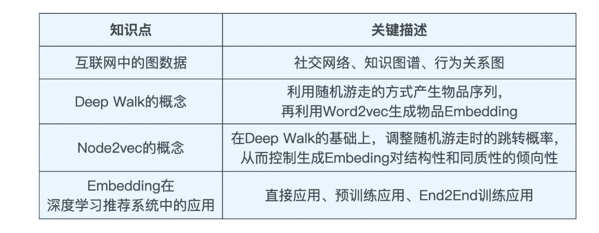

图结构数据：

+ 社交关系图：

+ 知识图谱：

+ 行为关系图：是用户和物品组成的二部图。能够利用 `Embedding` 技术发掘出物品和物品之间、用户和用户之间，以及用户和物品之间的关系

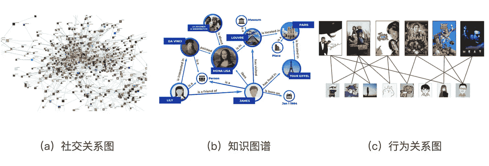

基于图数据的 `Graph Embedding` 方法：将图中的节点 `Embedding` 化

+ 基于随机游走的 `Graph Embedding` 方法：`Deep Walk`

+ 在同质性和结构性间权衡的方法：`Node2vec`

### Deep Walk

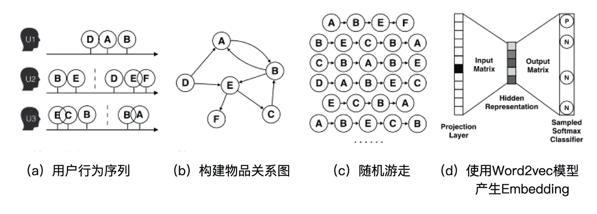

`Deep Walk`：

+ 基于原始的用户行为序列（eg. 购买物品序列、观看视频序列），构建物品关系图

+ 在物品关系图上，采用随机游走的方式随机选择起始点，重新产生物品序列

+ 将这些物品序列作为训练样本输入 `Word2vec` 进行训练，最终得到物品的 `Embedding` 向量

随机游走的跳转概率：到达节点后，下一步遍历的邻接点的概率

+ 有向有权图：

+ 跳转概率就是跳转边的权重占所有相关出边权重之和的比例

## Embedding 在推荐系统特征工程中的应用

`Embedding` 是一种更高阶的特征处理方法：

+ `Embedding` 的产出就是一个数值型特征向量，所以 `Embedding` 技术本身就可以视作特征处理方式的一种，并且具备了把序列结构、网络结构、甚至其他特征融合到一个特征向量中的能力

`Embedding` 在推荐系统中的应用方式：

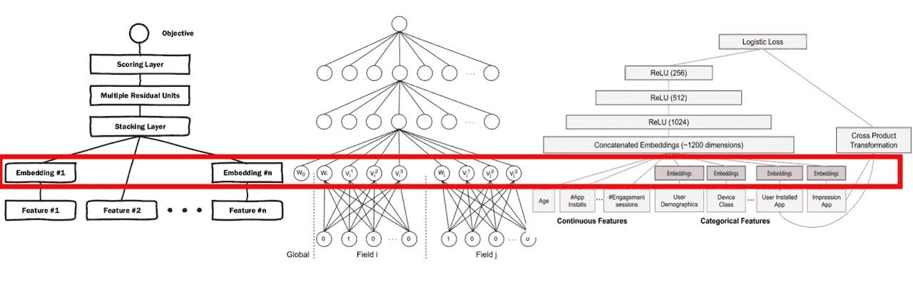

+ 直接应用：得到 `Embedding` 向量之后，直接利用 `Embedding` 向量的相似性实现某些推荐系统的功能，eg. 猜你喜欢，利用物品 `embedding` 实现推荐系统的召回层

+ 预训练应用：预先训练好物品和用户的 `Embedding` 之后，不直接应用，而是把这些 `Embedding` 向量作为特征向量的一部分，跟其余的特征向量拼接起来，作为推荐模型的输入参与训练

+ 能够更好地把其他特征引入进来，让推荐模型作出更为全面且准确的预测

+ End2End 应用：不预先训练 `Embedding`，而是把 `Embedding` 的训练与深度学习推荐模型结合起来，采用统一的、端到端的方式一起训练，直接得到包含 `Embedding` 层的推荐模型

## 训练阶段

> 把训练看成一个二分类问题，其中训练数据中的正样本是视频展示后用户点击了该视频，负样本则是展示后未点击。如果只是这样的话，那优化的目标就是点击率了。如何把目标变成优化平均观看时长？奥秘在训练样本的权重。所有负样本的权重都为 1，而正样本的权重为点击后的视频观看时长。所以模型的损失函数是如下的加权交叉熵：

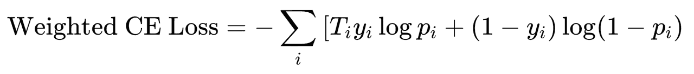

线上使用时，只要基于排序候选视频即可，也即选取值最大的那些视频。

为什么优化这样的加权 `Loss`，其实就是在近似优化平均观看时长呢？

+ 假设训练数据总共包含 `N` 个样本，其中有 个正样本，显然在 `youtube` 这个场景下。按上面的样本权重选取方式，模型学到的几率如下：

从式子的右边看：

从式子的左边看：

所以有：

`dwq`

故基于值排序视频近似等价于基于预估观看时长排序视频。

## 模型输入特征

特征分为两大类:

1. 一类是展示（`impression`）相关的特征，如视频属性等；

1. 另一类是 `query` 相关的特征，如 `user/context` 属性。

模型中包含几百个特征，其中类别特征和连续特征大致各占一半。作者说还是花了很多功夫在特征工程上的，主要挑战是如何表示用户的时序行为，以及把用户行为与待评分的视频关联上。

> 最重要的特征，是那些描述用户历史上与待评分视频，或类似视频已有的交互行为信号。例如用户与待评分视频所在频道的交互历史：用户观看了此频道的多少视频？用户最后一次观看同主题视频是什么时候？这些特征的泛发性很好，对待评分视频的预测很有帮助。

把检索模型的信息以特征形式传入进排序模型也很有帮助:

+ 例如: 哪些检索模型提名了这个候选视频？它们都给出了什么分数？

+ 描述视频历史展示频率的特征对于在推荐中引入 “流失” 也很关键（连续的请求不会返回相同的列表）。如果最近给用户推荐了一个视频但用户没观看，那么模型会在下一次页面加载时自动降低这个视频的展示可能。

对于类别特征，使用嵌入向量进行表示:

+ 嵌入向量的维度建议选择与词汇量大小的对数成比例，即 如果某个类别的取值特别多，可以限定一个值，长尾的值对应的表示为全0的向量。

对连续特征的归一化处理方式很影响训练的收敛性。使用了如下的归一化方式:

+ 对于连续变量 ，假设它的取值分布为 ，通过以下公式把 归一化为 ：

+ 说白了 就是 在整体取值中的百分比排序位置。

+ 具体归一化时，会使用 `x` 训练数据中取值分布的四分位值插值得到近似的 。除了归一化后的 ， 和  也会加入到输入中。这也是处理连续特征的常见手段

## 实验结果

定义了一个加权逐对损失 `weighted, per-user loss`：给定一个用户，每次选定同页面展示的一对样本作为比较对象，一个为正（展示后点击），一个为负（展示后未点击），权重来自于正样本的观看时间。如果负样本的得分比正样本高，就认为正样本的观看时间被误识别了。`weighted, per-user loss` 就是误识别观看时间占总观看时间的比例。

+ 结果 `DNN` 结构越深，效果越好，但到了 3 层深度收益就很小了。

+ 在 3 层模型时，如果不使用连续变量的幂次变换 和 ，损失会上升 0.2%

+ 如果训练时不对正样本做观看时间加权，即正负样本等权重，损失会上升 4.1%

## 总结

几个值得 `take-home` 的结论：

+ 仔细选择训练数据，避免不恰当的信息泄露。

+ `DL` 时代特征处理依旧重要，了解下对连续特征按分布归一化的方法。

+ 使用 `example age` 特征处理 `time bias`，这样线上检索时可以预先计算好用户向量。

+ 排序模型训练使用基于观看时长加权的 `CE`，这样产生的排序可以近似认为是基于期望观看时长进行的排序。

`https://v11enp9ok1h.feishu.cn/sync/Ipw1d27gNsv3OAbo3N7cks4ZnJf`
