# 兴趣时钟: 时间感知流式推荐系统

> 来源：[https://v11enp9ok1h.feishu.cn/docx/VE3OdFcreoCmxZxoQJac2ZHxn0g](https://v11enp9ok1h.feishu.cn/docx/VE3OdFcreoCmxZxoQJac2ZHxn0g)

# 兴趣时钟: 时间感知流式推荐系统

## 导读

> **用户**偏好在一天中遵循动态**模式，例**如，在**上午**8点，用户可能更喜欢**阅读新**闻，而在晚上8点，他们可能更喜欢看电影。时间建模旨在使推荐系统能够感知时间变化，以捕捉用户随时间的动态偏好。

> **兴趣时钟****首先将用****户的时间**感知偏好编码为时钟（小时级个性化特征），然后使用高斯分布将其平滑并聚合到根据当前时间嵌入的最终兴趣时钟中，用于最终预测。通过使用兴趣时钟结合基本模型，线上用户活跃天数和应用程序持续时间分别提高了+0.509%和+0.758%。

## 方法

### 特征工程

对于时间特征，比较直接的方法就是将时间信息离散化后学习对应的emb，然后拼接日和时的emb。但作者希望对时间感知的个性化偏好进行编码。

+   **将一天划分为****24个桶****，表示一天中的24小时。**

+   根据用户在过**去3**0天中某个小时的消费数据计算用户的时间感知偏好**。例**如**，获**得**用户**在**过去3**0天中7**:0**0到8:**00**生**成的**所**有样**本，每个样本都有多个标签（例如，喜欢、跳过、完成、不喜欢）和许多特征（例如，流派、情绪、语言）。每个特征的得分计算如下，其中𝐶𝑛𝑡表示对应行为的样本数

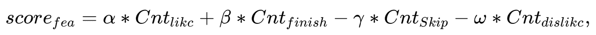

基于上式，计算给定**特征**（包括**流派**、**情绪**和**语言****等）在某个小**时的得分，并且流派/情绪/语言特征被用作时间感知特征。时间感知特征（例如流派）的emb表示为 ，同理可以得到情绪和语言的时间感特征

###  兴趣时钟

> 兴趣时钟的目标是使模型能够感知流式推荐系统中的时间信息。通过特征提取过程，将用户的时间感知个性化偏好编码到时钟中，即小时级特征。通常可以利用两种简单的方法来聚合兴趣时钟特征，

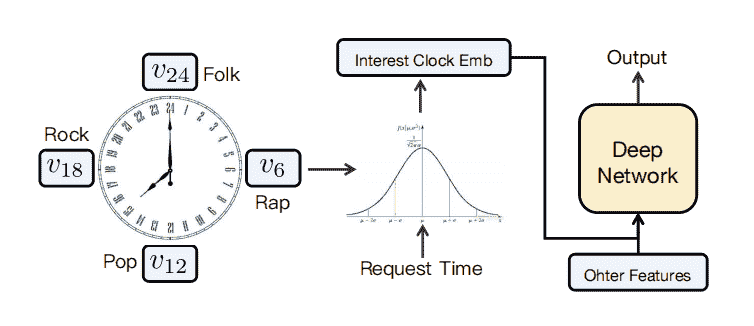

+   **（1）****将24小时的兴趣****emb****拼接到一个****emb****中，**

+   **（2）****根据当前请求时间**** t ****, 为模型提供相应的兴趣****emb**** **** 。**

> 但这两种方案都有一定的问题，第一种方法依赖于通过优化过程对每个小时级别特征的重要性进行自适应学习，但作者发现深度模型很难自适应地学习特征权重，因为该模型会过拟合当前时间，并忘记流系统中其他时间的信息。而对于第二种方法，模型只能看到当前时间的兴趣，每个时间用户的兴趣都会发生突然的变化。

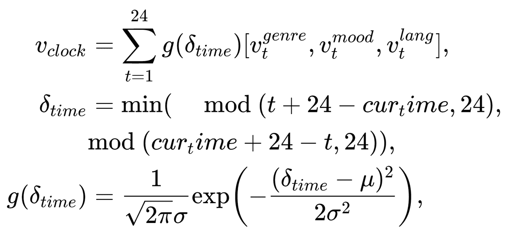

> **高斯兴趣时钟**，将24小时的**时间感知emb**与**经验高斯分布**相聚合。兴趣时钟emb表示为下式，其中 反应的时不同小时的兴趣与当前时间的时间间隔，这个思路就是结合了前面的两种方案，在聚合emb的时候考虑了时间间隔，并且距离当前时间越近的兴趣emb权重也越大。

# 京东:基于多模态预训练模型打造推荐系统

当前**推荐系统**还严重依赖**ID特征**, 下文记为IDRec, 它存在两方面问题:

1.  物品冷启动问题, 这些ID embedding未充分训练, 表现会差很多

1.  受迭代效率限制, IDRec通常没法使用太长时间的数据进行训练

**引入多模态预训**练模型的先验**知识可以部分缓解物品冷启动**问题, 同时减少对训练数据样本量的依赖。但预训**练模型的参数量**很大,** 推**理延迟会增加, 业务上落地困难, 同时, 如果想要使用End2End的方式训练, 训练成本也会非常高, 这些都阻碍了预训练多模态模型在推荐场景的落地应用。

> 为了缓解这个问题, 提出了一种**插件式**的多模态预训练模型(Pre-train**ed **Plug-in **Mo**del, 简称PPM), **它以多**模态特征为输入**, 使用大**规模数据集预训练, 然后集成到IDRec**模型**中**, **这里, PP**M会缓存网络中**的部分中间结果, 只有少部分子集的参数会参与训练与推理, 可以实现End2End部署, 而不增加推理延迟。

## 方法

**PPM**的整体框架如下图所示, 主要分成两部分

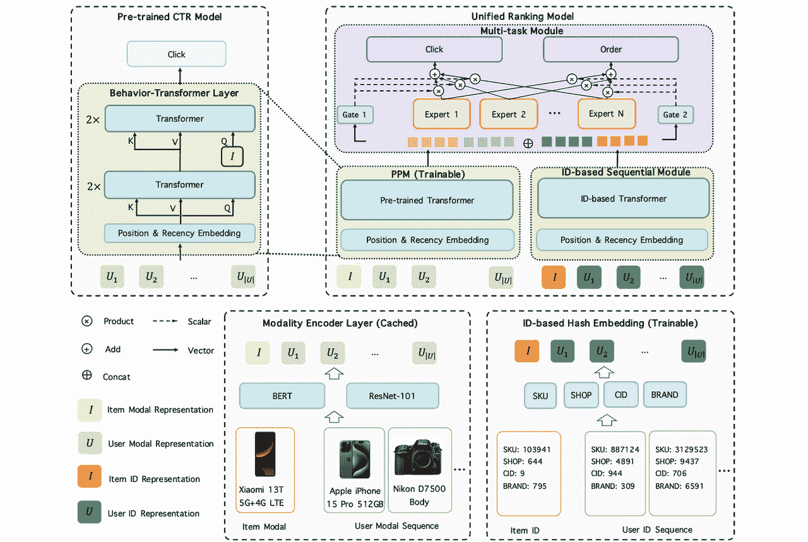

### 预训练的**CTR模型**

这一部分的模型, 以多模态信息为输入, 与ID无关, 并辅**以CTR**作为监督信号进行学习, 主要包含以下3层:

#### ** 模态编**码层(Modality Encoder Layer,简称ME)

> **模态编码层**(ME)用于获取高质量的**文本模态**表征和**图像视觉模态**表征, 在这一层中, 会基于电商场景数据, 使用查询匹配(Query Matc**hing**)**任务和实体预**测(E**nt**ity **Pred**i**ctio**n)任务对预训练模型(BERT和**ResNet)****进行微调。**微调后文本模型和视觉模型会被冻结住, 然后从这些冻结后的文本模型和视觉模型中分别提取出固定长度的dense表征, 将它们拼接后，就得到给定商品的多模态表征。

1.  **查询匹配任务**

同**SimCS**E, 结合用户行为**反馈(是否**点击), 使用对比查询匹配任务来微调文本模型。记(𝑥𝑖,𝑦𝑖)为文本的pair对, 分别表示搜索的Query以及对应用户点击商品的文本序列信息, 在经过文本模型编码后, 得到对应的文本表征, 分别记为 和 。然后使用对比学习(InfoNCE Loss)进行训练:

其中  表示batch size, 而𝜏 为温度系数.

1.  **实体预测任务**

使用**ResNet-101**作为**Vision**基础模型, 然后使用电商**场景数据**, 基于物品预测任务来进行**模型微调**。具体地, 在给定商品 的图片, 模型的目标是要去**预测**图片中的关键实体 , 训练目标是:

#### 行为变换层(Behavior-Transformer Layer)

**为了从用**户物品的交互历史中学习到**用户偏好**, 首先从模态编码层抽取物品表征, 如下图所**示, 其**中, 为用户的交互历史的物品表征。

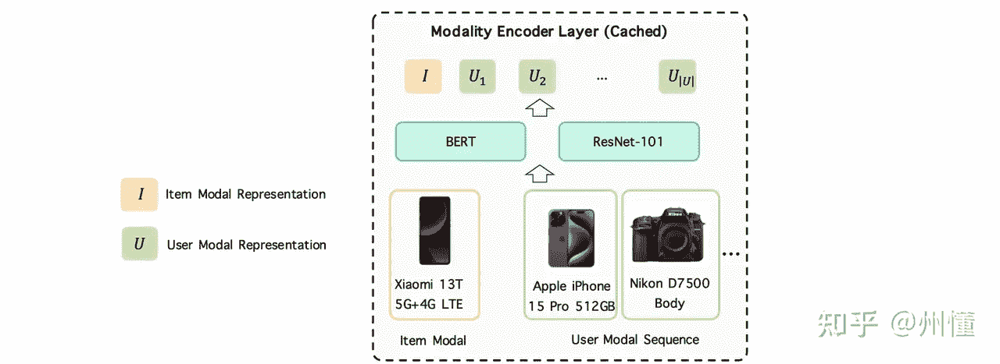

然后再使用**双向****Transformer**去捕获上下文信息, 如下图所示:

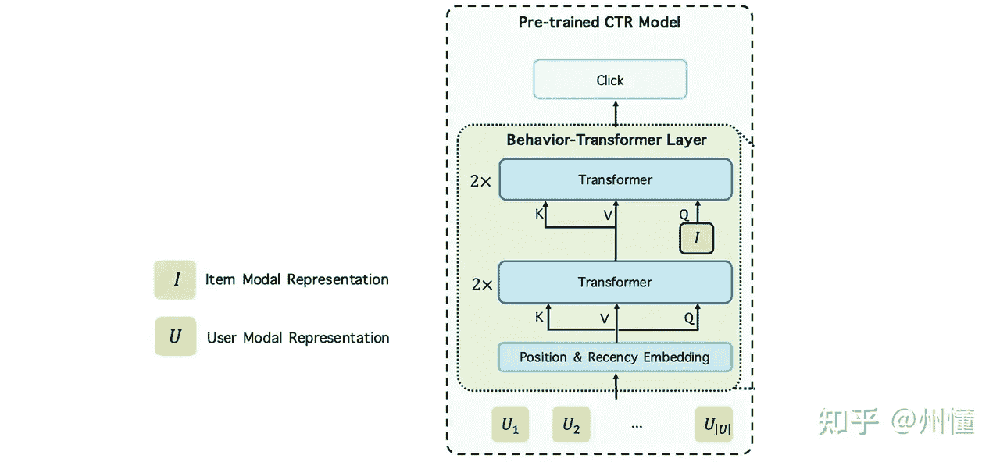

一步步来看这里的过程:

**Step1**: 以用户交互历史的**模态表征** 为输入, 同时也考虑**位置编码** 和**时间间隔编码** , 即:

**这里位置编**码和时间间隔编码一开始是做随机初始化。

**Step2**: 拼接用户交互历史表征:

**Step3**: 基于双向Transformer模块计算:

其中,  表示T**rans**form**er模块的第  层, **Trm表示双向Transformer模块, 其对应的输入𝑞 、𝑘、𝑣都使用 。

**Step4:** 以**Target Item**的模态表征作为**Query**, 上面的输出作为**Key**和**Value**, 再做Target Attenti**on, **最**后一层的**输出即作为融合User和Item后的表征。

####  CTR预测层

通过将**Transformer**模块得到的**user**和target item的表征**concat**起来, 再过几层MLP去预测点击率。需要留意的是, 这里只使用点击单目标, 不同于后面的URM会使用点击&下单的多目标。损失函数使用交叉熵损失:

### 统一排序模型(Unified Ranking Model)

预训练的**CTR模型**会被集成到**IDRec模型****中进行端**到端训练。为了**加速训练过**程并最小化推理延**迟，一**开**始会缓存多模****态特征，**从而支持在行为**变换层和C**T**R预测层中**训练。统一排序模块包括3个模块, 基于ID的序列模块(IDSM)、PPM模块和多任务模块。

#### 基于ID的序列模块(简称IDSM)

记给定用户𝑢按时间顺序的交互历史** , 长**度为**𝑛。每个**交互**商品的库**存I**D, 店**铺I**D, 品牌ID, **类目**ID等的Em**bedding会被Concat起来,作为该交互商品的表征, 如下图所示:

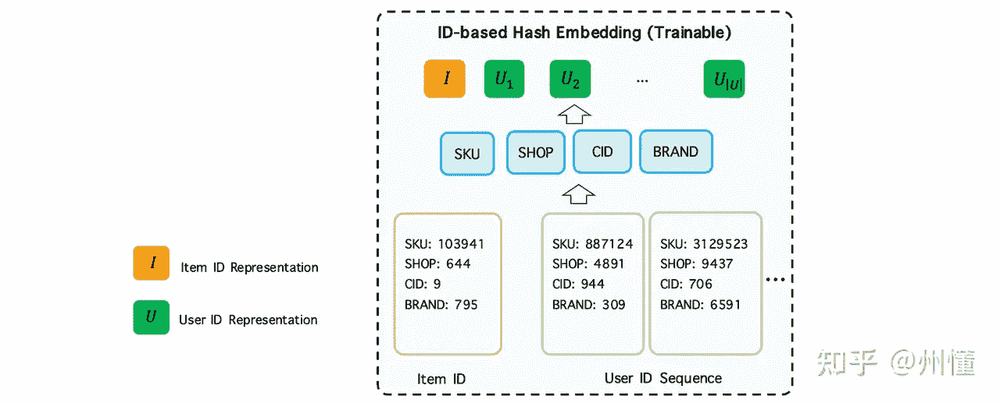

同时, 也加入位置信息和时间间隔, 因此该模块的输入为:

**和2.1.2章节类似,****这里也会过**Transformer, 只是这里是ID类信息, 而非多模态信息:

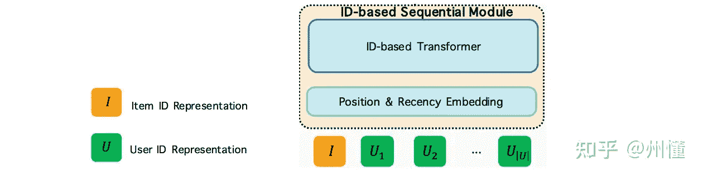

####  PPM

这个模块的**结构**和**IDSM**基本一样, 除了输入是**多模态特征,** 每个商**品 ** 的标题和**图片经由**  编码得到文本和图像表征, 同时为了加速训练过程以及减少线上推理延迟, 这些表征会被缓存到HDFS, 而其它模型参数则会通过预加载预训练的CTR模型来初始化。

#### 多任务模块

这里的多任务主要是预估**用户点击**,**加购物车**,**购买**等任务, 这些任务之间有一定的相关性和不少差异。

**例如:**用户购买之前肯定会点击商品，但用户点击产品却不一定是出于购买的目的，**很可能只是**对**新发布的手机好**奇。使**用MMo**E来**做多任务关系**学习, 输入𝑥为将基于模态的表征、基于ID的表征、以及其它特征一起concat起来

**如下图所示:**

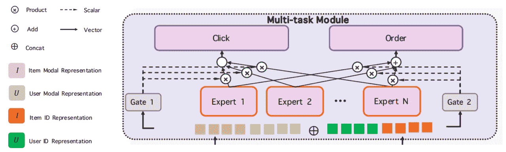

给定**𝑁个**专家Expert和𝐾**个任**务, 则第𝑘个**任务**的输出为:

其中,  表示gate:

融合不同Expert的输出后, 第𝑘个任务的预测结果为:

其中,   表示第𝑘个任务的Tower.

## 实验部分

### 模型效果

论文对比了各**基线模型**增加**PPM****的对比**实验,** 离线指**标上都有显著提升, 同时论文所提URM取得了SOTA的效果.

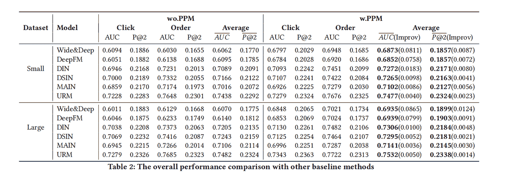

### 消融实验

作者做了消融实验验证论文所提各模块的有效性:

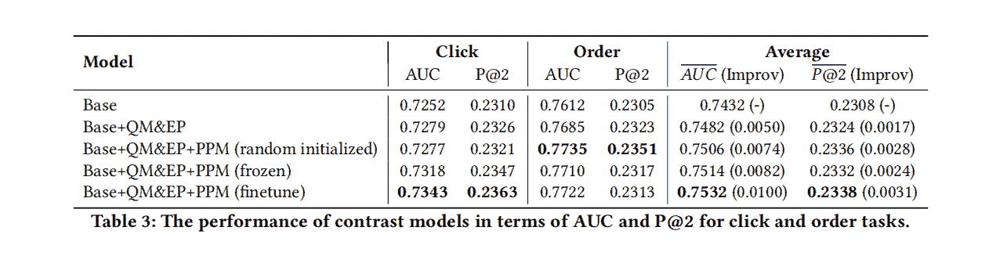

### 物品冷启动

离线实验验证了所提方法在物品冷启动问题上的效果

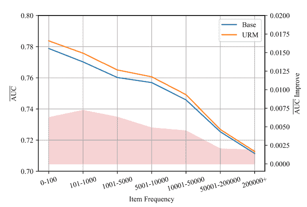

### 线上AB测试

**URM**在线上的整体流程如下图所示, PPM是T-2更新的, URM是T-1更新的:

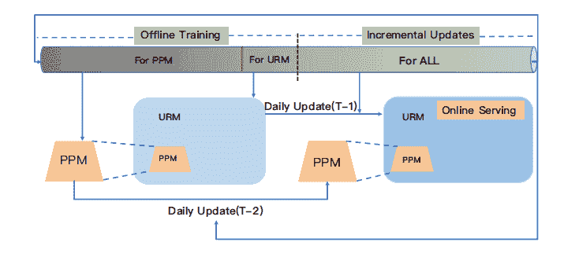

在线上AB实验期间, PPM在**UCTR**(人均点击次数)指标提升**1.09%**, 在**UCVR**(人均购买次数)提升**0.28%**, 同时, 还使**长尾内容曝光**提升了**10%**

# Youtube DNN推荐系统

## 整体架构

整体架构是标准的先检索后精排：

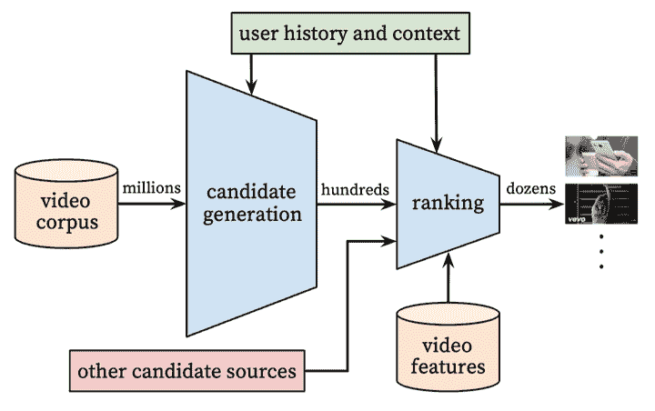

## 候选生成（检索）

把**推荐**看成一个**分类问题**。时刻   用户   在背景  下对每个视频  的观看可能建模为：

> **这么定义**显然变成类别很多（视频数量）的分类问题，分母计算量很大，直接优化肯定不行。作者使用了负采样（Negative Sampling）方法，所有类别太多，只从中选择一些作为负类（相当于对上式中的分母做了个近似）。负类基于样本分布抽取而来 ^{[10]}，每个正样本会对应抽取几千个负样本。负采样是针对类别数很多情况下的常用方法。

+   **DNN**的任务是学习用户表示向量    ，把它视为用户历史和背景的函数。

+   视频    的表示向量   本身就是模型训练参数。表示向量都是 256维。

+   模型首先把用户的各种历史和背景信息抽取为向量，然**后把这些向量拼接起来**送进一个多层DNN，DNN的宽度逐层减半。

+   DNN的输出就作为此用户的向量   。

+   所以模型的关键是输入的各种信号，即用户的历史和背景信息。

模型训练后即可得到每个**视频的表示向量**，以及每个**用户的表示向量****（利用特**征可提前计算好**，特征不**依**赖于****特定ite**m）**，只要拿这**个用户向量去检索最相似的 N 个视频即可，可以直接用常见的向量检索库，如Faiss等。

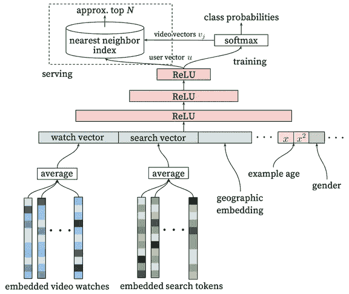

## **训练数据的选取**

> **训练样本**来自于用户在youtu**be各个****展位的日志，不仅限于推荐展**位。训练数据来**源于用****户的隐**式数据（虽然有显式数据，但规模小好几个量级）训练模型，用户看完了的视频作为正样本。负样本是通过负采样选取的，所以训练数据中可以不包括负样本。

+   **一个经验是**训练数据中对于**每个用户选取相**同的样本数，保证用户等权重。这样可以改进线上A/B测试的效果。

+   另一个经验是要**避免让模型知道不该知道的信息****。一个例子是如果模型知道用户**最**后的行为是搜**索了 **“Tayl****or Swi**ft”，那**模型可能会倾向**于推荐搜索页面搜 “Taylor Swift” 时搜出的视频，这不是推荐模型的期望行为。解决方法是扔掉时序信息，使用无序的搜索tokens来表示搜索queries（直接平均）。

> 基于这个例子就把时序信息扔掉理由挺勉强的，解决这种特殊场景的信息泄露会有更针对性的方法，比如把搜索query与搜索结果行为绑定让它们不可分。Google后面是有时序建模相关的工作的

## 模型输入特征

DNN的好处是可以把各种离散和连续的特征都输入进去。论文中提到检索模型中使用到的特征：

+   用户的观看历史：使用用户最近的 50 次观看历史。视频数量为 1 Million。观看历史中的视频向量（256维）被直接平均后输入到模型中。

+   用户的搜索历史：使用用户最近的 50 次搜索历史。每个query被分解为unigram和bigram，然后所有这些token对应的向量（256维）被直接平均后输入到模型中。token数量为 1 Million。

+   用户的人口统计特征：对新用户的推荐会比较有帮助。

+   用户的地理位置和设备特征

简单的二元和连续特征，如用户的性别、登录状态和年龄，归一化到 [0, 1] 区间的实数值后直接输入网络。

## 特征 “Example Age”

视频有明显的**生命周期**，

**例如****：****刚上传**时比之后更受欢迎，所以视频流行度随着时间的分布是高度非稳态的（下图中的绿色曲线）。

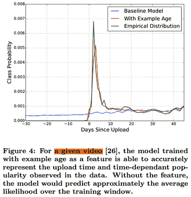

因为模型是**基于历史数据训练****获得的，所以它对**每个视频的预测**会倾向于拟合**此视频在训练数据中的平均观看情况（上图中的蓝色曲线）。

> 通过引入 **example age**** 这个特征来捕捉视频的**生命周期，效果见上图红色曲线。example age 定义为 𝑡max⁡−𝑡tmax−t ，其中 𝑡max⁡tmax 为训练数据**中所有样本时间的最大****值， t 为当前样本时****间。既然训****练**数据样本量巨大， 𝑡max⁡tmax 就近似等于选取的训练数据所在的时间段的右端点时间。线上预测时，直接把 example age 全都设为0或一个小的负值即可，不依赖于各个视频的上传时间。

+   **加入这种时间bia**s的传统方**法是使用v**ideo age，也即一个video从上传到样本的时间跨度。

+   对于给定视频，可以使用下图理解**video age**** **和 **example age** 的差异：

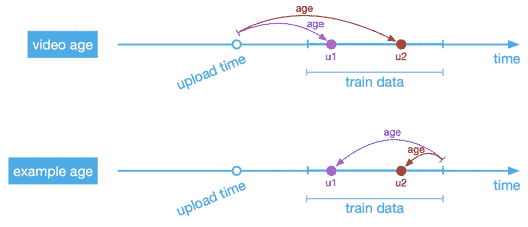

+   对于某个视频的不同样本，video age 和 example age 的定义其实是等价的，因为它们的和是一个常数：

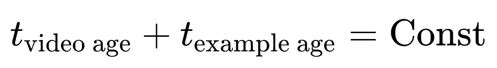

+   可以从数学上更严格地说明 video age 和 example age 的定义在当前检索模型结构下是可以做到效果近似的。先给出一个简单数学结论：

> 对于任意足够好（高阶可导）的函数  ，基于泰勒展开，我们总能找到合适的函数  和   ，使得   。

> 在 **example age** 的定义下，前面的检索模型相当于是在学习函数  ，而   ，其中   对应上面的   ，是个只与视频   有关的值。近似成立的依据来自**上一段的结论。所以****    。 在上面**的检索**模型中，是可以很方便地**把 t_v 这个信息加到模型中的，也即可以认为模型是可以计算   的。  就是在 video age 定义下模型学习的函数。这就说明了 video age 和 example age 两个定义在当前检索模型结构下效果是近似的。

**但 ****example age**** 的定义方式也有些特别的好处：**

+   **最大优势是**线上预测时 **example age** **是常数值，所以用户向量**计算的输入值是不依赖于候选item的，这样用户向量只要计算一次即可。这应该是作者使用 example age 定义的本质原因。

+   对于不同的视频，它们对应的** ****example age** 所在范围一致，只依赖于训练数据选取的时间跨度，便于归一化。

**当然也有坏处**，比如**不方便做在线的持续训练。**

## 实验结果

为了验证特征和模型结构对推荐效果的影响，作者做了以下的实验。结论如下：

+   对于DNN的层级，作者尝试了 0 ~ 4 层，实验结果是层数越多效果越好，但4层之后的提升就很有限，而且层数越多训练越难收敛。

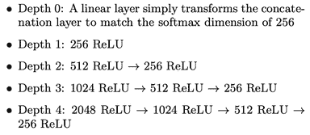

+   **特征越多效果越好**，见下图：

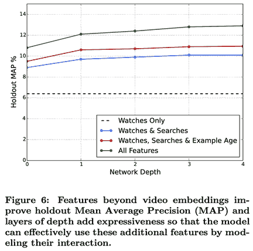

## 排序

+   排序模型的结构类似检索模型，如下图。**但训练数据和目标函数都不相同**。模型优化的目标是每次展示的平均观看时间。作者认为按点击率排序会倾向于把诱惑用户点击（用户未必真感兴趣）的视频排前面，而观看时间能更好地反映出用户对视频的兴趣。

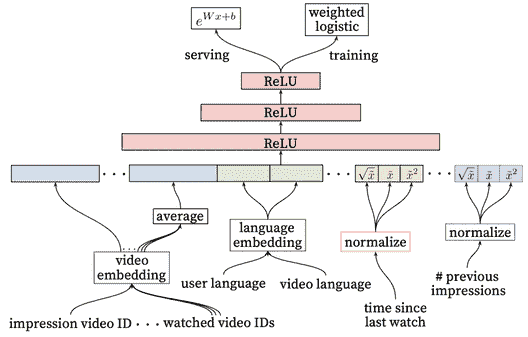

> **把****训练看成一个二分类问题**，其中训练数据中的正样本是视频展示后用户点击**了该视频，负样**本则是展示后未点击。如果只是这**样**的话，那优化的目标就是点击率了。如何把目标变成优化平均观看时长？奥秘在训练样本的权重。所有负样本的权重都为 1，而正样本的权重为点击后的视频观看时长  。所以模型的损失函数是如下的加权交叉熵：

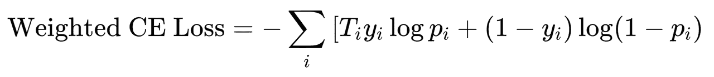

线上使用时，只要基于   排序候选视频即可，也即选取值  最大的那些视频。

为什么优化这样的加权Loss，其实就是在近似优化平均观看时长呢？

+   假设训练数据总共包含** N** 个样本，其中有   个**正样本**，显然在youtube**这个**场景下。按上面的样本权重选取方式，模型学到的几率如下：

**从式子的右边看：**

**从式子的左边看：**

**所以有：**

dwq

**故基于值  **** **排序视频近似等价于基于预估观看时长排序视频。

## 模型输入特征

**特征分为两大类:**

1.  一类是展示（impression）相关的特征，如视频属性等；

1.  另一类是query相关的特征，如 user/context 属性。

模**型中包含几百个特征，其****中**类别特征和连续特征大致各占一半。作者说还是花了很多功夫在特征工程上的，主要挑战是如何表示用户的时序行为，以及把用户行为与待评分的视频关联上。

> **最重要的特征**，是那些描述用户历史上与待评分视频，或类似视频已有的交互行为信号。例如用户与待评分视频所在频道的交互历史：用户观看了此频道的多少视频？用户最后一次观看同主题视频是什么时候？这些特征的泛发性很好，对待评分视频的预测很有帮助。

把检索模型的信息以特征形式传入进排序模型也很有帮助:

+   **例如:  ****哪些检索模型提名了这个**候选视频？它们都给出了什么分数？

+   描述视频历史展示频率的特征对于在推荐中引入 “流失” 也很关键（连续的请求不会返回相同的列表）。如果最近给用户推荐了一个视频但用户没观看，那么模型会在下一次页面加载时自动降低这个视频的展示可能。

**对于****类别特征****，使用嵌入向量进行表示:**

+   嵌入向量的维度建议选择与词汇量大小的对数成比例，即   如果某个类别的取值特别多，可以限定一个值，长尾的值对应的表示为全0的向量。

**对连续特征的归一化处理方式很很影**响训练的收敛性。使用了如下的归一化方式:

+   对于连续变量   ，假设它的取值分布为   ，通过以下公式把   归一化为    ：

>

+   说白了   就是   在整体取值中的百分比排序位置。

+   具体归一化时，会使用 x 训练数据中取值分布的四分位值插值得到近似的    。除了归一化后的     ，  和  也会加入到输入中。这也是处理连续特征的常见手段

## 实验结果

定义了一个加权逐对损失 **“wei**ghted, p**er-u**ser loss”：给定一个**用户，**每次选定同页面展示的一对样本作为比较对象，一个为正（展示后点击），一个为负（展示后未点击），权重来自于正样本的观看时间。如果负样本的得分比正样本高，就认为正样本的观看时间被误识别了。weighted, per-user loss 就是误识别观看时间占总观看时间的比例。

+   结果DNN结构越深，效果越好，但到了3层深度收益就很小了。

+   在3层模型时，如果不使用连续变量的幂次变换   和  ，损失会上升 0.2%

+   如果训练时不对正样本做观看时间加权，即正负样本等权重，损失会上升 4.1%

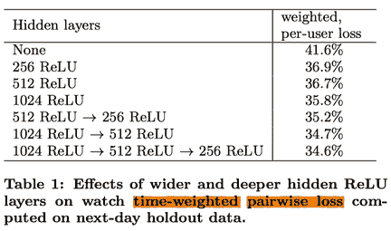

## 总结

几个值得 **take-home** 的结论：

+   仔细选择训练数据，避免不恰当的信息泄露。

+   DL时代特征处理依旧重要，了解下对连续特征按分布归一化的方法。

+   使用 **example age** 特征处理 time bias，这样线上检索时可以预先计算好用户向量。

+   排序模型训练使用基于观看时长加权的CE，这样产生的排序可以近似认为是基于期望观看时长进行的排序。