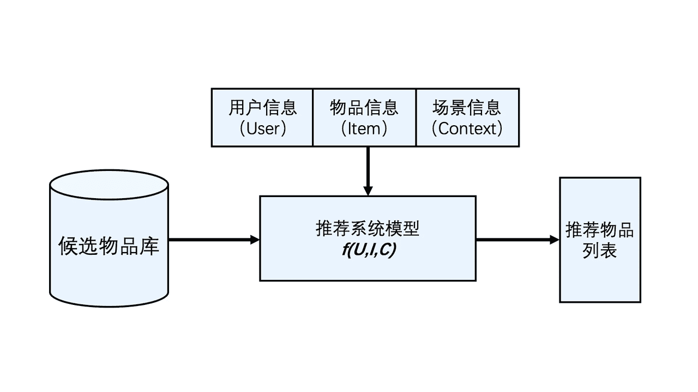
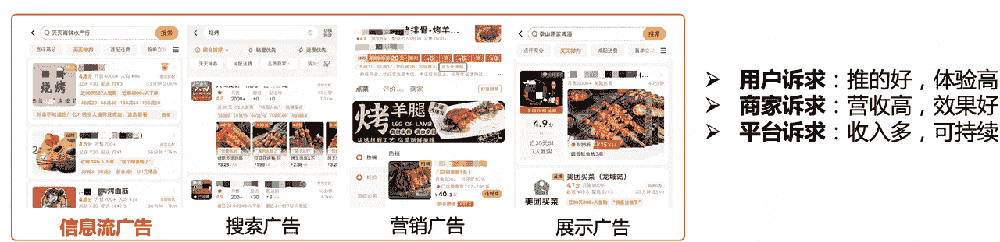
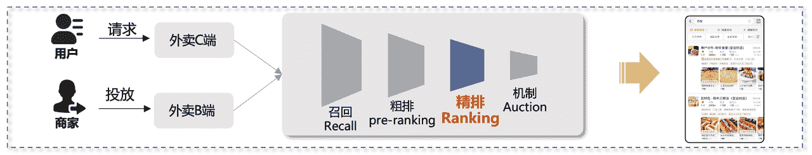
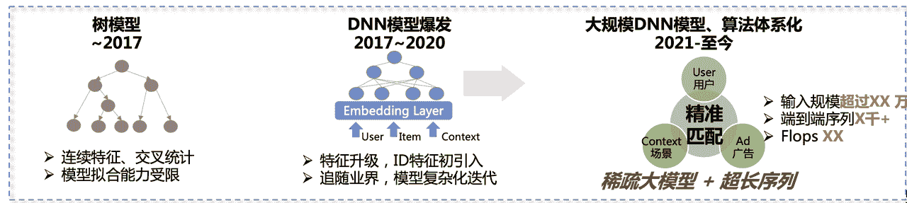
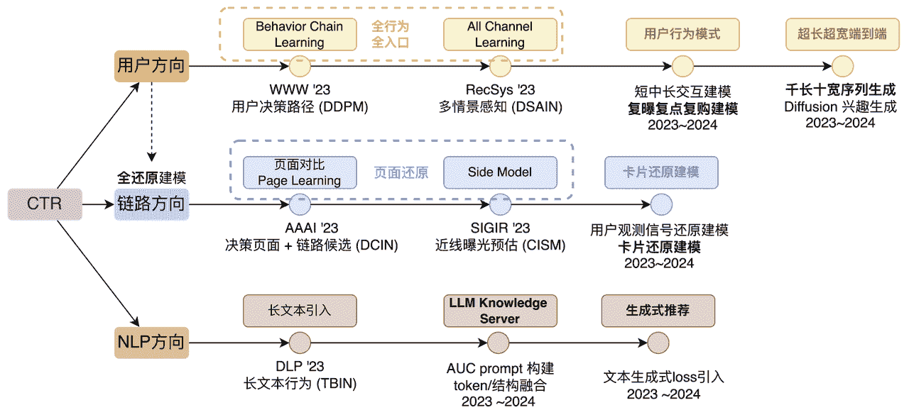
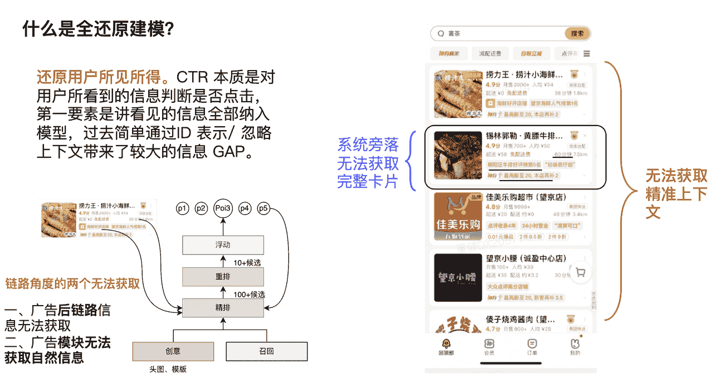
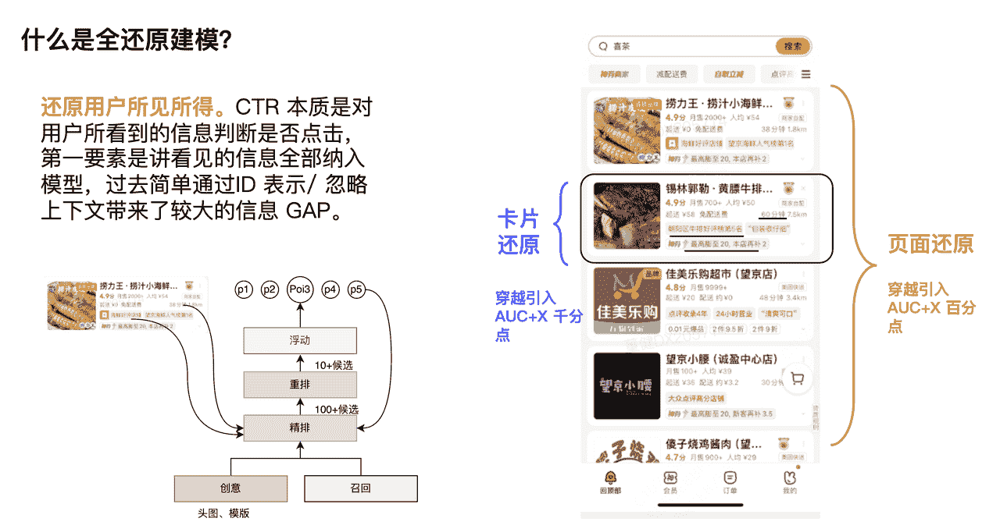
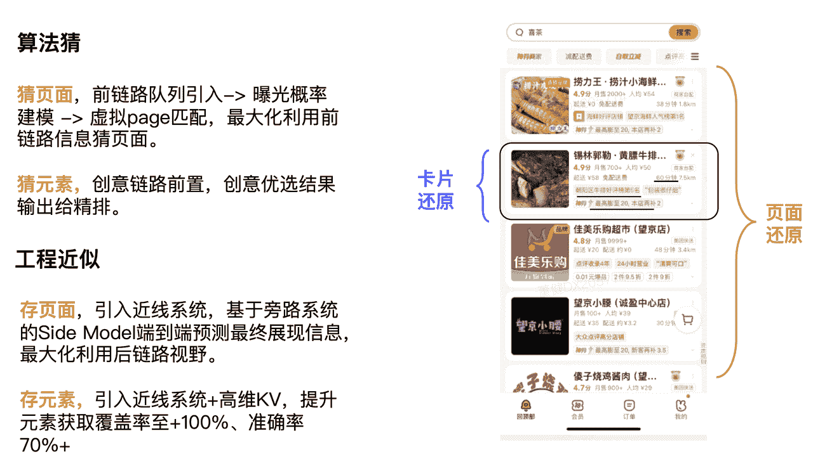
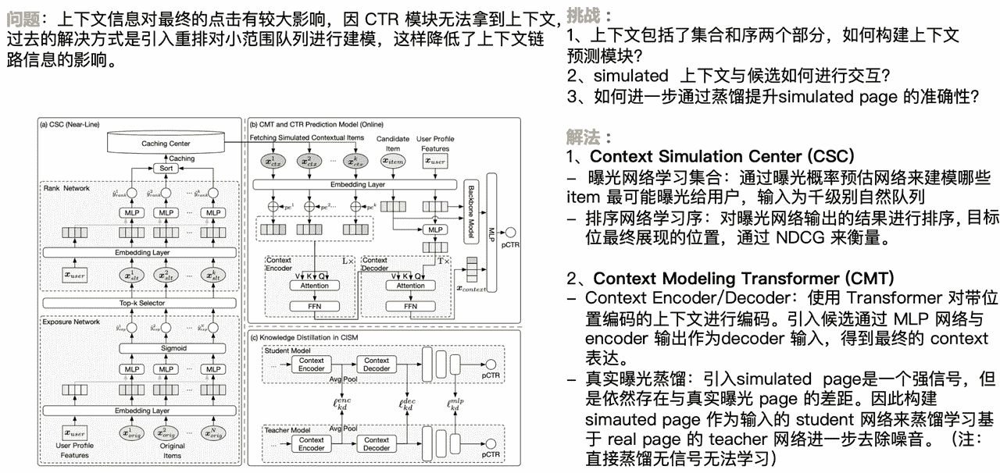

# LLM in CTR 技术在美团外卖的实践

> 来源：[https://v11enp9ok1h.feishu.cn/docx/Uk1RdEf0doogdLxu54zc1kCKn7d](https://v11enp9ok1h.feishu.cn/docx/Uk1RdEf0doogdLxu54zc1kCKn7d)

## 推荐系统的作用/意义/目标

推荐系统的作用和意义：

+ 用户角度：推荐系统解决在“信息过载”的情况下，用户如何从海量信息中高效获得感兴趣信息的问题。

  推荐系统是在用户需求并不十分明确的情况下，进行信息的过滤。因此，与搜索系统（用户会输入明确的搜索词 `query`）相比，推荐系统更多地利用用户的各类历史信息“猜测”可能喜欢的内容。

+ 公司角度：推荐系统解决产品能够最大限度地吸引用户、留存用户、增加用户黏性、提高用户转化率的问题，从而达到公司商业目标连续增长（增加公司收益）的目的。

推荐系统的终极优化目标：包括以下两个维度

1. 一个维度是用户体验的优化

1. 另一个维度是满足公司的商业利益

对一个健康的商业模式来说，以上两个维度应该是和谐统一的

## 推荐系统的架构

+ 物品信息：商品推荐中的商品信息，视频推荐中的视频信息，新闻推荐中的新闻信息

+ 用户信息：与人相关的信息，包括历史行为、人口属性、关系网络等，可以用来更可靠地推测出人的兴趣点

+ 场景信息/上下文信息：指具体推荐场景中的时间、地点、用户的状态等一系列环境信息

## 推荐系统的逻辑框架

推荐系统要处理的问题的定义：

+ 对于`用户 U`，在特定场景`C`下，针对海量的物品信息，构建一个函数`f(U,I,C)`，预测用户对特定候选物品`I`的喜好程度，再根据喜好程度对所有物品进行排序，生成推荐列表

## 推荐系统的技术架构

> 实际的推荐系统需要解决两类问题：

+ 数据和信息相关的问题：即用户信息、物品信息、场景信息分别是什么？如何存储、更新和处理？

+ 推荐系统算法和模型相关的问题：即推荐模型如何训练、如何预测、如何达到更好的推荐效果？

因此，推荐系统的技术架构也分为两个部分：

+ 数据部分：数据离线批处理、实时流处理

+ 负责“用户”“物品”“场景”的信息收集与处理

+ 原始数据加工后有 3 个主要出口：

1. 生成推荐模型所需的样本数据，用于算法模型的训练和评估

1. 生成推荐模型服务（`model serving`）所需的“特征”，用于推荐系统的线上推断

1. 生成监控系统、商业智能系统所需的统计型数据

+ 模型部分：训练、评估、部署、线上推断

+ 模型结构/模型服务过程：输入是所有候选物品集，输出是推荐列表

+ 召回层：一般由高效的召回规则、算法或简单的模型组成，这让推荐系统能快速从海量的候选集中召回用户可能感兴趣的物品

+ 深度学习中的`Embedding`技术

+ 排序层（精排层）：利用排序模型对初筛的候选集进行精排序。是推荐系统产生效果的重点/核心

+ 深度学习模型的复杂结构，使其具备了理论上拟合任何函数的能力，极大地增强了推荐系统的拟合能力和表达能力

+ 补充策略与算法层（再排序层）：在返回给用户推荐列表之前，为兼顾结果的“多样性”“流行度”“新鲜度”等指标，结合一些补充的策略和算法对推荐列表进行一定的调整，最终形成用户可见的推荐列表

+ 模型训练：在线环境进行模型服务前，需要通过模型训练确定模型结构、超参数、参数取值

+ 离线训练：可以利用全量样本和特征，使模型逼近全局最优点

+ 在线更新：可以准实时地“消化”新的数据样本，更快地反应新的数据变化趋势，满足模型实时性的需求

+ 评估模块：

+ 离线评估：得到线下评估指标

+ 线上`A/B`测试：得到线上评估指标

## 信息流广告业务及预估技术现状

### 信息流广告业务特点

目前，美团外卖的广告主要包括信息流广告、搜索广告、营销广告、展示广告等等。外卖业务都有着典型的业务特点：

+ 用户行为连贯性强：用户用餐意图明确，一般在10分钟内完成，`UV`成单率较高。

+ 展示信息丰富：卡片信息覆盖了评分、评价、优惠、配送等多种信息，对用户的决策影响较强。

+ 文本信息多：在电商场景中，商品作为候选图片往往占据很大的决定因素，而在外卖场景下，商家作为候选更加复杂，商户名称、评价、热销菜品等文本信息能够影响用户做出决策。

### 技术概况及演进阶段

这里先来介绍一下预估技术的现状。从技术层面，下图展示了广告投放系统的整体的流程：

总的来说，外卖广告系统跟我们在业界的搜推广系统是比较相似的，召回、粗排、精排以及各种机制。但外卖广告和业界场景区别较大的地方在于召回，因为它是基于位置服务（`LBS`）的，这个过程本身带有一定的约束。

广告预估算法历经了三个发展阶段：

+ 第一个阶段就是树模型，包括连续特征、交叉统计等等，当时的模型拟合能力是比较受限的。

+ 第二个阶段是从2017年开始到2020年，在这个阶段`DNN`模型开始爆发，进行了特征升级，也开始紧随业界步伐，引入更加复杂的模型，不断提升业务效果。

+ 第三个阶段就是2021年至今，主要方向是稀疏大模型+超长序列，进一步实现业务效果的提升。

### 预估技术现状

在信息流广告预估技术层面，主要探索方向为用户方向、链路方向以及`NLP`方向（如下图所示）。

> 没有选择其他方向，主要是因为就交叉方向而言，我们发现随着互联网行业的不断发展，用户的行为会越来越多且更加复杂，而交叉方向仅仅能带来`Context`级别的深度学习能力，也就无法持续的成为效果的来源。

> 另一方面，虽然交叉技术也在发展，但发展方向上也是从`ID matching` 到 `Sequence Matching`，单纯平铺类类别特征的交叉模型能力发展有限。

整体的思路是从用户的元素匹配、页面匹配，到路径匹配，最后到长期的兴趣匹配。本质上都是在做不同层面的用户匹配相关的工作。其中，元素匹配、页面匹配归到了链路方向。原因是链路方向更多的都是在解决“看不见的问题”，然后再通过这些“被看见”的信息去做相应建模，所以我们将链路方向单独列了出来。

+ 在用户方向，我们也大概经历了三个阶段，第一个阶段，要从原始单点、单入口的行为，向全行为、全入口进行扩张；第二个阶段，是在已有的输入的情况下，去探索更多的行为模式；第三个阶段，我们主要是做一些自动化模式提取，或者说网络自动拟合行为的能力做到更强。

+ 在链路方向，主要关注两件事，一个是页面还原，一个是卡片还原，通过算法和工程能力来还原用户“所见”到模型决策中。

+ 在`NLP`方向，过去我们还有一个方向叫多模态，但是客观来讲，随着`LLM`的火爆，外界的技术也给我们更多的输入，因此我们将`LLM IN CTR`单独列出来作为一个主要的技术方向。

## 信息流广告在美团的实践

### 用户建模思路概览

用户方向整体又拆解为三个方向，第一个是时间线，第二个是空间线，第三个是时间和空间共同作用下的行为模式。

> 参考了业界学界主要迭代的方法，包括`Session`建模、超长行为建模、多行为建模、长短期建模等。以学界和业界为基础，结合业务问题、特点，将技术和业务结合的更好，有了以下的技术拆解。

> 在时间线上，我们认为长短期的多`Level`融合更加重要。

> 一方面是用户兴趣在不同级别“片段”上关注点有显著差异，比如页面倾向比较、路径上的兴趣更连续、用户会连续吃一段时间轻食等，我们需要将这种在不同级别片段上的用户行为模式提取出来。

> 因此，一方面我们通过更多页面和路径的方式将短期和长期进行联合；同时，通过增加日、周级别的中期兴趣，将短中、短长进行交互，增强时间线行为上的连接。

> 另一方面，在模型上增加一些端到端的方式，自动化的将行为规律挖掘出来。这是时间线要解决的关键问题。

> 在空间线上，真实物理空间维度下，面对的问题比较明确，在不同的位置下，比如上班的时候和在家的时候，人的兴趣其实是不完全一样的，可以根据空间的位置为大家进行推荐。

> 在虚拟空间下，比如用户在使用`App`和`App`等不同入口，人的兴趣和意图也会发生较大变化。

> 一个显著的例子是，用户在首页和会员入口上对优惠的关注区别较大。空间线解决的问题是结合真实空间、虚拟空间，去判断用户的真实的意图或者行为模式。

> 第三条线，就是跟业务进行结合，比如用户在`App`上进行了一些操作（领取了红包），那么这个行为会对点餐有什么影响。

> 本质上是模型在理解用户进行了一些操作行为后，会对接下来的行为产生哪些影响，进而模型能学习到不同的用户行为模式、更好的预测用户的行为。

> 以上就是我们用户建模的整体思路。

#### 决策路径建模

本部分会介绍一下决策路径建模，第一个核心的问题就是，`DIN`单点匹配忽略了什么？

+ 单点匹配，我们认为是忽略了前序行为对用户后续行为的一个影响。对绝大多数电商业务来说，用户在一段时间内的行为是具备一定的连贯性的，我们可以根据用户的历史行为数据，对接下来的行为做出预测。

这里有两个挑战，第一，如何构建核心路径；第二，如何解决路径本身的噪声、稀疏性、匹配等问题。我们的解法主要有三点：

> 第一，`Path Enhance Module`（`PEM`）提取核心路径。

+ 判断前置路径和候选（历史路径为点击）的相关性，建模路径置信度。

+ 对原始进行全连接的`MLP`激活+`Softmax Top K`结合原始表示作为核心路径表达。

> 第二，`Path Augment Module`（`PAM`）扩充路径。

+ 使用用户的增广路径作为正样本、其他用户的路径作为负样本，引入对比学习`Loss`，提升路径表示学习能力。

> 第三，`Path Matching Module`（`PMM`）路径+点双层匹配。

+ 基于`PEM`表示，构建路径匹配`Attention`，进一步对历史路径取`Top K`，去除掉无关路径影响提升候选点匹配精度。

+ 进一步引入点（`item`）匹配，完成双层匹配。

#### 用户行为超长超宽建模

相信很多同学都知道超长建模，基本上是通过聚类、局部`hash`等近似技术来进行实现。

> 要引入超宽建模，本质上是因为我们需要将所有的输入都放到一起，所以需要一个更大更复杂的模型去把事情给处理了。不过，在实际中我们没有完全实现，因为目前的算力还是无法支持的。

这里也面临2个问题：

第一个问题是

`SIM/ETA`为什么没有带来效果？这个方向，最早是电商平台提出来的，`SIM`主要是`Hard`过滤，比如通过用户在网站浏览鞋相关的行为时，他们也会看其他各种各样的东西，它通过硬过滤，能够把跟「鞋」相关的产品能过滤出来，过滤掉和鞋无关的噪音，学习到用户在鞋上的偏好。

第二个问题是

拟合`DIN Score`是否是长序列的终局？之前业界有一篇文章认为`DIN Score`是基准，把它线性扩展就能带来效果，进一步扩展到万级别或者十万级别把效果推到最大化。但是通过实验，我们的`CTR`场景线性扩展到超长级别并没有持续带来效果，反而到一定长度有所下降。

> 我们可以把`CTR`理解成一个去噪任务，本质上是根据用户历史和当前场景`Match`用户和候选的过程。我们发现，如果能预测出精准或者去除掉所有噪声，比如拿穿越信息`Label POI`与`Target`进行匹配，使用简单的网络也可以有很高的`AUC`。因此，我们认为完美的`CTR`网络应该是一个强预测网络+弱匹配网络的组合。预测网络应该是一个能力非常强的网络，能够进行多层的叠加，把信息进行萃取得到一个预测更加精准的结果，来与`Target`进行匹配。

### 全还原建模

首先，什么是全还原建模？我们给的一个定义是还原用户所见所得。`CTR`任务是根据用户看到的信息来判断用户是否点击，最重要的一点是将看见的信息全部纳入到模型之中，过往简单的通过`ID`表示建模忽略了上下文及展示的信息，带来了较大的信息`GAP`。

第一个视角，上下文卡片无法获得。上下文信息对当前候选、当前卡片的`CTR`相当重要。有的同学可能会认为重排可以搞定这个事情，但我们始终认为，上下文信息属于链路信息，我们认为每个模块都需要去学习上下文信息，当然每个模块可能学习的重点不一样，而且实际上都能带来一定的效果。第二个视角，我们从算力的角度，因为预估侧的算力比较高，其影响的范围会更大，实际上也能够带来更多的效果空间。

再看左下角的图，从链路视角来说，对于预估模块、广告模块模块存在两个无法获取。第一个是广告的后链路信息无法获取，这里包括了展示的配送信息、配送费、准确的优惠信息等；第二个是自然的信息无法获取，这里包括了自然的上下文。因此，还原从另一个角度说是，如何打破链路的束缚来使用穿越信息。

**整体解决思路**

这里把页面还原和卡片还原展开。首先，从思路上讲，我们主要从算法、工程两个维度去解。在算法层面，第一个就是去猜页面，最大化利用前链路信息猜页面；第二个是猜元素，创意链路前置，创意优选结果输出给精排。在工程层面，第一个是存页面，引入近线系统，基于旁路系统的`Side Model`端到端预测最终展现信息，最大化利用后链路视野。第二个是存元素，引入近线系统+高维`KV`，提升元素获取覆盖率至+100%、准确率70%+。

前文也提到，上下文信息对最终的点击有较大影响，因`CTR`模块无法拿到上下文过去的解决方式是引入重排对小范围队列进行建模，这样降低了上下文链路信息的影响。

接下来，面临的挑战就是：

+ 上下文包括了集合和序两个部分，如何构建上下文预测模块?

+ `Simulated`上下文与候选如何进行交互?

+ 如何进一步通过蒸馏提升`Simulated Page`的准确性?

**解法是：**

`Context Simulation Center`（`CSC`）

+ 曝光网络学习集合：通过曝光概率预估网络来建模哪些`item`最可能曝光给用户，输入为千级别自然队列。

+ 排序网络学习序：对曝光网络输出的结果进行排序，目标位最终展现的位置，通过`NDCG`来衡量。

`Context Modeling Transformer`（`CMT`）

+ `Context Encoder/Decoder`：使用`Transformer`对带位置编码的上下文进行编码。引入候选通过`MLP`网络与`Encoder`输出作为`Decoder`输入，得到最终的`Context`表达。

+ 真实曝光蒸馏：引入`Simulated Page`是一个强信号，但是依然存在与真实曝光`page`的差距。因此构建`Simauted Page`作为输入的`Student`网络来蒸馏学习基于`Real Page`的`Teacher`网络进一步去除噪音。（注：直接蒸馏无信号无法学习）

我们引入了缓存的和预测配置策略，加上真实的蒸馏，就帮助我们进一步地去提升效果，这属于页面还原的部分。

> 卡片还原这部分整体的思路分为三部分：第一个部分，能够拿到卡片信息；第二部分，组成用户看到的卡片；第三部分，通过卡片来做历史兴趣匹配。

### LLM in CTR

最后分享一下大模型在`CTR`的应用。我们做了一些初步的调研，发现目前很多技术团队整体的思路是差不多的。下图展示了`CTR`任务跟`NLP`任务的对比，可以看到从输入到模型架构，再到学习模式和任务模式，都有较大区别。`NLP`任务是自然语言做`Token` + 大规模`Transformer` + 理解及推理能力，`CTR`任务是`ID`输入+ 人工设计网络 + 强记忆能力。同时对于`CTR`，大部分业务只用了自身业务数据，是缺乏外部知识和全任务的理解能力的。

所以基于以上几个方面，我们做了三方面的工作：

+ 第一层，知识注入，就是要把外部的、真实的、当前`CTR`缺乏哪些知识放到模型中，这部分工作很多公司都在做，这块主要要求的是`Prompt`工程能力。因为生成的结果，不一定是`CTR`需要的，我们就需要做好适配工作。根据`CTR`的特点，就可以将高频词和低频词区分出来，同时也需要做一些`Prompt`融合相关的后处理工作来提升和`CTR`任务的匹配度。

>

+ 第二层，思维注入，就是要把大模型的结构能力给引入进来，或者说将大模型判断过程的引入进来。

>

+ 第三层，范式迭代，最近，`Meta`似乎给生成式推荐指出了一条路。主要的思路是把输入的形式进行变化，换成了更小规模的`Token`，大概可能只有几万的规模，来解决大规模`Softmax`问题。

+ 然后通过`Transform`叠加的方式，结合聚合语义，从模型融合到端到端自回归，让数据能够跑通。发现如果噪音特别高的输入，`Transformer`并不能处理得很好，但一个相对来讲语义比较明确的信息，`Transformer`对上下文理解的性能还不错，因此我们先做了一层语义聚合来降低输入`Token`序列的噪音。总的来说，我们通过小规模`Token`，加上语义聚合，结合`Transformer`的架构，给业务效果带来了一波提升。

> 总结一下，本质上是要把CTR不具备的能力通过大模型进行补齐。我们将CTR目前不具备的能力，划分成了知识能力、泛化能力和推理能力。对应的，我们也列举了一些我们尝试的结果如下图所示：
