# 推荐系统之交叉

> 来源：[https://v11enp9ok1h.feishu.cn/docx/SDYZdeohgoUf2rxLxg7cQ7OVnwe](https://v11enp9ok1h.feishu.cn/docx/SDYZdeohgoUf2rxLxg7cQ7OVnwe)

Factorized Machine

线性模型预测是特征的加权和。（只有加，没有乘。）

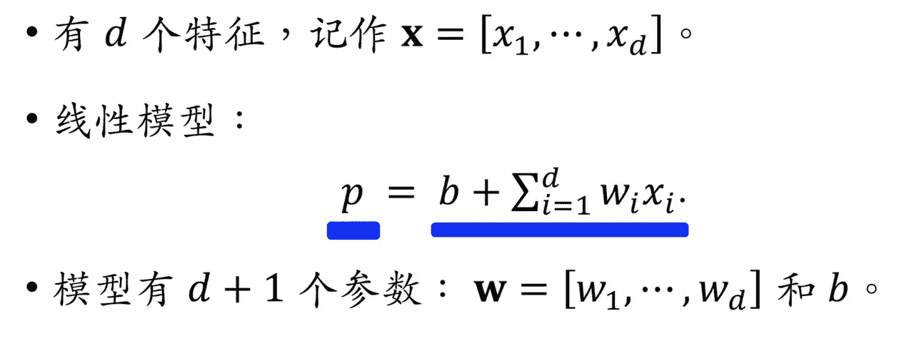

二阶特征交叉

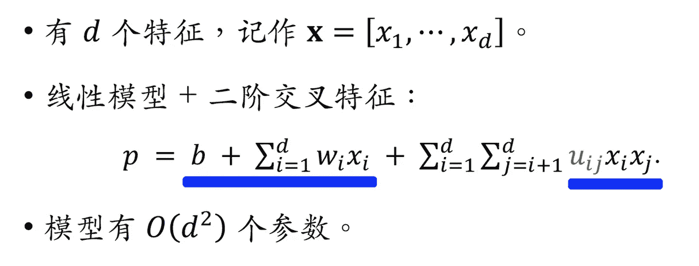

可以通过矩阵分解减少模型参数量

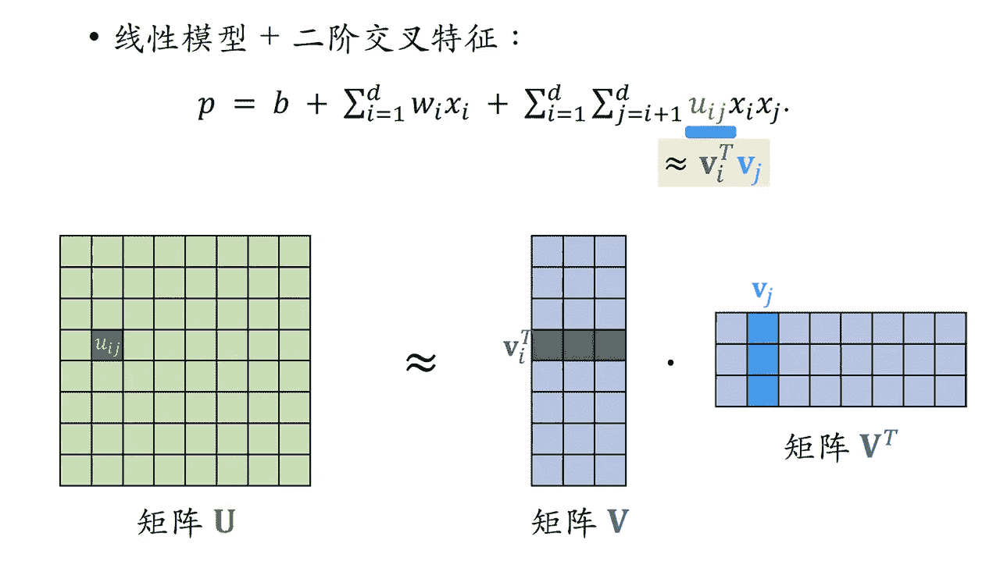

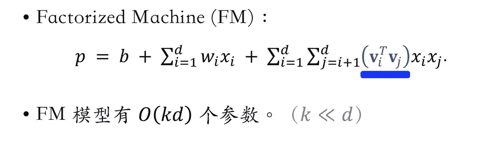

深度交叉网络（DCN）

之前提到过的召回、排序模型中的神经网络可以用任意网络结构；常见的交叉层

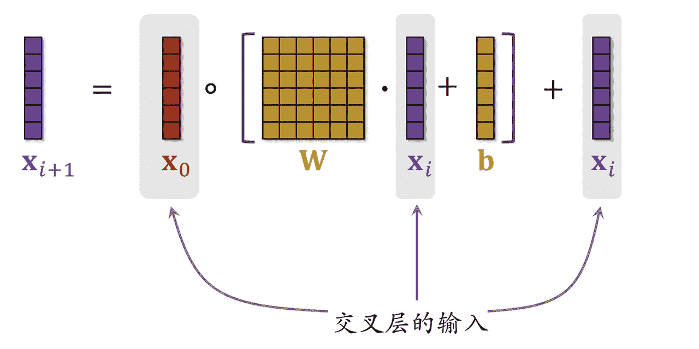

交叉网络就是多个交叉层串起来的网络

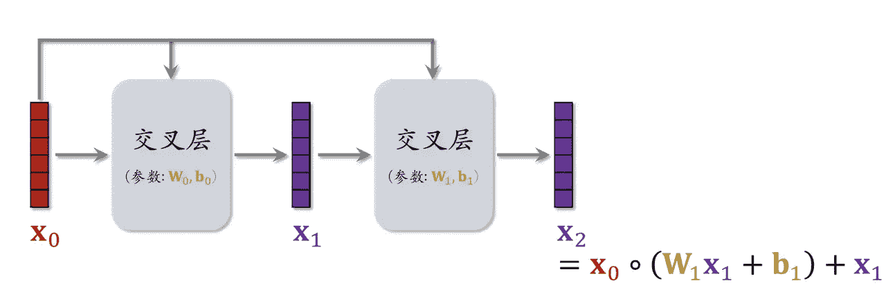

深度交叉网络就是两个分支，一边是全连接，一边是交叉网络

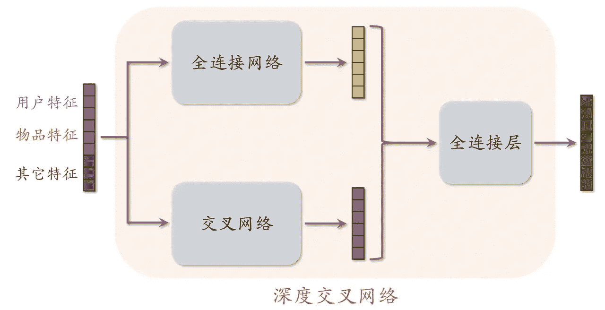

LHUC网络结构

LHUC起源于语⾳识别，快⼿将LHUC应⽤在推荐精排，称作PPNet

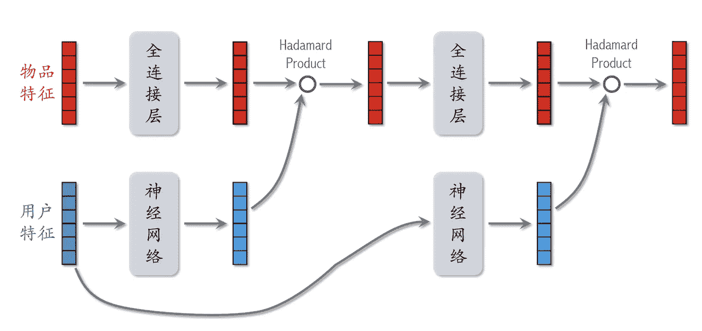

SENet & Bilinear Cross

SENet 对离散特征做field-wise加权，如果有 个fields，那么权重向量是 维。

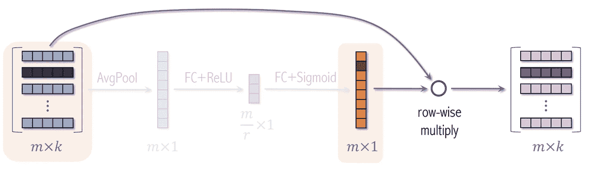

Field 间特征交叉

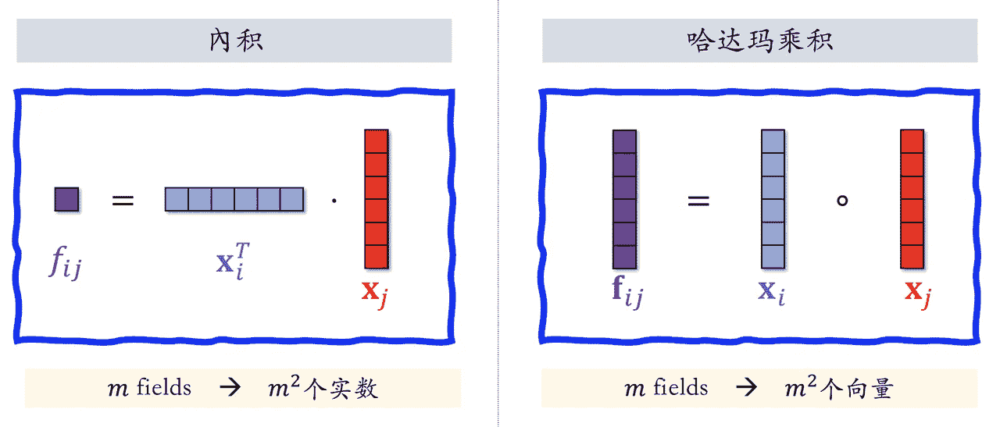

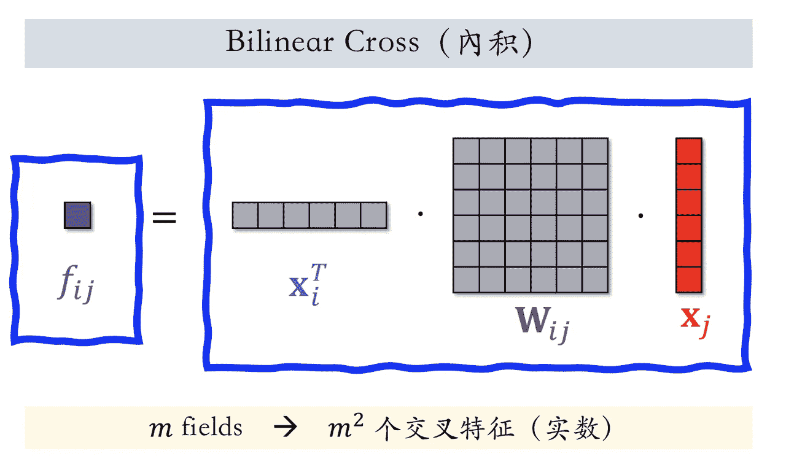

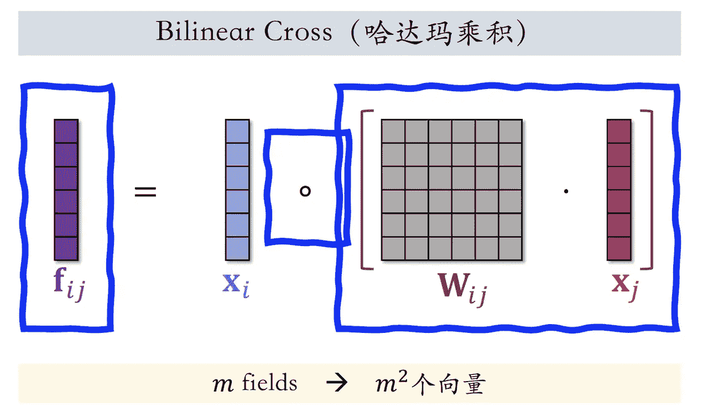

FiBiNet可以理解为同时考虑了SENet 结合 Field 间特征交叉

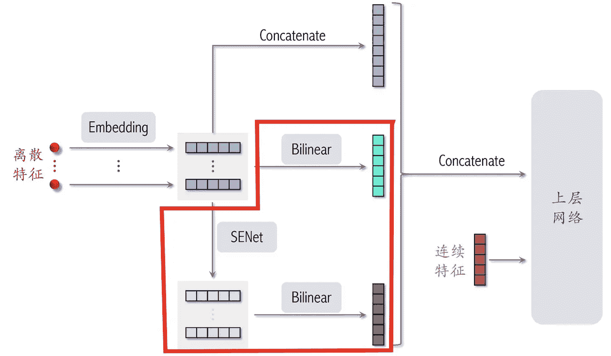