# 推荐系统之序列建模

> 来源：[https://v11enp9ok1h.feishu.cn/docx/W0uMdSmvWoQOYTxYSY5cRb2pnBf](https://v11enp9ok1h.feishu.cn/docx/W0uMdSmvWoQOYTxYSY5cRb2pnBf)

## 推荐系统之序列建模

## LastN特征

+   LastN：⽤户最近的 次交互（点击、点赞等）的物品ID。

+   对LastN物品ID做embedding，得到 个向量。

+   把 个向量取平均，作为⽤户的⼀种特征。

+   适⽤于召回双塔模型、粗排三塔模型、精排模型。

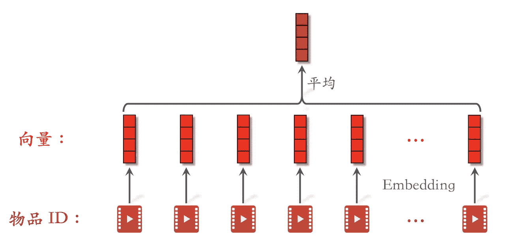

比如在小红书中可以同时考虑点击、点赞、收藏等多种交互序列

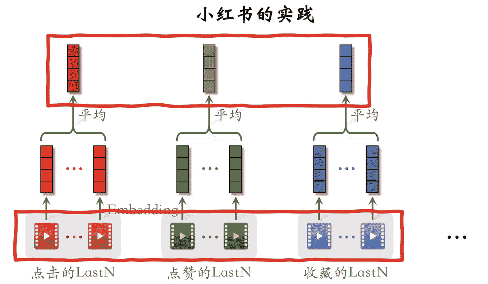

## DIN模型

DIN ⽤加权平均代替平均，即注意⼒机制（attention），其中权重为候选物品与⽤户LastN物品的相似度。

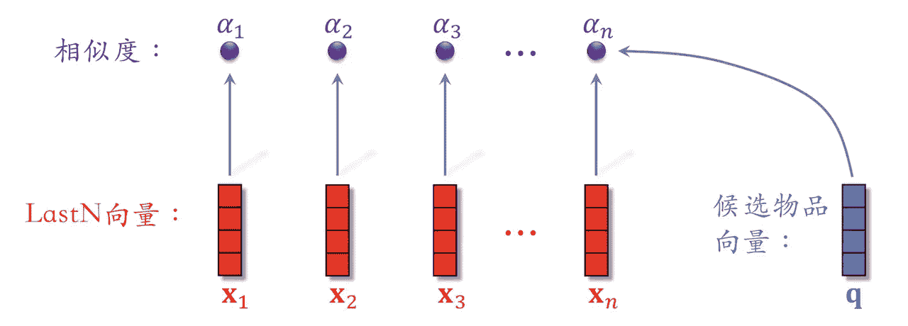

以相似度为权重，求⽤户LastN物品向量的加权和，结果是⼀个向量

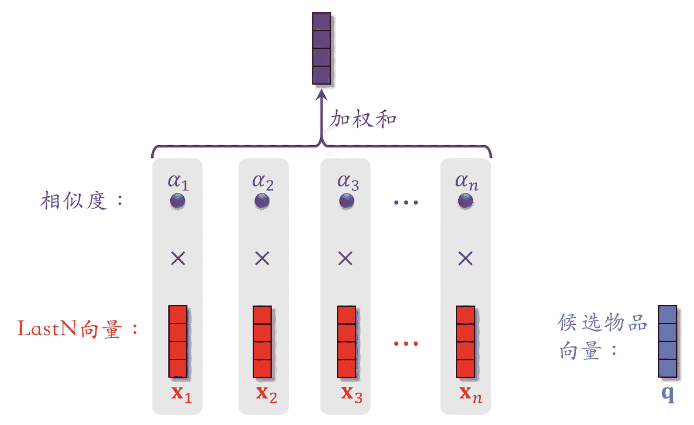

**简单平均** v.s**注意力机制**

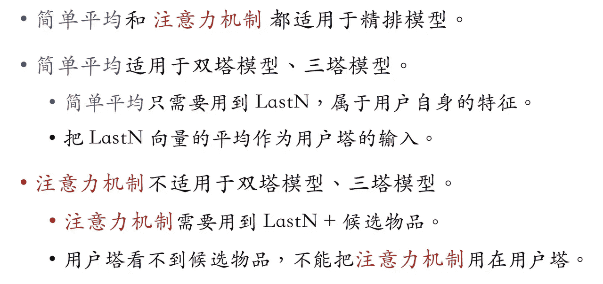

**DIN模型的缺点**

**SIM模型**

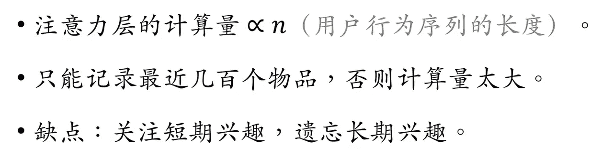

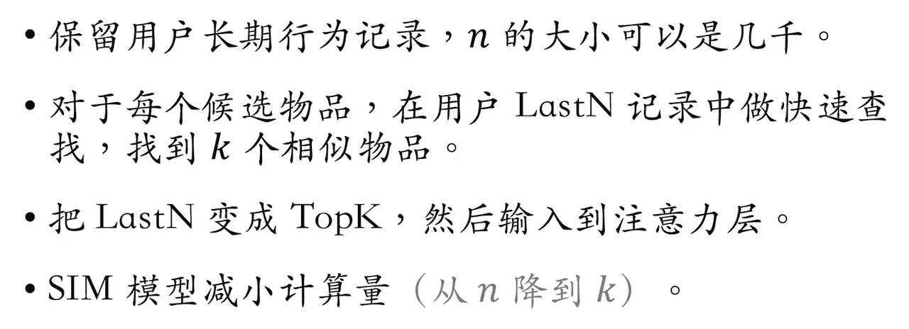

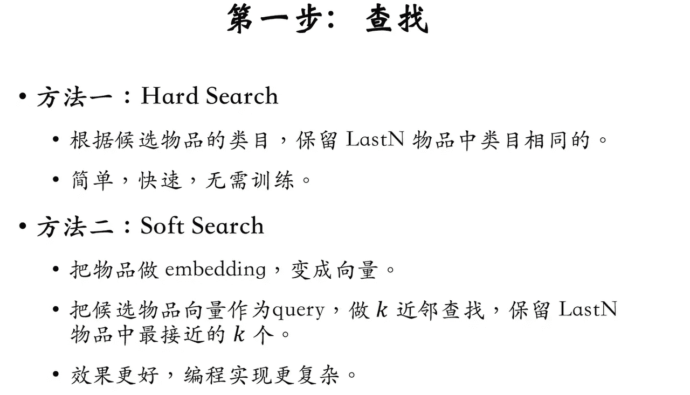

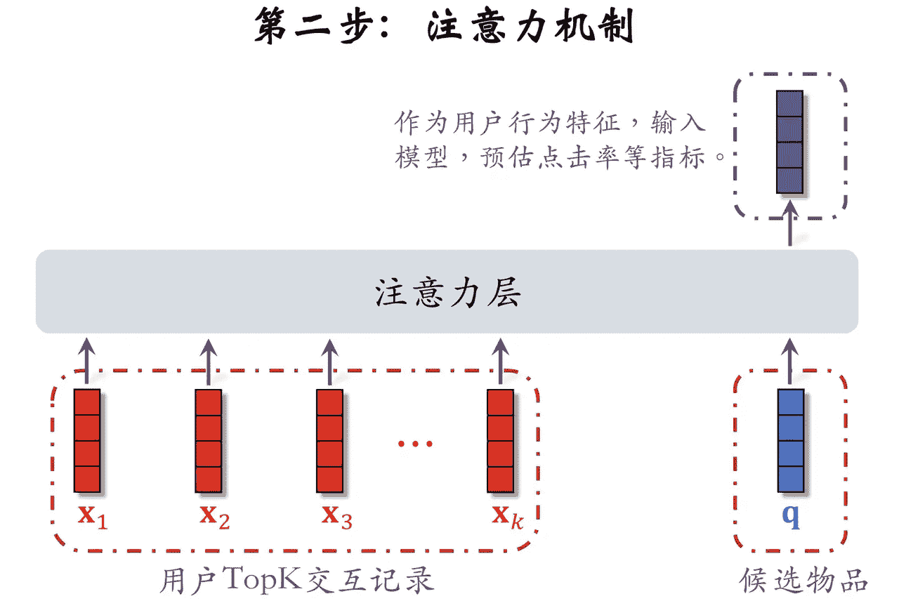

使⽤时间信息。SIM的序列长，记录⽤户长期⾏为。时间越久远，重要性越低。

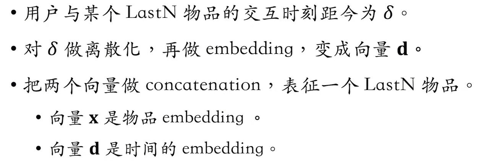

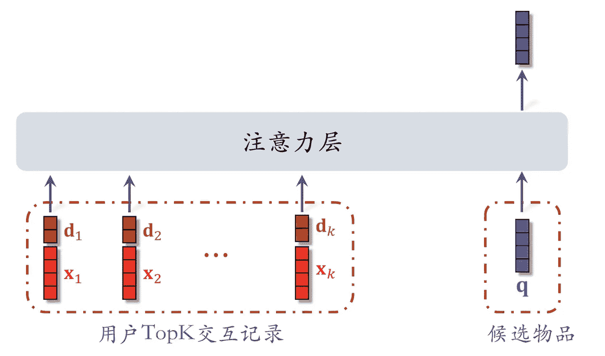