# 推荐系统之重排

> 来源：[https://v11enp9ok1h.feishu.cn/docx/OFWuddJzYocO9qxr2SjcWRyunLg](https://v11enp9ok1h.feishu.cn/docx/OFWuddJzYocO9qxr2SjcWRyunLg)

## 推荐系统之重排

### 相似性的度量

+   基于物品属性标签

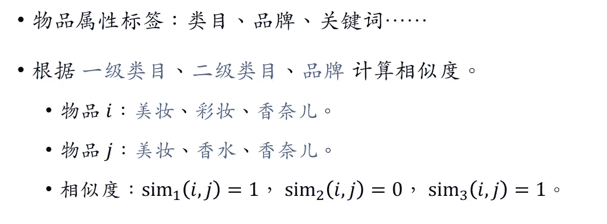

基于物品向量表征⽤召回的双塔模型的物品向量（不好）

基于内容的向量表征（好）

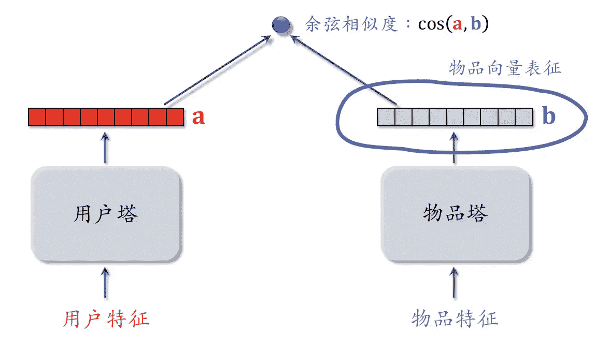

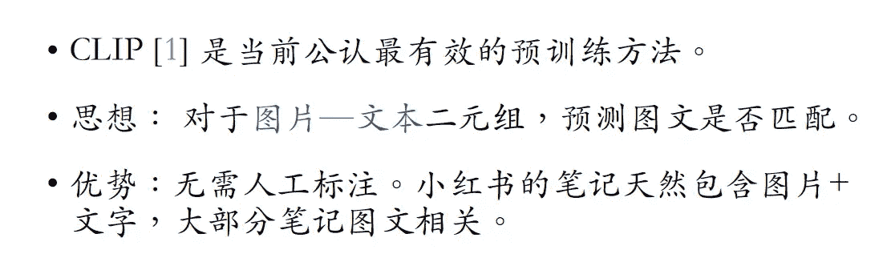

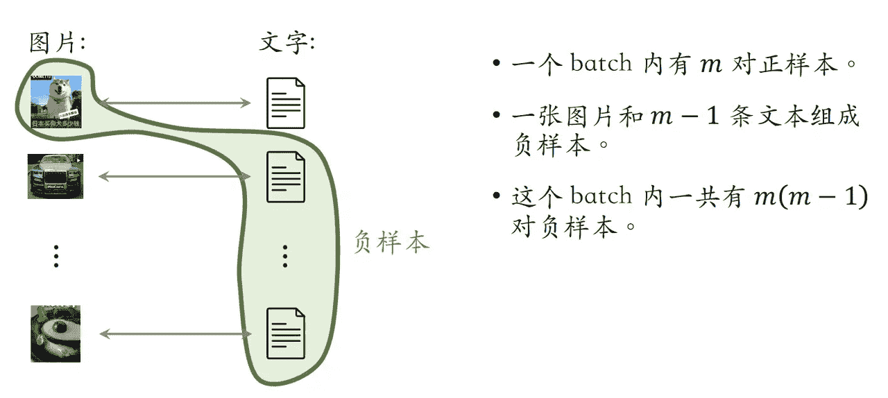

## Maximal Marginal Relevance (MMR)

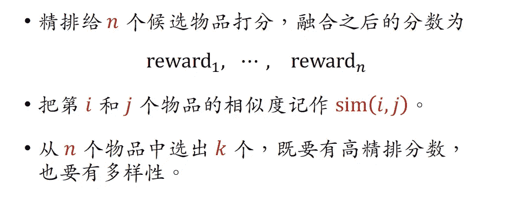

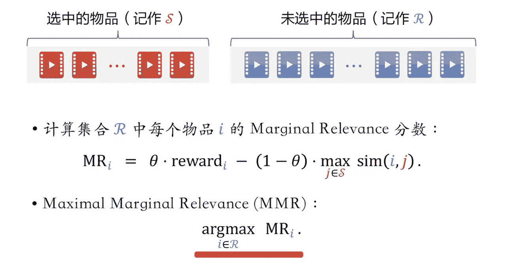

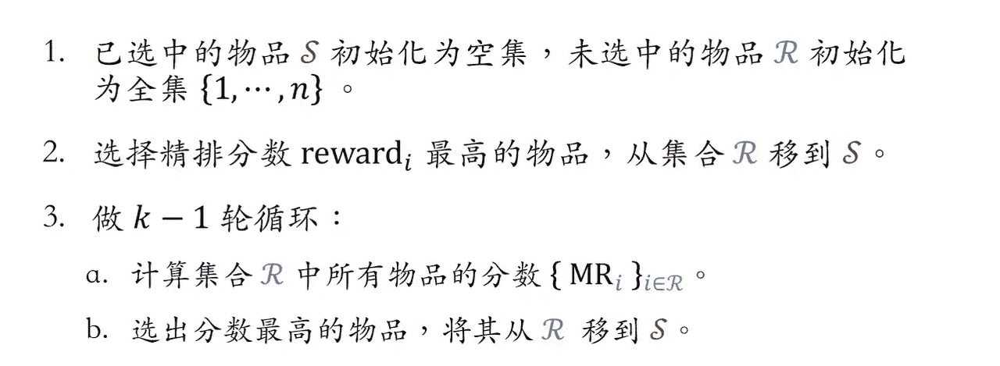

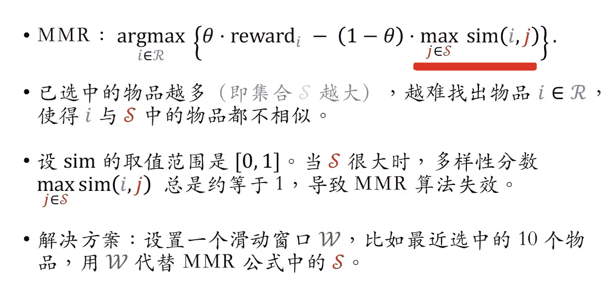

## 重排的规则

+   最多连续出现 篇某种笔记

+   每篇笔记最多出现1篇某种笔记

+   前篇笔记最多出现 篇某种笔记

**MMR + 重排规则**

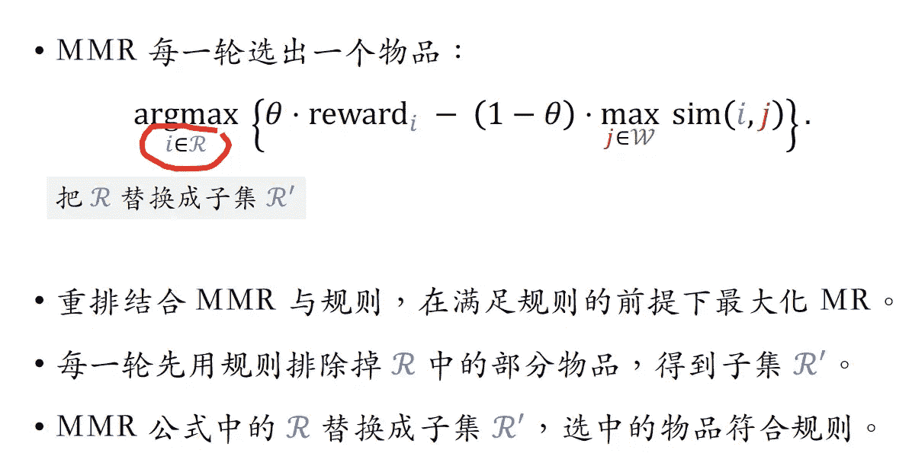

**DPP：多样性算法**

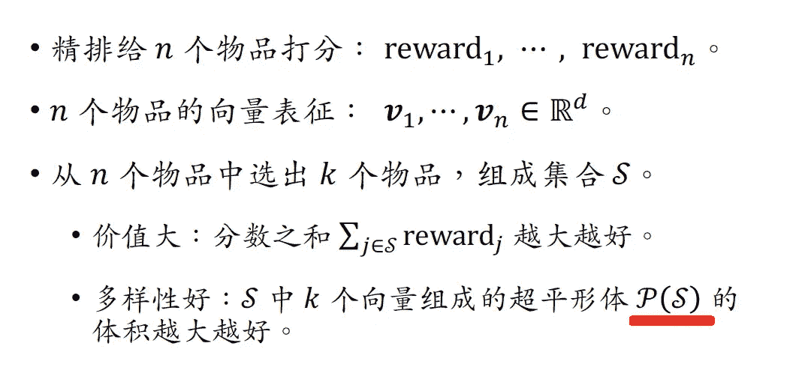

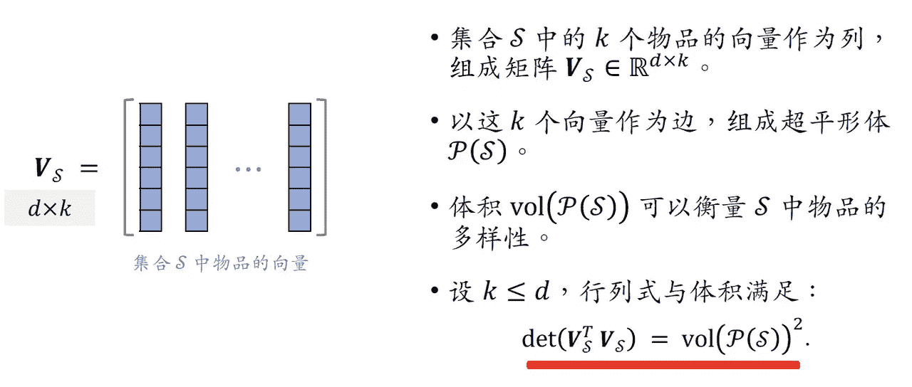

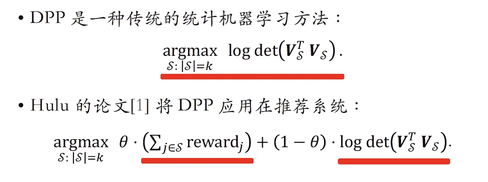