# 推荐系统

> 来源：[https://v11enp9ok1h.feishu.cn/docx/JK7DdjKKFojdhFx0vRocOktoncd](https://v11enp9ok1h.feishu.cn/docx/JK7DdjKKFojdhFx0vRocOktoncd)

推荐系统是机器学习的一类，它可使用数据来帮助预测、缩小范围，并找到人们在呈指数级增长的选项中寻找的内容。

## 什么是推荐系统？

[推荐系统](https://images.nvidia.cn/cn/youtube-replicates/ukzFI9rgwfU.mp4)是一种人工智能或人工智能算法，通常与机器学习相关，使用大数据向消费者建议或推荐其他产品。这些推荐可以基于各种标准，包括过去的购买、搜索历史记录、人口统计信息和其他因素。

推荐系统经过训练，可使用收集的交互数据了解用户和产品偏好、之前的决策和特征。其中包括展示、点击、喜欢和购买。推荐系统由于能够高度个性化地预测消费者兴趣和需求，因此受到内容和产品提供商的喜爱。

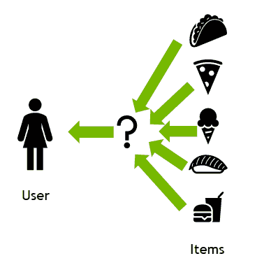

## 推荐系统类型

虽然有许多推荐算法和技术，但大多数都属于以下广泛类别：协作过滤、内容过滤和上下文过滤。

+   协作过滤算法根据许多用户的偏好信息（这是协作部分）推荐物品（这是过滤部分）。

+   此方法使用用户偏好行为的相似性，并鉴于用户与物品之间的之前交互，推荐算法便可以学会预测未来交互。这些推荐系统基于用户过去的行为构建模型，例如之前购买的物品或给予这些物品的评分以及其他用户的类似决策。相关理念在于，如果有些人过去也做出过类似的决策和购买，比如电影选择，那么他们很有可能会同意未来的其他选择。例如，如果协作过滤推荐系统了解您和另一个用户在电影中有着相似的品味，它可能会向您推荐一部其了解的其他用户已经喜欢的电影。

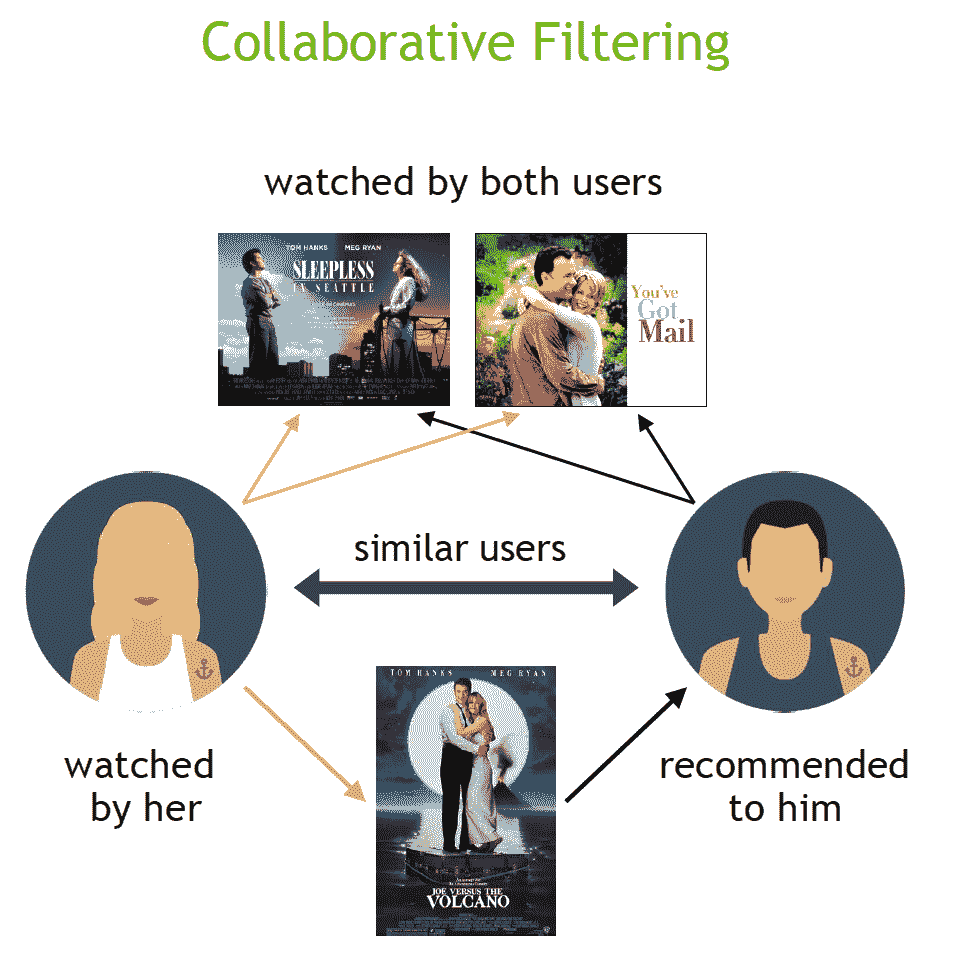

相比之下，内容过滤则使用物品的属性或特征（这是内容部分）来推荐类似于用户偏好的其他物品。此方法基于物品和用户特征的相似性，并鉴于用户及其与之交互过的物品的信息

（例如，用户的年龄、餐厅的菜系、电影的平均评价），来模拟新互动的可能性。例如，如果内容过滤推荐系统了解到您喜欢电影《电子情书》和《西雅图夜未眠》，它可能会向您推荐另一部相同类别和/或演员阵容的电影，例如《跳火山的人》。

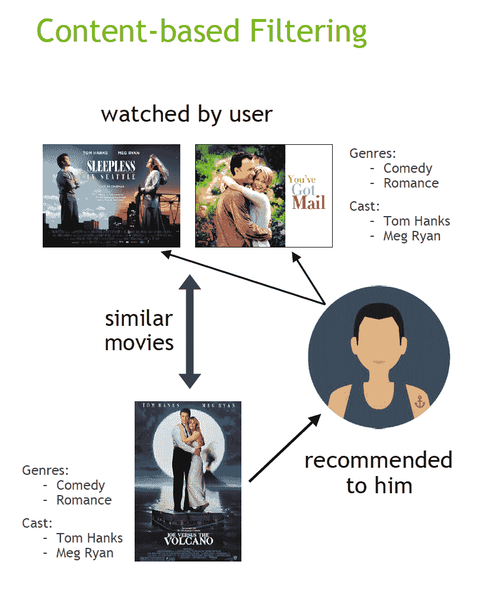

混合推荐系统结合了上述类型系统的优势，以便创建更全面的推荐系统。

上下文过滤包括推荐过程中用户的背景信息。将推荐内容框定为上下文序列预测，以便作出更好的推荐。此方法使用一系列上下文用户操作和当前上下文来预测下一个操作的概率。在 Netflix 示例中，鉴于每位用户的序列（用户在观看电影时的国家/地区、设备、日期和时间），他们训练出一个模型，来预测用户接下来要观看的内容。

## 用例和应用

### 电子商务与零售：个性化营销

假设用户已经购买了一条围巾。何不提供匹配的帽子，来完善外观？ 此功能通常通过基于 AI 的算法实现，如电子商务平台（例如 Amazon、沃尔玛、Target 等）的“搭配造型”或“您可能还喜欢”部分。

### 媒体与娱乐：个性化内容

基于 AI 的推荐引擎可以分析个人的购买行为并检测模式，这有助于为他们提供更有可能符合其兴趣的内容建议。这是 Google 和 Facebook 在推荐广告时主动应用的内容，或 Netflix 在推荐电影和电视节目时在幕后所应用的内容。

## 推荐系统的优势

推荐系统是推动个性化用户体验、与客户更深入互动以及零售、娱乐、医疗健康、金融等行业中功能强大的决策支持工具的关键组件。在某些大型商业平台上，推荐系统所产生的收入占比高达 30%。推荐质量每提高 1% 可以转化为数十亿美元的收入。

公司出于各种以下原因实施推荐系统：

+   提高保留率。通过持续迎合用户和客户偏好，企业更有可能将其保留为忠诚的订阅者或购物者。如果客户感觉到品牌真正理解他们且不仅是随机地为其提供信息，他们更有可能保持忠诚度，并继续在您的网站购物。

+   增加销量。各种研究表明，“您可能还喜欢”准确的产品推荐导致销售收入增加 10% 到 50%。只需在购买确认函中添加匹配的产品推荐内容、收集废弃电子购物车的信息、分享有关“客户现在购买的产品的信息”以及分享其他买家的购买和评论，推荐系统策略就可以提高销量。

+   帮助形成客户习惯和趋势。持续提供准确且相关的内容可以触发线索，从而建立客户的良好的习惯并影响其使用模式。

+   加快工作进度。当为进一步研究所需资源和其他材料提供定制建议时，分析师和研究人员可以节省高达 80% 的时间。

+   提升购物车价值。拥有成千上万商品出售的公司将面临的挑战是，需针对这种库存提供硬编码产品建议。通过使用各种过滤方法，这些电子商务巨头可以找到合适时间，以建议客户通过网站、电子邮件或其他方式想购买的新产品。

## 推荐系统的工作原理

> 推荐模型如何进行推荐将取决于您拥有的数据类型。如果您只拥有过去发生的交互数据，您可能有兴趣使用协作过滤。如果您有描述用户及其与之交互过的物品的数据（例如，用户的年龄、餐厅的菜系、电影的平均评价），您可以通过添加内容和上下文过滤，对当前给定这些属性下新交互的可能性进行建模。

### 推荐矩阵分解

> [矩阵分解](https://developer.nvidia.com/blog/accelerate-recommender-systems-with-gpus/) (`MF`) 技术是许多热门算法（包括词嵌入和主题建模）的核心，已成为基于协作过滤的推荐中的主要方法。`MF` 可用于计算用户的评分或交互中的相似度，以提供推荐。在下方简单的用户物品矩阵中，Ted 和 Carol 喜欢电影 `B` 和 `C`。`Bob` 喜欢电影 `B`。为了向 `Bob` 推荐电影，矩阵分解计算喜欢 `B` 的用户也喜欢 `C`，因此 `C` 是 `Bob` 的一个可能建议。

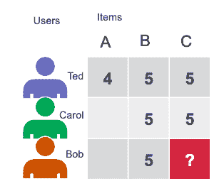

+   使用交替最小二乘法 (`ALS`) 算法的矩阵分解将稀疏用户物品评价矩阵 `u-by-i` 近似为用户和物品因素矩阵的两个密集矩阵的乘积，其大小分别为 `u × f` 和 `f × i`（其中 `u` 表示用户数，`i` 表示物品数，`f` 表示潜在特征数）。

+   因素矩阵表示算法尝试发现的潜在特征或隐藏特征。一个矩阵试图描述每个用户的潜在特征或隐藏特征，另一个矩阵则试图描述每部电影的潜在特性。

+   对于每个用户和每个物品，`ALS` 算法会迭代学习 (`f`) 数字，“`factors`”表示用户或物品。在每一次迭代中，算法可以交替地修复一个因子矩阵并针对另一个矩阵进行优化，并且此过程会一直持续到其收敛。

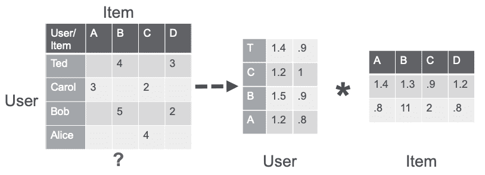

`CuMF` 是基于 NVIDIA(®) CUDA(®) 的矩阵因子库，可优化替代最小二乘法 (`ALS`) 方法，以求解大规模的 `MF`。`CuMF` 使用一系列技术，以便在单个和多个 GPU 上更大限度地提高性能。

这些技术包括利用 GPU 显存层次结构对稀疏数据进行智能访问、将数据并行与模型并行结合使用，以最大限度减少 GPU 之间的通信用度以及全新的拓扑感知型并行减少方案。

## 用于推荐的深度神经网络模型

人工神经网络 (`ANN`) 存在[不同变体](https://www.asimovinstitute.org/neural-network-zoo/)，如下所示：

+   [只将信息从一层向前馈送至下一层的人工神经网络](https://developer.nvidia.com/discover/artificial-neural-network)称为前馈神经网络。多层感知器 (`MLP`) 是一种前馈 `ANN`，由至少三层节点组成：输入层、隐藏层和输出层。`MLP` 是可应用于各种场景的灵活网络。

+   [卷积神经网络](https://blogs.nvidia.com/blog/2018/09/05/whats-the-difference-between-a-cnn-and-an-rnn/)是识别物体的图像处理器。

+   [时间递归神经网络](https://blogs.nvidia.com/blog/2018/09/05/whats-the-difference-between-a-cnn-and-an-rnn/#:~:text=CNNs%20are%20called%20%E2%80%9Cfeedforward%E2%80%9D%20neural,can%20serve%20as%20feedback%20loops.)是解析语言模式和序列数据的数学工具。

深度学习 (`DL`) 推荐模型基于现有技术（例如，分解）而构建，以便对变量和嵌入之间的交互进行建模，从而处理类别变量。

嵌入是表示实体特征的已学习的数字向量，因此相似的实体（用户或物品）在向量空间中具有相似的距离。例如，协作过滤深度学习方法基于用户和物品与神经网络的交互来学习用户和物品嵌入（潜在特征向量）。

`DL` 技术还利用庞大且快速发展的新颖网络架构和优化算法，对大量数据进行训练，利用深度学习的强大功能进行特征提取，并构建更具表现力的模型。

[当前基于 DL](https://github.com/NVIDIA/DeepLearningExamples/tree/master/PyTorch/Recommendation/DLRM) 的推荐系统模型：[DLRM、Wide and Deep](https://github.com/NVIDIA/DeepLearningExamples/tree/master/TensorFlow/Recommendation/NCF)、[VAE-CF](https://github.com/NVIDIA/DeepLearningExamples/tree/master/TensorFlow/Recommendation/VAE-CF) ([`W&D`](https://developer.nvidia.com/blog/achieving-high-quality-search-and-recommendation-results-with-deepnlp/))、神经协作过滤 (`NCF`)、变分自动编码器 (`VAE`) 和 BERT（适用于 `NLP`）构成了 NVIDIA GPU 加速 `DL` 模型产品组合的一部分，并涵盖推荐系统以外的许多不同领域的各种网络架构和应用程序，包括图像、文本和语音分析。这些模型专为使用 `TensorFlow` 和 `PyTorch` 进行训练而设计和优化。

### 神经协作过滤

[神经协作过滤](https://github.com/NVIDIA/DeepLearningExamples/tree/master/TensorFlow/Recommendation/NCF) (`NCF`) 模型是一个神经网络，可基于用户和物品交互提供协作过滤。该模型从非线性角度处理矩阵分解。`NCF` `TensorFlow` 以一系列（用户 `ID`、物品 `ID`）对作为输入，然后分别将其输入到矩阵分解步骤（其中嵌入成倍增加）并输入到多层感知器 (`MLP`) 网络中。

然后，将矩阵分解和 `MLP` 网络的输出将组合到一个密集层中，以预测输入用户是否可能与输入物品交互。

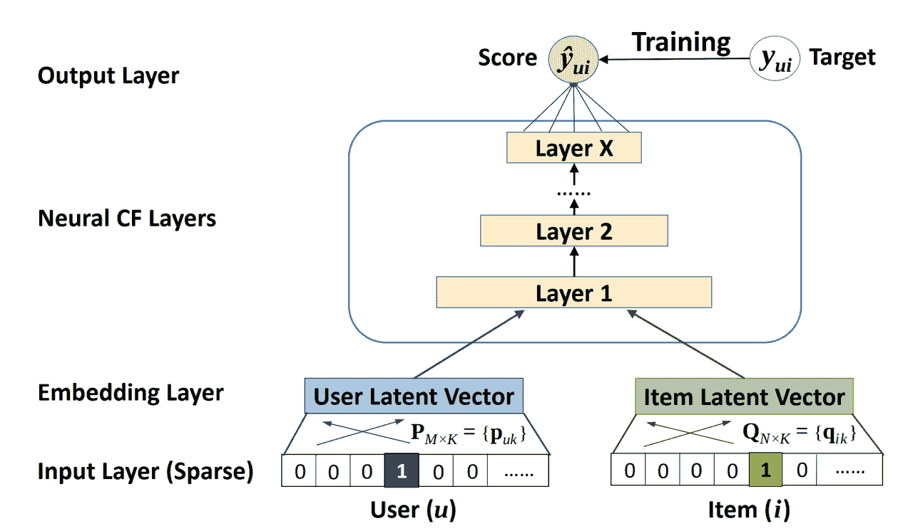

### 用于协作过滤的变分自动编码器

自动编码器神经网络使用隐藏层中获取的表征，来重建输出层的输入层。用于协作过滤的自动编码器可以学习用户物品矩阵的非线性表征，并可通过确定缺失值重建该矩阵。

用于协作过滤 ([`VAE-CF`](https://github.com/NVIDIA/DeepLearningExamples/tree/master/TensorFlow/Recommendation/VAE-CF)) 的 [`NVIDIA GPU 加速`](https://github.com/NVIDIA/DeepLearningExamples) [`变分自动编码器`](https://arxiv.org/abs/1802.05814) 是一种优化的架构实现，首先在用于协作过滤的变分自动编码器中介绍。`VAE-CF` 是一个神经网络，可基于用户和物品交互提供协作过滤。此模型的训练数据由用户和物品之间的每次交互的用户项 `ID` 对组成。

模型包含两部分：[编码器和解码器](https://developer.nvidia.com/blog/deep-learning-nutshell-sequence-learning/)。编码器是一个前馈全连接神经网络，可将输入向量（包含特定用户的交互）转换为 `n` 维变分分布。这种变分分布用于获取用户（或嵌入）的潜在特征表征。然后，将这种潜在表征输入到解码器中，解码器也是一个与编码器结构相似的前馈网络。结果为特定用户的物品交互概率向量。

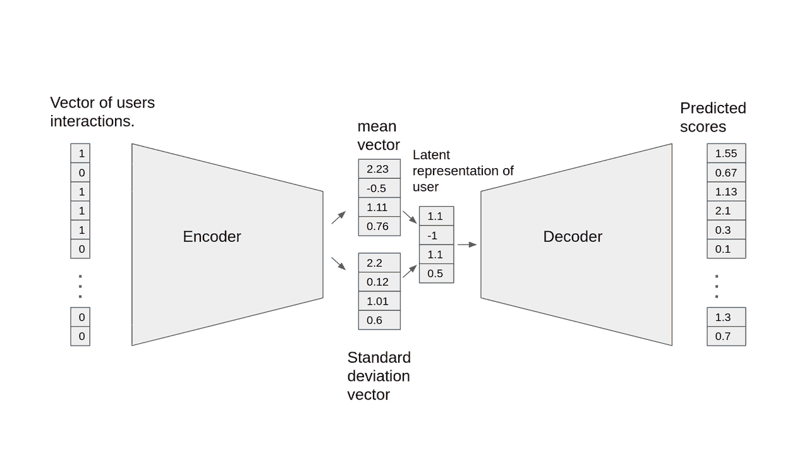

### 上下文序列学习

[时间递归神经网络 (`RNN`)](https://developer.nvidia.com/discover/recurrent-neural-network) 是具有记忆或反馈回路的一类[神经网络](https://developer.nvidia.com/discover/recurrent-neural-network)，允许其更好地识别数据中的模式。`RNN` 可以解决处理上下文和序列（例如自然语言处理）的艰巨任务，还可用于上下文序列推荐。序列学习与其他任务的区别是，序列学习需要使用具有主动数据存储的模型（例如 `LSMS`（长短期记忆模型）或 `GRU` 门控循环单元）来学习输入数据的时间依赖关系。这种对过往输入的记忆对于顺利进行序列学习至关重要。`Transformer` 深度学习模型，如 `BERT`（`Transformer` 双向编码器表征模型），是 `RNN` 的一个替代方案，它应用了一种注意力技术 – 通过将注意力集中在前后最相关的词上来解析一个句子。基于 `Transformer` 的深度学习模型不需要按顺序处理连续数据，与 `RNN` 相比，可以在 GPU 上实现更多的并行化，并减少训练时间。

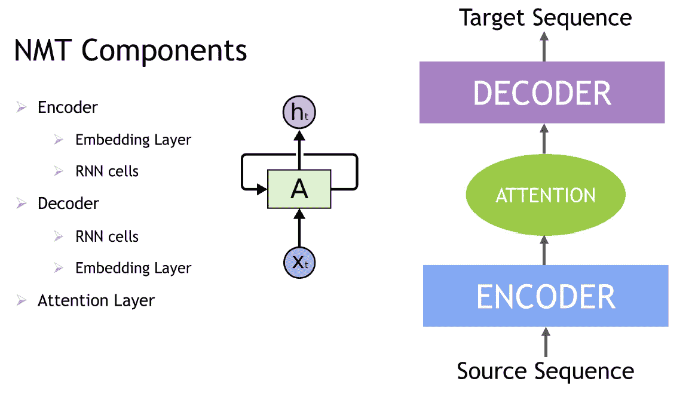

在 [`NLP`](https://developer.nvidia.com/blog/deep-learning-nutshell-sequence-learning/) [应用](https://developer.nvidia.com/blog/achieving-high-quality-search-and-recommendation-results-with-deepnlp/)中，会使用词嵌入等技术将输入文本转换为词向量。借助词嵌入，可将句子中的每个词翻译成一组数字，然后再输入到 `RNN` 变体、`Transformer` 或 `BERT` 中，以理解上下文。神经网络在训练自身时，这些数字会随时发生变化，编码每个单词的语义和上下文信息等独特属性，这意味着，相似词在此数字空间中彼此接近，不同词则相距遥远。这些 `DL` 模型为特定语言任务（例如下一词语预测和文本摘要）提供适当的输出，这些任务用于生成输出序列

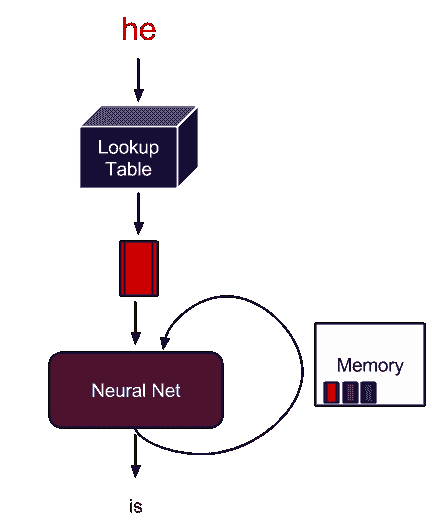

基于会话上下文的推荐将深度学习和 `NLP` 序列建模方面的进步应用于推荐内容。基于用户会话中的事件序列训练的 `RNN` 模型（例如，查看的产品、数据和交互时间）会学习预测会话中的下一个物品。会话中的用户物品交互类似于句子中的词嵌入。例如，在将观看的电影输入 `RNN` 变体（例如 `LSTM`、`GRU` 或 `Transformer`）之前，需要将其转换为一组数字，以理解上下文。

### Wide & Deep

[`Wide & Deep`](https://github.com/NVIDIA/DeepLearningExamples/tree/master/TensorFlow2/Recommendation/WideAndDeep) 是指使用并行处理两个部分（`Wide` 模型和 `Deep` 模型）的输出，并对其输出进行求和以创建交互概率的网络类别。`Wide` 模型是特征及其转换的一个广义线性模型。`Deep` 模型是一个密集神经网络 (`DNN`)，由 5 个隐藏 `MLP` 层（包含 1024 个神经元）组成，每个层都从密集特征嵌入开始。分类变量会嵌入到连续向量空间中，然后通过学习的嵌入或用户确定的嵌入输入到 `DNN` 中。

为何模型能够成功执行推荐任务，原因之一是提供数据中的两种学习模式：“`deep`”和“`shallow`”。复杂的非线性 `DNN` 能够学习数据中丰富的关系表征，并可通过嵌入来推广到相似的物品，但需要查看相关关系的多种示例才能做得更好。另一方面，线性部分能够“记住”可能仅在训练集内发生几次的简单关系。

综合来说，这两种表征信道通常比单种表征信道提供更多的建模能力。NVIDIA 与许多使用离线和在线指标报告改进的行业合作伙伴合作，他们使用 `Wide & Deep` 替代传统机器学习模型。

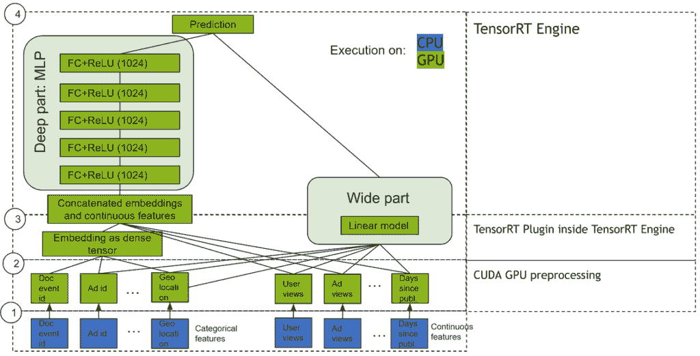

### `DLRM`

# DLRM 与 GPU 加速推荐系统

[DLRM](https://developer.nvidia.com/blog/optimizing-dlrm-on-nvidia-gpus/) 是一种 [基于 DL 的模型](https://arxiv.org/pdf/1906.00091.pdf)，适用于推荐，由 Facebook 研究院提出。它旨在同时使用推荐系统训练数据中通常呈现的分类输入和数值输入。要处理分类数据，嵌入层将每个类别映射到密集表征，然后再将其输入到多层感知器 (MLP)。数值特征可直接输入到 MLP。

在下一级别中，通过在所有嵌入向量对和已处理的密集特征之间取点积，显式计算不同特征的二次交互。并将这些成对交互输入到顶层 MLP 中，以计算用户和物品对之间的交互概率。

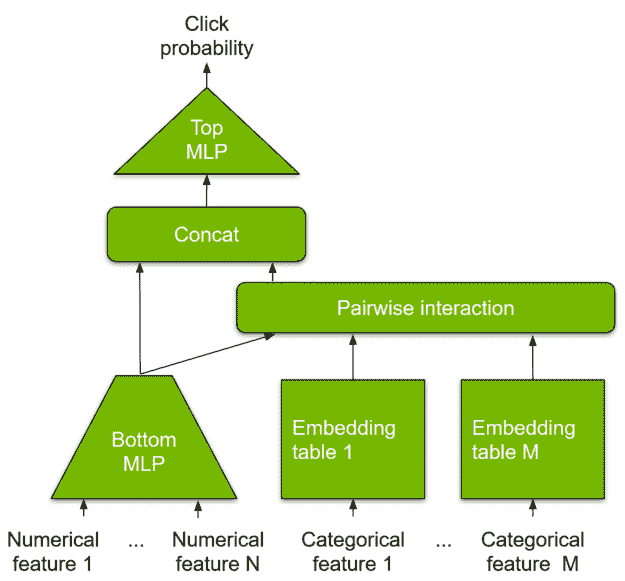

与其他基于 DL 的推荐方法相比，DLRM 有两种差异。首先，它可以对特征交互进行显式计算，同时将交互顺序限制为成对交互。其次，DLRM 将每个嵌入式特征向量（对应分类特征）视为一个单元，而其他方法（如 Deep 和 Cross）则将特征向量中的每个元素视为应生成不同交叉项目的新单元。这些设计选项，有助于降低计算/内存成本，同时保持竞争的准确性。

DLRM 是 NVIDIA [Merlin](https://developer.nvidia.com/nvidia-merlin) 的一部分，后者是一个基于 DL 所构建的高性能推荐系统框架，我们下面将介绍这一框架。

## 为何推荐系统在 GPU 上表现更出色

推荐系统能够提高消费者在热门平台上的参与度。随着数据规模变得越来越大（数千万到数十亿的示例），DL 技术正展现出传统方法所不具备的优势。因此，更复杂的模型与数据的快速增长相结合，提高了计算资源的标准。

许多机器学习算法的基础数学运算通常是矩阵乘法。这些类型的运算具有高度并行性，并且可以使用 GPU 大幅加速。

一个 [由数百个核心组成的 GPU](https://blogs.nvidia.com/blog/2009/12/16/whats-the-difference-between-a-cpu-and-a-gpu/)，可以 [并行](https://www.nvidia.com/object/what-is-gpu-computing.html) 处理数千个线程。由于神经网络由大量相同的神经元构建而成，因此本质上具有高度并行性。这种并行性自然地映射到 GPU，GPU 的性能比仅依赖 CPU 的平台高 10 倍。因此，GPU 已成为训练基于神经网络的大型复杂系统的首选平台，推理运算的并行性质也有助于在 GPU 上执行。

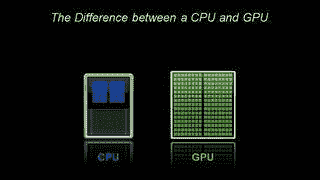

## NVIDIA GPU 加速的深度学习框架

[GPU 加速深度学习框架](https://developer.nvidia.com/deep-learning-frameworks)能够为设计和训练自定义深度神经网络带来灵活性，并为 Python 和 C/C++ 等常用编程语言提供编程接口。MXNet、PyTorch、TensorFlow 等广泛使用的深度学习框架依赖于 NVIDIA GPU 加速库，能够提供高性能的多 GPU 加速训练。

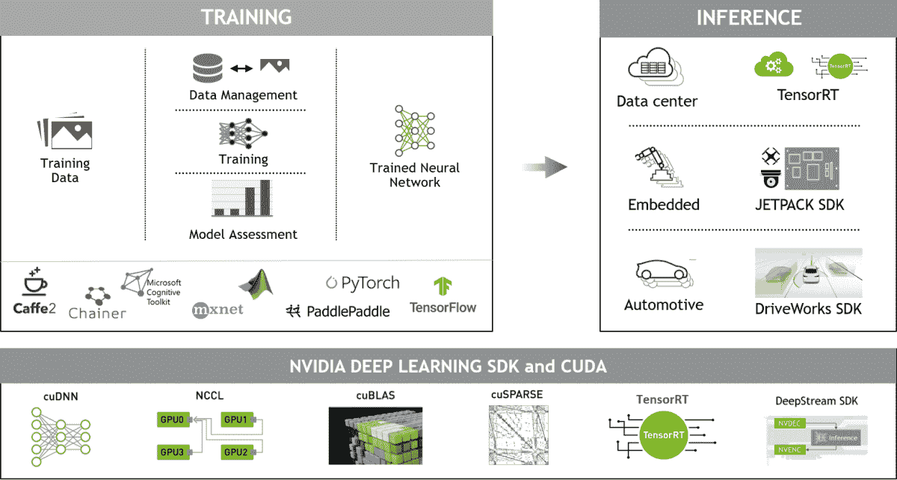
