# 0-1AI智能客服全落地流程

> 来源：[https://v11enp9ok1h.feishu.cn/docx/Khlyd9YUgo8oRxx67BUcjpklnfe](https://v11enp9ok1h.feishu.cn/docx/Khlyd9YUgo8oRxx67BUcjpklnfe)

## **智能客服产品**

> 在用户的产品服务（企业为用户提供的服务）体验流程发生断层or不完美的时候，能够让其中简单可以被搭建成模型的问题快速自助的解决，从而让复杂的问题被人工解决，提升问题解决效率。

## **用户体验流程**

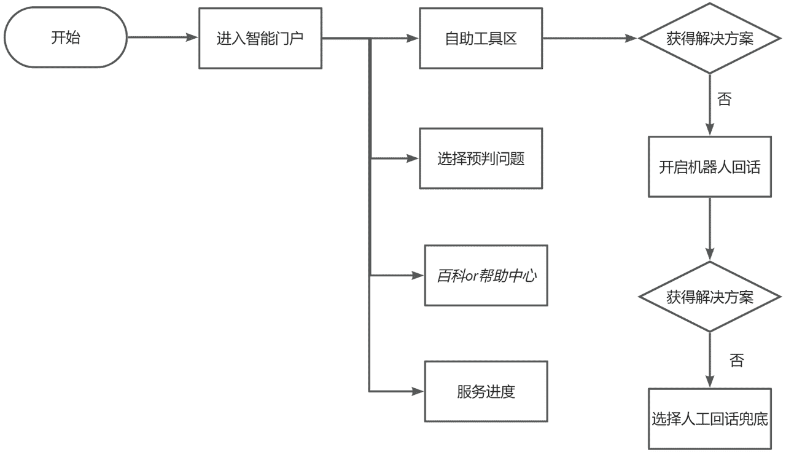

### **关于智能客服门户的三个标准：**

+   **入口易得**：终端用户在发生服务流程中断的时候，体验较差的时候（可能遇到问题的地方），就需要有客服门户入口。

+   **以解决中心为最终目的**：一次就好，避免用户多次无效咨询。

+   **快速转人工**：不能解决的内容能够快速路由到人工，降低用户费力度。如C端交互页面第一层快捷功能就支持转人工，无效交互达到某个限定次数的时候就设置转人工。

## **咨询需求产生VS咨询入口**

## **需求产生**

**主动识别体系**：主动识别用户发生的服务体验断点，在用户发生咨询诉求前就可以直接触达客户。协助客户尽快恢复到正常服务流程中。

**其通用规则如下：**

| **名称** | **触发条件** | **参数** | **采取的行动** | **优先级** |
| --- | --- | --- | --- | --- |
| **完成？** | 某一C2C交易买家一直申诉 | 申诉次数 | 仲裁介入 |  |
| **发货时效** | 某一C2C交易卖家长时间未发货 | 等待时长 | 取消交易 |  |

## **咨询入口**

**主要分为三类：**

1.  在线智能门户：标识统一（小熊智能客服），清晰明确（统一客服icon）,充分前置（帮助中心，商详页，订单页，店铺页）

在线智能门户是一个可以由**入口参数+用户登录信息+用户订单信息+ 产品信息共同形成组合信**息的服务入口，极大方便后续的智能化处理。

1.  电话智能门户：统一热线号码（*******），网络呼叫（滴滴上线可视化语音电话，如在线客服的租户信息）

1.  私域：社交群，企业🛰️等

## **在线智能门户**

+   基于以往的客服记录，页面历史数据和线上用户诉求，搭建了4种核心服务路径。分别是：问题预判，服务工具，机器人交互及人工入口。

**路径归纳：**

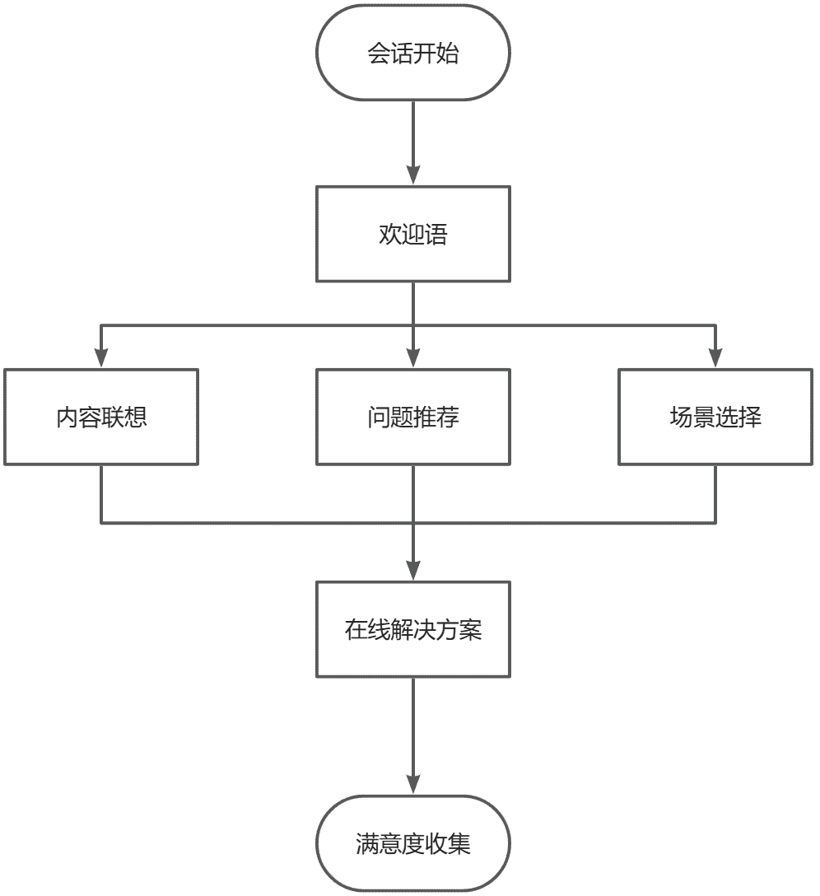

### **预判模块**

用户发生体验服务断裂时，来寻找客服，基本上与几类信息有关：订单状态，交易状态，已有的服务工单，上次的诉求状态。都可以借助这些信息做订单预判和问题预判。

**如转转的客服中心****：即**根**据用**户**的交**易信息，推荐可能产生**的问题和猜你想问。其**主要衡量是曝光、点击、解决等指标，根据其指标，不断优化迭代相关模型。

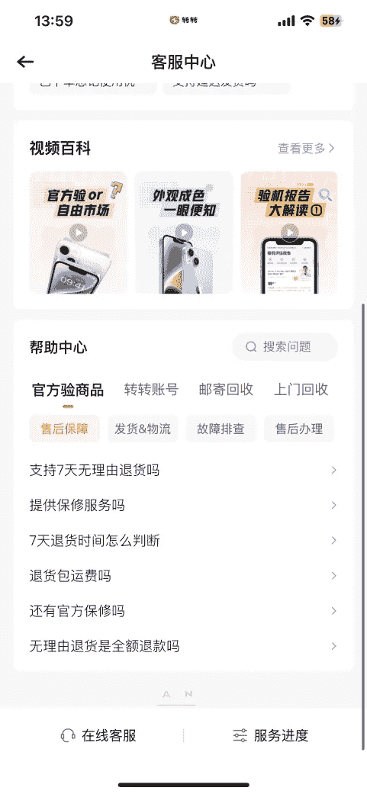

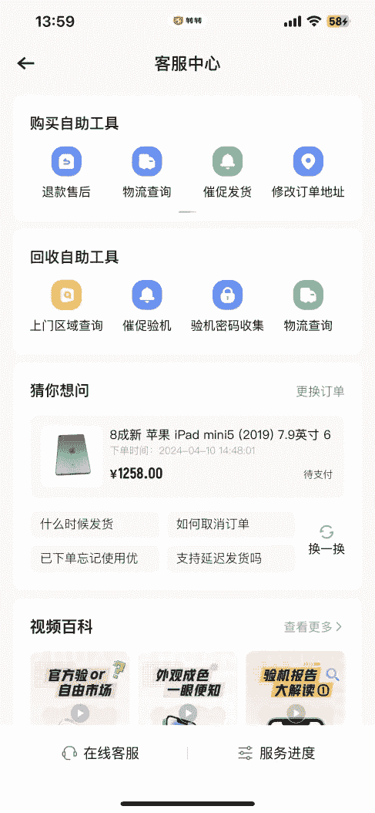

### **服务工具**

#### **a. 服务进度**

转转提供了服务进度的工具。将其可以延伸为服务过程中的沟通信息板，主要可以包含以下内容：

1.  历史问题的处理进度。特被是已经很长时间没有联系，超过用户的容忍时长。

1.  坐席联系客户，但电话未接通，可以表明外呼的目的。（包含回访、二次升级客服处理）

1.  对解决方案不满，或者过程不满的意见反馈。

#### **b. 自助工具**

这些交互工具，可以减少用户的联系次数，同时减少用户提交证据（C2C仲裁？）和反馈意见的费力程度。

1.  **机器人交互**

机器人交互的核心指标主要表现为：点击率，不满意率和转人工率。

#### **c. 标准问答式**

> 其主要体现出的对话任务为：**闲聊型**和**问答型**。

> **闲聊**：主要为打招呼或者简单的情绪安抚，起到润滑人机对话的作用。

> **问答**：侧重于一问一答，即直接根据用户的问题给出精准答案。主要用于服务政策咨询，产品标准咨询。

> 主要体现为两个模块：问题理解和答案供给。

> **问题理解：**

> 主要应用**NLP自然语言技术**，可以理解用户的自然语言，聚类提炼标准文题和拓展问题。

+   **问题理解延伸-知识挖掘**

当用户提问与知识库中问题相似度较低时，机器人会给出1-3个候选标准问题让用户选择。

**答案供给：**

根据用户的标准问和相似问题，由知识库/知识图谱匹配相应的答案。

智能客服产品设计中搭建流程主要包含以下步骤：

需基于已有的人工客服交互逻辑，自助在C端客服页面与客户沟通。

**搭建意图体系****：**原始数据处理、高频问题提取。准备素材。

**模型训练****：**主要由算法同是完成。其主要目的将用户问题与意图体系进行匹配。主要做的两件事为召回和精排。

在做匹配理解的时候，主要分为检索式和生成式，其主要区别如下：

| **方案** | **场景** | **数据需求** | **准确性** | **性能** | **复杂性** |
| --- | --- | --- | --- | --- | --- |
| **检索式** | 主要适用于对知识库的检索和筛选，比如问答系统、知识库管理、智能客服等 | 依赖，需要丰富的结构化语料库 | 本质上是从已有数据集中检索最匹配的数据，准确性高 | 毫秒级 | 低 |
| **生成式** | 主要适用于需要生成自主文本或任务的应用场景，如对话生成、文本创作、任务调度等 | 依赖，无需结构化 | 生成的质量可能会受到模型的训练数据和质量的限制，可能会出现不准确、无意义或不一致的输出 | 秒级 | 高 |

+   对转转而言，其主营业务二手电商，回答用户问题的准确性为第一前提。宁可选择不回答，也不能回答错误，相比之下，生成式答案会受到很多种因素的影响，导致结果不可控。

**搭建知识库：**整体知识库，建议按照“**问候语+问题名称+问题答案”**。设计知识库时需注意其应用场景。（多轮对话和知识图谱）

**搭建知识图谱：**知识图谱主要解决问题为：**实体-属性-实体**，实体-关系-实体之间等二维查询的问题，如转转官方验的商品详情，手机所属商家的问题。

**智能标准问答其流程如下:**

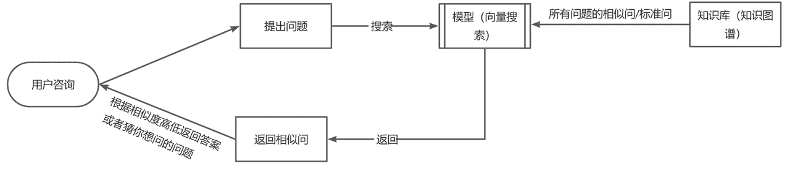

### **d. 多轮对话**

> **第一步**：将用户的输入与意图体系的标准问题/拓展问题进行匹配，确定其主要意图。

> **第二步**：完成多轮交互里面的调度和方案生成。

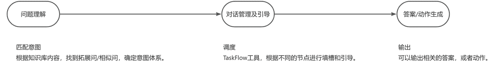

1.  意图识别同上述标准问答的模型进行问题理解。但问题理解不能脱离场景和上述的组合信息。如转转在机器人咨询时，需选择对应的业务场景，方便快速定位问题。

1.  识别意图后，若需要进行填槽，则可能需要接入不同的API接口，获取用户信息。若官方验流程中的订单退款，需要填槽具体的订单号，退款原因。此处产品方案需要搭建流程画布。

1.  方案生成。方案生成会有以下几种方式：

+   生成专属定制答案。例如根据用户实际订单状态，返回具体的答案结果。

+   链接到解决页面。直接转到上述自助工具服务。由用户自行操作。

+   直接调用接口完成任务。如一键退款等功能。

+   搭建后续自助服务流程。如C2B2C交易中，可以协调相关买家和卖家协商，自动外呼卖家等。

+   生成工单后续跟进。如包裹丢失的情况下，系统可以自动生成对应丢失工单，转发到网点部门进行核实。

### **e. 智能客服的理解**

**智能客服的解决路径**是根据用户的意图，根据系统设置流程路径，去确定答案。人工客服与其的区别主要差异体现在：面对用户的需求，人工不是直接寻找方案，而是要确认用户的场景，提供可能的方案与用户协商，之后才会依照用户诉求来需求解决。

**智能客服壁垒**是无法根据信息去拓展问题，例如用户查询物流状态，可能延伸的问题是包裹丢失，能不能退等基础问题。针对每一个标准问答探索更多的场景和多种解决方案。更贴合的解决用户问题。

1.  **转人工**

当发现无法解决用户问题是，及时转人工处理，才能够达到更好的用户体验。但是作为设计智能客服的初衷，我们也希望尽可能多的解决用户的问题，不希望有什么问题都转人工处理。基于这个矛盾点，普遍存在的转人工的思路如下。

1.  **常驻转人工**

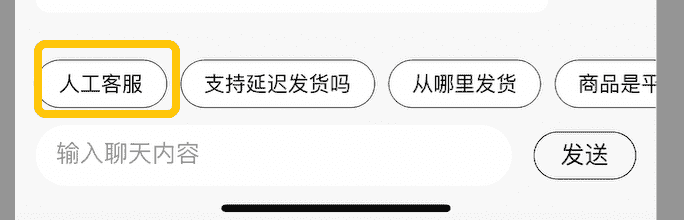

1.  **预设拦截词转人工**

如：人工客服、Agent、转人工等词语。

1.  **答案内转人工**

如在某些指定答案增加对应的人工客服按钮，可支持转人工，

1.  **未知问题转人工**

1.  **相似问题转人工**

同一个问题连续咨询一定次数以后，进入转人工节点。

1.  **答案差评转人工**

根据标准问题提供的答案，若用户对答案不满意，可人工接入。

1.  **情绪识别转人工**

在安抚性话术中，增加转人工的操作。

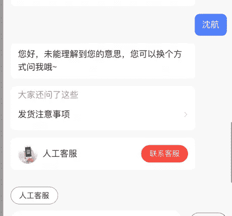

## **数据监控**

| **字段名称** | 字段解释 |
| --- | --- |
| **总会话量** | 机器人产生的总会话数量 |
| **有效会话量** | 机器人产生的总会话量中，去除无效会话后的数量 |
| **无效会话量** | 用户进入后，未与机器人产生交互即离开的会话，包括直接离开、直接转人工、直接转接其他机器人这三种情况 |
| **解决量** | 有效会话中，在统计周期内未转接人工客服的会话数量。 特别地，如果转接其它机器人会话，当通机器人会话会被记录为解决 |
| **解决率的公式说明** | 解决率=有效会话解决量/【有效会话量-有效会话中自定义拦截词转人工量-有效会话中情绪识别转人工量】 |
| **用户直接离开** | 用户进入后，未与机器人产生任何交互且直接离开的会话 |
| **用户直接转人工** | 用户进入后，未与机器人产生任何交互并直接转人工的会话 |
| **提问总数** | 访客向机器人发出的问题总量 |
| **匹配提问数** | 机器人能够匹配到的问题数量 |
| **匹配率** | 匹配提问数与提问总数的比值 |
| **完全匹配率** | 机器人直接回答的问题数量/匹配提问数 |
| **相似匹配率** | 机器人给出候选的问题进行回复的消息数量/匹配提问数 |
| **相似匹配采纳率** | 用户点击候选的问题数量/总的给出候选的问题数量 |
| **会话参评率** | 会话评价结果为“非常满意”、“满意”的会话量与有评价结果的会话量的比值。 三级、五级满意度中评价结果为“一般”会计为“满意”。 |
| **会话满意度** | 有评价结果的会话量与可评价会话量（即有效会话量）的比值。只有有效会话可以进行会话满意度评价。 |

## **私域-SCRM**

## **业务背景：**

**市场方面**

1.  单独获客成本越来越高，获客之后需专属化、私人化维护，搭建护城河。

1.  🛰️成为主流渠道，沟通场景=营销场景=销售场景。

**业务方面**

1.  转转业务复杂，C2C业务，C2B业务，C2B2C业务，B2C业务都需要对不同客户进行精细化区分，不同方式的维护。

**用户方面**

1.  电子产品二手市场分析：迭代升级频率较快，用户更换手机频繁。

## **业务流程**

从公域海量客户到其形成订单

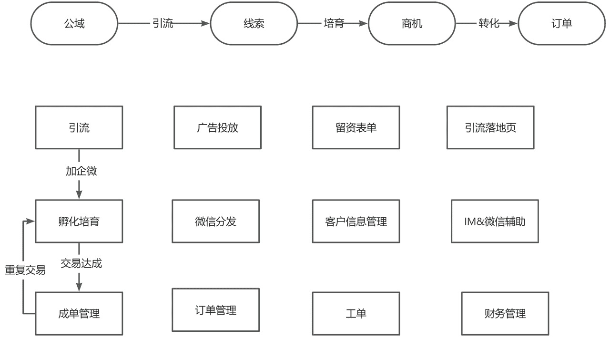

### **引流：**

**常见的几种方式：**销售自拓，广告投放，内容营销，活动营销

+   支持多种加🛰️方式：一键加微，表单加微，注册加微，APP加微

+   支持多种终端：APP，PC

+   公于私域无缝打通

+   其主要核心目的：缩短路径，一键入微

+   转转广告投放：注重成交关键词搜索词，提高线索质量。

+   抖音（巨量引擎）-广告投放

### **培育：**

**客户信息管理****：****客户信息****，****跟进信息****，****客户旅程****，****客户任务****，****客户商机**

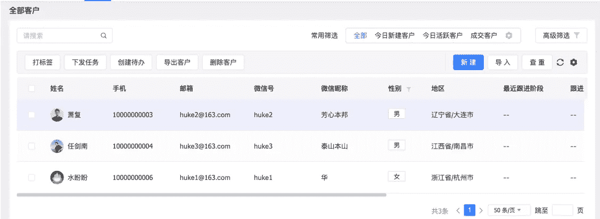

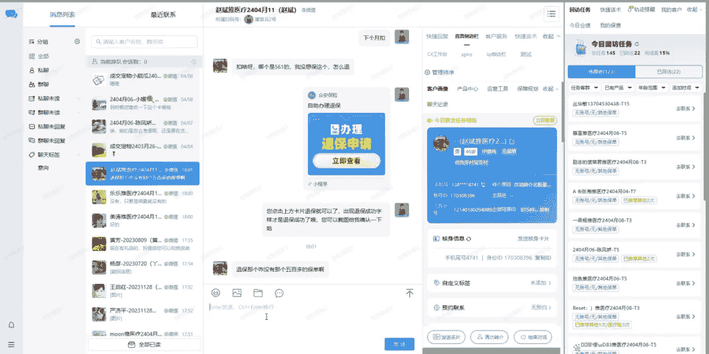

### **转化：**

促单提醒，订单交易，工单任务，财务管理等。

## **数据监控**

### **业绩统计**

商机维度：成交商机数，成交商机单价，成交客户数，成交客户单价，平均成交周期

订单维度：订单数，订单金额，订单单价

员工维度目标完成统计：目标，已完成，完成率

### **业务统计**

商机漏斗、商机分布、丢单分析、跟进分析、互动分析、客资分析、素材分析

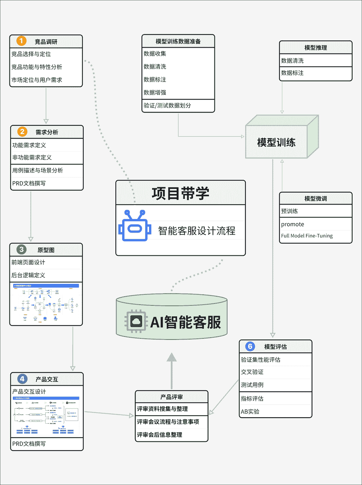

<https://v11enp9ok1h.feishu.cn/sync/Ipw1d27gNsv3OAbo3N7cks4ZnJf>