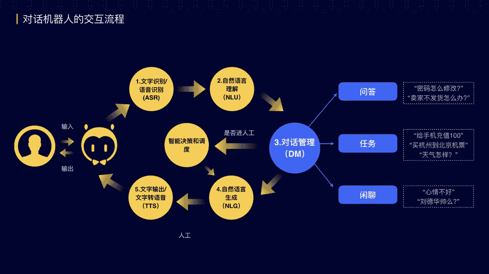

# LangGraph 构建 AI 智能聊天机器人

> 来源：[https://v11enp9ok1h.feishu.cn/docx/TwtDdSfXHodObLxvHb5crH5AnEh](https://v11enp9ok1h.feishu.cn/docx/TwtDdSfXHodObLxvHb5crH5AnEh)

## 概述

> 我们将介绍如何设计和实现由 LLM 驱动的聊天机器人的示例。此[聊天机器人](https://python.langchain.ac.cn/docs/concepts/chat_models/)将能够进行对话，并记住之前与聊天模型的交互。

请注意，我们构建的此聊天机器人将仅使用语言模型进行对话。您可能正在寻找其他几个相关概念

+ [`对话式 RAG`](https://python.langchain.ac.cn/docs/tutorials/qa_chat_history/)：在外部数据源上启用聊天机器人体验

+ [`代理`](https://python.langchain.ac.cn/docs/tutorials/agents/)：构建可以采取行动的聊天机器人

本教程将涵盖基础知识，这些知识将对这两个更高级的主题有所帮助，但如果您愿意，也可以直接跳到那里。



## 设置

### Jupyter Notebook

> 本指南（以及文档中的大多数其他指南）使用 Jupyter Notebook，并假定读者也是如此。Jupyter Notebook 非常适合学习如何使用 LLM 系统，因为通常情况下，事情可能会出错（意外输出、API 宕机等），并且在交互式环境中浏览指南是更好地理解它们的好方法。

本教程和其他教程可能最方便在 [Jupyter Notebook](https://jupyter.pythonlang.cn/install) 中运行。有关如何安装的说明，请参阅此处。

### 安装

在本教程中，我们将需要 `langchain-core` 和 `langgraph`。本指南需要 `langgraph` >= 0.2.28。

```
pip install langchain-core langgraph>0.2.27
```

### LangSmith

> 您使用 [LangChain](https://smith.langchain.com/) 构建的许多应用程序将包含多个步骤，其中包含多次 LLM 调用。随着这些应用程序变得越来越复杂，能够检查链或代理内部究竟发生了什么变得至关重要。最好的方法是使用 `LangSmith`。

在上面的链接注册后，请确保设置您的环境变量以开始记录追踪

```
export LANGSMITH_TRACING="true"
export LANGSMITH_API_KEY="..."
```

或者，如果在 Notebook 中，您可以使用以下命令设置它们

```
import getpass
import os

os.environ["LANGSMITH_TRACING"] = "true"
os.environ["LANGSMITH_API_KEY"] = getpass.getpass()
```

## 快速入门

> 首先，让我们学习如何单独使用语言模型。`LangChain` 支持许多不同的语言模型，您可以互换使用它们 - 选择您想要使用的模型！

选择 [`聊天模型`](https://python.langchain.ac.cn/docs/integrations/chat/)：`OpenAI`

`pip install -qU "langchain[openai]"`

```
import getpass
import os

if not os.environ.get("OPENAI_API_KEY"):
  os.environ["OPENAI_API_KEY"] = getpass.getpass("Enter API key for OpenAI: ")

from langchain.chat_models import init_chat_model

model = init_chat_model("gpt-4o-mini", model_provider="openai")
```

让我们首先直接使用模型。`ChatModel` 是 `LangChain` "Runnables" 的实例，这意味着它们公开了一个用于与之交互的标准接口。要简单地调用模型，我们可以将消息列表传递给 `.invoke` 方法。

```
from langchain_core.messages import HumanMessage
model.invoke([HumanMessage(content="Hi! I'm Bob")])
```

API 参考：[`HumanMessage`](https://python.langchain.ac.cn/api_reference/core/messages/langchain_core.messages.human.HumanMessage.html)

```
AIMessage(content='Hi Bob! How can I assist you today?', additional_kwargs={'refusal': None}, response_metadata={'token_usage': {'completion_tokens': 10, 'prompt_tokens': 11, 'total_tokens': 21, 'completion_tokens_details': {'accepted_prediction_tokens': 0, 'audio_tokens': 0, 'reasoning_tokens': 0, 'rejected_prediction_tokens': 0}, 'prompt_tokens_details': {'audio_tokens': 0, 'cached_tokens': 0}}, 'model_name': 'gpt-4o-mini-2024-07-18', 'system_fingerprint': 'fp_0705bf87c0', 'finish_reason': 'stop', 'logprobs': None}, id='run-5211544f-da9f-4325-8b8e-b3d92b2fc71a-0', usage_metadata={'input_tokens': 11, 'output_tokens': 10, 'total_tokens': 21, 'input_token_details': {'audio': 0, 'cache_read': 0}, 'output_token_details': {'audio': 0, 'reasoning': 0}})
```

模型本身没有任何状态概念。例如，如果您提出后续问题

```
model.invoke([HumanMessage(content="What's my name?")])
```

```
AIMessage(content="I'm sorry, but I don't have access to personal information about users unless it has been shared with me in the course of our conversation. How can I assist you today?", additional_kwargs={'refusal': None}, response_metadata={'token_usage': {'completion_tokens': 34, 'prompt_tokens': 11, 'total_tokens': 45, 'completion_tokens_details': {'accepted_prediction_tokens': 0, 'audio_tokens': 0, 'reasoning_tokens': 0, 'rejected_prediction_tokens': 0}, 'prompt_tokens_details': {'audio_tokens': 0, 'cached_tokens': 0}}, 'model_name': 'gpt-4o-mini-2024-07-18', 'system_fingerprint': 'fp_0705bf87c0', 'finish_reason': 'stop', 'logprobs': None}, id='run-a2d13a18-7022-4784-b54f-f85c097d1075-0', usage_metadata={'input_tokens': 11, 'output_tokens': 34, 'total_tokens': 45, 'input_token_details': {'audio': 0, 'cache_read': 0}, 'output_token_details': {'audio': 0, 'reasoning': 0}})
```

让我们看一下示例 [`LangSmith 追踪`](https://smith.langchain.com/public/5c21cb92-2814-4119-bae9-d02b8db577ac/r)

+ 我们可以看到它没有将之前的对话回合纳入上下文，并且无法回答问题。这会带来糟糕的聊天机器人体验！

+ [`为了解决这个问题`](https://python.langchain.ac.cn/docs/concepts/chat_history/)我们需要将整个 对话历史记录 传递到模型中。让我们看看当我们这样做时会发生什么

```
from langchain_core.messages import AIMessage

model.invoke(
    [
        HumanMessage(content="Hi! I'm Bob"),
        AIMessage(content="Hello Bob! How can I assist you today?"),
        HumanMessage(content="What's my name?"),
    ]
)
```

API 参考：[`AIMessage`](https://python.langchain.ac.cn/api_reference/core/messages/langchain_core.messages.ai.AIMessage.html)

```
AIMessage(content='Your name is Bob! How can I help you today, Bob?', additional_kwargs={'refusal': None}, response_metadata={'token_usage': {'completion_tokens': 14, 'prompt_tokens': 33, 'total_tokens': 47, 'completion_tokens_details': {'accepted_prediction_tokens': 0, 'audio_tokens': 0, 'reasoning_tokens': 0, 'rejected_prediction_tokens': 0}, 'prompt_tokens_details': {'audio_tokens': 0, 'cached_tokens': 0}}, 'model_name': 'gpt-4o-mini-2024-07-18', 'system_fingerprint': 'fp_0705bf87c0', 'finish_reason': 'stop', 'logprobs': None}, id='run-34bcccb3-446e-42f2-b1de-52c09936c02c-0', usage_metadata={'input_tokens': 33, 'output_tokens': 14, 'total_tokens': 47, 'input_token_details': {'audio': 0, 'cache_read': 0}, 'output_token_details': {'audio': 0, 'reasoning': 0}})
```

现在我们可以看到我们得到了很好的回应！

这是聊天机器人会话交互能力背后的基本思想。那么我们如何最好地实现这一点呢？

## 消息持久化

> `LangGraph` 实现了内置的持久化层，使其成为支持多轮对话的聊天应用程序的理想选择。

> 将我们的聊天模型包装在最小的 `LangGraph` 应用程序中，使我们能够自动持久化消息历史记录，从而简化多轮应用程序的开发。

`LangGraph` 附带一个简单的内存 [`检查点`](https://github.langchain.ac.cn/langgraph/concepts/persistence/) 程序，我们在下面使用它。请参阅其 文档 以了解更多详细信息，包括如何使用不同的持久化后端（例如，`SQLite` 或 `Postgres`）。

```
from langgraph.checkpoint.memory import MemorySaver
from langgraph.graph import START, MessagesState, StateGraph

# Define a new graph
workflow = StateGraph(state_schema=MessagesState)

# Define the function that calls the model
def call_model(state: MessagesState):
    response = model.invoke(state["messages"])
    return {"messages": response}

# Define the (single) node in the graph
workflow.add_edge(START, "model")
workflow.add_node("model", call_model)

# Add memory
memory = MemorySaver()
app = workflow.compile(checkpointer=memory)
```

API 参考：[`MemorySaver`](https://github.langchain.ac.cn/langgraph/reference/checkpoints/#langgraph.checkpoint.memory.MemorySaver) | [`StateGraph`](https://github.langchain.ac.cn/langgraph/reference/graphs/#langgraph.graph.state.StateGraph)

我们现在需要创建一个 `config`，每次都将其传递到 `runnable` 中。此配置包含不直接属于输入的信息，但仍然有用。在这种情况下，我们想要包含一个 `thread_id`。它应该看起来像

```
config = {"configurable": {"thread_id": "abc123"}}
```


这使我们能够使用单个应用程序支持多个对话线程，这是您的应用程序有多个用户时的常见要求。

然后我们可以调用应用程序

```
query = "Hi! I'm Bob."

input_messages = [HumanMessage(query)]
output = app.invoke({"messages": input_messages}, config)
output["messages"][-1].pretty_print()  # output contains all messages in state
```

=================[1m Ai Message [0m==================

Hi Bob! How can I assist you today?

```
query = "What's my name?"

input_messages = [HumanMessage(query)]
output = app.invoke({"messages": input_messages}, config)
output["messages"][-1].pretty_print()
```

=================[1m Ai Message [0m==================

Your name is Bob! How can I help you today, Bob?

太棒了！我们的聊天机器人现在记住了关于我们的事情。如果我们更改配置以引用不同的 `thread_id`，我们可以看到它重新开始对话。

```
config = {"configurable": {"thread_id": "abc234"}}

input_messages = [HumanMessage(query)]
output = app.invoke({"messages": input_messages}, config)
output["messages"][-1].pretty_print()
```

=================[1m Ai Message [0m==================

I'm sorry, but I don't have access to personal information about you unless you've shared it in this conversation. How can I assist you today?

但是，我们始终可以返回到原始对话（因为我们将其持久化在数据库中）

```
config = {"configurable": {"thread_id": "abc123"}}

input_messages = [HumanMessage(query)]
output = app.invoke({"messages": input_messages}, config)
output["messages"][-1].pretty_print()
```

=================[1m Ai Message [0m==================

Your name is Bob. What would you like to discuss today?

这就是我们如何支持聊天机器人与许多用户进行对话的方式！

> 提示
>
> 对于异步支持，请更新 `call_model` 节点使其成为异步函数，并在调用应用程序时使用 `.ainvoke`

```
# Async function for node:
async def call_model(state: MessagesState):
    response = await model.ainvoke(state["messages"])
    return {"messages": response}


# Define graph as before:
workflow = StateGraph(state_schema=MessagesState)
workflow.add_edge(START, "model")
workflow.add_node("model", call_model)
app = workflow.compile(checkpointer=MemorySaver())

# Async invocation:
output = await app.ainvoke({"messages": input_messages}, config)
output["messages"][-1].pretty_print()
```

现在，我们所做的只是在模型周围添加一个简单的持久化层。我们可以通过添加提示模板来使聊天机器人更复杂和个性化。

## 提示模板

> [提示模板](https://python.langchain.ac.cn/docs/concepts/prompt_templates/) 帮助将原始用户信息转换为 LLM 可以使用的格式。在这种情况下，原始用户输入只是一条消息，我们将其传递给 LLM。现在让我们使其更复杂一些。首先，让我们添加一些带有自定义指令的系统消息（但仍然将消息作为输入）。接下来，除了消息之外，我们将添加更多输入。

要添加系统消息，我们将创建一个 `ChatPromptTemplate`。我们将使用 `MessagesPlaceholder` 来传递所有消息。

```
from langchain_core.prompts import ChatPromptTemplate, MessagesPlaceholder

prompt_template = ChatPromptTemplate.from_messages(
    [
        (
            "system",
            "You talk like a pirate. Answer all questions to the best of your ability.",
        ),
        MessagesPlaceholder(variable_name="messages"),
    ]
)
```

API 参考：`ChatPromptTemplate` | `MessagesPlaceholder`

我们现在可以更新我们的应用程序以合并此模板

```
workflow = StateGraph(state_schema=MessagesState)


def call_model(state: MessagesState):
    prompt = prompt_template.invoke(state)
    response = model.invoke(prompt)
    return {"messages": response}


workflow.add_edge(START, "model")
workflow.add_node("model", call_model)

memory = MemorySaver()
app = workflow.compile(checkpointer=memory)
```

我们以相同的方式调用应用程序

```
config = {"configurable": {"thread_id": "abc345"}}
query = "Hi! I'm Jim."

input_messages = [HumanMessage(query)]
output = app.invoke({"messages": input_messages}, config)
output["messages"][-1].pretty_print()
```

=================[1m Ai Message [0m==================

Ahoy there, Jim! What brings ye to these waters today? Be ye seekin' treasure, knowledge, or perhaps a good tale from the high seas? Arrr!

```
query = "What is my name?"

input_messages = [HumanMessage(query)]
output = app.invoke({"messages": input_messages}, config)
output["messages"][-1].pretty_print()
```

=================[1m Ai Message [0m==================

Ye be called Jim, matey! A fine name fer a swashbuckler such as yerself! What else can I do fer ye? Arrr!

太棒了！现在让我们使我们的提示稍微复杂一些。假设提示模板现在看起来像这样

```
prompt_template = ChatPromptTemplate.from_messages(
    [
        (
            "system",
            "You are a helpful assistant. Answer all questions to the best of your ability in {language}.",
        ),
        MessagesPlaceholder(variable_name="messages"),
    ]
)
```

请注意，我们向提示添加了一个新的 `language` 输入。我们的应用程序现在有两个参数——输入 `messages` 和 `language`。我们应该更新应用程序的状态以反映这一点

```
from typing import Sequence

from langchain_core.messages import BaseMessage
from langgraph.graph.message import add_messages
from typing_extensions import Annotated, TypedDict


class State(TypedDict):
    messages: Annotated[Sequence[BaseMessage], add_messages]
    language: str


workflow = StateGraph(state_schema=State)


def call_model(state: State):
    prompt = prompt_template.invoke(state)
    response = model.invoke(prompt)
    return {"messages": [response]}


workflow.add_edge(START, "model")
workflow.add_node("model", call_model)

memory = MemorySaver()
app = workflow.compile(checkpointer=memory)
```

API 参考：[BaseMessage](https://python.langchain.ac.cn/api_reference/core/messages/langchain_core.messages.base.BaseMessage.html) | [add_messages](https://github.langchain.ac.cn/langgraph/reference/graphs/#langgraph.graph.message.add_messages)

```
config = {"configurable": {"thread_id": "abc456"}}
query = "Hi! I'm Bob."
language = "Spanish"

input_messages = [HumanMessage(query)]
output = app.invoke(
    {"messages": input_messages, "language": language},
    config,
)
output["messages"][-1].pretty_print()
```

=================[1m Ai Message [0m==================

¡Hola, Bob! ¿Cómo puedo ayudarte hoy?

请注意，整个状态都是持久化的，因此如果不需要更改，我们可以省略像 `language` 这样的参数

```
query = "What is my name?"

input_messages = [HumanMessage(query)]
output = app.invoke(
    {"messages": input_messages},
    config,
)
output["messages"][-1].pretty_print()
```

=================[1m Ai Message [0m==================

Tu nombre es Bob. ¿Hay algo更多 en lo que pueda ayudarte?

[为了帮助您了解内部发生的事情](https://smith.langchain.com/public/15bd8589-005c-4812-b9b9-23e74ba4c3c6/r)，请查看 此 LangSmith 追踪。

## 管理对话历史记录

> 构建聊天机器人时，要理解的一个重要概念是如何管理对话历史记录。如果管理不当，消息列表将无限增长，并可能溢出 LLM 的上下文窗口。因此，重要的是添加一个步骤来限制您传递的消息的大小。
>
> 重要的是，您需要先执行此操作，然后再进行提示模板，但在从消息历史记录加载先前消息之后。
>
> 我们可以通过在提示前面添加一个简单的步骤来修改 `messages` 键，然后将新的链包装在消息历史记录类中来实现此目的。
>
> [LangCh](https://python.langchain.ac.cn/docs/how_to/#messages)ain 附带了一些内置的助手[，用于管理消息列表。在这种](https://python.langchain.ac.cn/docs/how_to/trim_messages/)情况下，我们将使用 `trim_messages` 助手来减少我们发送给模型的消息数量。修剪器允许我们指定我们想要保留多少令牌，以及其他参数，例如我们是否总是要保留系统消息以及是否允许部分消息

```
from langchain_core.messages import SystemMessage, trim_messages

trimmer = trim_messages(
    max_tokens=65,
    strategy="last",
    token_counter=model,
    include_system=True,
    allow_partial=False,
    start_on="human",
)

messages = [
    SystemMessage(content="you're a good assistant"),
    HumanMessage(content="hi! I'm bob"),
    AIMessage(content="hi!"),
    HumanMessage(content="I like vanilla ice cream"),
    AIMessage(content="nice"),
    HumanMessage(content="whats 2 + 2"),
    AIMessage(content="4"),
    HumanMessage(content="thanks"),
    AIMessage(content="no problem!"),
    HumanMessage(content="having fun?"),
    AIMessage(content="yes!"),
]

trimmer.invoke(messages)
```


## API 参考

[`SystemMessage`](https://python.langchain.ac.cn/api_reference/core/messages/langchain_core.messages.system.SystemMessage.html) | [`trim_messages`](https://python.langchain.ac.cn/api_reference/core/messages/langchain_core.messages.utils.trim_messages.html)

```
[SystemMessage(content="you're a good assistant", additional_kwargs={}, response_metadata={}),
 HumanMessage(content='whats 2 + 2', additional_kwargs={}, response_metadata={}),
 AIMessage(content='4', additional_kwargs={}, response_metadata={}),
 HumanMessage(content='thanks', additional_kwargs={}, response_metadata={}),
 AIMessage(content='no problem!', additional_kwargs={}, response_metadata={}),
 HumanMessage(content='having fun?', additional_kwargs={}, response_metadata={}),
 AIMessage(content='yes!', additional_kwargs={}, response_metadata={})]
```

要在我们的链中使用它，我们只需要在将 `messages` 输入传递给我们的提示之前运行修剪器。

```
workflow = StateGraph(state_schema=State)

def call_model(state: State):
    trimmed_messages = trimmer.invoke(state["messages"])
    prompt = prompt_template.invoke(
        {"messages": trimmed_messages, "language": state["language"]}
    )
    response = model.invoke(prompt)
    return {"messages": [response]}

workflow.add_edge(START, "model")
workflow.add_node("model", call_model)

memory = MemorySaver()
app = workflow.compile(checkpointer=memory)
```

现在，如果我们尝试询问模型的名字，它将不知道，因为我们修剪了聊天记录的这一部分

```
config = {"configurable": {"thread_id": "abc567"}}
query = "What is my name?"
language = "English"

input_messages = messages + [HumanMessage(query)]
output = app.invoke(
    {"messages": input_messages, "language": language},
    config,
)
output["messages"][-1].pretty_print()
```

=================[1m Ai Message [0m==================

your name. You haven't told me yet!

但是，如果我们询问最近几条消息中的信息，它会记住

```
config = {"configurable": {"thread_id": "abc678"}}
query = "What math problem did I ask?"
language = "English"

input_messages = messages + [HumanMessage(query)]
output = app.invoke(
    {"messages": input_messages, "language": language},
    config,
)
output["messages"][-1].pretty_print()
```

=================[1m Ai Message [0m==================

You asked what 2 + 2 equals.

[如果您查看 LangSmith](https://smith.langchain.com/public/04402eaa-29e6-4bb1-aa91-885b730b6c21/r)，您可以在 LangSmith 追踪 中确切地看到幕后发生的事情。

## 流式传输

> 现在我们有了一个功能正常的聊天机器人。但是，对于聊天机器人应用程序来说，一个非常重要的 UX 考虑因素是流式传输。LLM 有时可能需要一段时间才能响应，因此为了改善用户体验，大多数应用程序所做的一件事是流式传输回每个令牌，因为它被生成。这允许用户看到进度。

实际上，这样做超级容易！

默认情况下，我们的 LangGraph 应用程序中的 `.stream` 流式传输应用程序步骤——在这种情况下，是模型响应的单个步骤。设置 `stream_mode="messages"` 允许我们流式传输输出令牌

```
config = {"configurable": {"thread_id": "abc789"}}
query = "Hi I'm Todd, please tell me a joke."
language = "English"

input_messages = [HumanMessage(query)]
for chunk, metadata in app.stream(
    {"messages": input_messages, "language": language},
    config,
    stream_mode="messages",
):
    if isinstance(chunk, AIMessage):  # Filter to just model responses
        print(chunk.content, end="|")
```

```
|Hi| Todd|!| Here|’s| a| joke| for| you|:

|Why| don|’t| skeleton|s| fight| each| other|?

|Because| they| don|’t| have| the| guts|!||
```

## 下一步

既然您了解了如何在 LangChain 中创建聊天机器人的基础知识，那么您可能对以下更高级的教程感兴趣

+ [对话式 RAG](https://python.langchain.ac.cn/docs/tutorials/qa_chat_history/)：在外部数据源上启用聊天机器人体验

+ [代理](https://python.langchain.ac.cn/docs/tutorials/agents/)：构建可以采取行动的聊天机器人

> 如果您想深入了解细节，一些值得查看的内容是

+ [流式传输](https://python.langchain.ac.cn/docs/how_to/streaming/)：流式传输对于聊天应用程序至关重要

+ [如何添加消息历史记录](https://python.langchain.ac.cn/docs/how_to/message_history/)：深入了解与消息历史记录相关的所有内容

+ [如何管理大型消息历史记录](https://python.langchain.ac.cn/docs/how_to/trim_messages/)：管理大型聊天记录的更多技术

+ [LangGraph 主要文档](https://github.langchain.ac.cn/langgraph/)：有关使用 LangGraph 构建的更多详细信息
