# 智能客服解决方案

> 来源：[https://v11enp9ok1h.feishu.cn/docx/ZAhEdJqBQoV6HxxqK2JclykSnpl](https://v11enp9ok1h.feishu.cn/docx/ZAhEdJqBQoV6HxxqK2JclykSnpl)

## **解决方案**

企业可以基于本产品及关联产品，构建一套7X24小时全天候在线、支持人机联动、多渠道统一服务、多模态服务输出的全方位智能服务业务系统，给用户带来更好的服务体验。

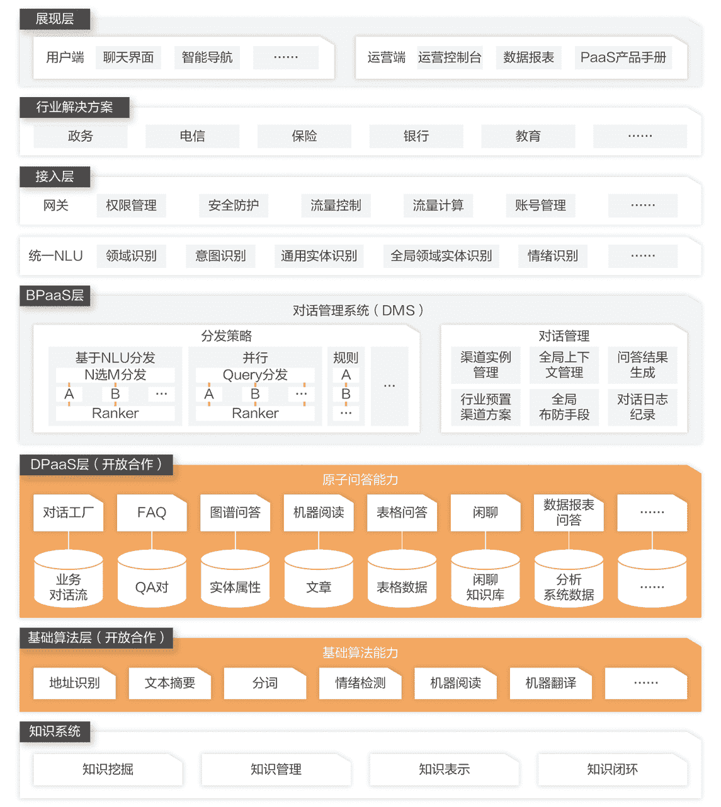

## **适用的业务场景**

#### 在线智能客服

+   您可以通过本产品构建“在线智能客服机器人”，并部署在APP、Web、微信等渠道。在线智能客服机器人可以自动识别并回复用户问题，您可以通过本产品，自助完成机器人对话能力及知识库设置、分析对话数据并通过多种工具持续优化效果，从而降级人工客服成本、提高服务质量和品质。

#### 在线智能辅助

+   您可以将本产品集成在您购买或自研的人工客服工作台上，当人工客服收到用户问题时，调用本产品服务获得机器人回复或推荐结果，辅助人工客服更快、更好的接待用户。在此场景下，您需要在本产品控制台或通过API，维护机器人对话能力及知识库，并在人工客服工作台上进行服务集成。

#### 热线智能语音

+   您可以将本产品集成在您购买或自研的呼叫中心产品上，针对“呼入”、“呼出”两类行为，由您自行调用ASR（语音转文本）与TTS技术（文本转语音）服务转为文本，再调用本产品服务获得机器人回复结果。

### 语音控制

+   您可以将本产品部署在硬件设备终端上，比如服务机器人、车载语音助手、智能音箱、语音交互式电视盒等。您可以根据业务需求，自定义对话配置。在此场景下，您需要自助完成硬件系统接入适配。

### **智能对话能力**

### **SaaS控制台功能**

## 快速创建对话机器人

**新建机器人配置知识库**

> **机器人配置页允**许**用户进行机**器**人问**答**能力的配置，**包括FAQ类目绑定、对话流管理、闲聊、问答策略配置等。这些内容，都是从机器人管理菜单进入，选中一个机器人，单击管理，进入机器人配置界面。

+   **FAQ类目绑定**：即绑定一个问题和一个答案形态的知识，可以支持机器人做单轮问答。

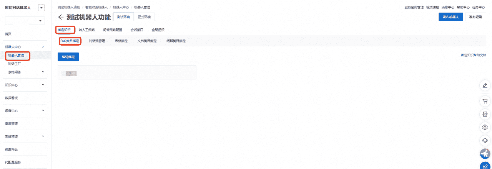

+   **对话流管理：**配置任务式或流程式会话，让机器人可以做多轮问答，按照预设流程推进会话的顺利进行

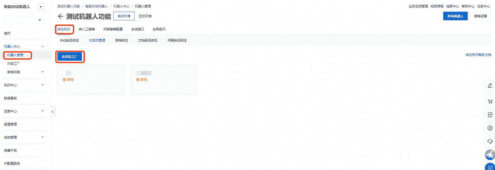

+   **表格绑定：**配置绑定表格类的知识，针对表格相关内容的查询、推理等问题，提供对应智能问答能力。

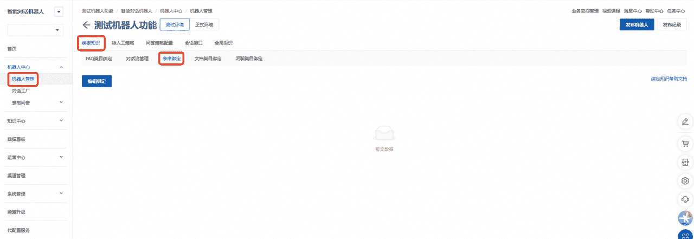

+   **闲聊：**预置了一些闲聊语料包，可以让机器人有陪人聊天的能力。

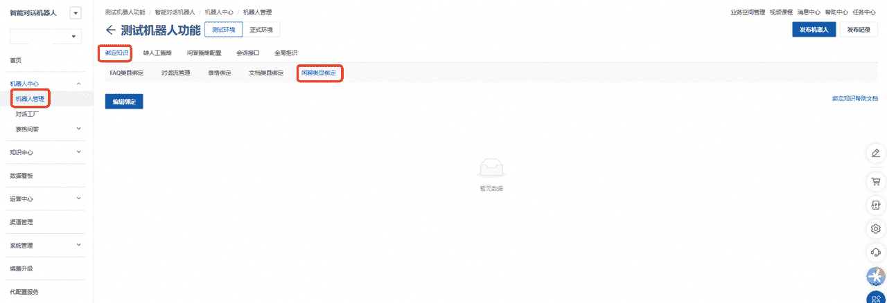

+   **问答策略配置**：机器人问答策略可支持配置机器人相关的问答策略，包括欢迎语、敏感词、无答案默认话术、澄清条数及问答策略等。相关功能说明如下：

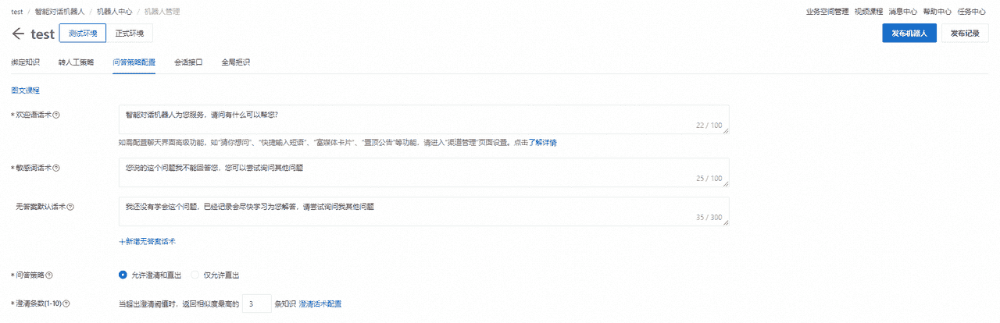

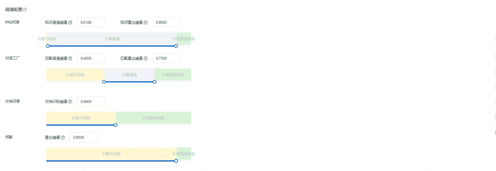

---

### **在FAQ库创建新知识**

[**FAQ可批**](https://help.aliyun.com/zh/beebot/intelligent-dialogue-robot-old-version/manage-faq#topic-2100795)量上传，也可单条新增，具体FAQ的配置可以参考FAQ管理。

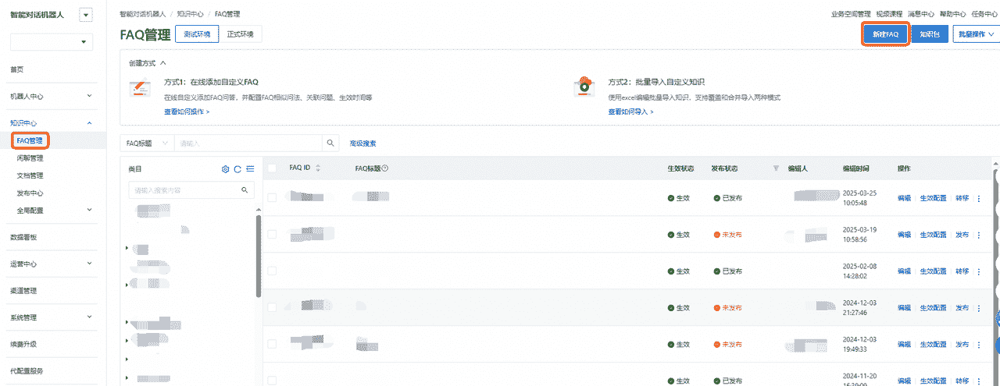

机器人实例绑定**FAQ类目**。选择FAQ库中要与该机器人实例绑定的知识类目，单击保存后生效。

### **为机器人配置对话流**

机器人配置页为多轮对话管理提供了配置入口，单击“去对话工厂”按钮进入对话工厂配置页，详情见《多轮对话（新画布）》。

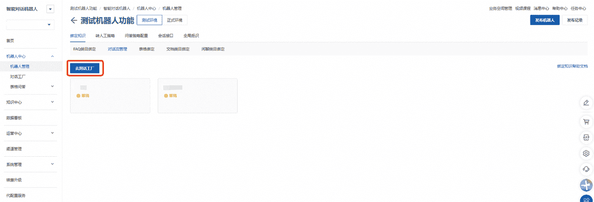

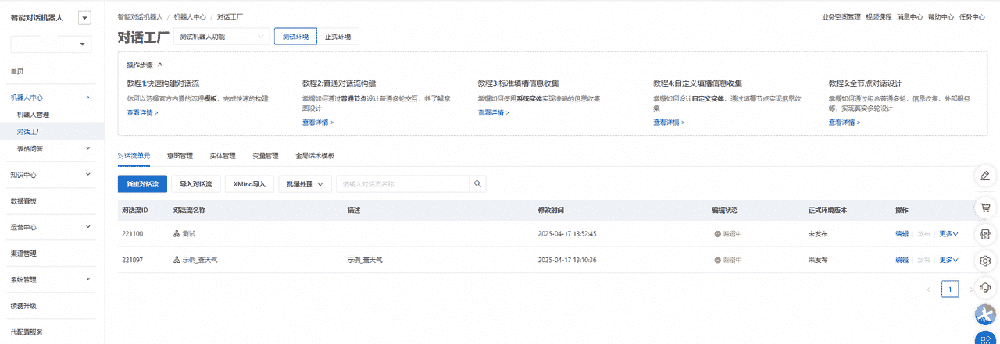

### **为机器人实例配置闲聊语料包**

系统为每个机器人实例配置了闲聊管理功能，用户可以根据实际业务需要订阅闲聊知识包。在闲聊管理中，单击知识包-选择系统闲聊知识包进行订阅。

**如下图所示：**

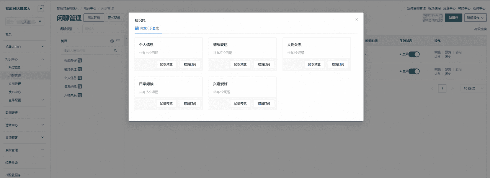

+   订阅闲聊知识包后，管理员无需为闲聊知识维护更多的问法；可以在特定问题下编辑机器人回答（同一问题支持一个或多个答案），机器人会随机选择一个进行回复。

+   除了自定义知识包中的闲聊答案，管理员也可以自定义新增更多闲聊问题，配置方法与FAQ一致。

### 意图管理

#### 功能概述

+   **概念：**意图就是用户说话时的真正目的，简单理解就是无论用户怎么换说法，只要核心目的一致，就属于同一个意图。

>

+   **作用：**通过新建意图可**配置用户可能输入的信息**。

+   以查天气为例，设置“查天气意图”和对应意图的回复内容，当用户输入信息是有关查天气，则将触发匹配“查天气意图”，机器人将输出对应的回复内容。

1.  进入智能对话机器人后，选择**机器人中心**>**机器人管理**，单击待编辑意图对应机器人的**管理**，进入机器人管理界面。

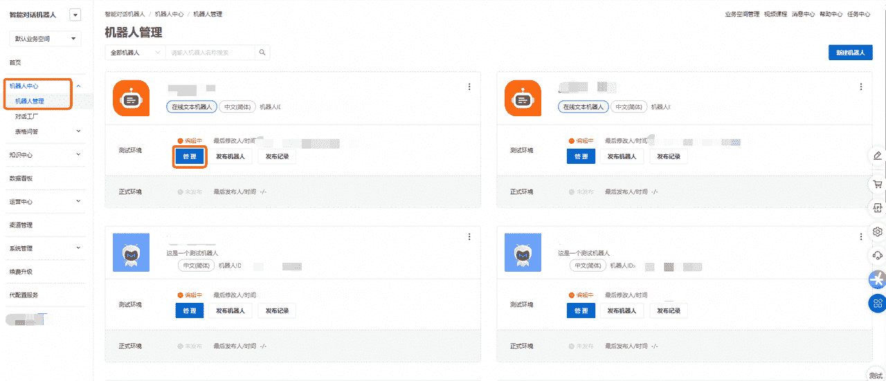

1.  进入机器人管理界面后，选择**绑定知识**>**对话流管理**页签，单击**去对话工厂**或具体对话流，进入对话工厂主界面或具体对话编辑界面。

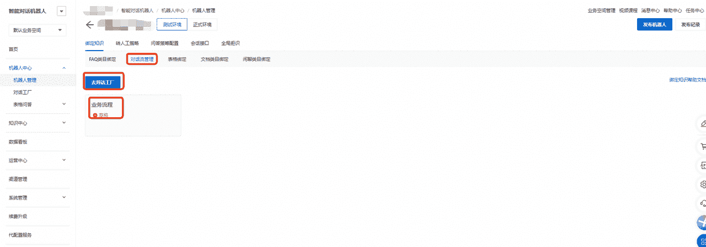

1.  进入有关界面后，选择**意图管理**页签，进入意图管理界面，可在此对意图进行增删改查等操作。

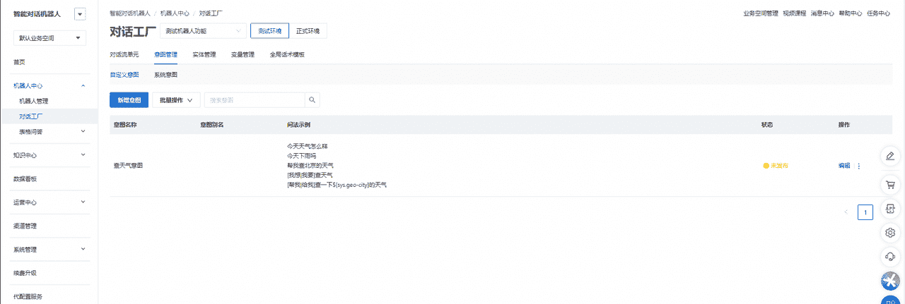

### **通过多轮对话进入意图管理界面**

1.  进入智能对话机器人后，选择**机器人中心**>**对话工厂**，根据实际业务需求**选择对应机器人**，进入机器人对话工厂管理主界面。

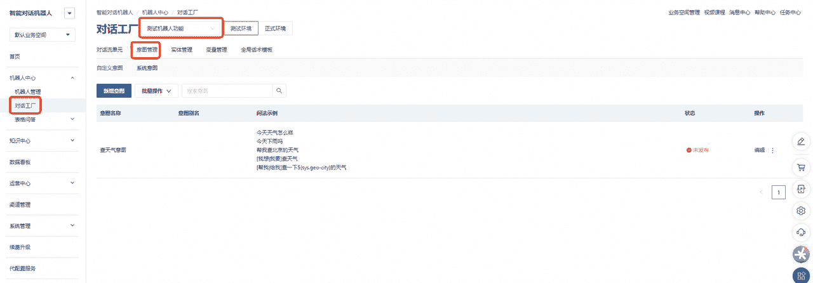

1.  **进入机器**人对话工厂管理主界面后，选择意图管理页签，进入意图管理界面，可在此对意图进行增删改查等操作。

#### 单个意图新增

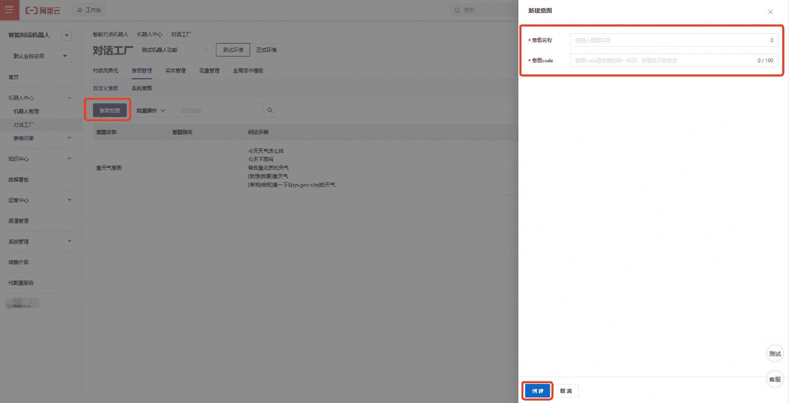

1.  进入意图管理界面后，单击**新增意图**即可进行单个意图新增。

1.  **根据**实际业务需求，填写有关意图信息后，单击创建，即可完成意图创建。

+   **意图名称：**即意图名字。

+   **意图code：**意图code是意图的唯一标识，新建后不能修改。

#### 多个意图导入新增

进入意图管理界面后，选择**导入意图**，进入意图批量导入界面后，根据实际业务需求上传Excel文件后，即可完成意图的批量导入。

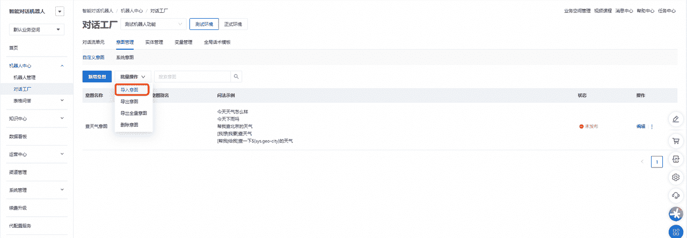

#### 意图编辑

意图编辑主要包括**意图名称**、**意图别名**和**意图问法**的内容编辑配置，具体界面如下图所示：

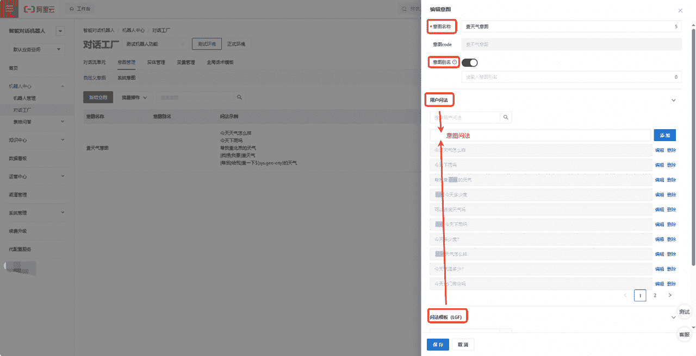

#### 意图名称与别名编辑

+   **意图名称：**即意图名字，意图创建后可根据实际业务需求进行编辑修改。

+   **意图别名：**意图面向用户可理解的一种表述，当机器人识别到两个相近的意图时，会主动用意图别名澄清访问。机器人澄清示例：请问您是要申请公积金贷款，还是使用公积金支付房贷？

#### 意图问法

意图问法包括两类：**用户问法**和**问法模板****。在意图的问法**配置中，给意图添加用户问法和问法模板。输入完成后，按“enter”键可快捷添加问法。

##### 用户问法

+   **用户问法**：用户表达该意图的各种不同的表述方式，用户问法应更多覆盖多类不同的表述方式。

+   **相似的表达方式**，比如：我要买火车票、买火车票、买一张火车票。

+   **不同表达的方式**，比如：我要买火车票、我要坐火车出行、坐火车到xx去玩。

#### 问法模板

问法模板（LGF）：通过模板匹配来表示用户的问法。问法模板支持以下元素：

### 转人工设置

转人工设置功能，用于设置智能对话机器人在满足特定条件时，将用户转交给人工客服接待。

#### **功能入口**

+   进入机器人管理页，选中1个机器人，点击“管理”按钮，进入机器人详情页。

+   在机器人详情页，点击“转人工策略”TAB。

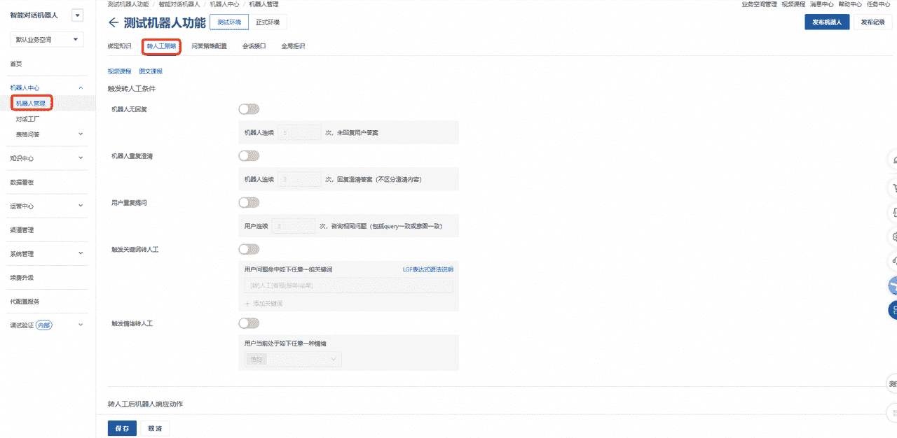

### **功能说明**

## 测试

系统为用户提供了全局的测试窗，供用户在配置完机器人后进行测试。

单击页面右侧悬浮的测试窗按钮，打开测试窗，如下图所示：

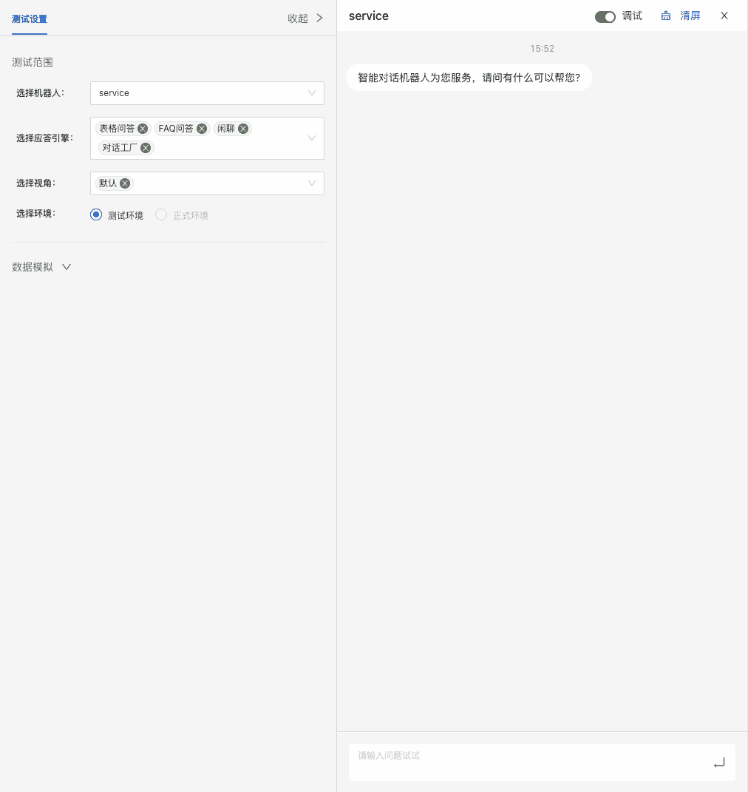

用户需要在下拉列表中选择要进行测试的机器。

+   测试窗下方选择要测试的视角，默认选取系统预置的“默认视角”。

+   在测试窗输出问题即可进行测试，如下图所示：

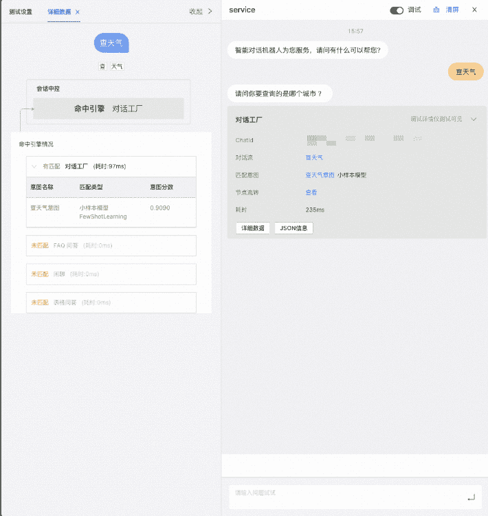